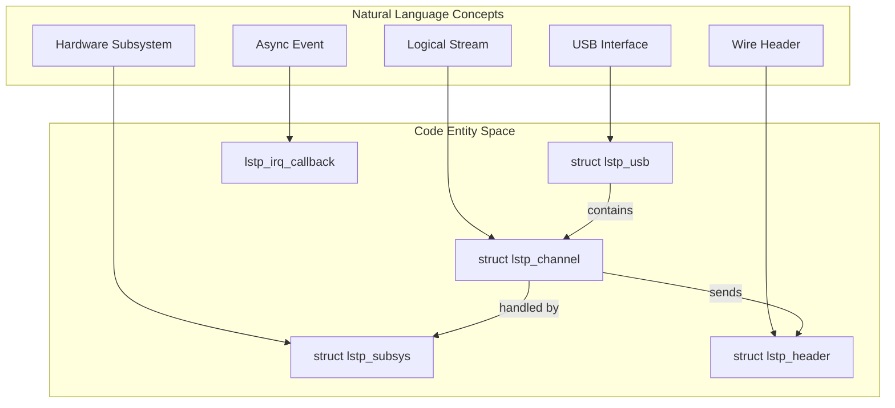
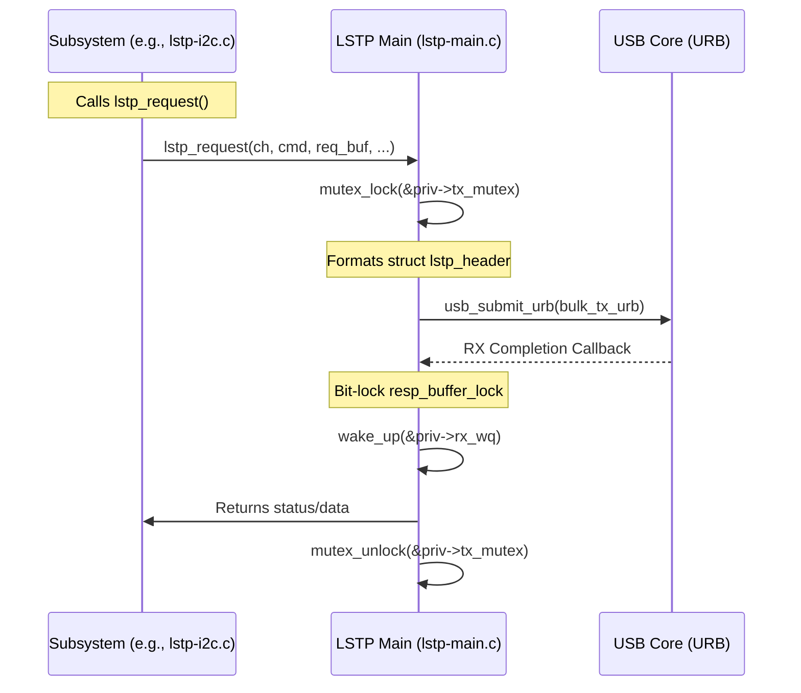

<!-- source: DeepWiki mcp.deepwiki.com · repo NVIDIA/lstp_module · page 6 Glossary · fetched 2026-10-26 -->

# Glossary

Relevant source files

The following files were used as context for generating this wiki page:

- [AGENTS.md](AGENTS.md)
- [Kconfig](Kconfig)
- [LSTP Specification 1.0 -- 08-03-2026.pdf](LSTP Specification 1.0 -- 08-03-2026.pdf)
- [devicetree/bindings/nvidia,lstp.yaml](devicetree/bindings/nvidia,lstp.yaml)
- [lstp-gpio.c](lstp-gpio.c)
- [lstp-i2c.c](lstp-i2c.c)
- [lstp-ipmi-postcodes.h](lstp-ipmi-postcodes.h)
- [lstp-ipmi.c](lstp-ipmi.c)
- [lstp-main.c](lstp-main.c)
- [lstp-main.h](lstp-main.h)
- [lstp-mmio.c](lstp-mmio.c)
- [lstp-spi.c](lstp-spi.c)
- [lstp-uart.c](lstp-uart.c)

This page defines technical terms, abbreviations, and protocol-specific concepts used throughout the LSTP driver codebase. It serves as a reference for onboarding engineers to understand the mapping between the LSTP Specification and the Linux kernel implementation.

## Protocol Terms

### LSTP (Low-Speed Transport Protocol)
A multiplexing protocol designed by NVIDIA to tunnel multiple low-speed peripheral streams (I2C, SPI, UART, etc.) over a single USB interface [devicetree/bindings/nvidia,lstp.yaml:9-13](). It uses a request/response model for standard operations and an unsolicited "IRQ" model for asynchronous events like GPIO interrupts or UART RX [lstp-main.h:175-175]().

### Channel
A logical stream within the LSTP protocol. Each channel is identified by a `ch_id` (0-255) [lstp-main.h:32-32](). 
*   **Channel 0**: The Management Channel used for discovery and configuration [lstp-main.c:188-190]().
*   **Subsystem Channels**: Channels 1-255, which are assigned specific types (e.g., `LSTP_CHANNEL_TYPE_SPI`) [lstp-main.h:60-69]().

### Wire Format
The binary layout of data as it exists on the USB bus. All LSTP wire structures are defined with `__packed` and use Little-Endian (`__le16`, `__le32`) fields to ensure cross-platform compatibility [AGENTS.md:37-39]().

### Solicited vs. Unsolicited
*   **Solicited**: A transaction initiated by the host (e.g., `lstp_request`). The device sends a response with the same `ch_id` and the response bit set in the status byte [lstp-main.h:123-128]().
*   **Unsolicited (IRQ)**: A transaction initiated by the device (e.g., a GPIO state change). The host receives these via the `lstp_irq_callback` [lstp-main.h:175-175]().

---

## Code Entities and Data Structures

### `struct lstp_usb`
The root structure representing a physical LSTP USB interface. It manages the bulk endpoints, the RX URB, and the array of logical channels [lstp-main.h:145-162]().
*   **Location**: [lstp-main.h:145-162]()

### `struct lstp_channel`
The public interface provided to subsystem drivers (SPI, I2C, etc.). It contains metadata like `max_tx_payload` and the `fwnode` for firmware matching [lstp-main.h:206-224]().
*   **Location**: [lstp-main.h:206-224]()

### `struct lstp_header`
The 4-byte prefix of every LSTP packet.
*   `ch_id`: The target logical channel.
*   `cmd`/`status`: Command ID (for requests) or Status/Response bit (for responses).
*   `length`: Length of the following payload in bytes.
*   **Location**: [lstp-main.h:121-128]()

### `struct lstp_subsys`
A descriptor for an LSTP subsystem. It defines the callbacks for channel initialization (`channel_init`), starting (`channel_start`), and handling unsolicited packets (`irq_callback`) [lstp-main.h:234-255]().
*   **Location**: [lstp-main.h:234-255]()

---

## Architectural Mapping

### Natural Language to Code Entity Space

The following diagram maps high-level system concepts to the specific C structures and functions that implement them.

**System Concept to Code Mapping**

**Sources:** [lstp-main.h:145-255](), [lstp-main.c:36-89]()

---

## Data Flow: Request/Response

The diagram below illustrates the data flow for a solicited request (e.g., an I2C Read) from the subsystem driver through the core transport to the USB bus.

**Request Pipeline Data Flow**

**Sources:** [lstp-main.c:125-126](), [lstp-main.c:1252-1320](), [lstp-main.c:1052-1110]()

---

## Subsystem-Specific Terms

| Term | Subsystem | Definition | Code Pointer |
| :--- | :--- | :--- | :--- |
| **CS Assertion** | SPI | Embedding Chip Select state in the command byte to avoid extra USB round-trips. | [lstp-spi.c:34-48]() |
| **Shadow IRQ** | GPIO | A local cache of pending interrupt configurations before they are committed to hardware. | [lstp-gpio.c:159-160]() |
| **Bus Recovery** | I2C | A procedure to clear a hung I2C bus by toggling SCL. | [lstp-i2c.c:111-124]() |
| **Postcodes** | IPMI | A specialized sub-channel for BIOS/Firmware status codes, often routed to a separate miscdevice. | [lstp-ipmi-postcodes.h:33-45]() |
| **TX Coalescing** | UART | Buffering small TTY writes into a single LSTP packet to improve USB efficiency. | [lstp-uart.c]() |

---

## Status and Error Codes

LSTP defines a specific set of status codes in the protocol header. The driver maps these to standard Linux `errno` values via `lstp_status_to_errno()` [lstp-main.c:179-185]().

| LSTP Status | Code | Linux Errno | Meaning |
| :--- | :--- | :--- | :--- |
| `LSTP_SUCCESS` | 0x00 | 0 | Operation completed successfully. |
| `LSTP_ERROR` | 0x01 | `-EIO` | Generic hardware/firmware error. |
| `LSTP_TIMEOUT` | 0x02 | `-ETIMEDOUT` | Device timed out waiting for peripheral. |
| `LSTP_BUSY` | 0x03 | `-EBUSY` | Resource is currently locked or in use. |
| `LSTP_NACK` | 0x04 | `-ENXIO` | I2C address NACK or similar protocol rejection. |
| `LSTP_ARB_LOST` | 0x05 | `-EAGAIN` | I2C arbitration lost; retry suggested. |
| `LSTP_NOT_SUPP` | 0x06 | `-EOPNOTSUPP` | Command not implemented by firmware. |
| `LSTP_TOO_LARGE`| 0x07 | `-EFBIG` | Request exceeds buffer limits. |

**Sources:** [lstp-main.h:71-80](), [lstp-main.c:162-171]()