# Page: LSTP Driver Overview

# LSTP Driver Overview

<details>
<summary>Relevant source files</summary>

The following files were used as context for generating this wiki page:

- [AGENTS.md](AGENTS.md)
- [LICENSE](LICENSE)
- [LSTP Specification 1.0 -- 08-03-2026.pdf](LSTP Specification 1.0 -- 08-03-2026.pdf)
- [README.md](README.md)

</details>


The **Low-Speed Transport Protocol (LSTP)** Linux kernel driver provides a unified transport for multiplexing multiple low-speed peripheral protocols over a single USB interface. It is designed to bridge host systems (such as Ubuntu-based servers or OpenBMC controllers) to various hardware targets including ASICs, FPGAs, and microcontrollers [AGENTS.md:7-14]().

The driver functions as an out-of-tree kernel module that translates standard Linux subsystem requests (SPI, I2C, GPIO, etc.) into LSTP-formatted USB packets [README.md:1-3]().

## System Architecture

The LSTP driver is organized into a core manager and several protocol-specific subsystems. The core manages the USB lifecycle and channel multiplexing, while subsystems handle the translation to specific Linux kernel frameworks.

### High-Level Component Mapping

The following diagram bridges the conceptual protocol layers to the primary code entities within the repository.

**LSTP Component Overview**
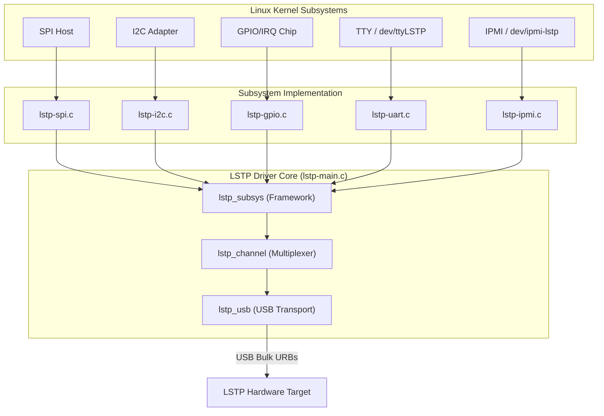
**Sources:** [README.md:126-146](), [AGENTS.md:44-46]()

## Protocol and Background
LSTP was developed to solve the problem of managing numerous low-speed pins and buses on modern hardware without requiring dozens of dedicated USB interfaces or complex cabling. It uses a logical channel system (supporting up to 256 channels) to tunnel traffic for:
*   **SPI** (Serial Peripheral Interface)
*   **I2C** (Inter-Integrated Circuit)
*   **GPIO** (General Purpose I/O and LEDs)
*   **UART** (Universal Asynchronous Receiver-Transmitter)
*   **IPMI** (Intelligent Platform Management Interface)
*   **MMIO** (Memory Mapped I/O)

For a deep dive into the wire format, headers, and hardware compatibility, see **[Project Background and Protocol Specification](#1.1)**.

**Sources:** [LSTP Specification 1.0 -- 08-03-2026.pdf:1-13](), [README.md:3]()

## Driver Operations

The driver supports dynamic discovery of peripherals via the LSTP protocol itself, as well as static configuration via Device Tree or ACPI [AGENTS.md:11-14](). 

### Data Flow and Code Entities

This diagram illustrates how a standard Linux system call (like `write()`) travels through the LSTP stack to the wire.

**Request-Response Data Flow**
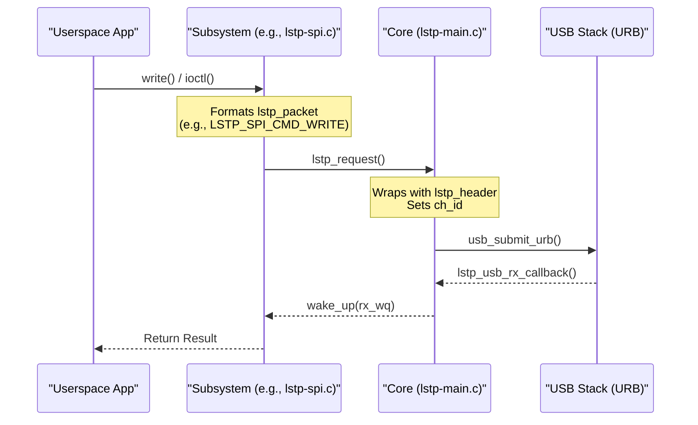
**Sources:** [AGENTS.md:48-55](), [README.md:159-167]()

## Navigation Guide

This wiki is organized to assist both system administrators deploying the driver and developers extending its functionality.

| Section | Description |
| :--- | :--- |
| **[Project Background and Protocol Specification](#1.1)** | Detailed look at the LSTP Spec 1.0, wire formats, and target hardware. |
| **[Getting Started: Build, Install, and Load](#1.2)** | Instructions for building the out-of-tree module, cross-compilation, and Secure Boot signing. |
| **[Security and Licensing](#1.3)** | Information on GPL-2.0 licensing and the NVIDIA PSIRT vulnerability reporting process. |
| **Core Driver Architecture** | (Section 2) Technical details on URB management, channel multiplexing, and the internal API. |
| **Transport Subsystems** | (Section 3) Deep dives into the individual SPI, I2C, GPIO, UART, IPMI, and MMIO implementations. |
| **Device Tree Bindings** | (Section 4) Documentation for firmware nodes and hardware description schemas. |
| **Development and Tooling** | (Section 5) Coding standards, `clang-format` rules, and contribution guidelines. |

## Quick Start Summary
To get the driver running on a standard Linux host:
1.  **Install dependencies**: `build-essential` and `linux-headers`.
2.  **Build**: Run `make build`.
3.  **Sign (if required)**: Use `sign-file` for UEFI Secure Boot environments.
4.  **Load**: Run `make load`.
5.  **Verify**: Check `dmesg` and the `/sys/bus/usb/drivers/lstp` directory.

For detailed steps, see **[Getting Started: Build, Install, and Load](#1.2)**.

**Sources:** [README.md:9-31](), [README.md:97-112]()

---

# Page: Project Background and Protocol Specification

# Project Background and Protocol Specification

<details>
<summary>Relevant source files</summary>

The following files were used as context for generating this wiki page:

- [AGENTS.md](AGENTS.md)
- [LSTP Specification 1.0 -- 08-03-2026.pdf](LSTP Specification 1.0 -- 08-03-2026.pdf)
- [README.md](README.md)

</details>


The Low-Speed Transport Protocol (LSTP) is a multiplexing transport protocol designed to bridge low-speed hardware peripherals over a single USB interface. It enables a host system (such as an x86 Ubuntu server or an ARM-based OpenBMC controller) to interact with SPI, I2C, GPIO, UART, IPMI, and MMIO controllers located on a remote ASIC, FPGA, or microcontroller via USB bulk endpoints `[README.md:1-3, AGENTS.md:7-14]()`.

## Protocol Purpose and Scope

LSTP addresses the challenge of managing numerous low-speed interfaces without requiring dedicated USB interfaces for every peripheral. By multiplexing up to 256 logical channels over a single pair of USB Bulk IN/OUT endpoints, it reduces hardware complexity and pin count on target devices `[README.md:126-146, AGENTS.md:11-12]()`.

### Target Environments
*   **Hosts:** Ubuntu-style Linux distributions (x86_64) and OpenBMC (arm64/armv7l) `[AGENTS.md:11-12, README.md:63-66]()`.
*   **Targets:** ASICs, FPGAs, and microcontrollers implementing the LSTP Specification 1.0 `[AGENTS.md:11-12, README.md:3]()`.
*   **Discovery:** Supports both dynamic firmware-reported channel discovery (via Channel 0) and static configuration via Device Tree (DT) or ACPI `[AGENTS.md:12-13, README.md:169-217]()`.

## Wire-Format Concepts

The protocol relies on a structured packet format to ensure reliable communication and command dispatching. All multi-byte fields are transmitted in **Little-Endian** format (`__le16`, `__le32`) unless otherwise specified by the subsystem `[AGENTS.md:37-39]()`.

### Packet Structure
Every LSTP transaction begins with a standard header, followed by an optional payload. The driver uses `BUILD_BUG_ON` assertions to ensure these structures fit within the minimum USB endpoint size `[AGENTS.md:48-50]()`.

| Field | Type | Description |
| :--- | :--- | :--- |
| `ch_id` | `u8` | Logical channel ID (0-255). Channel 0 is reserved for management. |
| `cmd_status` | `u8` | Command ID (Request) or Status Code (Response). Bit 7 indicates an IRQ/Unsolicited message. |
| `length` | `__le16` | Length of the payload following the header. |

**Sources:** `[AGENTS.md:37-50]()`

### Channel Multiplexing
LSTP allows a single USB physical link to represent a complex hierarchy of devices. The driver maps these logical channels to standard Linux kernel subsystems.

**Entity Mapping: Protocol to Code**
The following diagram illustrates how wire-format concepts map to specific data structures in the driver implementation.

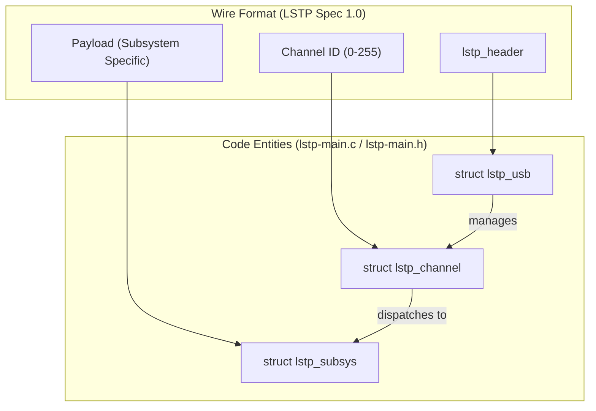
**Sources:** `[AGENTS.md:7-14, README.md:126-146]()`

## Supported Peripherals (Subsystems)

The driver implements several subsystems that translate Linux-native requests into LSTP packets.

1.  **SPI:** Supports multiple chip-selects and high-frequency transfers. Can automatically bind `spidev` if configured `[README.md:77-92, README.md:186-204]()`.
2.  **I2C:** Implements standard I2C algorithms including repeated START and SMBus block reads `[README.md:134-140]()`.
3.  **GPIO/LED:** Provides a `gpio_chip` and `irq_chip` for digital I/O and a pattern engine for LEDs `[README.md:141-144]()`.
4.  **UART:** Exposes virtual TTY devices (`/dev/ttyLSTP`) with flow control and break detection support `[AGENTS.md:17-20]()`.
5.  **IPMI:** Bridges IPMI messages to a character device, often used for BMC-to-Host communication `[README.md:206-210]()`.
6.  **MMIO:** Allows direct memory-mapped I/O access to target registers for debugging or low-level control.

## System Architecture and Data Flow

The LSTP driver acts as a manager that sits between the USB core and the various Linux peripheral subsystems.

**Data Flow: Host to Target**
This diagram bridges the natural language flow of a request to the internal code functions responsible for handling it.

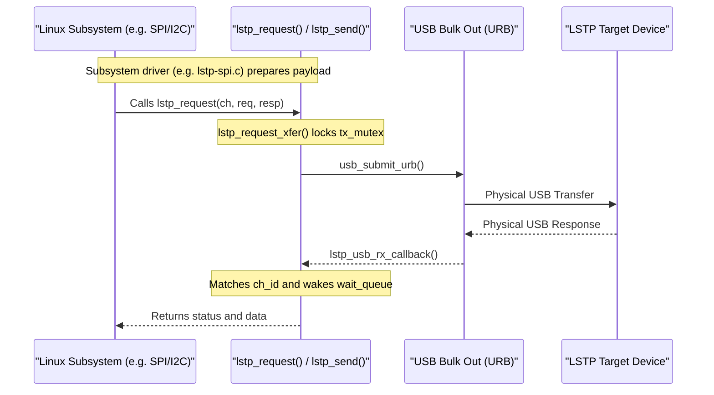
**Sources:** `[AGENTS.md:7-14, AGENTS.md:51-55]()`

## Compatibility and Stability

The LSTP driver is built with strict compatibility requirements. Because the protocol is already deployed in production environments, the following interfaces are considered stable "Compatibility Surfaces" `[AGENTS.md:16-20]`:
*   **Packet Formats:** The layout of `lstp_header` and subsystem-specific payloads.
*   **Sysfs Hierarchy:** The structure under `/sys/bus/usb/devices/.../lstp/`.
*   **Module Parameters:** Such as `auto_bind_spidev`.
*   **Device Tree Bindings:** The `nvidia,lstp` schema and its child nodes.

Any extensions to the driver must maintain backward compatibility with existing firmware and userspace tools `[AGENTS.md:19-20]`.

**Sources:**
* `AGENTS.md:1-69`
* `README.md:1-218`
* `LSTP Specification 1.0 -- 08-03-2026.pdf:1-23`

---

# Page: Getting Started: Build, Install, and Load

# Getting Started: Build, Install, and Load

<details>
<summary>Relevant source files</summary>

The following files were used as context for generating this wiki page:

- [.gitignore](.gitignore)
- [Kbuild](Kbuild)
- [Kconfig](Kconfig)
- [Makefile](Makefile)
- [README.md](README.md)

</details>


This page provides a comprehensive technical guide for building, installing, and managing the LSTP (Low-Speed Transport Protocol) out-of-tree Linux kernel module. It covers the build system architecture, cross-compilation workflows, module parameters, and security requirements for Secure Boot environments.

## Build System Overview

The LSTP driver uses a standard Linux Kbuild-compatible `Makefile` designed to handle both local host builds and cross-compilation for embedded targets (arm64, armv7l). The build process utilizes a staging directory (`/build/`) to isolate generated artifacts from the source tree [Makefile:24-25]().

### Makefile Targets and Logic

The `Makefile` defines several key targets for the module lifecycle:

| Target | Action |
| :--- | :--- |
| `build` | Compiles the `lstp.ko` module using the local kernel headers [Makefile:57-59](). |
| `install` | Copies the module to `/lib/modules/$(uname -r)/extra/` and runs `depmod` [Makefile:70-74](). |
| `load` | Inserts the module into the running kernel using `insmod`, passing `MODPARAMS` [Makefile:84-87](). |
| `unload` | Removes the module from the kernel using `rmmod` [Makefile:80-82](). |
| `reload` | Sequential execution of `unload`, `build`, and `load` for rapid development [Makefile:68](). |
| `clean` | Removes the `/build/` staging directory [Makefile:65-66](). |

### Build Artifacts Association

The following diagram illustrates how the build system maps source files to the final kernel object.

**Diagram: Build Entity Mapping**
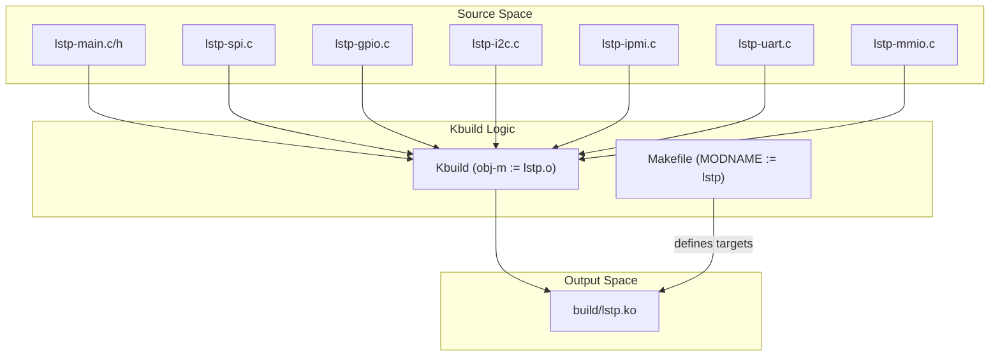
Sources: [Kbuild:14-16](), [Makefile:16-17](), [Makefile:58-59]()

## Compilation Workflows

### Local Host Build
To build for the currently running kernel, ensure `build-essential` and `linux-headers` are installed [README.md:11-14]().
```bash
make build
```
The `Makefile` automatically detects the local kernel version using `uname -r` [Makefile:19]() and sets the kernel directory `KDIR` to `/lib/modules/$(UNAME_R)/build` [Makefile:22]().

### Cross-Compilation
The driver supports cross-compilation for different architectures by overriding `ARCH` and `CROSS_COMPILE` [Makefile:31-40]().

*   **arm64 (aarch64):** Uses `aarch64-linux-gnu-` [Makefile:33]().
*   **armv7l (arm):** Uses `arm-linux-gnueabihf-` [Makefile:39]().
*   **x86_64:** Uses host tools [Makefile:36]().

For Raspberry Pi or OpenBMC targets, point `KDIR` (or `KERNEL_SRC` for the `build_rpi` target) to a pre-configured and `modules_prepare`'d kernel source tree [README.md:68-74]().

Sources: [Makefile:31-40](), [README.md:56-74]()

## Module Loading and Parameters

The module can be loaded using `make load`, which utilizes `insmod` [Makefile:85](). Users can pass parameters directly to the make command:
```bash
make load auto_bind_spidev=1
```

### Key Module Parameters

| Parameter | Type | Description |
| :--- | :--- | :--- |
| `auto_bind_spidev` | bool | If `1`, the driver creates `spidev` child devices for SPI channels that lack explicit firmware (DT/ACPI) descriptions [README.md:77-88](). |

The default value for `auto_bind_spidev` is determined at compile time by the `CONFIG_USB_LSTP_SPI_SPIDEV` Kconfig option [Kconfig:22-34]().

Sources: [Kconfig:22-34](), [README.md:77-92](), [Makefile:51-53]()

## Secure Boot and Module Signing

On systems with UEFI Secure Boot enabled (e.g., Ubuntu, OpenBMC), the kernel will reject the LSTP module unless it is signed by a trusted key [README.md:32-38]().

### Signing Workflow
1.  **Generate MOK (Machine Owner Key):** Create a self-signed X.509 certificate [README.md:43-44]().
2.  **Enroll Key:** Use `mokutil --import` and reboot to enroll the key in the system firmware [README.md:45-48]().
3.  **Sign Module:** Use the kernel's `sign-file` script to sign the `.ko` after every build [README.md:52-54]().

**Diagram: Module Loading Data Flow**
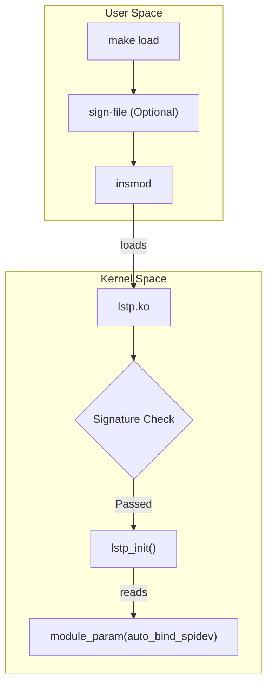
Sources: [README.md:32-54](), [Makefile:84-85](), [Kconfig:31-32]()

## Installation and Verification

### Persistent Installation
Using `make install` places the module in the `extra` directory, ensuring it persists across reboots and can be loaded via `modprobe lstp` [Makefile:70-74]().

### Verification
After loading, verify the driver status via `dmesg` or by inspecting the sysfs hierarchy:
*   **Logs:** `sudo dmesg | grep -i lstp` [README.md:97-100]().
*   **Sysfs Path:** Bound interfaces appear under `/sys/bus/usb/drivers/lstp/` [README.md:105-112]().
*   **Topology:** Each channel is visible at `/sys/bus/usb/devices/.../lstp/channel/N/` [README.md:126-146]().

Sources: [Makefile:70-74](), [README.md:95-146]()

---

# Page: Security and Licensing

# Security and Licensing

<details>
<summary>Relevant source files</summary>

The following files were used as context for generating this wiki page:

- [LICENSE](LICENSE)
- [SECURITY.md](SECURITY.md)

</details>


This page details the legal governance and security protocols for the LSTP (Low-Speed Transport Protocol) driver. The project adheres to standard Linux kernel licensing expectations while providing specific dual-licensing for hardware description components and a formal pipeline for vulnerability management through NVIDIA PSIRT.

## Licensing Framework

The LSTP codebase is governed by two primary licenses depending on the nature of the file (logic vs. hardware description). This ensures compatibility with the Linux kernel's GPL requirements while allowing flexibility for firmware and devicetree bindings that may be consumed by non-GPL environments.

### License Distribution
| Component | License | SPDX Identifier |
| :--- | :--- | :--- |
| **Kernel Driver Logic** | GPL-2.0-only | `GPL-2.0-only` |
| **Devicetree Bindings** | GPL-2.0-only OR BSD-3-Clause | `GPL-2.0-only OR BSD-3-Clause` |

Most files in the repository are licensed under **GPL-2.0-only** [LICENSE:3-3](). This includes the core transport logic in `lstp-main.c` and all subsystem implementations (SPI, I2C, GPIO, UART, IPMI, MMIO). 

Files located under `devicetree/bindings/` are **dual-licensed** under **GPL-2.0-only OR BSD-3-Clause** [LICENSE:3-3](). The BSD-3-Clause option allows for redistribution in source and binary forms provided that copyright notices and disclaimers are maintained [LICENSE:8-16]().

### SPDX Metadata Implementation
To ensure automated compliance and clarity, every source file must include an SPDX-License-Identifier header. This header serves as the machine-readable authority on the file's licensing terms.

**Example: Driver Source Header**
```c
// SPDX-License-Identifier: GPL-2.0-only
/*
 * Copyright (c) 2026 NVIDIA CORPORATION & AFFILIATES. All rights reserved.
 */
```

**Example: Devicetree Binding Header**
```yaml
# SPDX-License-Identifier: (GPL-2.0-only OR BSD-3-Clause)
%YAML 1.2
---
$id: http://devicetree.org/schemas/bus/nvidia,lstp.yaml#
$schema: http://devicetree.org/meta-schemas/core.yaml#
```

**Sources:**
- [LICENSE:1-3]()
- [LICENSE:6-16]()
- [LICENSE:20-48]()

---

## Security Vulnerability Reporting

NVIDIA manages security concerns for the LSTP driver through the **Product Security Incident Response Team (PSIRT)**. The project follows a **Coordinated Vulnerability Disclosure (CVD)** policy.

### Reporting Process
Contributors and users are strictly prohibited from reporting security vulnerabilities via GitHub Issues or Public Pull Requests [SECURITY.md:5-5](). All potential vulnerabilities (e.g., buffer overflows, denial of service, or unauthorized code execution) must be submitted through official channels.

#### Submission Channels
*   **Web Portal:** [Security Vulnerability Submission Form](https://www.nvidia.com/object/submit-security-vulnerability.html) [SECURITY.md:10-10]()
*   **Email:** `psirt@nvidia.com` [SECURITY.md:11-11]()
    *   NVIDIA encourages the use of **PGP-encrypted email** for sensitive disclosures. The public PGP key is available at the [NVIDIA Security Portal](https://www.nvidia.com/en-us/security/pgp-key) [SECURITY.md:12-12]().

### Required Information for Disclosures
When submitting a report, the following technical details must be included to facilitate triage [SECURITY.md:13-19]():
1.  **Product/Driver Identification:** Specifically mention the LSTP driver and the affected branch/version.
2.  **Vulnerability Type:** Classification (e.g., integer overflow in `lstp_packet` length parsing).
3.  **Reproduction Steps:** Clear instructions to trigger the issue.
4.  **Proof-of-Concept (PoC):** Exploit code or scripts demonstrating the flaw.
5.  **Impact Assessment:** How an attacker could exploit the vulnerability and the potential consequences.

### Bug Bounty and Recognition
NVIDIA **does not** currently operate a bug bounty program for this driver [SECURITY.md:20-20](). However, external researchers are acknowledged once a reported issue is addressed, provided they adhere to the coordinated disclosure policy [SECURITY.md:20-20]().

**Sources:**
- [SECURITY.md:1-24]()

---

## Security Data Flow: Vulnerability Handling

The following diagram illustrates the flow of a security report from discovery to resolution, mapping the natural language process to the organizational entities.

### Security Reporting Pipeline
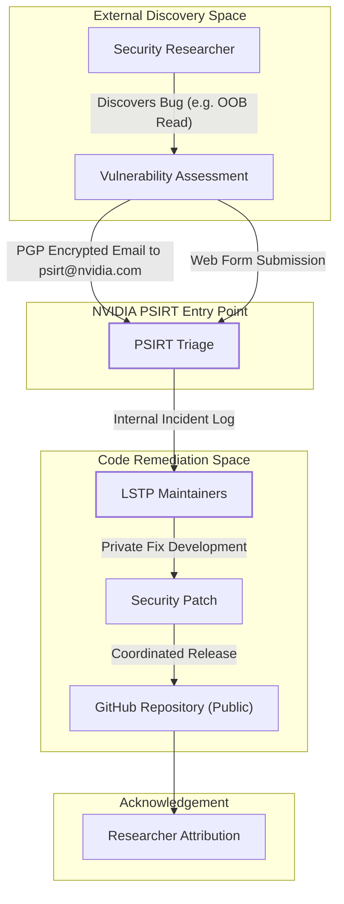

**Sources:**
- [SECURITY.md:7-20]()

---

## Licensing and Entity Mapping

This diagram bridges the "Natural Language" license requirements to the specific "Code Entities" (files and directories) they govern within the `lstp_module` repository.

### Code Entity License Mapping
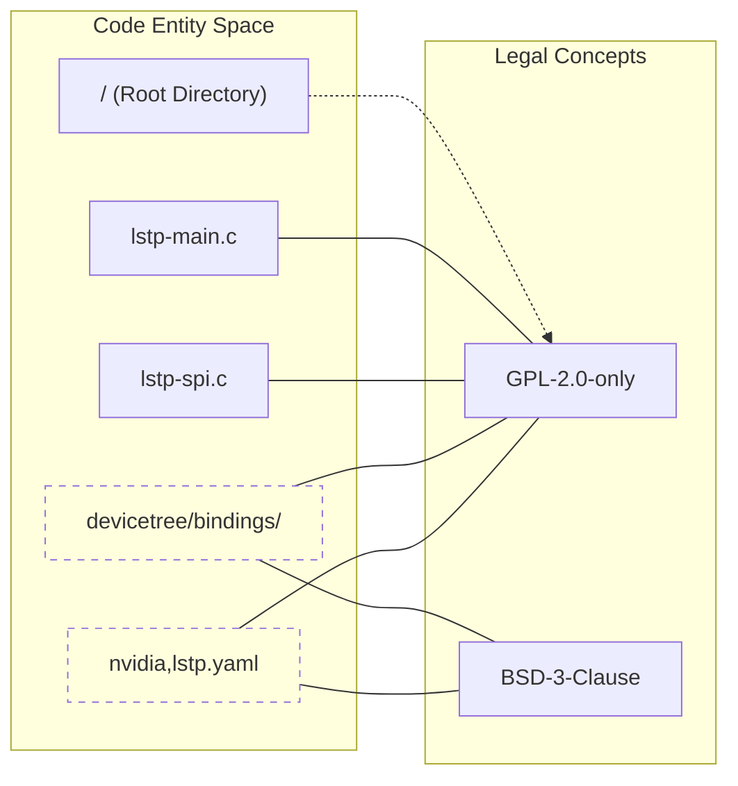

**Sources:**
- [LICENSE:3-3]()
- [LICENSE:6-6]()
- [LICENSE:20-20]()

---

# Page: Core Driver Architecture

# Core Driver Architecture

<details>
<summary>Relevant source files</summary>

The following files were used as context for generating this wiki page:

- [lstp-main.c](lstp-main.c)
- [lstp-main.h](lstp-main.h)

</details>


The LSTP (Low-Speed Transport Protocol) driver is designed as a modular framework that multiplexes multiple low-speed peripheral protocols (SPI, I2C, GPIO, etc.) over a single USB transport. The core architecture follows a **Manager-Subsystem** model where `lstp-main.c` handles the USB lifecycle and protocol multiplexing, while specialized subsystems handle the translation to Linux kernel frameworks.

## System Overview

The driver is anchored by the `lstp_usb` structure, which represents a single LSTP-capable USB interface. This interface manages up to 256 logical channels, each represented by an `lstp_channel`.

### Code-to-Entity Mapping: Core Structures
The following diagram illustrates how the logical protocol concepts map to specific C structures and their relationships.

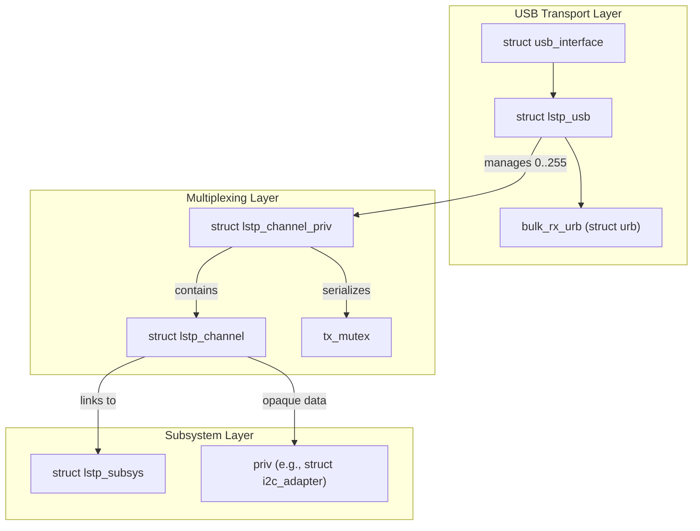
**Sources:** [lstp-main.h:145-162](), [lstp-main.h:180-206](), [lstp-main.c:66-89]()

---

## USB Transport and Channel Multiplexing
The transport layer manages the physical movement of data via USB Bulk endpoints. All logical channels share the same physical USB Bulk-IN and Bulk-OUT endpoints. The driver uses a 4-byte `lstp_header` to route incoming packets to the correct logical channel.

*   **RX Path:** A single `bulk_rx_urb` is kept constantly in flight. Upon completion, `lstp_usb_rx_callback` parses the header and dispatches the payload to either a waiting synchronous request or an asynchronous IRQ callback.
*   **TX Path:** Each channel maintains its own `tx_mutex` to ensure that only one request-response exchange is active per logical channel at a time, preventing protocol interleaving within a single channel.

For details, see [USB Transport and Channel Multiplexing](#2.1).

**Sources:** [lstp-main.c:105-106](), [lstp-main.c:125-126](), [lstp-main.h:121-128]()

---

## Wire Protocol and Framing
The LSTP wire protocol defines a compact framing mechanism for requests and responses. Every packet starts with an `lstp_header` containing the `ch_id`, a command/status byte, and a 16-bit length field.

| Field | Size | Description |
| :--- | :--- | :--- |
| `ch_id` | 8 bits | The logical channel index (0-255). |
| `status` / `cmd` | 8 bits | Bit 7: 0 for Request, 1 for Response. Bits 0-6: Opcode or Status code. |
| `length` | 16 bits | Length of the payload in bytes (Little Endian). |

Channel 0 is reserved for management tasks, such as discovering available channels and reading/writing configuration descriptors (`lstp_ch_desc`).

For details, see [Wire Protocol: Packet Format and Status Codes](#2.2).

**Sources:** [lstp-main.h:121-133](), [lstp-main.h:103-107](), [lstp-main.c:24-28]()

---

## Subsystem Registration Framework
The driver uses a registration-based model to support different peripheral types. Each subsystem (like SPI or I2C) defines an `lstp_subsys` structure and registers itself with the core.

### Code-to-Entity Mapping: Dispatch Flow
This diagram shows how a packet received from USB is dispatched to the correct subsystem handler.

```mermaid
graph TD
    [USB_Completion] --> RX_CB["lstp_usb_rx_callback()"]
    RX_CB --> VALIDATE["lstp_validate_rx_pkt()"]
    VALIDATE --> DISPATCH{"Is Bit 7 Set?"}
    
    DISPATCH -- "Yes (Response)" --> SYNC_WAIT["Wake rx_wq for lstp_request()"]
    DISPATCH -- "No (Unsolicited/IRQ)" --> IRQ_CB["subsys->irq_callback()"]
    
    subgraph "Subsystem Implementations"
        IRQ_CB -.-> SPI["lstp-spi.c"]
        IRQ_CB -.-> GPIO["lstp-gpio.c"]
        IRQ_CB -.-> UART["lstp-uart.c"]
    end
```
**Sources:** [lstp-main.c:105-105](), [lstp-main.c:192-192](), [lstp-main.h:175-175](), [lstp-main.c:292-315]()

When a new LSTP USB device is probed, the core reads the channel configuration from the device and matches each channel to a registered subsystem using `lstp_subsys_by_channel_type()`.

For details, see [Subsystem Registration Framework](#2.3).

**Sources:** [lstp-main.c:487-501](), [lstp-main.h:218-232]()

---

## Request/Response API
Subsystems interact with the hardware through a set of synchronous and asynchronous APIs. The primary synchronous entry point is `lstp_request()`, which handles the full lifecycle of a command:
1.  Acquiring the channel `tx_mutex`.
2.  Formatting the `lstp_packet`.
3.  Submitting the `bulk_tx_urb`.
4.  Waiting on `rx_wq` for the response or a timeout (`LSTP_USB_RESPONSE_TIMEOUT_MS`).

For details, see [Request/Response API and Synchronization](#2.4).

**Sources:** [lstp-main.c:416-435](), [lstp-main.h:28-29]()

---

## Sysfs and Firmware Integration
The driver exposes the LSTP hierarchy via sysfs under the USB interface device. The structure follows `/sys/bus/usb/devices/.../interface/lstp/channel/N/`.
*   **Sysfs:** Users can view channel names and toggle the `enable` attribute, which triggers a `LSTP_CH0_CMD_WRITE_CONFIG` to the hardware.
*   **Firmware:** The driver attempts to match logical channels with Device Tree or ACPI nodes using the `reg` property (matching the `ch_id`). This allows standard Linux drivers (like `spidev` or `i2c-dev`) to bind to LSTP-backed controllers.

For details, see [Sysfs Hierarchy and Firmware Node Integration](#2.5).

**Sources:** [lstp-main.c:142-159](), [lstp-main.c:704-723](), [lstp-main.c:795-812]()

---

# Page: USB Transport and Channel Multiplexing

# USB Transport and Channel Multiplexing

<details>
<summary>Relevant source files</summary>

The following files were used as context for generating this wiki page:

- [lstp-main.c](lstp-main.c)
- [lstp-main.h](lstp-main.h)

</details>


The LSTP (Low-Speed Transport Protocol) driver manages a single USB interface to provide a multiplexed transport layer for up to 256 logical channels. This page details the lifecycle of USB Request Blocks (URBs), the mechanism for solicited and unsolicited (IRQ) communication, and how logical channels are isolated over shared physical bulk endpoints.

## Architectural Overview

The transport layer is centered around the `lstp_usb` structure, which represents the physical USB interface, and the `lstp_channel_priv` structure, which manages the state and buffers for individual logical channels.

### Key Data Structures

| Structure | Role | Definition |
| :--- | :--- | :--- |
| `lstp_usb` | Manages the USB device, interface, and global RX URB. | [lstp-main.h:145-161]() |
| `lstp_channel` | Public state visible to subsystems (SPI, I2C, etc.). | [lstp-main.h:206-221]() |
| `lstp_channel_priv` | Framework-private state, including per-channel URBs and synchronization. | [lstp-main.c:66-89]() |
| `lstp_header` | The 4-byte wire-format header (Channel ID, Command/Status, Length). | [lstp-main.h:121-128]() |

**Sources:** [lstp-main.c:66-89](), [lstp-main.h:121-161](), [lstp-main.h:206-221]()

## USB URB Lifecycle

LSTP utilizes USB bulk endpoints for all communications. To ensure high availability and low latency, the driver maintains a continuous "RX loop" and per-channel serialized TX paths.

### RX Path and Dispatcher
The driver submits a single `bulk_rx_urb` during initialization [lstp-main.c:832-840](). When data arrives, the `lstp_usb_rx_callback` acts as the central dispatcher:

1.  **Validation**: The packet is checked for basic wire-format integrity via `lstp_validate_rx_pkt` [lstp-main.c:192-232]().
2.  **Channel Lookup**: The `ch_id` in the `lstp_header` is used to index the `dev->channels[]` array [lstp-main.c:266-267]().
3.  **Solicited vs. Unsolicited**:
    *   **Solicited (Bit 7 of Status = 1)**: The packet is a response to a previous request. The dispatcher copies the payload into the channel's `resp_buf` and wakes the `rx_wq` [lstp-main.c:286-302]().
    *   **Unsolicited (Bit 7 of Status = 0)**: The packet is an IRQ/Event. The dispatcher copies the data to `irq_buf` and executes the subsystem's `irq_callback` in atomic context [lstp-main.c:304-323]().
4.  **Resubmission**: The URB is resubmitted to the USB core. If resubmission fails (e.g., due to memory pressure), the `lstp_rx_retry` delayed work is scheduled [lstp-main.c:334-345]().

### TX Path and Serialization
Outbound requests are serialized per-channel using `tx_mutex` [lstp-main.c:72](). This ensures that only one request is in flight per logical channel, simplifying response matching. Subsystems use `lstp_request_xfer()` to perform synchronous exchanges [lstp-main.c:541-610]().

### Diagram: USB URB Data Flow
This diagram illustrates how data moves from the physical USB wire through the URB completion handlers to the logical subsystems.

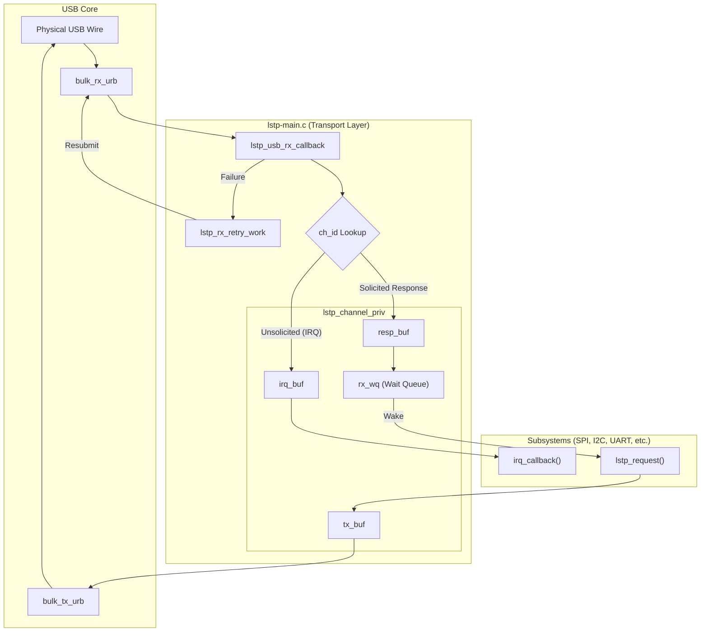
**Sources:** [lstp-main.c:105-106](), [lstp-main.c:255-350](), [lstp-main.c:541-610](), [lstp-main.h:139-143]()

## Channel Multiplexing

LSTP supports up to 256 logical channels [lstp-main.h:32](). Channel 0 is reserved for management (configuration and discovery), while channels 1-255 are assigned to specific peripheral subsystems.

### Logical Channel Structure
Each channel is represented by a `lstp_channel_priv` object. The association between a USB packet and a channel is strictly determined by the `ch_id` field in the `lstp_header` [lstp-main.h:121-128]().

### Channel Discovery (Channel 0)
At probe time, the driver queries Channel 0 to discover the available hardware configuration:
1.  **READ_CONFIG**: The driver sends `LSTP_CH0_CMD_READ_CONFIG` to retrieve the `lstp_ch0_config` [lstp-main.c:377-393]().
2.  **Channel Enumeration**: The driver iterates from `ch_id` 1 to `num_channels`, reading the `lstp_ch_desc` for each [lstp-main.c:1134-1148]().
3.  **Subsystem Matching**: For each channel, the driver matches the `ch_type` against the registered `lstp_subsystems[]` and initializes the corresponding subsystem [lstp-main.c:1150-1165]().

### Diagram: Logical Channel Multiplexing
This diagram maps the relationship between the physical `lstp_usb` interface and the logical `lstp_channel` entities.

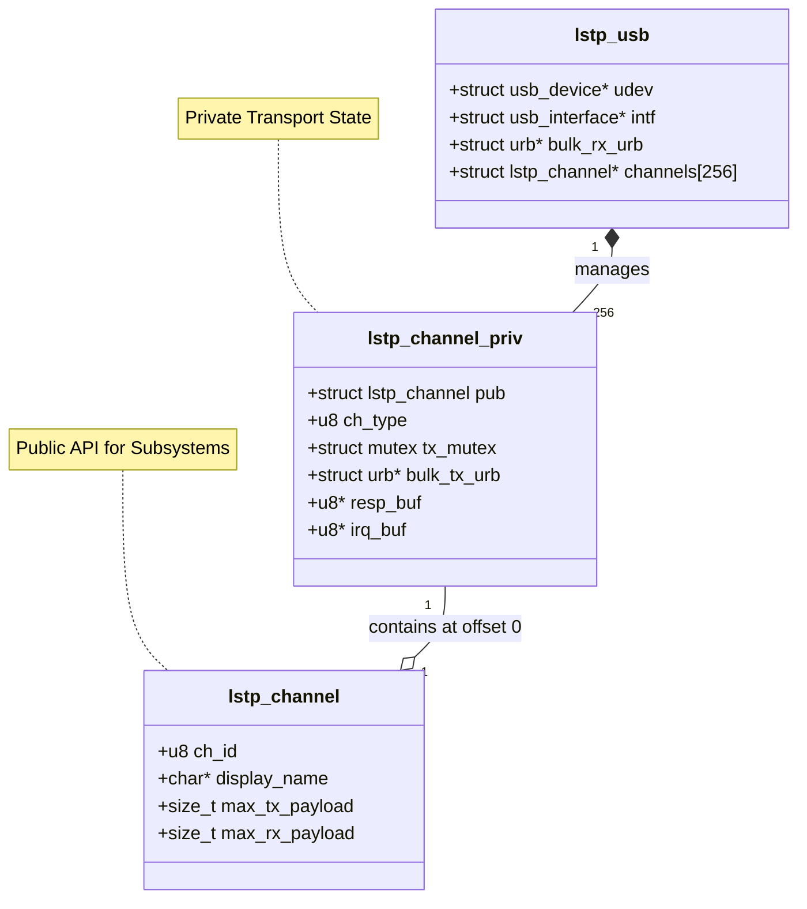
**Sources:** [lstp-main.c:66-89](), [lstp-main.c:98-99](), [lstp-main.h:32](), [lstp-main.h:145-161](), [lstp-main.h:206-221]()

## RX Retry Mechanism

USB URB submission can fail due to transient conditions (e.g., `-ENOMEM`). To prevent the RX loop from dying, the driver implements a retry mechanism using `lstp_rx_retry`.

*   **Failure Handling**: If `usb_submit_urb` fails in `lstp_usb_rx_callback` or during initial probe, the error is recorded in `bulk_rx_retry.last_err` [lstp-main.c:338-344]().
*   **Backoff**: The `lstp_rx_retry_work` function attempts to resubmit the URB. It uses a `delayed_work` to avoid tight-looping during persistent failure conditions [lstp-main.c:352-373]().
*   **Recovery**: Once the URB is successfully accepted by the USB core, the normal completion callback flow resumes.

**Sources:** [lstp-main.c:334-373](), [lstp-main.h:139-143]()

## Synchronization and Locking

The transport layer employs several locking primitives to ensure thread safety:

1.  **`tx_mutex`**: Serializes access to the `bulk_tx_urb` and the channel's `tx_buf`. This ensures that a request-response pair is atomic from the perspective of the USB wire [lstp-main.c:72]().
2.  **`resp_buffer_lock`**: A bit-lock used to protect the `resp_buf` during the hand-off between the RX callback (interrupt context) and the `lstp_request` caller (process context) [lstp-main.c:74]().
3.  **`cfg_lock`**: Protects read-modify-write operations on Channel 0 configuration, specifically during sysfs-initiated channel enable/disable toggling [lstp-main.c:73]().

**Sources:** [lstp-main.c:72-76](), [lstp-main.c:125-126](), [lstp-main.c:286-302]()

---

# Page: Wire Protocol: Packet Format and Status Codes

# Wire Protocol: Packet Format and Status Codes

<details>
<summary>Relevant source files</summary>

The following files were used as context for generating this wiki page:

- [LSTP Specification 1.0 -- 08-03-2026.pdf](LSTP Specification 1.0 -- 08-03-2026.pdf)
- [lstp-main.c](lstp-main.c)
- [lstp-main.h](lstp-main.h)

</details>


The LSTP (Low-Speed Transport Protocol) wire protocol defines a compact, binary-efficient framing mechanism for multiplexing peripheral traffic (SPI, I2C, UART, etc.) over USB bulk endpoints. The protocol uses a fixed-size header followed by a variable-length payload, with specific bit-packing for command and status identification.

## 1. Packet Structure

All LSTP communication is encapsulated in `struct lstp_packet`, which consists of a 4-byte `struct lstp_header` and an optional payload.

### 1.1. LSTP Header (`struct lstp_header`)
The header is defined in [lstp-main.h:121-128](). It uses little-endian byte order for multi-byte fields and is marked `__packed` to ensure no compiler padding.

| Offset | Field | Type | Description |
| :--- | :--- | :--- | :--- |
| 0 | `ch_id` | `u8` | Logical channel ID (0-255). |
| 1 | `cmd` / `status` | `u8` | Bit-packed field for operation or result. |
| 2-3 | `length` | `__le16` | Length of the payload in bytes (excluding header). |

**Command/Status Byte Bit-Packing:**
The second byte of the header serves a dual purpose depending on the direction of the packet and the nature of the transaction [lstp-main.h:40-42]():
*   **Bit 7 (Direction/Type):** 
    *   `0`: Request (Host to Device) or Unsolicited Request (Device to Host IRQ).
    *   `1`: Response (Device to Host).
*   **Bits 0-6 (Opcode/Status):**
    *   In a Request: Contains the subsystem-specific command opcode.
    *   In a Response: Contains the `lstp_status` code.

### 1.2. Packet Definition
```c
struct lstp_packet {
	struct lstp_header hdr;
	u8 payload[];
} __packed;
```
[lstp-main.h:130-133]()

The framework uses `BUILD_BUG_ON` assertions to ensure that these structures match the physical wire specification exactly [lstp-main.c:2152-2153]().

## 2. Status Codes and Error Handling

LSTP defines a standard set of status codes in `enum lstp_status` [lstp-main.h:71-80](). When the host receives a response (Bit 7 of byte 1 is set), it extracts the status from bits 0-6 and maps it to a standard Linux `errno`.

### 2.1. Status Mapping Table
The mapping is implemented via the `lstp_errno_map` array [lstp-main.c:162-171]().

| LSTP Status | Value | Linux Errno | Description |
| :--- | :--- | :--- | :--- |
| `LSTP_SUCCESS` | 0x00 | `0` | Operation completed successfully. |
| `LSTP_ERROR` | 0x01 | `-EIO` | General I/O error. |
| `LSTP_TIMEOUT` | 0x02 | `-ETIMEDOUT` | Hardware-level timeout. |
| `LSTP_BUSY` | 0x03 | `-EBUSY` | Resource is currently locked or busy. |
| `LSTP_NACK` | 0x04 | `-ENXIO` | No acknowledgement (e.g., I2C address NACK). |
| `LSTP_ARB_LOST` | 0x05 | `-EAGAIN` | Arbitration lost (e.g., I2C multi-master). |
| `LSTP_NOT_SUPP` | 0x06 | `-EOPNOTSUPP` | Command or feature not supported. |
| `LSTP_TOO_LARGE` | 0x07 | `-EFBIG` | Payload exceeds device limits. |

The function `lstp_status_to_errno()` performs this conversion during packet processing [lstp-main.c:179-185]().

## 3. Channel 0: Management Protocol

Channel 0 is reserved for protocol management, including device discovery and configuration. It supports three primary commands defined in `enum lstp_ch0_cmd` [lstp-main.c:24-28]().

### 3.1. Management Commands
*   **`LSTP_CH0_CMD_READ_CONFIG` (0x08):** Reads the configuration block for a specific channel.
*   **`LSTP_CH0_CMD_WRITE_CONFIG` (0x09):** Updates the configuration (e.g., enabling/disabling a channel).
*   **`LSTP_CH0_CMD_LOCK` (0x0A):** Finalizes configuration (often used by firmware).

### 3.2. Configuration Structures
Channel descriptors provide the identity of each logical channel.

**`struct lstp_ch_desc`** [lstp-main.h:103-107]():
*   `ch_type`: The subsystem type (SPI, GPIO, etc.) [lstp-main.h:60-69]().
*   `ch_flags`: Status flags (e.g., `LSTP_CH_FLAG_ENABLE`).
*   `ch_name`: A 16-character string identifier.

**`struct lstp_ch0_read_resp`** [lstp-main.h:116-119]():
This is the payload returned by a `READ_CONFIG` request. It contains the fixed `lstp_ch_desc` followed by a variable-length `ch_config` byte array specific to the subsystem (e.g., SPI bus speed, GPIO pin count).

## 4. Protocol Flow Diagrams

### 4.1. Request/Response Transaction
This diagram shows how the `lstp_header` fields change during a standard host-initiated synchronous request.

Title: LSTP Synchronous Request-Response Flow
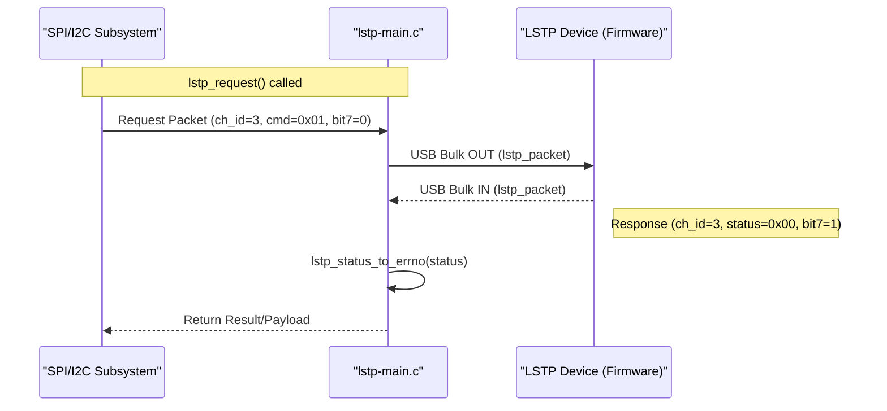
Sources: [lstp-main.c:179-185](), [lstp-main.c:542-560](), [lstp-main.h:121-128]()

### 4.2. Unsolicited Request (IRQ)
LSTP supports asynchronous notifications from the device (e.g., GPIO interrupts or UART RX data). These are distinguished by Bit 7 of the command byte being `0` when sent from the device to the host.

Title: LSTP Unsolicited IRQ Flow
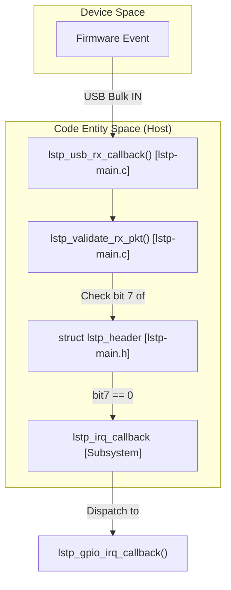
Sources: [lstp-main.c:192-220](), [lstp-main.c:292-320](), [lstp-main.h:175-176]()

## 5. Implementation Assertions
To prevent protocol breakage due to architecture-specific padding or alignment, the driver uses `static_assert` and `BUILD_BUG_ON` for all wire-format structures.

*   `struct lstp_header` must be exactly 4 bytes [lstp-main.c:2152]().
*   `struct lstp_ch_desc` must be exactly 18 bytes [lstp-main.c:2155]().
*   `struct lstp_ch0_read_req` must be exactly 5 bytes [lstp-main.c:2156]().

Sources:
*   Protocol structure definitions: [lstp-main.h:89-133]()
*   Status codes and mapping: [lstp-main.h:71-80](), [lstp-main.c:162-185]()
*   Channel 0 commands: [lstp-main.c:24-28]()
*   Size assertions: [lstp-main.c:2150-2160]()

---

# Page: Subsystem Registration Framework

# Subsystem Registration Framework

<details>
<summary>Relevant source files</summary>

The following files were used as context for generating this wiki page:

- [lstp-main.c](lstp-main.c)
- [lstp-main.h](lstp-main.h)

</details>


The LSTP Subsystem Registration Framework provides a standardized interface for protocol-specific drivers (SPI, I2C, GPIO, etc.) to plug into the LSTP core. It manages the lifecycle of logical channels multiplexed over USB, handling everything from initial discovery and firmware matching to runtime interrupt dispatching and cleanup.

### Subsystem Definition and Discovery

Subsystems are defined using `struct lstp_subsys`, which acts as a template for handling specific LSTP channel types. Each subsystem must provide handlers for initialization, startup, and shutdown.

#### The `lstp_subsys` Structure
The structure [lstp-main.h:208-228]() defines the contract between the core driver and the protocol implementation:
*   `type`: The `enum lstp_channel_type` this subsystem handles.
*   `name`: A string identifier used for logging and sysfs.
*   `channel_init`: Allocates subsystem-specific resources (e.g., `i2c_adapter`).
*   `channel_start`: Activates the hardware/logical channel (e.g., registering with the Linux SPI framework).
*   `channel_stop`: Deactivates the channel before removal.
*   `irq_callback`: (Optional) Handles unsolicited packets (bit 7 of status byte set).

#### Registration Macros
Subsystems are not registered at runtime via a dynamic list; instead, they are declared and referenced using a pair of macros to ensure link-time visibility within the `lstp_subsystems[]` array [lstp-main.c:265-274]().

*   `LSTP_SUBSYS_DECLARE(name)`: Declares the external symbol for the subsystem struct [lstp-main.h:234]().
*   `LSTP_SUBSYS_REF(name)`: References the symbol for inclusion in the global array [lstp-main.h:235]().
*   `LSTP_SUBSYS(name, ...)`: Defines the actual `struct lstp_subsys` instance [lstp-main.h:237-243]().

**Sources:** [lstp-main.h:60-69](), [lstp-main.h:208-243](), [lstp-main.c:265-274]()

### Subsystem Dispatch Architecture

When the LSTP core probes a USB interface, it iterates through all available channels reported by the hardware. For each channel, it identifies the correct subsystem using `lstp_subsys_by_channel_type()` [lstp-main.c:276-288]().

#### Data Entity Mapping: Subsystem to Code
The following diagram maps the conceptual "Subsystem" entities to their implementation in the code.

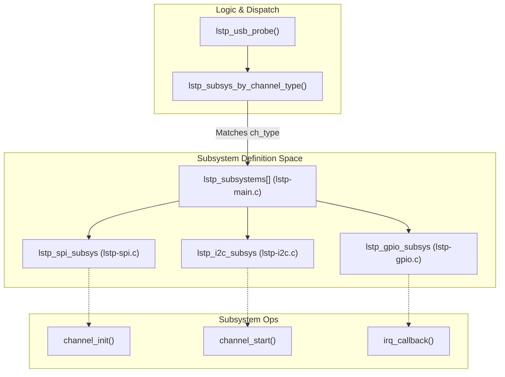
**Sources:** [lstp-main.c:265-288](), [lstp-main.c:1202-1240]()

### Channel Lifecycle

The framework manages a strict state machine for channels. This ensures that resources are allocated before the channel is exposed to the Linux kernel and that interrupts are only dispatched when the subsystem is ready.

| Phase | Function | Responsibility |
| :--- | :--- | :--- |
| **Discovery** | `lstp_create_channels` | Reads Channel 0 config to find `ch_type` [lstp-main.c:1130](). |
| **Init** | `channel_init` | Allocates `lstp_channel->priv` and sets up `fwnode` [lstp-main.c:1164](). |
| **Startup** | `channel_start` | Registers the device with Linux (e.g., `spi_register_controller`) [lstp-main.c:1225](). |
| **Runtime** | `irq_callback` | Dispatches unsolicited LSTP packets to the subsystem [lstp-main.c:380](). |
| **Shutdown** | `channel_stop` | Unregisters the Linux device; called during USB disconnect [lstp-main.c:1048](). |
| **Cleanup** | `devres` | Automatically frees memory allocated during `init` [lstp-main.c:1175](). |

#### Channel Initialization Flow
During `lstp_usb_probe()`, the driver calls `lstp_create_channels()`. This function performs a `READ_CONFIG` on Channel 0 to fetch the `lstp_ch_desc` [lstp-main.h:103-107]() for every hardware channel. It then allocates a `struct lstp_channel_priv` [lstp-main.c:66-89]() which contains the public `lstp_channel` [lstp-main.h:180-206]() shared with subsystems.

**Sources:** [lstp-main.c:1120-1195](), [lstp-main.c:1202-1240](), [lstp-main.h:103-107]()

### Interrupt (IRQ) Dispatching

LSTP supports "unsolicited requests," which function as hardware interrupts. These are identified by bit 7 of the status byte in the LSTP header [lstp-main.h:40]().

When the `lstp_usb_rx_callback` [lstp-main.c:317]() receives a packet where bit 7 is set:
1.  The framework identifies the target channel via `hdr.ch_id`.
2.  It verifies if the channel has been started (`priv->started == true`) [lstp-main.c:372]().
3.  It invokes the subsystem's `irq_callback` in **atomic context** [lstp-main.c:380]().

#### Data Flow: USB URB to Subsystem IRQ
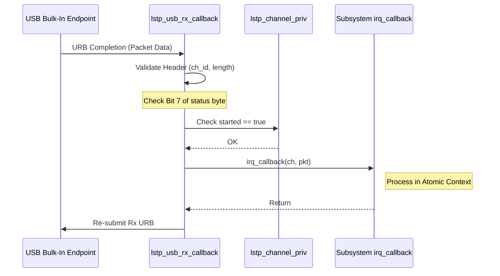
**Sources:** [lstp-main.c:317-390](), [lstp-main.h:175-176]()

### Devres-Managed Cleanup

The framework heavily utilizes the Linux `devres` (Device Managed Resources) pattern to prevent memory leaks during hot-unplug or probe failure.

1.  **Memory Allocation**: `lstp_create_channel` uses `devm_kzalloc` to allocate the `lstp_channel_priv` structure [lstp-main.c:1085]().
2.  **Sysfs Integration**: The per-channel sysfs directory (`/sys/bus/usb/devices/.../lstp/channel/N`) is managed via `kobject_init_and_add` [lstp-main.c:1100]().
3.  **Teardown**: When the USB device is removed, `lstp_usb_disconnect` calls `lstp_teardown` [lstp-main.c:1040-1060](), which invokes `channel_stop` for all active channels. Because resources were allocated via `devm`, they are automatically freed once the parent USB interface device is destroyed.

**Sources:** [lstp-main.c:1040-1060](), [lstp-main.c:1085-1110]()

---

# Page: Request/Response API and Synchronization

# Request/Response API and Synchronization

<details>
<summary>Relevant source files</summary>

The following files were used as context for generating this wiki page:

- [lstp-main.c](lstp-main.c)
- [lstp-main.h](lstp-main.h)

</details>


The LSTP driver provides a unified Request/Response API that allows subsystems (SPI, I2C, GPIO, etc.) to communicate with remote peripherals over a multiplexed USB transport. This API handles packet framing, USB URB lifecycle management, and thread-safe synchronization to ensure that logical channel transactions remain atomic and isolated from one another.

## Public API Functions

Subsystems interact with the LSTP core using a set of exported functions defined in `lstp-main.c`. These functions handle the transition from Linux kernel subsystem calls to LSTP wire-format packets.

### Synchronous Request/Response
*   **`lstp_request()`**: The primary synchronous interface. It sends a command and waits for a response from the device. It handles the full `lstp_request_xfer` pipeline, including timeouts and status code translation [lstp-main.c:548-571]().
*   **`lstp_requestv()`**: A scatter-gather variant of `lstp_request()`. It accepts a `kvec` array, allowing subsystems to frame packets without performing intermediate memory copies (zero-copy framing). This is extensively used by the I2C subsystem for combined transactions [lstp-main.c:587-611]().

### Unidirectional and IRQ Support
*   **`lstp_send()`**: A "fire-and-forget" synchronous send. It transmits a request but does not wait for an LSTP-level response. It only ensures the USB transport accepted the data [lstp-main.c:523-535]().
*   **`lstp_send_irq_resp()`**: Used by subsystems to respond to unsolicited requests (IRQs) sent by the device. Unlike standard requests, IRQ responses use a dedicated `bulk_tx_resp_urb` to avoid head-of-line blocking against pending outbound requests [lstp-main.c:623-652]().

### Configuration Access
*   **`lstp_ch0_read_config()`**: A wrapper around `lstp_request()` targeting Channel 0. It retrieves the `lstp_ch_desc` and any subsystem-specific configuration data for a given channel [lstp-main.c:286-319]().
*   **`lstp_read_config_table()`**: A high-level helper that iterates through all available channels on an interface to discover their types and names during the probe phase [lstp-main.c:331-360]().

**Sources:** [lstp-main.c:523-652](), [lstp-main.c:286-360](), [lstp-main.h:216-241]()

---

## The `lstp_request_xfer` Pipeline

The core logic for every synchronous exchange resides in `lstp_request_xfer()`. This function manages the lifecycle of a request from buffer preparation to response validation.

### Data Flow and Code Entities
The following diagram maps the natural language flow of a request to the specific code entities and locks involved.

**Request/Response Sequence and Synchronization**
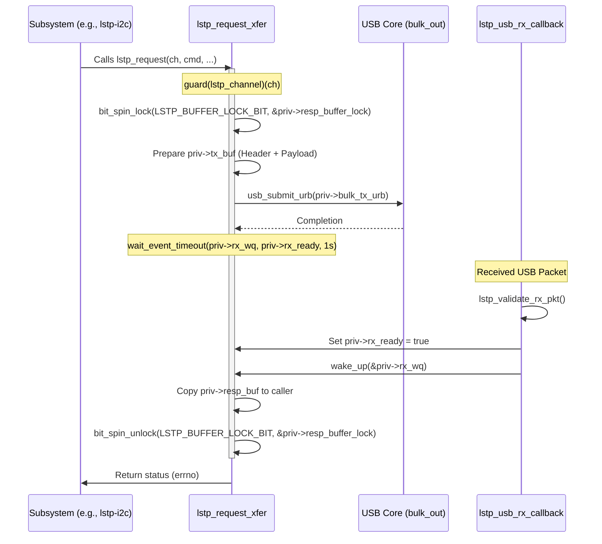
**Sources:** [lstp-main.c:426-508](), [lstp-main.c:125-126](), [lstp-main.c:664-709]()

---

## Synchronization and Locking

LSTP employs a multi-layered locking strategy to ensure high performance while maintaining strict atomicity for channel operations.

### Channel Guard and `tx_mutex`
Each channel has a `tx_mutex` [lstp-main.c:72](). The framework provides a `DEFINE_GUARD(lstp_channel, ...)` macro [lstp-main.c:125-126]() that is used at the entry point of all `lstp_send` and `lstp_request` calls. This ensures:
1.  Only one request is in flight per logical channel at any time.
2.  The shared `tx_buf` (scratch buffer) for that channel is protected from concurrent access [lstp-main.c:80]().

### Response Buffer Bit-Lock
Because the RX path (`lstp_usb_rx_callback`) runs in atomic/interrupt context and the TX path (`lstp_request_xfer`) runs in process context, a bit-lock is used to guard the `resp_buf` [lstp-main.c:74]().
*   The `LSTP_BUFFER_LOCK_BIT` is set via `bit_spin_lock` before a request is sent [lstp-main.c:452]().
*   The RX callback checks this bit to determine if a synchronous waiter is expecting the incoming packet [lstp-main.c:703]().
*   This prevents the RX path from overwriting a buffer while the process context is still reading from it.

### Wait Queues and Timeouts
The driver uses `wait_event_timeout` on `priv->rx_wq` to sleep the calling thread while waiting for the device's response [lstp-main.c:475](). 
*   **Timeout Constants**: Both `LSTP_USB_RESPONSE_TIMEOUT_MS` and `LSTP_USB_REQUEST_TIMEOUT_MS` are set to 1000ms [lstp-main.h:28-29]().
*   If a timeout occurs, the bit-lock is released, and the function returns `-ETIMEDOUT` [lstp-main.c:482]().

**Sources:** [lstp-main.c:66-89](), [lstp-main.c:426-508](), [lstp-main.h:28-29](), [lstp-main.h:54-55]()

---

## Status Code Mapping

LSTP status codes returned by the hardware are mapped to standard Linux `errno` values via `lstp_status_to_errno()` [lstp-main.c:179-185]().

| LSTP Status | Linux Errno | Description |
| :--- | :--- | :--- |
| `LSTP_SUCCESS` | `0` | Operation completed successfully. |
| `LSTP_ERROR` | `-EIO` | General I/O error. |
| `LSTP_TIMEOUT` | `-ETIMEDOUT` | Hardware-side timeout. |
| `LSTP_BUSY` | `-EBUSY` | Resource temporarily unavailable. |
| `LSTP_NACK` | `-ENXIO` | No device responded (I2C/SPI). |
| `LSTP_ARB_LOST` | `-EAGAIN` | Bus arbitration lost. |
| `LSTP_NOT_SUPP` | `-EOPNOTSUPP` | Command not supported by firmware. |
| `LSTP_TOO_LARGE` | `-EFBIG` | Request exceeded hardware buffers. |

**Sources:** [lstp-main.c:162-171](), [lstp-main.h:71-80]()

---

## Structural Overview: Code Entity Space

The following diagram illustrates the relationship between the public API, the private channel structures, and the synchronization primitives.

**API to Implementation Mapping**
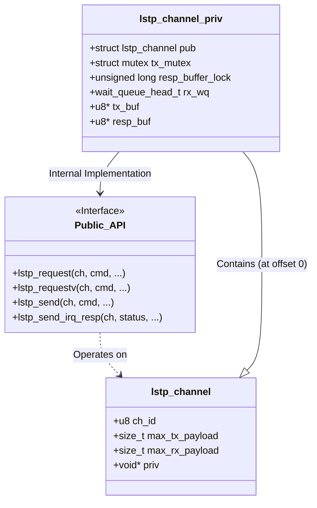
**Sources:** [lstp-main.c:66-89](), [lstp-main.c:98-99](), [lstp-main.h:180-206]()

---

# Page: Sysfs Hierarchy and Firmware Node Integration

# Sysfs Hierarchy and Firmware Node Integration

<details>
<summary>Relevant source files</summary>

The following files were used as context for generating this wiki page:

- [README.md](README.md)
- [lstp-main.c](lstp-main.c)
- [lstp-main.h](lstp-main.h)

</details>


The LSTP driver exposes a structured sysfs hierarchy under the bound USB interface device. This hierarchy provides a mechanism for userspace to discover LSTP channels, identify them by stable names, and control their operational state. Additionally, the driver integrates with firmware nodes (Device Tree or ACPI) to associate logical LSTP channels with platform-level hardware descriptions.

## Sysfs Topology

The driver creates a root `lstp/` directory under the USB interface device (`/sys/bus/usb/devices/.../interface/lstp/`). This directory serves as the anchor for interface-wide attributes and the per-channel subdirectory.

### Hierarchy Structure
- **`lstp/name`**: The interface-level name (e.g., "HOST_INTERFACE") [lstp-main.c:128-128]().
- **`lstp/channel/`**: A container directory for all logical channels discovered on the interface [lstp-main.h:160-160]().
- **`lstp/channel/N/`**: Per-channel directory, where `N` is the decimal `ch_id` [lstp-main.c:66-89]().
    - **`name`**: The stable, firmware-defined string name for the channel (e.g., "SPI_PORT_A") [lstp-main.c:145-146]().
    - **`enable`**: A read-write attribute (0/1) to control the channel's active state [lstp-main.c:142-143]().
    - **`device`**: A symbolic link to the underlying Linux subsystem device (e.g., `spi_master/spi7`, `gpiochip2`) [lstp-main.c:88-88]().

### Code Entity to Sysfs Mapping
The following diagram illustrates how internal driver structures relate to the visible sysfs filesystem nodes.

**Diagram: Sysfs KObject Mapping**
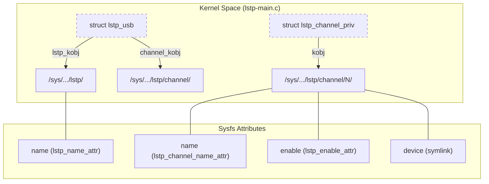
Sources: [lstp-main.h:145-162](), [lstp-main.c:66-89](), [lstp-main.c:128-159]()

## Channel Enablement and Read-Modify-Write Flow

The `enable` attribute allows userspace to dynamically start or stop a channel. Changing this value triggers a Read-Modify-Write (RMW) operation on Channel 0 (Management Channel) to update the device-side configuration.

1.  **Store Operation**: `lstp_channel_enable_store` is called when userspace writes to the `enable` file [lstp-main.c:486-530]().
2.  **Read Configuration**: The driver calls `lstp_ch0_read_config()` to fetch the current `struct lstp_ch_desc` from the device [lstp-main.c:508-508]().
3.  **Modify**: The `LSTP_CH_FLAG_ENABLE` bit in `ch_flags` is set or cleared based on the input [lstp-main.c:514-517]().
4.  **Write Configuration**: The driver calls `lstp_ch0_write_config()` to push the updated descriptor back to the device [lstp-main.c:520-520]().
5.  **Lifecycle Sync**: If enabling, `lstp_channel_start()` is invoked to register the Linux subsystem device; if disabling, `lstp_channel_stop()` is invoked [lstp-main.c:524-527]().

Sources: [lstp-main.c:486-530](), [lstp-main.h:52-52](), [lstp-main.h:103-107]()

## Firmware Node Integration

The driver supports matching LSTP channels to platform firmware (Device Tree or ACPI) using the `reg` property, which must match the hardware `ch_id`.

### Discovery and Matching
During initialization, `lstp_find_channel_fwnode` iterates through the child nodes of the USB interface's firmware node [lstp-main.c:634-656]().

- **Matching Logic**: The function looks for a child node where the `reg` property matches the `ch_id` discovered via LSTP Channel 0 [lstp-main.c:646-649]().
- **Subsystem Assignment**: If a match is found, the `fwnode` is assigned to `struct lstp_channel`, allowing the subsequent subsystem probe (e.g., SPI or I2C) to inherit the firmware properties (such as clock speeds or child peripheral definitions) [lstp-main.c:687-687]().

**Diagram: Firmware Matching Data Flow**
```mermaid
flowchart LR
    subgraph "Firmware (DT/ACPI)"
        NodeA["interface@2"] -->|child| NodeB["channel@1 { reg=1; }"]
    end

    subgraph "Driver Probe (lstp-main.c)"
        Discovery["ch0 READ_CONFIG"] -->|ID=1| Match["lstp_find_channel_fwnode"]
        Match -->|device_get_next_child_node| NodeB
        Match -->|fwnode_property_read_u32| Val["reg value"]
        Val == Discovery -->|Success| Bind["Assign ch->fwnode"]
    end

    subgraph "Subsystem Probe"
        Bind --> Sub["lstp_spi_init / lstp_i2c_init"]
        Sub -->|"devm_spi_register_controller"| Linux["Linux Subsystem Device"]
    end
```
Sources: [lstp-main.c:634-656](), [lstp-main.c:670-700](), [README.md:181-211]()

## KObject Lifecycle

The driver manages three distinct kobject levels to ensure memory safety during USB hot-unplug:

| KObject | Parent | Responsibility |
| :--- | :--- | :--- |
| `lstp_kobj` | `usb_interface->dev.kobj` | Root `/lstp` directory [lstp-main.c:757-768](). |
| `channel_kobj` | `lstp_kobj` | The `/lstp/channel` container [lstp-main.c:773-779](). |
| `priv->kobj` | `channel_kobj` | The per-channel directory `/lstp/channel/N` [lstp-main.c:714-722](). |

The per-channel kobject is released via `lstp_channel_kobj_release`, which is the final stage of the channel's cleanup, ensuring that the `lstp_channel_priv` structure is not freed while sysfs attributes are being accessed [lstp-main.c:542-550]().

Sources: [lstp-main.c:66-89](), [lstp-main.c:542-550](), [lstp-main.c:714-780]()

---

# Page: Transport Subsystems

# Transport Subsystems

<details>
<summary>Relevant source files</summary>

The following files were used as context for generating this wiki page:

- [Kbuild](Kbuild)
- [Kconfig](Kconfig)
- [lstp-gpio.c](lstp-gpio.c)
- [lstp-i2c.c](lstp-i2c.c)
- [lstp-ipmi.c](lstp-ipmi.c)
- [lstp-mmio.c](lstp-mmio.c)
- [lstp-spi.c](lstp-spi.c)
- [lstp-uart.c](lstp-uart.c)

</details>


The LSTP (Low-Speed Transport Protocol) driver acts as a bridge between the Linux kernel's standard peripheral subsystems and the LSTP USB transport layer. It implements six protocol-specific subsystem drivers that translate standard Linux I/O requests into LSTP-formatted USB packets.

Each subsystem is implemented as an `lstp_subsys` structure [lstp-main.h:320-336](), providing callbacks for initialization, lifecycle management, and unsolicited data (IRQ) handling.

### Subsystem Architecture Overview

The following diagram illustrates how the protocol subsystems bridge the gap between Linux kernel APIs and the LSTP wire protocol.

**Subsystem Integration Map**
```mermaid
graph TD
    subgraph "Linux Kernel Space"
        A1["SPI Core"]
        A2["GPIOLIB / IRQ"]
        A3["I2C Core"]
        A4["TTY / Console"]
        A5["Misc Device / FIFO"]
    end

    subgraph "LSTP Subsystem Drivers (Code Entities)"
        B1["lstp-spi.c"]
        B2["lstp-gpio.c"]
        B3["lstp-i2c.c"]
        B4["lstp-uart.c"]
        B5["lstp-ipmi.c"]
        B6["lstp-mmio.c"]
    end

    subgraph "LSTP Core (lstp-main.c)"
        C["lstp_request() / lstp_requestv()"]
        D["lstp_usb_rx_callback()"]
    end

    A1 --> B1
    A2 --> B2
    A3 --> B3
    A4 --> B4
    A5 --> B5
    A5 --> B6

    B1 & B2 & B3 & B4 & B5 & B6 -->|Request| C
    D -->|IRQ Dispatch| B1 & B2 & B4 & B5
```
**Sources:** [lstp-main.c:15-16](), [lstp-main.h:320-336](), [Kbuild:14-16]()

---

### SPI Subsystem (`lstp-spi.c`)
The SPI subsystem implements a `spi_controller` [lstp-spi.c:61](). It translates `spi_transfer` requests into LSTP SPI opcodes. A key optimization is the embedding of Chip Select (CS) assertion/deassertion directly into the command byte [lstp-spi.c:34-37](), avoiding extra USB round-trips for CS management.

*   **Key Opcodes:** `LSTP_SPI_CMD_READ`, `WRITE`, `WRITE_READ`, `POSTED_WRITE` [lstp-spi.c:26-31]().
*   **CS Mapping:** Supports multiple chip selects mapped via `lstp_spi_cs_map` [lstp-spi.c:45-48]().
*   **For details, see [SPI Subsystem (lstp-spi.c)](#3.1).**

**Sources:** [lstp-spi.c:26-63](), [lstp-spi.c:168-215]()

---

### GPIO Subsystem (`lstp-gpio.c`)
This subsystem exposes pins as a `gpio_chip` and an `irq_chip` [lstp-gpio.c:154-158](). It supports standard GPIO operations, interrupt delivery via an ordered workqueue (`lstp_gpio_wq`), and an integrated LED pattern engine for pins with `led_support` [lstp-gpio.c:147-151]().

*   **IRQ Pattern:** Uses a sleepable bus-lock pattern (`irq_bus_lock`/`irq_bus_sync_unlock`) to handle the high-latency USB transport [lstp-gpio.c:158]().
*   **LED Integration:** Registers pins with `LEDS_CLASS` and supports complex hardware-accelerated brightness patterns [lstp-gpio.c:78-83]().
*   **For details, see [GPIO Subsystem (lstp-gpio.c)](#3.2).**

**Sources:** [lstp-gpio.c:41-48](), [lstp-gpio.c:154-182]()

---

### I2C Subsystem (`lstp-i2c.c`)
The I2C subsystem implements an `i2c_adapter` using the `lstp_i2c_algorithm` [lstp-i2c.c:90-93](). It handles standard I2C transfers, including repeated-START sequences by detecting combined message pairs and setting the `LSTP_I2C_CMD_FLAG_NO_STOP` flag [lstp-i2c.c:33]().

*   **SMBus Support:** Includes specific support for SMBus Block Reads [lstp-i2c.c:59-63]().
*   **Error Handling:** Implements specialized retry logic for `LSTP_BUSY` and `LSTP_ARB_LOST` status codes [lstp-i2c.c:95-98]().
*   **For details, see [I2C Subsystem (lstp-i2c.c)](#3.3).**

**Sources:** [lstp-i2c.c:24-31](), [lstp-i2c.c:78-86]()

---

### UART Subsystem (`lstp-uart.c`)
Exposes LSTP channels as `/dev/ttyLSTP` devices [lstp-uart.c:98-115](). It features a two-stage TX coalescing mechanism where writes are buffered in `coal_buf` and then snapshotted for USB transmission [lstp-uart.c:90-97]().

*   **Reliability:** Implements NACK retry logic to handle cases where the remote firmware's TX FIFO is temporarily full [lstp-uart.c:80-81]().
*   **Line Status:** Maps LSTP tags (Carrier Down, Break Detect, Overrun) to TTY status flags [lstp-uart.c:65-70]().
*   **For details, see [UART Subsystem (lstp-uart.c)](#3.4).**

**Sources:** [lstp-uart.c:38-43](), [lstp-uart.c:98-115]()

---

### IPMI Subsystem (`lstp-ipmi.c`)
Provides a bridge for Intelligent Platform Management Interface (IPMI) messages via a character device [lstp-ipmi.c:83-96](). It uses a `kfifo_rec_ptr_2` to buffer inbound requests [lstp-ipmi.c:93]().

*   **Postcodes:** Includes a sub-device for handling BIOS/Firmware postcodes (NetFn 0x2C), which can be routed to a separate miscdevice for performance [Kconfig:36-43](), [lstp-ipmi.c:95]().
*   **Atomicity:** Uses a rolling `msg_count` tag to ensure responses are matched to the correct requests [lstp-ipmi.c:94]().
*   **For details, see [IPMI Subsystem (lstp-ipmi.c and lstp-ipmi-postcodes.h)](#3.5).**

**Sources:** [lstp-ipmi.c:44-53](), [lstp-ipmi.c:83-96]()

---

### MMIO Subsystem (`lstp-mmio.c`)
The Memory-Mapped I/O subsystem provides a raw memory access interface via `/dev/lstp_mmio_X` [lstp-mmio.c:50-58](). It allows userspace to perform chunked reads and writes to a 32-bit address space [lstp-mmio.c:40-49]().

*   **Transfer Loop:** Automatically breaks large userspace I/O requests into smaller chunks that fit within the USB endpoint's `max_rx_payload` and `max_tx_payload` [lstp-mmio.c:149-151]().
*   **Serialization:** Uses a per-context `mutex` to serialize access to the shared `xfer_buf` [lstp-mmio.c:55-56]().
*   **For details, see [MMIO Subsystem (lstp-mmio.c)](#3.6).**

**Sources:** [lstp-mmio.c:35-58](), [lstp-mmio.c:149-175]()

---

### Subsystem Data Structures

The following diagram bridges the high-level subsystem names to their primary internal context structures.

**Code Entity Association**
```mermaid
classDiagram
    class lstp_subsys {
        +char* name
        +u8 type
        +int (*init)(ch, info)
        +int (*start)(ch)
        +void (*irq_callback)(ch, cmd, data, len)
    }

    class lstp_spi_priv {
        +spi_controller* ctrl
        +u32 current_speed_hz
    }

    class lstp_gpio_priv {
        +gpio_chip gc
        +mutex irq_lock
        +u8* hw_irq_type
    }

    class lstp_uart_ctx {
        +tty_port port
        +u8* coal_buf
        +work_struct write_work
    }

    class lstp_ipmi_ctx {
        +miscdevice miscdev
        +kfifo_rec_ptr_2 fifo
        +u8 msg_count
    }

    lstp_subsys ..> lstp_spi_priv : SPI Private Data
    lstp_subsys ..> lstp_gpio_priv : GPIO Private Data
    lstp_subsys ..> lstp_uart_ctx : UART Context
    lstp_subsys ..> lstp_ipmi_ctx : IPMI Context
```
**Sources:** [lstp-main.h:320-336](), [lstp-spi.c:60-63](), [lstp-gpio.c:154-166](), [lstp-uart.c:98-115](), [lstp-ipmi.c:83-96]()

---

# Page: SPI Subsystem (lstp-spi.c)

# SPI Subsystem (lstp-spi.c)

<details>
<summary>Relevant source files</summary>

The following files were used as context for generating this wiki page:

- [Kconfig](Kconfig)
- [lstp-spi.c](lstp-spi.c)

</details>


The SPI subsystem provides a bridge between the Linux SPI framework and the LSTP protocol. It registers an `spi_controller` for each LSTP SPI channel, allowing standard SPI peripheral drivers (e.g., flash memory, sensors) or `spidev` to operate over the USB transport.

## Overview and Registration

The SPI subsystem is defined via the `LSTP_SUBSYS` descriptor, which links the LSTP core to the SPI-specific initialization and lifecycle functions [lstp-spi.c:286-291](). When the LSTP core identifies a channel of type `LSTP_CH_TYPE_SPI`, it invokes `lstp_spi_init` to set up the controller [lstp-spi.c:237-284]().

### Initialization Flow
1.  **Allocation**: The driver uses `devm_spi_alloc_host` to create the `spi_controller` [lstp-spi.c:250]().
2.  **Configuration Parsing**: It attempts to read the `lstp_spi_config` from the hardware via `lstp_ch0_read_config` [lstp-spi.c:256](). If the hardware does not provide configuration, it falls back to defaults (2 devices, 18.75 MHz) [lstp-spi.c:65-67]().
3.  **Controller Setup**: The driver sets the `transfer_one_message` callback, which is the primary entry point for SPI I/O [lstp-spi.c:272]().
4.  **Payload Limits**: The `max_transfer_size` is calculated based on the LSTP channel's `max_tx_payload` and `max_rx_payload`, accounting for the LSTP command overhead [lstp-spi.c:275-276]().
5.  **Device Discovery**: The driver enumerates child devices from the Device Tree [lstp-spi.c:281](). If no children are found and the `auto_bind_spidev` module parameter is enabled, it automatically creates `spidev` nodes for all available chip selects [lstp-spi.c:282]().

### Natural Language to Code Entity Mapping: SPI Controller

| System Concept | Code Entity | File Reference |
| :--- | :--- | :--- |
| **Subsystem Descriptor** | `lstp_spi_subsys` | [lstp-spi.c:286-291]() |
| **Command Opcodes** | `enum lstp_spi_cmd` | [lstp-spi.c:26-31]() |
| **Private Data** | `struct lstp_spi_priv` | [lstp-spi.c:60-63]() |
| **Configuration Data** | `struct lstp_spi_config` | [lstp-spi.c:54-57]() |
| **CS Management** | `lstp_spi_cs_map` | [lstp-spi.c:45-48]() |

Sources: [lstp-spi.c:26-67](), [lstp-spi.c:237-291]()

## Command and Protocol Logic

Unlike traditional SPI controllers that use a separate `set_cs` GPIO-style callback, the LSTP SPI protocol embeds Chip Select (CS) state directly into the command byte of each transfer [lstp-spi.c:149-152]().

### Command Byte Bit-Packing
The LSTP SPI command byte is constructed by OR-ing three components:
1.  **Opcode**: `READ`, `WRITE`, `WRITE_READ`, or `POSTED_WRITE` [lstp-spi.c:26-31]().
2.  **CS Selection**: `LSTP_SPI_CMD_CS0` or `LSTP_SPI_CMD_CS1` [lstp-spi.c:40-43]().
3.  **CS Toggle**: `LSTP_SPI_CMD_CS_ASSERT` (assert before transfer) and `LSTP_SPI_CMD_CS_DEASSERT` (deassert after transfer) [lstp-spi.c:34-37]().

### Data Flow: Message Execution

The following diagram illustrates how a standard `spi_message` containing multiple `spi_transfer` objects is translated into LSTP packets.

**SPI Message Translation Flow**
```mermaid
graph TD
    subgraph "Linux SPI Core"
        A["spi_sync() / spi_async()"] --> B["spi_controller.transfer_one_message"]
    end

    subgraph "lstp-spi.c"
        B --> C["lstp_spi_transfer_one_message()"]
        C --> D{"Iterate Transfers"}
        D --> E["Calculate CS flags (Assert/Deassert)"]
        E --> F["lstp_spi_do_transfer()"]
        F --> G{"Determine Opcode"}
    end

    subgraph "lstp-main.c (Transport)"
        G -- "WRITE_READ" --> H["lstp_request(cmd, tx_buf, rx_buf)"]
        G -- "READ" --> I["lstp_request(cmd, lstp_spi_read_req, rx_buf)"]
        G -- "WRITE" --> J["lstp_request(cmd, tx_buf, NULL)"]
    end

    J --> K["USB Bulk Out"]
    H --> K
    I --> K
```
Sources: [lstp-spi.c:91-142](), [lstp-spi.c:168-215]()

## Key Functions

### `lstp_spi_transfer_one_message`
This function handles the logic for a sequence of transfers within a single SPI message [lstp-spi.c:168](). It tracks the `cs_active` state to ensure `LSTP_SPI_CMD_CS_ASSERT` is only sent on the first transfer and `LSTP_SPI_CMD_CS_DEASSERT` is sent based on the `xfer->cs_change` flag or when the message ends [lstp-spi.c:189-198]().

### `lstp_spi_do_transfer`
This function maps the `spi_transfer` buffers to LSTP requests [lstp-spi.c:91]().
*   **Full Duplex**: If both `tx_buf` and `rx_buf` are present, it uses `LSTP_SPI_CMD_WRITE_READ` [lstp-spi.c:117-120]().
*   **Read Only**: Uses `LSTP_SPI_CMD_READ`. Since the LSTP protocol requires the request to specify the number of bytes to read, it encapsulates the length in a `struct lstp_spi_read_req` [lstp-spi.c:125-128]().
*   **Write Only**: Uses `LSTP_SPI_CMD_WRITE` [lstp-spi.c:121-123]().

### SPI Controller Setup and Constraints
The driver enforces hardware constraints during `lstp_spi_init`:
*   **Max Payload**: The driver limits `max_transfer_size` to the minimum of the channel's TX and RX payload capacities [lstp-spi.c:275-276]().
*   **Speed**: The `current_speed_hz` is cached from the firmware config and reported back to the SPI core in `xfer->effective_speed_hz` [lstp-spi.c:104]().

### Logic Entity Association: SPI Transfer

```mermaid
classDiagram
    class spi_controller {
        +transfer_one_message()
        +num_chipselect
        +max_transfer_size
    }
    class lstp_channel {
        +ch_id
        +max_tx_payload
        +max_rx_payload
        +priv
    }
    class lstp_spi_priv {
        +current_speed_hz
        +ctrl
    }
    class lstp_spi_cmd {
        <<enumeration>>
        LSTP_SPI_CMD_READ
        LSTP_SPI_CMD_WRITE
        LSTP_SPI_CMD_WRITE_READ
    }

    spi_controller --* lstp_channel : "via devdata"
    lstp_channel --* lstp_spi_priv : "via priv"
    lstp_spi_priv --* spi_controller : "via ctrl"
```
Sources: [lstp-spi.c:26-31](), [lstp-spi.c:60-63](), [lstp-spi.c:170](), [lstp-spi.c:250]()

## Device Tree and Spidev Fallback

The driver supports two methods for populating child devices under the SPI controller:
1.  **Firmware Description**: Standard Device Tree child nodes are enumerated via `devm_spi_register_controller` [lstp-spi.c:281]().
2.  **Auto-bind Spidev**: If the `auto_bind_spidev` module parameter is set (or the `USB_LSTP_SPI_SPIDEV` Kconfig option is enabled), the driver will manually create `spidev` devices for every chip select not already claimed by the Device Tree [lstp-spi.c:282](), [Kconfig:22-34]().

Sources: [lstp-spi.c:281-282](), [Kconfig:22-34]()

---

# Page: GPIO Subsystem (lstp-gpio.c)

# GPIO Subsystem (lstp-gpio.c)

<details>
<summary>Relevant source files</summary>

The following files were used as context for generating this wiki page:

- [lstp-gpio.c](lstp-gpio.c)

</details>


The GPIO subsystem implements a bridge between the Linux kernel's GPIO/IRQ/LED frameworks and the LSTP hardware. It presents a `gpio_chip` for standard digital I/O, an `irq_chip` for interrupt management, and registers `led_classdev` instances for pins identified as LEDs in the device configuration.

## Pin Classification and Data Structures

The driver distinguishes between standard GPIO pins and LED-capable pins based on the `lstp_gpio_pin_config` retrieved during initialization.

### Data Entities

| Entity | Description |
| :--- | :--- |
| `struct lstp_gpio_priv` | The main state container for a GPIO channel, including the `gpio_chip`, `irq_chip` metadata, and an ordered workqueue. |
| `struct lstp_gpio_pin_config` | Wire-format structure defining a pin's direction, bias, drive strength, and LED support [lstp-gpio.c:103-116](). |
| `struct lstp_gpio_led` | A wrapper for `led_classdev` that associates a specific LSTP pin with the Linux LED subsystem [lstp-gpio.c:177-181](). |

### Logical Mapping
```mermaid
graph TD
    subgraph "Code Entity Space"
        PRIV["struct lstp_gpio_priv"]
        GC["struct gpio_chip"]
        LED["struct lstp_gpio_led"]
        IRQ["struct irq_chip"]
        WQ["lstp_gpio_wq"]
    end

    subgraph "System Names"
        LSTP_CH["LSTP Channel (GPIO Type)"]
        SYS_GPIO["/sys/class/gpio"]
        SYS_LED["/sys/class/leds"]
        PROC_IRQ["/proc/interrupts"]
    end

    PRIV --> GC
    PRIV --> LED
    PRIV --> WQ
    GC --- SYS_GPIO
    LED --- SYS_LED
    PRIV --- IRQ
    IRQ --- PROC_IRQ
    LSTP_CH --- PRIV
```
**Sources:** [lstp-gpio.c:154-181]()

## GPIO Chip Implementation

The driver implements standard `gpio_chip` callbacks to translate Linux GPIO requests into LSTP USB packets.

*   **Get/Set Value**: Uses `LSTP_GPIO_CMD_GET_VALUE` and `LSTP_GPIO_CMD_SET_VALUE` [lstp-gpio.c:264-325]().
*   **Multiple Pin Operations**: `lstp_gpio_get_multiple` and `lstp_gpio_set_multiple` iterate through the requested bitmask, issuing individual USB requests for each pin [lstp-gpio.c:327-376]().
*   **Direction Control**: `lstp_gpio_direction_input` and `lstp_gpio_direction_output` use `lstp_ch0_write_config` to modify the hardware configuration table on the device [lstp-gpio.c:232-262]().

**Sources:** [lstp-gpio.c:232-376](), [lstp-gpio.c:41-43]()

## IRQ Chip and Sleepable Bus-Lock

Because LSTP operates over USB, interrupt configuration requires sleepable context to perform I/O. The driver implements the "bus-lock" pattern to handle this.

### Shadow vs. Hardware State
To avoid synchronous USB transfers inside atomic IRQ contexts (like `irq_set_type`), the driver maintains two state arrays in `lstp_gpio_priv`:
1.  **`shadow_irq_type`**: Stores the desired IRQ configuration set by the kernel [lstp-gpio.c:159]().
2.  **`hw_irq_type`**: Stores the actual configuration currently programmed into the hardware [lstp-gpio.c:160]().

### Configuration Flow
1.  **`lstp_gpio_irq_bus_lock`**: Acquires the `priv->irq_lock` mutex [lstp-gpio.c:474-479]().
2.  **`lstp_gpio_irq_set_type`**: Updates the `shadow_irq_type` in memory [lstp-gpio.c:459-472]().
3.  **`lstp_gpio_irq_bus_sync_unlock`**: Compares shadow and HW states. If they differ, it sends `LSTP_GPIO_CMD_SET_IRQ_CONFIG` to the hardware before releasing the mutex [lstp-gpio.c:481-518]().

**Sources:** [lstp-gpio.c:158-160](), [lstp-gpio.c:459-518]()

## IRQ Event Delivery

Interrupts are delivered as unsolicited `LSTP_GPIO_CMD_IRQ_EVENT` packets from the hardware.

### Ordered Workqueue
Because USB RX callbacks occur in atomic/tasklet context, the driver offloads IRQ processing to an ordered workqueue (`lstp_gpio_wq`) to ensure events are processed in the order they were received [lstp-gpio.c:542-553]().

### Event Processing Sequence
```mermaid
sequenceDiagram
    participant HW as LSTP Hardware
    participant RX as lstp_gpio_irq_callback
    participant WQ as lstp_gpio_wq (Worker)
    participant K as Linux IRQ Core

    HW->>RX: Unsolicited IRQ Packet (pin, value)
    RX->>RX: Allocate lstp_gpio_irq_event_work
    RX->>WQ: queue_work(priv->wq, &work->work)
    Note over WQ: lstp_gpio_irq_event_proc
    WQ->>K: generic_handle_domain_irq(gc->irq.domain, pin)
```
**Sources:** [lstp-gpio.c:520-575](), [lstp-gpio.c:73-76]()

## LED Class Integration

Pins configured with `led_support` (either `LSTP_GPIO_LED_MODE_HOLD` or `INTERPOLATE`) are registered as LED class devices [lstp-gpio.c:147-151]().

### LED Pattern Engine
The driver supports the hardware's native pattern engine via the `pattern_set` callback.
*   **`lstp_led_set_pattern`**: Converts a Linux LED pattern (array of brightness/delta_t) into `struct lstp_led_pattern` steps [lstp-gpio.c:641-696]().
*   **Repeat Logic**: Linux's `repeat = -1` is translated to `LSTP_LED_REPEAT_FOREVER` (wire value 0) [lstp-gpio.c:36-37]().
*   **Brightness**: Simple brightness updates use a 1-step pattern with `LSTP_LED_REPEAT_FOREVER` to hold the state [lstp-gpio.c:595-618]().

**Sources:** [lstp-gpio.c:50-54](), [lstp-gpio.c:78-83](), [lstp-gpio.c:641-696]()

## Initialization and Probe

During `lstp_gpio_probe`, the driver performs the following steps:
1.  **Read Config**: Fetches the `lstp_gpio_config` table from Channel 0 [lstp-gpio.c:753-764]().
2.  **Allocate Priv**: Sets up the `lstp_gpio_priv` and pin metadata [lstp-gpio.c:766-785]().
3.  **Setup Workqueue**: Creates the ordered `lstp_gpio_wq` [lstp-gpio.c:796-802]().
4.  **GPIO Chip Registration**: Configures `gc->get`, `gc->set`, and `gc->direction_*` [lstp-gpio.c:825-842]().
5.  **IRQ Chip Registration**: Sets up the `irq_chip` with the bus-lock handlers [lstp-gpio.c:846-860]().
6.  **LED Registration**: Iterates through pins and registers `led_classdev` for those with LED support [lstp-gpio.c:871-887]().

**Sources:** [lstp-gpio.c:733-900]()

---

# Page: I2C Subsystem (lstp-i2c.c)

# I2C Subsystem (lstp-i2c.c)

<details>
<summary>Relevant source files</summary>

The following files were used as context for generating this wiki page:

- [lstp-i2c.c](lstp-i2c.c)

</details>


The I2C subsystem implements a standard Linux I2C adapter driver that bridges kernel I2C/SMBus transactions to the LSTP protocol over USB. It supports standard read/write operations, repeated-START transactions, SMBus block reads, and bus recovery procedures.

## Architecture and Data Flow

The I2C subsystem is defined as an LSTP subsystem using the `LSTP_SUBSYS` macro [lstp-i2c.c:668-675](). It registers an `i2c_adapter` for each identified I2C channel during the `lstp_i2c_init` and `lstp_i2c_start` lifecycle [lstp-i2c.c:595-650]().

The core of the driver is the `lstp_i2c_algorithm` [lstp-i2c.c:541-545](), which provides the `master_xfer` and `smbus_xfer` callbacks used by the Linux I2C core to dispatch transactions.

### System Mapping: Linux I2C to LSTP Opcodes

The following diagram illustrates how standard I2C messages are transformed into LSTP-specific commands and sent over the USB transport.

**I2C Transaction Dispatch Flow**
```mermaid
graph TD
    subgraph "Linux I2C Core"
        A["i2c_transfer()"] --> B["lstp_i2c_xfer()"]
    end

    subgraph "lstp-i2c.c"
        B --> C{Analyze msg flags}
        C -- "I2C_M_RD" --> D["lstp_i2c_read()"]
        C -- "I2C_M_WR" --> E["lstp_i2c_write()"]
        C -- "Combined Pair" --> F["lstp_i2c_write_read()"]
        
        D --> G["LSTP_I2C_CMD_READ"]
        E --> H["LSTP_I2C_CMD_WRITE"]
        F --> I["LSTP_I2C_CMD_WRITE_READ"]
    end

    subgraph "LSTP Core (lstp-main.c)"
        G & H & I --> J["lstp_request() / lstp_requestv()"]
        J --> K["USB Bulk Out (Request)"]
        K -.-> L["USB Bulk In (Response)"]
        L --> J
    end

    subgraph "Hardware / MCU"
        K --> M["Execute I2C Bus Ops"]
        M --> L
    end
```
**Sources:** [lstp-i2c.c:157-195](), [lstp-i2c.c:205-247](), [lstp-i2c.c:310-359](), [lstp-i2c.c:438-539]()

## Transaction Types and Opcodes

The driver supports several I2C/SMBus specific opcodes defined in `enum lstp_i2c_cmd` [lstp-i2c.c:24-31]():

| Opcode | Command | Description |
| :--- | :--- | :--- |
| `0x00` | `LSTP_I2C_CMD_BUS_RECOVERY` | Triggers a hardware-level bus recovery (e.g., toggling SCL) [lstp-i2c.c:111-124](). |
| `0x01` | `LSTP_I2C_CMD_READ` | Standard I2C read using `lstp_i2c_read_req` [lstp-i2c.c:39-42](). |
| `0x02` | `LSTP_I2C_CMD_WRITE` | Standard I2C write using `lstp_i2c_write_req` [lstp-i2c.c:44-47](). |
| `0x04` | `LSTP_I2C_CMD_WRITE_READ` | Combined write-then-read transaction (Repeated START) [lstp-i2c.c:53-57](). |
| `0x05` | `LSTP_I2C_CMD_SMBUS_BLOCK_READ` | Modern SMBus block read with optional PEC [lstp-i2c.c:59-63](). |

### Combined-Pair Detection
The `lstp_i2c_xfer` function optimizes transactions by looking ahead at the message array. If it detects a write message followed immediately by a read message to the same address, it collapses them into a single `LSTP_I2C_CMD_WRITE_READ` request [lstp-i2c.c:476-492](). This reduces USB overhead and ensures the hardware performs a Repeated START instead of a STOP-START sequence.

### Repeated START and NO_STOP Flag
For transactions that are not collapsed but still require a Repeated START (i.e., multiple messages in one transfer), the driver uses the `LSTP_I2C_CMD_FLAG_NO_STOP` (0x40) [lstp-i2c.c:33](). If a message is not the last one in the sequence, this flag is ORed into the command byte [lstp-i2c.c:185-186](), [lstp-i2c.c:240-241]().

## SMBus Block Read Evolution

The driver handles SMBus block reads through two distinct mechanisms to maintain compatibility with different firmware versions:

1.  **Modern (`LSTP_I2C_CMD_SMBUS_BLOCK_READ`)**: The preferred method. It supports Packet Error Checking (PEC) via `LSTP_I2C_SMBUS_BLOCK_READ_FLAG_PEC` [lstp-i2c.c:35-37]().
2.  **Fallback (Deprecated)**: If the MCU returns `LSTP_INVALID_COMMAND` for the modern opcode, the driver sets `priv->use_smbus_block_read = false` [lstp-i2c.c:396-398]() and falls back to `LSTP_I2C_CMD_READ_RECVLEN_DEPRECATED` (0x03) for subsequent attempts [lstp-i2c.c:406-414]().

**SMBus Block Read Logic**
```mermaid
flowchart TD
    Start["lstp_i2c_smbus_block_read()"] --> Check{"priv->use_smbus_block_read?"}
    Check -- "Yes" --> Modern["Try LSTP_I2C_CMD_SMBUS_BLOCK_READ"]
    Check -- "No" --> Legacy["Use LSTP_I2C_CMD_READ_RECVLEN_DEPRECATED"]
    
    Modern --> Result{"Status == LSTP_INVALID_COMMAND?"}
    Result -- "Yes" --> Mark["Set use_smbus_block_read = false"]
    Mark --> Legacy
    Result -- "No" --> Success["Complete Transaction"]
```
**Sources:** [lstp-i2c.c:90-93](), [lstp-i2c.c:361-436]()

## Implementation Details

### Zero-Copy Framing with kvec
To avoid unnecessary memory copies when prepending LSTP headers to I2C data, the driver utilizes `lstp_requestv()` with `kvec` arrays [lstp-i2c.c:210-213](). For a write operation:
*   `vecs[0]` contains the `lstp_i2c_write_req` header (address).
*   `vecs[1]` points directly to the `msg->buf` provided by the I2C client.

### Retry and Error Policy
The driver implements a specific retry policy based on the `lstp_status` returned by the hardware:
*   **Retriable Errors**: `LSTP_BUSY` and `LSTP_ARB_LOST` trigger an `-EAGAIN` return, allowing the I2C core to retry the transaction [lstp-i2c.c:95-98]().
*   **Suppressed Logs**: Errors like `LSTP_NACK` are considered "normal" bus conditions and do not flood the kernel log with error messages [lstp-i2c.c:100-103]().

### Configuration (lstp_i2c_config)
The I2C bus parameters are parsed from firmware via `struct lstp_i2c_config` [lstp-i2c.c:78-86](). This includes:
*   `speed`: Supports 100kHz, 400kHz, 1MHz, and 3.4MHz [lstp-i2c.c:71-76]().
*   Hardware-specific tunables: `output_drive_strength`, `slew_rate`, `input_debounce_time`, and `glitch_filter_width` [lstp-i2c.c:80-83]().
*   `bus_arbitration_retries`: Number of times the hardware should attempt to win bus arbitration [lstp-i2c.c:85]().

**Sources:**
*   `lstp_i2c_priv` definition: [lstp-i2c.c:90-93]()
*   Command/Flag enums: [lstp-i2c.c:24-37]()
*   Request structures: [lstp-i2c.c:39-63]()
*   `lstp_i2c_algorithm`: [lstp-i2c.c:541-545]()
*   Subsystem declaration: [lstp-i2c.c:668-675]()

---

# Page: UART Subsystem (lstp-uart.c)

# 3.4 UART Subsystem (lstp-uart.c)

<details>
<summary>Relevant source files</summary>

The following files were used as context for generating this wiki page:

- [lstp-uart.c](lstp-uart.c)

</details>


The LSTP UART subsystem provides a TTY driver interface that exposes logical LSTP channels as `/dev/ttyLSTP` devices. It translates standard Linux TTY operations (read, write, termios configuration) into LSTP wire protocol packets. The driver is designed to handle high-latency USB transport by implementing a two-stage TX coalescing mechanism and robust NACK retry logic for firmware flow control.

## Driver Architecture and Context
Each UART channel is managed by a `struct lstp_uart_ctx`, which encapsulates the `tty_port`, minor number, and buffers required for asynchronous TX operations [lstp-uart.c:98-115](). The subsystem utilizes the `tty_driver` framework to integrate with the Linux serial core [lstp-uart.c:117]().

### Context Management
*   **Minor Numbers:** Managed via a global IDR (`lstp_minors`) to support up to 256 concurrent UART devices [lstp-uart.c:119-120]().
*   **Reference Counting:** The driver uses `tty_port_get` and `tty_port_put` to ensure the `lstp_uart_ctx` remains valid during hot-unplug events until all userspace file descriptors are closed [lstp-uart.c:150-151]().

### Data Flow Overview
The following diagram illustrates the path of data from userspace to the physical wire and back.

**UART Data Path: Userspace to Wire**
```mermaid
graph TD
    subgraph "Userspace"
        APP["Application"]
    end

    subgraph "TTY Layer"
        DEV["/dev/ttyLSTP_n"]
        LDISC["Line Discipline"]
    end

    subgraph "LSTP UART Subsystem (lstp-uart.c)"
        CTX["lstp_uart_ctx"]
        COAL["coal_buf (Coalescing)"]
        SNAP["tx_snapshot"]
        WORK["write_work (Worker)"]
    end

    subgraph "LSTP Core"
        REQ["lstp_request()"]
        USB["USB Bulk Out"]
    end

    APP -->|write| DEV
    DEV --> LDISC
    LDISC -->|lstp_uart_tty_write| COAL
    COAL -->|Schedule| WORK
    WORK -->|Move to| SNAP
    SNAP -->|lstp_uart_send_with_retry| REQ
    REQ --> USB
```
**Sources:** [lstp-uart.c:98-115](), [lstp-uart.c:378-410](), [lstp-uart.c:317-362]()

## Protocol and Command Tags
The UART subsystem uses the `LSTP_UART_CMD_WRITE` (0x00) opcode for all data transfers [lstp-uart.c:34-36](). Specific UART events are signaled using "tags" bit-packed into the command byte of the LSTP header [lstp-uart.c:65-74]().

| Tag | Bit | Direction | Description |
| :--- | :--- | :--- | :--- |
| `LSTP_UART_TAG_CARRIER_DOWN` | BIT(6) | Device → Host | Signals loss of carrier (DCD). |
| `LSTP_UART_TAG_TX_OVERRUN` | BIT(5) | Device → Host | Device-side TX buffer overflowed; data lost. |
| `LSTP_UART_TAG_BREAK_DET` | BIT(4) | Device → Host | Remote serial break detected. |
| `LSTP_UART_TAG_GEN_BREAK` | BIT(3) | Host → Device | Instructs device to assert a break condition. |

**Sources:** [lstp-uart.c:65-74]()

## Transmit (TX) Pipeline
TX operations are optimized for USB's natural frame intervals (~1ms).

### Two-Stage Coalescing
To prevent flooding the USB bus with small packets, the driver implements a two-stage buffer system [lstp-uart.c:90-97]():
1.  **`coal_buf`**: When `lstp_uart_tty_write` is called, data is appended to this buffer and `write_work` is scheduled [lstp-uart.c:395-404]().
2.  **`tx_snapshot`**: When the worker runs, it moves data from `coal_buf` to `tx_snapshot`. This stable copy is then passed to the LSTP core [lstp-uart.c:328-335]().
While a USB transfer is in-flight (`tx_in_flight == true`), incoming writes continue to accumulate in `coal_buf` for the next batch [lstp-uart.c:348-350]().

### NACK Retry Logic
If the firmware's internal TX FIFO is full, it returns `LSTP_STATUS_NAK`. The function `lstp_uart_send_with_retry` implements a retry loop [lstp-uart.c:273-305]():
*   **Max Retries:** 5 attempts [lstp-uart.c:80]().
*   **Delay:** 10ms between attempts [lstp-uart.c:81]().
This allows the firmware approximately 50ms to drain its buffer (sufficient for 500 bytes at 115200 baud) before the host reports an error [lstp-uart.c:77-79]().

**Sources:** [lstp-uart.c:77-82](), [lstp-uart.c:90-115](), [lstp-uart.c:273-305]()

## Receive (RX) Path
Incoming data is delivered via `lstp_uart_irq_callback`. The driver handles both raw data and status tags.

1.  **Tag Processing:** The driver checks for `LSTP_UART_TAG_BREAK_DET` and `LSTP_UART_TAG_TX_OVERRUN`, updating internal `iocount` statistics and signaling the TTY layer [lstp-uart.c:427-440]().
2.  **Flip-Buffer Push:** Valid data is pushed into the TTY flip-buffer using `tty_insert_flip_string` and committed with `tty_flip_buffer_push` [lstp-uart.c:442-445]().

**Sources:** [lstp-uart.c:412-447]()

## Termios and Configuration
At initialization, the driver reads the hardware's current configuration using `lstp_ch0_read_config` [lstp-uart.c:492-498]().

### Mapping Helpers
The driver translates between `struct lstp_uart_config` (wire format) and Linux `termios` flags:
*   **`lstp_build_cflag`**: Maps baud rate, data bits (5-8), stop bits, and parity (None, Odd, Even, Mark, Space) to `c_cflag` [lstp-uart.c:186-231]().
*   **`lstp_build_iflag`**: Maps XON/XOFF flow control to `c_iflag` [lstp-uart.c:233-238]().

### Baud Rate Mapping
A static map `lstp_baud_to_speed` converts raw numeric baud rates (e.g., 115200) to Linux `Bxxx` constants (e.g., `B115200`) [lstp-uart.c:159-182]().

**Sources:** [lstp-uart.c:38-61](), [lstp-uart.c:159-238]()

## Subsystem Registration
The UART subsystem is defined using the `LSTP_SUBSYS_DECLARE` macro, linking it into the core LSTP dispatch logic.

**UART Subsystem Definition**
```mermaid
classDiagram
    class lstp_subsys {
        +type = LSTP_CHANNEL_TYPE_UART
        +init() : lstp_uart_init
        +start() : lstp_uart_start
        +stop() : lstp_uart_stop
        +irq_callback() : lstp_uart_irq_callback
    }
    
    class lstp_uart_ctx {
        +tty_port port
        +lstp_channel ch
        +u8* coal_buf
        +work_struct write_work
    }

    lstp_subsys --> lstp_uart_ctx : manages
```
**Sources:** [lstp-uart.c:542-550](), [lstp-uart.c:98-115]()

### Initialization Sequence
1.  **`lstp_uart_init`**: Allocates the `lstp_uart_ctx`, initializes the TTY port, and sets up the TX workqueue and spinlocks [lstp-uart.c:461-488]().
2.  **`lstp_uart_start`**: Allocates a minor number, reads the initial hardware config, and registers the TTY device via `tty_port_register_device` [lstp-uart.c:490-523]().
3.  **`lstp_uart_stop`**: Unregisters the TTY device and releases the minor number [lstp-uart.c:525-540]().

**Sources:** [lstp-uart.c:461-540]()

---

# Page: IPMI Subsystem (lstp-ipmi.c and lstp-ipmi-postcodes.h)

# IPMI Subsystem (lstp-ipmi.c and lstp-ipmi-postcodes.h)

<details>
<summary>Relevant source files</summary>

The following files were used as context for generating this wiki page:

- [Kconfig](Kconfig)
- [lstp-ipmi-postcodes.h](lstp-ipmi-postcodes.h)
- [lstp-ipmi.c](lstp-ipmi.c)

</details>


The IPMI subsystem provides a bridge between the LSTP USB transport and userspace IPMI stack (typically OpenBMC `ipmid`). It exposes a `miscdevice` character device for bidirectional IPMI messaging and an optional secondary device for high-throughput BIOS postcodes. The implementation focuses on atomicity between requests and responses and safe lifecycle management during USB hot-unplug events.

## Architecture and Data Flow

The subsystem is built around `struct lstp_ipmi_ctx`, which manages the state for a single IPMI channel. It utilizes a `kfifo_rec_ptr_2` to handle variable-length IPMI messages (requests) coming from the hardware and a `msg_count` tag to ensure that responses sent from userspace match the current hardware state.

### Code Entity Mapping: Natural Language to Code Space

The following diagram maps high-level system concepts to the specific data structures and functions implemented in `lstp-ipmi.c`.

**IPMI Subsystem Components**
```mermaid
graph TD
    subgraph "Userspace Interface"
        A["/dev/ipmi-lstpN"] --> B["struct miscdevice"]
        B --> C["lstp_ipmi_fops"]
    end

    subgraph "Core Context [struct lstp_ipmi_ctx]"
        C --> D["struct kref kref"]
        C --> E["struct kfifo_rec_ptr_2 fifo"]
        C --> F["u8 msg_count"]
        C --> G["struct mutex tx_mutex"]
    end

    subgraph "Hardware Bridge"
        H["lstp_ipmi_irq_callback"] --> E
        G --> I["lstp_request()"]
    end

    D -- "Manages" --> C
    E -- "Buffers RX Req" --> C
    F -- "Atomic Tag" --> I
```
**Sources:** [lstp-ipmi.c:49-96](), [lstp-ipmi.c:172-178](), [lstp-ipmi.c:380-417]()

## Character Device Interface

The driver registers a character device under `/dev/ipmi-lstpN`. The naming is handled by an IDA (`lstp_ipmi_ida`) or a firmware-provided label [lstp-ipmi.c:37-37, 517-531]().

### Request-Response Atomicity
To prevent userspace from responding to a stale request (e.g., if a new request arrives before the previous one was processed), the driver uses a rolling `u8 msg_count` [lstp-ipmi.c:94-94]().
1.  **RX Path:** When a message arrives via `lstp_ipmi_irq_callback`, the `msg_count` is incremented and prepended to the message in the FIFO [lstp-ipmi.c:398-406]().
2.  **Read Path:** `lstp_ipmi_read` provides the message and the `msg_num` to userspace [lstp-ipmi.c:266-276]().
3.  **Write Path:** Userspace must include the `msg_num` in the `ipmi_lstp_msg` header. `lstp_ipmi_write` verifies that this matches the current `ctx->msg_count`. If it does not, the response is dropped as stale [lstp-ipmi.c:317-322]().

### Buffer Management
The request buffer is a 4096-byte `kfifo_rec_ptr_2` [lstp-ipmi.c:35-35, 93-93]().
*   **Policy:** It implements a "drop-oldest" policy. If the FIFO is full when a new IRQ arrives, the driver calls `kfifo_skip_rec` until enough space is cleared for the new message [lstp-ipmi.c:403-408]().
*   **Capacity:** At typical OpenBMC rates, this absorbs ~1 second of userspace stall [lstp-ipmi.c:28-34]().

### Lifecycle and Hot-Unplug
The subsystem uses `struct kref` to ensure memory safety during USB disconnection [lstp-ipmi.c:84-84]().
*   **Exclusive Open:** Only one userspace process can open the device at a time, tracked by `ctx->running` [lstp-ipmi.c:88-88, 225-231]().
*   **Safe Unplug:** When the USB device is removed, `lstp_ipmi_stop` sets `ctx->stopped`, wakes pending readers, and unregisters the `miscdevice` [lstp-ipmi.c:475-497](). The underlying `ctx` memory is only freed via `lstp_ipmi_ctx_release` once the last userspace file descriptor is closed [lstp-ipmi.c:135-146]().

**Sources:** [lstp-ipmi.c:28-35](), [lstp-ipmi.c:135-166](), [lstp-ipmi.c:212-246](), [lstp-ipmi.c:302-330](), [lstp-ipmi.c:395-410]()

## Postcodes Sub-device

When `CONFIG_SEPARATE_LSTP_IPMI_POSTCODES` is enabled, the driver can peel off specific IPMI messages and route them to a dedicated `/dev/ipmi-lstpN-postcodes` device [Kconfig:36-45](), [lstp-ipmi-postcodes.h:209-209]().

### Identification and Extraction
The driver inspects incoming IPMI IRQs in `lstp_ipmi_irq_callback`. If the message matches the following OEM Group Extension criteria, it is treated as a postcode [lstp-ipmi-postcodes.h:33-41]():
*   **NetFn:** 0x2C (Group Extension)
*   **Cmd:** 0x02 (OEM Command)
*   **Group:** 0xAE (NVIDIA OEM Group)

If matched, the driver extracts 9 bytes of postcode data starting at offset 3 [lstp-ipmi-postcodes.h:43-44]().

### Postcode FIFO Policy
Unlike the main IPMI path, the postcode path uses a standard `kfifo` of 1024 bytes [lstp-ipmi-postcodes.h:45-45, 64-64]().
*   **Overflow:** If the postcode FIFO overflows, it is completely reset (`kfifo_reset`) to ensure that userspace only receives contiguous, recent postcode sequences rather than fragmented data [lstp-ipmi-postcodes.h:258-262]().

**Sources:** [lstp-ipmi-postcodes.h:33-45](), [lstp-ipmi-postcodes.h:250-265](), [lstp-ipmi.c:388-393]()

## Key Implementation Functions

| Function | File | Description |
| :--- | :--- | :--- |
| `lstp_ipmi_irq_callback` | `lstp-ipmi.c` | Entry point for unsolicited LSTP packets. Dispatches to postcodes or the request FIFO. |
| `lstp_ipmi_read` | `lstp-ipmi.c` | Dequeues one IPMI request record from the kfifo and copies it to userspace. |
| `lstp_ipmi_write` | `lstp-ipmi.c` | Validates the `msg_num` tag and sends the response to hardware via `lstp_request`. |
| `lstp_ipmi_postcodes_init` | `lstp-ipmi-postcodes.h` | Allocates the postcode FIFO and prepares the `miscdevice` structure. |
| `lstp_ipmi_stop` | `lstp-ipmi.c` | Quiesces the channel, sets the `stopped` flag, and triggers devres-managed cleanup. |

**Sources:** [lstp-ipmi.c:248-295](), [lstp-ipmi.c:297-347](), [lstp-ipmi.c:380-417](), [lstp-ipmi.c:475-502](), [lstp-ipmi-postcodes.h:193-226]()

## Data Flow Diagram

The following diagram illustrates the path of an IPMI message from the USB wire to userspace and back.

**IPMI Message Data Flow**
```mermaid
sequenceDiagram
    participant HW as "LSTP Hardware"
    participant RX as "lstp_ipmi_irq_callback"
    participant FIFO as "ctx->fifo (kfifo_rec_ptr_2)"
    participant US as "Userspace (ipmid)"
    participant TX as "lstp_ipmi_write"

    Note over HW, RX: Unsolicited Request (IRQ)
    HW->>RX: LSTP Packet (NetFn, Cmd, Data)
    alt is Postcode
        RX->>RX: Check NetFn 0x2C, Cmd 0x02, Group 0xAE
        RX->>FIFO: kfifo_put (9 bytes)
    else is Standard IPMI
        RX->>RX: Increment ctx->msg_count
        RX->>FIFO: kfifo_in (msg_count + payload)
    end
    
    US->>FIFO: read() / kfifo_out
    FIFO->>US: msg_num + IPMI Data
    
    Note over US, TX: Response Path
    US->>TX: write(msg_num + Response)
    TX->>TX: Compare msg_num == ctx->msg_count
    alt Match
        TX->>HW: lstp_request(LSTP_IPMI_CMD_MESSAGE)
    else Mismatch (Stale)
        TX->>US: Drop Response (Success return)
    end
```
**Sources:** [lstp-ipmi.c:266-285](), [lstp-ipmi.c:317-336](), [lstp-ipmi.c:395-412](), [lstp-ipmi-postcodes.h:250-265]()

---

# Page: MMIO Subsystem (lstp-mmio.c)

# MMIO Subsystem (lstp-mmio.c)

<details>
<summary>Relevant source files</summary>

The following files were used as context for generating this wiki page:

- [lstp-mmio.c](lstp-mmio.c)

</details>


The MMIO (Memory-Mapped I/O) subsystem provides a mechanism for the host to perform arbitrary memory-mapped read and write operations over the LSTP transport. It exposes these capabilities to userspace via a `miscdevice` character device node (`/dev/lstp_mmio_X`), allowing standard file operations like `read()`, `write()`, and `llseek()` to be translated into LSTP wire protocol commands.

### Architecture and Data Flow

The subsystem acts as a bridge between the Linux VFS (Virtual File System) and the LSTP core. Each LSTP channel of type MMIO results in a unique character device. The driver handles the complexity of protocol constraints, such as maximum payload sizes and 32-bit address space limitations, by transparently chunking large I/O requests.

#### System Entity Mapping
The following diagram illustrates how userspace file operations map to internal code structures and LSTP protocol commands.

**Diagram: MMIO Request Translation**
```mermaid
graph TD
    subgraph "Userspace Space"
        USR_R["read() / write()"]
        USR_S["llseek()"]
    end

    subgraph "Kernel Space (lstp-mmio.c)"
        FOPS["lstp_mmio_fops"]
        CTX["struct lstp_mmio_ctx"]
        CHUNK["I/O Chunking Loop"]
        XFER["ctx->xfer_buf"]
    end

    subgraph "LSTP Core (lstp-main.c)"
        REQ["lstp_request()"]
    end

    USR_R --> FOPS
    USR_S --> FOPS
    FOPS --> CTX
    CTX --> CHUNK
    CHUNK --> XFER
    XFER --> REQ
    REQ -- "LSTP_MMIO_CMD_READ" --> HW["LSTP Target"]
    REQ -- "LSTP_MMIO_CMD_WRITE" --> HW
```
**Sources:** [lstp-mmio.c:35-58](), [lstp-mmio.c:267-274]()

---

### Implementation Details

#### Context Management and Lifecycle
The subsystem uses a `struct lstp_mmio_ctx` to maintain the state of an MMIO channel. Because multiple file descriptors can be open against a single `/dev/lstp_mmio_X` node, the driver employs a `kref` for reference counting to ensure the context remains valid until the last file descriptor is closed and the underlying LSTP channel is stopped.

*   **Naming:** Devices are named using a global IDA (`lstp_mmio_ida`) to generate unique indices for the `/dev/lstp_mmio_X` nodes [lstp-mmio.c:33](), [lstp-mmio.c:64-65]().
*   **Serialization:** A `mutex` (`ctx->lock`) serializes access to the `xfer_buf` and protects against race conditions during channel hot-unplug (the `stopped` flag) [lstp-mmio.c:55-58]().
*   **Buffer Management:** A single `xfer_buf` is allocated per context to avoid repeated memory allocations during I/O. Its size is determined by the maximum of `max_rx_payload` and `max_tx_payload` during initialization [lstp-mmio.c:56]().

#### I/O Operations and Chunking
The MMIO protocol supports 32-bit offsets [lstp-mmio.c:41]() and 16-bit length fields per packet [lstp-mmio.c:42](). When a user requests a read or write larger than the transport's capabilities, the driver performs "chunked I/O."

| Constraint | Value / Source |
| :--- | :--- |
| **Max Address** | `U32_MAX` (4GB) [lstp-mmio.c:94]() |
| **Max Packet Length** | `U16_MAX` (65535 bytes) [lstp-mmio.c:150]() |
| **Transport Limit** | `ch->max_rx_payload` or `ch->max_tx_payload` [lstp-mmio.c:150](), [lstp-mmio.c:221]() |

**Read Loop Logic (`lstp_mmio_read`):**
1. Validates the range to ensure it does not exceed `U32_MAX` [lstp-mmio.c:124]().
2. Calculates `chunk` size as the minimum of remaining `count`, `max_rx_payload`, and `U16_MAX` [lstp-mmio.c:150]().
3. Issues `LSTP_MMIO_CMD_READ` via `lstp_request()` [lstp-mmio.c:162]().
4. Copies data from `ctx->xfer_buf` to userspace [lstp-mmio.c:169]().
5. Updates `*ppos` and repeats until `done == count`.

**Write Loop Logic (`lstp_mmio_write`):**
1. Calculates `chunk` size, accounting for the `lstp_mmio_write_req` header overhead [lstp-mmio.c:221]().
2. Copies data from userspace into `req->data` (located within `xfer_buf`) [lstp-mmio.c:228]().
3. Issues `LSTP_MMIO_CMD_WRITE` [lstp-mmio.c:235]().
4. Updates `*ppos` and repeats.

**Sources:** [lstp-mmio.c:115-185](), [lstp-mmio.c:187-253]()

---

### Protocol Structures

The MMIO subsystem uses specific wire-format structures for requests. All fields are little-endian as per the LSTP specification.

| Structure | Purpose | Fields |
| :--- | :--- | :--- |
| `lstp_mmio_read_req` | Defines the address and length to read. | `offset` (u32), `length` (u16) [lstp-mmio.c:40-43]() |
| `lstp_mmio_write_req` | Defines the address and trailing data to write. | `offset` (u32), `data[]` (flexible array) [lstp-mmio.c:45-48]() |

The driver uses `BUILD_BUG_ON` assertions to ensure that the minimum LSTP packet size can accommodate these headers, preventing runtime failures on hardware with extremely small buffers [lstp-mmio.c:137](), [lstp-mmio.c:211]().

**Diagram: MMIO Wire Format**
```mermaid
packet-beta
0-31: "LSTP Header (lstp_header)"
32-63: "Offset (le32)"
64-79: "Length (le16) [Read Only]"
80-95: "Data... [Write Only]"
```
**Sources:** [lstp-mmio.c:40-48](), [lstp-mmio.c:137]()

---

### Subsystem Lifecycle

The MMIO subsystem implements the standard `lstp_subsys` interface.

1.  **`lstp_mmio_init`**:
    *   Allocates `lstp_mmio_ctx` [lstp-mmio.c:281]().
    *   Allocates a unique ID from `lstp_mmio_ida` [lstp-mmio.c:33]().
    *   Allocates `xfer_buf` based on channel payload limits.
    *   Registers the `miscdevice` with a name format `lstp_mmio_%d`.
2.  **`lstp_mmio_start`**:
    *   Currently a placeholder for channel-specific startup logic.
3.  **`lstp_mmio_stop`**:
    *   Sets `ctx->stopped = true` under `ctx->lock` [lstp-mmio.c:57]().
    *   Ensures that any subsequent `read()` or `write()` calls return `-ENODEV` [lstp-mmio.c:130](), [lstp-mmio.c:203]().
    *   Unregisters the `miscdevice`.
    *   Drops the initial `kref` reference to allow cleanup once all userspace handles are closed [lstp-mmio.c:79]().

**Sources:** [lstp-mmio.c:50-85](), [lstp-mmio.c:276-290]()

---

# Page: Device Tree Bindings

# Device Tree Bindings

<details>
<summary>Relevant source files</summary>

The following files were used as context for generating this wiki page:

- [devicetree/bindings/nvidia,lstp.yaml](devicetree/bindings/nvidia,lstp.yaml)

</details>


The LSTP (Low-Speed Transport Protocol) driver utilizes Device Tree (DT) bindings to describe how multi-function USB hardware is represented in firmware. These bindings allow the Linux kernel to associate specific USB interfaces and logical channels with their respective subsystem drivers (SPI, I2C, GPIO, etc.) and to enumerate child devices sitting on those buses.

The schema files are located under `devicetree/bindings/` and follow a hierarchical structure that mirrors the physical USB topology and the logical LSTP channel architecture.

### Hardware Hierarchy and Matching

LSTP hardware is organized into a three-tier hierarchy within the Device Tree:
1.  **USB Device**: Identified by the NVIDIA VID/PID `0955:cf11` and the compatible string `usb0955,cf11` [devicetree/bindings/nvidia,lstp.yaml:22-22]().
2.  **USB Interface**: A child node representing the specific `bInterfaceNumber` used for LSTP multiplexing [devicetree/bindings/nvidia,lstp.yaml:23-23]().
3.  **Logical Channel**: Child nodes under the interface that represent specific peripherals (e.g., a SPI controller or GPIO bank). These are matched using a combination of a `compatible` string and a `reg` property that must correspond to the firmware-reported Channel ID [devicetree/bindings/nvidia,lstp.yaml:30-31]().

#### Logical to Physical Mapping
The following diagram illustrates how the natural language concept of a "USB Peripheral" maps to specific Device Tree entities and properties defined in the schema.

**Diagram: DT Entity Mapping**
```mermaid
graph TD
    subgraph "Natural Language Space"
        A["USB Multi-Function Chip"]
        B["Communication Interface"]
        C["Peripheral Channel"]
    end

    subgraph "Code Entity Space (nvidia,lstp.yaml)"
        A1["Node: lstp-mcu@3"]
        A2["compatible = 'usb0955,cf11'"]
        B1["Node: interface@2"]
        B2["reg = <bInterfaceNumber>"]
        C1["Node: channel@1"]
        C2["reg = <Firmware_Channel_ID>"]
        C3["compatible = 'nvidia,lstp-spi'"]
    end

    A --- A1
    A --- A2
    B --- B1
    B --- B2
    C --- C1
    C --- C2
    C --- C3
```
Sources: [devicetree/bindings/nvidia,lstp.yaml:7-31](), [devicetree/bindings/nvidia,lstp.yaml:45-46]()

### Top-Level LSTP USB Device Binding

The root of the LSTP binding is defined in `nvidia,lstp.yaml`. This file acts as the primary dispatcher for the entire device. It defines the requirements for the USB device node and the `interface@N` nodes. Crucially, it uses an `allOf: if-then` schema pattern to delegate the validation of specific channel nodes to their respective peripheral-specific YAML files based on the `compatible` string [devicetree/bindings/nvidia,lstp.yaml:100-130]().

For details on the root device properties and the two-step firmware-discovery matching process, see **[Top-Level LSTP USB Device Binding (nvidia,lstp.yaml)](#4.1)**.

### Per-Peripheral Channel Bindings

Each supported LSTP subsystem has a dedicated binding file that describes its specific properties and constraints. These nodes reside as children of the `interface@N` node.

| Subsystem | Compatible String | Key Properties |
| :--- | :--- | :--- |
| **SPI** | `nvidia,lstp-spi` | `spi-max-frequency`, CS constraints, child `spidev` nodes. |
| **GPIO** | `nvidia,lstp-gpio` | `gpio-controller`, `interrupt-controller`, `gpio-line-names`. |
| **I2C** | `nvidia,lstp-i2c` | Standard I2C bus properties for child device enumeration. |
| **IPMI** | `nvidia,lstp-ipmi` | `label` for device identification. |
| **UART** | `nvidia,lstp-uart` | Standard UART/TTY properties. |

The `reg` property in these nodes is mandatory and must match the logical Channel ID assigned by the device firmware [devicetree/bindings/nvidia,lstp.yaml:92-98]().

For detailed property definitions and examples for each subsystem, see **[Per-Peripheral Channel Bindings](#4.2)**.

### Structural Overview
The relationship between the sysfs path and the Device Tree hierarchy is strictly defined to ensure consistent discovery across different host controllers.

**Diagram: USB Path to DT Hierarchy**
```mermaid
graph TD
    subgraph "USB Sysfs Path (e.g., 1-1.3:1.2)"
        S1["1- (Controller)"]
        S2["1-1 (Hub)"]
        S3["1-1.3 (Device)"]
        S4["1-1.3:1.2 (Interface)"]
    end

    subgraph "Device Tree Hierarchy"
        DT1["usb-controller"]
        DT2["hub@1 { reg=<1>; }"]
        DT3["lstp-mcu@3 { reg=<3>; }"]
        DT4["interface@2 { reg=<2>; }"]
        DT5["channel@N { reg=<N>; }"]
    end

    S1 --> DT1
    S2 --> DT2
    S3 --> DT3
    S4 --> DT4
    DT4 --> DT5
```
Sources: [devicetree/bindings/nvidia,lstp.yaml:33-43](), [devicetree/bindings/nvidia,lstp.yaml:150-165]()

---

# Page: Top-Level LSTP USB Device Binding (nvidia,lstp.yaml)

# Top-Level LSTP USB Device Binding (nvidia,lstp.yaml)

<details>
<summary>Relevant source files</summary>

The following files were used as context for generating this wiki page:

- [README.md](README.md)
- [devicetree/bindings/nvidia,lstp.yaml](devicetree/bindings/nvidia,lstp.yaml)

</details>


The `nvidia,lstp.yaml` binding defines the schema for the NVIDIA Low-Speed Transport Protocol (LSTP) USB Multi-Function Device. It describes a hierarchy where a single USB interface multiplexes multiple logical channels (SPI, I2C, GPIO, UART, IPMI) using a lightweight packet protocol [devicetree/bindings/nvidia,lstp.yaml:9-13]().

## Binding Overview

The root of the binding identifies the hardware via the specific NVIDIA USB Vendor/Product ID (VID/PID) `0955:cf11`. In the Device Tree, this is represented by the `usb0955,cf11` compatible string [devicetree/bindings/nvidia,lstp.yaml:22-46]().

### Hierarchy Structure
The LSTP binding follows a three-tier hierarchy to match the physical and logical structure of the USB device:

1.  **USB Device Node**: Matches the physical USB device on a specific hub port.
2.  **Interface Node**: Matches the `bInterfaceNumber` within the USB device that carries the LSTP protocol.
3.  **Channel Nodes**: Represent individual functional sub-devices (e.g., a specific SPI master or I2C bus) [devicetree/bindings/nvidia,lstp.yaml:20-28]().

### Logical Hierarchy Diagram

The following diagram bridges the Device Tree structure to the corresponding hardware and logical entities.

"LSTP Device Tree Hierarchy"
```mermaid
graph TD
    subgraph "Hardware/Firmware Space"
        USB_DEV["USB Device (VID:0955, PID:cf11)"]
        USB_IF["USB Interface (bInterfaceNumber)"]
        FW_CH["Firmware Channel ID (reg)"]
    end

    subgraph "DT Binding Space (nvidia,lstp.yaml)"
        NODE_DEV["usb-device node"]
        NODE_IF["interface@N node"]
        NODE_CH["channel@N node"]
        
        NODE_DEV -- "compatible" --> COMPAT_DEV["usb0955,cf11"]
        NODE_IF -- "reg" --> USB_IF
        NODE_CH -- "reg" --> FW_CH
    end

    USB_DEV --> USB_IF
    USB_IF --> FW_CH
    
    NODE_DEV --> NODE_IF
    NODE_IF --> NODE_CH
```
**Sources:** [devicetree/bindings/nvidia,lstp.yaml:20-31](), [devicetree/bindings/nvidia,lstp.yaml:44-98]()

## Device Discovery and Matching

The LSTP driver employs a two-step process to bind functional drivers to channels. This process ensures that firmware-reported capabilities are correctly mapped to the Device Tree descriptions.

1.  **Firmware Discovery**: At probe time, the device firmware reports available Channel IDs and types to the host driver [devicetree/bindings/nvidia,lstp.yaml:30-31]().
2.  **DT Matching**: The driver searches for a `channel@N` node under the corresponding `interface@N` where the `reg` property matches the firmware-reported Channel ID [devicetree/bindings/nvidia,lstp.yaml:17-18]().

### Sysfs to DT Mapping
Because USB is a dynamic bus, the sysfs path must be mapped to the static Device Tree hierarchy. The following table illustrates this mapping for a device located at USB path `1-1.3:1.2` (Bus 1, Port Path 1.3, Interface 2).

| Sysfs Segment | DT Node | `reg` Value | Description |
| :--- | :--- | :--- | :--- |
| `1-` | `usb-controller/` | N/A | The root host controller. |
| `1-1` | `hub@1` | `<1>` | First level hub on port 1. |
| `1-1.3` | `lstp-mcu@3` | `<3>` | LSTP device on hub port 3. |
| `1-1.3:1.2` | `interface@2` | `<2>` | LSTP interface (`bInterfaceNumber` 2). |

**Sources:** [devicetree/bindings/nvidia,lstp.yaml:33-42]()

## Schema Dispatching

The top-level `nvidia,lstp.yaml` acts as a dispatcher. It uses an `allOf: if-then` pattern to validate child channel nodes against their specific peripheral bindings based on the `compatible` string [devicetree/bindings/nvidia,lstp.yaml:100-130]().

### Dispatch Logic Diagram

"Binding Dispatch Flow"
```mermaid
flowchart TD
    ROOT["interface@N"] --> CH["channel@N"]
    CH --> COMPAT{Check compatible}
    
    COMPAT -- "nvidia,lstp-spi" --> SPI["$ref: nvidia,lstp-spi.yaml"]
    COMPAT -- "nvidia,lstp-i2c" --> I2C["$ref: nvidia,lstp-i2c.yaml"]
    COMPAT -- "nvidia,lstp-gpio" --> GPIO["$ref: nvidia,lstp-gpio.yaml"]
    COMPAT -- "nvidia,lstp-ipmi" --> IPMI["$ref: nvidia,lstp-ipmi.yaml"]
    COMPAT -- "nvidia,lstp-uart" --> UART["$ref: nvidia,lstp-uart.yaml"]
```
**Sources:** [devicetree/bindings/nvidia,lstp.yaml:84-130]()

## Usage Example

A complete Device Tree representation for an LSTP device includes the interface and its associated channels. Each channel node contains peripheral-specific properties (e.g., `spi-max-frequency` for SPI or `gpio-controller` for GPIO) [devicetree/bindings/nvidia,lstp.yaml:147-210]().

```devicetree
lstp-mcu@3 {
    compatible = "usb0955,cf11";
    reg = <3>;
    #address-cells = <1>;
    #size-cells = <0>;

    interface@2 {
        reg = <2>;
        #address-cells = <1>;
        #size-cells = <0>;

        channel@1 {
            compatible = "nvidia,lstp-spi";
            reg = <1>;
            #address-cells = <1>;
            #size-cells = <0>;

            spidev@0 {
                compatible = "nvidia,lstp-spidev";
                reg = <0>;
                spi-max-frequency = <24000000>;
            };
        };

        channel@3 {
            compatible = "nvidia,lstp-gpio";
            reg = <3>;
            gpio-controller;
            #gpio-cells = <2>;
            gpio-line-names = "LED", "INT";
        };
    };
};
```
**Sources:** [devicetree/bindings/nvidia,lstp.yaml:155-210](), [README.md:171-217]()

---

# Page: Per-Peripheral Channel Bindings

# Per-Peripheral Channel Bindings

<details>
<summary>Relevant source files</summary>

The following files were used as context for generating this wiki page:

- [devicetree/bindings/nvidia,lstp-gpio.yaml](devicetree/bindings/nvidia,lstp-gpio.yaml)
- [devicetree/bindings/nvidia,lstp-i2c.yaml](devicetree/bindings/nvidia,lstp-i2c.yaml)
- [devicetree/bindings/nvidia,lstp-ipmi.yaml](devicetree/bindings/nvidia,lstp-ipmi.yaml)
- [devicetree/bindings/nvidia,lstp-spi.yaml](devicetree/bindings/nvidia,lstp-spi.yaml)
- [devicetree/bindings/nvidia,lstp-uart.yaml](devicetree/bindings/nvidia,lstp-uart.yaml)

</details>


This page documents the individual Device Tree (DT) bindings for the specific peripheral types supported by the LSTP (Low-Speed Transport Protocol) driver. While the top-level LSTP USB device binding manages the interface and discovery, these per-peripheral bindings define the configuration, constraints, and child device enumeration for each logical channel.

In all LSTP channel bindings, the `reg` property represents the **Firmware Channel ID** [devicetree/bindings/nvidia,lstp-gpio.yaml:37-39](), which must match the ID reported by the device during the `READ_CONFIG` phase of the LSTP protocol.

## SPI Channel Binding (`nvidia,lstp-spi.yaml`)

The SPI channel binding represents a bus master controller. It allows for the definition of SPI child nodes that the Linux SPI core will auto-enumerate.

### Key Properties
*   **`compatible`**: Must be `nvidia,lstp-spi` [devicetree/bindings/nvidia,lstp-spi.yaml:24-25]().
*   **`reg`**: The LSTP channel ID [devicetree/bindings/nvidia,lstp-spi.yaml:27-29]().
*   **`spi-max-frequency`**: (Child node property) Defines the maximum clock speed. It must not exceed the hardware limit reported by the firmware [devicetree/bindings/nvidia,lstp-spi.yaml:51-54]().
*   **`nvidia,lstp-spidev`**: A specific compatible string used for generic userspace SPI access via `spidev` [devicetree/bindings/nvidia,lstp-spi.yaml:76-80]().

### Constraints
The driver supports up to 2 chip-selects (CS0 and CS1) [devicetree/bindings/nvidia,lstp-spi.yaml:17-18](). The `reg` property in child nodes corresponds to these chip-select indices [devicetree/bindings/nvidia,lstp-spi.yaml:46-49]().

**Sources:** [devicetree/bindings/nvidia,lstp-spi.yaml:1-87]()

## GPIO Channel Binding (`nvidia,lstp-gpio.yaml`)

The GPIO binding enables the LSTP channel to act as both a `gpio-chip` and an `interrupt-controller`.

### Configuration and Hogs
*   **`gpio-controller`**: Enables phandle references for consumers like `gpio-leds` [devicetree/bindings/nvidia,lstp-gpio.yaml:41]().
*   **`interrupt-controller`**: Allows the GPIO pins to serve as interrupt sources [devicetree/bindings/nvidia,lstp-gpio.yaml:50]().
*   **`gpio-line-names`**: An optional list of strings to name pins, overriding the names provided by firmware [devicetree/bindings/nvidia,lstp-gpio.yaml:59-63]().
*   **GPIO Hogs**: Supported via pattern properties `^.+-hog(-[0-9]+)?$` for boot-time pin state configuration [devicetree/bindings/nvidia,lstp-gpio.yaml:75-92]().

### Operational Constraints
Because the GPIO controller communicates over USB, all operations are **inherently sleeping** (`can_sleep = true`) [devicetree/bindings/nvidia,lstp-gpio.yaml:29-31](). Furthermore, the firmware-reported pin direction is authoritative and cannot be changed at runtime for interrupt lines [devicetree/bindings/nvidia,lstp-gpio.yaml:23-25]().

### Data Flow: GPIO to Code Mapping
The following diagram illustrates how DT properties map to the internal `lstp-gpio.c` logic.

**GPIO Entity Mapping**
```mermaid
graph TD
    subgraph "DT Space"
        DT_REG["reg = <ID>"]
        DT_GLN["gpio-line-names"]
        DT_HOG["gpio-hog"]
    end

    subgraph "Code Space (lstp-gpio.c)"
        CH_INIT["lstp_gpio_init()"]
        G_CHIP["struct gpio_chip"]
        I_CHIP["struct irq_chip"]
        W_QUE["lstp_gpio_wq (Ordered)"]
    end

    DT_REG -->|"Identifies"| CH_INIT
    DT_GLN -->|"Populates"| G_CHIP
    DT_HOG -->|"Triggers"| G_CHIP
    I_CHIP -->|"Schedules Events"| W_QUE
```
**Sources:** [devicetree/bindings/nvidia,lstp-gpio.yaml:1-154]()

## I2C Channel Binding (`nvidia,lstp-i2c.yaml`)

The I2C binding defines an LSTP channel as a Linux I2C adapter.

### Bus Management
*   **`retries`**: Defines how many times the host re-issues a transfer on `-EAGAIN`. However, if the firmware reports `bus_arbitration_retries`, the host-side retries are forced to 0 to avoid redundant attempts [devicetree/bindings/nvidia,lstp-i2c.yaml:40-48]().
*   **`clock-frequency`**: Standard I2C clock definitions (e.g., 100,000 for Standard Mode) [devicetree/bindings/nvidia,lstp-i2c.yaml:34-38]().

Child nodes are auto-enumerated by the I2C core using standard `#address-cells = <1>` and `#size-cells = <0>` conventions [devicetree/bindings/nvidia,lstp-i2c.yaml:28-32]().

**Sources:** [devicetree/bindings/nvidia,lstp-i2c.yaml:1-90]()

## UART Channel Binding (`nvidia,lstp-uart.yaml`)

The UART channel binding exposes a TTY device (`/dev/ttyLSTPN`). 

### Serdev Support
A DT node for a UART channel allows for **serdev** (Serial Device) child nodes. This is required for peripherals like Bluetooth or GNSS modules that are hard-wired to the LSTP UART [devicetree/bindings/nvidia,lstp-uart.yaml:31-38]().

### Runtime Constraints
Baud rate, parity, and flow control are determined by firmware at probe time. While userspace may attempt to change these via `termios`, the driver silently preserves the firmware-defined hardware bits [devicetree/bindings/nvidia,lstp-uart.yaml:12-16]().

**Sources:** [devicetree/bindings/nvidia,lstp-uart.yaml:1-70]()

## IPMI Channel Binding (`nvidia,lstp-ipmi.yaml`)

The IPMI binding creates a character device for raw IPMI message exchange.

### Device Naming
*   **`label`**: If provided, the device is created at `/dev/<label>`. If omitted, the driver defaults to `/dev/ipmi-lstpN` [devicetree/bindings/nvidia,lstp-ipmi.yaml:28-32]().

### IPMI Subsystem Integration
The IPMI channel functions as a bridge, where the `reg` property links the logical LSTP channel to the specific IPMI controller instance in firmware [devicetree/bindings/nvidia,lstp-ipmi.yaml:24-26]().

**IPMI Interaction Model**
```mermaid
graph LR
    subgraph "Userspace"
        APP["Application"]
        DEV_NODE["/dev/ipmi-lstp-mcu"]
    end

    subgraph "Kernel (lstp-ipmi.c)"
        MISC["miscdevice"]
        KFIFO["kfifo_rec_ptr_2 (Req Buffer)"]
        IRQ_CB["lstp_ipmi_irq_callback"]
    end

    subgraph "Hardware"
        FW["LSTP Firmware"]
    end

    APP --> DEV_NODE
    DEV_NODE --> MISC
    MISC --> KFIFO
    KFIFO -->|"LSTP_SEND"| FW
    FW -->|"Unsolicited Response"| IRQ_CB
    IRQ_CB --> APP
```
**Sources:** [devicetree/bindings/nvidia,lstp-ipmi.yaml:1-53]()

---

# Page: Development and Tooling

# Development and Tooling

<details>
<summary>Relevant source files</summary>

The following files were used as context for generating this wiki page:

- [.clang-format](.clang-format)
- [.gitignore](.gitignore)
- [AGENTS.md](AGENTS.md)
- [SECURITY.md](SECURITY.md)

</details>


This page provides an overview of the developer-facing tooling, coding standards, and contribution workflows for the LSTP driver. Maintaining high standards for code quality and protocol compatibility is essential, as the driver supports a wide range of hardware targets including ASICs, FPGAs, and microcontrollers across both OpenBMC and Ubuntu hosts [AGENTS.md:7-12]().

## Code Style and Formatting

The LSTP codebase adheres to a strict formatting policy based on the Linux kernel style. All C source and header files are managed using `clang-format`.

*   **Tooling**: Developers must use `clang-format-19` to ensure consistency [AGENTS.md:59-60]().
*   **Configuration**: The root `.clang-format` file defines the rules, including a `ColumnLimit` of 100, `TabWidth` of 8, and specific `BraceWrapping` behaviors [ .clang-format:32-56]().
*   **Macro Whitelist**: The configuration includes an extensive `ForEachMacros` list (e.g., `list_for_each_entry`, `hash_for_each`) to ensure kernel-style loops are formatted correctly [.clang-format:72-218]().

For details, see [Code Style and Formatting](#5.1).

## Coding Conventions

The driver follows specific patterns to ensure correctness in a concurrent, out-of-tree kernel environment. Key conventions include:

*   **Wire-Format Integrity**: All structures crossing the USB wire must use `__packed` and explicit endianness types (`__le16`, `__le32`, etc.) [AGENTS.md:37-39]().
*   **Safety Assertions**: The codebase uses `BUILD_BUG_ON` to anchor wire-size assumptions at the point of consumption, preventing regressions in protocol alignment [AGENTS.md:48-50]().
*   **Resource Management**: Preference is given to `devres`-managed cleanup patterns and newer kernel APIs, with version-specific shims isolated in compatibility headers [AGENTS.md:31-33]().
*   **Naming**: Stack-allocated request and response structures follow a standard naming convention (`req`, `resp`) while their types are prefixed by the subsystem (e.g., `struct lstp_spi_read_req`) [AGENTS.md:51-56]().

For details, see [Coding Conventions and Compatibility Guidelines](#5.2).

## Development Workflow

### Tooling to Code Mapping
The following diagram illustrates how development tools and conventions interact with specific code entities and files.

**Tooling Integration Map**
```mermaid
graph TD
    subgraph "Development Tools"
        CF["clang-format-19"]
        CP["checkpatch.pl"]
        MK["Makefile"]
    end

    subgraph "Code Entities"
        style C1 stroke-dasharray: 5 5
        C1[".c / .h Source Files"]
        C2["lstp_header / Wire Structs"]
        C3["Compatibility Shims"]
    end

    CF -- "Enforces .clang-format" --> C1
    CP -- "Validates Style" --> C1
    C2 -- "Validated by" --> BBO["BUILD_BUG_ON assertions"]
    MK -- "Builds" --> MOD["lstp.ko"]
    
    linkStyle 0,1,2,3 stroke:#333,stroke-width:2px;
```
Sources: [.clang-format:1-11](), [AGENTS.md:48-50](), [AGENTS.md:59-63]()

### Compatibility and Security
Maintaining backward compatibility is a hard requirement for the LSTP driver. Packet formats, sysfs hierarchies, and module parameters are considered stable interfaces [AGENTS.md:16-20]().

**Security Reporting**: Security vulnerabilities should **not** be reported via GitHub issues. Instead, they must be submitted to the NVIDIA Product Security Incident Response Team (PSIRT) via the official web form or PGP-encrypted email [SECURITY.md:5-12]().

**Security and Compatibility Workflow**
```mermaid
graph LR
    subgraph "Interface Stability"
        SYS["Sysfs Hierarchy"]
        PAR["Module Parameters"]
        PKT["Packet Formats"]
    end

    subgraph "Reporting & License"
        SEC["NVIDIA PSIRT"]
        GPL["GPL-2.0-only"]
    end

    PKT -- "Must maintain" --> COMP["Backward Compatibility"]
    SYS -- "Must maintain" --> COMP
    PAR -- "Must maintain" --> COMP
    
    DEVELOPER -- "Vulnerability" --> SEC
    DEVELOPER -- "Contributions" --> GPL
```
Sources: [AGENTS.md:16-20](), [SECURITY.md:7-12](), [.gitignore:1-7]()

### Contribution Process
1.  **Format**: Run `clang-format-19 -i` on touched files [AGENTS.md:59-63]().
2.  **Verify**: Use `checkpatch.pl` to ensure compliance with kernel coding standards.
3.  **Assert**: Ensure all new wire-bound structures are protected by `BUILD_BUG_ON` [AGENTS.md:48-50]().
4.  **Report**: Direct all security concerns to `psirt@nvidia.com` [SECURITY.md:11]().

Sources: [AGENTS.md:1-68](), [SECURITY.md:1-24](), [.clang-format:1-60]()

---

# Page: Code Style and Formatting

# Code Style and Formatting

<details>
<summary>Relevant source files</summary>

The following files were used as context for generating this wiki page:

- [.clang-format](.clang-format)
- [AGENTS.md](AGENTS.md)

</details>


This page documents the coding standards, formatting rules, and automated tooling requirements for the LSTP (Low-Speed Transport Protocol) driver. To maintain consistency with the Linux kernel and ensure long-term maintainability, the project strictly enforces a specific `.clang-format` configuration and set of structural conventions.

## 1. Tooling and Version Requirements

The LSTP codebase requires **clang-format version 19** for all formatting operations. While the `.clang-format` file indicates compatibility with version 11+, the repository instructions specifically mandate version 19 to ensure consistent output across different development environments [AGENTS.md:59-60]().

Developers must run the formatter on every `.c` and `.h` file touched before staging a final commit or amending existing lines [.clang-format:3-4](), [AGENTS.md:59-61]().

| Tool | Recommended Command |
| :--- | :--- |
| **Full File Format** | `clang-format-19 -i <filename>` |
| **Patch-only Format** | `git clang-format --binary clang-format-19 HEAD~1` |

**Sources:** [.clang-format:1-10](), [AGENTS.md:57-68]()

---

## 2. Configuration Details

The project's style is based on the **Linux Kernel Style**, with specific overrides to accommodate the LSTP driver's architectural patterns [.clang-format:11]().

### 2.1. Layout and Spacing
The driver uses a standard 8-character tab width and enforces a 100-character column limit to improve readability on modern displays while respecting kernel-like density.

*   **TabWidth:** 8 [.clang-format:236]()
*   **IndentWidth:** 8 [.clang-format:226]()
*   **ColumnLimit:** 100 [.clang-format:56]()
*   **PointerAlignment:** Right (e.g., `struct lstp_usb *usb`) [.clang-format:241]()

### 2.2. Brace Wrapping
Brace wrapping is configured to follow the "Custom" style, primarily ensuring that functions and namespaces break to a new line, while control statements (if/else/for) keep braces on the same line.

| Context | Wrap Rule |
| :--- | :--- |
| `AfterFunction` | `true` [.clang-format:36]() |
| `AfterControlStatement` | `false` [.clang-format:34]() |
| `AfterStruct` / `AfterUnion` | `false` [.clang-format:39-40]() |
| `SplitEmptyFunction` | `true` [.clang-format:45]() |

**Sources:** [.clang-format:32-56](), [.clang-format:226-241]()

---

## 3. Macro and Loop Handling

The LSTP driver makes extensive use of kernel-style iterator macros. To prevent `clang-format` from misinterpreting these as standard function calls (which would lead to incorrect indentation of the following block), a comprehensive whitelist of `ForEachMacros` is maintained.

### 3.1. Supported Iterators
The configuration includes standard Linux iterators and common subsystem-specific loops. Key macros recognized by the formatter include:
*   `list_for_each_entry` [.clang-format:286]()
*   `hash_for_each` [.clang-format:268]()
*   `rht_for_each` [.clang-format:326]()
*   `device_for_each_child_node` [.clang-format:154]()

### 3.2. Spacing for Control Statements
To distinguish between standard control flow and custom LSTP macros, the project uses `SpaceBeforeParens: ControlStatementsExceptForEachMacros` [.clang-format:245](). This ensures a space exists after `if`, `while`, and `for`, but not necessarily after the specialized iterators defined in the whitelist.

**Sources:** [.clang-format:72-220](), [.clang-format:245-250]()

---

## 4. Coding Conventions (AGENTS.md)

Beyond automated formatting, the repository enforces structural rules to ensure wire-format compatibility and memory safety.

### 4.1. Wire-Bound Structures
Any structure transmitted over the USB wire must adhere to strict alignment and endianness rules:
*   **Packing:** Use `__packed` for all wire structs [AGENTS.md:37]().
*   **Endianness:** Use `__le*` or `__be*` for multi-byte fields; use `u8` for single bytes [AGENTS.md:37-38]().
*   **Access:** Use `cpu_to_le*()` and `le*_to_cpu()` for field access [AGENTS.md:39]().
*   **Validation:** Use `BUILD_BUG_ON` at the consumer site to verify struct sizes against hardware limits (e.g., `LSTP_USB_EP_MIN_SIZE`) [AGENTS.md:48-49]().

### 4.2. Request/Response Naming
To maintain clarity across the six transport subsystems, the following naming convention is required for stack-allocated variables:
*   **Struct Naming:** `<subsystem>_<operation>_(req|resp)` (e.g., `struct lstp_spi_read_req`) [AGENTS.md:44-46]().
*   **Local Variable Naming:** Use `req` and `resp` for locals within the function scope [AGENTS.md:54-55]().
*   **Initialization:** Use designated initializers (e.g., `.field = value`) and scope declarations to the specific branch where they are used [AGENTS.md:53-54]().

**Sources:** [AGENTS.md:35-56]()

---

## 5. Architectural Style Mapping

The following diagrams illustrate how the natural language style requirements map to specific code entities and formatting outcomes.

### Diagram 1: Wire Format Logic Flow
This diagram shows how the coding conventions for wire-bound structures are implemented in the code to ensure hardware compatibility.

```mermaid
graph TD
    subgraph "Natural Language Space"
        A["'Must be Little-Endian'"]
        B["'Must be Packed'"]
        C["'Must verify Size'"]
    end

    subgraph "Code Entity Space"
        A --> A1["__le16 / __le32 fields"]
        A1 --> A2["cpu_to_le16() / le16_to_cpu()"]
        B --> B1["struct __packed"]
        C --> C1["BUILD_BUG_ON(sizeof(struct...) > EP_SIZE)"]
    end

    style A1 fill:none,stroke-dasharray: 5 5
    style B1 fill:none,stroke-dasharray: 5 5
    style C1 fill:none,stroke-dasharray: 5 5
```
**Sources:** [AGENTS.md:35-50]()

### Diagram 2: Formatting Pipeline
This diagram tracks the lifecycle of a code change from the developer's editor to the repository, highlighting the role of the formatting tools.

```mermaid
graph LR
    subgraph "Developer Action"
        DEV["Edit .c/.h file"]
    end

    subgraph "Validation Step"
        CF["clang-format-19 -i"]
        CP["checkpatch.pl (implied)"]
    end

    subgraph "Resulting Entity"
        ST["Formatted Code"]
        ATTR["TabWidth: 8<br/>ColumnLimit: 100<br/>Pointer: Right"]
    end

    DEV --> CF
    CF --> ST
    ST --> ATTR
```
**Sources:** [.clang-format:56-241](), [AGENTS.md:57-68]()

---

# Page: Coding Conventions and Compatibility Guidelines

# Coding Conventions and Compatibility Guidelines

<details>
<summary>Relevant source files</summary>

The following files were used as context for generating this wiki page:

- [AGENTS.md](AGENTS.md)
- [lstp-main.h](lstp-main.h)

</details>


This page documents the mandatory coding standards, wire-format conventions, and compatibility requirements for the LSTP (Low-Speed Transport Protocol) Linux kernel driver. Adherence to these rules ensures that the driver remains portable across different host architectures (x86_64, arm64, armv7l) and maintains binary compatibility with existing firmware and userspace tools.

## Purpose and Scope

The LSTP driver is an out-of-tree kernel module that must support a wide range of environments, from OpenBMC to Ubuntu-style hosts, and interact with diverse endpoints including ASICs, FPGAs, and microcontrollers [AGENTS.md:7-14](). Because the protocol and its userspace-visible interfaces (sysfs, module parameters, device tree bindings) are already deployed, all extensions must maintain strict backwards compatibility [AGENTS.md:16-20]().

## Wire-Format Struct Conventions

To ensure cross-platform compatibility and alignment safety, all structures that cross the LSTP wire must follow specific formatting rules.

### Packing and Endianness
*   **Packing**: Every struct intended for the wire must be marked with `__packed` [AGENTS.md:37-37]().
*   **Endianness**: Multi-byte fields must use explicit little-endian (`__le*`) or big-endian (`__be*`) types [AGENTS.md:37-38]().
*   **Byte Fields**: Use plain `u8` for single-byte fields; `__u*` types are reserved for UAPI headers [AGENTS.md:38-38]().
*   **Conversion**: Fields must be converted using `cpu_to_le*()` or `le*_to_cpu()` during access [AGENTS.md:39-39]().

### Alignment and Access
Field access through a `__packed` struct pointer is considered alignment-safe by the compiler. Developers should not use `get_unaligned_le*()` on these pointers; those helpers are reserved for raw byte buffers [AGENTS.md:41-43]().

### Request/Response Naming
To improve code readability and maintainability:
1.  Every opcode variant should be promoted to a top-level struct [AGENTS.md:44-45]().
2.  Naming follows the pattern: `<subsystem>_<operation>_(req|resp)` [AGENTS.md:46-46]().
3.  Anonymous-struct unions over opcodes are prohibited [AGENTS.md:45-46]().

### Size Assertions
Cross-file wire-size assumptions must be anchored with `BUILD_BUG_ON` at the consumer site to prevent silent regressions in packet framing [AGENTS.md:48-50]().

**Example Assertion:**
```c
BUILD_BUG_ON(sizeof(struct lstp_header) + sizeof(*req) > LSTP_USB_EP_MIN_SIZE);
```
*Sources: [AGENTS.md:35-50](), [lstp-main.h:89-133]()*

## Implementation Patterns

### Designated Initializers and Scoping
Per-call request and response structures must use designated initializers in their declaration [AGENTS.md:53-54](). These structures should be scoped to the specific branch that uses them to minimize stack usage [AGENTS.md:54-54]().

Local variables for these structs should be named simply `req` or `resp`, as the struct type itself provides the necessary subsystem context [AGENTS.md:54-55]().

### Memory and Resource Management
The driver heavily utilizes the `devres` (Device Managed Resources) framework for cleanup patterns. Subsystems are expected to use `devm_*` APIs (e.g., `devm_kzalloc`, `devm_spi_alloc_host`) to ensure resources are automatically freed when the underlying USB interface is unbound [lstp-main.h:191-192]().

### Locking and Lifetime
Correctness is critical regarding:
*   **USB URB Lifecycle**: Managing submissions and completions safely [AGENTS.md:8-9]().
*   **Kobject/Sysfs Lifetime**: Ensuring sysfs nodes do not outlive their backing data [AGENTS.md:8-9]().
*   **Atomic Context**: The `lstp_irq_callback` is called in atomic context and **must not sleep** [lstp-main.h:173-175]().

### Compatibility Shims
When newer kernel APIs are available, they should be preferred for safety. However, to support older kernels, differences must be isolated in a compatibility header rather than using `#ifdef LINUX_VERSION_CODE` checks throughout the functional driver logic [AGENTS.md:31-33]().

*Sources: [AGENTS.md:8-9](), [AGENTS.md:31-33](), [AGENTS.md:51-56](), [lstp-main.h:163-175]()*

## System Entity Mapping

The following diagrams bridge the gap between protocol concepts and the specific C entities defined in the codebase.

### Protocol to Code Entity Mapping
This diagram maps LSTP protocol components to their representative C structures.

```mermaid
graph TD
    subgraph "Wire Protocol"
        [LSTP_Packet] --> [LSTP_Header]
        [LSTP_Packet] --> [Payload]
    end

    subgraph "Code Entities (lstp-main.h)"
        HDR["struct lstp_header"]
        PKT["struct lstp_packet"]
        DESC["struct lstp_ch_desc"]
        REQ0["struct lstp_ch0_read_req"]
    end

    [LSTP_Header] --- HDR
    [LSTP_Packet] --- PKT
    [Channel_Descriptor] --- DESC
    [Mgmt_Request] --- REQ0
```
*Sources: [lstp-main.h:89-133]()*

### Driver Resource and Lifecycle Mapping
This diagram associates kernel subsystem management concepts with LSTP-specific implementation structures.

```mermaid
graph LR
    subgraph "Kernel Concepts"
        USB["USB Interface"]
        DEV["struct device"]
        SYS["Sysfs Kobject"]
    end

    subgraph "LSTP Implementation"
        USB_OBJ["struct lstp_usb"]
        CH_OBJ["struct lstp_channel"]
        SUBSYS["struct lstp_subsys"]
    end

    USB --- USB_OBJ
    DEV --- CH_OBJ
    SYS --- USB_OBJ
    CH_OBJ --- SUBSYS
```
*Sources: [lstp-main.h:145-161](), [lstp-main.h:179-206]()*

## Formatting and Tooling

### Clang-Format
The repository includes a `.clang-format` file. Contributors must run `clang-format-19 -i` on every modified file before staging [AGENTS.md:59-60]().

**Key Style Rules:**
*   **Column Limit**: 100 characters [AGENTS.md:62-63]().
*   **Tab Width**: 8 [AGENTS.md:59-60]().
*   **Scope**: Only format the files actually touched by the change to avoid "noise" in the git history [AGENTS.md:65-66]().

### Binary Compatibility Constraints
The following interfaces are considered "Frozen" compatibility surfaces. Any change to these must be strictly additive and non-breaking:
*   **Sysfs Hierarchy**: The structure under `/sys/.../lstp/` [AGENTS.md:17-18]().
*   **Module Parameters**: Such as `auto_bind_spidev` [AGENTS.md:18-18]().
*   **Wire Format**: Command and status bit-packing (e.g., Bit 7 for Request/Response distinction) [AGENTS.md:16-17](), [lstp-main.h:40-42]().

*Sources: [AGENTS.md:16-20](), [AGENTS.md:57-68](), [lstp-main.h:40-42]()*

---

# Page: Glossary

# Glossary

<details>
<summary>Relevant source files</summary>

The following files were used as context for generating this wiki page:

- [AGENTS.md](AGENTS.md)
- [Kconfig](Kconfig)
- [LSTP Specification 1.0 -- 08-03-2026.pdf](LSTP Specification 1.0 -- 08-03-2026.pdf)
- [devicetree/bindings/nvidia,lstp.yaml](devicetree/bindings/nvidia,lstp.yaml)
- [lstp-gpio.c](lstp-gpio.c)
- [lstp-i2c.c](lstp-i2c.c)
- [lstp-ipmi-postcodes.h](lstp-ipmi-postcodes.h)
- [lstp-ipmi.c](lstp-ipmi.c)
- [lstp-main.c](lstp-main.c)
- [lstp-main.h](lstp-main.h)
- [lstp-mmio.c](lstp-mmio.c)
- [lstp-spi.c](lstp-spi.c)
- [lstp-uart.c](lstp-uart.c)

</details>


This page defines technical terms, abbreviations, and protocol-specific concepts used throughout the LSTP driver codebase. It serves as a reference for onboarding engineers to understand the mapping between the LSTP Specification and the Linux kernel implementation.

## Protocol Terms

### LSTP (Low-Speed Transport Protocol)
A multiplexing protocol designed by NVIDIA to tunnel multiple low-speed peripheral streams (I2C, SPI, UART, etc.) over a single USB interface [devicetree/bindings/nvidia,lstp.yaml:9-13](). It uses a request/response model for standard operations and an unsolicited "IRQ" model for asynchronous events like GPIO interrupts or UART RX [lstp-main.h:175-175]().

### Channel
A logical stream within the LSTP protocol. Each channel is identified by a `ch_id` (0-255) [lstp-main.h:32-32](). 
*   **Channel 0**: The Management Channel used for discovery and configuration [lstp-main.c:188-190]().
*   **Subsystem Channels**: Channels 1-255, which are assigned specific types (e.g., `LSTP_CHANNEL_TYPE_SPI`) [lstp-main.h:60-69]().

### Wire Format
The binary layout of data as it exists on the USB bus. All LSTP wire structures are defined with `__packed` and use Little-Endian (`__le16`, `__le32`) fields to ensure cross-platform compatibility [AGENTS.md:37-39]().

### Solicited vs. Unsolicited
*   **Solicited**: A transaction initiated by the host (e.g., `lstp_request`). The device sends a response with the same `ch_id` and the response bit set in the status byte [lstp-main.h:123-128]().
*   **Unsolicited (IRQ)**: A transaction initiated by the device (e.g., a GPIO state change). The host receives these via the `lstp_irq_callback` [lstp-main.h:175-175]().

---

## Code Entities and Data Structures

### `struct lstp_usb`
The root structure representing a physical LSTP USB interface. It manages the bulk endpoints, the RX URB, and the array of logical channels [lstp-main.h:145-162]().
*   **Location**: [lstp-main.h:145-162]()

### `struct lstp_channel`
The public interface provided to subsystem drivers (SPI, I2C, etc.). It contains metadata like `max_tx_payload` and the `fwnode` for firmware matching [lstp-main.h:206-224]().
*   **Location**: [lstp-main.h:206-224]()

### `struct lstp_header`
The 4-byte prefix of every LSTP packet.
*   `ch_id`: The target logical channel.
*   `cmd`/`status`: Command ID (for requests) or Status/Response bit (for responses).
*   `length`: Length of the following payload in bytes.
*   **Location**: [lstp-main.h:121-128]()

### `struct lstp_subsys`
A descriptor for an LSTP subsystem. It defines the callbacks for channel initialization (`channel_init`), starting (`channel_start`), and handling unsolicited packets (`irq_callback`) [lstp-main.h:234-255]().
*   **Location**: [lstp-main.h:234-255]()

---

## Architectural Mapping

### Natural Language to Code Entity Space

The following diagram maps high-level system concepts to the specific C structures and functions that implement them.

**System Concept to Code Mapping**
```mermaid
graph TD
    subgraph "Natural Language Concepts"
        A["USB Interface"]
        B["Logical Stream"]
        C["Hardware Subsystem"]
        D["Wire Header"]
        E["Async Event"]
    end

    subgraph "Code Entity Space"
        A1["struct lstp_usb"]
        B1["struct lstp_channel"]
        C1["struct lstp_subsys"]
        D1["struct lstp_header"]
        E1["lstp_irq_callback"]
    end

    A --> A1
    B --> B1
    C --> C1
    D --> D1
    E --> E1

    A1 -- "contains" --> B1
    B1 -- "handled by" --> C1
    B1 -- "sends" --> D1
```
**Sources:** [lstp-main.h:145-255](), [lstp-main.c:36-89]()

---

## Data Flow: Request/Response

The diagram below illustrates the data flow for a solicited request (e.g., an I2C Read) from the subsystem driver through the core transport to the USB bus.

**Request Pipeline Data Flow**
```mermaid
sequenceDiagram
    participant S as Subsystem (e.g., lstp-i2c.c)
    participant M as LSTP Main (lstp-main.c)
    participant U as USB Core (URB)

    Note over S: Calls lstp_request()
    S->>M: lstp_request(ch, cmd, req_buf, ...)
    M->>M: mutex_lock(&priv->tx_mutex)
    Note over M: Formats struct lstp_header
    M->>U: usb_submit_urb(bulk_tx_urb)
    U-->>M: RX Completion Callback
    Note over M: Bit-lock resp_buffer_lock
    M->>M: wake_up(&priv->rx_wq)
    M->>S: Returns status/data
    M->>M: mutex_unlock(&priv->tx_mutex)
```
**Sources:** [lstp-main.c:125-126](), [lstp-main.c:1252-1320](), [lstp-main.c:1052-1110]()

---

## Subsystem-Specific Terms

| Term | Subsystem | Definition | Code Pointer |
| :--- | :--- | :--- | :--- |
| **CS Assertion** | SPI | Embedding Chip Select state in the command byte to avoid extra USB round-trips. | [lstp-spi.c:34-48]() |
| **Shadow IRQ** | GPIO | A local cache of pending interrupt configurations before they are committed to hardware. | [lstp-gpio.c:159-160]() |
| **Bus Recovery** | I2C | A procedure to clear a hung I2C bus by toggling SCL. | [lstp-i2c.c:111-124]() |
| **Postcodes** | IPMI | A specialized sub-channel for BIOS/Firmware status codes, often routed to a separate miscdevice. | [lstp-ipmi-postcodes.h:33-45]() |
| **TX Coalescing** | UART | Buffering small TTY writes into a single LSTP packet to improve USB efficiency. | [lstp-uart.c]() |

---

## Status and Error Codes

LSTP defines a specific set of status codes in the protocol header. The driver maps these to standard Linux `errno` values via `lstp_status_to_errno()` [lstp-main.c:179-185]().

| LSTP Status | Code | Linux Errno | Meaning |
| :--- | :--- | :--- | :--- |
| `LSTP_SUCCESS` | 0x00 | 0 | Operation completed successfully. |
| `LSTP_ERROR` | 0x01 | `-EIO` | Generic hardware/firmware error. |
| `LSTP_TIMEOUT` | 0x02 | `-ETIMEDOUT` | Device timed out waiting for peripheral. |
| `LSTP_BUSY` | 0x03 | `-EBUSY` | Resource is currently locked or in use. |
| `LSTP_NACK` | 0x04 | `-ENXIO` | I2C address NACK or similar protocol rejection. |
| `LSTP_ARB_LOST` | 0x05 | `-EAGAIN` | I2C arbitration lost; retry suggested. |
| `LSTP_NOT_SUPP` | 0x06 | `-EOPNOTSUPP` | Command not implemented by firmware. |
| `LSTP_TOO_LARGE`| 0x07 | `-EFBIG` | Request exceeds buffer limits. |

**Sources:** [lstp-main.h:71-80](), [lstp-main.c:162-171]()