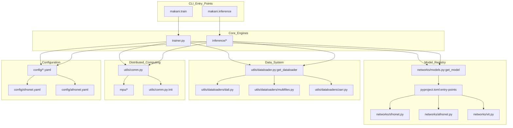
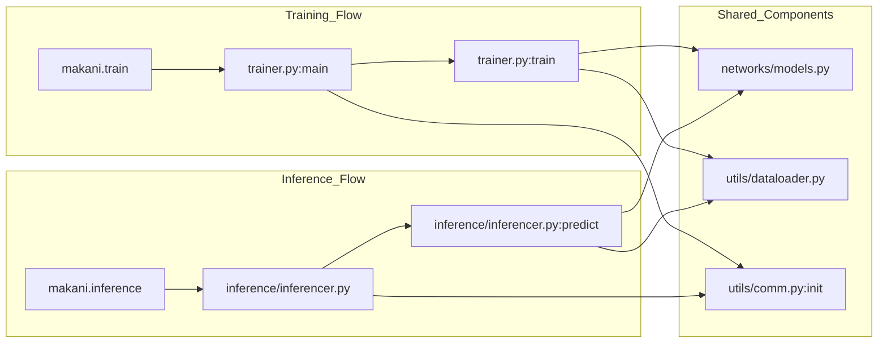
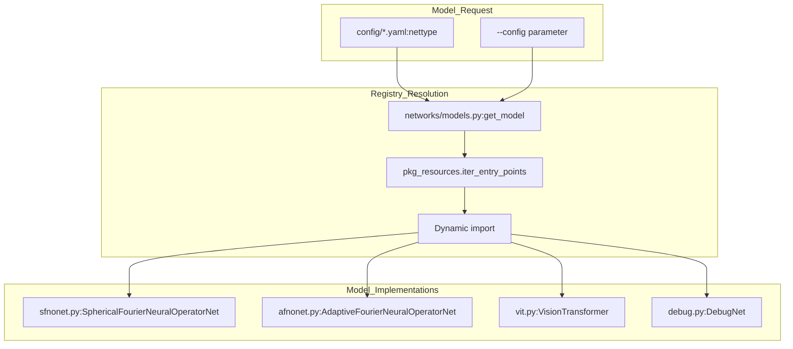
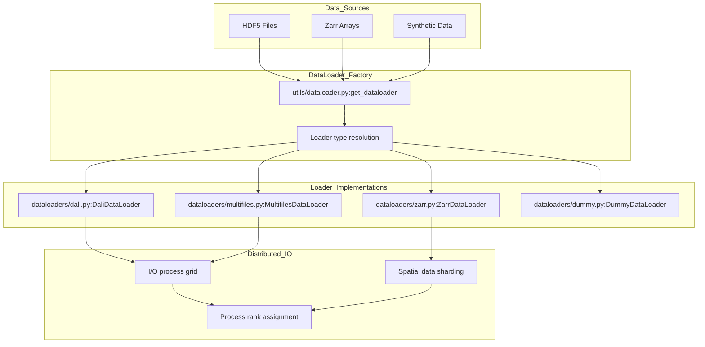
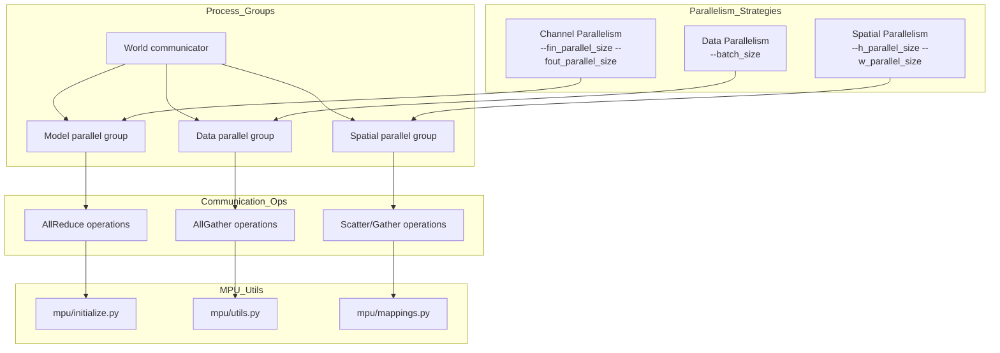

<!-- source: DeepWiki mcp.deepwiki.com · repo NVIDIA/makani · page 1 Overview · fetched 2026-10-26 -->

# Overview

Relevant source files

The following files were used as context for generating this wiki page:

- [.github/workflows/tests.yml](.github/workflows/tests.yml)
- [README.md](README.md)
- [pyproject.toml](pyproject.toml)

This document provides a high-level architectural overview of the Makani system, a PyTorch-based library designed for massively parallel training of machine learning weather and climate models. This overview covers the system's core execution engines, model registry, data pipeline, and distributed computing framework.

For detailed information about specific model architectures, see [Neural Network Models](#4). For configuration management details, see [Configuration System](#6). For data processing workflows, see [Data Pipeline](#5).

## Purpose and Scope

Makani is an experimental research library that enables training and inference of machine learning based weather and climate models on 100+ GPUs. The system supports various neural operator architectures including Spherical Fourier Neural Operators (SFNO) and Adaptive Fourier Neural Operators (AFNO), with comprehensive support for model parallelism, data parallelism, and distributed computing.

The system provides two main execution modes through CLI entry points: `makani.train` for distributed training and `makani.inference` for model evaluation and prediction.

Sources: [README.md:1-27](), [pyproject.toml:36-36]()

## System Architecture Overview

The following diagram illustrates the high-level architecture of Makani, showing the relationships between major system components and their corresponding code entities:

Sources: [README.md:98-99](), [README.md:83-96](), [pyproject.toml:106-115]()

## Core Execution Engines

Makani provides two primary execution engines accessible through CLI commands:

### Training Engine
The training engine is launched via `makani.train` and implemented in `trainer.py`. It handles distributed training orchestration, model checkpointing, and performance optimization features including:

| Feature | CLI Argument | Implementation |
|---------|--------------|----------------|
| Automatic Mixed Precision | `--amp_mode` | `none`, `fp16`, `bf16` |
| JIT Compilation | `--jit_mode` | `none`, `script`, `inductor` |
| CUDA Graphs | `--cuda_graph_mode` | `none`, `fwdbwd`, `step` |
| Activation Checkpointing | `--checkpointing_level` | 0,1,2,3 |

### Inference Engine
The inference engine is accessed via `makani.inference` and implemented in the `inference/` directory. It supports the same distributed computing features as training and handles model evaluation on out-of-sample datasets.

Sources: [README.md:31-35](), [README.md:61-65](), [README.md:39-50](), [README.md:95-96]()

## Model Registry and Entry Points

Makani implements a dynamic model loading system through Python entry points and a centralized model registry. The system supports plugin-style model registration for both internal Makani models and external framework integration.

### Entry Points Configuration
The model registry uses Python entry points defined in `pyproject.toml` to enable dynamic model discovery:

| Entry Point Group | Models | Purpose |
|-------------------|---------|---------|
| `makani.models` | AFNOv1, AFNO, FNO, SFNO, DebugNet, ViT | Internal Makani models |
| `modulus.models` | SFNO | Integration with NVIDIA Modulus framework |

### Model Resolution Flow

Sources: [pyproject.toml:106-115](), [README.md:105-105](), [README.md:109-109]()

## Data Pipeline Architecture

The data pipeline supports multiple data formats and distributed loading strategies through a factory pattern implemented in `get_dataloader`. The system handles HDF5, Zarr, and synthetic data sources with GPU-accelerated loading capabilities.

### DataLoader Factory System

### Data Format Support
The system expects training data in specific formats with accompanying metadata:

- **HDF5 Format**: Annual files with `inp` and `tar` variables for time-series prediction
- **Metadata**: `data.json` files describing dataset structure, channels, and grid coordinates
- **Grid Types**: Support for `equiangular` and `legendre-gauss` coordinate systems

Sources: [README.md:88-89](), [README.md:127-149]()

## Distributed Computing Framework

Makani implements multi-dimensional parallelization through an orthogonal communicator infrastructure managed by `comm.py`. The system supports data parallelism, spatial model parallelism, and channel parallelism.

### Communication Infrastructure

### Parallelization Configuration
The system supports flexible parallelization strategies configurable via CLI arguments:

| Parallelism Type | CLI Arguments | Purpose |
|------------------|---------------|---------|
| Data Parallelism | `--batch_size` | Distribute batches across processes |
| Spatial Parallelism | `--h_parallel_size`, `--w_parallel_size` | Split spatial dimensions |
| Channel Parallelism | `--fin_parallel_size`, `--fout_parallel_size` | Split feature channels |

Sources: [README.md:92-92](), [README.md:47-50](), [README.md:84-84]()

## Configuration Management

The system uses YAML-based configuration files located in the `config/` directory to specify model architectures, training parameters, and dataset configurations. Each configuration file contains complete specifications for reproducible training runs.

### Configuration Structure
Key configuration parameters include:

| Parameter | Description | Location |
|-----------|-------------|----------|
| `nettype` | Model architecture selection | Maps to entry points |
| `train_data_path` | Training dataset location | File system path |
| `metadata_json_path` | Dataset metadata file | `data.json` file |
| `channel_names` | Input/output channels | Dataset-specific |

The configuration system integrates with the model registry to dynamically load appropriate model classes based on the `nettype` parameter.

Sources: [README.md:104-123](), [README.md:78-78]()

---

