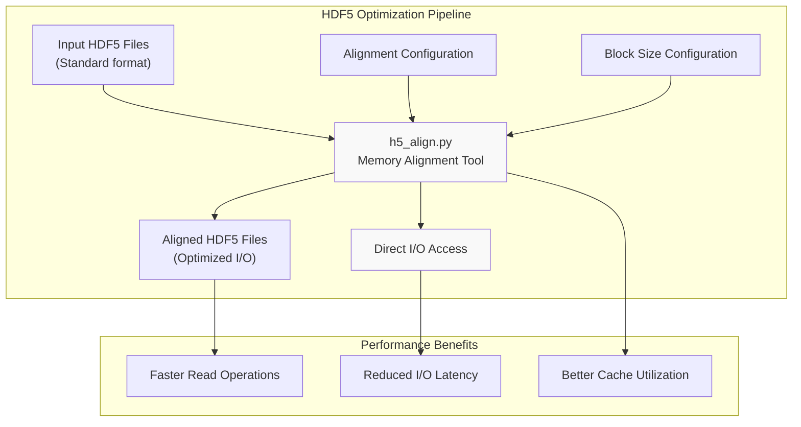
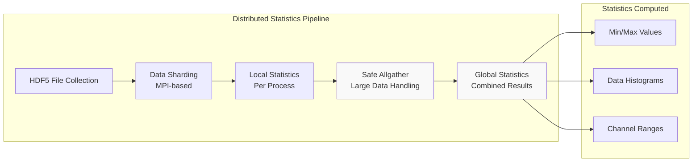
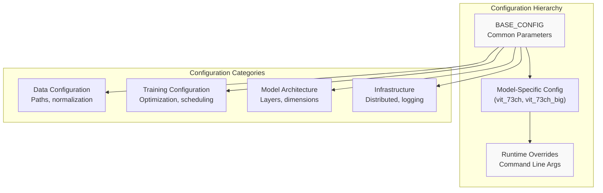
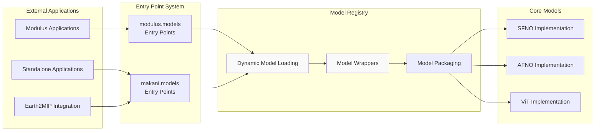
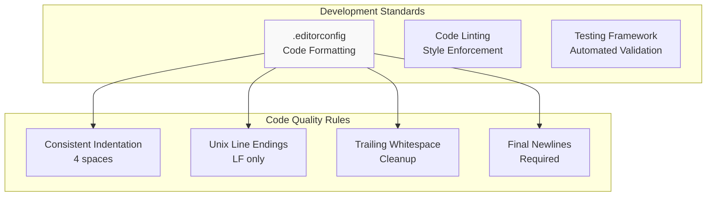

<!-- source: DeepWiki mcp.deepwiki.com · repo NVIDIA/makani · page 10 Advanced Topics · fetched 2026-10-26 -->

# Advanced Topics

Relevant source files

The following files were used as context for generating this wiki page:

- [.editorconfig](.editorconfig)
- [config/vit.yaml](config/vit.yaml)
- [data_process/get_histograms.py](data_process/get_histograms.py)
- [data_process/h5_align.py](data_process/h5_align.py)

This page covers advanced usage patterns, performance optimization techniques, and integration strategies for the Makani system. It is intended for experienced users who need to optimize performance, integrate with external frameworks, or implement custom processing pipelines.

For basic configuration and model usage, see [Configuration System](#6). For standard data loading patterns, see [Data Pipeline](#5). For basic distributed computing concepts, see [Distributed Computing Framework](#3.3).

## Performance Optimization

### Data Pipeline Optimization

Makani provides several advanced techniques for optimizing data I/O performance, particularly important when training on large climate datasets.

#### HDF5 Memory Alignment

The system includes utilities for optimizing HDF5 file access patterns through memory alignment, which can significantly improve I/O performance on high-performance storage systems.

Key optimization parameters include:

| Parameter | Purpose | Typical Values |
|-----------|---------|----------------|
| `align_size_bytes` | Memory alignment boundary | 4096, 8192 |
| `block_size_bytes` | I/O block size | System dependent |
| `batch_size` | Processing batch size | 32-128 |

The alignment tool [data_process/h5_align.py:25-87]() provides several optimization features:

- **Direct I/O Access**: Uses HDF5's direct driver for bypassing OS cache [data_process/h5_align.py:34]()
- **Memory Alignment**: Ensures data is aligned to optimal boundaries [data_process/h5_align.py:32]()
- **Batch Processing**: Processes data in chunks to manage memory usage [data_process/h5_align.py:62-71]()
- **Data Transposition**: Optional layout optimization for better access patterns [data_process/h5_align.py:67-68]()

Sources: `data_process/h5_align.py`

#### Distributed Statistical Analysis

For large-scale data analysis, Makani provides MPI-based tools for computing statistics across distributed datasets without loading entire datasets into memory.

The distributed statistics system [data_process/get_histograms.py:181-346]() includes:

- **Safe Large Data Gathering**: Chunked communication to handle large statistical objects [data_process/get_histograms.py:34-84]()
- **Memory-Efficient Processing**: Processes data in batches to control memory usage [data_process/get_histograms.py:110-122]()
- **Slice-Based Access**: Optimizes file access patterns using intelligent slicing [data_process/get_histograms.py:87-91]()

Sources: `data_process/get_histograms.py`

## Advanced Configuration Patterns

### Complex Model Configuration

Makani supports sophisticated configuration patterns using YAML anchors and inheritance for managing complex model setups.

Advanced configuration features include:

- **YAML Anchors**: Reusable configuration blocks using `&BASE_CONFIG` and `<<: *BASE_CONFIG` [config/vit.yaml:1, 111]()
- **Hierarchical Overrides**: Base configurations with model-specific overrides [config/vit.yaml:117-124]()
- **Multi-Scale Configurations**: Different model sizes with optimized hyperparameters [config/vit.yaml:110-124]()

Key configuration categories:

| Category | Key Parameters | Example Values |
|----------|----------------|----------------|
| Model Architecture | `embed_dim`, `depth`, `num_heads` | 384, 12, 8 |
| Training Optimization | `lr`, `batch_size`, `max_epochs` | 5E-4, 32, 150 |
| Data Processing | `normalization`, `channel_names` | "zscore", 73 channels |
| Infrastructure | `wireup_info`, `num_data_workers` | "mpi", 4 |

Sources: `config/vit.yaml`

### Advanced Training Strategies

The configuration system supports sophisticated training strategies:

- **Learning Rate Scheduling**: Multiple scheduler types with warm-up [config/vit.yaml:30-32]()
- **Dropout Strategies**: Per-component dropout configuration [config/vit.yaml:35-37]()
- **Prediction Types**: Iterative vs single-step prediction modes [config/vit.yaml:47-50]()
- **Invariant Integration**: Orography and land mask incorporation [config/vit.yaml:84-87]()

Sources: `config/vit.yaml`

## Integration with External Frameworks

### Modulus Framework Integration

Makani integrates with NVIDIA Modulus through a dual entry point system, allowing models to be used both as standalone components and within the broader Modulus ecosystem.

The integration system provides:

- **Dual Entry Points**: Models accessible via both `makani.models` and `modulus.models` namespaces
- **Dynamic Loading**: Runtime model discovery and instantiation
- **Wrapper Compatibility**: Single-step and multi-step prediction wrappers for different use cases
- **Deployment Packaging**: Models packaged for external deployment scenarios

Sources: Based on architecture diagrams and entry point system

### Earth2MIP Compatibility

Makani models are designed to be compatible with Earth2MIP for operational weather forecasting deployments:

- **Standardized Interfaces**: Consistent input/output formats
- **Checkpoint Compatibility**: Flexible checkpoint loading for deployed models
- **Inference Optimization**: Optimized inference paths for production use

Sources: Based on architecture diagrams and model packaging system

## Advanced Development Patterns

### Code Quality and Standards

The project maintains strict development standards through automated tooling:

Development configuration includes:

- **Universal Standards**: Applied to all file types [.editorconfig:3-8]()
- **Language-Specific Rules**: Special handling for Markdown, YAML, and Makefiles [.editorconfig:10-18]()
- **Consistency Enforcement**: Automated formatting and validation

| File Type | Indent Style | Indent Size | Special Rules |
|-----------|--------------|-------------|---------------|
| Python, General | Space | 4 | Trim whitespace |
| YAML | Space | 4 | Consistent formatting |
| Markdown | Space | 4 | Preserve trailing spaces |
| Makefile | Tab | N/A | Tab-based indentation |

Sources: `.editorconfig`

### Performance Profiling and Debugging

Advanced users can leverage several debugging and profiling capabilities:

- **Distributed Debugging**: MPI-aware debugging tools for multi-process issues
- **Memory Profiling**: Tools for analyzing memory usage patterns in large-scale training
- **I/O Performance Analysis**: Benchmarking data loading and storage access patterns
- **Model Verification**: Debug models and synthetic data loaders for validation

The system includes debug utilities like `DebugNet` models for testing infrastructure without computational overhead.

Sources: Based on architecture diagrams and utility systems

## Custom Extension Points

### Custom Data Loaders

Advanced users can implement custom data loaders by following the factory pattern used in the data pipeline:

- **Factory Registration**: Register new loader types with the `get_dataloader` system
- **Distributed I/O**: Implement distributed sharding and process group integration
- **Performance Optimization**: Leverage GPU-accelerated processing patterns like DALI

### Custom Model Architectures

The entry point system allows for custom model registration:

- **Entry Point Registration**: Add models to the registry system
- **Wrapper Implementation**: Implement single-step and multi-step prediction interfaces
- **Configuration Integration**: Support for YAML-based configuration

Sources: Based on architecture diagrams and extensibility patterns