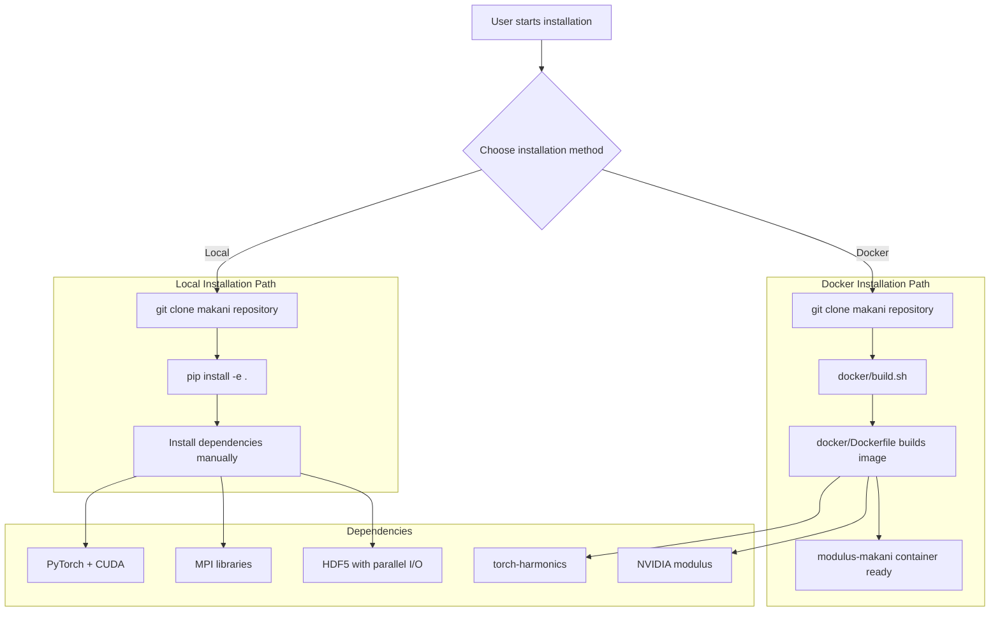
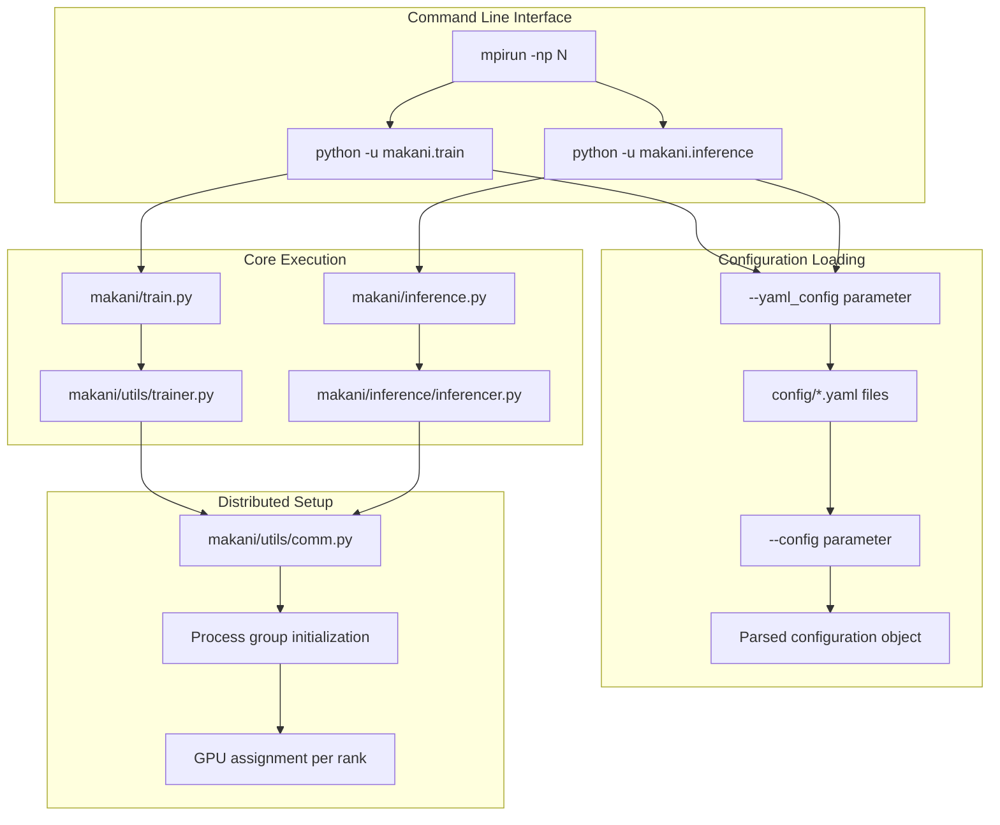

<!-- source: DeepWiki mcp.deepwiki.com · repo NVIDIA/makani · page 2 Getting Started · fetched 2026-10-26 -->

# Getting Started

<details>
<summary>Relevant source files</summary>

The following files were used as context for generating this wiki page:

- [.github/workflows/tests.yml](.github/workflows/tests.yml)
- [README.md](README.md)
- [docker/Dockerfile](docker/Dockerfile)
- [docker/build.sh](docker/build.sh)

</details>


This document provides instructions for installing Makani, configuring your first training or inference job, and understanding the basic execution workflow. It covers environment setup, command-line usage, and fundamental configuration concepts needed to run weather and climate prediction models.

For detailed information about model architectures, see [Neural Network Models](#4). For advanced distributed computing configurations, see [Distributed Computing Framework](#3.3). For comprehensive configuration options, see [Configuration System](#6).

## Installation and Environment Setup

Makani can be installed in two ways: direct installation from source or using the provided Docker environment for reproducible builds.

### Local Installation

The simplest installation method clones the repository and installs the package in development mode:

```bash
git clone git@github.com:NVIDIA/makani.git
cd makani
pip install -e .
```

This installation method requires manual dependency management. For a complete list of dependencies, refer to the GitHub Actions workflow at [.github/workflows/tests.yml:16-22]().

### Docker Environment

For reproducible training environments, Makani provides a Docker-based setup that includes all required dependencies and optimizations:

```bash
cd docker
./build.sh
```

The Docker image is built from [docker/Dockerfile]() and includes:
- PyTorch with CUDA support
- MPI libraries for distributed computing  
- HDF5 with parallel I/O support
- Additional ML libraries (torch-harmonics, modulus)
- Performance optimization patches

**Installation Workflow**



Sources: [README.md:21-27](), [docker/Dockerfile](), [docker/build.sh](), [.github/workflows/tests.yml:16-29]()

## Basic Usage

Makani provides two main CLI entry points for training and inference operations. Both scripts use identical command-line interfaces and configuration systems.

### Training Execution

Training is launched using the `makani.train` CLI script with YAML configuration files:

```bash
mpirun -np 8 --allow-run-as-root python -u makani.train \
    --yaml_config="config/sfnonet.yaml" \
    --config="sfno_linear_73chq_sc3_layers8_edim384_asgl2"
```

The `--yaml_config` parameter specifies the configuration file, while `--config` selects a specific configuration target within that file.

### Inference Execution  

Inference follows the same pattern as training but uses the `makani.inference` entry point:

```bash
mpirun -np 8 --allow-run-as-root python -u makani.inference \
    --yaml_config="config/sfnonet.yaml" \
    --config="sfno_linear_73chq_sc3_layers8_edim384_asgl2"
```

By default, inference runs on the out-of-sample dataset specified in the configuration file.

**CLI Execution Workflow**



Sources: [README.md:29-65](), [makani/train.py](), [makani/inference.py](), [makani/utils/trainer.py](), [makani/inference/inferencer.py]()

## Configuration System

Makani uses YAML-based configuration files located in the `config/` directory. Each file contains multiple named configurations for different model architectures and training scenarios.

### Configuration Structure

The configuration system defines model architecture, training parameters, data paths, and optimization settings:

| Configuration Key | Description | Example Values |
|-------------------|-------------|----------------|
| `nettype` | Model architecture | `SFNO`, `AFNO`, `FNO`, `ViT` |
| `loss` | Loss function | `l2`, `geometric l2` |
| `optimizer` | Optimization algorithm | `Adam`, `AdamW` |
| `batch_size` | Training batch size | `1`, `64`, `128` |
| `train_data_path` | Training dataset directory | `/path/to/train/data` |
| `metadata_json_path` | Dataset metadata file | `/path/to/data.json` |
| `exp_dir` | Output directory for checkpoints | `/path/to/experiments` |

### Available Configurations

The main configuration files include:

- `config/sfnonet.yaml` - Spherical Fourier Neural Operator configurations
- `config/afnonet.yaml` - Adaptive Fourier Neural Operator configurations  
- `config/vit.yaml` - Vision Transformer configurations

Each configuration file contains multiple named targets that can be selected via the `--config` CLI argument.

Sources: [README.md:104-126](), [config/README.md]()

## Performance Optimization Options

Makani provides several CLI arguments for optimizing memory usage and training performance:

### Memory and Compute Optimizations

| Feature | CLI Argument | Options | Description |
|---------|--------------|---------|-------------|
| Automatic Mixed Precision | `--amp_mode` | `none`, `fp16`, `bf16` | Reduces memory usage and improves speed |
| Just-in-time Compilation | `--jit_mode` | `none`, `script`, `inductor` | Optimizes model execution |
| CUDA Graphs | `--cuda_graph_mode` | `none`, `fwdbwd`, `step` | Reduces kernel launch overhead |
| Activation Checkpointing | `--checkpointing_level` | `0`, `1`, `2`, `3` | Trades compute for memory |

### Parallelization Strategies

| Parallelism Type | CLI Arguments | Description |
|------------------|---------------|-------------|
| Data Parallelism | `--batch_size` | Distributes batch across ranks |
| Channel Parallelism | `--fin_parallel_size`, `--fout_parallel_size` | Splits input/output channels |
| Spatial Parallelism | `--h_parallel_size`, `--w_parallel_size` | Splits spatial dimensions |
| Multi-step Training | `--multistep_count` | Enables autoregressive training |

### Large-Scale Training Example

For large models requiring significant memory optimization:

```bash
mpirun -np 256 --allow-run-as-root python -u makani.train \
    --amp_mode=bf16 \
    --cuda_graph_mode=fwdbwd \
    --multistep_count=1 \
    --yaml_config="config/sfnonet.yaml" \
    --config="sfno_linear_73chq_sc3_layers8_edim384_asgl2" \
    --h_parallel_size=4 \
    --w_parallel_size=1 \
    --batch_size=64
```

This example uses 256 GPUs with spatial parallelism, mixed precision, and CUDA graphs for optimal performance.

Sources: [README.md:39-58]()

## Data Requirements

Makani expects training data in HDF5 format with specific structure and metadata requirements.

### Dataset Format

- **File Organization**: One HDF5 file per year of data
- **Data Variables**: `inp` (input) and `tar` (target) arrays representing atmospheric states
- **Temporal Resolution**: Determined by `dhours` parameter in metadata
- **Time Stepping**: `dt` parameter controls input-target time difference

### Metadata Requirements

Each dataset requires a `data.json` metadata file describing the dataset structure:

```json
{
    "dataset_name": "ERA5 reanalysis",
    "h5_path": "fields",
    "dims": ["time", "channel", "lat", "lon"],
    "dhours": 6,
    "coord": {
        "grid_type": "equiangular",
        "lat": [90.0, 89.5, ...],
        "lon": [0.0, 0.5, ...],
        "channel": ["t2m", "u10", "v10", ...]
    }
}
```

The ERA5 dataset can be downloaded from the [Copernicus Climate Data Store](https://cds.climate.copernicus.eu/cdsapp#!/dataset/reanalysis-era5-single-levels).

Sources: [README.md:127-151]()

## Project Structure

Understanding the codebase organization helps navigate Makani's components:

```
makani/
├── config/                 # YAML configuration files
├── makani/
│   ├── train.py           # Training CLI entry point
│   ├── inference.py       # Inference CLI entry point
│   ├── utils/
│   │   ├── trainer.py     # Main training logic
│   │   ├── comm.py        # Distributed communication
│   │   └── dataloaders/   # Data loading implementations
│   ├── networks/          # Model architectures
│   ├── inference/         # Inference engine
│   └── mpu/              # Model parallelism utilities
├── tests/                 # Unit tests
└── docker/               # Container build scripts
```

Sources: [README.md:71-102]()

## Next Steps

After completing the basic setup:

1. **Configure your first training run**: Review available configurations in [Configuration System](#6)
2. **Understand model architectures**: Explore supported models in [Neural Network Models](#4)  
3. **Set up distributed training**: Learn about parallelization in [Distributed Computing Framework](#3.3)
4. **Prepare your data**: Follow data preparation guidelines in [Data Pipeline](#5)
5. **Deploy trained models**: Review packaging and deployment in [Model Deployment and Packaging](#7)

For development contributions, see [Development Environment](#8) for build systems and testing frameworks.

---

