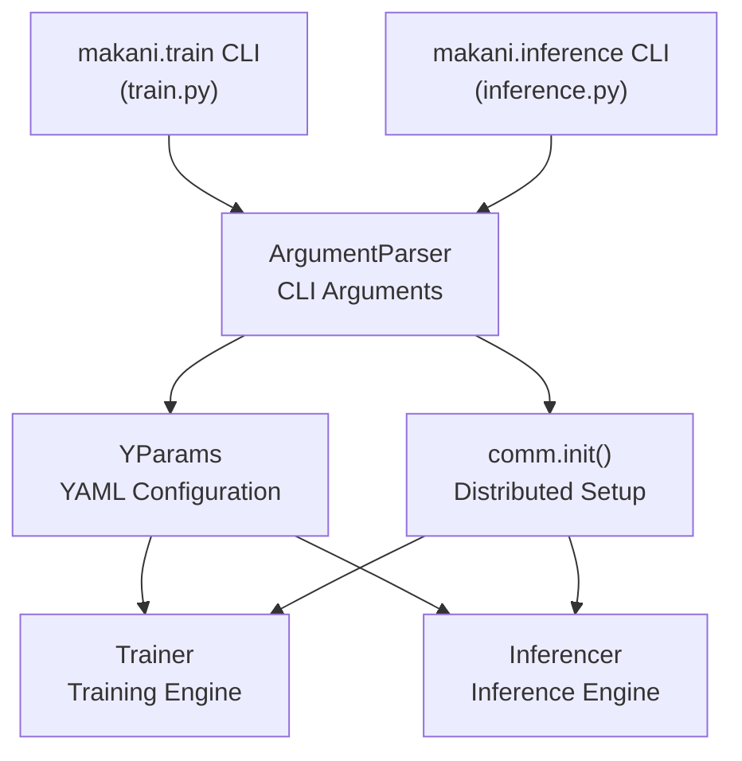
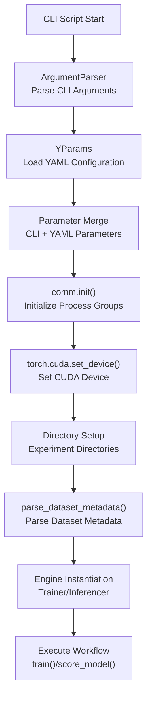
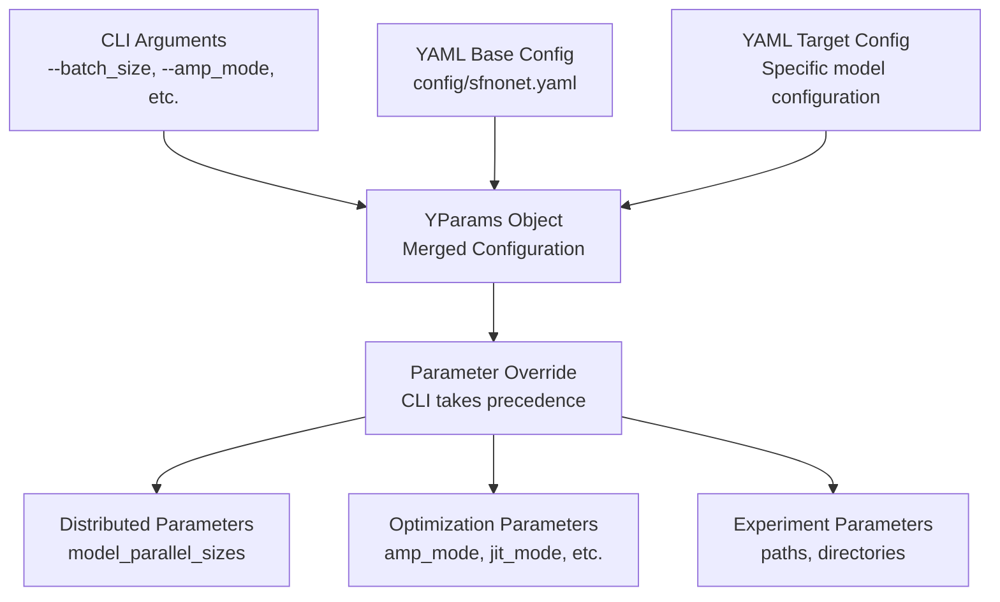
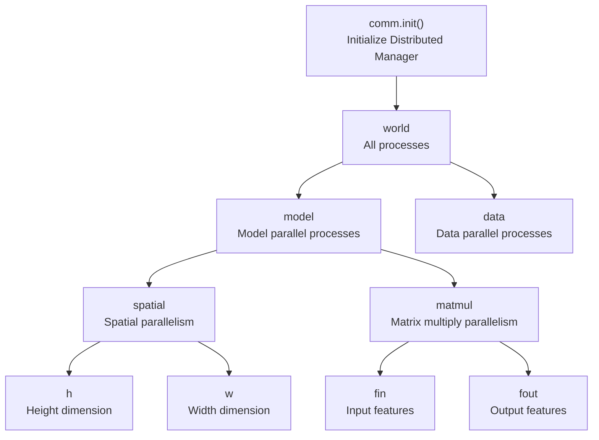
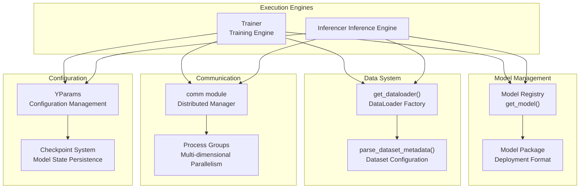

<!-- source: DeepWiki mcp.deepwiki.com · repo NVIDIA/makani · page 3.1 Training and Inference Engines · fetched 2026-10-26 -->

# Training and Inference Engines

<details>
<summary>Relevant source files</summary>

The following files were used as context for generating this wiki page:

- [.github/workflows/tests.yml](.github/workflows/tests.yml)
- [README.md](README.md)
- [makani/inference.py](makani/inference.py)
- [makani/utils/comm.py](makani/utils/comm.py)

</details>


This document covers the core execution engines that drive machine learning workflows in Makani: the training and inference systems. These engines serve as the primary entry points for users and orchestrate the entire pipeline from data loading through model execution to result generation.

The training and inference engines handle CLI argument parsing, distributed computing setup, configuration management, and coordination with other system components including the model registry ([3.2](#3.2)), distributed computing framework ([3.3](#3.3)), and data pipeline ([5](#5)). For information about specific model architectures, see [Neural Network Models](#4). For data loading details, see [Data Pipeline](#5).

## CLI Entry Points

Makani provides two primary CLI scripts that serve as the main user interface for training and inference operations.

### Training Entry Point

The training workflow is initiated through `makani.train`, which corresponds to the `train.py` script referenced throughout the configuration system. Users launch training with:

```bash
mpirun -np 8 --allow-run-as-root python -u makani.train --yaml_config="config/sfnonet.yaml" --config="sfno_linear_73chq_sc3_layers8_edim384_asgl2"
```

### Inference Entry Point

The inference workflow is handled by the `inference.py` script, which provides CLI access to model evaluation and scoring capabilities. The inference engine supports multiple execution modes and comprehensive performance optimization options.



**CLI Entry Points Architecture**

Sources: [README.md:31-35](), [README.md:61-65](), [makani/inference.py:34-62]()

## Execution Workflow

The training and inference engines follow a systematic workflow that coordinates multiple system components to execute ML operations at scale.

### Common Initialization Pattern

Both engines follow a similar initialization pattern that establishes the distributed computing environment and configuration management:



**Execution Workflow Pattern**

Sources: [makani/inference.py:62-166](), [makani/utils/comm.py:96-154]()

### Inference Execution Details

The inference engine implements a specialized workflow for model evaluation and scoring:

| Execution Phase | Component | Purpose |
|----------------|-----------|---------|
| Parameter Setup | `YParams` | Merge CLI arguments with YAML configuration |
| Distributed Init | `comm.init()` | Establish process groups for parallelism |
| Device Config | `torch.cuda.set_device()` | Configure CUDA devices and optimization |
| Directory Setup | `os.makedirs()` | Create experiment and output directories |
| Metadata Parse | `parse_dataset_metadata()` | Load dataset characteristics |
| Engine Creation | `Inferencer()` | Instantiate inference engine |
| Model Scoring | `inferencer.score_model()` | Execute inference workflow |

Sources: [makani/inference.py:84-166]()

## Configuration Management

The engines implement a sophisticated configuration system that merges CLI arguments with YAML-based configuration files to provide flexible parameter management.

### Parameter Hierarchy



**Configuration Management Hierarchy**

### Key Configuration Categories

The engines manage several categories of configuration parameters:

**Distributed Computing Parameters:**
- `fin_parallel_size`, `fout_parallel_size` - Feature parallelism dimensions
- `h_parallel_size`, `w_parallel_size` - Spatial parallelism dimensions  
- `model_parallel_sizes` - Combined parallelism configuration
- `model_parallel_names` - Process group naming

**Optimization Parameters:**
- `amp_mode` - Mixed precision mode (`none`, `fp16`, `bf16`)
- `jit_mode` - JIT compilation mode (`none`, `script`, `inductor`)
- `cuda_graph_mode` - CUDA graph capture mode (`none`, `fwdbwd`, `step`)
- `checkpointing_level` - Activation checkpointing aggressiveness

**Data and Experiment Parameters:**
- `batch_size` - Local batch size after data parallel distribution
- `global_batch_size` - Total batch size across all processes
- `experiment_dir` - Output directory for results and checkpoints
- `checkpoint_path` - Model checkpoint file paths

Sources: [makani/inference.py:65-95](), [makani/inference.py:125-135]()

## Distributed Computing Integration

The engines integrate tightly with Makani's distributed computing framework to enable massively parallel execution across hundreds of GPUs.

### Process Group Initialization



**Distributed Process Group Hierarchy**

The engines establish a hierarchical process group structure that enables multi-dimensional parallelism:

| Process Group | Purpose | CLI Parameter |
|---------------|---------|---------------|
| `world` | Global communication across all processes | N/A |
| `model` | Model parallel communication | Combined from spatial/matmul |
| `data` | Data parallel communication | Derived from total processes |
| `spatial` | Spatial dimension parallelism | `h_parallel_size`, `w_parallel_size` |
| `matmul` | Feature dimension parallelism | `fin_parallel_size`, `fout_parallel_size` |

Sources: [makani/utils/comm.py:96-154](), [makani/inference.py:68-84]()

### Batch Size Distribution

The engines implement automatic batch size distribution across data parallel processes:

1. **Global Batch Size Validation**: Ensures `global_batch_size` is evenly divisible by data parallel size
2. **Local Batch Size Calculation**: Computes `batch_size = global_batch_size // data_parallel_size`  
3. **Memory and I/O Optimization**: Reduces per-process memory footprint and I/O load

Sources: [makani/inference.py:87-93]()

## Integration with Other Systems

The training and inference engines serve as orchestration layers that coordinate with other major system components.



**System Integration Architecture**

### Key Integration Points

**Model Registry Integration:**
- Engines instantiate models through the dynamic model loading system
- Model selection based on `nettype` configuration parameter
- Support for both legacy and flexible checkpoint formats

**Data Pipeline Integration:**  
- Engines use `get_dataloader()` factory function for data loading
- Automatic selection of appropriate dataloader (DALI, multifiles, Zarr, dummy)
- Integration with distributed I/O for spatial parallelism

**Distributed Computing Integration:**
- Engines initialize and manage process groups through `comm` module
- Coordinate with `DistributedManager` from Modulus framework
- Handle multi-dimensional parallelism strategies

**Configuration System Integration:**
- Engines merge CLI arguments with YAML configuration files
- Support for configuration inheritance and parameter overrides
- Integration with experiment directory management and logging

Sources: [makani/inference.py:30-32](), [makani/inference.py:154-159](), [makani/inference.py:161-166]()

---

