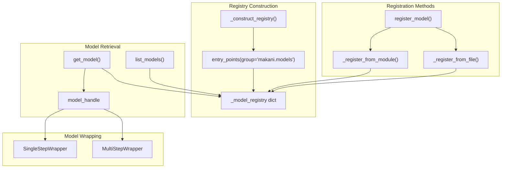
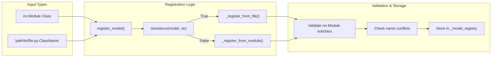
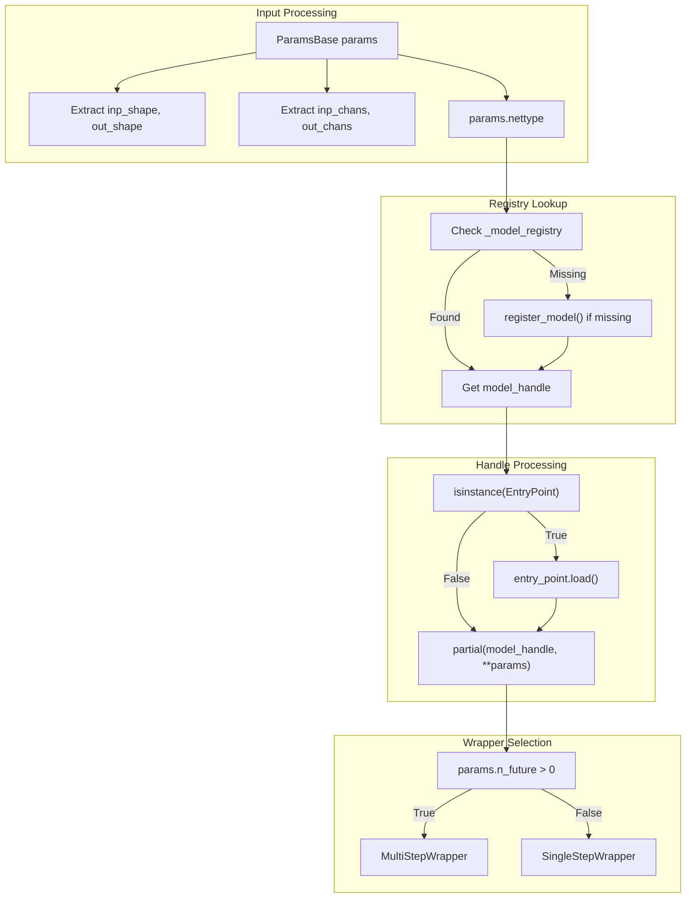
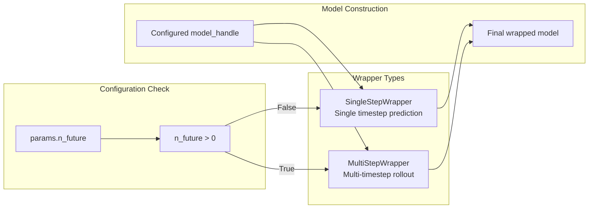

<!-- source: DeepWiki mcp.deepwiki.com · repo NVIDIA/makani · page 3.2 Model Registry System · fetched 2026-10-26 -->

# Model Registry System

<details>
<summary>Relevant source files</summary>

The following files were used as context for generating this wiki page:

- [makani/models/model_registry.py](makani/models/model_registry.py)
- [pyproject.toml](pyproject.toml)

</details>


## Purpose and Scope

The Model Registry System provides dynamic model loading and instantiation capabilities for the Makani framework. It enables registration and retrieval of neural network models through a plugin-based architecture using Python entry points, allowing both built-in models and external models to be seamlessly integrated into the training and inference pipelines.

This system handles model discovery, registration, and instantiation with appropriate wrapper classes. For information about specific model architectures (SFNO, AFNO, etc.), see [Neural Network Models](#4). For training and inference execution workflows, see [Training and Inference Engines](#3.1).

## Entry Points System

The model registry is built on Python's entry points mechanism, defined in `pyproject.toml`. This allows models to be registered as plugins that can be discovered and loaded at runtime.

### Entry Point Groups

Makani defines two entry point groups for model registration:

| Group | Purpose | Integration |
|-------|---------|-------------|
| `makani.models` | Native Makani models | Direct integration with Makani training/inference |
| `modulus.models` | Modulus framework compatibility | Integration with NVIDIA Modulus ecosystem |

### Registered Models

The following models are registered through entry points:

```mermaid
graph TB
    subgraph "Entry Point Groups"
        MAKANI_EP["makani.models"]
        MODULUS_EP["modulus.models"]
    end
    
    subgraph "Model Implementations"
        AFNOV1["AFNOv1<br/>makani.models.networks.afnonet:AdaptiveFourierNeuralOperatorNet"]
        AFNO["AFNO<br/>makani.models.networks.afnonet_v2:AdaptiveFourierNeuralOperatorNet"]
        FNO["FNO<br/>makani.models.networks.sfnonet:FourierNeuralOperatorNet"]
        SFNO_MAKANI["SFNO<br/>makani.models.networks.sfnonet:SphericalFourierNeuralOperatorNet"]
        DEBUG["DebugNet<br/>makani.models.networks.debug:DebugNet"]
        VIT["ViT<br/>makani.models.networks.vit:VisionTransformer"]
        SFNO_MODULUS["SFNO<br/>makani.models.networks.sfnonet:SFNO"]
    end
    
    MAKANI_EP --> AFNOV1
    MAKANI_EP --> AFNO
    MAKANI_EP --> FNO
    MAKANI_EP --> SFNO_MAKANI
    MAKANI_EP --> DEBUG
    MAKANI_EP --> VIT
    
    MODULUS_EP --> SFNO_MODULUS
```



**Sources:** [pyproject.toml:106-116]()

## Registry Architecture

The model registry system consists of several key components that work together to provide dynamic model loading capabilities.

### Core Registry Components



**Sources:** [makani/models/model_registry.py:34-171]()

### Registry Initialization

The registry is automatically constructed when the module is imported through the `_construct_registry()` function:

```python
def _construct_registry() -> dict:
    registry = {}
    entrypoints = entry_points(group="makani.models")
    for entry_point in entrypoints:
        registry[entry_point.name] = entry_point
    return registry
```

**Sources:** [makani/models/model_registry.py:34-39](), [makani/models/model_registry.py:170]()

## Model Registration Process

The registry supports multiple methods for registering models, providing flexibility for different use cases.

### Registration Methods

| Method | Input Type | Use Case |
|--------|------------|----------|
| `_register_from_module()` | `nn.Module` class | Direct class registration |
| `_register_from_file()` | File path string | External model files |
| `register_model()` | Either type | Public interface |

### Registration Workflow



**Sources:** [makani/models/model_registry.py:42-104]()

### File-based Registration

The `_register_from_file()` method enables dynamic loading of models from external Python files:

```python
def _register_from_file(model_string: str, name: Union[str, None] = None) -> None:
    assert len(model_string.split(":")) == 2
    model_path, model_handle = model_string.split(":")
    
    module_spec = importlib.util.spec_from_file_location(model_handle, model_path)
    module = importlib.util.module_from_spec(module_spec)
    module_spec.loader.exec_module(module)
    model = getattr(module, model_handle)
```

**Sources:** [makani/models/model_registry.py:63-79]()

## Model Retrieval and Instantiation

The `get_model()` function serves as the primary interface for retrieving and instantiating registered models with proper configuration.

### Model Instantiation Flow



**Sources:** [makani/models/model_registry.py:119-166]()

### Parameter Extraction

The system automatically extracts required model parameters from the configuration:

| Parameter | Source | Purpose |
|-----------|--------|---------|
| `inp_shape` | `params.img_crop_shape_x/y` | Input spatial dimensions |
| `out_shape` | `params.out_shape_x/y` | Output spatial dimensions |
| `inp_chans` | `params.N_in_channels` | Input channel count |
| `out_chans` | `params.N_out_channels` | Output channel count |

**Sources:** [makani/models/model_registry.py:142-145]()

## Wrapper Integration

All models retrieved through the registry are automatically wrapped with either `SingleStepWrapper` or `MultiStepWrapper` based on the configuration.

### Wrapper Selection Logic



**Sources:** [makani/models/model_registry.py:160-165]()

## External Framework Integration

The registry system enables integration with external frameworks through dedicated entry point groups.

### Modulus Integration

The `modulus.models` entry point group provides compatibility with the NVIDIA Modulus framework:

```python
[project.entry-points."modulus.models"]
SFNO = "makani.models.networks.sfnonet:SFNO"
```

This allows Modulus applications to discover and use Makani models through their own model registry system.

### Registry API

The registry provides a simple API for external access:

| Function | Purpose | Return Type |
|----------|---------|-------------|
| `list_models()` | List registered model names | `List[str]` |
| `get_model()` | Retrieve configured model | `torch.nn.Module` |
| `register_model()` | Register new model | `None` |

**Sources:** [pyproject.toml:114-115](), [makani/models/model_registry.py:106-117]()

---

