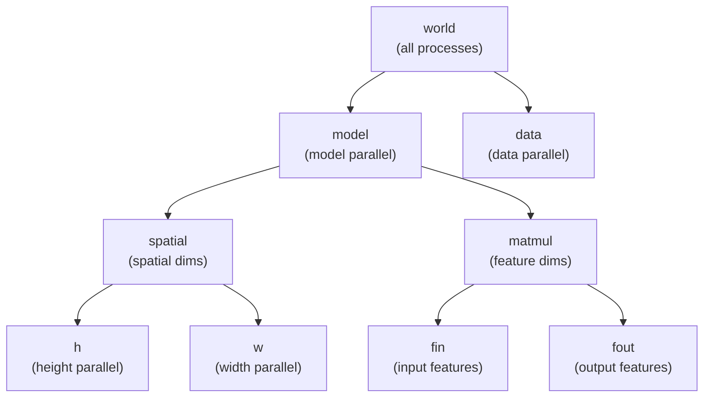
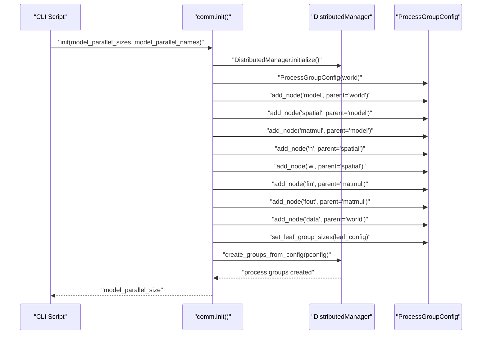
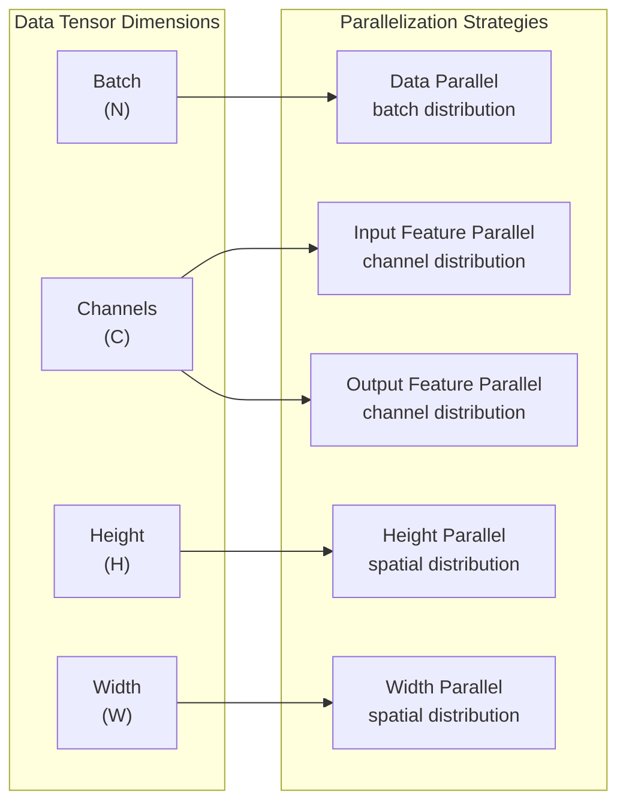
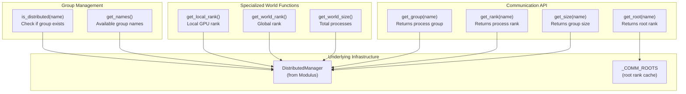
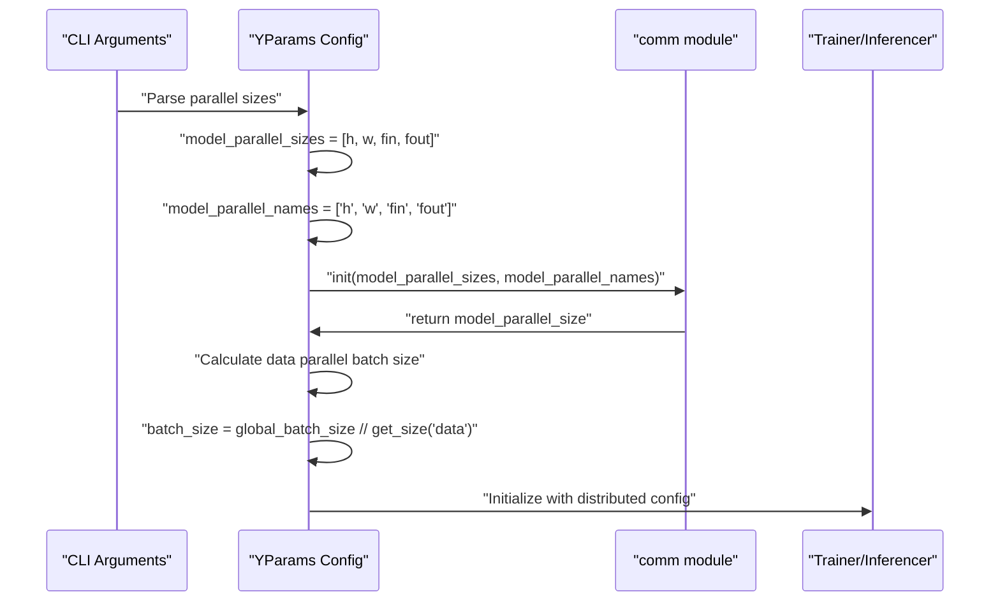

<!-- source: DeepWiki mcp.deepwiki.com · repo NVIDIA/makani · page 3.3 Distributed Computing Framework · fetched 2026-10-26 -->

# Distributed Computing Framework

<details>
<summary>Relevant source files</summary>

The following files were used as context for generating this wiki page:

- [.github/workflows/tests.yml](.github/workflows/tests.yml)
- [README.md](README.md)
- [makani/inference.py](makani/inference.py)
- [makani/utils/comm.py](makani/utils/comm.py)

</details>


## Purpose and Scope

The Distributed Computing Framework in Makani enables massively parallel training and inference of weather and climate models across hundreds of GPUs. This framework implements multi-dimensional parallelization strategies including spatial, feature, and data parallelism to efficiently distribute both model parameters and data across compute resources.

For information about the high-level training and inference execution that uses this framework, see [Training and Inference Engines](#3.1). For details about how models leverage the parallelization capabilities, see [Neural Network Models](#4).

## Process Group Hierarchy

The distributed computing framework is built on top of the Modulus `DistributedManager` and creates a hierarchical structure of process groups to enable orthogonal parallelization strategies.

### Process Group Architecture



The framework establishes this hierarchy through the `comm.init()` function, which configures process groups based on the specified parallelization dimensions. Each leaf group corresponds to a specific parallelization strategy that can be applied independently.

**Sources:** [makani/utils/comm.py:96-154]()

### Initialization Workflow



The initialization process creates the process group hierarchy and calculates the data parallel size automatically based on the total world size and specified model parallel dimensions.

**Sources:** [makani/utils/comm.py:96-154](), [makani/inference.py:81-84]()

## Multi-Dimensional Parallelism Strategies

The framework supports four orthogonal parallelization dimensions that can be combined to efficiently scale models across large numbers of GPUs.

### Parallelism Strategy Mapping

| Parallelism Type | CLI Arguments | Process Groups | Purpose |
|------------------|---------------|----------------|---------|
| Spatial | `--h_parallel_size`, `--w_parallel_size` | `h`, `w` | Partition spatial dimensions (height/width) |
| Feature Input | `--fin_parallel_size` | `fin` | Partition input feature channels |
| Feature Output | `--fout_parallel_size` | `fout` | Partition output feature channels |
| Data | Calculated automatically | `data` | Distribute batch across processes |

### Parallelism Strategy Implementation



The parallelization strategies work by partitioning different tensor dimensions across process groups. Each strategy reduces memory requirements and enables larger models to fit in GPU memory.

**Sources:** [README.md:47-51](), [makani/inference.py:36-39]()

## Communication Infrastructure

The communication layer provides utilities for distributed operations and process group management through a set of utility functions that abstract the underlying Modulus `DistributedManager`.

### Core Communication Functions



These functions provide a consistent interface for querying process group information and performing distributed operations across different parallelization strategies.

**Sources:** [makani/utils/comm.py:32-95]()

## Integration with Training and Inference

The distributed computing framework is tightly integrated with the training and inference engines through parameter configuration and batch size calculation.

### Training/Inference Integration Flow



The framework automatically calculates the local batch size based on the data parallel size and ensures that the global batch size is evenly divisible across data parallel processes.

**Sources:** [makani/inference.py:68-95]()

### Batch Size Distribution

The framework implements automatic batch size distribution across data parallel processes:

```python
# From inference.py:91-92
assert params["global_batch_size"] % comm.get_size("data") == 0
params["batch_size"] = int(params["global_batch_size"] // comm.get_size("data"))
```

This ensures that each data parallel process handles an equal portion of the global batch, enabling efficient data parallel training and inference.

**Sources:** [makani/inference.py:88-93]()

---

