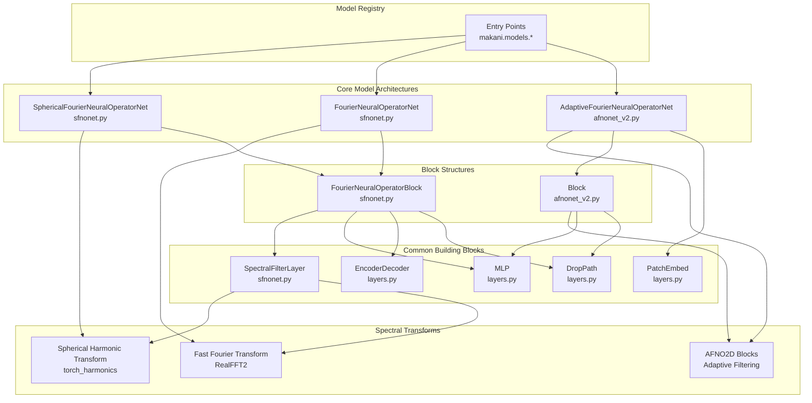
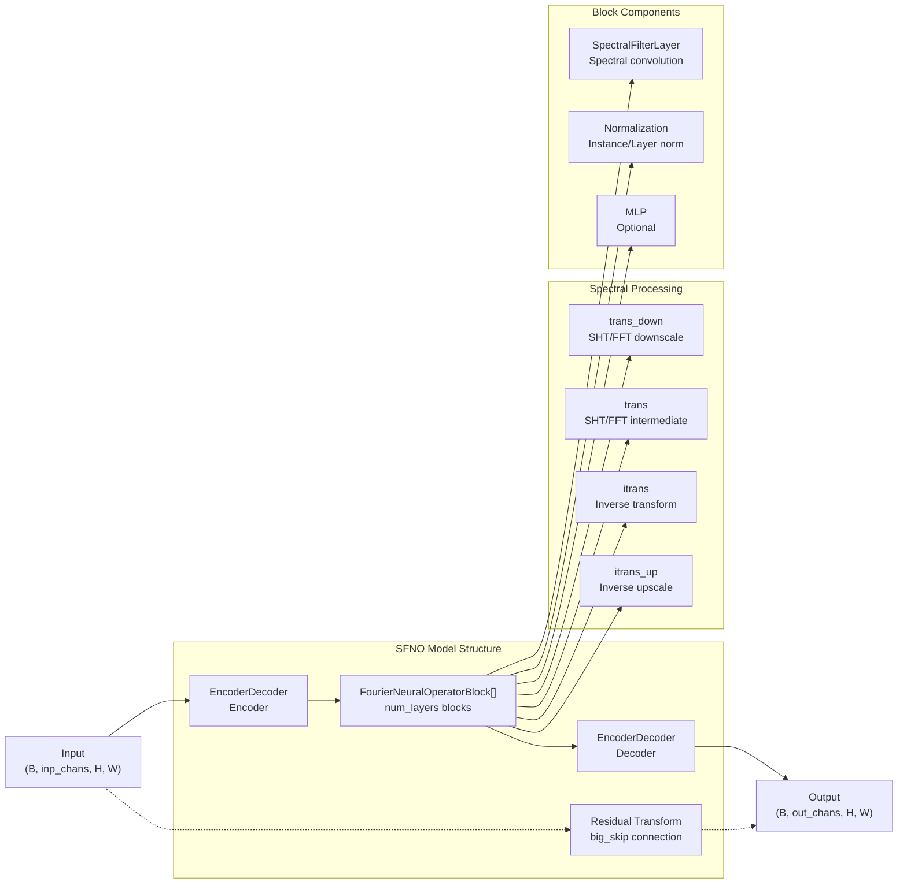
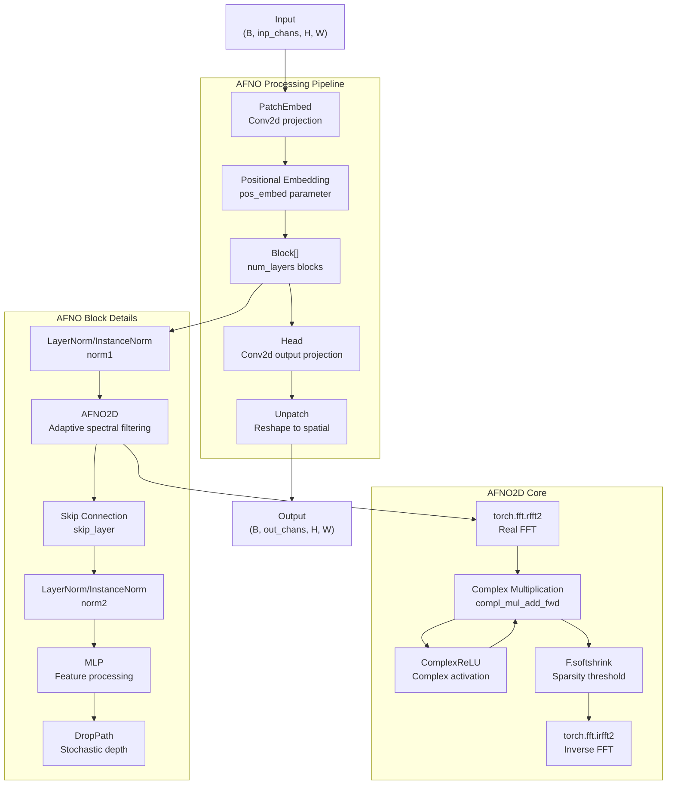
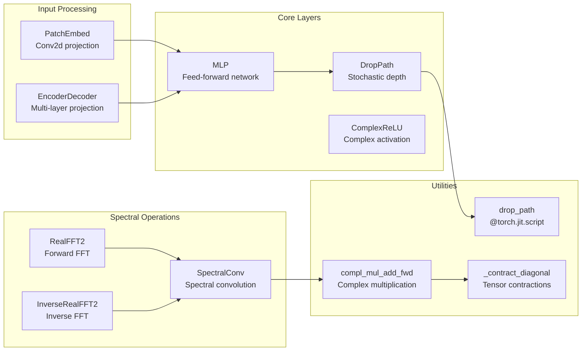
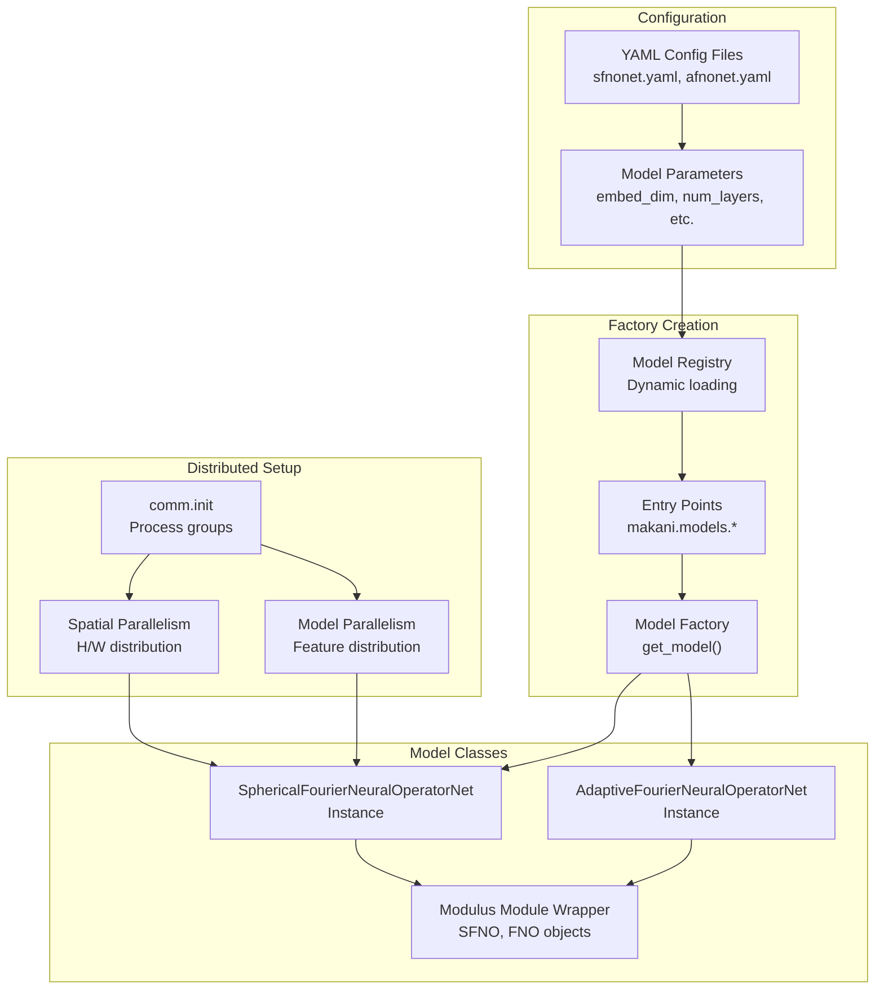

<!-- source: DeepWiki mcp.deepwiki.com · repo NVIDIA/makani · page 4 Neural Network Models · fetched 2026-10-26 -->

# Neural Network Models

Relevant source files

The following files were used as context for generating this wiki page:

- [makani/__init__.py](makani/__init__.py)
- [makani/models/common/layers.py](makani/models/common/layers.py)
- [makani/models/networks/afnonet_v2.py](makani/models/networks/afnonet_v2.py)
- [makani/models/networks/sfnonet.py](makani/models/networks/sfnonet.py)

This page provides an overview of the neural network model architectures supported by Makani, including Spherical Fourier Neural Operators (SFNO), Adaptive Fourier Neural Operators (AFNO), and their shared building blocks. For detailed implementation specifics of individual model types, see [SFNO Models](#4.1) and [AFNO Models](#4.2). For information about how models are dynamically loaded and registered, see [Model Registry System](#3.2). For shared neural network components, see [Common Neural Network Layers](#4.3).

## Model Architecture Overview

Makani supports multiple neural operator architectures designed for weather and climate modeling on spherical grids. These models share common design patterns while specializing in different spectral transform approaches.

Sources: [makani/models/networks/sfnonet.py:270-673](), [makani/models/networks/afnonet_v2.py:190-315](), [makani/models/common/layers.py:1-288]()

## Spherical Fourier Neural Operators (SFNO)

The `SphericalFourierNeuralOperatorNet` class implements neural operators that work in the spherical harmonic domain, making them well-suited for global climate modeling on spherical grids.

### Core Architecture

Sources: [makani/models/networks/sfnonet.py:270-311](), [makani/models/networks/sfnonet.py:386-430](), [makani/models/networks/sfnonet.py:587-641]()

### Key Components

| Component | Class | Purpose |
|-----------|-------|---------|
| Main Model | `SphericalFourierNeuralOperatorNet` | Complete SFNO architecture with spherical harmonic transforms |
| FFT Variant | `FourierNeuralOperatorNet` | SFNO using FFT instead of SHT |
| Core Block | `FourierNeuralOperatorBlock` | Individual layer with spectral filtering and MLP |
| Spectral Layer | `SpectralFilterLayer` | Wrapper for different spectral convolution types |

Sources: [makani/models/networks/sfnonet.py:270-273](), [makani/models/networks/sfnonet.py:657-659](), [makani/models/networks/sfnonet.py:119-146](), [makani/models/networks/sfnonet.py:51-69]()

## Adaptive Fourier Neural Operators (AFNO)

The `AdaptiveFourierNeuralOperatorNet` class implements neural operators using adaptive Fourier filtering with patch-based processing, following vision transformer patterns.

### Architecture Flow

Sources: [makani/models/networks/afnonet_v2.py:190-315](), [makani/models/networks/afnonet_v2.py:115-188](), [makani/models/networks/afnonet_v2.py:50-113]()

### AFNO Key Features

| Feature | Implementation | Location |
|---------|---------------|----------|
| Patch Processing | `PatchEmbed` with configurable patch sizes | [afnonet_v2.py:226]() |
| Adaptive Filtering | `AFNO2D` with learnable spectral weights | [afnonet_v2.py:50-113]() |
| Block Structure | `Block` with skip connections and normalization | [afnonet_v2.py:115-188]() |
| Complex Kernels | `compl_mul_add_fwd_c` for efficient complex ops | [afnonet_v2.py:41-48]() |

Sources: [makani/models/common/layers.py:65-84](), [makani/models/networks/afnonet_v2.py:50-52](), [makani/models/networks/afnonet_v2.py:115-117](), [makani/models/networks/afnonet_v2.py:42]()

## Common Building Blocks

All models share fundamental neural network components that provide consistent functionality across architectures.

### Shared Components

Sources: [makani/models/common/layers.py:65-84](), [makani/models/common/layers.py:86-134](), [makani/models/common/layers.py:136-217](), [makani/models/common/layers.py:54-63](), [makani/models/common/layers.py:219-288]()

### Layer Specifications

| Layer Class | Key Parameters | Usage Pattern |
|-------------|---------------|---------------|
| `MLP` | `hidden_features`, `act_layer`, `input_format` | Feature transformation in both SFNO and AFNO |
| `PatchEmbed` | `patch_size`, `embed_dim`, `in_chans` | Input processing in AFNO models |
| `EncoderDecoder` | `num_layers`, `hidden_dim`, `act_layer` | Input/output processing in SFNO |
| `DropPath` | `drop_prob` | Regularization across all models |

Sources: [makani/models/common/layers.py:136-150](), [makani/models/common/layers.py:65-67](), [makani/models/common/layers.py:86-88](), [makani/models/common/layers.py:54-57]()

## Model Integration Patterns

The models integrate with the broader Makani system through standardized interfaces and distributed computing patterns.

### Model Instantiation Flow

Sources: [makani/models/networks/sfnonet.py:642-673](), [makani/models/networks/sfnonet.py:148-156](), [makani/models/networks/sfnonet.py:528-571]()

### Distributed Computing Integration

Both model architectures support multi-dimensional parallelism through the `comm` module and specialized distributed layers:

- **Spatial Parallelism**: Domain decomposition across H/W dimensions
- **Model Parallelism**: Feature/channel parallelism using `DistributedMLP` and `DistributedEncoderDecoder`
- **Spectral Parallelism**: Distributed spectral transforms via `torch_harmonics.distributed`

Sources: [makani/models/networks/sfnonet.py:37-44](), [makani/models/networks/sfnonet.py:342-365](), [makani/models/networks/sfnonet.py:218-231]()

---

