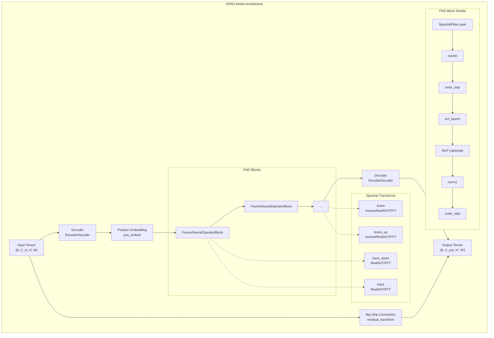
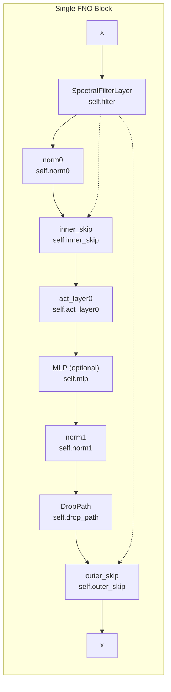
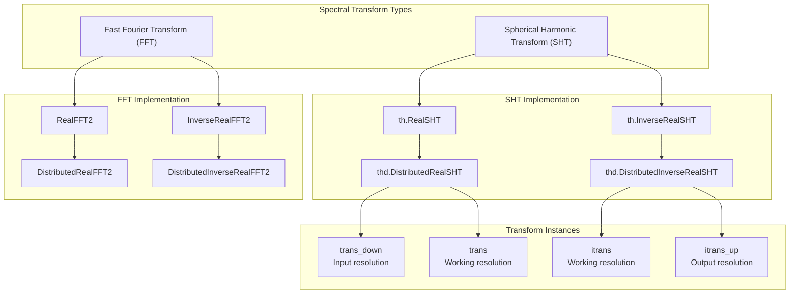
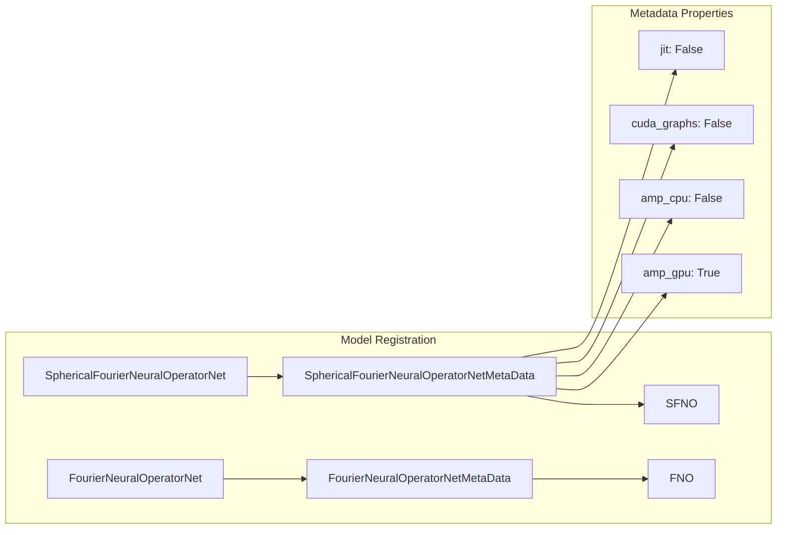

<!-- source: DeepWiki mcp.deepwiki.com · repo NVIDIA/makani · page 4.1 Spherical Fourier Neural Operators (SFNO) · fetched 2026-10-26 -->

# Spherical Fourier Neural Operators (SFNO)

<details>
<summary>Relevant source files</summary>

The following files were used as context for generating this wiki page:

- [config/sfnonet.yaml](config/sfnonet.yaml)
- [makani/__init__.py](makani/__init__.py)
- [makani/models/networks/sfnonet.py](makani/models/networks/sfnonet.py)

</details>


## Purpose and Scope

This document covers the Spherical Fourier Neural Operator (SFNO) implementation in Makani, which provides a neural network architecture specifically designed for learning stable dynamics on spherical domains such as weather and climate modeling. SFNO combines Fourier Neural Operators with spherical harmonic transforms to efficiently process global atmospheric data.

For information about training and inference workflows, see [Training and Inference Engines](#3.1). For details about the broader model registry system, see [Model Registry System](#3.2). For other neural network architectures, see [Adaptive Fourier Neural Operators (AFNO)](#4.2).

## Architecture Overview



Sources: [makani/models/networks/sfnonet.py:270-641](), [makani/models/networks/sfnonet.py:119-267]()

## Core Components

### SphericalFourierNeuralOperatorNet Class

The main `SphericalFourierNeuralOperatorNet` class implements the complete SFNO architecture with the following key parameters:

| Parameter | Description | Default |
|-----------|-------------|---------|
| `spectral_transform` | Transform type: "sht" or "fft" | "sht" |
| `model_grid_type` | Grid type for model resolution | "equiangular" |
| `sht_grid_type` | Grid type for spectral transforms | "legendre-gauss" |
| `filter_type` | Spectral filter: "linear" or "non-linear" | "linear" |
| `operator_type` | Convolution type: "dhconv", "diagonal" | "dhconv" |
| `embed_dim` | Feature embedding dimension | 32 |
| `num_layers` | Number of FNO blocks | 4 |
| `use_mlp` | Whether to include MLP layers | True |

Sources: [makani/models/networks/sfnonet.py:275-312]()

### FourierNeuralOperatorBlock Structure



The `FourierNeuralOperatorBlock` processes input through spectral filtering with residual connections. The `inner_skip` and `outer_skip` connections can be configured as "linear", "identity", or "none".

Sources: [makani/models/networks/sfnonet.py:119-267](), [makani/models/networks/sfnonet.py:239-267]()

## Spectral Transform System

### Transform Initialization

The SFNO supports two spectral transform backends:



The `_init_spectral_transforms` method configures transforms based on the `spectral_transform` parameter and handles distributed computing setups.

Sources: [makani/models/networks/sfnonet.py:503-572](), [makani/models/networks/sfnonet.py:523-540](), [makani/models/networks/sfnonet.py:541-556]()

### SpectralFilterLayer Options

The `SpectralFilterLayer` supports three types of spectral filtering:

| Filter Type | Implementation | Use Case |
|-------------|----------------|----------|
| "linear" + no factorization | `SpectralConv` | Standard linear spectral convolution |
| "linear" + factorization | `FactorizedSpectralConv` | Memory-efficient factorized convolution |
| "non-linear" | `SpectralAttention` | Attention-based spectral processing |

Sources: [makani/models/networks/sfnonet.py:51-116](), [makani/models/networks/sfnonet.py:86-96](), [makani/models/networks/sfnonet.py:98-110](), [makani/models/networks/sfnonet.py:72-84]()

## Configuration System

### Default SFNO Configuration

The SFNO configuration is defined in YAML format with the following key sections:

```yaml
# Architecture Configuration
nettype: "SFNO"
model_grid_type: "equiangular"
sht_grid_type: "legendre-gauss"
filter_type: "linear"
operator_type: "dhconv"
scale_factor: 3
embed_dim: 384
num_layers: 8
normalization_layer: "instance_norm"
```

The configuration supports multiple normalization options through the `normalization_layer` parameter:
- `"layer_norm"`: Uses `DistributedLayerNorm`
- `"instance_norm"`: Uses `DistributedInstanceNorm2d` or `nn.InstanceNorm2d`
- `"none"`: No normalization

Sources: [config/sfnonet.yaml:23-41](), [makani/models/networks/sfnonet.py:371-384]()

### Channel Configuration

SFNO processes atmospheric variables defined in the configuration:

```yaml
channel_names: ["u10m", "v10m", "u100m", "v100m", "t2m", "sp", "msl", "tcwv", 
                "u50", "u100", "u150", "u200", "u250", "u300", "u400", "u500", 
                "u600", "u700", "u850", "u925", "u1000", ...]
```

Additional channels can be enabled:
- `add_grid`: Adds sinusoidal grid coordinates
- `add_zenith`: Adds zenith angle information  
- `add_orography`: Adds topographical data
- `add_landmask`: Adds land/sea mask

Sources: [config/sfnonet.yaml:92-106]()

## Model Registration and Entry Points

### Modulus Integration

SFNO integrates with the Modulus framework through model metadata and entry points:



The `FourierNeuralOperatorNet` class inherits from `SphericalFourierNeuralOperatorNet` but uses FFT transforms instead of spherical harmonic transforms.

Sources: [makani/models/networks/sfnonet.py:642-655](), [makani/models/networks/sfnonet.py:657-673]()

## Position Embedding System

SFNO supports three types of position embeddings controlled by the `pos_embed` parameter:

| Type | Implementation | Description |
|------|----------------|-------------|
| "direct" | `nn.Parameter` tensor | Direct spatial position embedding |
| "frequency" | Spherical harmonic coefficients | Spectral domain position embedding |
| "none" | No embedding | Relies on `add_grid` for positional information |

The frequency-based embedding uses real and complex spherical harmonic coefficients that are transformed to spatial domain during forward pass.

Sources: [makani/models/networks/sfnonet.py:469-500](), [makani/models/networks/sfnonet.py:612-621]()

## Distributed Computing Support

SFNO integrates with Makani's distributed computing framework through several mechanisms:

- **Spatial Parallelism**: Distributes spatial dimensions across processes using `comm.get_size("spatial")`
- **Model Parallelism**: Supports channel parallelism through `comm.get_size("matmul")`
- **Distributed Transforms**: Uses `thd.DistributedRealSHT` and `DistributedRealFFT2` for parallel spectral transforms
- **Distributed Layers**: Employs `DistributedMLP` and `DistributedEncoderDecoder` when model parallelism is enabled

The model automatically selects distributed implementations based on the communication group sizes.

Sources: [makani/models/networks/sfnonet.py:149-156](), [makani/models/networks/sfnonet.py:342-365](), [makani/models/networks/sfnonet.py:528-533](), [makani/models/networks/sfnonet.py:604-605](), [makani/models/networks/sfnonet.py:634-635]()

---

