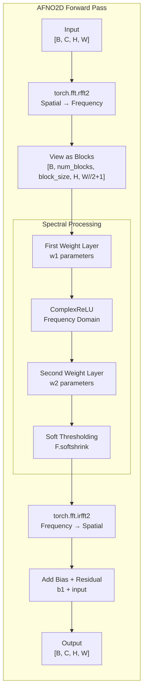
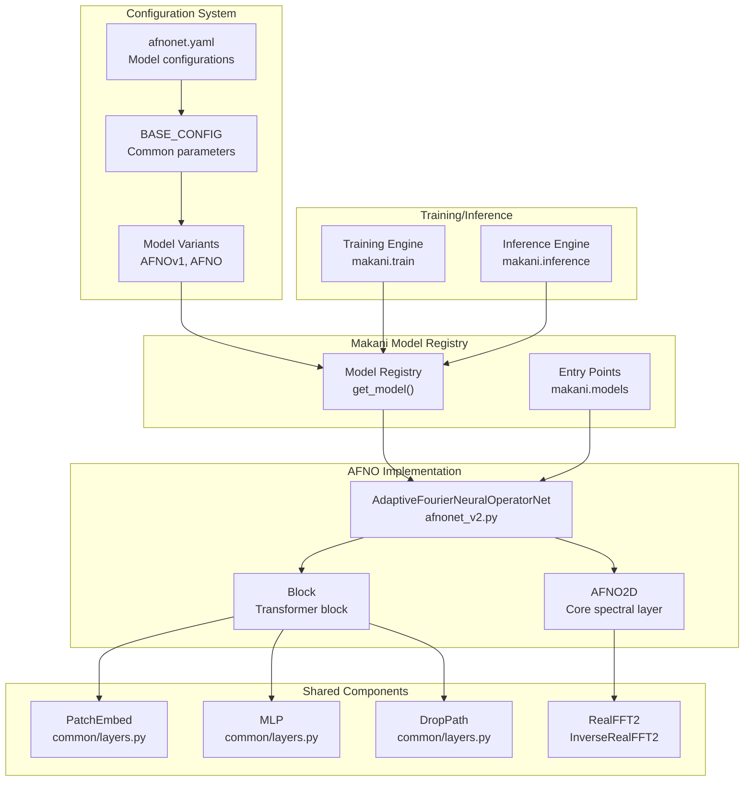

<!-- source: DeepWiki mcp.deepwiki.com · repo NVIDIA/makani · page 4.2 Adaptive Fourier Neural Operators (AFNO) · fetched 2026-10-26 -->

# Adaptive Fourier Neural Operators (AFNO)

Relevant source files

The following files were used as context for generating this wiki page:

- [config/afnonet.yaml](config/afnonet.yaml)
- [makani/models/common/layers.py](makani/models/common/layers.py)
- [makani/models/networks/afnonet_v2.py](makani/models/networks/afnonet_v2.py)

This document covers the Adaptive Fourier Neural Operators (AFNO) model implementation in Makani, including the core `AFNO2D` spectral filtering layer, transformer-style blocks, and full network architecture. For information about Spherical Fourier Neural Operators, see [Spherical Fourier Neural Operators (SFNO)](#4.1). For shared neural network components used across models, see [Common Neural Network Layers](#4.3).

## Architecture Overview

AFNO implements adaptive spectral filtering in the frequency domain using block-wise processing and learnable spectral weights. The implementation consists of three main components: the core `AFNO2D` spectral layer, transformer-style `Block` modules, and the full `AdaptiveFourierNeuralOperatorNet` wrapper.

### AFNO Network Architecture

```mermaid
graph TB
    subgraph "AdaptiveFourierNeuralOperatorNet"
        INPUT["Input Tensor<br/>[B, inp_chans, H, W]"]
        PATCH_EMBED["PatchEmbed<br/>patch_size conversion"]
        POS_EMBED["Positional Embedding<br/>pos_embed parameter"]
        
        subgraph "Block Stack"
            BLOCK1["Block 0<br/>AFNO2D + MLP"]
            BLOCK2["Block 1<br/>AFNO2D + MLP"] 
            BLOCKN["Block N<br/>AFNO2D + MLP"]
        end
        
        HEAD["Head Layer<br/>Conv2d output projection"]
        OUTPUT["Output Tensor<br/>[B, out_chans, H, W]"]
    end
    
    subgraph "Block Internal Structure"
        NORM1["LayerNorm/<br/>InstanceNorm2d"]
        AFNO2D_LAYER["AFNO2D<br/>Spectral Filtering"]
        SKIP1["Skip Connection<br/>linear/identity"]
        NORM2["LayerNorm/<br/>InstanceNorm2d"]
        MLP_LAYER["MLP<br/>Feed Forward"]
        SKIP2["Residual Connection"]
    end
    
    INPUT --> PATCH_EMBED
    PATCH_EMBED --> POS_EMBED
    POS_EMBED --> BLOCK1
    BLOCK1 --> BLOCK2
    BLOCK2 --> BLOCKN
    BLOCKN --> HEAD
    HEAD --> OUTPUT
    
    NORM1 --> AFNO2D_LAYER
    AFNO2D_LAYER --> SKIP1
    SKIP1 --> NORM2
    NORM2 --> MLP_LAYER
    MLP_LAYER --> SKIP2
```

**Sources:** [makani/models/networks/afnonet_v2.py:190-314]()

## Core Components

### AFNO2D Spectral Layer

The `AFNO2D` class implements the core adaptive spectral filtering mechanism using learnable weights in the frequency domain.

| Parameter | Description | Default |
|-----------|-------------|---------|
| `hidden_size` | Total feature dimension | Required |
| `num_blocks` | Number of channel blocks for processing | 8 |
| `sparsity_threshold` | Soft thresholding parameter | 0.0 |
| `hard_thresholding_fraction` | Fraction of modes to keep | 1.0 |
| `use_complex_kernels` | Use optimized complex operations | False |

The layer performs the following operations:
1. **FFT Transform**: Convert input to frequency domain using `torch.fft.rfft2`
2. **Block Processing**: Split channels into blocks and apply learnable spectral weights
3. **Activation**: Apply `ComplexReLU` activation in frequency domain
4. **Spectral Filtering**: Apply second set of learnable weights and soft thresholding
5. **IFFT Transform**: Convert back to spatial domain using `torch.fft.irfft2`

**Sources:** [makani/models/networks/afnonet_v2.py:50-113]()

### Block Structure

The `Block` class combines `AFNO2D` with normalization, MLP layers, and skip connections in a transformer-style architecture.

Key features:
- **Normalization**: Support for `LayerNorm` or `InstanceNorm2d`
- **Skip Connections**: Configurable skip around AFNO (`linear`, `identity`, or `None`)
- **MLP**: Feed-forward network with configurable expansion ratio
- **Drop Path**: Stochastic depth for regularization

**Sources:** [makani/models/networks/afnonet_v2.py:115-188]()

### Full Network Architecture

`AdaptiveFourierNeuralOperatorNet` provides the complete model implementation:

1. **Patch Embedding**: `PatchEmbed` converts input images to patches
2. **Positional Encoding**: Learnable positional embeddings
3. **Block Stack**: Multiple `Block` modules with optional drop path
4. **Output Head**: Convolution layer to generate final predictions

**Sources:** [makani/models/networks/afnonet_v2.py:190-314]()

## Configuration and Variants

### Model Variants

The configuration system supports multiple AFNO variants:

| Variant | NetType | Description |
|---------|---------|-------------|
| AFNOv1 | `AFNOv1` | Original AFNO implementation |
| AFNO | `AFNO` | Optimized AFNO implementation |

### Key Configuration Parameters

| Parameter | Purpose | Default |
|-----------|---------|---------|
| `patch_size` | Input patch dimensions | `[8, 8]` |
| `embed_dim` | Model embedding dimension | 768 |
| `num_blocks` | AFNO spectral blocks | 8 |
| `num_layers` | Number of transformer blocks | 12 |
| `normalization_layer` | Normalization type | `"instance_norm"` |
| `skip_fno` | Skip connection type | `"identity"` |
| `hard_thresholding_fraction` | Spectral mode retention | 1.0 |

**Sources:** [config/afnonet.yaml:1-147]()

## Integration with Makani System

**Sources:** [makani/models/networks/afnonet_v2.py:1-315](), [makani/models/common/layers.py:1-288](), [config/afnonet.yaml:1-147]()

## Advanced Features

### Complex Kernel Optimization

The `AFNO2D` layer supports optimized complex arithmetic through the `use_complex_kernels` parameter:

- **Standard Mode**: Uses `compl_mul_add_fwd` with real-valued tensor operations
- **Optimized Mode**: Uses `compl_mul_add_fwd_c` with native complex tensor operations

### Spectral Thresholding

Two types of spectral filtering are available:

1. **Hard Thresholding**: `hard_thresholding_fraction` parameter controls which frequency modes to retain
2. **Soft Thresholding**: `sparsity_threshold` applies soft shrinkage to spectral coefficients

### Checkpointing Support

Both `Block` and `MLP` components support gradient checkpointing for memory efficiency during training.

**Sources:** [makani/models/networks/afnonet_v2.py:50-113](), [makani/models/common/layers.py:136-217]()

---

