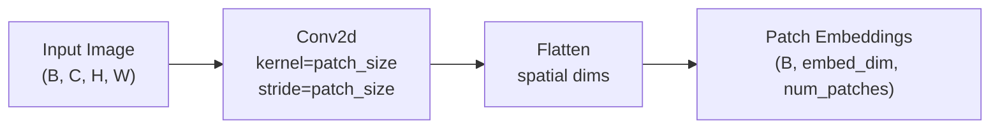
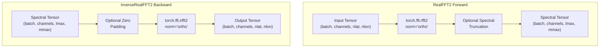
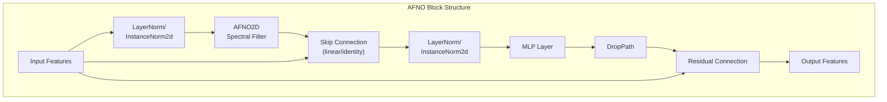

<!-- source: DeepWiki mcp.deepwiki.com · repo NVIDIA/makani · page 4.3 Common Neural Network Layers · fetched 2026-10-26 -->

# Common Neural Network Layers

<details>
<summary>Relevant source files</summary>

The following files were used as context for generating this wiki page:

- [makani/models/common/layers.py](makani/models/common/layers.py)
- [makani/models/networks/afnonet_v2.py](makani/models/networks/afnonet_v2.py)

</details>


This document describes the shared neural network building blocks used across all model architectures in the Makani system. These layers form the fundamental components that are composed together to create larger models like SFNO, AFNO, and Vision Transformers.

For model-specific layer implementations, see [Spherical Fourier Neural Operators (SFNO)](#4.1) and [Adaptive Fourier Neural Operators (AFNO)](#4.2). For complete model architectures, see [Neural Network Models](#4).

## Core Layer Components

The Makani system provides several fundamental layer types that serve as building blocks for neural operator models. These layers are implemented in [makani/models/common/layers.py]() and are designed to support distributed training, mixed precision, and various input formats.

### Multi-Layer Perceptron (MLP)

The `MLP` class provides a configurable multi-layer perceptron implementation that supports both convolutional (`nchw`) and traditional (`traditional`) input formats:

| Parameter | Description | Default |
|-----------|-------------|---------|
| `in_features` | Input feature dimension | Required |
| `hidden_features` | Hidden layer dimension | `in_features` |
| `out_features` | Output feature dimension | `in_features` |
| `input_format` | Input format: `"nchw"` or `"traditional"` | `"nchw"` |
| `drop_rate` | Dropout rate | 0.0 |
| `drop_type` | Dropout type: `"iid"` or `"features"` | `"iid"` |
| `checkpointing` | Activation checkpointing level | 0 |

The MLP automatically handles weight sharing for spatial parallelism by setting `is_shared_mp = ["spatial"]` on weights and biases [makani/models/common/layers.py:159-161]().

### Patch Embedding

The `PatchEmbed` class converts 2D images into patch sequences for transformer-style processing:



The implementation uses a convolutional layer with kernel and stride equal to the patch size to efficiently extract non-overlapping patches [makani/models/common/layers.py:73]().

### Stochastic Depth (DropPath)

The `DropPath` layer implements stochastic depth for training deeper networks by randomly dropping entire paths during training:

- Uses a per-sample random tensor to determine which samples to drop [makani/models/common/layers.py:48-49]()
- Scales remaining samples by `1/(1-drop_prob)` to maintain expected values
- Only active during training mode

### Encoder-Decoder Architecture

The `EncoderDecoder` class provides a configurable multi-layer architecture suitable for various encoding and decoding tasks. It supports both convolutional and linear layer implementations based on the `input_format` parameter.

Sources: [makani/models/common/layers.py:86-134]()

## Spectral Transform Layers

Makani includes specialized layers for spectral domain operations, which are crucial for neural operators working with physical simulations.

### Real-valued 2D FFT

The `RealFFT2` and `InverseRealFFT2` classes provide wrapper functionality around PyTorch's FFT operations with optional spectral truncation:



Key features:
- Supports spectral truncation via `lmax` and `mmax` parameters
- Handles both full and truncated spectral representations
- Maintains orthogonal normalization for energy conservation

Sources: [makani/models/common/layers.py:219-288]()

## Layer Integration Patterns

The common layers are integrated into larger model architectures following consistent patterns:

### AFNO Block Integration



### Vision Transformer Integration

The `PatchEmbed` layer is used to convert images into patch sequences, which are then processed by transformer blocks. The patch embeddings include positional encoding and support spatial parallelism through weight sharing annotations.

Sources: [makani/models/networks/afnonet_v2.py:115-188](), [makani/models/networks/afnonet_v2.py:226-227]()

## Weight Initialization and Distributed Training Support

All common layers implement proper weight initialization and distributed training support:

### Weight Sharing Annotations

Layers automatically annotate weights and biases with `is_shared_mp = ["spatial"]` to support spatial model parallelism:

```python
# Example from MLP implementation
fc1.weight.is_shared_mp = ["spatial"]
fc1.bias.is_shared_mp = ["spatial"]
```

### Initialization Strategies

- **Linear/Conv layers**: Normal initialization with variance scaling based on input dimensions
- **Bias terms**: Zero initialization
- **Normalization layers**: Weight=1.0, bias=0.0 initialization

### Gradient Checkpointing

Several layers support activation checkpointing to reduce memory usage during training:
- `MLP` class supports checkpointing levels via the `checkpointing` parameter
- Uses PyTorch's `checkpoint` function with `use_reentrant=False` for safety

Sources: [makani/models/common/layers.py:102-109](), [makani/models/common/layers.py:159-161](), [makani/models/common/layers.py:208-216]()

## Input Format Flexibility

The common layers support multiple input formats to accommodate different model architectures:

| Format | Description | Use Case |
|--------|-------------|----------|
| `"nchw"` | Channel-first format using Conv2d | Vision models, CNNs |
| `"traditional"` | Linear layer format | Transformer models, MLPs |

This flexibility allows the same layer implementations to be used across different model types while maintaining optimal performance for each use case.

Sources: [makani/models/common/layers.py:94-99](), [makani/models/common/layers.py:157-164]()

---

