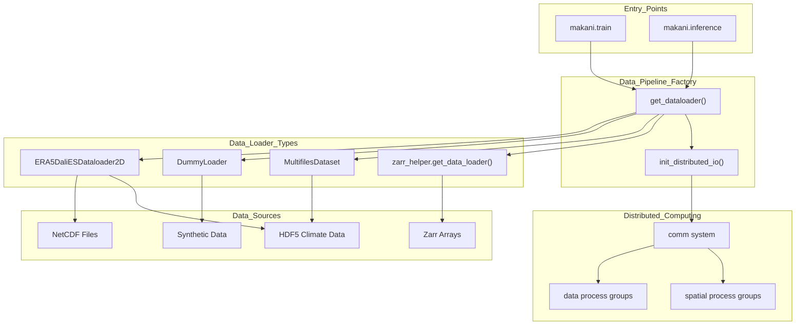
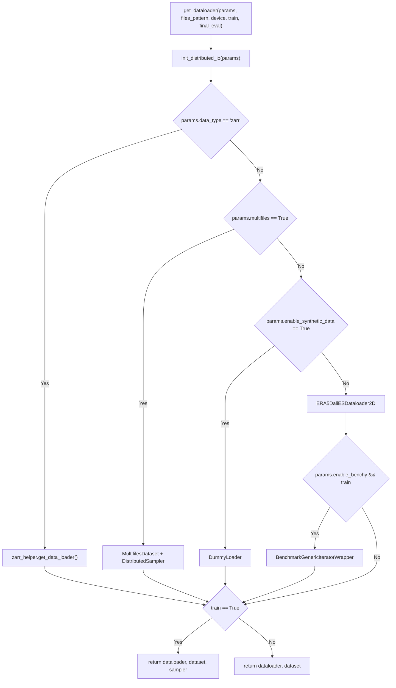
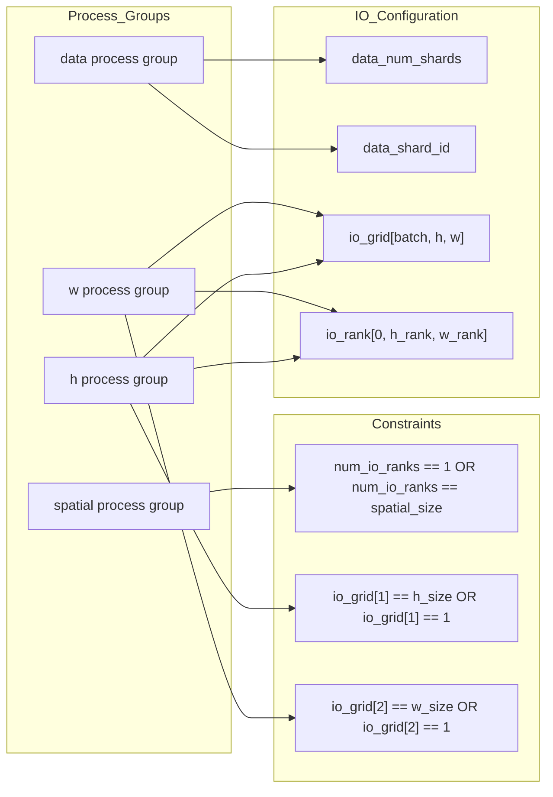

<!-- source: DeepWiki mcp.deepwiki.com · repo NVIDIA/makani · page 5 Data Pipeline · fetched 2026-10-26 -->

# Data Pipeline

Relevant source files

The following files were used as context for generating this wiki page:

- [makani/utils/dataloader.py](makani/utils/dataloader.py)
- [makani/utils/dataloaders/__init__.py](makani/utils/dataloaders/__init__.py)

## Purpose and Scope

The Data Pipeline system in Makani provides a unified interface for loading and distributing climate and weather data across multiple GPUs and nodes for training and inference. This system abstracts the complexities of different data formats, distributed I/O patterns, and GPU-accelerated data loading to support the massive scale requirements of weather and climate ML models.

This page covers the high-level data pipeline architecture and the factory system that selects appropriate data loaders. For detailed documentation of specific data loader implementations, see [Data Loaders](#5.1). For information about data preprocessing and statistical computations, see [Data Processing and Statistics](#5.2).

## Data Pipeline Architecture

The data pipeline follows a factory pattern that automatically selects the appropriate data loader based on configuration parameters and integrates with Makani's distributed computing framework to enable scalable data loading across multiple processes.

Sources: [makani/utils/dataloader.py:1-152]()

## Data Loader Factory System

The `get_dataloader` function serves as the central factory that determines which data loading implementation to use based on configuration parameters. The selection logic follows a priority-based approach:

Sources: [makani/utils/dataloader.py:63-152]()

## Distributed I/O Initialization

The `init_distributed_io` function configures the data sharding and spatial distribution parameters required for distributed data loading. This function integrates with Makani's communication framework to determine how data should be partitioned across processes.

| Parameter | Description | Source |
|-----------|-------------|---------|
| `data_num_shards` | Number of data parallel shards | `comm.get_size("data")` |
| `data_shard_id` | Current process's data shard ID | `comm.get_rank("data")` |
| `io_grid` | 3D grid layout for I/O processes | `[1, comm.get_size("h"), comm.get_size("w")]` |
| `io_rank` | Current process's position in I/O grid | `[0, comm.get_rank("h"), comm.get_rank("w")]` |

The I/O grid configuration ensures that spatial dimensions are properly distributed across processes while maintaining data consistency. The system enforces constraints that the number of I/O ranks must either be 1 (no spatial parallelism) or equal to the spatial process group size.

Sources: [makani/utils/dataloader.py:27-61]()

## Data Loader Types

The data pipeline supports four distinct data loader implementations, each optimized for different data formats and use cases:

| Data Loader | Configuration Trigger | Primary Use Case | Data Formats |
|-------------|----------------------|------------------|--------------|
| **Zarr Loader** | `params.data_type == "zarr"` | Cloud-optimized chunked arrays | Zarr |
| **Multifiles Loader** | `params.multifiles == True` | Distributed HDF5 files | HDF5, NetCDF |
| **Dummy Loader** | `params.enable_synthetic_data == True` | Testing and benchmarking | Synthetic data |
| **DALI Loader** | Default (none of above) | GPU-accelerated production workloads | HDF5, NetCDF |

### Common Interface

All data loaders provide a consistent interface with the following attributes:

- `in_channels` / `out_channels`: Number of input/output channels
- `grid_converter`: Spatial grid conversion utilities  
- `img_shape_x` / `img_shape_y`: Global image dimensions
- `img_crop_shape_x` / `img_crop_shape_y`: Cropped region dimensions
- `img_local_shape_x` / `img_local_shape_y`: Local process dimensions
- `get_input_normalization()` / `get_output_normalization()`: Normalization parameters

Sources: [makani/utils/dataloader.py:66-151]()

## Integration with Benchy

For performance benchmarking during training, the data pipeline can optionally wrap the DALI data loader with `BenchmarkGenericIteratorWrapper` when `params.enable_benchy` is enabled. This provides detailed timing and throughput metrics for the data loading pipeline.

Sources: [makani/utils/dataloader.py:140-143]()

---

