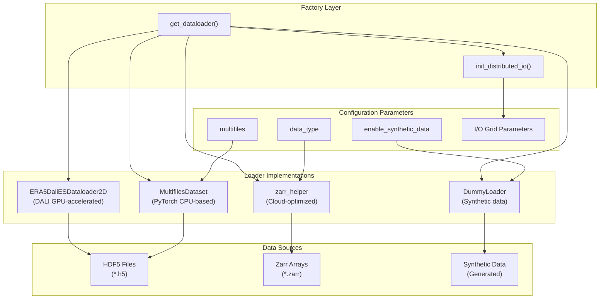
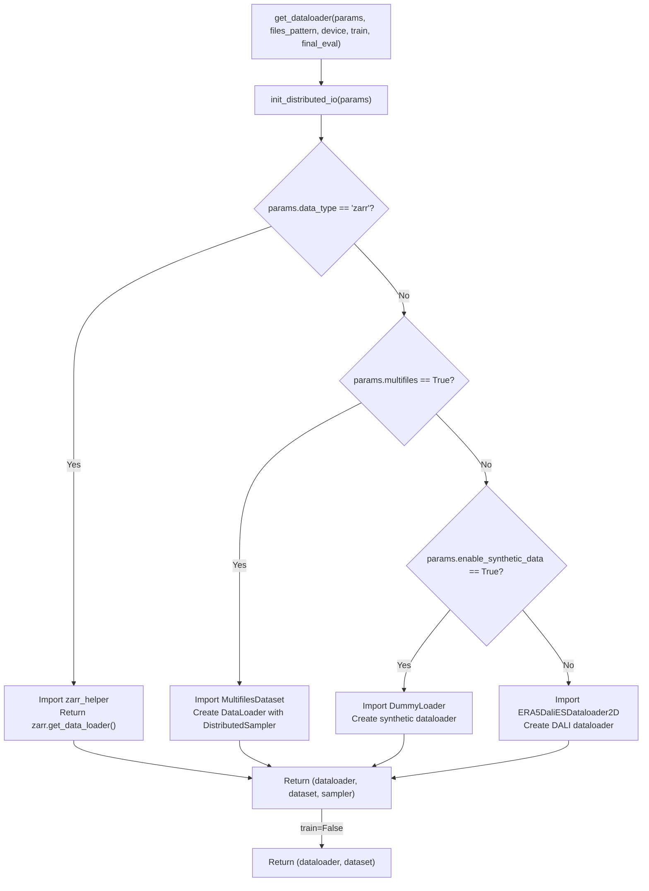
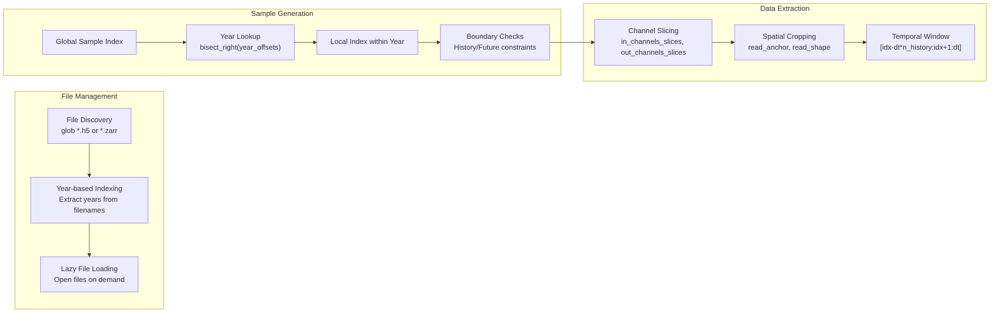

<!-- source: DeepWiki mcp.deepwiki.com · repo NVIDIA/makani · page 5.1 Data Loaders · fetched 2026-10-26 -->

# Data Loaders

<details>
<summary>Relevant source files</summary>

The following files were used as context for generating this wiki page:

- [makani/utils/dataloader.py](makani/utils/dataloader.py)
- [makani/utils/dataloaders/dali_es_helper_2d.py](makani/utils/dataloaders/dali_es_helper_2d.py)
- [makani/utils/dataloaders/data_loader_multifiles.py](makani/utils/dataloaders/data_loader_multifiles.py)

</details>


This document covers the data loading system in Makani, which provides multiple implementations for loading weather and climate data from different storage formats. The data loaders handle distributed I/O, spatial decomposition, temporal sequencing, and normalization for training and inference workflows.

For information about data processing and statistics computation, see [Data Processing and Statistics](#5.2). For details about the overall data pipeline architecture, see [Data Pipeline](#5).

## Overview

The Makani data loading system is built around a factory pattern that routes to different loader implementations based on configuration parameters. It supports multiple data formats and loading strategies optimized for different use cases:



Sources: [makani/utils/dataloader.py:63-152]()

## Factory Function and Routing Logic

The `get_dataloader` function serves as the main entry point for creating data loaders. It implements a routing pattern that selects the appropriate loader based on configuration parameters:



Sources: [makani/utils/dataloader.py:63-152]()

## Distributed I/O Initialization

The `init_distributed_io` function configures distributed I/O parameters for spatial decomposition and data sharding:

| Parameter | Description | Default |
|-----------|-------------|---------|
| `data_num_shards` | Number of data parallel shards | `comm.get_size("data")` |
| `data_shard_id` | Current shard ID | `comm.get_rank("data")` |
| `io_grid` | Spatial decomposition grid `[1, H, W]` | `[1, comm.get_size("h"), comm.get_size("w")]` |
| `io_rank` | Process rank in I/O grid | `[0, comm.get_rank("h"), comm.get_rank("w")]` |

The function ensures that:
- Channel parallelism is not supported (`io_grid[0] == 1`)
- Total I/O ranks equals 1 or matches spatial parallel size
- Grid dimensions are compatible with communication groups

Sources: [makani/utils/dataloader.py:27-61]()

## DALI Data Loader

The DALI data loader (`ERA5DaliESDataloader2D`) provides GPU-accelerated data loading through the `GeneralES` class. It supports both HDF5 and Zarr formats with optimized I/O operations:

### Key Features

- **GPU-accelerated I/O**: Uses NVIDIA DALI for high-performance data loading
- **Spatial decomposition**: Distributes data across multiple processes based on `io_grid`
- **Temporal sequencing**: Handles history and future timesteps with configurable `dt`, `n_history`, `n_future`
- **Zenith angle computation**: Optional solar zenith angle features for time-aware models
- **Double buffering**: Reduces I/O overhead with pinned memory buffers

### Data Reading Strategy



Sources: [makani/utils/dataloaders/dali_es_helper_2d.py:40-489]()

## Multifiles Data Loader

The `MultifilesDataset` provides a PyTorch-compatible dataset implementation for HDF5 files. It integrates with PyTorch's `DataLoader` and `DistributedSampler` for standard distributed training:

### Characteristics

- **PyTorch native**: Uses standard `torch.utils.data.Dataset` interface
- **CPU-based**: Does not require DALI dependencies
- **Distributed sampling**: Uses `DistributedSampler` for data parallel distribution
- **Grid conversion**: Supports conversion between data and model grid types
- **Normalization**: Built-in support for minmax and zscore normalization

### Dataset Implementation

The `MultifilesDataset` class implements the following key methods:

| Method | Purpose |
|--------|---------|
| `__init__` | Initialize dataset with parameters and file discovery |
| `__len__` | Return total samples minus boundary constraints |
| `__getitem__` | Load and process a single sample with temporal context |
| `get_input_normalization` | Return input normalization parameters |
| `get_output_normalization` | Return output normalization parameters |

Sources: [makani/utils/dataloaders/data_loader_multifiles.py:38-290]()

## Configuration Parameters

The data loaders are configured through parameter objects with the following key settings:

### Common Parameters

| Parameter | Description | Type |
|-----------|-------------|------|
| `batch_size` | Batch size for training/inference | int |
| `num_data_workers` | Number of data loading workers | int |
| `dt` | Timestep interval | int |
| `dhours` | Hours per timestep | float |
| `n_history` | Number of history timesteps | int |
| `n_future` | Number of future timesteps | int |
| `in_channels` | Input channel indices | list[int] |
| `out_channels` | Output channel indices | list[int] |

### Spatial Parameters

| Parameter | Description | Type |
|-----------|-------------|------|
| `crop_size_x`, `crop_size_y` | Spatial crop dimensions | int |
| `crop_anchor_x`, `crop_anchor_y` | Crop starting coordinates | int |
| `io_grid` | I/O decomposition grid | list[int] |
| `io_rank` | Process rank in I/O grid | list[int] |

### Format-Specific Parameters

| Parameter | Description | Loader |
|-----------|-------------|--------|
| `data_type` | Data format ("zarr" or other) | Zarr |
| `multifiles` | Enable multifiles loader | Multifiles |
| `enable_synthetic_data` | Use synthetic data | Dummy |
| `h5_path` | HDF5 dataset path | HDF5-based |
| `normalization` | Normalization type ("minmax", "zscore") | Multifiles |

Sources: [makani/utils/dataloader.py:63-152](), [makani/utils/dataloaders/data_loader_multifiles.py:39-108]()

## Return Interface

All data loaders return a consistent interface to maintain compatibility with training and inference engines:

### Training Mode

```python
dataloader, dataset, sampler = get_dataloader(params, files_pattern, device, train=True)
```

### Inference Mode

```python
dataloader, dataset = get_dataloader(params, files_pattern, device, train=False)
```

### Dataset Attributes

The dataset object provides metadata for model configuration:

| Attribute | Description |
|-----------|-------------|
| `in_channels` | Number of input channels |
| `out_channels` | Number of output channels |
| `grid_converter` | Grid conversion utility |
| `img_shape_x`, `img_shape_y` | Full image dimensions |
| `img_crop_shape_x`, `img_crop_shape_y` | Cropped dimensions |
| `img_local_shape_x`, `img_local_shape_y` | Local process dimensions |

Sources: [makani/utils/dataloader.py:99-151]()

---

