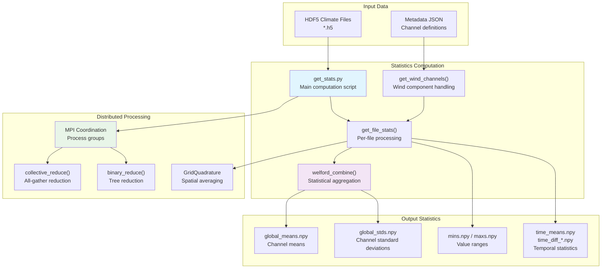
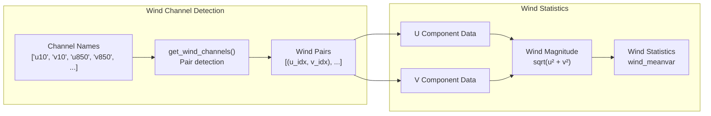
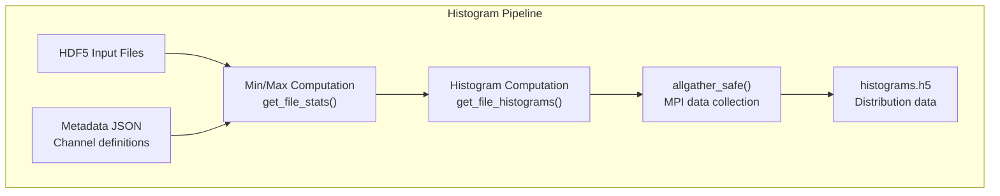
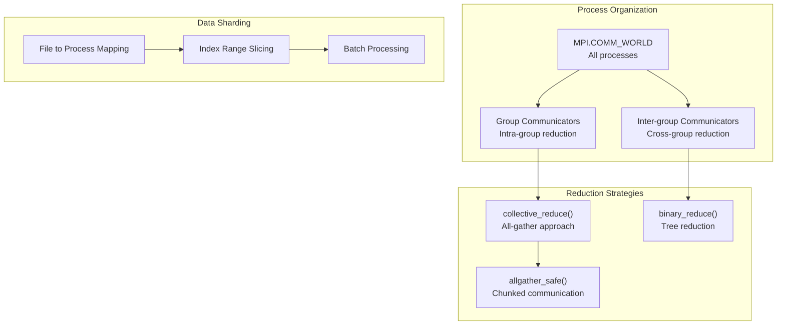

<!-- source: DeepWiki mcp.deepwiki.com · repo NVIDIA/makani · page 5.2 Data Processing and Statistics · fetched 2026-10-26 -->

# Data Processing and Statistics

<details>
<summary>Relevant source files</summary>

The following files were used as context for generating this wiki page:

- [config/vit.yaml](config/vit.yaml)
- [data_process/get_histograms.py](data_process/get_histograms.py)
- [data_process/get_stats.py](data_process/get_stats.py)
- [data_process/h5_align.py](data_process/h5_align.py)

</details>


This page documents the data preprocessing utilities and statistical computation workflows in Makani. These tools prepare climate datasets for training by computing normalization statistics, performing data format conversions, and generating distribution analyses. The outputs are used by the training pipeline for data normalization and preprocessing.

For information about data loading during training and inference, see [Data Loaders](#5.1). For configuration of data paths and parameters, see [Configuration System](#6).

## Statistical Computation Pipeline

The core statistical computation is handled by a distributed MPI-based system that processes large climate datasets to generate normalization statistics required for model training.



**Sources:** [data_process/get_stats.py:1-437]()

## Core Statistical Computations

### Welford's Algorithm Implementation

The system uses Welford's algorithm for numerically stable computation of means and variances across distributed datasets. This is critical for processing large climate datasets where numerical precision matters.

| Statistic Type | Description | Implementation |
|----------------|-------------|----------------|
| `global_meanvar` | Global mean and variance per channel | Welford algorithm with quadrature weighting |
| `mins` / `maxs` | Global min/max values per channel | Element-wise reduction |
| `time_means` | Temporal mean preserving spatial structure | Time-axis averaging |
| `time_diff_meanvar` | Statistics of temporal differences | First-order differences |
| `wind_meanvar` | Wind magnitude statistics | Computed from u/v components |

The `welford_combine()` function [data_process/get_stats.py:97-132]() merges statistics from different processes:

```python
# Key operations in welford_combine
n_ab = n_a + n_b  # Combined sample count
mean_combined = (mean_a * n_a + mean_b * n_b) / n_ab  # Weighted mean
m2_combined = m2_a + m2_b + delta * delta * n_a * n_b / n_ab  # Combined variance
```

**Sources:** [data_process/get_stats.py:97-132](), [data_process/get_stats.py:135-205]()

### Wind Component Processing

Special handling is provided for wind components (u/v pairs) to compute wind magnitude statistics:



The `get_wind_channels()` function [data_process/get_stats.py:207-222]() automatically detects u/v component pairs by matching channel names with 'u' and 'v' prefixes.

**Sources:** [data_process/get_stats.py:193-198](), [data_process/get_stats.py:207-222](), [data_process/get_stats.py:397-402]()

## Data Preprocessing Utilities

### HDF5 File Alignment

The `h5_align.py` script optimizes HDF5 files for high-performance I/O by implementing direct I/O with proper alignment:

| Parameter | Purpose | Default |
|-----------|---------|---------|
| `align_size_bytes` | Memory alignment for direct I/O | 4096 |
| `block_size_bytes` | I/O block size | 0 (auto) |
| `batch_size` | Rows processed per batch | 32 |
| `transpose` | Convert data layout (TCHW → THWC) | False |

The alignment process [data_process/h5_align.py:31-34]() configures HDF5 property lists for optimal performance:

```python
fcpl = h5.h5p.create(h5.h5p.FILE_CREATE)  # File creation properties
fcpl.set_userblock(max(512, align_size_bytes))  # User block alignment
fapl = h5.h5p.create(h5.h5p.FILE_ACCESS)  # File access properties  
fapl.set_fapl_direct(align_size_bytes, block_size_bytes, 0)  # Direct I/O
```

**Sources:** [data_process/h5_align.py:25-87]()

### Histogram Generation

The `get_histograms.py` script generates data distribution histograms for analysis and validation:



The histogram computation [data_process/get_histograms.py:130-160]() processes data in batches and accumulates histograms across channels using `np.histogram()` with computed global min/max ranges.

**Sources:** [data_process/get_histograms.py:94-127](), [data_process/get_histograms.py:130-160]()

## Distributed Processing Architecture

### MPI Communication Strategy

The statistical computation uses a hierarchical MPI communication pattern to handle large-scale distributed processing:



The process organization [data_process/get_stats.py:274-280]() creates hierarchical communicator groups:

- **Group Communicators**: Processes within each group perform collective reduction
- **Inter-group Communicators**: Group leaders perform binary tree reduction
- **Safe Gather**: Handles large data transfers by chunking into ~1GB pieces

**Sources:** [data_process/get_stats.py:37-87](), [data_process/get_stats.py:225-231](), [data_process/get_stats.py:234-264](), [data_process/get_stats.py:274-280]()

### Memory-Efficient Processing

The system implements several strategies to handle large datasets efficiently:

| Strategy | Implementation | Purpose |
|----------|----------------|---------|
| Index Slicing | `_get_slices()` function | Convert sparse indices to contiguous slices |
| Batch Processing | Configurable batch sizes | Limit memory usage per operation |
| Chunked Communication | `allgather_safe()` | Handle large MPI transfers |
| Lazy Loading | Process files on-demand | Minimize memory footprint |

The `_get_slices()` function [data_process/get_stats.py:90-94]() optimizes sparse index access by grouping consecutive indices into slice objects for efficient HDF5 reading.

**Sources:** [data_process/get_stats.py:90-94](), [data_process/get_stats.py:37-87](), [data_process/get_stats.py:141-154]()

## Integration with Training Pipeline

### Configuration Integration

The computed statistics are referenced in training configurations and used for data normalization:

```yaml
# Statistics file paths in configuration
min_path: "/stats/mins.npy"
max_path: "/stats/maxs.npy"  
global_means_path: "/stats/global_means.npy"
global_stds_path: "/stats/global_stds.npy"
time_means_path: "/stats/time_means.npy"
time_diff_means_path: "/stats/time_diff_means.npy"
time_diff_stds_path: "/stats/time_diff_stds.npy"
```

### Normalization Types

The system supports different normalization strategies configured via the `normalization` parameter:

- **Z-score normalization**: Uses `global_means` and `global_stds`
- **Min-max normalization**: Uses `mins` and `maxs` for scaling to [0,1]

**Sources:** [config/vit.yaml:12-18](), [config/vit.yaml:74]()

## Usage Examples

### Computing Dataset Statistics

```bash
# Distributed statistics computation
mpirun -np 32 python data_process/get_stats.py \
    --input_dir /data/climate/train \
    --output_dir /stats \
    --group_size 8 \
    --quadrature_rule "clenshaw-curtiss" \
    --wind_angle \
    --batch_size 16
```

### HDF5 File Alignment

```bash
# Optimize HDF5 files for direct I/O
python data_process/h5_align.py \
    --input_dir /data/raw \
    --output_dir /data/aligned \
    --align_size_bytes 4096 \
    --batch_size 32 \
    --transpose
```

### Histogram Generation

```bash
# Generate data distribution histograms
mpirun -np 16 python data_process/get_histograms.py \
    --input_dir /data/climate \
    --metadata_file /metadata/data.json \
    --output_dir /analysis \
    --nbins 100
```

**Sources:** [data_process/get_stats.py:421-432](), [data_process/h5_align.py:89-102](), [data_process/get_histograms.py:337-346]()

---

