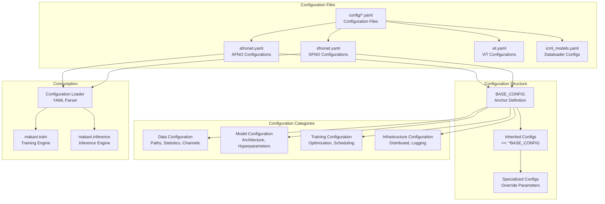
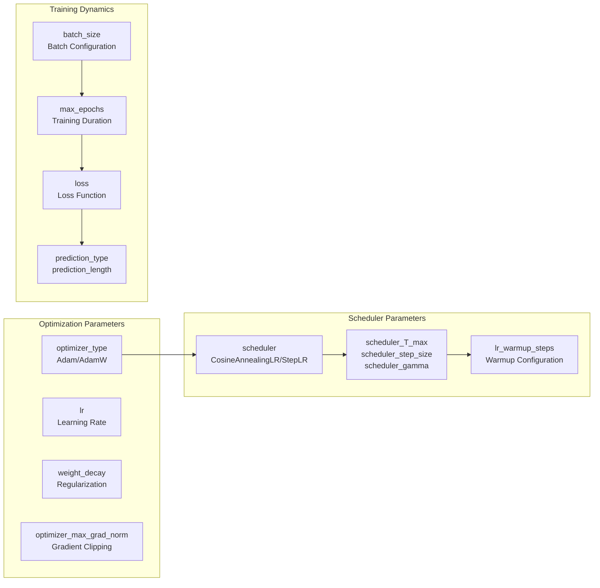
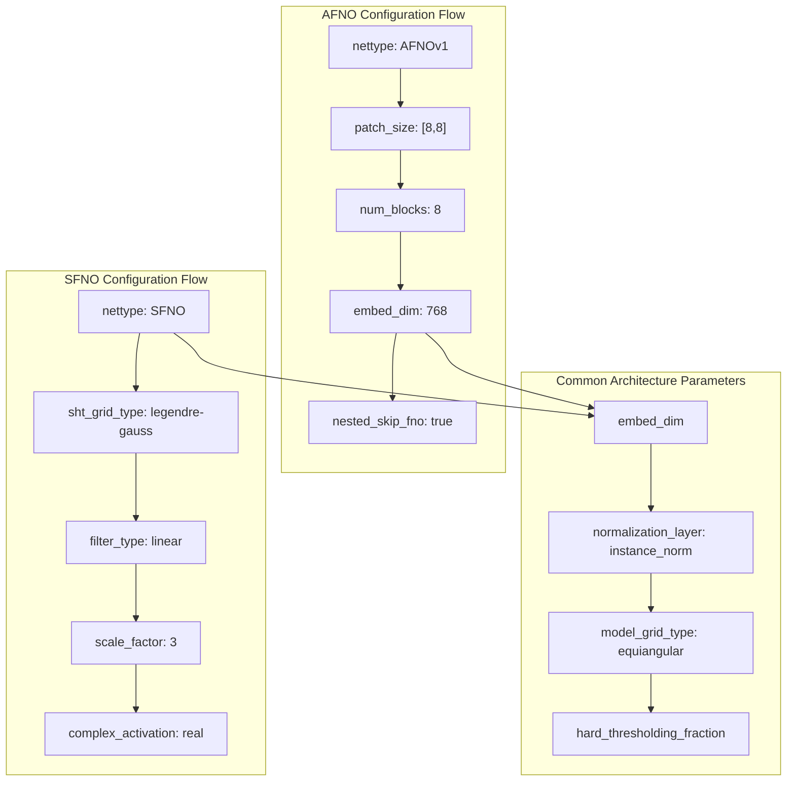

<!-- source: DeepWiki mcp.deepwiki.com · repo NVIDIA/makani · page 6 Configuration System · fetched 2026-10-26 -->

# Configuration System

Relevant source files

The following files were used as context for generating this wiki page:

- [config/README.md](config/README.md)
- [config/afnonet.yaml](config/afnonet.yaml)
- [config/sfnonet.yaml](config/sfnonet.yaml)

The Configuration System provides a comprehensive YAML-based parameter management framework for defining model architectures, training hyperparameters, data processing settings, and deployment options. This system enables reproducible experiments and easy configuration management across different model types and training scenarios.

For information about model architectures and their implementations, see [Neural Network Models](#4). For details about the training and inference workflows that consume these configurations, see [Training and Inference Engines](#3.1).

## Configuration Architecture

The configuration system is built around YAML files that use anchors and references to enable inheritance and reduce duplication. The main configuration files are organized by model type and provide both base configurations and specialized variants.

Sources: [config/README.md:1-19](), [config/afnonet.yaml:1-147](), [config/sfnonet.yaml:1-175]()

## Configuration Structure and Inheritance

The configuration system uses YAML anchors (`&`) and references (`<<: *`) to implement inheritance patterns. Base configurations define common parameters, while specialized configurations override specific settings for different model variants or experimental scenarios.

```mermaid
graph TD
    subgraph "YAML Inheritance Pattern"
        ANCHOR["&BASE_CONFIG<br/>Anchor Definition"]
        REFERENCE["<<: *BASE_CONFIG<br/>Reference Inheritance"]
        OVERRIDE["param: new_value<br/>Parameter Override"]
    end
    
    subgraph "AFNO Configuration Hierarchy"
        AFNO_BASE["full_field: &BASE_CONFIG<br/>Base AFNO Configuration"]
        AFNO_26CH["afno_26ch_arxiv_network: &AFNO_26CH<br/>26-Channel Variant"]
        AFNO_FINETUNE["afno_26ch_arxiv_network_finetune<br/>Finetuning Configuration"]
        AFNO_TEST["afno_26ch_arxiv_network_test_config<br/>Test Configuration"]
    end
    
    subgraph "SFNO Configuration Hierarchy"
        SFNO_BASE["base_config: &BASE_CONFIG<br/>Base SFNO Configuration"]
        SFNO_73CH["base_73chq: &BASELINE_73CHQ<br/>73-Channel Baseline"]
        SFNO_FINETUNE["base_73chq_finetune<br/>Finetuning Configuration"]
        SFNO_BEST["sfno_linear_73chq_sc3_layers8_edim384_wstgl2<br/>Best Single GPU Model"]
    end
    
    ANCHOR --> REFERENCE
    REFERENCE --> OVERRIDE
    
    AFNO_BASE --> AFNO_26CH
    AFNO_26CH --> AFNO_FINETUNE
    AFNO_26CH --> AFNO_TEST
    
    SFNO_BASE --> SFNO_73CH
    SFNO_73CH --> SFNO_FINETUNE
    SFNO_73CH --> SFNO_BEST
```

Sources: [config/afnonet.yaml:1-2, 108-147](), [config/sfnonet.yaml:1-2, 137-175]()

## Configuration Categories

### Data Configuration

Data configuration parameters define input/output paths, statistics files for normalization, and data processing options.

| Parameter Category | Key Parameters | Purpose |
|-------------------|---------------|---------|
| **Data Paths** | `train_data_path`, `valid_data_path`, `inf_data_path` | Define dataset locations |
| **Metadata** | `metadata_json_path`, `img_shape_x`, `img_shape_y` | Dataset structure information |
| **Statistics** | `global_means_path`, `global_stds_path`, `time_means_path` | Normalization statistics |
| **Channels** | `channel_names`, `normalization` | Variable selection and preprocessing |

### Model Architecture Configuration

Model configuration parameters define the neural network architecture and its hyperparameters.

| Parameter Category | AFNO Parameters | SFNO Parameters | Purpose |
|-------------------|----------------|----------------|---------|
| **Network Type** | `nettype: "AFNOv1"` | `nettype: "SFNO"` | Model architecture selection |
| **Core Architecture** | `embed_dim`, `num_blocks`, `patch_size` | `embed_dim`, `num_layers`, `scale_factor` | Network dimensions |
| **Spectral Processing** | `hard_thresholding_fraction` | `filter_type`, `sht_grid_type`, `complex_activation` | Spectral transform configuration |
| **Grid Configuration** | `model_grid_type: "equiangular"` | `model_grid_type`, `sht_grid_type` | Spatial discretization |

### Training Configuration

Training configuration parameters control the optimization process, scheduling, and training dynamics.

Sources: [config/afnonet.yaml:20-26, 51-52, 88-92](), [config/sfnonet.yaml:42-58, 115-118]()

## Model-Specific Configuration Patterns

### AFNO Configuration Pattern

AFNO configurations focus on patch-based processing with adaptive Fourier filtering.

Key AFNO-specific parameters:
- `nettype: "AFNOv1"` or `"AFNO"` - Model variant selection
- `patch_size: [8,8]` - Spatial patch dimensions
- `num_blocks: 8` - Number of AFNO blocks
- `embed_dim: 768` - Feature embedding dimension
- `nested_skip_fno: !!bool True` - Skip connection configuration

### SFNO Configuration Pattern

SFNO configurations emphasize spherical harmonic transforms and spectral filtering.

Key SFNO-specific parameters:
- `nettype: "SFNO"` - Spherical Fourier Neural Operator
- `sht_grid_type: "legendre-gauss"` - Spherical harmonic grid
- `filter_type: "linear"` - Spectral filter type
- `scale_factor: 3` - Spectral mode scaling
- `complex_activation: "real"` - Complex number handling
- `operator_type: "dhconv"` - Convolution operator type

Sources: [config/afnonet.yaml:52-59](), [config/sfnonet.yaml:24-40]()

## Advanced Configuration Features

### Channel and Variable Configuration

The configuration system supports flexible channel selection and variable management:

- `channel_names` - List of atmospheric variables to include
- `add_grid`, `add_zenith`, `add_orography`, `add_landmask` - Additional input channels
- `normalization` - Data normalization strategy (`"zscore"`, `"minmax"`, `"none"`)

### Distributed Training Configuration

Parameters for multi-GPU and multi-node training:

- `wireup_info: "mpi"` - Process communication method
- `wireup_store: "tcp"` - Communication backend
- `num_data_workers` - Data loading parallelism
- Spatial and model parallelism settings (handled by distributed framework)

### Logging and Monitoring Configuration

Comprehensive logging and experiment tracking:

- `log_to_wandb: !!bool True` - Weights & Biases integration
- `wandb_project`, `wandb_entity`, `wandb_group` - W&B organization
- `save_checkpoint: "legacy"` - Checkpoint format and frequency
- `log_video: 20` - Visualization logging interval

Sources: [config/afnonet.yaml:28-32, 64-79, 83-87, 100-106](), [config/sfnonet.yaml:63-68, 91-106, 109-129]()

## Configuration Usage Patterns

### Training Configuration

Training workflows consume configurations to set up:
1. Model architecture parameters via model registry
2. Data loading and preprocessing pipelines
3. Optimization and scheduling strategies
4. Distributed training coordination
5. Logging and checkpointing behavior

### Inference Configuration

Inference workflows use configurations for:
1. Model loading and architecture reconstruction
2. Data preprocessing consistency
3. Prediction parameters (`prediction_type`, `prediction_length`)
4. Output format and saving options

### Finetuning Configuration

Specialized finetuning configurations modify base configurations:
- `finetune: !!bool True` - Enable finetuning mode
- `pretrained_checkpoint_path` - Path to pretrained weights
- Reduced learning rates and shorter training schedules
- Modified scheduler parameters for transfer learning

Sources: [config/afnonet.yaml:115-122, 140-147](), [config/sfnonet.yaml:140-147]()

---

