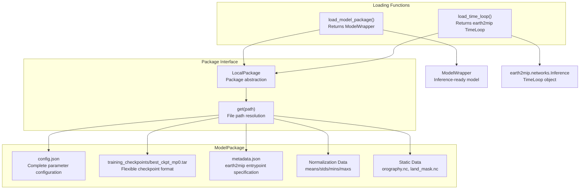
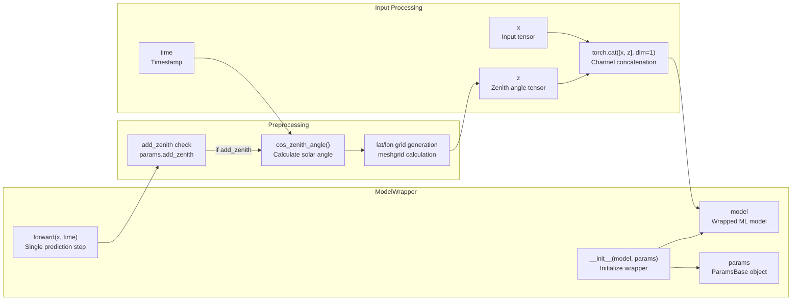
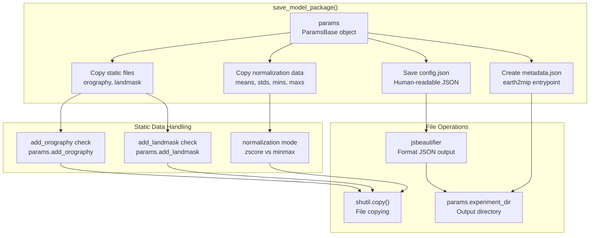
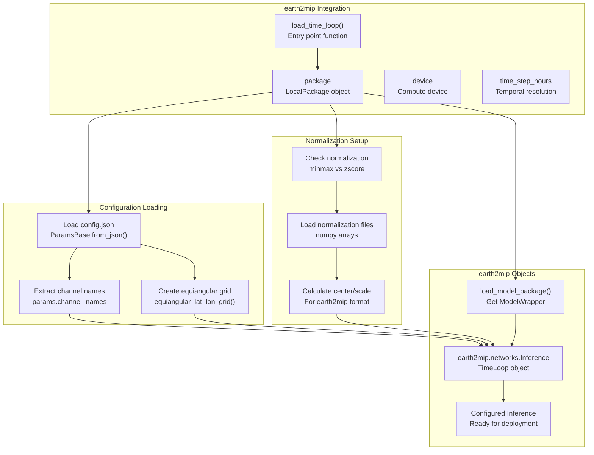
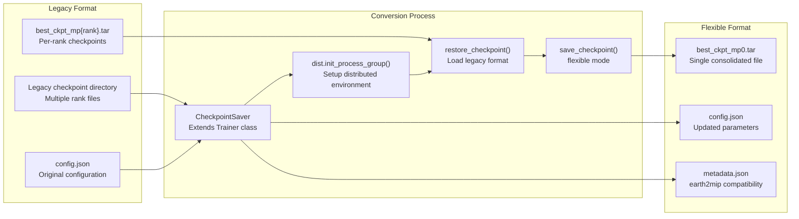
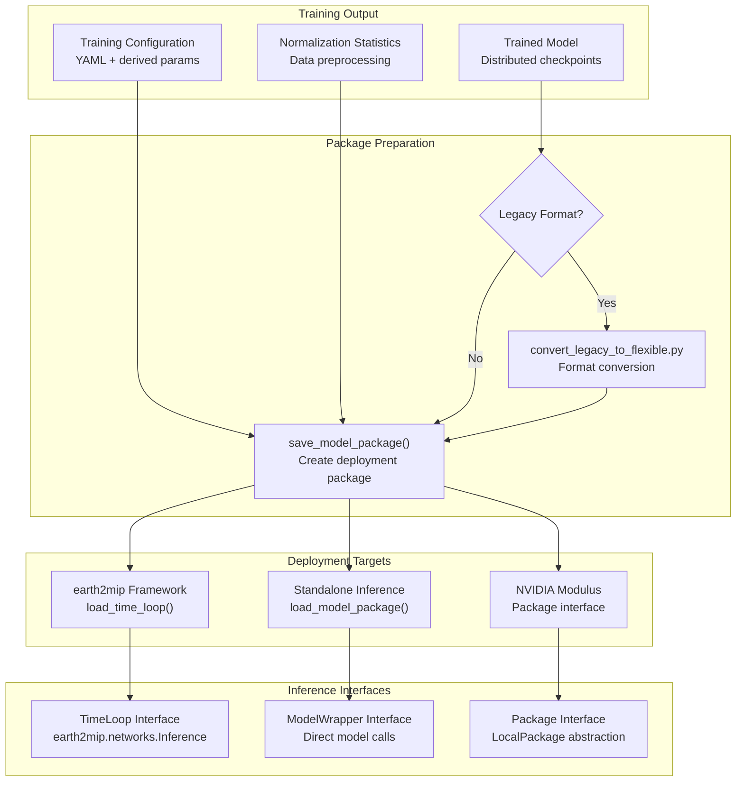

<!-- source: DeepWiki mcp.deepwiki.com · repo NVIDIA/makani · page 7 Model Deployment and Packaging · fetched 2026-10-26 -->

# Model Deployment and Packaging

Relevant source files

The following files were used as context for generating this wiki page:

- [.gitignore](.gitignore)
- [datasets/copernicus/get_data.py](datasets/copernicus/get_data.py)
- [makani/convert_legacy_to_flexible.py](makani/convert_legacy_to_flexible.py)
- [makani/models/model_package.py](makani/models/model_package.py)

This document covers the model deployment and packaging system in Makani, which provides functionality for creating self-contained, deployment-ready model packages. The system enables models trained in the Makani framework to be packaged with all necessary metadata, normalization data, and configuration files for inference in external frameworks, particularly earth2mip.

For information about the model registry and dynamic model loading, see [Model Registry System](#3.2). For details about the training and inference engines, see [Training and Inference Engines](#3.1).

## Model Package Structure

The Makani model packaging system creates self-contained packages that include all components necessary for inference. Each package follows a standardized directory structure that ensures compatibility with external frameworks.

The package structure includes these key components:

| Component | File Path | Description |
|-----------|-----------|-------------|
| Configuration | `config.json` | Complete parameter configuration from training |
| Model Weights | `training_checkpoints/best_ckpt_mp0.tar` | Flexible checkpoint format |
| Metadata | `metadata.json` | earth2mip entrypoint specification |
| Normalization | `global_means.npy`, `global_stds.npy` | Z-score normalization statistics |
| Min/Max Data | `mins.npy`, `maxs.npy` | Min-max normalization bounds |
| Static Data | `orography.nc`, `land_mask.nc` | Geographical data files |

Sources: [makani/models/model_package.py:50-56](), [makani/models/model_package.py:131-138]()

## ModelWrapper for Inference

The `ModelWrapper` class provides a simplified interface for model inference outside of the Makani training framework. It handles preprocessing steps like zenith angle calculation and provides a clean `forward()` method for predictions.

The wrapper performs these key operations:

- **Zenith Angle Integration**: Automatically adds solar zenith angle as an additional input channel when `add_zenith` is enabled
- **Coordinate Grid Management**: Maintains latitude/longitude grids for zenith angle calculations  
- **Device Handling**: Ensures tensors are on the correct device for computation
- **Dimension Broadcasting**: Handles tensor dimension matching for concatenation

Sources: [makani/models/model_package.py:58-97]()

## Package Creation and Management

The package creation system saves all necessary components for model deployment through the `save_model_package()` function. This function creates a complete, self-contained package from a trained model.

The package creation process handles different normalization modes and optional static data:

| Component | Condition | Source Path | Target Path |
|-----------|-----------|-------------|-------------|
| Orography | `add_orography=True` | `params.orography_path` | `orography.nc` |
| Land Mask | `add_landmask=True` | `params.landmask_path` | `land_mask.nc` |
| Global Stats | `normalization='zscore'` | `global_means_path`, `global_stds_path` | `global_means.npy`, `global_stds.npy` |
| Min/Max | `normalization='minmax'` | `min_path`, `max_path` | `mins.npy`, `maxs.npy` |

Sources: [makani/models/model_package.py:99-138]()

## earth2mip Integration

The Makani packaging system provides seamless integration with the earth2mip framework through the `load_time_loop()` function, which creates earth2mip-compatible inference objects.

The earth2mip integration handles:

- **Grid Configuration**: Creates equiangular latitude-longitude grids compatible with earth2mip
- **Normalization Adaptation**: Converts Makani normalization to earth2mip format (center/scale)
- **Channel Mapping**: Maps model channels to earth2mip variable names
- **Time Step Configuration**: Sets temporal resolution for inference loops

Sources: [makani/models/model_package.py:199-268]()

## Checkpoint Format Conversion

The checkpoint conversion system transforms legacy distributed checkpoints into flexible single-file formats suitable for deployment. This is handled by the `convert_legacy_to_flexible.py` script.

The conversion process:

1. **Process Group Setup**: Initializes distributed environment matching original training configuration
2. **Legacy Loading**: Restores checkpoints using original distributed parameters
3. **Flexible Saving**: Consolidates model state into single checkpoint file
4. **Package Generation**: Creates complete model package with updated metadata

Key parameters updated during conversion:

| Parameter | Legacy Value | Flexible Value |
|-----------|--------------|----------------|
| `img_local_offset_x` | Distributed offset | `0` |
| `img_local_offset_y` | Distributed offset | `0` |
| `img_local_shape_x` | Local partition size | `params.img_shape_x` |
| `img_local_shape_y` | Local partition size | `params.img_shape_y` |

Sources: [makani/convert_legacy_to_flexible.py:41-103](), [makani/models/model_package.py:171-177]()

## Deployment Workflows

The model deployment system supports multiple deployment scenarios through standardized interfaces and package formats.

The deployment system provides these key benefits:

- **Format Standardization**: Consistent package structure across all deployment targets
- **Framework Compatibility**: Native integration with earth2mip and Modulus
- **Self-Contained Packages**: All dependencies included for reproducible inference
- **Legacy Support**: Conversion tools for existing model checkpoints

Sources: [makani/models/model_package.py:36-47](), [makani/convert_legacy_to_flexible.py:105-134]()

---

