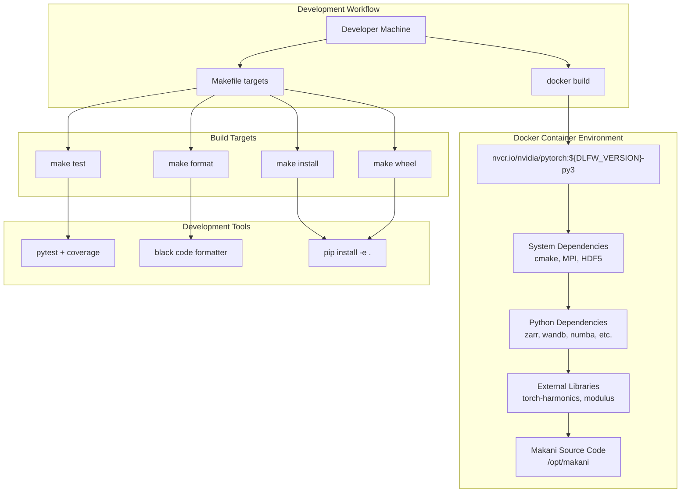
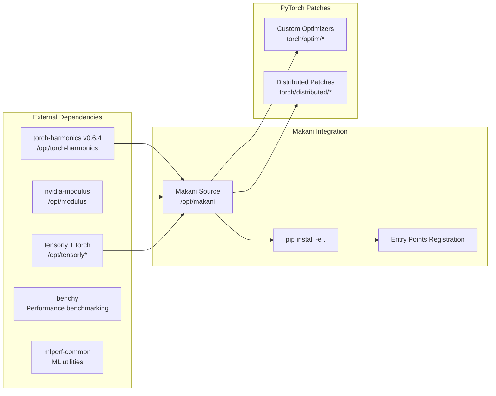

<!-- source: DeepWiki mcp.deepwiki.com · repo NVIDIA/makani · page 8 Development Environment · fetched 2026-10-26 -->

# Development Environment

<details>
<summary>Relevant source files</summary>

The following files were used as context for generating this wiki page:

- [Makefile](Makefile)
- [docker/Dockerfile](docker/Dockerfile)

</details>


This document provides guidance for developers working on the Makani codebase, covering the Docker-based development environment, build systems, and essential development workflows. 

For detailed information about the Docker build system and containerization, see [Build System and Docker](#8.1). For testing infrastructure and procedures, see [Testing Framework](#8.2).

## Overview

The Makani development environment is built around a Docker-based workflow that ensures reproducible builds and consistent dependency management across different systems. The environment includes all necessary dependencies for training and inference of neural weather models, along with development tools for testing, formatting, and building the codebase.

## Development Environment Architecture



Sources: [docker/Dockerfile:1-104](), [Makefile:1-31]()

## Docker-Based Development Environment

The development environment is containerized using Docker to ensure reproducibility and manage complex dependencies. The base configuration is defined in the main Dockerfile.

### Base Container and Dependencies

The Docker environment starts from the NVIDIA PyTorch container and adds specific dependencies required for Makani:

| Component | Purpose | Installation Method |
|-----------|---------|-------------------|
| Base Image | `nvcr.io/nvidia/pytorch:${DLFW_VERSION}-py3` | Docker FROM instruction |
| MPI | Distributed computing support | `mpi4py` via pip |
| HDF5 | Climate data file format | Custom build from source |
| Zarr | Array storage format | `zarr netCDF4 xarray pandas` |
| Visualization | Plotting and logging | `moviepy imageio wandb` |
| Numerical | Scientific computing | `numba xskillscore properscoring` |

### External Library Integration

The environment includes several external libraries that Makani depends on:



Sources: [docker/Dockerfile:77-87](), [docker/Dockerfile:99-104]()

## Build System

The build system is managed through a `Makefile` that provides convenient targets for common development tasks.

### Available Make Targets

| Target | Command | Purpose |
|--------|---------|---------|
| `install` | `pip install --upgrade pip && pip install -e .` | Install Makani in development mode |
| `wheel` | `pip wheel . --no-deps` | Build wheel package |
| `test` | `coverage run --source ./makani -m pytest tests` | Run tests with coverage |
| `format` | `python3 -m black --line-length=180 ./makani` | Format code using black |

### Development Installation

For development work, the recommended installation uses editable mode:

```bash
make install
```

This command executes the installation process defined in [Makefile:16-17]() and installs Makani using `pip install -e .`, which allows for immediate testing of code changes without reinstallation.

Sources: [Makefile:16-17]()

## Development Workflow

### Code Quality and Testing

The development workflow emphasizes code quality through automated testing and formatting:

1. **Code Formatting**: Uses `black` with a line length of 180 characters
2. **Testing**: Runs `pytest` with coverage reporting via the `coverage` package
3. **Coverage Reporting**: Generates both console and XML coverage reports

### Testing Infrastructure

The testing system uses `pytest` with coverage measurement:

```bash
make test
```

This executes the test suite defined in [Makefile:22-25]() and generates coverage reports for the `./makani` source directory.

### PyTorch Customizations

The development environment includes custom patches to PyTorch for specific functionality:

- **Custom Optimizers**: Modified optimizers for complex number optimization in ADAM
- **Distributed Computing**: Enhanced distributed computing functionality

These patches are applied during Docker build at [docker/Dockerfile:99-104]().

Sources: [Makefile:22-31](), [docker/Dockerfile:99-104]()

## Environment Variables and Configuration

Several environment variables control the development environment behavior:

| Variable | Value | Purpose |
|----------|-------|---------|
| `DLFW_VERSION` | Container version tag | Controls base PyTorch container version |
| `HARMONICS_VERSION` | `0.6.4` | Specifies torch-harmonics version |
| `NUMBA_DISABLE_CUDA` | `1` | Disables CUDA in numba for compatibility |
| `SETUPTOOLS_USE_DISTUTILS` | `local` | Ensures proper MPI compilation |

These variables are configured during the Docker build process and ensure consistent behavior across different deployment environments.

Sources: [docker/Dockerfile:16](), [docker/Dockerfile:53](), [docker/Dockerfile:78]()

## Integration with Child Systems

This development environment supports the specialized systems documented in the child pages:

- **Docker Build System**: Detailed containerization and dependency management ([Build System and Docker](#8.1))
- **Testing Infrastructure**: Comprehensive testing framework and utilities ([Testing Framework](#8.2))

The environment provides the foundation for both building and testing the entire Makani system, including its neural network models, data pipelines, and distributed computing capabilities.

---

