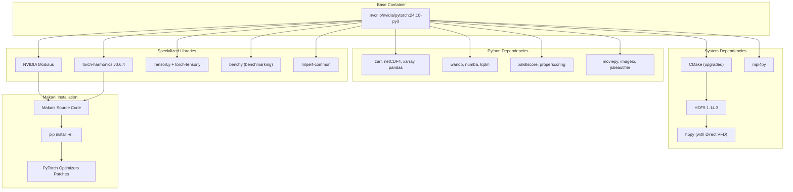
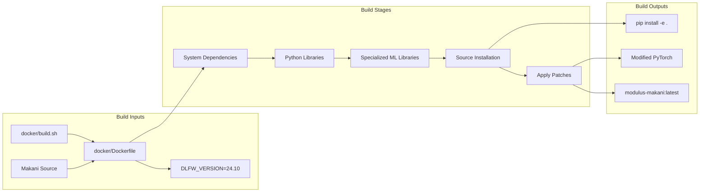
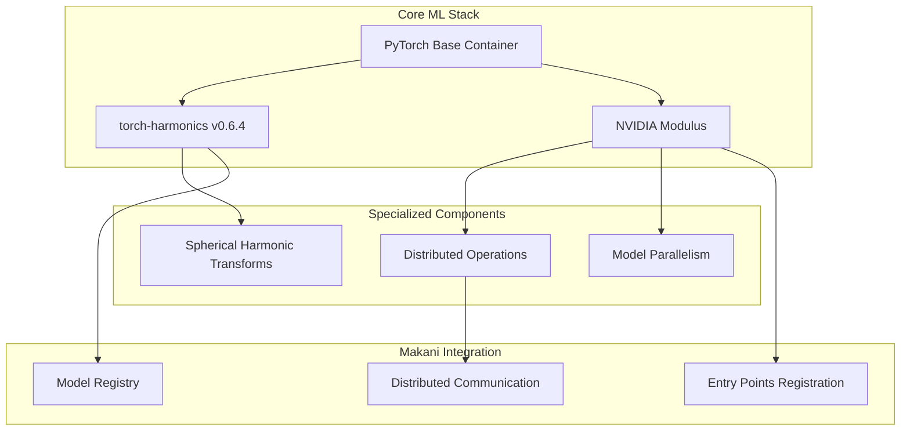

<!-- source: DeepWiki mcp.deepwiki.com · repo NVIDIA/makani · page 8.1 Build System and Docker · fetched 2026-10-26 -->

# Build System and Docker

<details>
<summary>Relevant source files</summary>

The following files were used as context for generating this wiki page:

- [docker/Dockerfile](docker/Dockerfile)
- [docker/build.sh](docker/build.sh)

</details>


This document covers the Docker-based build system and containerized development environment for Makani. The build system provides a reproducible environment with all necessary dependencies for training and inference of neural weather and climate models. This includes specialized dependencies like torch-harmonics for spherical harmonic transforms, NVIDIA Modulus framework integration, and optimized data loading libraries.

For information about testing within the containerized environment, see [Testing Framework](#8.2). For details about model deployment and packaging workflows, see [Model Deployment and Packaging](#7).

## Docker Environment Overview

The Makani project uses a Docker-based development environment built on top of NVIDIA's PyTorch container. This ensures consistent execution across different hardware and deployment scenarios while providing optimized GPU acceleration and distributed computing capabilities.



**Sources:** [docker/Dockerfile:17-104]()

## Build Process and Architecture

The Docker build process follows a structured approach to install dependencies in the correct order and apply necessary patches for optimal performance.



**Sources:** [docker/build.sh:27-29](), [docker/Dockerfile:16-104]()

### Build Script Configuration

The build process is controlled by the `build.sh` script which sets key configuration parameters:

| Parameter | Value | Purpose |
|-----------|-------|---------|
| `dlfw_version` | 24.10 | NVIDIA Deep Learning Framework container version |
| `gitlab_tag` | latest | Tag for the resulting container image |
| `network` | host | Use host networking during build for dependency downloads |

**Sources:** [docker/build.sh:19-29]()

## Key Dependencies and Integration Points

### Scientific Computing Stack

The container includes a comprehensive scientific computing environment optimized for weather and climate modeling:

- **HDF5 1.14.3**: Custom compiled with Direct VFD support for high-performance I/O
- **h5py**: Built with MPI and Direct VFD support for distributed data access
- **zarr, netCDF4, xarray**: For chunked array operations and climate data formats
- **numba**: JIT compilation with CUDA disabled to avoid conflicts

**Sources:** [docker/Dockerfile:29-44](), [docker/Dockerfile:51-53]()

### Machine Learning Framework Integration



**Sources:** [docker/Dockerfile:78-86]()

### PyTorch Patches and Optimizations

The container includes custom patches to PyTorch for enhanced functionality:

- **Complex Number Optimization**: Modified ADAM optimizer to support complex number operations
- **Distributed Communication**: Enhanced distributed training capabilities

These patches are applied by copying modified files directly into the PyTorch installation:

**Sources:** [docker/Dockerfile:99-104]()

## Development Workflow Integration

### Source Code Installation

The Makani source code is installed as an editable package, enabling development workflows:

```
COPY config /opt/makani/config
COPY makani /opt/makani/makani
COPY tests /opt/makani/tests
COPY pyproject.toml /opt/makani/pyproject.toml
RUN cd /opt/makani && pip install -e .
```

This installation method allows for:
- Live code changes during development
- Access to all CLI entry points (`makani.train`, `makani.inference`)
- Integration with the model registry system
- Proper Python package structure

**Sources:** [docker/Dockerfile:89-97]()

### Container Usage Patterns

The container is designed to support multiple usage patterns:

| Pattern | Description | Key Features |
|---------|-------------|--------------|
| Interactive Development | Running container with mounted source | Live code editing, debugging |
| Batch Training | Automated training jobs | Reproducible environment, all dependencies |
| Distributed Execution | Multi-node training/inference | MPI support, optimized communication |
| CI/CD Integration | Automated testing and validation | Consistent test environment |

### Environment Variables and Configuration

Key environment variables set in the container:

- `NUMBA_DISABLE_CUDA=1`: Prevents CUDA conflicts with numba JIT compilation
- `HARMONICS_VERSION=0.6.4`: Pins specific torch-harmonics version
- Various library paths for HDF5, MPI, and other dependencies

**Sources:** [docker/Dockerfile:53](), [docker/Dockerfile:78]()

---

