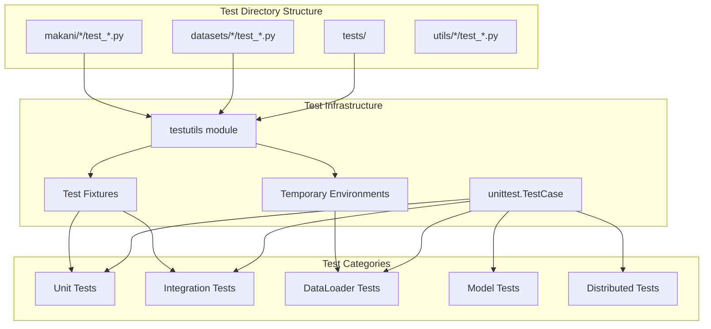
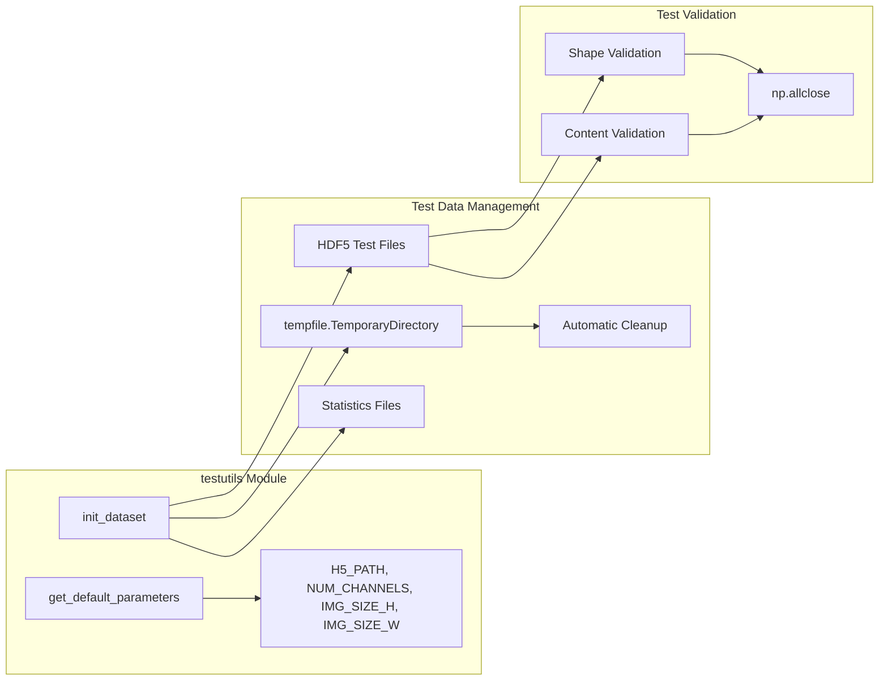
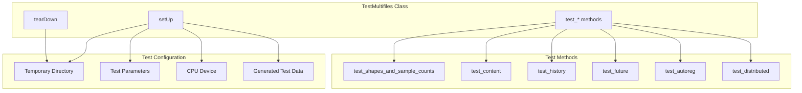
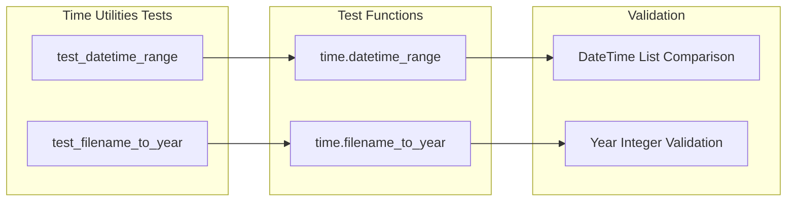

<!-- source: DeepWiki mcp.deepwiki.com · repo NVIDIA/makani · page 8.2 Testing Framework · fetched 2026-10-26 -->

# Testing Framework

<details>
<summary>Relevant source files</summary>

The following files were used as context for generating this wiki page:

- [datasets/era5/test_time.py](datasets/era5/test_time.py)
- [tests/test_dataloader.py](tests/test_dataloader.py)

</details>


## Purpose and Scope

The Testing Framework provides the infrastructure and utilities for validating Makani's functionality across all system components. This includes unit tests for individual components, integration tests for complex workflows, and specialized test utilities for distributed computing scenarios. The framework ensures code reliability, validates model behavior, and supports continuous integration workflows.

For information about the build system and Docker environment setup, see [Build System and Docker](#8.1). For details about the core data pipeline being tested, see [Data Pipeline](#5).

## Test Organization and Structure

The Makani testing framework follows a hierarchical organization with tests distributed across component-specific directories and a central `tests/` directory for integration tests.



**Test File Patterns:**
- Component tests: `datasets/era5/test_time.py`, `tests/test_dataloader.py`
- Naming convention: `test_*.py` files within relevant directories
- Base class: `unittest.TestCase` for structured test organization

Sources: [tests/test_dataloader.py:21](), [datasets/era5/test_time.py:1-28]()

## Test Utilities and Fixtures

The testing framework provides specialized utilities for creating test environments, managing temporary data, and validating complex data structures.

### Core Test Utilities

The `testutils` module provides essential testing infrastructure:



**Key Test Constants and Utilities:**
- `H5_PATH`: Standard HDF5 dataset path for testing
- `NUM_CHANNELS`, `IMG_SIZE_H`, `IMG_SIZE_W`: Standard test data dimensions
- `get_default_parameters()`: Creates baseline parameter configuration
- `init_dataset()`: Sets up temporary test datasets with statistics

Sources: [tests/test_dataloader.py:28-29](), [tests/test_dataloader.py:94]()

### Test Environment Setup

Test classes implement standardized setup and teardown patterns:

| Method | Purpose | Implementation |
|--------|---------|----------------|
| `setUp()` | Initialize test environment | Creates temporary directories, test data, and parameter objects |
| `tearDown()` | Clean up resources | Removes temporary files and directories |
| `init_params()` | Configure test parameters | Sets up paths, batch sizes, and data loading parameters |

Sources: [tests/test_dataloader.py:85-117]()

## DataLoader Testing Framework

The most comprehensive testing implementation focuses on the data loading system, providing templates for testing complex distributed components.

### Test Class Structure



**Test Categories:**
- **Shape Validation**: Ensures data tensors have correct dimensions
- **Content Validation**: Verifies data integrity through numerical comparison
- **Configuration Testing**: Tests different parameter combinations (history, future, autoregression)
- **Distributed Testing**: Validates spatial decomposition and I/O grid functionality

Sources: [tests/test_dataloader.py:83-261]()

### Distributed Testing Patterns

The framework includes sophisticated testing for distributed data loading scenarios:

```python
# Example distributed test configuration
self.params.io_grid = [1, 2, 1]  # Spatial decomposition
self.params.io_rank = [0, 1, 0]  # Process rank assignment
```

**Validation Approaches:**
- Compare local data slices with expected spatial decomposition
- Validate offset and range calculations for distributed I/O
- Ensure data consistency across different process configurations

Sources: [tests/test_dataloader.py:219-261]()

## Component-Specific Testing

### Time Utilities Testing

The framework includes targeted tests for utility components:



**Test Patterns:**
- Function-level unit tests with specific input/output validation
- Edge case testing for time calculations and filename parsing
- Timezone-aware datetime testing with `pytz.utc`

Sources: [datasets/era5/test_time.py:21-28]()

## Running Tests

The testing framework integrates with standard Python testing tools and supports various execution modes:

### Test Execution Commands

| Command | Purpose | Scope |
|---------|---------|-------|
| `python -m unittest` | Run all tests | Full test suite |
| `python -m unittest tests.test_dataloader` | Run specific module | Single test module |
| `python -m unittest tests.test_dataloader.TestMultifiles.test_shapes_and_sample_counts` | Run specific test | Individual test method |
| `pytest` | Alternative test runner | Configurable test discovery |

### Test Configuration

Tests support various configuration parameters:
- Batch size and data dimensions
- Distributed computing parameters (`io_grid`, `io_rank`)
- Data loading modes (`multifiles`, normalization strategies)
- Device configuration (CPU/GPU testing)

Sources: [tests/test_dataloader.py:262-263]()

## Writing New Tests

### Test Development Guidelines

When creating new tests, follow these established patterns:

1. **Inherit from `unittest.TestCase`**
2. **Implement `setUp()` and `tearDown()` methods** for resource management
3. **Use descriptive test method names** starting with `test_`
4. **Validate both shapes and content** for data-related tests
5. **Include distributed testing scenarios** for parallel components
6. **Use temporary directories** for file-based testing

### Test Validation Patterns

```python
# Shape validation example
self.assertEqual(tuple(inp.shape), expected_shape)

# Content validation example  
self.assertTrue(np.allclose(actual_data, expected_data))

# Count validation example
self.assertEqual(num_iterations, expected_count)
```

### Testing Best Practices

- **Isolation**: Each test should be independent and not rely on other tests
- **Cleanup**: Use `tearDown()` methods to ensure proper resource cleanup
- **Parameterization**: Test multiple configurations within single test methods
- **Numerical Tolerance**: Use `np.allclose()` for floating-point comparisons
- **Temporary Resources**: Create test data in temporary directories

Sources: [tests/test_dataloader.py:120-164](), [tests/test_dataloader.py:160-161]()

---

