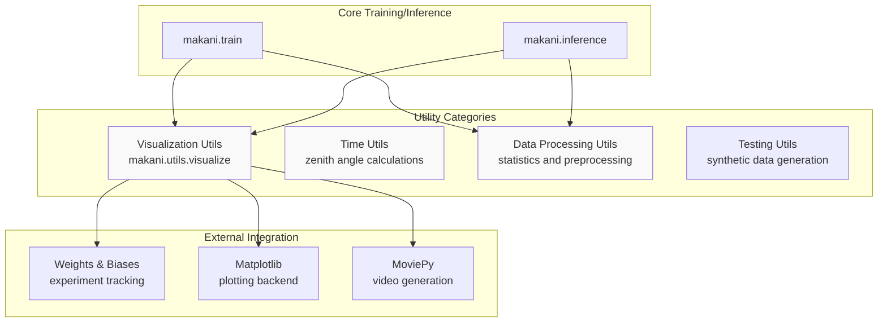
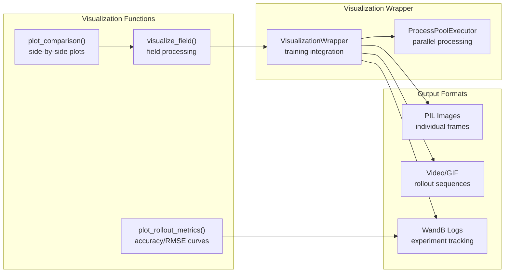
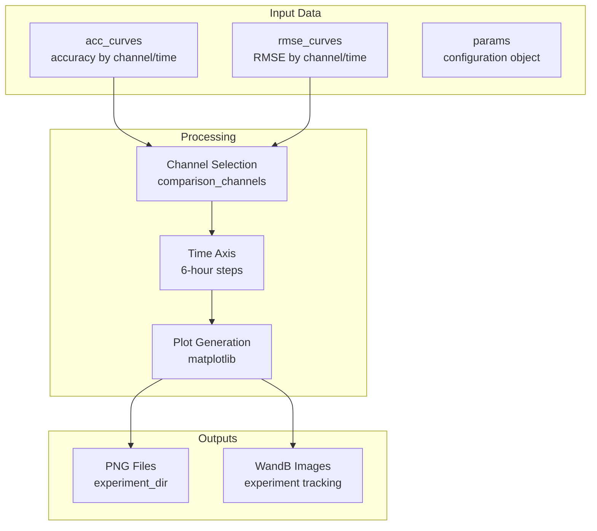

<!-- source: DeepWiki mcp.deepwiki.com · repo NVIDIA/makani · page 9 Utilities and Tools · fetched 2026-10-26 -->

# Utilities and Tools

<details>
<summary>Relevant source files</summary>

The following files were used as context for generating this wiki page:

- [makani/utils/__init__.py](makani/utils/__init__.py)
- [makani/utils/visualize.py](makani/utils/visualize.py)

</details>


This section documents the supporting utilities and helper tools that complement the core Makani training and inference workflows. These utilities provide essential functionality for data visualization, analysis, and auxiliary computations that enhance the development and operation of neural weather models.

The utilities are organized into specialized modules that handle specific aspects of model development and analysis. For information about the core neural network model architectures, see [Neural Network Models](#4). For details about the data processing pipeline, see [Data Pipeline](#5).

## Overview

The Makani utilities ecosystem provides several categories of supporting tools that work alongside the main training and inference engines:



**Sources:** [makani/utils/visualize.py:1-236]()

## Visualization System

The visualization system provides comprehensive tools for creating visual comparisons between model predictions and ground truth, plotting training metrics, and generating videos of rollout sequences. The system is designed to work seamlessly with both local development and distributed training environments.

### Core Visualization Functions

The visualization system centers around three main functions that handle different aspects of model output visualization:



**Sources:** [makani/utils/visualize.py:27-96](), [makani/utils/visualize.py:99-133](), [makani/utils/visualize.py:135-154]()

### Plot Comparison Function

The `plot_comparison()` function creates side-by-side visualizations of model predictions versus ground truth data on global projections:

| Parameter | Type | Description |
|-----------|------|-------------|
| `pred` | 2D array | Model prediction field |
| `truth` | 2D array | Ground truth field |
| `lat`, `lon` | Optional arrays | Latitude/longitude coordinates |
| `projection` | str | Map projection (`"mollweide"`, `"hammer"`, `"aitoff"`) |
| `cmap` | str | Colormap (default: `"twilight_shifted"`) |
| `diverging` | bool | Whether to use symmetric color scale |

The function automatically handles coordinate generation if lat/lon are not provided and normalizes the color scale based on the ground truth maximum values. It returns a PIL Image object that can be saved or logged to experiment tracking systems.

**Sources:** [makani/utils/visualize.py:27-96]()

### Rollout Metrics Visualization

The `plot_rollout_metrics()` function generates time-series plots of model performance metrics across rollout steps:



The function creates separate plots for each specified atmospheric variable (default: `["u10m", "v10m", "z500", "t2m", "t850"]`) and both accuracy and RMSE metrics. Time steps are displayed in 6-hour intervals to match typical weather forecasting conventions.

**Sources:** [makani/utils/visualize.py:99-133]()

### Visualization Wrapper

The `VisualizationWrapper` class provides a comprehensive interface for managing visualization during training and inference workflows:

| Method | Purpose |
|--------|---------|
| `__init__()` | Initialize with logging, plotting configuration |
| `reset()` | Clear pending visualization requests |
| `add()` | Queue visualization of prediction/target pairs |
| `finalize()` | Process all queued visualizations and log results |

The wrapper supports parallel processing of visualizations using `ProcessPoolExecutor` and can generate both individual images and video sequences. It integrates with Weights & Biases for automatic experiment logging.

**Key Configuration Parameters:**

```python
# Example initialization
wrapper = VisualizationWrapper(
    log_to_wandb=True,
    path="./outputs",
    prefix="rollout",
    plot_list=[
        {"name": "temperature", "functor": "lambda x: x", "diverging": False},
        {"name": "vorticity", "functor": "some_function", "diverging": True}
    ],
    num_workers=4
)
```

**Sources:** [makani/utils/visualize.py:157-236]()

### Video Generation

The visualization system can automatically generate videos or GIFs from sequences of visualizations during model rollouts. This feature uses `moviepy.video.io.ImageSequenceClip` for local video generation and `wandb.Video` for experiment tracking integration.

The video generation process:
1. Collects all visualization frames from parallel workers
2. Stacks frames in temporal order
3. Creates video at 3 FPS for optimal viewing
4. Logs to WandB or saves locally as GIF

**Sources:** [makani/utils/visualize.py:204-235]()

## Additional Utility Categories

Beyond the visualization system, Makani includes several other utility categories that support specific aspects of model development:

### Time and Astronomical Utilities

These utilities handle temporal calculations and astronomical computations required for accurate weather modeling, including zenith angle calculations for solar radiation modeling. For detailed documentation of these utilities, see [Time and Astronomical Utilities](#9.2).

### Data Processing Utilities

Supporting utilities for data preprocessing, statistical computation, and data preparation workflows. These work closely with the main data pipeline described in [Data Processing and Statistics](#5.2).

### Testing Utilities

Helper functions and classes that support the testing framework, including synthetic data generation and test validation utilities. For more information about the testing infrastructure, see [Testing Framework](#8.2).

**Sources:** [makani/utils/__init__.py:1-2]()

---

