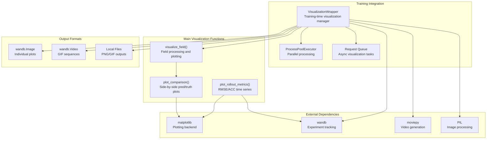
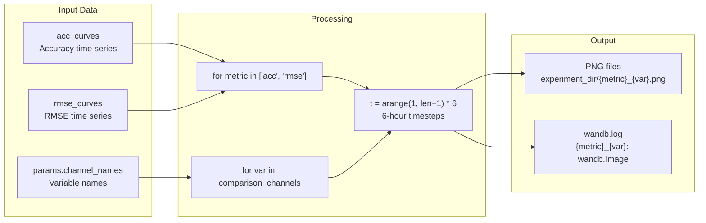
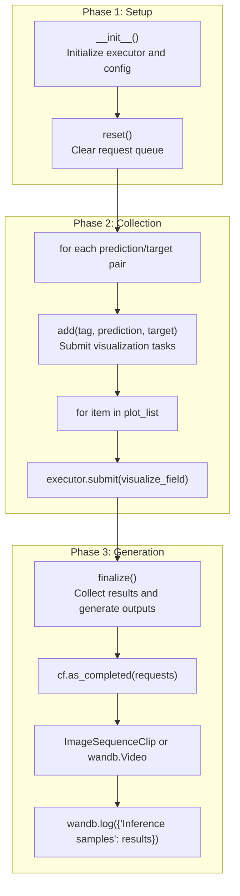

<!-- source: DeepWiki mcp.deepwiki.com · repo NVIDIA/makani · page 9.1 Visualization System · fetched 2026-10-26 -->

# Visualization System

Relevant source files

The following files were used as context for generating this wiki page:

- [images/sfno_rollout.gif](images/sfno_rollout.gif)
- [makani/utils/visualize.py](makani/utils/visualize.py)

## Purpose and Scope

The Visualization System provides comprehensive visualization capabilities for Makani's machine learning weather and climate models. This system enables visual comparison of model predictions against ground truth data, tracks training metrics over time, and generates visual outputs for analysis and presentation. The visualization utilities support both real-time monitoring during training and post-hoc analysis of model performance.

For information about data processing and statistics, see [5.2](#5.2). For details about model training and inference workflows, see [3.1](#3.1).

## Core Architecture

The visualization system is centered around a single module that provides both individual plotting functions and a comprehensive wrapper for training-time visualization.

### Component Overview

Sources: [makani/utils/visualize.py:1-236]()

## Individual Visualization Functions

### Prediction vs Ground Truth Comparison

The `plot_comparison` function creates side-by-side visualizations of model predictions and ground truth data using geographic projections.

| Parameter | Type | Description |
|-----------|------|-------------|
| `pred` | 2D array | Model prediction data |
| `truth` | 2D array | Ground truth data |
| `lat`/`lon` | arrays | Coordinate grids (optional) |
| `projection` | string | Map projection (`mollweide`, `hammer`, `aitoff`) |
| `cmap` | string | Colormap name |
| `diverging` | bool | Whether to use symmetric color scale |

The function automatically handles coordinate grid generation, color scale normalization, and returns PIL Image objects for further processing.

Sources: [makani/utils/visualize.py:27-96]()

### Rollout Metrics Visualization

The `plot_rollout_metrics` function generates time series plots for model performance metrics during rollout evaluation.

Sources: [makani/utils/visualize.py:99-133]()

## Training-Time Visualization Wrapper

### VisualizationWrapper Class

The `VisualizationWrapper` class manages visualization during training and inference, providing parallel processing and batch generation of visual outputs.

| Attribute | Type | Purpose |
|-----------|------|---------|
| `log_to_wandb` | bool | Enable wandb logging |
| `plot_list` | list | Configuration for visualization fields |
| `executor` | ProcessPoolExecutor | Parallel processing manager |
| `requests` | list | Queue of visualization tasks |
| `lat`/`lon` | arrays | Coordinate grids |
| `scale`/`bias` | float | Data normalization parameters |

Sources: [makani/utils/visualize.py:157-177]()

### Visualization Workflow

The wrapper follows a three-phase workflow for handling visualizations during training:

Sources: [makani/utils/visualize.py:179-235]()

### Field Visualization Processing

The `visualize_field` function handles individual field processing with data transformation and plotting:

1. **Data Unscaling**: `pred = scale * prediction + bias` [makani/utils/visualize.py:142]()
2. **Function Application**: `pred = func_handle(pred)` using `eval(func_string)` [makani/utils/visualize.py:146]()
3. **Comparison Plot**: Calls `plot_comparison` with processed data [makani/utils/visualize.py:150]()

The function supports custom transformation functions specified as strings in the plot configuration, enabling flexible data processing pipelines.

Sources: [makani/utils/visualize.py:135-154]()

## Output Generation and Integration

### Video Generation

The system supports two modes of video generation:

| Mode | Output Type | Implementation |
|------|-------------|----------------|
| wandb | `wandb.Video` | NumPy array with shape transformation |
| Local | GIF file | `ImageSequenceClip` from moviepy |

For wandb integration, images are converted to `(channels, height, width)` format and stacked into video arrays at 3 FPS. For local output, the system generates GIF files using moviepy's `ImageSequenceClip`.

Sources: [makani/utils/visualize.py:204-223]()

### Experiment Tracking Integration

The visualization system integrates with wandb for experiment tracking, automatically logging:

- Individual comparison plots as `wandb.Image` objects
- Time series metrics plots for rollout evaluation  
- Video sequences of inference samples
- Custom tags and captions for organized viewing

All wandb logging is conditional on the `log_to_wandb` parameter, allowing the system to operate in offline modes for development and testing.

Sources: [makani/utils/visualize.py:131-132](), [makani/utils/visualize.py:227-228]()

---

