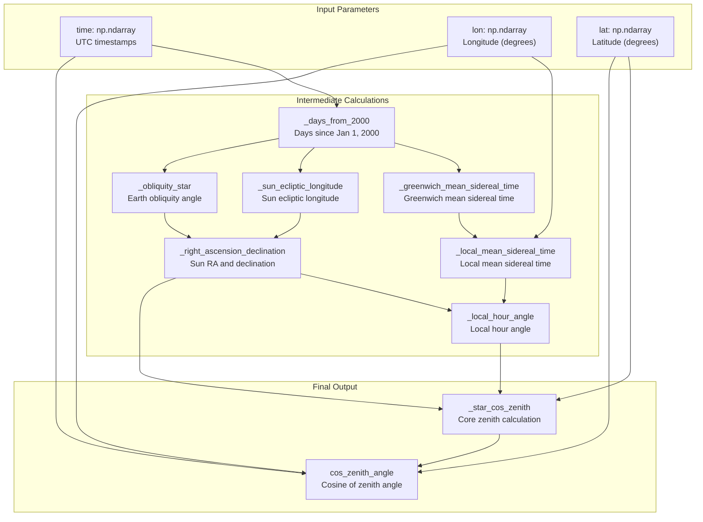
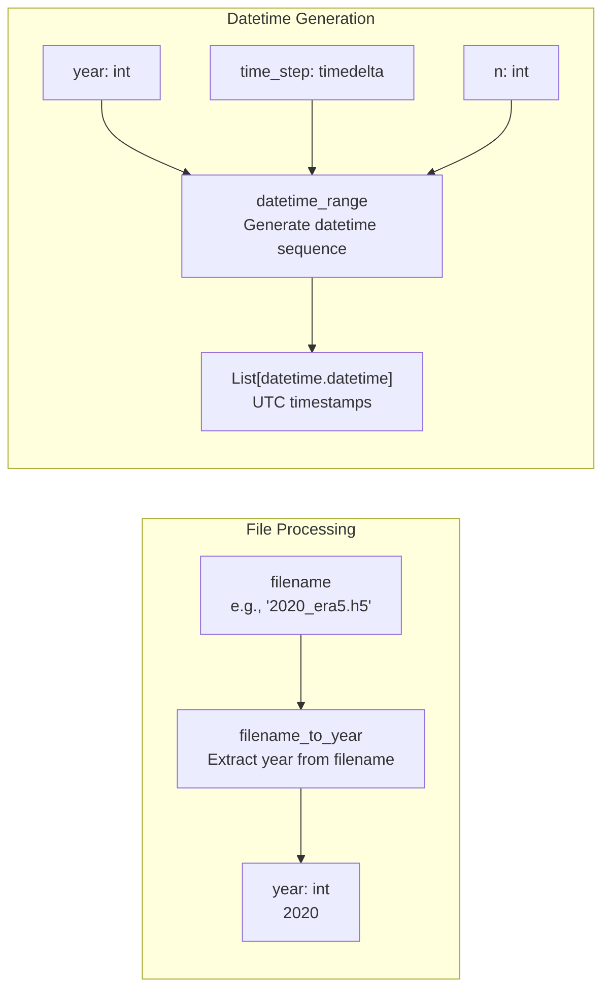

<!-- source: DeepWiki mcp.deepwiki.com · repo NVIDIA/makani · page 9.2 Time and Astronomical Utilities · fetched 2026-10-26 -->

# Time and Astronomical Utilities

Relevant source files

The following files were used as context for generating this wiki page:

- [datasets/era5/time.py](datasets/era5/time.py)
- [makani/third_party/climt/zenith_angle.py](makani/third_party/climt/zenith_angle.py)

This document covers the time-related and astronomical calculation utilities in Makani. These utilities provide essential functionality for climate and weather modeling, particularly for calculating solar zenith angles and handling temporal data processing. The system includes astronomical calculations for solar positioning and time utilities for dataset management.

For information about data processing pipelines that use these time utilities, see [Data Pipeline](#5). For visualization utilities that may use temporal calculations, see [Visualization System](#9.1).

## Overview

The time and astronomical utilities in Makani are split into two main components:

1. **Solar zenith angle calculations** - Comprehensive astronomical calculations for determining sun position relative to Earth coordinates
2. **Dataset time utilities** - Helper functions for processing temporal metadata in climate datasets

These utilities support the broader climate modeling workflow by providing accurate temporal and astronomical reference data that can be incorporated into neural network models or used for data preprocessing.

## Solar Zenith Angle Calculation System

The primary astronomical utility is the solar zenith angle calculation system, implemented in [makani/third_party/climt/zenith_angle.py](). This module provides vectorized, JIT-compiled functions for calculating the cosine of the solar zenith angle at any given time and location on Earth.

### Astronomical Calculation Pipeline

Sources: [makani/third_party/climt/zenith_angle.py:45-227]()

### Core Functions and Their Responsibilities

| Function | Purpose | Input | Output |
|----------|---------|--------|--------|
| `cos_zenith_angle` | Main public API for zenith angle calculation | time, lon, lat in degrees | Cosine of zenith angle |
| `_star_cos_zenith` | Core zenith calculation with optimized inputs | time, lon/lat in radians | Cosine of zenith angle |
| `_days_from_2000` | Convert datetime to days since Y2K epoch | datetime array | Days as float32 |
| `_greenwich_mean_sidereal_time` | Calculate Greenwich mean sidereal time | datetime array | Angle in radians |
| `_sun_ecliptic_longitude` | Calculate sun's ecliptic longitude | datetime array | Longitude in radians |
| `_right_ascension_declination` | Calculate sun's celestial coordinates | datetime array | RA and declination |

Sources: [makani/third_party/climt/zenith_angle.py:196-227](), [makani/third_party/climt/zenith_angle.py:173-194]()

### Performance Optimizations

The astronomical calculation system includes several performance optimizations:

- **JIT compilation**: All functions use `@jit` decorators with `numba` for accelerated execution
- **Vectorization**: Functions operate on numpy arrays for batch processing of coordinates and times
- **Caching**: Core functions use `cache=True` for compiled function caching
- **Data type optimization**: Uses `np.float32` for reduced memory footprint

The main optimization strategy reshapes inputs to enable broadcasting:
- Time: `(-1, 1, 1)` 
- Longitude: `(1, -1, 1)`
- Latitude: `(1, 1, -1)`

This allows efficient computation over time × latitude × longitude grids.

Sources: [makani/third_party/climt/zenith_angle.py:38-43](), [makani/third_party/climt/zenith_angle.py:219-225]()

## Dataset Time Utilities

The dataset time utilities provide helper functions for processing temporal metadata in climate datasets, particularly ERA5 data.

### Time Utility Functions

Sources: [datasets/era5/time.py:21-31]()

### Function Specifications

| Function | Purpose | Parameters | Return Type |
|----------|---------|------------|-------------|
| `filename_to_year` | Extract year from ERA5 filename | `path: str` | `int` |
| `datetime_range` | Generate sequence of UTC timestamps | `year: int, time_step: timedelta, n: int` | `List[datetime.datetime]` |

The `datetime_range` function creates a sequence starting from January 1st at midnight UTC for the specified year, incrementing by the given time step for `n` iterations.

Sources: [datasets/era5/time.py:26-30]()

## Integration with Makani System

### Usage Patterns

The time and astronomical utilities integrate with the broader Makani system in several ways:

1. **Data preprocessing**: Zenith angle calculations can be incorporated as additional input features for weather/climate models
2. **Dataset loading**: Time utilities help process temporal metadata from climate datasets during data loading
3. **Model inputs**: Solar zenith angle can serve as an auxiliary input to neural network models for improved physics-aware predictions

### Coordinate System Conventions

The astronomical calculations follow standard conventions:
- **Longitude**: East-West coordinates in degrees (positive East)
- **Latitude**: North-South coordinates in degrees (positive North)  
- **Time**: UTC timestamps using `pytz.utc` timezone
- **Angles**: Internal calculations use radians, public API accepts degrees

### Performance Characteristics

The system is designed for high-performance batch processing:
- Vectorized operations over spatial grids and time sequences
- JIT compilation for computational kernels
- Memory-efficient float32 precision
- Broadcasting-optimized tensor shapes

Sources: [makani/third_party/climt/zenith_angle.py:196-227](), [datasets/era5/time.py:29]()

---

