# Page: Overview

# Overview

<details>
<summary>Relevant source files</summary>

The following files were used as context for generating this wiki page:

- [.github/workflows/tests.yml](.github/workflows/tests.yml)
- [README.md](README.md)
- [pyproject.toml](pyproject.toml)

</details>


This document provides a high-level architectural overview of the Makani system, a PyTorch-based library designed for massively parallel training of machine learning weather and climate models. This overview covers the system's core execution engines, model registry, data pipeline, and distributed computing framework.

For detailed information about specific model architectures, see [Neural Network Models](#4). For configuration management details, see [Configuration System](#6). For data processing workflows, see [Data Pipeline](#5).

## Purpose and Scope

Makani is an experimental research library that enables training and inference of machine learning based weather and climate models on 100+ GPUs. The system supports various neural operator architectures including Spherical Fourier Neural Operators (SFNO) and Adaptive Fourier Neural Operators (AFNO), with comprehensive support for model parallelism, data parallelism, and distributed computing.

The system provides two main execution modes through CLI entry points: `makani.train` for distributed training and `makani.inference` for model evaluation and prediction.

Sources: [README.md:1-27](), [pyproject.toml:36-36]()

## System Architecture Overview

The following diagram illustrates the high-level architecture of Makani, showing the relationships between major system components and their corresponding code entities:

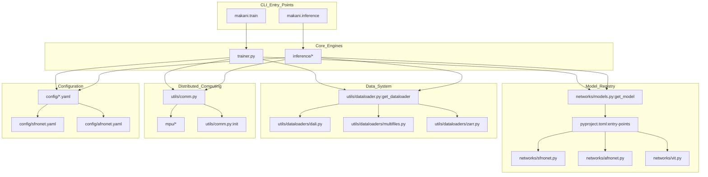

Sources: [README.md:98-99](), [README.md:83-96](), [pyproject.toml:106-115]()

## Core Execution Engines

Makani provides two primary execution engines accessible through CLI commands:

### Training Engine
The training engine is launched via `makani.train` and implemented in `trainer.py`. It handles distributed training orchestration, model checkpointing, and performance optimization features including:

| Feature | CLI Argument | Implementation |
|---------|--------------|----------------|
| Automatic Mixed Precision | `--amp_mode` | `none`, `fp16`, `bf16` |
| JIT Compilation | `--jit_mode` | `none`, `script`, `inductor` |
| CUDA Graphs | `--cuda_graph_mode` | `none`, `fwdbwd`, `step` |
| Activation Checkpointing | `--checkpointing_level` | 0,1,2,3 |

### Inference Engine
The inference engine is accessed via `makani.inference` and implemented in the `inference/` directory. It supports the same distributed computing features as training and handles model evaluation on out-of-sample datasets.

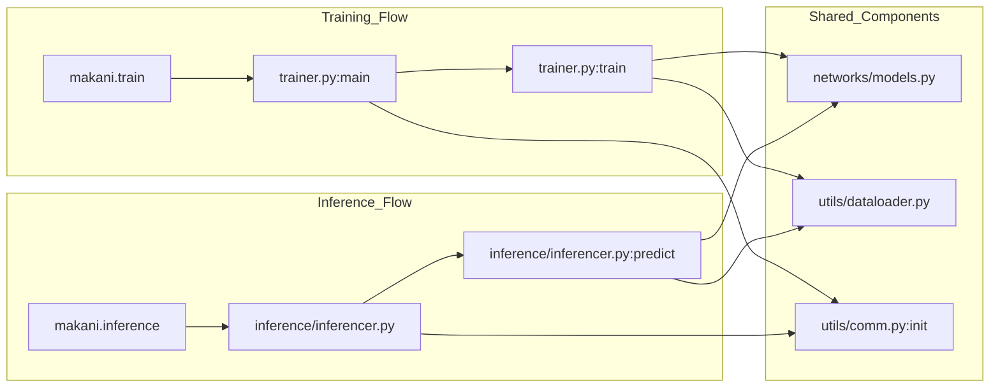

Sources: [README.md:31-35](), [README.md:61-65](), [README.md:39-50](), [README.md:95-96]()

## Model Registry and Entry Points

Makani implements a dynamic model loading system through Python entry points and a centralized model registry. The system supports plugin-style model registration for both internal Makani models and external framework integration.

### Entry Points Configuration
The model registry uses Python entry points defined in `pyproject.toml` to enable dynamic model discovery:

| Entry Point Group | Models | Purpose |
|-------------------|---------|---------|
| `makani.models` | AFNOv1, AFNO, FNO, SFNO, DebugNet, ViT | Internal Makani models |
| `modulus.models` | SFNO | Integration with NVIDIA Modulus framework |

### Model Resolution Flow
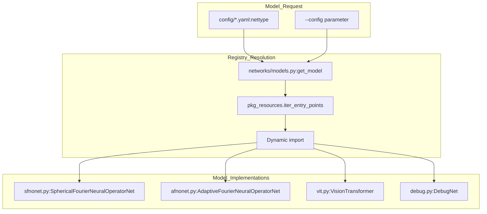

Sources: [pyproject.toml:106-115](), [README.md:105-105](), [README.md:109-109]()

## Data Pipeline Architecture

The data pipeline supports multiple data formats and distributed loading strategies through a factory pattern implemented in `get_dataloader`. The system handles HDF5, Zarr, and synthetic data sources with GPU-accelerated loading capabilities.

### DataLoader Factory System
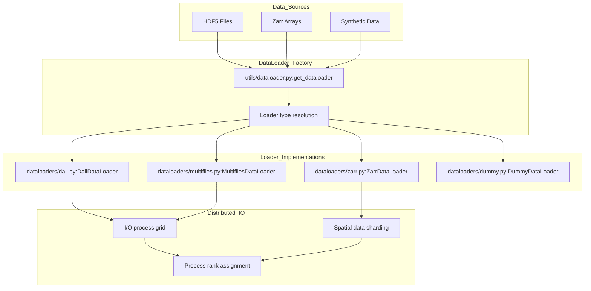

### Data Format Support
The system expects training data in specific formats with accompanying metadata:

- **HDF5 Format**: Annual files with `inp` and `tar` variables for time-series prediction
- **Metadata**: `data.json` files describing dataset structure, channels, and grid coordinates
- **Grid Types**: Support for `equiangular` and `legendre-gauss` coordinate systems

Sources: [README.md:88-89](), [README.md:127-149]()

## Distributed Computing Framework

Makani implements multi-dimensional parallelization through an orthogonal communicator infrastructure managed by `comm.py`. The system supports data parallelism, spatial model parallelism, and channel parallelism.

### Communication Infrastructure
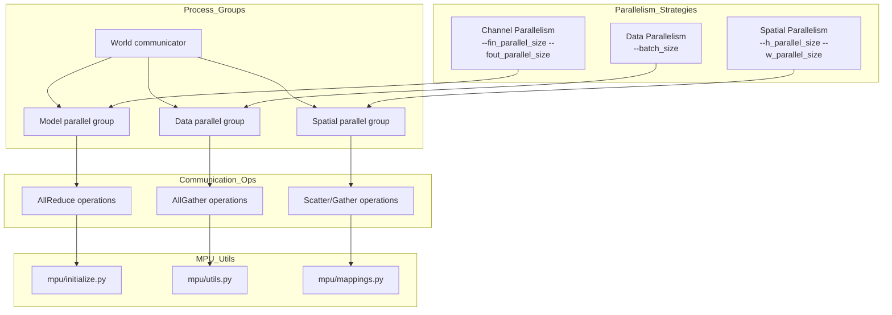

### Parallelization Configuration
The system supports flexible parallelization strategies configurable via CLI arguments:

| Parallelism Type | CLI Arguments | Purpose |
|------------------|---------------|---------|
| Data Parallelism | `--batch_size` | Distribute batches across processes |
| Spatial Parallelism | `--h_parallel_size`, `--w_parallel_size` | Split spatial dimensions |
| Channel Parallelism | `--fin_parallel_size`, `--fout_parallel_size` | Split feature channels |

Sources: [README.md:92-92](), [README.md:47-50](), [README.md:84-84]()

## Configuration Management

The system uses YAML-based configuration files located in the `config/` directory to specify model architectures, training parameters, and dataset configurations. Each configuration file contains complete specifications for reproducible training runs.

### Configuration Structure
Key configuration parameters include:

| Parameter | Description | Location |
|-----------|-------------|----------|
| `nettype` | Model architecture selection | Maps to entry points |
| `train_data_path` | Training dataset location | File system path |
| `metadata_json_path` | Dataset metadata file | `data.json` file |
| `channel_names` | Input/output channels | Dataset-specific |

The configuration system integrates with the model registry to dynamically load appropriate model classes based on the `nettype` parameter.

Sources: [README.md:104-123](), [README.md:78-78]()

---

# Page: Getting Started

# Getting Started

<details>
<summary>Relevant source files</summary>

The following files were used as context for generating this wiki page:

- [.github/workflows/tests.yml](.github/workflows/tests.yml)
- [README.md](README.md)
- [docker/Dockerfile](docker/Dockerfile)
- [docker/build.sh](docker/build.sh)

</details>


This document provides instructions for installing Makani, configuring your first training or inference job, and understanding the basic execution workflow. It covers environment setup, command-line usage, and fundamental configuration concepts needed to run weather and climate prediction models.

For detailed information about model architectures, see [Neural Network Models](#4). For advanced distributed computing configurations, see [Distributed Computing Framework](#3.3). For comprehensive configuration options, see [Configuration System](#6).

## Installation and Environment Setup

Makani can be installed in two ways: direct installation from source or using the provided Docker environment for reproducible builds.

### Local Installation

The simplest installation method clones the repository and installs the package in development mode:

```bash
git clone git@github.com:NVIDIA/makani.git
cd makani
pip install -e .
```

This installation method requires manual dependency management. For a complete list of dependencies, refer to the GitHub Actions workflow at [.github/workflows/tests.yml:16-22]().

### Docker Environment

For reproducible training environments, Makani provides a Docker-based setup that includes all required dependencies and optimizations:

```bash
cd docker
./build.sh
```

The Docker image is built from [docker/Dockerfile]() and includes:
- PyTorch with CUDA support
- MPI libraries for distributed computing  
- HDF5 with parallel I/O support
- Additional ML libraries (torch-harmonics, modulus)
- Performance optimization patches

**Installation Workflow**

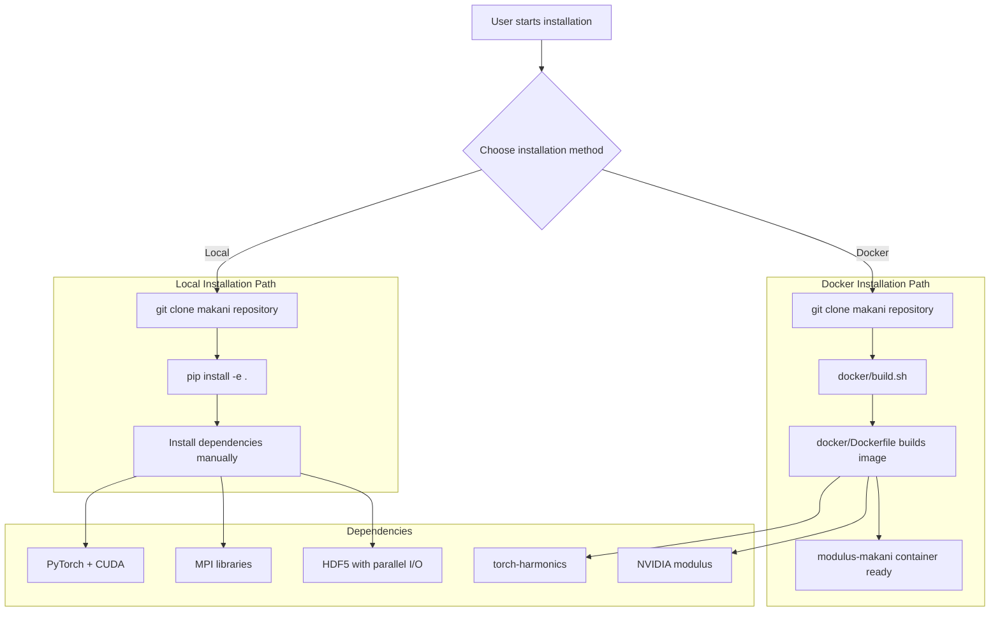

Sources: [README.md:21-27](), [docker/Dockerfile](), [docker/build.sh](), [.github/workflows/tests.yml:16-29]()

## Basic Usage

Makani provides two main CLI entry points for training and inference operations. Both scripts use identical command-line interfaces and configuration systems.

### Training Execution

Training is launched using the `makani.train` CLI script with YAML configuration files:

```bash
mpirun -np 8 --allow-run-as-root python -u makani.train \
    --yaml_config="config/sfnonet.yaml" \
    --config="sfno_linear_73chq_sc3_layers8_edim384_asgl2"
```

The `--yaml_config` parameter specifies the configuration file, while `--config` selects a specific configuration target within that file.

### Inference Execution  

Inference follows the same pattern as training but uses the `makani.inference` entry point:

```bash
mpirun -np 8 --allow-run-as-root python -u makani.inference \
    --yaml_config="config/sfnonet.yaml" \
    --config="sfno_linear_73chq_sc3_layers8_edim384_asgl2"
```

By default, inference runs on the out-of-sample dataset specified in the configuration file.

**CLI Execution Workflow**

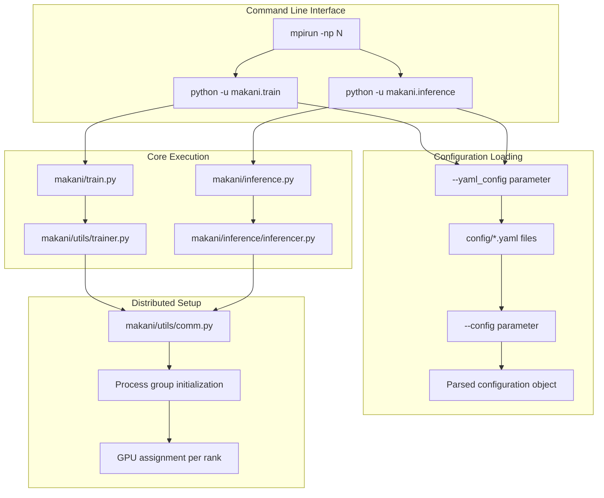

Sources: [README.md:29-65](), [makani/train.py](), [makani/inference.py](), [makani/utils/trainer.py](), [makani/inference/inferencer.py]()

## Configuration System

Makani uses YAML-based configuration files located in the `config/` directory. Each file contains multiple named configurations for different model architectures and training scenarios.

### Configuration Structure

The configuration system defines model architecture, training parameters, data paths, and optimization settings:

| Configuration Key | Description | Example Values |
|-------------------|-------------|----------------|
| `nettype` | Model architecture | `SFNO`, `AFNO`, `FNO`, `ViT` |
| `loss` | Loss function | `l2`, `geometric l2` |
| `optimizer` | Optimization algorithm | `Adam`, `AdamW` |
| `batch_size` | Training batch size | `1`, `64`, `128` |
| `train_data_path` | Training dataset directory | `/path/to/train/data` |
| `metadata_json_path` | Dataset metadata file | `/path/to/data.json` |
| `exp_dir` | Output directory for checkpoints | `/path/to/experiments` |

### Available Configurations

The main configuration files include:

- `config/sfnonet.yaml` - Spherical Fourier Neural Operator configurations
- `config/afnonet.yaml` - Adaptive Fourier Neural Operator configurations  
- `config/vit.yaml` - Vision Transformer configurations

Each configuration file contains multiple named targets that can be selected via the `--config` CLI argument.

Sources: [README.md:104-126](), [config/README.md]()

## Performance Optimization Options

Makani provides several CLI arguments for optimizing memory usage and training performance:

### Memory and Compute Optimizations

| Feature | CLI Argument | Options | Description |
|---------|--------------|---------|-------------|
| Automatic Mixed Precision | `--amp_mode` | `none`, `fp16`, `bf16` | Reduces memory usage and improves speed |
| Just-in-time Compilation | `--jit_mode` | `none`, `script`, `inductor` | Optimizes model execution |
| CUDA Graphs | `--cuda_graph_mode` | `none`, `fwdbwd`, `step` | Reduces kernel launch overhead |
| Activation Checkpointing | `--checkpointing_level` | `0`, `1`, `2`, `3` | Trades compute for memory |

### Parallelization Strategies

| Parallelism Type | CLI Arguments | Description |
|------------------|---------------|-------------|
| Data Parallelism | `--batch_size` | Distributes batch across ranks |
| Channel Parallelism | `--fin_parallel_size`, `--fout_parallel_size` | Splits input/output channels |
| Spatial Parallelism | `--h_parallel_size`, `--w_parallel_size` | Splits spatial dimensions |
| Multi-step Training | `--multistep_count` | Enables autoregressive training |

### Large-Scale Training Example

For large models requiring significant memory optimization:

```bash
mpirun -np 256 --allow-run-as-root python -u makani.train \
    --amp_mode=bf16 \
    --cuda_graph_mode=fwdbwd \
    --multistep_count=1 \
    --yaml_config="config/sfnonet.yaml" \
    --config="sfno_linear_73chq_sc3_layers8_edim384_asgl2" \
    --h_parallel_size=4 \
    --w_parallel_size=1 \
    --batch_size=64
```

This example uses 256 GPUs with spatial parallelism, mixed precision, and CUDA graphs for optimal performance.

Sources: [README.md:39-58]()

## Data Requirements

Makani expects training data in HDF5 format with specific structure and metadata requirements.

### Dataset Format

- **File Organization**: One HDF5 file per year of data
- **Data Variables**: `inp` (input) and `tar` (target) arrays representing atmospheric states
- **Temporal Resolution**: Determined by `dhours` parameter in metadata
- **Time Stepping**: `dt` parameter controls input-target time difference

### Metadata Requirements

Each dataset requires a `data.json` metadata file describing the dataset structure:

```json
{
    "dataset_name": "ERA5 reanalysis",
    "h5_path": "fields",
    "dims": ["time", "channel", "lat", "lon"],
    "dhours": 6,
    "coord": {
        "grid_type": "equiangular",
        "lat": [90.0, 89.5, ...],
        "lon": [0.0, 0.5, ...],
        "channel": ["t2m", "u10", "v10", ...]
    }
}
```

The ERA5 dataset can be downloaded from the [Copernicus Climate Data Store](https://cds.climate.copernicus.eu/cdsapp#!/dataset/reanalysis-era5-single-levels).

Sources: [README.md:127-151]()

## Project Structure

Understanding the codebase organization helps navigate Makani's components:

```
makani/
├── config/                 # YAML configuration files
├── makani/
│   ├── train.py           # Training CLI entry point
│   ├── inference.py       # Inference CLI entry point
│   ├── utils/
│   │   ├── trainer.py     # Main training logic
│   │   ├── comm.py        # Distributed communication
│   │   └── dataloaders/   # Data loading implementations
│   ├── networks/          # Model architectures
│   ├── inference/         # Inference engine
│   └── mpu/              # Model parallelism utilities
├── tests/                 # Unit tests
└── docker/               # Container build scripts
```

Sources: [README.md:71-102]()

## Next Steps

After completing the basic setup:

1. **Configure your first training run**: Review available configurations in [Configuration System](#6)
2. **Understand model architectures**: Explore supported models in [Neural Network Models](#4)  
3. **Set up distributed training**: Learn about parallelization in [Distributed Computing Framework](#3.3)
4. **Prepare your data**: Follow data preparation guidelines in [Data Pipeline](#5)
5. **Deploy trained models**: Review packaging and deployment in [Model Deployment and Packaging](#7)

For development contributions, see [Development Environment](#8) for build systems and testing frameworks.

---

# Page: Core Architecture

# Core Architecture

<details>
<summary>Relevant source files</summary>

The following files were used as context for generating this wiki page:

- [.github/workflows/tests.yml](.github/workflows/tests.yml)
- [README.md](README.md)
- [makani/__init__.py](makani/__init__.py)
- [makani/models/networks/sfnonet.py](makani/models/networks/sfnonet.py)

</details>


This document explains the fundamental architecture of the Makani system, including its main execution engines, distributed computing framework, and key design patterns. It provides a high-level overview of how the major components work together to enable massively parallel training and inference of ML weather and climate models.

For detailed information about specific execution workflows, see [Training and Inference Engines](#3.1). For the model registration and loading system, see [Model Registry System](#3.2). For distributed computing implementation details, see [Distributed Computing Framework](#3.3).

## Overall System Architecture

The Makani system is built around four primary architectural pillars that work together to enable scalable ML model training and inference:

```mermaid
graph TB
    subgraph "CLI_LAYER" ["Command Line Interface Layer"]
        TRAIN_CLI["makani.train<br/>(makani/train.py)"]
        INFER_CLI["makani.inference<br/>(makani/inference.py)"]
    end
    
    subgraph "EXECUTION_ENGINES" ["Core Execution Engines"]
        TRAINER["Trainer<br/>(utils/trainer.py)"]
        INFERENCER["Inferencer<br/>(utils/inferencer.py)"]
    end
    
    subgraph "MODEL_SYSTEM" ["Model Management System"]
        MODEL_REG["get_model<br/>(networks/models.py)"]
        SFNO_NET["SphericalFourierNeuralOperatorNet"]
        AFNO_NET["AdaptiveFourierNeuralOperatorNet"]
        VIT_NET["Vision Transformer Models"]
    end
    
    subgraph "DATA_SYSTEM" ["Data Pipeline System"]  
        DATALOADER_FACTORY["get_dataloader<br/>(utils/dataloader.py)"]
        DALI_LOADER["DALI DataLoader"]
        MULTIFILES_LOADER["Multifiles DataLoader"]
        ZARR_LOADER["Zarr DataLoader"]
    end
    
    subgraph "DISTRIBUTED_SYSTEM" ["Distributed Computing Framework"]
        COMM_INIT["comm.init<br/>(utils/comm.py)"]
        PROCESS_GROUPS["Process Groups<br/>(world/model/data/spatial)"]
        MPU_LAYERS["Model Parallel Utils<br/>(mpu/)"]
    end
    
    subgraph "CONFIG_SYSTEM" ["Configuration System"]
        YAML_CONFIGS["YAML Configurations<br/>(config/)"]
        MODEL_PARAMS["Model Parameters"]
        TRAINING_PARAMS["Training Parameters"]
    end
    
    TRAIN_CLI --> TRAINER
    INFER_CLI --> INFERENCER
    
    TRAINER --> MODEL_REG
    INFERENCER --> MODEL_REG
    
    MODEL_REG --> SFNO_NET
    MODEL_REG --> AFNO_NET  
    MODEL_REG --> VIT_NET
    
    TRAINER --> DATALOADER_FACTORY
    INFERENCER --> DATALOADER_FACTORY
    
    DATALOADER_FACTORY --> DALI_LOADER
    DATALOADER_FACTORY --> MULTIFILES_LOADER
    DATALOADER_FACTORY --> ZARR_LOADER
    
    TRAINER --> COMM_INIT
    INFERENCER --> COMM_INIT
    
    COMM_INIT --> PROCESS_GROUPS
    PROCESS_GROUPS --> MPU_LAYERS
    
    YAML_CONFIGS --> MODEL_PARAMS
    YAML_CONFIGS --> TRAINING_PARAMS
    
    MODEL_PARAMS --> MODEL_REG
    TRAINING_PARAMS --> TRAINER
    TRAINING_PARAMS --> INFERENCER
```

**Sources:** [README.md:73-102](), [makani/__init__.py:18-19](), [makani/models/networks/sfnonet.py:270-314]()

## Core Components Overview

Makani's architecture is organized into six primary components, each responsible for specific aspects of the system:

| Component | Primary Module | Key Responsibilities |
|-----------|----------------|---------------------|
| **CLI Layer** | `makani.train`, `makani.inference` | Command-line entry points, argument parsing |
| **Execution Engines** | `Trainer`, `Inferencer` | Training loops, inference execution, checkpointing |
| **Model System** | `networks/models.py`, model implementations | Dynamic model loading, neural network architectures |
| **Data Pipeline** | `utils/dataloaders/` | Multi-format data loading, distributed I/O |
| **Distributed Framework** | `utils/comm.py`, `mpu/` | Process groups, model parallelism, communication |
| **Configuration** | `config/` YAML files | Model parameters, training hyperparameters |

**Sources:** [README.md:76-97](), [makani/__init__.py:18-19]()

## Model Registration and Loading System

The model system uses a registry pattern to enable dynamic model instantiation based on configuration parameters:

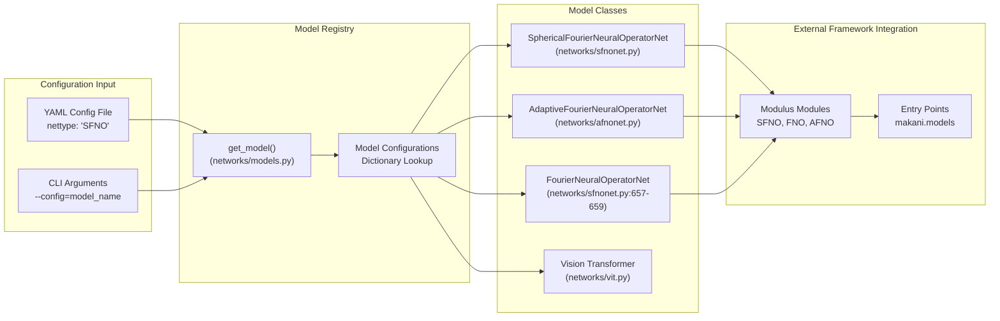

**Sources:** [README.md:105-123](), [makani/models/networks/sfnonet.py:652-656](), [makani/models/networks/sfnonet.py:670-673]()

## Distributed Computing Architecture

Makani implements a sophisticated multi-dimensional parallelization strategy that enables scaling to hundreds of GPUs:

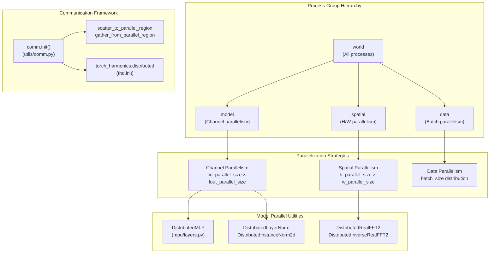

**Sources:** [README.md:42-50](), [makani/models/networks/sfnonet.py:40-44](), [makani/models/networks/sfnonet.py:528-533]()

## Key Architectural Patterns

### 1. Spectral Transform Abstraction

The system abstracts spectral transforms through a unified interface that supports both Spherical Harmonics Transform (SHT) and Fast Fourier Transform (FFT):

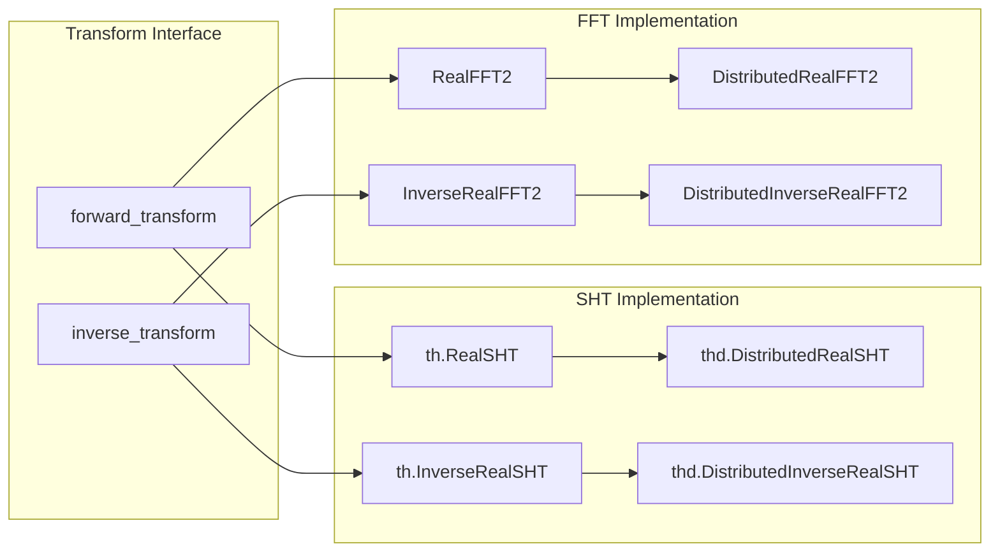

**Sources:** [makani/models/networks/sfnonet.py:503-558]()

### 2. Configuration-Driven Model Instantiation

The system uses YAML configurations to drive model instantiation, allowing for flexible experimentation:

| Configuration Key | Purpose | Example Values |
|-------------------|---------|----------------|
| `nettype` | Model architecture selection | `SFNO`, `AFNO`, `FNO`, `ViT` |
| `filter_type` | Spectral filter type | `linear`, `non-linear` |
| `operator_type` | Spectral operator type | `diagonal`, `dhconv` |
| `embed_dim` | Model embedding dimension | `384`, `512`, `768` |
| `num_layers` | Number of model layers | `8`, `12`, `16` |

**Sources:** [README.md:107-123]()

### 3. Multi-Scale Spectral Processing

Models process data at multiple scales using downsampling and upsampling transforms:

- `trans_down`: Transforms from input resolution to processing resolution
- `trans`: Transforms at processing resolution  
- `itrans`: Inverse transforms at processing resolution
- `itrans_up`: Transforms from processing resolution to output resolution

**Sources:** [makani/models/networks/sfnonet.py:392-393](), [makani/models/networks/sfnonet.py:536-540]()

### 4. Memory Optimization Strategies

The system provides multiple memory optimization techniques that can be combined:

- **Automatic Mixed Precision**: `--amp_mode=bf16` reduces memory footprint
- **Activation Checkpointing**: `--checkpointing_level` trades compute for memory
- **CUDA Graphs**: `--cuda_graph_mode` reduces kernel launch overhead
- **JIT Compilation**: `--jit_mode=inductor` optimizes execution

**Sources:** [README.md:39-50]()

## Execution Flow

The typical execution flow demonstrates how all components work together:

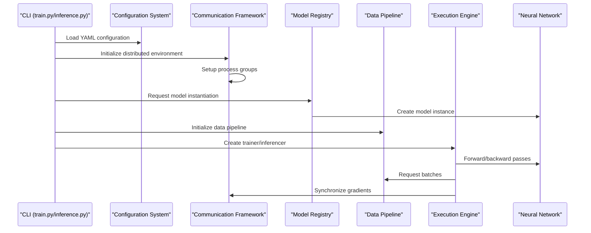

**Sources:** [README.md:29-64](), [makani/__init__.py:18-19]()

This architecture enables Makani to scale efficiently across hundreds of GPUs while maintaining flexibility for research and experimentation through its configuration-driven design and modular component structure.

---

# Page: Training and Inference Engines

# Training and Inference Engines

<details>
<summary>Relevant source files</summary>

The following files were used as context for generating this wiki page:

- [.github/workflows/tests.yml](.github/workflows/tests.yml)
- [README.md](README.md)
- [makani/inference.py](makani/inference.py)
- [makani/utils/comm.py](makani/utils/comm.py)

</details>


This document covers the core execution engines that drive machine learning workflows in Makani: the training and inference systems. These engines serve as the primary entry points for users and orchestrate the entire pipeline from data loading through model execution to result generation.

The training and inference engines handle CLI argument parsing, distributed computing setup, configuration management, and coordination with other system components including the model registry ([3.2](#3.2)), distributed computing framework ([3.3](#3.3)), and data pipeline ([5](#5)). For information about specific model architectures, see [Neural Network Models](#4). For data loading details, see [Data Pipeline](#5).

## CLI Entry Points

Makani provides two primary CLI scripts that serve as the main user interface for training and inference operations.

### Training Entry Point

The training workflow is initiated through `makani.train`, which corresponds to the `train.py` script referenced throughout the configuration system. Users launch training with:

```bash
mpirun -np 8 --allow-run-as-root python -u makani.train --yaml_config="config/sfnonet.yaml" --config="sfno_linear_73chq_sc3_layers8_edim384_asgl2"
```

### Inference Entry Point

The inference workflow is handled by the `inference.py` script, which provides CLI access to model evaluation and scoring capabilities. The inference engine supports multiple execution modes and comprehensive performance optimization options.

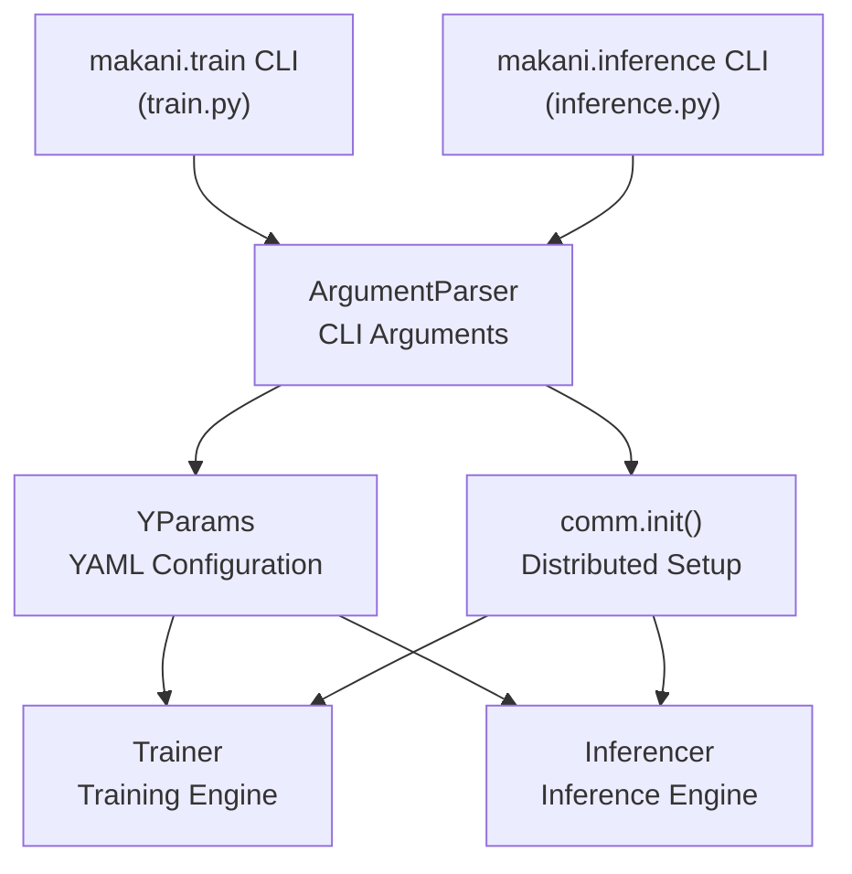

**CLI Entry Points Architecture**

Sources: [README.md:31-35](), [README.md:61-65](), [makani/inference.py:34-62]()

## Execution Workflow

The training and inference engines follow a systematic workflow that coordinates multiple system components to execute ML operations at scale.

### Common Initialization Pattern

Both engines follow a similar initialization pattern that establishes the distributed computing environment and configuration management:

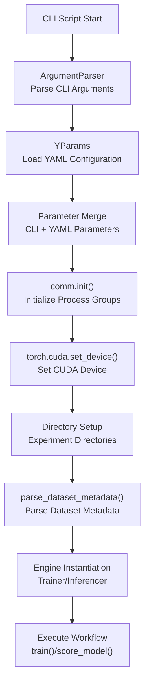

**Execution Workflow Pattern**

Sources: [makani/inference.py:62-166](), [makani/utils/comm.py:96-154]()

### Inference Execution Details

The inference engine implements a specialized workflow for model evaluation and scoring:

| Execution Phase | Component | Purpose |
|----------------|-----------|---------|
| Parameter Setup | `YParams` | Merge CLI arguments with YAML configuration |
| Distributed Init | `comm.init()` | Establish process groups for parallelism |
| Device Config | `torch.cuda.set_device()` | Configure CUDA devices and optimization |
| Directory Setup | `os.makedirs()` | Create experiment and output directories |
| Metadata Parse | `parse_dataset_metadata()` | Load dataset characteristics |
| Engine Creation | `Inferencer()` | Instantiate inference engine |
| Model Scoring | `inferencer.score_model()` | Execute inference workflow |

Sources: [makani/inference.py:84-166]()

## Configuration Management

The engines implement a sophisticated configuration system that merges CLI arguments with YAML-based configuration files to provide flexible parameter management.

### Parameter Hierarchy

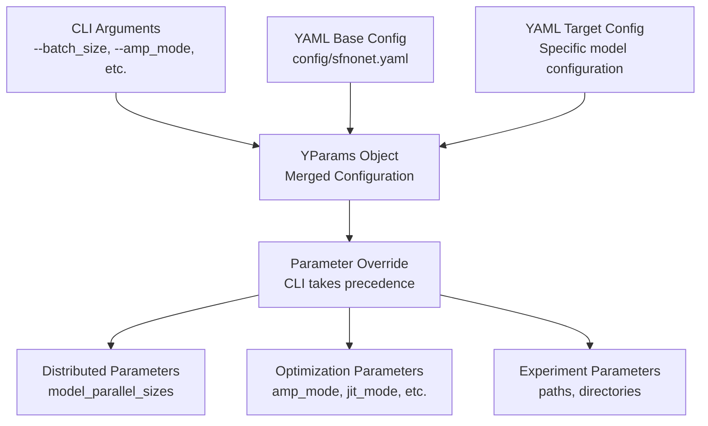

**Configuration Management Hierarchy**

### Key Configuration Categories

The engines manage several categories of configuration parameters:

**Distributed Computing Parameters:**
- `fin_parallel_size`, `fout_parallel_size` - Feature parallelism dimensions
- `h_parallel_size`, `w_parallel_size` - Spatial parallelism dimensions  
- `model_parallel_sizes` - Combined parallelism configuration
- `model_parallel_names` - Process group naming

**Optimization Parameters:**
- `amp_mode` - Mixed precision mode (`none`, `fp16`, `bf16`)
- `jit_mode` - JIT compilation mode (`none`, `script`, `inductor`)
- `cuda_graph_mode` - CUDA graph capture mode (`none`, `fwdbwd`, `step`)
- `checkpointing_level` - Activation checkpointing aggressiveness

**Data and Experiment Parameters:**
- `batch_size` - Local batch size after data parallel distribution
- `global_batch_size` - Total batch size across all processes
- `experiment_dir` - Output directory for results and checkpoints
- `checkpoint_path` - Model checkpoint file paths

Sources: [makani/inference.py:65-95](), [makani/inference.py:125-135]()

## Distributed Computing Integration

The engines integrate tightly with Makani's distributed computing framework to enable massively parallel execution across hundreds of GPUs.

### Process Group Initialization

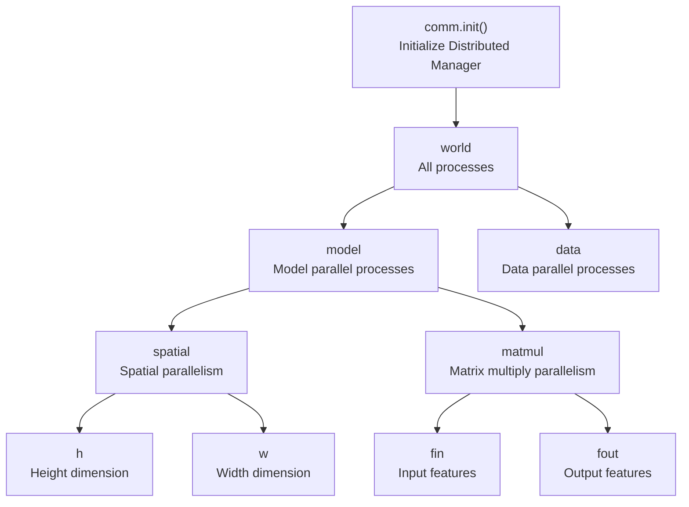

**Distributed Process Group Hierarchy**

The engines establish a hierarchical process group structure that enables multi-dimensional parallelism:

| Process Group | Purpose | CLI Parameter |
|---------------|---------|---------------|
| `world` | Global communication across all processes | N/A |
| `model` | Model parallel communication | Combined from spatial/matmul |
| `data` | Data parallel communication | Derived from total processes |
| `spatial` | Spatial dimension parallelism | `h_parallel_size`, `w_parallel_size` |
| `matmul` | Feature dimension parallelism | `fin_parallel_size`, `fout_parallel_size` |

Sources: [makani/utils/comm.py:96-154](), [makani/inference.py:68-84]()

### Batch Size Distribution

The engines implement automatic batch size distribution across data parallel processes:

1. **Global Batch Size Validation**: Ensures `global_batch_size` is evenly divisible by data parallel size
2. **Local Batch Size Calculation**: Computes `batch_size = global_batch_size // data_parallel_size`  
3. **Memory and I/O Optimization**: Reduces per-process memory footprint and I/O load

Sources: [makani/inference.py:87-93]()

## Integration with Other Systems

The training and inference engines serve as orchestration layers that coordinate with other major system components.

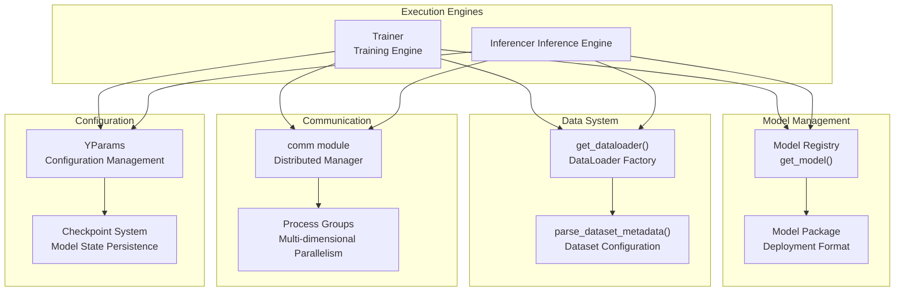

**System Integration Architecture**

### Key Integration Points

**Model Registry Integration:**
- Engines instantiate models through the dynamic model loading system
- Model selection based on `nettype` configuration parameter
- Support for both legacy and flexible checkpoint formats

**Data Pipeline Integration:**  
- Engines use `get_dataloader()` factory function for data loading
- Automatic selection of appropriate dataloader (DALI, multifiles, Zarr, dummy)
- Integration with distributed I/O for spatial parallelism

**Distributed Computing Integration:**
- Engines initialize and manage process groups through `comm` module
- Coordinate with `DistributedManager` from Modulus framework
- Handle multi-dimensional parallelism strategies

**Configuration System Integration:**
- Engines merge CLI arguments with YAML configuration files
- Support for configuration inheritance and parameter overrides
- Integration with experiment directory management and logging

Sources: [makani/inference.py:30-32](), [makani/inference.py:154-159](), [makani/inference.py:161-166]()

---

# Page: Model Registry System

# Model Registry System

<details>
<summary>Relevant source files</summary>

The following files were used as context for generating this wiki page:

- [makani/models/model_registry.py](makani/models/model_registry.py)
- [pyproject.toml](pyproject.toml)

</details>


## Purpose and Scope

The Model Registry System provides dynamic model loading and instantiation capabilities for the Makani framework. It enables registration and retrieval of neural network models through a plugin-based architecture using Python entry points, allowing both built-in models and external models to be seamlessly integrated into the training and inference pipelines.

This system handles model discovery, registration, and instantiation with appropriate wrapper classes. For information about specific model architectures (SFNO, AFNO, etc.), see [Neural Network Models](#4). For training and inference execution workflows, see [Training and Inference Engines](#3.1).

## Entry Points System

The model registry is built on Python's entry points mechanism, defined in `pyproject.toml`. This allows models to be registered as plugins that can be discovered and loaded at runtime.

### Entry Point Groups

Makani defines two entry point groups for model registration:

| Group | Purpose | Integration |
|-------|---------|-------------|
| `makani.models` | Native Makani models | Direct integration with Makani training/inference |
| `modulus.models` | Modulus framework compatibility | Integration with NVIDIA Modulus ecosystem |

### Registered Models

The following models are registered through entry points:

```mermaid
graph TB
    subgraph "Entry Point Groups"
        MAKANI_EP["makani.models"]
        MODULUS_EP["modulus.models"]
    end
    
    subgraph "Model Implementations"
        AFNOV1["AFNOv1<br/>makani.models.networks.afnonet:AdaptiveFourierNeuralOperatorNet"]
        AFNO["AFNO<br/>makani.models.networks.afnonet_v2:AdaptiveFourierNeuralOperatorNet"]
        FNO["FNO<br/>makani.models.networks.sfnonet:FourierNeuralOperatorNet"]
        SFNO_MAKANI["SFNO<br/>makani.models.networks.sfnonet:SphericalFourierNeuralOperatorNet"]
        DEBUG["DebugNet<br/>makani.models.networks.debug:DebugNet"]
        VIT["ViT<br/>makani.models.networks.vit:VisionTransformer"]
        SFNO_MODULUS["SFNO<br/>makani.models.networks.sfnonet:SFNO"]
    end
    
    MAKANI_EP --> AFNOV1
    MAKANI_EP --> AFNO
    MAKANI_EP --> FNO
    MAKANI_EP --> SFNO_MAKANI
    MAKANI_EP --> DEBUG
    MAKANI_EP --> VIT
    
    MODULUS_EP --> SFNO_MODULUS
```

**Sources:** [pyproject.toml:106-116]()

## Registry Architecture

The model registry system consists of several key components that work together to provide dynamic model loading capabilities.

### Core Registry Components

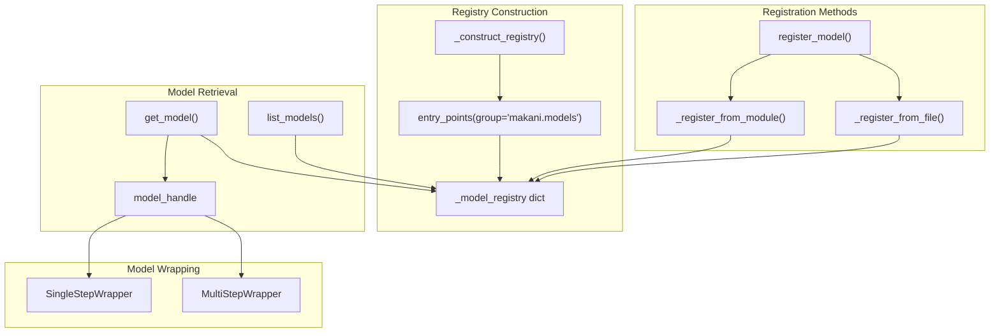

**Sources:** [makani/models/model_registry.py:34-171]()

### Registry Initialization

The registry is automatically constructed when the module is imported through the `_construct_registry()` function:

```python
def _construct_registry() -> dict:
    registry = {}
    entrypoints = entry_points(group="makani.models")
    for entry_point in entrypoints:
        registry[entry_point.name] = entry_point
    return registry
```

**Sources:** [makani/models/model_registry.py:34-39](), [makani/models/model_registry.py:170]()

## Model Registration Process

The registry supports multiple methods for registering models, providing flexibility for different use cases.

### Registration Methods

| Method | Input Type | Use Case |
|--------|------------|----------|
| `_register_from_module()` | `nn.Module` class | Direct class registration |
| `_register_from_file()` | File path string | External model files |
| `register_model()` | Either type | Public interface |

### Registration Workflow

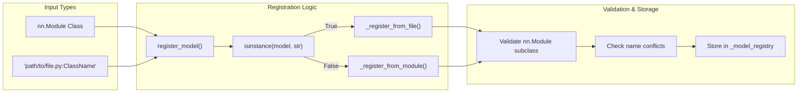

**Sources:** [makani/models/model_registry.py:42-104]()

### File-based Registration

The `_register_from_file()` method enables dynamic loading of models from external Python files:

```python
def _register_from_file(model_string: str, name: Union[str, None] = None) -> None:
    assert len(model_string.split(":")) == 2
    model_path, model_handle = model_string.split(":")
    
    module_spec = importlib.util.spec_from_file_location(model_handle, model_path)
    module = importlib.util.module_from_spec(module_spec)
    module_spec.loader.exec_module(module)
    model = getattr(module, model_handle)
```

**Sources:** [makani/models/model_registry.py:63-79]()

## Model Retrieval and Instantiation

The `get_model()` function serves as the primary interface for retrieving and instantiating registered models with proper configuration.

### Model Instantiation Flow

```mermaid
graph TB
    subgraph "Input Processing"
        PARAMS["ParamsBase params"]
        EXTRACT_SHAPE["Extract inp_shape, out_shape"]
        EXTRACT_CHANNELS["Extract inp_chans, out_chans"]
        NETTYPE["params.nettype"]
    end
    
    subgraph "Registry Lookup"
        CHECK_REGISTRY["Check _model_registry"]
        TRY_REGISTER["register_model() if missing"]
        GET_HANDLE["Get model_handle"]
    end
    
    subgraph "Handle Processing"
        CHECK_ENTRY["isinstance(EntryPoint)"]
        LOAD_ENTRY["entry_point.load()"]
        PARTIAL_FUNC["partial(model_handle, **params)"]
    end
    
    subgraph "Wrapper Selection"
        CHECK_FUTURE["params.n_future > 0"]
        MULTI_WRAP["MultiStepWrapper"]
        SINGLE_WRAP["SingleStepWrapper"]
    end
    
    PARAMS --> EXTRACT_SHAPE
    PARAMS --> EXTRACT_CHANNELS
    PARAMS --> NETTYPE
    
    NETTYPE --> CHECK_REGISTRY
    CHECK_REGISTRY -->|"Missing"| TRY_REGISTER
    CHECK_REGISTRY -->|"Found"| GET_HANDLE
    TRY_REGISTER --> GET_HANDLE
    
    GET_HANDLE --> CHECK_ENTRY
    CHECK_ENTRY -->|"True"| LOAD_ENTRY
    CHECK_ENTRY -->|"False"| PARTIAL_FUNC
    LOAD_ENTRY --> PARTIAL_FUNC
    
    PARTIAL_FUNC --> CHECK_FUTURE
    CHECK_FUTURE -->|"True"| MULTI_WRAP
    CHECK_FUTURE -->|"False"| SINGLE_WRAP
```

**Sources:** [makani/models/model_registry.py:119-166]()

### Parameter Extraction

The system automatically extracts required model parameters from the configuration:

| Parameter | Source | Purpose |
|-----------|--------|---------|
| `inp_shape` | `params.img_crop_shape_x/y` | Input spatial dimensions |
| `out_shape` | `params.out_shape_x/y` | Output spatial dimensions |
| `inp_chans` | `params.N_in_channels` | Input channel count |
| `out_chans` | `params.N_out_channels` | Output channel count |

**Sources:** [makani/models/model_registry.py:142-145]()

## Wrapper Integration

All models retrieved through the registry are automatically wrapped with either `SingleStepWrapper` or `MultiStepWrapper` based on the configuration.

### Wrapper Selection Logic

```mermaid
graph LR
    subgraph "Configuration Check"
        N_FUTURE["params.n_future"]
        CHECK_ZERO["n_future > 0"]
    end
    
    subgraph "Wrapper Types"
        SINGLE["SingleStepWrapper<br/>Single timestep prediction"]
        MULTI["MultiStepWrapper<br/>Multi-timestep rollout"]
    end
    
    subgraph "Model Construction"
        MODEL_HANDLE["Configured model_handle"]
        WRAPPED_MODEL["Final wrapped model"]
    end
    
    N_FUTURE --> CHECK_ZERO
    CHECK_ZERO -->|"False"| SINGLE
    CHECK_ZERO -->|"True"| MULTI
    
    SINGLE --> WRAPPED_MODEL
    MULTI --> WRAPPED_MODEL
    MODEL_HANDLE --> SINGLE
    MODEL_HANDLE --> MULTI
```

**Sources:** [makani/models/model_registry.py:160-165]()

## External Framework Integration

The registry system enables integration with external frameworks through dedicated entry point groups.

### Modulus Integration

The `modulus.models` entry point group provides compatibility with the NVIDIA Modulus framework:

```python
[project.entry-points."modulus.models"]
SFNO = "makani.models.networks.sfnonet:SFNO"
```

This allows Modulus applications to discover and use Makani models through their own model registry system.

### Registry API

The registry provides a simple API for external access:

| Function | Purpose | Return Type |
|----------|---------|-------------|
| `list_models()` | List registered model names | `List[str]` |
| `get_model()` | Retrieve configured model | `torch.nn.Module` |
| `register_model()` | Register new model | `None` |

**Sources:** [pyproject.toml:114-115](), [makani/models/model_registry.py:106-117]()

---

# Page: Distributed Computing Framework

# Distributed Computing Framework

<details>
<summary>Relevant source files</summary>

The following files were used as context for generating this wiki page:

- [.github/workflows/tests.yml](.github/workflows/tests.yml)
- [README.md](README.md)
- [makani/inference.py](makani/inference.py)
- [makani/utils/comm.py](makani/utils/comm.py)

</details>


## Purpose and Scope

The Distributed Computing Framework in Makani enables massively parallel training and inference of weather and climate models across hundreds of GPUs. This framework implements multi-dimensional parallelization strategies including spatial, feature, and data parallelism to efficiently distribute both model parameters and data across compute resources.

For information about the high-level training and inference execution that uses this framework, see [Training and Inference Engines](#3.1). For details about how models leverage the parallelization capabilities, see [Neural Network Models](#4).

## Process Group Hierarchy

The distributed computing framework is built on top of the Modulus `DistributedManager` and creates a hierarchical structure of process groups to enable orthogonal parallelization strategies.

### Process Group Architecture

```mermaid
graph TB
    world["world<br/>(all processes)"]
    model["model<br/>(model parallel)"]
    data["data<br/>(data parallel)"]
    spatial["spatial<br/>(spatial dims)"]
    matmul["matmul<br/>(feature dims)"]
    h["h<br/>(height parallel)"]
    w["w<br/>(width parallel)"]
    fin["fin<br/>(input features)"]
    fout["fout<br/>(output features)"]

    world --> model
    world --> data
    model --> spatial
    model --> matmul
    spatial --> h
    spatial --> w
    matmul --> fin
    matmul --> fout
```

The framework establishes this hierarchy through the `comm.init()` function, which configures process groups based on the specified parallelization dimensions. Each leaf group corresponds to a specific parallelization strategy that can be applied independently.

**Sources:** [makani/utils/comm.py:96-154]()

### Initialization Workflow

```mermaid
sequenceDiagram
    participant CLI as "CLI Script"
    participant comm as "comm.init()"
    participant DM as "DistributedManager"
    participant PGC as "ProcessGroupConfig"

    CLI->>comm: "init(model_parallel_sizes, model_parallel_names)"
    comm->>DM: "DistributedManager.initialize()"
    comm->>PGC: "ProcessGroupConfig(world)"
    comm->>PGC: "add_node('model', parent='world')"
    comm->>PGC: "add_node('spatial', parent='model')"
    comm->>PGC: "add_node('matmul', parent='model')"
    comm->>PGC: "add_node('h', parent='spatial')"
    comm->>PGC: "add_node('w', parent='spatial')"
    comm->>PGC: "add_node('fin', parent='matmul')"
    comm->>PGC: "add_node('fout', parent='matmul')"
    comm->>PGC: "add_node('data', parent='world')"
    comm->>PGC: "set_leaf_group_sizes(leaf_config)"
    comm->>DM: "create_groups_from_config(pconfig)"
    DM-->>comm: "process groups created"
    comm-->>CLI: "model_parallel_size"
```

The initialization process creates the process group hierarchy and calculates the data parallel size automatically based on the total world size and specified model parallel dimensions.

**Sources:** [makani/utils/comm.py:96-154](), [makani/inference.py:81-84]()

## Multi-Dimensional Parallelism Strategies

The framework supports four orthogonal parallelization dimensions that can be combined to efficiently scale models across large numbers of GPUs.

### Parallelism Strategy Mapping

| Parallelism Type | CLI Arguments | Process Groups | Purpose |
|------------------|---------------|----------------|---------|
| Spatial | `--h_parallel_size`, `--w_parallel_size` | `h`, `w` | Partition spatial dimensions (height/width) |
| Feature Input | `--fin_parallel_size` | `fin` | Partition input feature channels |
| Feature Output | `--fout_parallel_size` | `fout` | Partition output feature channels |
| Data | Calculated automatically | `data` | Distribute batch across processes |

### Parallelism Strategy Implementation

```mermaid
graph LR
    subgraph "Data Tensor Dimensions"
        batch["Batch<br/>(N)"]
        channels["Channels<br/>(C)"]
        height["Height<br/>(H)"]
        width["Width<br/>(W)"]
    end

    subgraph "Parallelization Strategies"
        data_par["Data Parallel<br/>batch distribution"]
        fin_par["Input Feature Parallel<br/>channel distribution"]
        fout_par["Output Feature Parallel<br/>channel distribution"]
        h_par["Height Parallel<br/>spatial distribution"]
        w_par["Width Parallel<br/>spatial distribution"]
    end

    batch --> data_par
    channels --> fin_par
    channels --> fout_par
    height --> h_par
    width --> w_par
```

The parallelization strategies work by partitioning different tensor dimensions across process groups. Each strategy reduces memory requirements and enables larger models to fit in GPU memory.

**Sources:** [README.md:47-51](), [makani/inference.py:36-39]()

## Communication Infrastructure

The communication layer provides utilities for distributed operations and process group management through a set of utility functions that abstract the underlying Modulus `DistributedManager`.

### Core Communication Functions

```mermaid
graph TB
    subgraph "Communication API"
        get_size["get_size(name)<br/>Returns group size"]
        get_rank["get_rank(name)<br/>Returns process rank"]
        get_group["get_group(name)<br/>Returns process group"]
        get_root["get_root(name)<br/>Returns root rank"]
    end

    subgraph "Specialized World Functions"
        get_world_size["get_world_size()<br/>Total processes"]
        get_world_rank["get_world_rank()<br/>Global rank"]
        get_local_rank["get_local_rank()<br/>Local GPU rank"]
    end

    subgraph "Group Management"
        get_names["get_names()<br/>Available group names"]
        is_distributed["is_distributed(name)<br/>Check if group exists"]
    end

    subgraph "Underlying Infrastructure"
        DM["DistributedManager<br/>(from Modulus)"]
        comm_roots["_COMM_ROOTS<br/>(root rank cache)"]
    end

    get_size --> DM
    get_rank --> DM
    get_group --> DM
    get_root --> comm_roots
    get_world_size --> DM
    get_world_rank --> DM
    get_local_rank --> DM
    get_names --> DM
    is_distributed --> DM
```

These functions provide a consistent interface for querying process group information and performing distributed operations across different parallelization strategies.

**Sources:** [makani/utils/comm.py:32-95]()

## Integration with Training and Inference

The distributed computing framework is tightly integrated with the training and inference engines through parameter configuration and batch size calculation.

### Training/Inference Integration Flow

```mermaid
sequenceDiagram
    participant CLI as "CLI Arguments"
    participant params as "YParams Config"
    participant comm as "comm module"
    participant engine as "Trainer/Inferencer"

    CLI->>params: "Parse parallel sizes"
    params->>params: "model_parallel_sizes = [h, w, fin, fout]"
    params->>params: "model_parallel_names = ['h', 'w', 'fin', 'fout']"
    params->>comm: "init(model_parallel_sizes, model_parallel_names)"
    comm->>params: "return model_parallel_size"
    params->>params: "Calculate data parallel batch size"
    params->>params: "batch_size = global_batch_size // get_size('data')"
    params->>engine: "Initialize with distributed config"
```

The framework automatically calculates the local batch size based on the data parallel size and ensures that the global batch size is evenly divisible across data parallel processes.

**Sources:** [makani/inference.py:68-95]()

### Batch Size Distribution

The framework implements automatic batch size distribution across data parallel processes:

```python
# From inference.py:91-92
assert params["global_batch_size"] % comm.get_size("data") == 0
params["batch_size"] = int(params["global_batch_size"] // comm.get_size("data"))
```

This ensures that each data parallel process handles an equal portion of the global batch, enabling efficient data parallel training and inference.

**Sources:** [makani/inference.py:88-93]()

---

# Page: Neural Network Models

# Neural Network Models

<details>
<summary>Relevant source files</summary>

The following files were used as context for generating this wiki page:

- [makani/__init__.py](makani/__init__.py)
- [makani/models/common/layers.py](makani/models/common/layers.py)
- [makani/models/networks/afnonet_v2.py](makani/models/networks/afnonet_v2.py)
- [makani/models/networks/sfnonet.py](makani/models/networks/sfnonet.py)

</details>


This page provides an overview of the neural network model architectures supported by Makani, including Spherical Fourier Neural Operators (SFNO), Adaptive Fourier Neural Operators (AFNO), and their shared building blocks. For detailed implementation specifics of individual model types, see [SFNO Models](#4.1) and [AFNO Models](#4.2). For information about how models are dynamically loaded and registered, see [Model Registry System](#3.2). For shared neural network components, see [Common Neural Network Layers](#4.3).

## Model Architecture Overview

Makani supports multiple neural operator architectures designed for weather and climate modeling on spherical grids. These models share common design patterns while specializing in different spectral transform approaches.

```mermaid
graph TB
    subgraph "Model Registry"
        ENTRY_POINTS["Entry Points<br/>makani.models.*"]
    end
    
    subgraph "Core Model Architectures"
        SFNO["SphericalFourierNeuralOperatorNet<br/>sfnonet.py"]
        FNO["FourierNeuralOperatorNet<br/>sfnonet.py"]
        AFNO["AdaptiveFourierNeuralOperatorNet<br/>afnonet_v2.py"]
    end
    
    subgraph "Spectral Transforms"
        SHT["Spherical Harmonic Transform<br/>torch_harmonics"]
        FFT["Fast Fourier Transform<br/>RealFFT2"]
        AFNO_BLOCKS["AFNO2D Blocks<br/>Adaptive Filtering"]
    end
    
    subgraph "Common Building Blocks"
        PATCH_EMBED["PatchEmbed<br/>layers.py"]
        MLP_BLOCKS["MLP<br/>layers.py"]
        ENCODER_DECODER["EncoderDecoder<br/>layers.py"]
        DROP_PATH["DropPath<br/>layers.py"]
        SPECTRAL_LAYERS["SpectralFilterLayer<br/>sfnonet.py"]
    end
    
    subgraph "Block Structures"
        FNO_BLOCK["FourierNeuralOperatorBlock<br/>sfnonet.py"]
        AFNO_BLOCK["Block<br/>afnonet_v2.py"]
    end
    
    ENTRY_POINTS --> SFNO
    ENTRY_POINTS --> FNO
    ENTRY_POINTS --> AFNO
    
    SFNO --> SHT
    FNO --> FFT
    AFNO --> AFNO_BLOCKS
    
    SFNO --> FNO_BLOCK
    FNO --> FNO_BLOCK
    AFNO --> AFNO_BLOCK
    
    FNO_BLOCK --> SPECTRAL_LAYERS
    FNO_BLOCK --> MLP_BLOCKS
    FNO_BLOCK --> ENCODER_DECODER
    FNO_BLOCK --> DROP_PATH
    
    AFNO_BLOCK --> AFNO_BLOCKS
    AFNO_BLOCK --> MLP_BLOCKS
    AFNO_BLOCK --> DROP_PATH
    
    AFNO --> PATCH_EMBED
    
    SPECTRAL_LAYERS --> SHT
    SPECTRAL_LAYERS --> FFT
```

Sources: [makani/models/networks/sfnonet.py:270-673](), [makani/models/networks/afnonet_v2.py:190-315](), [makani/models/common/layers.py:1-288]()

## Spherical Fourier Neural Operators (SFNO)

The `SphericalFourierNeuralOperatorNet` class implements neural operators that work in the spherical harmonic domain, making them well-suited for global climate modeling on spherical grids.

### Core Architecture

```mermaid
graph LR
    subgraph "SFNO Model Structure"
        ENCODER["EncoderDecoder<br/>Encoder"]
        FNO_BLOCKS["FourierNeuralOperatorBlock[]<br/>num_layers blocks"]
        DECODER["EncoderDecoder<br/>Decoder"]
        BIG_SKIP["Residual Transform<br/>big_skip connection"]
    end
    
    subgraph "Spectral Processing"
        TRANS_DOWN["trans_down<br/>SHT/FFT downscale"]
        TRANS["trans<br/>SHT/FFT intermediate"]
        ITRANS["itrans<br/>Inverse transform"]
        ITRANS_UP["itrans_up<br/>Inverse upscale"]
    end
    
    subgraph "Block Components"
        SPECTRAL_FILTER["SpectralFilterLayer<br/>Spectral convolution"]
        NORM_LAYERS["Normalization<br/>Instance/Layer norm"]
        MLP_LAYER["MLP<br/>Optional"]
    end
    
    INPUT["Input<br/>(B, inp_chans, H, W)"] --> ENCODER
    INPUT -.-> BIG_SKIP
    
    ENCODER --> FNO_BLOCKS
    FNO_BLOCKS --> DECODER
    DECODER --> OUTPUT["Output<br/>(B, out_chans, H, W)"]
    BIG_SKIP -.-> OUTPUT
    
    FNO_BLOCKS --> TRANS_DOWN
    FNO_BLOCKS --> TRANS
    FNO_BLOCKS --> ITRANS
    FNO_BLOCKS --> ITRANS_UP
    
    FNO_BLOCKS --> SPECTRAL_FILTER
    FNO_BLOCKS --> NORM_LAYERS
    FNO_BLOCKS --> MLP_LAYER
```

Sources: [makani/models/networks/sfnonet.py:270-311](), [makani/models/networks/sfnonet.py:386-430](), [makani/models/networks/sfnonet.py:587-641]()

### Key Components

| Component | Class | Purpose |
|-----------|-------|---------|
| Main Model | `SphericalFourierNeuralOperatorNet` | Complete SFNO architecture with spherical harmonic transforms |
| FFT Variant | `FourierNeuralOperatorNet` | SFNO using FFT instead of SHT |
| Core Block | `FourierNeuralOperatorBlock` | Individual layer with spectral filtering and MLP |
| Spectral Layer | `SpectralFilterLayer` | Wrapper for different spectral convolution types |

Sources: [makani/models/networks/sfnonet.py:270-273](), [makani/models/networks/sfnonet.py:657-659](), [makani/models/networks/sfnonet.py:119-146](), [makani/models/networks/sfnonet.py:51-69]()

## Adaptive Fourier Neural Operators (AFNO)

The `AdaptiveFourierNeuralOperatorNet` class implements neural operators using adaptive Fourier filtering with patch-based processing, following vision transformer patterns.

### Architecture Flow

```mermaid
graph TB
    subgraph "AFNO Processing Pipeline"
        PATCH["PatchEmbed<br/>Conv2d projection"]
        POS_EMBED["Positional Embedding<br/>pos_embed parameter"]
        BLOCKS["Block[]<br/>num_layers blocks"]
        HEAD["Head<br/>Conv2d output projection"]
        UNPATCH["Unpatch<br/>Reshape to spatial"]
    end
    
    subgraph "AFNO Block Details"
        NORM1["LayerNorm/InstanceNorm<br/>norm1"]
        AFNO2D["AFNO2D<br/>Adaptive spectral filtering"]
        SKIP1["Skip Connection<br/>skip_layer"]
        NORM2["LayerNorm/InstanceNorm<br/>norm2"]
        MLP_AFNO["MLP<br/>Feature processing"]
        DROP_PATH_AFNO["DropPath<br/>Stochastic depth"]
    end
    
    subgraph "AFNO2D Core"
        RFFT2["torch.fft.rfft2<br/>Real FFT"]
        SPECTRAL_CONV["Complex Multiplication<br/>compl_mul_add_fwd"]
        ACTIVATION["ComplexReLU<br/>Complex activation"]
        IRFFT2["torch.fft.irfft2<br/>Inverse FFT"]
        SOFT_THRESH["F.softshrink<br/>Sparsity threshold"]
    end
    
    INPUT_AFNO["Input<br/>(B, inp_chans, H, W)"] --> PATCH
    PATCH --> POS_EMBED
    POS_EMBED --> BLOCKS
    BLOCKS --> HEAD
    HEAD --> UNPATCH
    UNPATCH --> OUTPUT_AFNO["Output<br/>(B, out_chans, H, W)"]
    
    BLOCKS --> NORM1
    NORM1 --> AFNO2D
    AFNO2D --> SKIP1
    SKIP1 --> NORM2
    NORM2 --> MLP_AFNO
    MLP_AFNO --> DROP_PATH_AFNO
    
    AFNO2D --> RFFT2
    RFFT2 --> SPECTRAL_CONV
    SPECTRAL_CONV --> ACTIVATION
    ACTIVATION --> SPECTRAL_CONV
    SPECTRAL_CONV --> SOFT_THRESH
    SOFT_THRESH --> IRFFT2
```

Sources: [makani/models/networks/afnonet_v2.py:190-315](), [makani/models/networks/afnonet_v2.py:115-188](), [makani/models/networks/afnonet_v2.py:50-113]()

### AFNO Key Features

| Feature | Implementation | Location |
|---------|---------------|----------|
| Patch Processing | `PatchEmbed` with configurable patch sizes | [afnonet_v2.py:226]() |
| Adaptive Filtering | `AFNO2D` with learnable spectral weights | [afnonet_v2.py:50-113]() |
| Block Structure | `Block` with skip connections and normalization | [afnonet_v2.py:115-188]() |
| Complex Kernels | `compl_mul_add_fwd_c` for efficient complex ops | [afnonet_v2.py:41-48]() |

Sources: [makani/models/common/layers.py:65-84](), [makani/models/networks/afnonet_v2.py:50-52](), [makani/models/networks/afnonet_v2.py:115-117](), [makani/models/networks/afnonet_v2.py:42]()

## Common Building Blocks

All models share fundamental neural network components that provide consistent functionality across architectures.

### Shared Components

```mermaid
graph LR
    subgraph "Input Processing"
        PATCH_EMBED_COMP["PatchEmbed<br/>Conv2d projection"]
        ENCODER_COMP["EncoderDecoder<br/>Multi-layer projection"]
    end
    
    subgraph "Core Layers"
        MLP_COMP["MLP<br/>Feed-forward network"]
        DROP_PATH_COMP["DropPath<br/>Stochastic depth"]
        COMPLEX_RELU["ComplexReLU<br/>Complex activation"]
    end
    
    subgraph "Spectral Operations"
        REAL_FFT2["RealFFT2<br/>Forward FFT"]
        INVERSE_FFT2["InverseRealFFT2<br/>Inverse FFT"]
        SPECTRAL_CONV_COMP["SpectralConv<br/>Spectral convolution"]
    end
    
    subgraph "Utilities"
        DROP_PATH_FUNC["drop_path<br/>@torch.jit.script"]
        COMPLEX_MUL["compl_mul_add_fwd<br/>Complex multiplication"]
        CONTRACTIONS["_contract_diagonal<br/>Tensor contractions"]
    end
    
    PATCH_EMBED_COMP --> MLP_COMP
    ENCODER_COMP --> MLP_COMP
    MLP_COMP --> DROP_PATH_COMP
    
    REAL_FFT2 --> SPECTRAL_CONV_COMP
    INVERSE_FFT2 --> SPECTRAL_CONV_COMP
    
    DROP_PATH_COMP --> DROP_PATH_FUNC
    SPECTRAL_CONV_COMP --> COMPLEX_MUL
    COMPLEX_MUL --> CONTRACTIONS
```

Sources: [makani/models/common/layers.py:65-84](), [makani/models/common/layers.py:86-134](), [makani/models/common/layers.py:136-217](), [makani/models/common/layers.py:54-63](), [makani/models/common/layers.py:219-288]()

### Layer Specifications

| Layer Class | Key Parameters | Usage Pattern |
|-------------|---------------|---------------|
| `MLP` | `hidden_features`, `act_layer`, `input_format` | Feature transformation in both SFNO and AFNO |
| `PatchEmbed` | `patch_size`, `embed_dim`, `in_chans` | Input processing in AFNO models |
| `EncoderDecoder` | `num_layers`, `hidden_dim`, `act_layer` | Input/output processing in SFNO |
| `DropPath` | `drop_prob` | Regularization across all models |

Sources: [makani/models/common/layers.py:136-150](), [makani/models/common/layers.py:65-67](), [makani/models/common/layers.py:86-88](), [makani/models/common/layers.py:54-57]()

## Model Integration Patterns

The models integrate with the broader Makani system through standardized interfaces and distributed computing patterns.

### Model Instantiation Flow

```mermaid
graph TB
    subgraph "Configuration"
        YAML_CONFIG["YAML Config Files<br/>sfnonet.yaml, afnonet.yaml"]
        MODEL_PARAMS["Model Parameters<br/>embed_dim, num_layers, etc."]
    end
    
    subgraph "Factory Creation"
        MODEL_REGISTRY["Model Registry<br/>Dynamic loading"]
        ENTRY_POINT["Entry Points<br/>makani.models.*"]
        MODEL_FACTORY["Model Factory<br/>get_model()"]
    end
    
    subgraph "Model Classes"
        SFNO_INST["SphericalFourierNeuralOperatorNet<br/>Instance"]
        AFNO_INST["AdaptiveFourierNeuralOperatorNet<br/>Instance"]
        MODULUS_WRAPPER["Modulus Module Wrapper<br/>SFNO, FNO objects"]
    end
    
    subgraph "Distributed Setup"
        COMM_INIT["comm.init<br/>Process groups"]
        SPATIAL_PARALLEL["Spatial Parallelism<br/>H/W distribution"]
        MODEL_PARALLEL["Model Parallelism<br/>Feature distribution"]
    end
    
    YAML_CONFIG --> MODEL_PARAMS
    MODEL_PARAMS --> MODEL_REGISTRY
    MODEL_REGISTRY --> ENTRY_POINT
    ENTRY_POINT --> MODEL_FACTORY
    
    MODEL_FACTORY --> SFNO_INST
    MODEL_FACTORY --> AFNO_INST
    SFNO_INST --> MODULUS_WRAPPER
    AFNO_INST --> MODULUS_WRAPPER
    
    COMM_INIT --> SPATIAL_PARALLEL
    COMM_INIT --> MODEL_PARALLEL
    SPATIAL_PARALLEL --> SFNO_INST
    MODEL_PARALLEL --> SFNO_INST
```

Sources: [makani/models/networks/sfnonet.py:642-673](), [makani/models/networks/sfnonet.py:148-156](), [makani/models/networks/sfnonet.py:528-571]()

### Distributed Computing Integration

Both model architectures support multi-dimensional parallelism through the `comm` module and specialized distributed layers:

- **Spatial Parallelism**: Domain decomposition across H/W dimensions
- **Model Parallelism**: Feature/channel parallelism using `DistributedMLP` and `DistributedEncoderDecoder`
- **Spectral Parallelism**: Distributed spectral transforms via `torch_harmonics.distributed`

Sources: [makani/models/networks/sfnonet.py:37-44](), [makani/models/networks/sfnonet.py:342-365](), [makani/models/networks/sfnonet.py:218-231]()

---

# Page: Spherical Fourier Neural Operators (SFNO)

# Spherical Fourier Neural Operators (SFNO)

<details>
<summary>Relevant source files</summary>

The following files were used as context for generating this wiki page:

- [config/sfnonet.yaml](config/sfnonet.yaml)
- [makani/__init__.py](makani/__init__.py)
- [makani/models/networks/sfnonet.py](makani/models/networks/sfnonet.py)

</details>


## Purpose and Scope

This document covers the Spherical Fourier Neural Operator (SFNO) implementation in Makani, which provides a neural network architecture specifically designed for learning stable dynamics on spherical domains such as weather and climate modeling. SFNO combines Fourier Neural Operators with spherical harmonic transforms to efficiently process global atmospheric data.

For information about training and inference workflows, see [Training and Inference Engines](#3.1). For details about the broader model registry system, see [Model Registry System](#3.2). For other neural network architectures, see [Adaptive Fourier Neural Operators (AFNO)](#4.2).

## Architecture Overview

```mermaid
graph TB
    subgraph "SFNO Model Architecture"
        INPUT["Input Tensor<br/>(B, C_in, H, W)"]
        ENCODER["Encoder<br/>EncoderDecoder"]
        POSEMBED["Position Embedding<br/>pos_embed"]
        
        subgraph "FNO Blocks"
            BLOCK1["FourierNeuralOperatorBlock"]
            BLOCK2["FourierNeuralOperatorBlock"]
            BLOCKN["..."]
        end
        
        DECODER["Decoder<br/>EncoderDecoder"]
        BIGSKIP["Big Skip Connection<br/>residual_transform"]
        OUTPUT["Output Tensor<br/>(B, C_out, H', W')"]
        
        subgraph "Spectral Transforms"
            TRANSDOWN["trans_down<br/>RealSHT/FFT"]
            TRANS["trans<br/>RealSHT/FFT"]
            ITRANS["itrans<br/>InverseRealSHT/FFT"]
            ITRANSUP["itrans_up<br/>InverseRealSHT/FFT"]
        end
        
        subgraph "FNO Block Details"
            SPECTRALFILTER["SpectralFilterLayer"]
            NORM0["norm0"]
            INNERSKIP["inner_skip"]
            ACT0["act_layer0"]
            MLP_BLOCK["MLP (optional)"]
            NORM1["norm1"]
            OUTERSKIP["outer_skip"]
        end
    end
    
    INPUT --> ENCODER
    ENCODER --> POSEMBED
    POSEMBED --> BLOCK1
    BLOCK1 --> BLOCK2
    BLOCK2 --> BLOCKN
    BLOCKN --> DECODER
    
    INPUT --> BIGSKIP
    BIGSKIP --> OUTPUT
    DECODER --> OUTPUT
    
    BLOCK1 -.-> TRANSDOWN
    BLOCK1 -.-> TRANS
    BLOCKN -.-> ITRANS
    BLOCKN -.-> ITRANSUP
    
    SPECTRALFILTER --> NORM0
    NORM0 --> INNERSKIP
    INNERSKIP --> ACT0
    ACT0 --> MLP_BLOCK
    MLP_BLOCK --> NORM1
    NORM1 --> OUTERSKIP
```

Sources: [makani/models/networks/sfnonet.py:270-641](), [makani/models/networks/sfnonet.py:119-267]()

## Core Components

### SphericalFourierNeuralOperatorNet Class

The main `SphericalFourierNeuralOperatorNet` class implements the complete SFNO architecture with the following key parameters:

| Parameter | Description | Default |
|-----------|-------------|---------|
| `spectral_transform` | Transform type: "sht" or "fft" | "sht" |
| `model_grid_type` | Grid type for model resolution | "equiangular" |
| `sht_grid_type` | Grid type for spectral transforms | "legendre-gauss" |
| `filter_type` | Spectral filter: "linear" or "non-linear" | "linear" |
| `operator_type` | Convolution type: "dhconv", "diagonal" | "dhconv" |
| `embed_dim` | Feature embedding dimension | 32 |
| `num_layers` | Number of FNO blocks | 4 |
| `use_mlp` | Whether to include MLP layers | True |

Sources: [makani/models/networks/sfnonet.py:275-312]()

### FourierNeuralOperatorBlock Structure

```mermaid
graph LR
    subgraph "Single FNO Block"
        INPUT_BLOCK["x"]
        FILTER["SpectralFilterLayer<br/>self.filter"]
        NORM0_BLOCK["norm0<br/>self.norm0"]
        INNER["inner_skip<br/>self.inner_skip"]
        ACT0_BLOCK["act_layer0<br/>self.act_layer0"]
        MLP_OPT["MLP (optional)<br/>self.mlp"]
        NORM1_BLOCK["norm1<br/>self.norm1"]
        DROPOUT["DropPath<br/>self.drop_path"]
        OUTER["outer_skip<br/>self.outer_skip"]
        OUTPUT_BLOCK["x"]
    end
    
    INPUT_BLOCK --> FILTER
    FILTER --> NORM0_BLOCK
    NORM0_BLOCK --> INNER
    INNER --> ACT0_BLOCK
    ACT0_BLOCK --> MLP_OPT
    MLP_OPT --> NORM1_BLOCK
    NORM1_BLOCK --> DROPOUT
    DROPOUT --> OUTER
    OUTER --> OUTPUT_BLOCK
    
    FILTER -.-> INNER
    FILTER -.-> OUTER
```

The `FourierNeuralOperatorBlock` processes input through spectral filtering with residual connections. The `inner_skip` and `outer_skip` connections can be configured as "linear", "identity", or "none".

Sources: [makani/models/networks/sfnonet.py:119-267](), [makani/models/networks/sfnonet.py:239-267]()

## Spectral Transform System

### Transform Initialization

The SFNO supports two spectral transform backends:

```mermaid
graph TB
    subgraph "Spectral Transform Types"
        SHT_PATH["Spherical Harmonic Transform (SHT)"]
        FFT_PATH["Fast Fourier Transform (FFT)"]
    end
    
    subgraph "SHT Implementation"
        SHT_HANDLE["th.RealSHT"]
        ISHT_HANDLE["th.InverseRealSHT"]
        DIST_SHT["thd.DistributedRealSHT"]
        DIST_ISHT["thd.DistributedInverseRealSHT"]
    end
    
    subgraph "FFT Implementation"
        FFT_HANDLE["RealFFT2"]
        IFFT_HANDLE["InverseRealFFT2"]
        DIST_FFT["DistributedRealFFT2"]
        DIST_IFFT["DistributedInverseRealFFT2"]
    end
    
    subgraph "Transform Instances"
        TRANS_DOWN["trans_down<br/>Input resolution"]
        TRANS["trans<br/>Working resolution"]
        ITRANS["itrans<br/>Working resolution"]
        ITRANS_UP["itrans_up<br/>Output resolution"]
    end
    
    SHT_PATH --> SHT_HANDLE
    SHT_PATH --> ISHT_HANDLE
    FFT_PATH --> FFT_HANDLE
    FFT_PATH --> IFFT_HANDLE
    
    SHT_HANDLE --> DIST_SHT
    ISHT_HANDLE --> DIST_ISHT
    FFT_HANDLE --> DIST_FFT
    IFFT_HANDLE --> DIST_IFFT
    
    DIST_SHT --> TRANS_DOWN
    DIST_SHT --> TRANS
    DIST_ISHT --> ITRANS
    DIST_ISHT --> ITRANS_UP
```

The `_init_spectral_transforms` method configures transforms based on the `spectral_transform` parameter and handles distributed computing setups.

Sources: [makani/models/networks/sfnonet.py:503-572](), [makani/models/networks/sfnonet.py:523-540](), [makani/models/networks/sfnonet.py:541-556]()

### SpectralFilterLayer Options

The `SpectralFilterLayer` supports three types of spectral filtering:

| Filter Type | Implementation | Use Case |
|-------------|----------------|----------|
| "linear" + no factorization | `SpectralConv` | Standard linear spectral convolution |
| "linear" + factorization | `FactorizedSpectralConv` | Memory-efficient factorized convolution |
| "non-linear" | `SpectralAttention` | Attention-based spectral processing |

Sources: [makani/models/networks/sfnonet.py:51-116](), [makani/models/networks/sfnonet.py:86-96](), [makani/models/networks/sfnonet.py:98-110](), [makani/models/networks/sfnonet.py:72-84]()

## Configuration System

### Default SFNO Configuration

The SFNO configuration is defined in YAML format with the following key sections:

```yaml
# Architecture Configuration
nettype: "SFNO"
model_grid_type: "equiangular"
sht_grid_type: "legendre-gauss"
filter_type: "linear"
operator_type: "dhconv"
scale_factor: 3
embed_dim: 384
num_layers: 8
normalization_layer: "instance_norm"
```

The configuration supports multiple normalization options through the `normalization_layer` parameter:
- `"layer_norm"`: Uses `DistributedLayerNorm`
- `"instance_norm"`: Uses `DistributedInstanceNorm2d` or `nn.InstanceNorm2d`
- `"none"`: No normalization

Sources: [config/sfnonet.yaml:23-41](), [makani/models/networks/sfnonet.py:371-384]()

### Channel Configuration

SFNO processes atmospheric variables defined in the configuration:

```yaml
channel_names: ["u10m", "v10m", "u100m", "v100m", "t2m", "sp", "msl", "tcwv", 
                "u50", "u100", "u150", "u200", "u250", "u300", "u400", "u500", 
                "u600", "u700", "u850", "u925", "u1000", ...]
```

Additional channels can be enabled:
- `add_grid`: Adds sinusoidal grid coordinates
- `add_zenith`: Adds zenith angle information  
- `add_orography`: Adds topographical data
- `add_landmask`: Adds land/sea mask

Sources: [config/sfnonet.yaml:92-106]()

## Model Registration and Entry Points

### Modulus Integration

SFNO integrates with the Modulus framework through model metadata and entry points:

```mermaid
graph LR
    subgraph "Model Registration"
        SFNO_NET["SphericalFourierNeuralOperatorNet"]
        SFNO_META["SphericalFourierNeuralOperatorNetMetaData"]
        SFNO_MODULE["SFNO"]
        
        FNO_NET["FourierNeuralOperatorNet"]
        FNO_META["FourierNeuralOperatorNetMetaData"]
        FNO_MODULE["FNO"]
    end
    
    subgraph "Metadata Properties"
        JIT["jit: False"]
        CUDA_GRAPHS["cuda_graphs: False"]
        AMP_CPU["amp_cpu: False"]
        AMP_GPU["amp_gpu: True"]
    end
    
    SFNO_NET --> SFNO_META
    SFNO_META --> SFNO_MODULE
    
    FNO_NET --> FNO_META
    FNO_META --> FNO_MODULE
    
    SFNO_META --> JIT
    SFNO_META --> CUDA_GRAPHS
    SFNO_META --> AMP_CPU
    SFNO_META --> AMP_GPU
```

The `FourierNeuralOperatorNet` class inherits from `SphericalFourierNeuralOperatorNet` but uses FFT transforms instead of spherical harmonic transforms.

Sources: [makani/models/networks/sfnonet.py:642-655](), [makani/models/networks/sfnonet.py:657-673]()

## Position Embedding System

SFNO supports three types of position embeddings controlled by the `pos_embed` parameter:

| Type | Implementation | Description |
|------|----------------|-------------|
| "direct" | `nn.Parameter` tensor | Direct spatial position embedding |
| "frequency" | Spherical harmonic coefficients | Spectral domain position embedding |
| "none" | No embedding | Relies on `add_grid` for positional information |

The frequency-based embedding uses real and complex spherical harmonic coefficients that are transformed to spatial domain during forward pass.

Sources: [makani/models/networks/sfnonet.py:469-500](), [makani/models/networks/sfnonet.py:612-621]()

## Distributed Computing Support

SFNO integrates with Makani's distributed computing framework through several mechanisms:

- **Spatial Parallelism**: Distributes spatial dimensions across processes using `comm.get_size("spatial")`
- **Model Parallelism**: Supports channel parallelism through `comm.get_size("matmul")`
- **Distributed Transforms**: Uses `thd.DistributedRealSHT` and `DistributedRealFFT2` for parallel spectral transforms
- **Distributed Layers**: Employs `DistributedMLP` and `DistributedEncoderDecoder` when model parallelism is enabled

The model automatically selects distributed implementations based on the communication group sizes.

Sources: [makani/models/networks/sfnonet.py:149-156](), [makani/models/networks/sfnonet.py:342-365](), [makani/models/networks/sfnonet.py:528-533](), [makani/models/networks/sfnonet.py:604-605](), [makani/models/networks/sfnonet.py:634-635]()

---

# Page: Adaptive Fourier Neural Operators (AFNO)

# Adaptive Fourier Neural Operators (AFNO)

<details>
<summary>Relevant source files</summary>

The following files were used as context for generating this wiki page:

- [config/afnonet.yaml](config/afnonet.yaml)
- [makani/models/common/layers.py](makani/models/common/layers.py)
- [makani/models/networks/afnonet_v2.py](makani/models/networks/afnonet_v2.py)

</details>


This document covers the Adaptive Fourier Neural Operators (AFNO) model implementation in Makani, including the core `AFNO2D` spectral filtering layer, transformer-style blocks, and full network architecture. For information about Spherical Fourier Neural Operators, see [Spherical Fourier Neural Operators (SFNO)](#4.1). For shared neural network components used across models, see [Common Neural Network Layers](#4.3).

## Architecture Overview

AFNO implements adaptive spectral filtering in the frequency domain using block-wise processing and learnable spectral weights. The implementation consists of three main components: the core `AFNO2D` spectral layer, transformer-style `Block` modules, and the full `AdaptiveFourierNeuralOperatorNet` wrapper.

### AFNO Network Architecture

```mermaid
graph TB
    subgraph "AdaptiveFourierNeuralOperatorNet"
        INPUT["Input Tensor<br/>[B, inp_chans, H, W]"]
        PATCH_EMBED["PatchEmbed<br/>patch_size conversion"]
        POS_EMBED["Positional Embedding<br/>pos_embed parameter"]
        
        subgraph "Block Stack"
            BLOCK1["Block 0<br/>AFNO2D + MLP"]
            BLOCK2["Block 1<br/>AFNO2D + MLP"] 
            BLOCKN["Block N<br/>AFNO2D + MLP"]
        end
        
        HEAD["Head Layer<br/>Conv2d output projection"]
        OUTPUT["Output Tensor<br/>[B, out_chans, H, W]"]
    end
    
    subgraph "Block Internal Structure"
        NORM1["LayerNorm/<br/>InstanceNorm2d"]
        AFNO2D_LAYER["AFNO2D<br/>Spectral Filtering"]
        SKIP1["Skip Connection<br/>linear/identity"]
        NORM2["LayerNorm/<br/>InstanceNorm2d"]
        MLP_LAYER["MLP<br/>Feed Forward"]
        SKIP2["Residual Connection"]
    end
    
    INPUT --> PATCH_EMBED
    PATCH_EMBED --> POS_EMBED
    POS_EMBED --> BLOCK1
    BLOCK1 --> BLOCK2
    BLOCK2 --> BLOCKN
    BLOCKN --> HEAD
    HEAD --> OUTPUT
    
    NORM1 --> AFNO2D_LAYER
    AFNO2D_LAYER --> SKIP1
    SKIP1 --> NORM2
    NORM2 --> MLP_LAYER
    MLP_LAYER --> SKIP2
```

**Sources:** [makani/models/networks/afnonet_v2.py:190-314]()

## Core Components

### AFNO2D Spectral Layer

The `AFNO2D` class implements the core adaptive spectral filtering mechanism using learnable weights in the frequency domain.

| Parameter | Description | Default |
|-----------|-------------|---------|
| `hidden_size` | Total feature dimension | Required |
| `num_blocks` | Number of channel blocks for processing | 8 |
| `sparsity_threshold` | Soft thresholding parameter | 0.0 |
| `hard_thresholding_fraction` | Fraction of modes to keep | 1.0 |
| `use_complex_kernels` | Use optimized complex operations | False |

The layer performs the following operations:
1. **FFT Transform**: Convert input to frequency domain using `torch.fft.rfft2`
2. **Block Processing**: Split channels into blocks and apply learnable spectral weights
3. **Activation**: Apply `ComplexReLU` activation in frequency domain
4. **Spectral Filtering**: Apply second set of learnable weights and soft thresholding
5. **IFFT Transform**: Convert back to spatial domain using `torch.fft.irfft2`

```mermaid
graph LR
    subgraph "AFNO2D Forward Pass"
        INPUT_SPATIAL["Input<br/>[B, C, H, W]"]
        FFT["torch.fft.rfft2<br/>Spatial → Frequency"]
        RESHAPE["View as Blocks<br/>[B, num_blocks, block_size, H, W//2+1]"]
        
        subgraph "Spectral Processing"
            W1["First Weight Layer<br/>w1 parameters"]
            ACT["ComplexReLU<br/>Frequency Domain"]
            W2["Second Weight Layer<br/>w2 parameters"]
            THRESH["Soft Thresholding<br/>F.softshrink"]
        end
        
        IFFT["torch.fft.irfft2<br/>Frequency → Spatial"]
        BIAS_ADD["Add Bias + Residual<br/>b1 + input"]
        OUTPUT_SPATIAL["Output<br/>[B, C, H, W]"]
    end
    
    INPUT_SPATIAL --> FFT
    FFT --> RESHAPE
    RESHAPE --> W1
    W1 --> ACT
    ACT --> W2
    W2 --> THRESH
    THRESH --> IFFT
    IFFT --> BIAS_ADD
    BIAS_ADD --> OUTPUT_SPATIAL
```

**Sources:** [makani/models/networks/afnonet_v2.py:50-113]()

### Block Structure

The `Block` class combines `AFNO2D` with normalization, MLP layers, and skip connections in a transformer-style architecture.

Key features:
- **Normalization**: Support for `LayerNorm` or `InstanceNorm2d`
- **Skip Connections**: Configurable skip around AFNO (`linear`, `identity`, or `None`)
- **MLP**: Feed-forward network with configurable expansion ratio
- **Drop Path**: Stochastic depth for regularization

**Sources:** [makani/models/networks/afnonet_v2.py:115-188]()

### Full Network Architecture

`AdaptiveFourierNeuralOperatorNet` provides the complete model implementation:

1. **Patch Embedding**: `PatchEmbed` converts input images to patches
2. **Positional Encoding**: Learnable positional embeddings
3. **Block Stack**: Multiple `Block` modules with optional drop path
4. **Output Head**: Convolution layer to generate final predictions

**Sources:** [makani/models/networks/afnonet_v2.py:190-314]()

## Configuration and Variants

### Model Variants

The configuration system supports multiple AFNO variants:

| Variant | NetType | Description |
|---------|---------|-------------|
| AFNOv1 | `AFNOv1` | Original AFNO implementation |
| AFNO | `AFNO` | Optimized AFNO implementation |

### Key Configuration Parameters

| Parameter | Purpose | Default |
|-----------|---------|---------|
| `patch_size` | Input patch dimensions | `[8, 8]` |
| `embed_dim` | Model embedding dimension | 768 |
| `num_blocks` | AFNO spectral blocks | 8 |
| `num_layers` | Number of transformer blocks | 12 |
| `normalization_layer` | Normalization type | `"instance_norm"` |
| `skip_fno` | Skip connection type | `"identity"` |
| `hard_thresholding_fraction` | Spectral mode retention | 1.0 |

**Sources:** [config/afnonet.yaml:1-147]()

## Integration with Makani System

```mermaid
graph TB
    subgraph "Makani Model Registry"
        MODEL_REG["Model Registry<br/>get_model()"]
        ENTRY_POINTS["Entry Points<br/>makani.models"]
    end
    
    subgraph "AFNO Implementation"
        AFNO_NET["AdaptiveFourierNeuralOperatorNet<br/>afnonet_v2.py"]
        AFNO2D_CORE["AFNO2D<br/>Core spectral layer"]
        BLOCK_IMPL["Block<br/>Transformer block"]
    end
    
    subgraph "Shared Components" 
        PATCH_EMBED_SHARED["PatchEmbed<br/>common/layers.py"]
        MLP_SHARED["MLP<br/>common/layers.py"]
        DROPPATH_SHARED["DropPath<br/>common/layers.py"]
        FFT_UTILS["RealFFT2<br/>InverseRealFFT2"]
    end
    
    subgraph "Configuration System"
        YAML_CONFIG["afnonet.yaml<br/>Model configurations"]
        BASE_CONFIG["BASE_CONFIG<br/>Common parameters"]
        VARIANTS["Model Variants<br/>AFNOv1, AFNO"]
    end
    
    subgraph "Training/Inference"
        TRAIN_ENGINE["Training Engine<br/>makani.train"]
        INFER_ENGINE["Inference Engine<br/>makani.inference"]
    end
    
    MODEL_REG --> AFNO_NET
    ENTRY_POINTS --> AFNO_NET
    AFNO_NET --> AFNO2D_CORE
    AFNO_NET --> BLOCK_IMPL
    
    BLOCK_IMPL --> PATCH_EMBED_SHARED
    BLOCK_IMPL --> MLP_SHARED
    BLOCK_IMPL --> DROPPATH_SHARED
    AFNO2D_CORE --> FFT_UTILS
    
    YAML_CONFIG --> BASE_CONFIG
    BASE_CONFIG --> VARIANTS
    VARIANTS --> MODEL_REG
    
    TRAIN_ENGINE --> MODEL_REG
    INFER_ENGINE --> MODEL_REG
```

**Sources:** [makani/models/networks/afnonet_v2.py:1-315](), [makani/models/common/layers.py:1-288](), [config/afnonet.yaml:1-147]()

## Advanced Features

### Complex Kernel Optimization

The `AFNO2D` layer supports optimized complex arithmetic through the `use_complex_kernels` parameter:

- **Standard Mode**: Uses `compl_mul_add_fwd` with real-valued tensor operations
- **Optimized Mode**: Uses `compl_mul_add_fwd_c` with native complex tensor operations

### Spectral Thresholding

Two types of spectral filtering are available:

1. **Hard Thresholding**: `hard_thresholding_fraction` parameter controls which frequency modes to retain
2. **Soft Thresholding**: `sparsity_threshold` applies soft shrinkage to spectral coefficients

### Checkpointing Support

Both `Block` and `MLP` components support gradient checkpointing for memory efficiency during training.

**Sources:** [makani/models/networks/afnonet_v2.py:50-113](), [makani/models/common/layers.py:136-217]()

---

# Page: Common Neural Network Layers

# Common Neural Network Layers

<details>
<summary>Relevant source files</summary>

The following files were used as context for generating this wiki page:

- [makani/models/common/layers.py](makani/models/common/layers.py)
- [makani/models/networks/afnonet_v2.py](makani/models/networks/afnonet_v2.py)

</details>


This document describes the shared neural network building blocks used across all model architectures in the Makani system. These layers form the fundamental components that are composed together to create larger models like SFNO, AFNO, and Vision Transformers.

For model-specific layer implementations, see [Spherical Fourier Neural Operators (SFNO)](#4.1) and [Adaptive Fourier Neural Operators (AFNO)](#4.2). For complete model architectures, see [Neural Network Models](#4).

## Core Layer Components

The Makani system provides several fundamental layer types that serve as building blocks for neural operator models. These layers are implemented in [makani/models/common/layers.py]() and are designed to support distributed training, mixed precision, and various input formats.

### Multi-Layer Perceptron (MLP)

The `MLP` class provides a configurable multi-layer perceptron implementation that supports both convolutional (`nchw`) and traditional (`traditional`) input formats:

| Parameter | Description | Default |
|-----------|-------------|---------|
| `in_features` | Input feature dimension | Required |
| `hidden_features` | Hidden layer dimension | `in_features` |
| `out_features` | Output feature dimension | `in_features` |
| `input_format` | Input format: `"nchw"` or `"traditional"` | `"nchw"` |
| `drop_rate` | Dropout rate | 0.0 |
| `drop_type` | Dropout type: `"iid"` or `"features"` | `"iid"` |
| `checkpointing` | Activation checkpointing level | 0 |

The MLP automatically handles weight sharing for spatial parallelism by setting `is_shared_mp = ["spatial"]` on weights and biases [makani/models/common/layers.py:159-161]().

### Patch Embedding

The `PatchEmbed` class converts 2D images into patch sequences for transformer-style processing:

```mermaid
graph LR
    Input["Input Image<br/>(B, C, H, W)"]
    Conv2d["Conv2d<br/>kernel=patch_size<br/>stride=patch_size"]
    Flatten["Flatten<br/>spatial dims"]
    Output["Patch Embeddings<br/>(B, embed_dim, num_patches)"]
    
    Input --> Conv2d
    Conv2d --> Flatten
    Flatten --> Output
```

The implementation uses a convolutional layer with kernel and stride equal to the patch size to efficiently extract non-overlapping patches [makani/models/common/layers.py:73]().

### Stochastic Depth (DropPath)

The `DropPath` layer implements stochastic depth for training deeper networks by randomly dropping entire paths during training:

- Uses a per-sample random tensor to determine which samples to drop [makani/models/common/layers.py:48-49]()
- Scales remaining samples by `1/(1-drop_prob)` to maintain expected values
- Only active during training mode

### Encoder-Decoder Architecture

The `EncoderDecoder` class provides a configurable multi-layer architecture suitable for various encoding and decoding tasks. It supports both convolutional and linear layer implementations based on the `input_format` parameter.

Sources: [makani/models/common/layers.py:86-134]()

## Spectral Transform Layers

Makani includes specialized layers for spectral domain operations, which are crucial for neural operators working with physical simulations.

### Real-valued 2D FFT

The `RealFFT2` and `InverseRealFFT2` classes provide wrapper functionality around PyTorch's FFT operations with optional spectral truncation:

```mermaid
graph TB
    subgraph "RealFFT2 Forward"
        Input1["Input Tensor<br/>(batch, channels, nlat, nlon)"]
        FFT["torch.fft.rfft2<br/>norm='ortho'"]
        Truncate1["Optional Spectral<br/>Truncation"]
        Output1["Spectral Tensor<br/>(batch, channels, lmax, mmax)"]
        
        Input1 --> FFT
        FFT --> Truncate1
        Truncate1 --> Output1
    end
    
    subgraph "InverseRealFFT2 Backward"
        Input2["Spectral Tensor<br/>(batch, channels, lmax, mmax)"]
        Pad["Optional Zero<br/>Padding"]
        IFFT["torch.fft.irfft2<br/>norm='ortho'"]
        Output2["Output Tensor<br/>(batch, channels, nlat, nlon)"]
        
        Input2 --> Pad
        Pad --> IFFT
        IFFT --> Output2
    end
```

Key features:
- Supports spectral truncation via `lmax` and `mmax` parameters
- Handles both full and truncated spectral representations
- Maintains orthogonal normalization for energy conservation

Sources: [makani/models/common/layers.py:219-288]()

## Layer Integration Patterns

The common layers are integrated into larger model architectures following consistent patterns:

### AFNO Block Integration

```mermaid
graph TB
    subgraph "AFNO Block Structure"
        Input["Input Features"]
        Norm1["LayerNorm/<br/>InstanceNorm2d"]
        AFNO2D["AFNO2D<br/>Spectral Filter"]
        SkipFNO["Skip Connection<br/>(linear/identity)"]
        Norm2["LayerNorm/<br/>InstanceNorm2d"]
        MLPLayer["MLP Layer"]
        DropPathLayer["DropPath"]
        Skip2["Residual Connection"]
        Output["Output Features"]
        
        Input --> Norm1
        Norm1 --> AFNO2D
        AFNO2D --> SkipFNO
        Input --> SkipFNO
        SkipFNO --> Norm2
        Norm2 --> MLPLayer
        MLPLayer --> DropPathLayer
        DropPathLayer --> Skip2
        Input --> Skip2
        Skip2 --> Output
    end
```

### Vision Transformer Integration

The `PatchEmbed` layer is used to convert images into patch sequences, which are then processed by transformer blocks. The patch embeddings include positional encoding and support spatial parallelism through weight sharing annotations.

Sources: [makani/models/networks/afnonet_v2.py:115-188](), [makani/models/networks/afnonet_v2.py:226-227]()

## Weight Initialization and Distributed Training Support

All common layers implement proper weight initialization and distributed training support:

### Weight Sharing Annotations

Layers automatically annotate weights and biases with `is_shared_mp = ["spatial"]` to support spatial model parallelism:

```python
# Example from MLP implementation
fc1.weight.is_shared_mp = ["spatial"]
fc1.bias.is_shared_mp = ["spatial"]
```

### Initialization Strategies

- **Linear/Conv layers**: Normal initialization with variance scaling based on input dimensions
- **Bias terms**: Zero initialization
- **Normalization layers**: Weight=1.0, bias=0.0 initialization

### Gradient Checkpointing

Several layers support activation checkpointing to reduce memory usage during training:
- `MLP` class supports checkpointing levels via the `checkpointing` parameter
- Uses PyTorch's `checkpoint` function with `use_reentrant=False` for safety

Sources: [makani/models/common/layers.py:102-109](), [makani/models/common/layers.py:159-161](), [makani/models/common/layers.py:208-216]()

## Input Format Flexibility

The common layers support multiple input formats to accommodate different model architectures:

| Format | Description | Use Case |
|--------|-------------|----------|
| `"nchw"` | Channel-first format using Conv2d | Vision models, CNNs |
| `"traditional"` | Linear layer format | Transformer models, MLPs |

This flexibility allows the same layer implementations to be used across different model types while maintaining optimal performance for each use case.

Sources: [makani/models/common/layers.py:94-99](), [makani/models/common/layers.py:157-164]()

---

# Page: Data Pipeline

# Data Pipeline

<details>
<summary>Relevant source files</summary>

The following files were used as context for generating this wiki page:

- [makani/utils/dataloader.py](makani/utils/dataloader.py)
- [makani/utils/dataloaders/__init__.py](makani/utils/dataloaders/__init__.py)

</details>


## Purpose and Scope

The Data Pipeline system in Makani provides a unified interface for loading and distributing climate and weather data across multiple GPUs and nodes for training and inference. This system abstracts the complexities of different data formats, distributed I/O patterns, and GPU-accelerated data loading to support the massive scale requirements of weather and climate ML models.

This page covers the high-level data pipeline architecture and the factory system that selects appropriate data loaders. For detailed documentation of specific data loader implementations, see [Data Loaders](#5.1). For information about data preprocessing and statistical computations, see [Data Processing and Statistics](#5.2).

## Data Pipeline Architecture

The data pipeline follows a factory pattern that automatically selects the appropriate data loader based on configuration parameters and integrates with Makani's distributed computing framework to enable scalable data loading across multiple processes.

```mermaid
graph TB
    subgraph "Entry_Points"
        TRAIN["makani.train"]
        INFERENCE["makani.inference"]
    end
    
    subgraph "Data_Pipeline_Factory"
        GET_DATALOADER["get_dataloader()"]
        INIT_DIST_IO["init_distributed_io()"]
    end
    
    subgraph "Data_Loader_Types"
        ZARR_LOADER["zarr_helper.get_data_loader()"]
        MULTIFILES_LOADER["MultifilesDataset"]
        DUMMY_LOADER["DummyLoader"]
        DALI_LOADER["ERA5DaliESDataloader2D"]
    end
    
    subgraph "Data_Sources"
        HDF5_FILES["HDF5 Climate Data"]
        ZARR_FILES["Zarr Arrays"]
        SYNTHETIC_DATA["Synthetic Data"]
        NETCDF_FILES["NetCDF Files"]
    end
    
    subgraph "Distributed_Computing"
        COMM_SYSTEM["comm system"]
        SPATIAL_GROUPS["spatial process groups"]
        DATA_GROUPS["data process groups"]
    end
    
    TRAIN --> GET_DATALOADER
    INFERENCE --> GET_DATALOADER
    
    GET_DATALOADER --> INIT_DIST_IO
    
    INIT_DIST_IO --> COMM_SYSTEM
    COMM_SYSTEM --> SPATIAL_GROUPS
    COMM_SYSTEM --> DATA_GROUPS
    
    GET_DATALOADER --> ZARR_LOADER
    GET_DATALOADER --> MULTIFILES_LOADER
    GET_DATALOADER --> DUMMY_LOADER
    GET_DATALOADER --> DALI_LOADER
    
    ZARR_LOADER --> ZARR_FILES
    MULTIFILES_LOADER --> HDF5_FILES
    DUMMY_LOADER --> SYNTHETIC_DATA
    DALI_LOADER --> HDF5_FILES
    DALI_LOADER --> NETCDF_FILES
```

Sources: [makani/utils/dataloader.py:1-152]()

## Data Loader Factory System

The `get_dataloader` function serves as the central factory that determines which data loading implementation to use based on configuration parameters. The selection logic follows a priority-based approach:

```mermaid
flowchart TD
    START["get_dataloader(params, files_pattern, device, train, final_eval)"]
    
    INIT_IO["init_distributed_io(params)"]
    
    CHECK_ZARR{"params.data_type == 'zarr'"}
    CHECK_MULTIFILES{"params.multifiles == True"}
    CHECK_SYNTHETIC{"params.enable_synthetic_data == True"}
    
    ZARR_PATH["zarr_helper.get_data_loader()"]
    MULTIFILES_PATH["MultifilesDataset + DistributedSampler"]
    DUMMY_PATH["DummyLoader"]
    DALI_PATH["ERA5DaliESDataloader2D"]
    
    BENCHY_CHECK{"params.enable_benchy && train"}
    BENCHY_WRAP["BenchmarkGenericIteratorWrapper"]
    
    RETURN_TRAIN{"train == True"}
    RETURN_TRAIN_RESULT["return dataloader, dataset, sampler"]
    RETURN_EVAL_RESULT["return dataloader, dataset"]
    
    START --> INIT_IO
    INIT_IO --> CHECK_ZARR
    
    CHECK_ZARR -->|Yes| ZARR_PATH
    CHECK_ZARR -->|No| CHECK_MULTIFILES
    
    CHECK_MULTIFILES -->|Yes| MULTIFILES_PATH
    CHECK_MULTIFILES -->|No| CHECK_SYNTHETIC
    
    CHECK_SYNTHETIC -->|Yes| DUMMY_PATH
    CHECK_SYNTHETIC -->|No| DALI_PATH
    
    DALI_PATH --> BENCHY_CHECK
    BENCHY_CHECK -->|Yes| BENCHY_WRAP
    BENCHY_CHECK -->|No| RETURN_TRAIN
    BENCHY_WRAP --> RETURN_TRAIN
    
    ZARR_PATH --> RETURN_TRAIN
    MULTIFILES_PATH --> RETURN_TRAIN
    DUMMY_PATH --> RETURN_TRAIN
    
    RETURN_TRAIN -->|Yes| RETURN_TRAIN_RESULT
    RETURN_TRAIN -->|No| RETURN_EVAL_RESULT
```

Sources: [makani/utils/dataloader.py:63-152]()

## Distributed I/O Initialization

The `init_distributed_io` function configures the data sharding and spatial distribution parameters required for distributed data loading. This function integrates with Makani's communication framework to determine how data should be partitioned across processes.

| Parameter | Description | Source |
|-----------|-------------|---------|
| `data_num_shards` | Number of data parallel shards | `comm.get_size("data")` |
| `data_shard_id` | Current process's data shard ID | `comm.get_rank("data")` |
| `io_grid` | 3D grid layout for I/O processes | `[1, comm.get_size("h"), comm.get_size("w")]` |
| `io_rank` | Current process's position in I/O grid | `[0, comm.get_rank("h"), comm.get_rank("w")]` |

The I/O grid configuration ensures that spatial dimensions are properly distributed across processes while maintaining data consistency. The system enforces constraints that the number of I/O ranks must either be 1 (no spatial parallelism) or equal to the spatial process group size.

```mermaid
graph LR
    subgraph "Process_Groups"
        DATA_GROUP["data process group"]
        SPATIAL_GROUP["spatial process group"]
        H_GROUP["h process group"]
        W_GROUP["w process group"]
    end
    
    subgraph "IO_Configuration"
        DATA_SHARDS["data_num_shards"]
        DATA_SHARD_ID["data_shard_id"]
        IO_GRID["io_grid[batch, h, w]"]
        IO_RANK["io_rank[0, h_rank, w_rank]"]
    end
    
    subgraph "Constraints"
        CONSTRAINT1["num_io_ranks == 1 OR num_io_ranks == spatial_size"]
        CONSTRAINT2["io_grid[1] == h_size OR io_grid[1] == 1"]
        CONSTRAINT3["io_grid[2] == w_size OR io_grid[2] == 1"]
    end
    
    DATA_GROUP --> DATA_SHARDS
    DATA_GROUP --> DATA_SHARD_ID
    
    H_GROUP --> IO_GRID
    W_GROUP --> IO_GRID
    H_GROUP --> IO_RANK
    W_GROUP --> IO_RANK
    
    SPATIAL_GROUP --> CONSTRAINT1
    H_GROUP --> CONSTRAINT2
    W_GROUP --> CONSTRAINT3
```

Sources: [makani/utils/dataloader.py:27-61]()

## Data Loader Types

The data pipeline supports four distinct data loader implementations, each optimized for different data formats and use cases:

| Data Loader | Configuration Trigger | Primary Use Case | Data Formats |
|-------------|----------------------|------------------|--------------|
| **Zarr Loader** | `params.data_type == "zarr"` | Cloud-optimized chunked arrays | Zarr |
| **Multifiles Loader** | `params.multifiles == True` | Distributed HDF5 files | HDF5, NetCDF |
| **Dummy Loader** | `params.enable_synthetic_data == True` | Testing and benchmarking | Synthetic data |
| **DALI Loader** | Default (none of above) | GPU-accelerated production workloads | HDF5, NetCDF |

### Common Interface

All data loaders provide a consistent interface with the following attributes:

- `in_channels` / `out_channels`: Number of input/output channels
- `grid_converter`: Spatial grid conversion utilities  
- `img_shape_x` / `img_shape_y`: Global image dimensions
- `img_crop_shape_x` / `img_crop_shape_y`: Cropped region dimensions
- `img_local_shape_x` / `img_local_shape_y`: Local process dimensions
- `get_input_normalization()` / `get_output_normalization()`: Normalization parameters

Sources: [makani/utils/dataloader.py:66-151]()

## Integration with Benchy

For performance benchmarking during training, the data pipeline can optionally wrap the DALI data loader with `BenchmarkGenericIteratorWrapper` when `params.enable_benchy` is enabled. This provides detailed timing and throughput metrics for the data loading pipeline.

Sources: [makani/utils/dataloader.py:140-143]()

---

# Page: Data Loaders

# Data Loaders

<details>
<summary>Relevant source files</summary>

The following files were used as context for generating this wiki page:

- [makani/utils/dataloader.py](makani/utils/dataloader.py)
- [makani/utils/dataloaders/dali_es_helper_2d.py](makani/utils/dataloaders/dali_es_helper_2d.py)
- [makani/utils/dataloaders/data_loader_multifiles.py](makani/utils/dataloaders/data_loader_multifiles.py)

</details>


This document covers the data loading system in Makani, which provides multiple implementations for loading weather and climate data from different storage formats. The data loaders handle distributed I/O, spatial decomposition, temporal sequencing, and normalization for training and inference workflows.

For information about data processing and statistics computation, see [Data Processing and Statistics](#5.2). For details about the overall data pipeline architecture, see [Data Pipeline](#5).

## Overview

The Makani data loading system is built around a factory pattern that routes to different loader implementations based on configuration parameters. It supports multiple data formats and loading strategies optimized for different use cases:

```mermaid
graph TB
    subgraph "Factory Layer"
        get_dataloader["get_dataloader()"]
        init_distributed_io["init_distributed_io()"]
    end
    
    subgraph "Loader Implementations"
        dali_loader["ERA5DaliESDataloader2D<br/>(DALI GPU-accelerated)"]
        multifiles_loader["MultifilesDataset<br/>(PyTorch CPU-based)"]
        zarr_loader["zarr_helper<br/>(Cloud-optimized)"]
        dummy_loader["DummyLoader<br/>(Synthetic data)"]
    end
    
    subgraph "Data Sources"
        hdf5_files["HDF5 Files<br/>(*.h5)"]
        zarr_files["Zarr Arrays<br/>(*.zarr)"]
        synthetic["Synthetic Data<br/>(Generated)"]
    end
    
    subgraph "Configuration Parameters"
        data_type["data_type"]
        multifiles["multifiles"]
        enable_synthetic["enable_synthetic_data"]
        io_params["I/O Grid Parameters"]
    end
    
    get_dataloader --> init_distributed_io
    get_dataloader --> dali_loader
    get_dataloader --> multifiles_loader
    get_dataloader --> zarr_loader
    get_dataloader --> dummy_loader
    
    data_type --> zarr_loader
    multifiles --> multifiles_loader
    enable_synthetic --> dummy_loader
    
    dali_loader --> hdf5_files
    multifiles_loader --> hdf5_files
    zarr_loader --> zarr_files
    dummy_loader --> synthetic
    
    init_distributed_io --> io_params
```

Sources: [makani/utils/dataloader.py:63-152]()

## Factory Function and Routing Logic

The `get_dataloader` function serves as the main entry point for creating data loaders. It implements a routing pattern that selects the appropriate loader based on configuration parameters:

```mermaid
graph TD
    start["get_dataloader(params, files_pattern, device, train, final_eval)"]
    init_io["init_distributed_io(params)"]
    
    check_zarr{"params.data_type == 'zarr'?"}
    check_multifiles{"params.multifiles == True?"}
    check_synthetic{"params.enable_synthetic_data == True?"}
    
    zarr_path["Import zarr_helper<br/>Return zarr.get_data_loader()"]
    multifiles_path["Import MultifilesDataset<br/>Create DataLoader with DistributedSampler"]
    synthetic_path["Import DummyLoader<br/>Create synthetic dataloader"]
    dali_path["Import ERA5DaliESDataloader2D<br/>Create DALI dataloader"]
    
    return_train["Return (dataloader, dataset, sampler)"]
    return_eval["Return (dataloader, dataset)"]
    
    start --> init_io
    init_io --> check_zarr
    check_zarr -->|Yes| zarr_path
    check_zarr -->|No| check_multifiles
    check_multifiles -->|Yes| multifiles_path
    check_multifiles -->|No| check_synthetic
    check_synthetic -->|Yes| synthetic_path
    check_synthetic -->|No| dali_path
    
    zarr_path --> return_train
    multifiles_path --> return_train
    synthetic_path --> return_train
    dali_path --> return_train
    
    return_train -->|train=False| return_eval
```

Sources: [makani/utils/dataloader.py:63-152]()

## Distributed I/O Initialization

The `init_distributed_io` function configures distributed I/O parameters for spatial decomposition and data sharding:

| Parameter | Description | Default |
|-----------|-------------|---------|
| `data_num_shards` | Number of data parallel shards | `comm.get_size("data")` |
| `data_shard_id` | Current shard ID | `comm.get_rank("data")` |
| `io_grid` | Spatial decomposition grid `[1, H, W]` | `[1, comm.get_size("h"), comm.get_size("w")]` |
| `io_rank` | Process rank in I/O grid | `[0, comm.get_rank("h"), comm.get_rank("w")]` |

The function ensures that:
- Channel parallelism is not supported (`io_grid[0] == 1`)
- Total I/O ranks equals 1 or matches spatial parallel size
- Grid dimensions are compatible with communication groups

Sources: [makani/utils/dataloader.py:27-61]()

## DALI Data Loader

The DALI data loader (`ERA5DaliESDataloader2D`) provides GPU-accelerated data loading through the `GeneralES` class. It supports both HDF5 and Zarr formats with optimized I/O operations:

### Key Features

- **GPU-accelerated I/O**: Uses NVIDIA DALI for high-performance data loading
- **Spatial decomposition**: Distributes data across multiple processes based on `io_grid`
- **Temporal sequencing**: Handles history and future timesteps with configurable `dt`, `n_history`, `n_future`
- **Zenith angle computation**: Optional solar zenith angle features for time-aware models
- **Double buffering**: Reduces I/O overhead with pinned memory buffers

### Data Reading Strategy

```mermaid
graph LR
    subgraph "File Management"
        file_discovery["File Discovery<br/>glob *.h5 or *.zarr"]
        year_indexing["Year-based Indexing<br/>Extract years from filenames"]
        lazy_loading["Lazy File Loading<br/>Open files on demand"]
    end
    
    subgraph "Sample Generation"
        sample_idx["Global Sample Index"]
        year_lookup["Year Lookup<br/>bisect_right(year_offsets)"]
        local_idx["Local Index within Year"]
        boundary_check["Boundary Checks<br/>History/Future constraints"]
    end
    
    subgraph "Data Extraction"
        channel_slicing["Channel Slicing<br/>in_channels_slices, out_channels_slices"]
        spatial_crop["Spatial Cropping<br/>read_anchor, read_shape"]
        temporal_window["Temporal Window<br/>[idx-dt*n_history:idx+1:dt]"]
    end
    
    file_discovery --> year_indexing
    year_indexing --> lazy_loading
    
    sample_idx --> year_lookup
    year_lookup --> local_idx
    local_idx --> boundary_check
    
    boundary_check --> channel_slicing
    channel_slicing --> spatial_crop
    spatial_crop --> temporal_window
```

Sources: [makani/utils/dataloaders/dali_es_helper_2d.py:40-489]()

## Multifiles Data Loader

The `MultifilesDataset` provides a PyTorch-compatible dataset implementation for HDF5 files. It integrates with PyTorch's `DataLoader` and `DistributedSampler` for standard distributed training:

### Characteristics

- **PyTorch native**: Uses standard `torch.utils.data.Dataset` interface
- **CPU-based**: Does not require DALI dependencies
- **Distributed sampling**: Uses `DistributedSampler` for data parallel distribution
- **Grid conversion**: Supports conversion between data and model grid types
- **Normalization**: Built-in support for minmax and zscore normalization

### Dataset Implementation

The `MultifilesDataset` class implements the following key methods:

| Method | Purpose |
|--------|---------|
| `__init__` | Initialize dataset with parameters and file discovery |
| `__len__` | Return total samples minus boundary constraints |
| `__getitem__` | Load and process a single sample with temporal context |
| `get_input_normalization` | Return input normalization parameters |
| `get_output_normalization` | Return output normalization parameters |

Sources: [makani/utils/dataloaders/data_loader_multifiles.py:38-290]()

## Configuration Parameters

The data loaders are configured through parameter objects with the following key settings:

### Common Parameters

| Parameter | Description | Type |
|-----------|-------------|------|
| `batch_size` | Batch size for training/inference | int |
| `num_data_workers` | Number of data loading workers | int |
| `dt` | Timestep interval | int |
| `dhours` | Hours per timestep | float |
| `n_history` | Number of history timesteps | int |
| `n_future` | Number of future timesteps | int |
| `in_channels` | Input channel indices | list[int] |
| `out_channels` | Output channel indices | list[int] |

### Spatial Parameters

| Parameter | Description | Type |
|-----------|-------------|------|
| `crop_size_x`, `crop_size_y` | Spatial crop dimensions | int |
| `crop_anchor_x`, `crop_anchor_y` | Crop starting coordinates | int |
| `io_grid` | I/O decomposition grid | list[int] |
| `io_rank` | Process rank in I/O grid | list[int] |

### Format-Specific Parameters

| Parameter | Description | Loader |
|-----------|-------------|--------|
| `data_type` | Data format ("zarr" or other) | Zarr |
| `multifiles` | Enable multifiles loader | Multifiles |
| `enable_synthetic_data` | Use synthetic data | Dummy |
| `h5_path` | HDF5 dataset path | HDF5-based |
| `normalization` | Normalization type ("minmax", "zscore") | Multifiles |

Sources: [makani/utils/dataloader.py:63-152](), [makani/utils/dataloaders/data_loader_multifiles.py:39-108]()

## Return Interface

All data loaders return a consistent interface to maintain compatibility with training and inference engines:

### Training Mode

```python
dataloader, dataset, sampler = get_dataloader(params, files_pattern, device, train=True)
```

### Inference Mode

```python
dataloader, dataset = get_dataloader(params, files_pattern, device, train=False)
```

### Dataset Attributes

The dataset object provides metadata for model configuration:

| Attribute | Description |
|-----------|-------------|
| `in_channels` | Number of input channels |
| `out_channels` | Number of output channels |
| `grid_converter` | Grid conversion utility |
| `img_shape_x`, `img_shape_y` | Full image dimensions |
| `img_crop_shape_x`, `img_crop_shape_y` | Cropped dimensions |
| `img_local_shape_x`, `img_local_shape_y` | Local process dimensions |

Sources: [makani/utils/dataloader.py:99-151]()

---

# Page: Data Processing and Statistics

# Data Processing and Statistics

<details>
<summary>Relevant source files</summary>

The following files were used as context for generating this wiki page:

- [config/vit.yaml](config/vit.yaml)
- [data_process/get_histograms.py](data_process/get_histograms.py)
- [data_process/get_stats.py](data_process/get_stats.py)
- [data_process/h5_align.py](data_process/h5_align.py)

</details>


This page documents the data preprocessing utilities and statistical computation workflows in Makani. These tools prepare climate datasets for training by computing normalization statistics, performing data format conversions, and generating distribution analyses. The outputs are used by the training pipeline for data normalization and preprocessing.

For information about data loading during training and inference, see [Data Loaders](#5.1). For configuration of data paths and parameters, see [Configuration System](#6).

## Statistical Computation Pipeline

The core statistical computation is handled by a distributed MPI-based system that processes large climate datasets to generate normalization statistics required for model training.

```mermaid
graph TB
    subgraph "Input Data"
        HDF5_FILES["HDF5 Climate Files<br/>*.h5"]
        METADATA["Metadata JSON<br/>Channel definitions"]
    end
    
    subgraph "Statistics Computation"
        GET_STATS["get_stats.py<br/>Main computation script"]
        FILE_STATS["get_file_stats()<br/>Per-file processing"]
        WELFORD["welford_combine()<br/>Statistical aggregation"]
        WIND_PROC["get_wind_channels()<br/>Wind component handling"]
    end
    
    subgraph "Distributed Processing"
        MPI_COORD["MPI Coordination<br/>Process groups"]
        COLLECTIVE_RED["collective_reduce()<br/>All-gather reduction"]
        BINARY_RED["binary_reduce()<br/>Tree reduction"]
        GRID_QUAD["GridQuadrature<br/>Spatial averaging"]
    end
    
    subgraph "Output Statistics"
        GLOBAL_MEANS["global_means.npy<br/>Channel means"]
        GLOBAL_STDS["global_stds.npy<br/>Channel standard deviations"]
        MINS_MAXS["mins.npy / maxs.npy<br/>Value ranges"]
        TIME_STATS["time_means.npy<br/>time_diff_*.npy<br/>Temporal statistics"]
    end
    
    HDF5_FILES --> GET_STATS
    METADATA --> WIND_PROC
    GET_STATS --> FILE_STATS
    FILE_STATS --> WELFORD
    WIND_PROC --> FILE_STATS
    
    GET_STATS --> MPI_COORD
    MPI_COORD --> COLLECTIVE_RED
    MPI_COORD --> BINARY_RED
    FILE_STATS --> GRID_QUAD
    
    WELFORD --> GLOBAL_MEANS
    WELFORD --> GLOBAL_STDS
    FILE_STATS --> MINS_MAXS
    FILE_STATS --> TIME_STATS
    
    style GET_STATS fill:#e1f5fe
    style WELFORD fill:#f3e5f5
    style MPI_COORD fill:#e8f5e8
```

**Sources:** [data_process/get_stats.py:1-437]()

## Core Statistical Computations

### Welford's Algorithm Implementation

The system uses Welford's algorithm for numerically stable computation of means and variances across distributed datasets. This is critical for processing large climate datasets where numerical precision matters.

| Statistic Type | Description | Implementation |
|----------------|-------------|----------------|
| `global_meanvar` | Global mean and variance per channel | Welford algorithm with quadrature weighting |
| `mins` / `maxs` | Global min/max values per channel | Element-wise reduction |
| `time_means` | Temporal mean preserving spatial structure | Time-axis averaging |
| `time_diff_meanvar` | Statistics of temporal differences | First-order differences |
| `wind_meanvar` | Wind magnitude statistics | Computed from u/v components |

The `welford_combine()` function [data_process/get_stats.py:97-132]() merges statistics from different processes:

```python
# Key operations in welford_combine
n_ab = n_a + n_b  # Combined sample count
mean_combined = (mean_a * n_a + mean_b * n_b) / n_ab  # Weighted mean
m2_combined = m2_a + m2_b + delta * delta * n_a * n_b / n_ab  # Combined variance
```

**Sources:** [data_process/get_stats.py:97-132](), [data_process/get_stats.py:135-205]()

### Wind Component Processing

Special handling is provided for wind components (u/v pairs) to compute wind magnitude statistics:

```mermaid
graph LR
    subgraph "Wind Channel Detection"
        CHANNEL_NAMES["Channel Names<br/>['u10', 'v10', 'u850', 'v850', ...]"]
        GET_WIND["get_wind_channels()<br/>Pair detection"]
        WIND_PAIRS["Wind Pairs<br/>[(u_idx, v_idx), ...]"]
    end
    
    subgraph "Wind Statistics"
        U_DATA["U Component Data"]
        V_DATA["V Component Data"]
        WIND_MAG["Wind Magnitude<br/>sqrt(u² + v²)"]
        WIND_STATS["Wind Statistics<br/>wind_meanvar"]
    end
    
    CHANNEL_NAMES --> GET_WIND
    GET_WIND --> WIND_PAIRS
    WIND_PAIRS --> U_DATA
    WIND_PAIRS --> V_DATA
    U_DATA --> WIND_MAG
    V_DATA --> WIND_MAG
    WIND_MAG --> WIND_STATS
```

The `get_wind_channels()` function [data_process/get_stats.py:207-222]() automatically detects u/v component pairs by matching channel names with 'u' and 'v' prefixes.

**Sources:** [data_process/get_stats.py:193-198](), [data_process/get_stats.py:207-222](), [data_process/get_stats.py:397-402]()

## Data Preprocessing Utilities

### HDF5 File Alignment

The `h5_align.py` script optimizes HDF5 files for high-performance I/O by implementing direct I/O with proper alignment:

| Parameter | Purpose | Default |
|-----------|---------|---------|
| `align_size_bytes` | Memory alignment for direct I/O | 4096 |
| `block_size_bytes` | I/O block size | 0 (auto) |
| `batch_size` | Rows processed per batch | 32 |
| `transpose` | Convert data layout (TCHW → THWC) | False |

The alignment process [data_process/h5_align.py:31-34]() configures HDF5 property lists for optimal performance:

```python
fcpl = h5.h5p.create(h5.h5p.FILE_CREATE)  # File creation properties
fcpl.set_userblock(max(512, align_size_bytes))  # User block alignment
fapl = h5.h5p.create(h5.h5p.FILE_ACCESS)  # File access properties  
fapl.set_fapl_direct(align_size_bytes, block_size_bytes, 0)  # Direct I/O
```

**Sources:** [data_process/h5_align.py:25-87]()

### Histogram Generation

The `get_histograms.py` script generates data distribution histograms for analysis and validation:

```mermaid
graph TB
    subgraph "Histogram Pipeline"
        INPUT_FILES["HDF5 Input Files"]
        METADATA_JSON["Metadata JSON<br/>Channel definitions"]
        
        MINMAX_COMP["Min/Max Computation<br/>get_file_stats()"]
        HIST_COMP["Histogram Computation<br/>get_file_histograms()"]
        
        ALLGATHER["allgather_safe()<br/>MPI data collection"]
        HIST_OUTPUT["histograms.h5<br/>Distribution data"]
    end
    
    INPUT_FILES --> MINMAX_COMP
    METADATA_JSON --> MINMAX_COMP
    MINMAX_COMP --> HIST_COMP
    HIST_COMP --> ALLGATHER
    ALLGATHER --> HIST_OUTPUT
```

The histogram computation [data_process/get_histograms.py:130-160]() processes data in batches and accumulates histograms across channels using `np.histogram()` with computed global min/max ranges.

**Sources:** [data_process/get_histograms.py:94-127](), [data_process/get_histograms.py:130-160]()

## Distributed Processing Architecture

### MPI Communication Strategy

The statistical computation uses a hierarchical MPI communication pattern to handle large-scale distributed processing:

```mermaid
graph TB
    subgraph "Process Organization"
        WORLD_COMM["MPI.COMM_WORLD<br/>All processes"]
        GROUP_COMM["Group Communicators<br/>Intra-group reduction"]
        INTERGROUP_COMM["Inter-group Communicators<br/>Cross-group reduction"]
    end
    
    subgraph "Reduction Strategies"
        COLLECTIVE["collective_reduce()<br/>All-gather approach"]
        BINARY["binary_reduce()<br/>Tree reduction"]
        SAFE_GATHER["allgather_safe()<br/>Chunked communication"]
    end
    
    subgraph "Data Sharding"
        FILE_MAPPING["File to Process Mapping"]
        INDEX_SLICES["Index Range Slicing"]
        BATCH_PROC["Batch Processing"]
    end
    
    WORLD_COMM --> GROUP_COMM
    WORLD_COMM --> INTERGROUP_COMM
    GROUP_COMM --> COLLECTIVE
    INTERGROUP_COMM --> BINARY
    COLLECTIVE --> SAFE_GATHER
    
    FILE_MAPPING --> INDEX_SLICES
    INDEX_SLICES --> BATCH_PROC
```

The process organization [data_process/get_stats.py:274-280]() creates hierarchical communicator groups:

- **Group Communicators**: Processes within each group perform collective reduction
- **Inter-group Communicators**: Group leaders perform binary tree reduction
- **Safe Gather**: Handles large data transfers by chunking into ~1GB pieces

**Sources:** [data_process/get_stats.py:37-87](), [data_process/get_stats.py:225-231](), [data_process/get_stats.py:234-264](), [data_process/get_stats.py:274-280]()

### Memory-Efficient Processing

The system implements several strategies to handle large datasets efficiently:

| Strategy | Implementation | Purpose |
|----------|----------------|---------|
| Index Slicing | `_get_slices()` function | Convert sparse indices to contiguous slices |
| Batch Processing | Configurable batch sizes | Limit memory usage per operation |
| Chunked Communication | `allgather_safe()` | Handle large MPI transfers |
| Lazy Loading | Process files on-demand | Minimize memory footprint |

The `_get_slices()` function [data_process/get_stats.py:90-94]() optimizes sparse index access by grouping consecutive indices into slice objects for efficient HDF5 reading.

**Sources:** [data_process/get_stats.py:90-94](), [data_process/get_stats.py:37-87](), [data_process/get_stats.py:141-154]()

## Integration with Training Pipeline

### Configuration Integration

The computed statistics are referenced in training configurations and used for data normalization:

```yaml
# Statistics file paths in configuration
min_path: "/stats/mins.npy"
max_path: "/stats/maxs.npy"  
global_means_path: "/stats/global_means.npy"
global_stds_path: "/stats/global_stds.npy"
time_means_path: "/stats/time_means.npy"
time_diff_means_path: "/stats/time_diff_means.npy"
time_diff_stds_path: "/stats/time_diff_stds.npy"
```

### Normalization Types

The system supports different normalization strategies configured via the `normalization` parameter:

- **Z-score normalization**: Uses `global_means` and `global_stds`
- **Min-max normalization**: Uses `mins` and `maxs` for scaling to [0,1]

**Sources:** [config/vit.yaml:12-18](), [config/vit.yaml:74]()

## Usage Examples

### Computing Dataset Statistics

```bash
# Distributed statistics computation
mpirun -np 32 python data_process/get_stats.py \
    --input_dir /data/climate/train \
    --output_dir /stats \
    --group_size 8 \
    --quadrature_rule "clenshaw-curtiss" \
    --wind_angle \
    --batch_size 16
```

### HDF5 File Alignment

```bash
# Optimize HDF5 files for direct I/O
python data_process/h5_align.py \
    --input_dir /data/raw \
    --output_dir /data/aligned \
    --align_size_bytes 4096 \
    --batch_size 32 \
    --transpose
```

### Histogram Generation

```bash
# Generate data distribution histograms
mpirun -np 16 python data_process/get_histograms.py \
    --input_dir /data/climate \
    --metadata_file /metadata/data.json \
    --output_dir /analysis \
    --nbins 100
```

**Sources:** [data_process/get_stats.py:421-432](), [data_process/h5_align.py:89-102](), [data_process/get_histograms.py:337-346]()

---

# Page: Configuration System

# Configuration System

<details>
<summary>Relevant source files</summary>

The following files were used as context for generating this wiki page:

- [config/README.md](config/README.md)
- [config/afnonet.yaml](config/afnonet.yaml)
- [config/sfnonet.yaml](config/sfnonet.yaml)

</details>


The Configuration System provides a comprehensive YAML-based parameter management framework for defining model architectures, training hyperparameters, data processing settings, and deployment options. This system enables reproducible experiments and easy configuration management across different model types and training scenarios.

For information about model architectures and their implementations, see [Neural Network Models](#4). For details about the training and inference workflows that consume these configurations, see [Training and Inference Engines](#3.1).

## Configuration Architecture

The configuration system is built around YAML files that use anchors and references to enable inheritance and reduce duplication. The main configuration files are organized by model type and provide both base configurations and specialized variants.

```mermaid
graph TB
    subgraph "Configuration Files"
        BASE_YAML["config/*.yaml<br/>Configuration Files"]
        AFNO_YAML["afnonet.yaml<br/>AFNO Configurations"]
        SFNO_YAML["sfnonet.yaml<br/>SFNO Configurations"] 
        VIT_YAML["vit.yaml<br/>ViT Configurations"]
        ICML_YAML["icml_models.yaml<br/>Dataloader Configs"]
    end
    
    subgraph "Configuration Structure"
        BASE_CONFIG["BASE_CONFIG<br/>Anchor Definition"]
        INHERITED_CONFIGS["Inherited Configs<br/><<: *BASE_CONFIG"]
        SPECIALIZED_CONFIGS["Specialized Configs<br/>Override Parameters"]
    end
    
    subgraph "Configuration Categories"
        DATA_CONFIG["Data Configuration<br/>Paths, Statistics, Channels"]
        MODEL_CONFIG["Model Configuration<br/>Architecture, Hyperparameters"]
        TRAINING_CONFIG["Training Configuration<br/>Optimization, Scheduling"]
        INFRA_CONFIG["Infrastructure Configuration<br/>Distributed, Logging"]
    end
    
    subgraph "Consumption"
        TRAIN_CLI["makani.train<br/>Training Engine"]
        INFERENCE_CLI["makani.inference<br/>Inference Engine"]
        CONFIG_LOADER["Configuration Loader<br/>YAML Parser"]
    end
    
    BASE_YAML --> AFNO_YAML
    BASE_YAML --> SFNO_YAML
    BASE_YAML --> VIT_YAML
    BASE_YAML --> ICML_YAML
    
    AFNO_YAML --> BASE_CONFIG
    SFNO_YAML --> BASE_CONFIG
    BASE_CONFIG --> INHERITED_CONFIGS
    INHERITED_CONFIGS --> SPECIALIZED_CONFIGS
    
    BASE_CONFIG --> DATA_CONFIG
    BASE_CONFIG --> MODEL_CONFIG
    BASE_CONFIG --> TRAINING_CONFIG
    BASE_CONFIG --> INFRA_CONFIG
    
    CONFIG_LOADER --> TRAIN_CLI
    CONFIG_LOADER --> INFERENCE_CLI
    AFNO_YAML --> CONFIG_LOADER
    SFNO_YAML --> CONFIG_LOADER
```

Sources: [config/README.md:1-19](), [config/afnonet.yaml:1-147](), [config/sfnonet.yaml:1-175]()

## Configuration Structure and Inheritance

The configuration system uses YAML anchors (`&`) and references (`<<: *`) to implement inheritance patterns. Base configurations define common parameters, while specialized configurations override specific settings for different model variants or experimental scenarios.

```mermaid
graph TD
    subgraph "YAML Inheritance Pattern"
        ANCHOR["&BASE_CONFIG<br/>Anchor Definition"]
        REFERENCE["<<: *BASE_CONFIG<br/>Reference Inheritance"]
        OVERRIDE["param: new_value<br/>Parameter Override"]
    end
    
    subgraph "AFNO Configuration Hierarchy"
        AFNO_BASE["full_field: &BASE_CONFIG<br/>Base AFNO Configuration"]
        AFNO_26CH["afno_26ch_arxiv_network: &AFNO_26CH<br/>26-Channel Variant"]
        AFNO_FINETUNE["afno_26ch_arxiv_network_finetune<br/>Finetuning Configuration"]
        AFNO_TEST["afno_26ch_arxiv_network_test_config<br/>Test Configuration"]
    end
    
    subgraph "SFNO Configuration Hierarchy"
        SFNO_BASE["base_config: &BASE_CONFIG<br/>Base SFNO Configuration"]
        SFNO_73CH["base_73chq: &BASELINE_73CHQ<br/>73-Channel Baseline"]
        SFNO_FINETUNE["base_73chq_finetune<br/>Finetuning Configuration"]
        SFNO_BEST["sfno_linear_73chq_sc3_layers8_edim384_wstgl2<br/>Best Single GPU Model"]
    end
    
    ANCHOR --> REFERENCE
    REFERENCE --> OVERRIDE
    
    AFNO_BASE --> AFNO_26CH
    AFNO_26CH --> AFNO_FINETUNE
    AFNO_26CH --> AFNO_TEST
    
    SFNO_BASE --> SFNO_73CH
    SFNO_73CH --> SFNO_FINETUNE
    SFNO_73CH --> SFNO_BEST
```

Sources: [config/afnonet.yaml:1-2, 108-147](), [config/sfnonet.yaml:1-2, 137-175]()

## Configuration Categories

### Data Configuration

Data configuration parameters define input/output paths, statistics files for normalization, and data processing options.

| Parameter Category | Key Parameters | Purpose |
|-------------------|---------------|---------|
| **Data Paths** | `train_data_path`, `valid_data_path`, `inf_data_path` | Define dataset locations |
| **Metadata** | `metadata_json_path`, `img_shape_x`, `img_shape_y` | Dataset structure information |
| **Statistics** | `global_means_path`, `global_stds_path`, `time_means_path` | Normalization statistics |
| **Channels** | `channel_names`, `normalization` | Variable selection and preprocessing |

### Model Architecture Configuration

Model configuration parameters define the neural network architecture and its hyperparameters.

| Parameter Category | AFNO Parameters | SFNO Parameters | Purpose |
|-------------------|----------------|----------------|---------|
| **Network Type** | `nettype: "AFNOv1"` | `nettype: "SFNO"` | Model architecture selection |
| **Core Architecture** | `embed_dim`, `num_blocks`, `patch_size` | `embed_dim`, `num_layers`, `scale_factor` | Network dimensions |
| **Spectral Processing** | `hard_thresholding_fraction` | `filter_type`, `sht_grid_type`, `complex_activation` | Spectral transform configuration |
| **Grid Configuration** | `model_grid_type: "equiangular"` | `model_grid_type`, `sht_grid_type` | Spatial discretization |

### Training Configuration

Training configuration parameters control the optimization process, scheduling, and training dynamics.

```mermaid
graph LR
    subgraph "Optimization Parameters"
        OPTIMIZER["optimizer_type<br/>Adam/AdamW"]
        LR["lr<br/>Learning Rate"]
        WEIGHT_DECAY["weight_decay<br/>Regularization"]
        GRAD_NORM["optimizer_max_grad_norm<br/>Gradient Clipping"]
    end
    
    subgraph "Scheduler Parameters"
        SCHEDULER["scheduler<br/>CosineAnnealingLR/StepLR"]
        SCHEDULER_PARAMS["scheduler_T_max<br/>scheduler_step_size<br/>scheduler_gamma"]
        WARMUP["lr_warmup_steps<br/>Warmup Configuration"]
    end
    
    subgraph "Training Dynamics"
        BATCH_SIZE["batch_size<br/>Batch Configuration"]
        MAX_EPOCHS["max_epochs<br/>Training Duration"]
        LOSS["loss<br/>Loss Function"]
        PREDICTION["prediction_type<br/>prediction_length"]
    end
    
    OPTIMIZER --> SCHEDULER
    SCHEDULER --> SCHEDULER_PARAMS
    SCHEDULER_PARAMS --> WARMUP
    
    BATCH_SIZE --> MAX_EPOCHS
    MAX_EPOCHS --> LOSS
    LOSS --> PREDICTION
```

Sources: [config/afnonet.yaml:20-26, 51-52, 88-92](), [config/sfnonet.yaml:42-58, 115-118]()

## Model-Specific Configuration Patterns

### AFNO Configuration Pattern

AFNO configurations focus on patch-based processing with adaptive Fourier filtering.

Key AFNO-specific parameters:
- `nettype: "AFNOv1"` or `"AFNO"` - Model variant selection
- `patch_size: [8,8]` - Spatial patch dimensions
- `num_blocks: 8` - Number of AFNO blocks
- `embed_dim: 768` - Feature embedding dimension
- `nested_skip_fno: !!bool True` - Skip connection configuration

### SFNO Configuration Pattern

SFNO configurations emphasize spherical harmonic transforms and spectral filtering.

Key SFNO-specific parameters:
- `nettype: "SFNO"` - Spherical Fourier Neural Operator
- `sht_grid_type: "legendre-gauss"` - Spherical harmonic grid
- `filter_type: "linear"` - Spectral filter type
- `scale_factor: 3` - Spectral mode scaling
- `complex_activation: "real"` - Complex number handling
- `operator_type: "dhconv"` - Convolution operator type

```mermaid
graph TB
    subgraph "AFNO Configuration Flow"
        AFNO_NET["nettype: AFNOv1"]
        AFNO_PATCH["patch_size: [8,8]"]
        AFNO_BLOCKS["num_blocks: 8"]
        AFNO_EMBED["embed_dim: 768"]
        AFNO_SKIP["nested_skip_fno: true"]
    end
    
    subgraph "SFNO Configuration Flow"
        SFNO_NET["nettype: SFNO"]
        SFNO_GRID["sht_grid_type: legendre-gauss"]
        SFNO_FILTER["filter_type: linear"]
        SFNO_SCALE["scale_factor: 3"]
        SFNO_ACTIVATION["complex_activation: real"]
    end
    
    subgraph "Common Architecture Parameters"
        EMBED_DIM["embed_dim"]
        NORM_LAYER["normalization_layer: instance_norm"]
        GRID_TYPE["model_grid_type: equiangular"]
        THRESHOLD["hard_thresholding_fraction"]
    end
    
    AFNO_NET --> AFNO_PATCH
    AFNO_PATCH --> AFNO_BLOCKS
    AFNO_BLOCKS --> AFNO_EMBED
    AFNO_EMBED --> AFNO_SKIP
    
    SFNO_NET --> SFNO_GRID
    SFNO_GRID --> SFNO_FILTER
    SFNO_FILTER --> SFNO_SCALE
    SFNO_SCALE --> SFNO_ACTIVATION
    
    AFNO_EMBED --> EMBED_DIM
    SFNO_NET --> EMBED_DIM
    EMBED_DIM --> NORM_LAYER
    NORM_LAYER --> GRID_TYPE
    GRID_TYPE --> THRESHOLD
```

Sources: [config/afnonet.yaml:52-59](), [config/sfnonet.yaml:24-40]()

## Advanced Configuration Features

### Channel and Variable Configuration

The configuration system supports flexible channel selection and variable management:

- `channel_names` - List of atmospheric variables to include
- `add_grid`, `add_zenith`, `add_orography`, `add_landmask` - Additional input channels
- `normalization` - Data normalization strategy (`"zscore"`, `"minmax"`, `"none"`)

### Distributed Training Configuration

Parameters for multi-GPU and multi-node training:

- `wireup_info: "mpi"` - Process communication method
- `wireup_store: "tcp"` - Communication backend
- `num_data_workers` - Data loading parallelism
- Spatial and model parallelism settings (handled by distributed framework)

### Logging and Monitoring Configuration

Comprehensive logging and experiment tracking:

- `log_to_wandb: !!bool True` - Weights & Biases integration
- `wandb_project`, `wandb_entity`, `wandb_group` - W&B organization
- `save_checkpoint: "legacy"` - Checkpoint format and frequency
- `log_video: 20` - Visualization logging interval

Sources: [config/afnonet.yaml:28-32, 64-79, 83-87, 100-106](), [config/sfnonet.yaml:63-68, 91-106, 109-129]()

## Configuration Usage Patterns

### Training Configuration

Training workflows consume configurations to set up:
1. Model architecture parameters via model registry
2. Data loading and preprocessing pipelines
3. Optimization and scheduling strategies
4. Distributed training coordination
5. Logging and checkpointing behavior

### Inference Configuration

Inference workflows use configurations for:
1. Model loading and architecture reconstruction
2. Data preprocessing consistency
3. Prediction parameters (`prediction_type`, `prediction_length`)
4. Output format and saving options

### Finetuning Configuration

Specialized finetuning configurations modify base configurations:
- `finetune: !!bool True` - Enable finetuning mode
- `pretrained_checkpoint_path` - Path to pretrained weights
- Reduced learning rates and shorter training schedules
- Modified scheduler parameters for transfer learning

Sources: [config/afnonet.yaml:115-122, 140-147](), [config/sfnonet.yaml:140-147]()

---

# Page: Model Deployment and Packaging

# Model Deployment and Packaging

<details>
<summary>Relevant source files</summary>

The following files were used as context for generating this wiki page:

- [.gitignore](.gitignore)
- [datasets/copernicus/get_data.py](datasets/copernicus/get_data.py)
- [makani/convert_legacy_to_flexible.py](makani/convert_legacy_to_flexible.py)
- [makani/models/model_package.py](makani/models/model_package.py)

</details>


This document covers the model deployment and packaging system in Makani, which provides functionality for creating self-contained, deployment-ready model packages. The system enables models trained in the Makani framework to be packaged with all necessary metadata, normalization data, and configuration files for inference in external frameworks, particularly earth2mip.

For information about the model registry and dynamic model loading, see [Model Registry System](#3.2). For details about the training and inference engines, see [Training and Inference Engines](#3.1).

## Model Package Structure

The Makani model packaging system creates self-contained packages that include all components necessary for inference. Each package follows a standardized directory structure that ensures compatibility with external frameworks.

```mermaid
graph TB
    subgraph "ModelPackage"
        CONFIG["config.json<br/>Complete parameter configuration"]
        CHECKPOINT["training_checkpoints/best_ckpt_mp0.tar<br/>Flexible checkpoint format"]
        METADATA["metadata.json<br/>earth2mip entrypoint specification"]
        NORM_DATA["Normalization Data<br/>means/stds/mins/maxs"]
        STATIC_DATA["Static Data<br/>orography.nc, land_mask.nc"]
    end
    
    subgraph "Package Interface"
        LOCAL_PKG["LocalPackage<br/>Package abstraction"]
        GET_METHOD["get(path)<br/>File path resolution"]
    end
    
    subgraph "Loading Functions"
        LOAD_MODEL["load_model_package()<br/>Returns ModelWrapper"]
        LOAD_TIMELOOP["load_time_loop()<br/>Returns earth2mip TimeLoop"]
    end
    
    LOCAL_PKG --> GET_METHOD
    GET_METHOD --> CONFIG
    GET_METHOD --> CHECKPOINT
    GET_METHOD --> METADATA
    GET_METHOD --> NORM_DATA
    GET_METHOD --> STATIC_DATA
    
    LOAD_MODEL --> LOCAL_PKG
    LOAD_TIMELOOP --> LOCAL_PKG
    
    LOAD_MODEL --> MODEL_WRAPPER["ModelWrapper<br/>Inference-ready model"]
    LOAD_TIMELOOP --> EARTH2MIP_TIMELOOP["earth2mip.networks.Inference<br/>TimeLoop object"]
```

The package structure includes these key components:

| Component | File Path | Description |
|-----------|-----------|-------------|
| Configuration | `config.json` | Complete parameter configuration from training |
| Model Weights | `training_checkpoints/best_ckpt_mp0.tar` | Flexible checkpoint format |
| Metadata | `metadata.json` | earth2mip entrypoint specification |
| Normalization | `global_means.npy`, `global_stds.npy` | Z-score normalization statistics |
| Min/Max Data | `mins.npy`, `maxs.npy` | Min-max normalization bounds |
| Static Data | `orography.nc`, `land_mask.nc` | Geographical data files |

Sources: [makani/models/model_package.py:50-56](), [makani/models/model_package.py:131-138]()

## ModelWrapper for Inference

The `ModelWrapper` class provides a simplified interface for model inference outside of the Makani training framework. It handles preprocessing steps like zenith angle calculation and provides a clean `forward()` method for predictions.

```mermaid
graph LR
    subgraph "ModelWrapper"
        WRAPPER_INIT["__init__(model, params)<br/>Initialize wrapper"]
        FORWARD["forward(x, time)<br/>Single prediction step"]
        MODEL_ATTR["model<br/>Wrapped ML model"]
        PARAMS_ATTR["params<br/>ParamsBase object"]
    end
    
    subgraph "Preprocessing"
        ZENITH_CHECK["add_zenith check<br/>params.add_zenith"]
        ZENITH_CALC["cos_zenith_angle()<br/>Calculate solar angle"]
        COORD_GRID["lat/lon grid generation<br/>meshgrid calculation"]
    end
    
    subgraph "Input Processing"
        INPUT_X["x<br/>Input tensor"]
        TIME_INPUT["time<br/>Timestamp"]
        ZENITH_TENSOR["z<br/>Zenith angle tensor"]
        CONCAT["torch.cat([x, z], dim=1)<br/>Channel concatenation"]
    end
    
    WRAPPER_INIT --> MODEL_ATTR
    WRAPPER_INIT --> PARAMS_ATTR
    
    FORWARD --> ZENITH_CHECK
    ZENITH_CHECK -->|"if add_zenith"| ZENITH_CALC
    ZENITH_CALC --> COORD_GRID
    COORD_GRID --> ZENITH_TENSOR
    
    INPUT_X --> CONCAT
    ZENITH_TENSOR --> CONCAT
    CONCAT --> MODEL_ATTR
    
    TIME_INPUT --> ZENITH_CALC
```

The wrapper performs these key operations:

- **Zenith Angle Integration**: Automatically adds solar zenith angle as an additional input channel when `add_zenith` is enabled
- **Coordinate Grid Management**: Maintains latitude/longitude grids for zenith angle calculations  
- **Device Handling**: Ensures tensors are on the correct device for computation
- **Dimension Broadcasting**: Handles tensor dimension matching for concatenation

Sources: [makani/models/model_package.py:58-97]()

## Package Creation and Management

The package creation system saves all necessary components for model deployment through the `save_model_package()` function. This function creates a complete, self-contained package from a trained model.

```mermaid
graph TB
    subgraph "save_model_package()"
        PARAMS_INPUT["params<br/>ParamsBase object"]
        CONFIG_SAVE["Save config.json<br/>Human-readable JSON"]
        STATIC_COPY["Copy static files<br/>orography, landmask"]
        NORM_COPY["Copy normalization data<br/>means, stds, mins, maxs"]
        METADATA_CREATE["Create metadata.json<br/>earth2mip entrypoint"]
    end
    
    subgraph "File Operations"
        JSON_BEAUTIFY["jsbeautifier<br/>Format JSON output"]
        SHUTIL_COPY["shutil.copy()<br/>File copying"]
        EXPERIMENT_DIR["params.experiment_dir<br/>Output directory"]
    end
    
    subgraph "Static Data Handling"
        OROGRAPHY_CHECK["add_orography check<br/>params.add_orography"]
        LANDMASK_CHECK["add_landmask check<br/>params.add_landmask"]
        NORM_CHECK["normalization mode<br/>zscore vs minmax"]
    end
    
    PARAMS_INPUT --> CONFIG_SAVE
    CONFIG_SAVE --> JSON_BEAUTIFY
    JSON_BEAUTIFY --> EXPERIMENT_DIR
    
    PARAMS_INPUT --> STATIC_COPY
    STATIC_COPY --> OROGRAPHY_CHECK
    STATIC_COPY --> LANDMASK_CHECK
    OROGRAPHY_CHECK --> SHUTIL_COPY
    LANDMASK_CHECK --> SHUTIL_COPY
    
    PARAMS_INPUT --> NORM_COPY
    NORM_COPY --> NORM_CHECK
    NORM_CHECK --> SHUTIL_COPY
    
    PARAMS_INPUT --> METADATA_CREATE
    METADATA_CREATE --> EXPERIMENT_DIR
```

The package creation process handles different normalization modes and optional static data:

| Component | Condition | Source Path | Target Path |
|-----------|-----------|-------------|-------------|
| Orography | `add_orography=True` | `params.orography_path` | `orography.nc` |
| Land Mask | `add_landmask=True` | `params.landmask_path` | `land_mask.nc` |
| Global Stats | `normalization='zscore'` | `global_means_path`, `global_stds_path` | `global_means.npy`, `global_stds.npy` |
| Min/Max | `normalization='minmax'` | `min_path`, `max_path` | `mins.npy`, `maxs.npy` |

Sources: [makani/models/model_package.py:99-138]()

## earth2mip Integration

The Makani packaging system provides seamless integration with the earth2mip framework through the `load_time_loop()` function, which creates earth2mip-compatible inference objects.

```mermaid
graph TB
    subgraph "earth2mip Integration"
        LOAD_TIMELOOP["load_time_loop()<br/>Entry point function"]
        PACKAGE_INPUT["package<br/>LocalPackage object"]
        DEVICE_PARAM["device<br/>Compute device"]
        TIMESTEP_PARAM["time_step_hours<br/>Temporal resolution"]
    end
    
    subgraph "Configuration Loading"
        CONFIG_LOAD["Load config.json<br/>ParamsBase.from_json()"]
        CHANNEL_EXTRACT["Extract channel names<br/>params.channel_names"]
        GRID_CREATE["Create equiangular grid<br/>equiangular_lat_lon_grid()"]
    end
    
    subgraph "Normalization Setup"
        NORM_MODE["Check normalization<br/>minmax vs zscore"]
        LOAD_STATS["Load normalization files<br/>numpy arrays"]
        CENTER_SCALE["Calculate center/scale<br/>For earth2mip format"]
    end
    
    subgraph "earth2mip Objects"
        MODEL_LOAD["load_model_package()<br/>Get ModelWrapper"]
        INFERENCE_CREATE["earth2mip.networks.Inference<br/>TimeLoop object"]
        FINAL_INFERENCE["Configured Inference<br/>Ready for deployment"]
    end
    
    LOAD_TIMELOOP --> PACKAGE_INPUT
    PACKAGE_INPUT --> CONFIG_LOAD
    CONFIG_LOAD --> CHANNEL_EXTRACT
    CONFIG_LOAD --> GRID_CREATE
    
    PACKAGE_INPUT --> NORM_MODE
    NORM_MODE --> LOAD_STATS
    LOAD_STATS --> CENTER_SCALE
    
    PACKAGE_INPUT --> MODEL_LOAD
    
    MODEL_LOAD --> INFERENCE_CREATE
    CHANNEL_EXTRACT --> INFERENCE_CREATE
    CENTER_SCALE --> INFERENCE_CREATE
    GRID_CREATE --> INFERENCE_CREATE
    
    INFERENCE_CREATE --> FINAL_INFERENCE
```

The earth2mip integration handles:

- **Grid Configuration**: Creates equiangular latitude-longitude grids compatible with earth2mip
- **Normalization Adaptation**: Converts Makani normalization to earth2mip format (center/scale)
- **Channel Mapping**: Maps model channels to earth2mip variable names
- **Time Step Configuration**: Sets temporal resolution for inference loops

Sources: [makani/models/model_package.py:199-268]()

## Checkpoint Format Conversion

The checkpoint conversion system transforms legacy distributed checkpoints into flexible single-file formats suitable for deployment. This is handled by the `convert_legacy_to_flexible.py` script.

```mermaid
graph LR
    subgraph "Legacy Format"
        LEGACY_DIR["Legacy checkpoint directory<br/>Multiple rank files"]
        LEGACY_CONFIG["config.json<br/>Original configuration"]
        RANK_FILES["best_ckpt_mp{rank}.tar<br/>Per-rank checkpoints"]
    end
    
    subgraph "Conversion Process"
        CHECKPOINT_SAVER["CheckpointSaver<br/>Extends Trainer class"]
        DIST_INIT["dist.init_process_group()<br/>Setup distributed environment"]
        LOAD_CHECKPOINT["restore_checkpoint()<br/>Load legacy format"]
        SAVE_FLEXIBLE["save_checkpoint()<br/>flexible mode"]
    end
    
    subgraph "Flexible Format"
        FLEXIBLE_CHECKPOINT["best_ckpt_mp0.tar<br/>Single consolidated file"]
        UPDATED_CONFIG["config.json<br/>Updated parameters"]
        PACKAGE_METADATA["metadata.json<br/>earth2mip compatibility"]
    end
    
    LEGACY_DIR --> CHECKPOINT_SAVER
    LEGACY_CONFIG --> CHECKPOINT_SAVER
    RANK_FILES --> LOAD_CHECKPOINT
    
    CHECKPOINT_SAVER --> DIST_INIT
    DIST_INIT --> LOAD_CHECKPOINT
    LOAD_CHECKPOINT --> SAVE_FLEXIBLE
    
    SAVE_FLEXIBLE --> FLEXIBLE_CHECKPOINT
    CHECKPOINT_SAVER --> UPDATED_CONFIG
    CHECKPOINT_SAVER --> PACKAGE_METADATA
```

The conversion process:

1. **Process Group Setup**: Initializes distributed environment matching original training configuration
2. **Legacy Loading**: Restores checkpoints using original distributed parameters
3. **Flexible Saving**: Consolidates model state into single checkpoint file
4. **Package Generation**: Creates complete model package with updated metadata

Key parameters updated during conversion:

| Parameter | Legacy Value | Flexible Value |
|-----------|--------------|----------------|
| `img_local_offset_x` | Distributed offset | `0` |
| `img_local_offset_y` | Distributed offset | `0` |
| `img_local_shape_x` | Local partition size | `params.img_shape_x` |
| `img_local_shape_y` | Local partition size | `params.img_shape_y` |

Sources: [makani/convert_legacy_to_flexible.py:41-103](), [makani/models/model_package.py:171-177]()

## Deployment Workflows

The model deployment system supports multiple deployment scenarios through standardized interfaces and package formats.

```mermaid
graph TB
    subgraph "Training Output"
        TRAINED_MODEL["Trained Model<br/>Distributed checkpoints"]
        TRAINING_CONFIG["Training Configuration<br/>YAML + derived params"]
        NORM_STATS["Normalization Statistics<br/>Data preprocessing"]
    end
    
    subgraph "Package Preparation"
        LEGACY_CHECK{"Legacy Format?"}
        CONVERT_SCRIPT["convert_legacy_to_flexible.py<br/>Format conversion"]
        PACKAGE_SAVE["save_model_package()<br/>Create deployment package"]
    end
    
    subgraph "Deployment Targets"
        EARTH2MIP["earth2mip Framework<br/>load_time_loop()"]
        MODULUS["NVIDIA Modulus<br/>Package interface"]
        STANDALONE["Standalone Inference<br/>load_model_package()"]
    end
    
    subgraph "Inference Interfaces"
        TIMELOOP["TimeLoop Interface<br/>earth2mip.networks.Inference"]
        MODEL_WRAPPER["ModelWrapper Interface<br/>Direct model calls"]
        PACKAGE_INTERFACE["Package Interface<br/>LocalPackage abstraction"]
    end
    
    TRAINED_MODEL --> LEGACY_CHECK
    TRAINING_CONFIG --> PACKAGE_SAVE
    NORM_STATS --> PACKAGE_SAVE
    
    LEGACY_CHECK -->|"Yes"| CONVERT_SCRIPT
    LEGACY_CHECK -->|"No"| PACKAGE_SAVE
    CONVERT_SCRIPT --> PACKAGE_SAVE
    
    PACKAGE_SAVE --> EARTH2MIP
    PACKAGE_SAVE --> MODULUS
    PACKAGE_SAVE --> STANDALONE
    
    EARTH2MIP --> TIMELOOP
    MODULUS --> PACKAGE_INTERFACE
    STANDALONE --> MODEL_WRAPPER
```

The deployment system provides these key benefits:

- **Format Standardization**: Consistent package structure across all deployment targets
- **Framework Compatibility**: Native integration with earth2mip and Modulus
- **Self-Contained Packages**: All dependencies included for reproducible inference
- **Legacy Support**: Conversion tools for existing model checkpoints

Sources: [makani/models/model_package.py:36-47](), [makani/convert_legacy_to_flexible.py:105-134]()

---

# Page: Development Environment

# Development Environment

<details>
<summary>Relevant source files</summary>

The following files were used as context for generating this wiki page:

- [Makefile](Makefile)
- [docker/Dockerfile](docker/Dockerfile)

</details>


This document provides guidance for developers working on the Makani codebase, covering the Docker-based development environment, build systems, and essential development workflows. 

For detailed information about the Docker build system and containerization, see [Build System and Docker](#8.1). For testing infrastructure and procedures, see [Testing Framework](#8.2).

## Overview

The Makani development environment is built around a Docker-based workflow that ensures reproducible builds and consistent dependency management across different systems. The environment includes all necessary dependencies for training and inference of neural weather models, along with development tools for testing, formatting, and building the codebase.

## Development Environment Architecture

```mermaid
graph TB
    subgraph "Development Workflow"
        DEV_MACHINE["Developer Machine"]
        DOCKER_BUILD["docker build"]
        MAKEFILE_TARGETS["Makefile targets"]
    end
    
    subgraph "Docker Container Environment"
        BASE_IMAGE["nvcr.io/nvidia/pytorch:${DLFW_VERSION}-py3"]
        SYSTEM_DEPS["System Dependencies<br/>cmake, MPI, HDF5"]
        PYTHON_DEPS["Python Dependencies<br/>zarr, wandb, numba, etc."]
        EXTERNAL_LIBS["External Libraries<br/>torch-harmonics, modulus"]
        MAKANI_SOURCE["Makani Source Code<br/>/opt/makani"]
    end
    
    subgraph "Build Targets"
        INSTALL_TARGET["make install"]
        TEST_TARGET["make test"]
        FORMAT_TARGET["make format"]
        WHEEL_TARGET["make wheel"]
    end
    
    subgraph "Development Tools"
        PYTEST_COV["pytest + coverage"]
        BLACK_FORMATTER["black code formatter"]
        PIP_INSTALL["pip install -e ."]
    end
    
    DEV_MACHINE --> DOCKER_BUILD
    DEV_MACHINE --> MAKEFILE_TARGETS
    
    DOCKER_BUILD --> BASE_IMAGE
    BASE_IMAGE --> SYSTEM_DEPS
    SYSTEM_DEPS --> PYTHON_DEPS
    PYTHON_DEPS --> EXTERNAL_LIBS
    EXTERNAL_LIBS --> MAKANI_SOURCE
    
    MAKEFILE_TARGETS --> INSTALL_TARGET
    MAKEFILE_TARGETS --> TEST_TARGET
    MAKEFILE_TARGETS --> FORMAT_TARGET
    MAKEFILE_TARGETS --> WHEEL_TARGET
    
    INSTALL_TARGET --> PIP_INSTALL
    TEST_TARGET --> PYTEST_COV
    FORMAT_TARGET --> BLACK_FORMATTER
    WHEEL_TARGET --> PIP_INSTALL
```

Sources: [docker/Dockerfile:1-104](), [Makefile:1-31]()

## Docker-Based Development Environment

The development environment is containerized using Docker to ensure reproducibility and manage complex dependencies. The base configuration is defined in the main Dockerfile.

### Base Container and Dependencies

The Docker environment starts from the NVIDIA PyTorch container and adds specific dependencies required for Makani:

| Component | Purpose | Installation Method |
|-----------|---------|-------------------|
| Base Image | `nvcr.io/nvidia/pytorch:${DLFW_VERSION}-py3` | Docker FROM instruction |
| MPI | Distributed computing support | `mpi4py` via pip |
| HDF5 | Climate data file format | Custom build from source |
| Zarr | Array storage format | `zarr netCDF4 xarray pandas` |
| Visualization | Plotting and logging | `moviepy imageio wandb` |
| Numerical | Scientific computing | `numba xskillscore properscoring` |

### External Library Integration

The environment includes several external libraries that Makani depends on:

```mermaid
graph LR
    subgraph "External Dependencies"
        TORCH_HARMONICS["torch-harmonics v0.6.4<br/>/opt/torch-harmonics"]
        MODULUS["nvidia-modulus<br/>/opt/modulus"]
        TENSORLY["tensorly + torch<br/>/opt/tensorly*"]
        BENCHY["benchy<br/>Performance benchmarking"]
        MLPERF["mlperf-common<br/>ML utilities"]
    end
    
    subgraph "Makani Integration"
        MAKANI_CODE["Makani Source<br/>/opt/makani"]
        SETUP_PY["pip install -e ."]
        ENTRY_POINTS["Entry Points Registration"]
    end
    
    subgraph "PyTorch Patches"
        CUSTOM_OPTIM["Custom Optimizers<br/>torch/optim/*"]
        DIST_PATCHES["Distributed Patches<br/>torch/distributed/*"]
    end
    
    TORCH_HARMONICS --> MAKANI_CODE
    MODULUS --> MAKANI_CODE
    TENSORLY --> MAKANI_CODE
    
    MAKANI_CODE --> SETUP_PY
    SETUP_PY --> ENTRY_POINTS
    
    MAKANI_CODE --> CUSTOM_OPTIM
    MAKANI_CODE --> DIST_PATCHES
```

Sources: [docker/Dockerfile:77-87](), [docker/Dockerfile:99-104]()

## Build System

The build system is managed through a `Makefile` that provides convenient targets for common development tasks.

### Available Make Targets

| Target | Command | Purpose |
|--------|---------|---------|
| `install` | `pip install --upgrade pip && pip install -e .` | Install Makani in development mode |
| `wheel` | `pip wheel . --no-deps` | Build wheel package |
| `test` | `coverage run --source ./makani -m pytest tests` | Run tests with coverage |
| `format` | `python3 -m black --line-length=180 ./makani` | Format code using black |

### Development Installation

For development work, the recommended installation uses editable mode:

```bash
make install
```

This command executes the installation process defined in [Makefile:16-17]() and installs Makani using `pip install -e .`, which allows for immediate testing of code changes without reinstallation.

Sources: [Makefile:16-17]()

## Development Workflow

### Code Quality and Testing

The development workflow emphasizes code quality through automated testing and formatting:

1. **Code Formatting**: Uses `black` with a line length of 180 characters
2. **Testing**: Runs `pytest` with coverage reporting via the `coverage` package
3. **Coverage Reporting**: Generates both console and XML coverage reports

### Testing Infrastructure

The testing system uses `pytest` with coverage measurement:

```bash
make test
```

This executes the test suite defined in [Makefile:22-25]() and generates coverage reports for the `./makani` source directory.

### PyTorch Customizations

The development environment includes custom patches to PyTorch for specific functionality:

- **Custom Optimizers**: Modified optimizers for complex number optimization in ADAM
- **Distributed Computing**: Enhanced distributed computing functionality

These patches are applied during Docker build at [docker/Dockerfile:99-104]().

Sources: [Makefile:22-31](), [docker/Dockerfile:99-104]()

## Environment Variables and Configuration

Several environment variables control the development environment behavior:

| Variable | Value | Purpose |
|----------|-------|---------|
| `DLFW_VERSION` | Container version tag | Controls base PyTorch container version |
| `HARMONICS_VERSION` | `0.6.4` | Specifies torch-harmonics version |
| `NUMBA_DISABLE_CUDA` | `1` | Disables CUDA in numba for compatibility |
| `SETUPTOOLS_USE_DISTUTILS` | `local` | Ensures proper MPI compilation |

These variables are configured during the Docker build process and ensure consistent behavior across different deployment environments.

Sources: [docker/Dockerfile:16](), [docker/Dockerfile:53](), [docker/Dockerfile:78]()

## Integration with Child Systems

This development environment supports the specialized systems documented in the child pages:

- **Docker Build System**: Detailed containerization and dependency management ([Build System and Docker](#8.1))
- **Testing Infrastructure**: Comprehensive testing framework and utilities ([Testing Framework](#8.2))

The environment provides the foundation for both building and testing the entire Makani system, including its neural network models, data pipelines, and distributed computing capabilities.

---

# Page: Build System and Docker

# Build System and Docker

<details>
<summary>Relevant source files</summary>

The following files were used as context for generating this wiki page:

- [docker/Dockerfile](docker/Dockerfile)
- [docker/build.sh](docker/build.sh)

</details>


This document covers the Docker-based build system and containerized development environment for Makani. The build system provides a reproducible environment with all necessary dependencies for training and inference of neural weather and climate models. This includes specialized dependencies like torch-harmonics for spherical harmonic transforms, NVIDIA Modulus framework integration, and optimized data loading libraries.

For information about testing within the containerized environment, see [Testing Framework](#8.2). For details about model deployment and packaging workflows, see [Model Deployment and Packaging](#7).

## Docker Environment Overview

The Makani project uses a Docker-based development environment built on top of NVIDIA's PyTorch container. This ensures consistent execution across different hardware and deployment scenarios while providing optimized GPU acceleration and distributed computing capabilities.

```mermaid
graph TB
    subgraph "Base Container"
        PYTORCH_BASE["nvcr.io/nvidia/pytorch:24.10-py3"]
    end
    
    subgraph "System Dependencies"
        CMAKE["CMake (upgraded)"]
        MPI4PY["mpi4py"]
        HDF5_LIB["HDF5 1.14.3"]
        H5PY["h5py (with Direct VFD)"]
    end
    
    subgraph "Python Dependencies"
        DATA_LIBS["zarr, netCDF4, xarray, pandas"]
        ML_LIBS["wandb, numba, tqdm"]
        SCORING["xskillscore, properscoring"]
        UTILS["moviepy, imageio, jsbeautifier"]
    end
    
    subgraph "Specialized Libraries"
        TORCH_HARMONICS["torch-harmonics v0.6.4"]
        MODULUS["NVIDIA Modulus"]
        TENSORLY["TensorLy + torch-tensorly"]
        BENCHY["benchy (benchmarking)"]
        MLPERF["mlperf-common"]
    end
    
    subgraph "Makani Installation"
        MAKANI_SOURCE["Makani Source Code"]
        MAKANI_PACKAGE["pip install -e ."]
        PYTORCH_PATCHES["PyTorch Optimizers Patches"]
    end
    
    PYTORCH_BASE --> CMAKE
    PYTORCH_BASE --> MPI4PY
    CMAKE --> HDF5_LIB
    HDF5_LIB --> H5PY
    
    PYTORCH_BASE --> DATA_LIBS
    PYTORCH_BASE --> ML_LIBS
    PYTORCH_BASE --> SCORING
    PYTORCH_BASE --> UTILS
    
    PYTORCH_BASE --> TORCH_HARMONICS
    PYTORCH_BASE --> MODULUS
    PYTORCH_BASE --> TENSORLY
    PYTORCH_BASE --> BENCHY
    PYTORCH_BASE --> MLPERF
    
    MODULUS --> MAKANI_SOURCE
    TORCH_HARMONICS --> MAKANI_SOURCE
    MAKANI_SOURCE --> MAKANI_PACKAGE
    MAKANI_PACKAGE --> PYTORCH_PATCHES
```

**Sources:** [docker/Dockerfile:17-104]()

## Build Process and Architecture

The Docker build process follows a structured approach to install dependencies in the correct order and apply necessary patches for optimal performance.

```mermaid
graph LR
    subgraph "Build Inputs"
        BUILD_SCRIPT["docker/build.sh"]
        DOCKERFILE["docker/Dockerfile"]
        SOURCE_CODE["Makani Source"]
        BUILD_ARGS["DLFW_VERSION=24.10"]
    end
    
    subgraph "Build Stages"
        STAGE1["System Dependencies"]
        STAGE2["Python Libraries"]
        STAGE3["Specialized ML Libraries"]
        STAGE4["Source Installation"]
        STAGE5["Apply Patches"]
    end
    
    subgraph "Build Outputs"
        CONTAINER_IMAGE["modulus-makani:latest"]
        INSTALLED_PACKAGE["pip install -e ."]
        PATCHED_TORCH["Modified PyTorch"]
    end
    
    BUILD_SCRIPT --> DOCKERFILE
    DOCKERFILE --> BUILD_ARGS
    SOURCE_CODE --> DOCKERFILE
    
    DOCKERFILE --> STAGE1
    STAGE1 --> STAGE2
    STAGE2 --> STAGE3
    STAGE3 --> STAGE4
    STAGE4 --> STAGE5
    
    STAGE5 --> CONTAINER_IMAGE
    STAGE4 --> INSTALLED_PACKAGE
    STAGE5 --> PATCHED_TORCH
```

**Sources:** [docker/build.sh:27-29](), [docker/Dockerfile:16-104]()

### Build Script Configuration

The build process is controlled by the `build.sh` script which sets key configuration parameters:

| Parameter | Value | Purpose |
|-----------|-------|---------|
| `dlfw_version` | 24.10 | NVIDIA Deep Learning Framework container version |
| `gitlab_tag` | latest | Tag for the resulting container image |
| `network` | host | Use host networking during build for dependency downloads |

**Sources:** [docker/build.sh:19-29]()

## Key Dependencies and Integration Points

### Scientific Computing Stack

The container includes a comprehensive scientific computing environment optimized for weather and climate modeling:

- **HDF5 1.14.3**: Custom compiled with Direct VFD support for high-performance I/O
- **h5py**: Built with MPI and Direct VFD support for distributed data access
- **zarr, netCDF4, xarray**: For chunked array operations and climate data formats
- **numba**: JIT compilation with CUDA disabled to avoid conflicts

**Sources:** [docker/Dockerfile:29-44](), [docker/Dockerfile:51-53]()

### Machine Learning Framework Integration

```mermaid
graph TB
    subgraph "Core ML Stack"
        PYTORCH["PyTorch Base Container"]
        TORCH_HARMONICS["torch-harmonics v0.6.4"]
        MODULUS["NVIDIA Modulus"]
    end
    
    subgraph "Makani Integration"
        ENTRY_POINTS["Entry Points Registration"]
        MODEL_REGISTRY["Model Registry"]
        DISTRIBUTED_COMM["Distributed Communication"]
    end
    
    subgraph "Specialized Components"
        SHT["Spherical Harmonic Transforms"]
        DISTRIBUTED_OPS["Distributed Operations"]
        MODEL_PARALLEL["Model Parallelism"]
    end
    
    PYTORCH --> TORCH_HARMONICS
    PYTORCH --> MODULUS
    
    TORCH_HARMONICS --> SHT
    MODULUS --> DISTRIBUTED_OPS
    MODULUS --> MODEL_PARALLEL
    
    MODULUS --> ENTRY_POINTS
    TORCH_HARMONICS --> MODEL_REGISTRY
    DISTRIBUTED_OPS --> DISTRIBUTED_COMM
```

**Sources:** [docker/Dockerfile:78-86]()

### PyTorch Patches and Optimizations

The container includes custom patches to PyTorch for enhanced functionality:

- **Complex Number Optimization**: Modified ADAM optimizer to support complex number operations
- **Distributed Communication**: Enhanced distributed training capabilities

These patches are applied by copying modified files directly into the PyTorch installation:

**Sources:** [docker/Dockerfile:99-104]()

## Development Workflow Integration

### Source Code Installation

The Makani source code is installed as an editable package, enabling development workflows:

```
COPY config /opt/makani/config
COPY makani /opt/makani/makani
COPY tests /opt/makani/tests
COPY pyproject.toml /opt/makani/pyproject.toml
RUN cd /opt/makani && pip install -e .
```

This installation method allows for:
- Live code changes during development
- Access to all CLI entry points (`makani.train`, `makani.inference`)
- Integration with the model registry system
- Proper Python package structure

**Sources:** [docker/Dockerfile:89-97]()

### Container Usage Patterns

The container is designed to support multiple usage patterns:

| Pattern | Description | Key Features |
|---------|-------------|--------------|
| Interactive Development | Running container with mounted source | Live code editing, debugging |
| Batch Training | Automated training jobs | Reproducible environment, all dependencies |
| Distributed Execution | Multi-node training/inference | MPI support, optimized communication |
| CI/CD Integration | Automated testing and validation | Consistent test environment |

### Environment Variables and Configuration

Key environment variables set in the container:

- `NUMBA_DISABLE_CUDA=1`: Prevents CUDA conflicts with numba JIT compilation
- `HARMONICS_VERSION=0.6.4`: Pins specific torch-harmonics version
- Various library paths for HDF5, MPI, and other dependencies

**Sources:** [docker/Dockerfile:53](), [docker/Dockerfile:78]()

---

# Page: Testing Framework

# Testing Framework

<details>
<summary>Relevant source files</summary>

The following files were used as context for generating this wiki page:

- [datasets/era5/test_time.py](datasets/era5/test_time.py)
- [tests/test_dataloader.py](tests/test_dataloader.py)

</details>


## Purpose and Scope

The Testing Framework provides the infrastructure and utilities for validating Makani's functionality across all system components. This includes unit tests for individual components, integration tests for complex workflows, and specialized test utilities for distributed computing scenarios. The framework ensures code reliability, validates model behavior, and supports continuous integration workflows.

For information about the build system and Docker environment setup, see [Build System and Docker](#8.1). For details about the core data pipeline being tested, see [Data Pipeline](#5).

## Test Organization and Structure

The Makani testing framework follows a hierarchical organization with tests distributed across component-specific directories and a central `tests/` directory for integration tests.

```mermaid
graph TB
    subgraph "Test Directory Structure"
        TestsRoot[tests/]
        DatasetTests[datasets/*/test_*.py]
        ComponentTests[makani/*/test_*.py]
        UtilsTests[utils/*/test_*.py]
    end
    
    subgraph "Test Infrastructure"
        TestUtils[testutils module]
        TestBase[unittest.TestCase]
        TestFixtures[Test Fixtures]
        TempEnv[Temporary Environments]
    end
    
    subgraph "Test Categories"
        UnitTests[Unit Tests]
        IntegrationTests[Integration Tests]
        DataLoaderTests[DataLoader Tests]
        ModelTests[Model Tests]
        DistributedTests[Distributed Tests]
    end
    
    TestsRoot --> TestUtils
    DatasetTests --> TestUtils
    ComponentTests --> TestUtils
    
    TestUtils --> TestFixtures
    TestUtils --> TempEnv
    
    TestBase --> UnitTests
    TestBase --> IntegrationTests
    TestBase --> DataLoaderTests
    TestBase --> ModelTests
    TestBase --> DistributedTests
    
    TestFixtures --> UnitTests
    TestFixtures --> IntegrationTests
    TempEnv --> DataLoaderTests
```

**Test File Patterns:**
- Component tests: `datasets/era5/test_time.py`, `tests/test_dataloader.py`
- Naming convention: `test_*.py` files within relevant directories
- Base class: `unittest.TestCase` for structured test organization

Sources: [tests/test_dataloader.py:21](), [datasets/era5/test_time.py:1-28]()

## Test Utilities and Fixtures

The testing framework provides specialized utilities for creating test environments, managing temporary data, and validating complex data structures.

### Core Test Utilities

The `testutils` module provides essential testing infrastructure:

```mermaid
graph LR
    subgraph "testutils Module"
        GetDefaultParams[get_default_parameters]
        InitDataset[init_dataset]
        H5Constants[H5_PATH, NUM_CHANNELS, IMG_SIZE_H, IMG_SIZE_W]
    end
    
    subgraph "Test Data Management"
        TempDir[tempfile.TemporaryDirectory]
        H5Files[HDF5 Test Files]
        StatsFiles[Statistics Files]
        TempCleanup[Automatic Cleanup]
    end
    
    subgraph "Test Validation"
        ShapeValidation[Shape Validation]
        ContentValidation[Content Validation]
        NumericComparison[np.allclose]
    end
    
    GetDefaultParams --> H5Constants
    InitDataset --> TempDir
    InitDataset --> H5Files
    InitDataset --> StatsFiles
    
    TempDir --> TempCleanup
    H5Files --> ShapeValidation
    H5Files --> ContentValidation
    
    ShapeValidation --> NumericComparison
    ContentValidation --> NumericComparison
```

**Key Test Constants and Utilities:**
- `H5_PATH`: Standard HDF5 dataset path for testing
- `NUM_CHANNELS`, `IMG_SIZE_H`, `IMG_SIZE_W`: Standard test data dimensions
- `get_default_parameters()`: Creates baseline parameter configuration
- `init_dataset()`: Sets up temporary test datasets with statistics

Sources: [tests/test_dataloader.py:28-29](), [tests/test_dataloader.py:94]()

### Test Environment Setup

Test classes implement standardized setup and teardown patterns:

| Method | Purpose | Implementation |
|--------|---------|----------------|
| `setUp()` | Initialize test environment | Creates temporary directories, test data, and parameter objects |
| `tearDown()` | Clean up resources | Removes temporary files and directories |
| `init_params()` | Configure test parameters | Sets up paths, batch sizes, and data loading parameters |

Sources: [tests/test_dataloader.py:85-117]()

## DataLoader Testing Framework

The most comprehensive testing implementation focuses on the data loading system, providing templates for testing complex distributed components.

### Test Class Structure

```mermaid
graph TB
    subgraph "TestMultifiles Class"
        SetupMethod[setUp]
        TeardownMethod[tearDown]
        TestMethods[test_* methods]
    end
    
    subgraph "Test Configuration"
        TempDir[Temporary Directory]
        TestParams[Test Parameters]
        TestDevice[CPU Device]
        TestData[Generated Test Data]
    end
    
    subgraph "Test Methods"
        TestShapes[test_shapes_and_sample_counts]
        TestContent[test_content]
        TestHistory[test_history]
        TestFuture[test_future]
        TestAutoreg[test_autoreg]
        TestDistributed[test_distributed]
    end
    
    SetupMethod --> TempDir
    SetupMethod --> TestParams
    SetupMethod --> TestDevice
    SetupMethod --> TestData
    
    TestMethods --> TestShapes
    TestMethods --> TestContent
    TestMethods --> TestHistory
    TestMethods --> TestFuture
    TestMethods --> TestAutoreg
    TestMethods --> TestDistributed
    
    TeardownMethod --> TempDir
```

**Test Categories:**
- **Shape Validation**: Ensures data tensors have correct dimensions
- **Content Validation**: Verifies data integrity through numerical comparison
- **Configuration Testing**: Tests different parameter combinations (history, future, autoregression)
- **Distributed Testing**: Validates spatial decomposition and I/O grid functionality

Sources: [tests/test_dataloader.py:83-261]()

### Distributed Testing Patterns

The framework includes sophisticated testing for distributed data loading scenarios:

```python
# Example distributed test configuration
self.params.io_grid = [1, 2, 1]  # Spatial decomposition
self.params.io_rank = [0, 1, 0]  # Process rank assignment
```

**Validation Approaches:**
- Compare local data slices with expected spatial decomposition
- Validate offset and range calculations for distributed I/O
- Ensure data consistency across different process configurations

Sources: [tests/test_dataloader.py:219-261]()

## Component-Specific Testing

### Time Utilities Testing

The framework includes targeted tests for utility components:

```mermaid
graph LR
    subgraph "Time Utilities Tests"
        TestDatetimeRange[test_datetime_range]
        TestFilenameToYear[test_filename_to_year]
    end
    
    subgraph "Test Functions"
        DatetimeRange[time.datetime_range]
        FilenameToYear[time.filename_to_year]
    end
    
    subgraph "Validation"
        TimeComparison[DateTime List Comparison]
        YearExtraction[Year Integer Validation]
    end
    
    TestDatetimeRange --> DatetimeRange
    TestFilenameToYear --> FilenameToYear
    
    DatetimeRange --> TimeComparison
    FilenameToYear --> YearExtraction
```

**Test Patterns:**
- Function-level unit tests with specific input/output validation
- Edge case testing for time calculations and filename parsing
- Timezone-aware datetime testing with `pytz.utc`

Sources: [datasets/era5/test_time.py:21-28]()

## Running Tests

The testing framework integrates with standard Python testing tools and supports various execution modes:

### Test Execution Commands

| Command | Purpose | Scope |
|---------|---------|-------|
| `python -m unittest` | Run all tests | Full test suite |
| `python -m unittest tests.test_dataloader` | Run specific module | Single test module |
| `python -m unittest tests.test_dataloader.TestMultifiles.test_shapes_and_sample_counts` | Run specific test | Individual test method |
| `pytest` | Alternative test runner | Configurable test discovery |

### Test Configuration

Tests support various configuration parameters:
- Batch size and data dimensions
- Distributed computing parameters (`io_grid`, `io_rank`)
- Data loading modes (`multifiles`, normalization strategies)
- Device configuration (CPU/GPU testing)

Sources: [tests/test_dataloader.py:262-263]()

## Writing New Tests

### Test Development Guidelines

When creating new tests, follow these established patterns:

1. **Inherit from `unittest.TestCase`**
2. **Implement `setUp()` and `tearDown()` methods** for resource management
3. **Use descriptive test method names** starting with `test_`
4. **Validate both shapes and content** for data-related tests
5. **Include distributed testing scenarios** for parallel components
6. **Use temporary directories** for file-based testing

### Test Validation Patterns

```python
# Shape validation example
self.assertEqual(tuple(inp.shape), expected_shape)

# Content validation example  
self.assertTrue(np.allclose(actual_data, expected_data))

# Count validation example
self.assertEqual(num_iterations, expected_count)
```

### Testing Best Practices

- **Isolation**: Each test should be independent and not rely on other tests
- **Cleanup**: Use `tearDown()` methods to ensure proper resource cleanup
- **Parameterization**: Test multiple configurations within single test methods
- **Numerical Tolerance**: Use `np.allclose()` for floating-point comparisons
- **Temporary Resources**: Create test data in temporary directories

Sources: [tests/test_dataloader.py:120-164](), [tests/test_dataloader.py:160-161]()

---

# Page: Utilities and Tools

# Utilities and Tools

<details>
<summary>Relevant source files</summary>

The following files were used as context for generating this wiki page:

- [makani/utils/__init__.py](makani/utils/__init__.py)
- [makani/utils/visualize.py](makani/utils/visualize.py)

</details>


This section documents the supporting utilities and helper tools that complement the core Makani training and inference workflows. These utilities provide essential functionality for data visualization, analysis, and auxiliary computations that enhance the development and operation of neural weather models.

The utilities are organized into specialized modules that handle specific aspects of model development and analysis. For information about the core neural network model architectures, see [Neural Network Models](#4). For details about the data processing pipeline, see [Data Pipeline](#5).

## Overview

The Makani utilities ecosystem provides several categories of supporting tools that work alongside the main training and inference engines:

```mermaid
graph TB
    subgraph "Core Training/Inference"
        TRAIN["makani.train"]
        INFERENCE["makani.inference"]
    end
    
    subgraph "Utility Categories"
        VIZ["Visualization Utils<br/>makani.utils.visualize"]
        TIME["Time Utils<br/>zenith angle calculations"]
        DATA_UTILS["Data Processing Utils<br/>statistics and preprocessing"]
        TEST_UTILS["Testing Utils<br/>synthetic data generation"]
    end
    
    subgraph "External Integration"
        WANDB["Weights & Biases<br/>experiment tracking"]
        MATPLOTLIB["Matplotlib<br/>plotting backend"]
        MOVIEPY["MoviePy<br/>video generation"]
    end
    
    TRAIN --> VIZ
    INFERENCE --> VIZ
    
    VIZ --> WANDB
    VIZ --> MATPLOTLIB
    VIZ --> MOVIEPY
    
    TRAIN --> DATA_UTILS
    INFERENCE --> DATA_UTILS
    
    style VIZ fill:#f9f9f9
    style TIME fill:#f9f9f9
    style DATA_UTILS fill:#f9f9f9
```

**Sources:** [makani/utils/visualize.py:1-236]()

## Visualization System

The visualization system provides comprehensive tools for creating visual comparisons between model predictions and ground truth, plotting training metrics, and generating videos of rollout sequences. The system is designed to work seamlessly with both local development and distributed training environments.

### Core Visualization Functions

The visualization system centers around three main functions that handle different aspects of model output visualization:

```mermaid
graph LR
    subgraph "Visualization Functions"
        PLOT_COMP["plot_comparison()<br/>side-by-side plots"]
        PLOT_METRICS["plot_rollout_metrics()<br/>accuracy/RMSE curves"] 
        VIZ_FIELD["visualize_field()<br/>field processing"]
    end
    
    subgraph "Visualization Wrapper"
        VIZ_WRAPPER["VisualizationWrapper<br/>training integration"]
        EXECUTOR["ProcessPoolExecutor<br/>parallel processing"]
    end
    
    subgraph "Output Formats"
        IMAGES["PIL Images<br/>individual frames"]
        VIDEOS["Video/GIF<br/>rollout sequences"]
        WANDB_LOGS["WandB Logs<br/>experiment tracking"]
    end
    
    PLOT_COMP --> VIZ_FIELD
    VIZ_FIELD --> VIZ_WRAPPER
    VIZ_WRAPPER --> EXECUTOR
    
    VIZ_WRAPPER --> IMAGES
    VIZ_WRAPPER --> VIDEOS
    VIZ_WRAPPER --> WANDB_LOGS
    
    PLOT_METRICS --> WANDB_LOGS
```

**Sources:** [makani/utils/visualize.py:27-96](), [makani/utils/visualize.py:99-133](), [makani/utils/visualize.py:135-154]()

### Plot Comparison Function

The `plot_comparison()` function creates side-by-side visualizations of model predictions versus ground truth data on global projections:

| Parameter | Type | Description |
|-----------|------|-------------|
| `pred` | 2D array | Model prediction field |
| `truth` | 2D array | Ground truth field |
| `lat`, `lon` | Optional arrays | Latitude/longitude coordinates |
| `projection` | str | Map projection (`"mollweide"`, `"hammer"`, `"aitoff"`) |
| `cmap` | str | Colormap (default: `"twilight_shifted"`) |
| `diverging` | bool | Whether to use symmetric color scale |

The function automatically handles coordinate generation if lat/lon are not provided and normalizes the color scale based on the ground truth maximum values. It returns a PIL Image object that can be saved or logged to experiment tracking systems.

**Sources:** [makani/utils/visualize.py:27-96]()

### Rollout Metrics Visualization

The `plot_rollout_metrics()` function generates time-series plots of model performance metrics across rollout steps:

```mermaid
graph TB
    subgraph "Input Data"
        ACC_CURVES["acc_curves<br/>accuracy by channel/time"]
        RMSE_CURVES["rmse_curves<br/>RMSE by channel/time"]
        PARAMS["params<br/>configuration object"]
    end
    
    subgraph "Processing"
        CHANNEL_SEL["Channel Selection<br/>comparison_channels"]
        TIME_AXIS["Time Axis<br/>6-hour steps"]
        PLOT_GEN["Plot Generation<br/>matplotlib"]
    end
    
    subgraph "Outputs"
        PNG_FILES["PNG Files<br/>experiment_dir"]
        WANDB_IMAGES["WandB Images<br/>experiment tracking"]
    end
    
    ACC_CURVES --> CHANNEL_SEL
    RMSE_CURVES --> CHANNEL_SEL
    CHANNEL_SEL --> TIME_AXIS
    TIME_AXIS --> PLOT_GEN
    
    PLOT_GEN --> PNG_FILES
    PLOT_GEN --> WANDB_IMAGES
```

The function creates separate plots for each specified atmospheric variable (default: `["u10m", "v10m", "z500", "t2m", "t850"]`) and both accuracy and RMSE metrics. Time steps are displayed in 6-hour intervals to match typical weather forecasting conventions.

**Sources:** [makani/utils/visualize.py:99-133]()

### Visualization Wrapper

The `VisualizationWrapper` class provides a comprehensive interface for managing visualization during training and inference workflows:

| Method | Purpose |
|--------|---------|
| `__init__()` | Initialize with logging, plotting configuration |
| `reset()` | Clear pending visualization requests |
| `add()` | Queue visualization of prediction/target pairs |
| `finalize()` | Process all queued visualizations and log results |

The wrapper supports parallel processing of visualizations using `ProcessPoolExecutor` and can generate both individual images and video sequences. It integrates with Weights & Biases for automatic experiment logging.

**Key Configuration Parameters:**

```python
# Example initialization
wrapper = VisualizationWrapper(
    log_to_wandb=True,
    path="./outputs",
    prefix="rollout",
    plot_list=[
        {"name": "temperature", "functor": "lambda x: x", "diverging": False},
        {"name": "vorticity", "functor": "some_function", "diverging": True}
    ],
    num_workers=4
)
```

**Sources:** [makani/utils/visualize.py:157-236]()

### Video Generation

The visualization system can automatically generate videos or GIFs from sequences of visualizations during model rollouts. This feature uses `moviepy.video.io.ImageSequenceClip` for local video generation and `wandb.Video` for experiment tracking integration.

The video generation process:
1. Collects all visualization frames from parallel workers
2. Stacks frames in temporal order
3. Creates video at 3 FPS for optimal viewing
4. Logs to WandB or saves locally as GIF

**Sources:** [makani/utils/visualize.py:204-235]()

## Additional Utility Categories

Beyond the visualization system, Makani includes several other utility categories that support specific aspects of model development:

### Time and Astronomical Utilities

These utilities handle temporal calculations and astronomical computations required for accurate weather modeling, including zenith angle calculations for solar radiation modeling. For detailed documentation of these utilities, see [Time and Astronomical Utilities](#9.2).

### Data Processing Utilities

Supporting utilities for data preprocessing, statistical computation, and data preparation workflows. These work closely with the main data pipeline described in [Data Processing and Statistics](#5.2).

### Testing Utilities

Helper functions and classes that support the testing framework, including synthetic data generation and test validation utilities. For more information about the testing infrastructure, see [Testing Framework](#8.2).

**Sources:** [makani/utils/__init__.py:1-2]()

---

# Page: Visualization System

# Visualization System

<details>
<summary>Relevant source files</summary>

The following files were used as context for generating this wiki page:

- [images/sfno_rollout.gif](images/sfno_rollout.gif)
- [makani/utils/visualize.py](makani/utils/visualize.py)

</details>


## Purpose and Scope

The Visualization System provides comprehensive visualization capabilities for Makani's machine learning weather and climate models. This system enables visual comparison of model predictions against ground truth data, tracks training metrics over time, and generates visual outputs for analysis and presentation. The visualization utilities support both real-time monitoring during training and post-hoc analysis of model performance.

For information about data processing and statistics, see [5.2](#5.2). For details about model training and inference workflows, see [3.1](#3.1).

## Core Architecture

The visualization system is centered around a single module that provides both individual plotting functions and a comprehensive wrapper for training-time visualization.

### Component Overview

```mermaid
graph TB
    subgraph "Main Visualization Functions"
        plot_comparison["plot_comparison()<br/>Side-by-side pred/truth plots"]
        plot_rollout_metrics["plot_rollout_metrics()<br/>RMSE/ACC time series"]
        visualize_field["visualize_field()<br/>Field processing and plotting"]
    end
    
    subgraph "Training Integration"
        VisualizationWrapper["VisualizationWrapper<br/>Training-time visualization manager"]
        executor["ProcessPoolExecutor<br/>Parallel processing"]
        requests["Request Queue<br/>Async visualization tasks"]
    end
    
    subgraph "Output Formats"
        wandb_images["wandb.Image<br/>Individual plots"]
        wandb_video["wandb.Video<br/>GIF sequences"]
        local_files["Local Files<br/>PNG/GIF outputs"]
    end
    
    subgraph "External Dependencies"
        matplotlib["matplotlib<br/>Plotting backend"]
        wandb_lib["wandb<br/>Experiment tracking"]
        moviepy["moviepy<br/>Video generation"]
        PIL["PIL<br/>Image processing"]
    end
    
    plot_comparison --> matplotlib
    plot_rollout_metrics --> matplotlib
    plot_rollout_metrics --> wandb_lib
    
    visualize_field --> plot_comparison
    
    VisualizationWrapper --> executor
    VisualizationWrapper --> requests
    VisualizationWrapper --> visualize_field
    
    VisualizationWrapper --> wandb_images
    VisualizationWrapper --> wandb_video
    VisualizationWrapper --> local_files
    
    VisualizationWrapper --> wandb_lib
    VisualizationWrapper --> moviepy
    VisualizationWrapper --> PIL
```

Sources: [makani/utils/visualize.py:1-236]()

## Individual Visualization Functions

### Prediction vs Ground Truth Comparison

The `plot_comparison` function creates side-by-side visualizations of model predictions and ground truth data using geographic projections.

| Parameter | Type | Description |
|-----------|------|-------------|
| `pred` | 2D array | Model prediction data |
| `truth` | 2D array | Ground truth data |
| `lat`/`lon` | arrays | Coordinate grids (optional) |
| `projection` | string | Map projection (`mollweide`, `hammer`, `aitoff`) |
| `cmap` | string | Colormap name |
| `diverging` | bool | Whether to use symmetric color scale |

The function automatically handles coordinate grid generation, color scale normalization, and returns PIL Image objects for further processing.

Sources: [makani/utils/visualize.py:27-96]()

### Rollout Metrics Visualization

The `plot_rollout_metrics` function generates time series plots for model performance metrics during rollout evaluation.

```mermaid
graph LR
    subgraph "Input Data"
        acc_curves["acc_curves<br/>Accuracy time series"]
        rmse_curves["rmse_curves<br/>RMSE time series"]
        channel_names["params.channel_names<br/>Variable names"]
    end
    
    subgraph "Processing"
        metric_loop["for metric in ['acc', 'rmse']"]
        channel_loop["for var in comparison_channels"]
        time_axis["t = arange(1, len+1) * 6<br/>6-hour timesteps"]
    end
    
    subgraph "Output"
        png_files["PNG files<br/>experiment_dir/{metric}_{var}.png"]
        wandb_logs["wandb.log<br/>{metric}_{var}: wandb.Image"]
    end
    
    acc_curves --> metric_loop
    rmse_curves --> metric_loop
    channel_names --> channel_loop
    
    metric_loop --> time_axis
    channel_loop --> time_axis
    
    time_axis --> png_files
    time_axis --> wandb_logs
```

Sources: [makani/utils/visualize.py:99-133]()

## Training-Time Visualization Wrapper

### VisualizationWrapper Class

The `VisualizationWrapper` class manages visualization during training and inference, providing parallel processing and batch generation of visual outputs.

| Attribute | Type | Purpose |
|-----------|------|---------|
| `log_to_wandb` | bool | Enable wandb logging |
| `plot_list` | list | Configuration for visualization fields |
| `executor` | ProcessPoolExecutor | Parallel processing manager |
| `requests` | list | Queue of visualization tasks |
| `lat`/`lon` | arrays | Coordinate grids |
| `scale`/`bias` | float | Data normalization parameters |

Sources: [makani/utils/visualize.py:157-177]()

### Visualization Workflow

The wrapper follows a three-phase workflow for handling visualizations during training:

```mermaid
graph TB
    subgraph "Phase 1: Setup"
        init["__init__()<br/>Initialize executor and config"]
        reset["reset()<br/>Clear request queue"]
    end
    
    subgraph "Phase 2: Collection"
        add_loop["for each prediction/target pair"]
        add_method["add(tag, prediction, target)<br/>Submit visualization tasks"]
        plot_list_iter["for item in plot_list"]
        submit_task["executor.submit(visualize_field)"]
    end
    
    subgraph "Phase 3: Generation"
        finalize["finalize()<br/>Collect results and generate outputs"]
        collect_results["cf.as_completed(requests)"]
        generate_video["ImageSequenceClip or wandb.Video"]
        wandb_log["wandb.log({'Inference samples': results})"]
    end
    
    init --> reset
    reset --> add_loop
    add_loop --> add_method
    add_method --> plot_list_iter
    plot_list_iter --> submit_task
    
    submit_task --> finalize
    finalize --> collect_results
    collect_results --> generate_video
    generate_video --> wandb_log
```

Sources: [makani/utils/visualize.py:179-235]()

### Field Visualization Processing

The `visualize_field` function handles individual field processing with data transformation and plotting:

1. **Data Unscaling**: `pred = scale * prediction + bias` [makani/utils/visualize.py:142]()
2. **Function Application**: `pred = func_handle(pred)` using `eval(func_string)` [makani/utils/visualize.py:146]()
3. **Comparison Plot**: Calls `plot_comparison` with processed data [makani/utils/visualize.py:150]()

The function supports custom transformation functions specified as strings in the plot configuration, enabling flexible data processing pipelines.

Sources: [makani/utils/visualize.py:135-154]()

## Output Generation and Integration

### Video Generation

The system supports two modes of video generation:

| Mode | Output Type | Implementation |
|------|-------------|----------------|
| wandb | `wandb.Video` | NumPy array with shape transformation |
| Local | GIF file | `ImageSequenceClip` from moviepy |

For wandb integration, images are converted to `(channels, height, width)` format and stacked into video arrays at 3 FPS. For local output, the system generates GIF files using moviepy's `ImageSequenceClip`.

Sources: [makani/utils/visualize.py:204-223]()

### Experiment Tracking Integration

The visualization system integrates with wandb for experiment tracking, automatically logging:

- Individual comparison plots as `wandb.Image` objects
- Time series metrics plots for rollout evaluation  
- Video sequences of inference samples
- Custom tags and captions for organized viewing

All wandb logging is conditional on the `log_to_wandb` parameter, allowing the system to operate in offline modes for development and testing.

Sources: [makani/utils/visualize.py:131-132](), [makani/utils/visualize.py:227-228]()

---

# Page: Time and Astronomical Utilities

# Time and Astronomical Utilities

<details>
<summary>Relevant source files</summary>

The following files were used as context for generating this wiki page:

- [datasets/era5/time.py](datasets/era5/time.py)
- [makani/third_party/climt/zenith_angle.py](makani/third_party/climt/zenith_angle.py)

</details>


This document covers the time-related and astronomical calculation utilities in Makani. These utilities provide essential functionality for climate and weather modeling, particularly for calculating solar zenith angles and handling temporal data processing. The system includes astronomical calculations for solar positioning and time utilities for dataset management.

For information about data processing pipelines that use these time utilities, see [Data Pipeline](#5). For visualization utilities that may use temporal calculations, see [Visualization System](#9.1).

## Overview

The time and astronomical utilities in Makani are split into two main components:

1. **Solar zenith angle calculations** - Comprehensive astronomical calculations for determining sun position relative to Earth coordinates
2. **Dataset time utilities** - Helper functions for processing temporal metadata in climate datasets

These utilities support the broader climate modeling workflow by providing accurate temporal and astronomical reference data that can be incorporated into neural network models or used for data preprocessing.

## Solar Zenith Angle Calculation System

The primary astronomical utility is the solar zenith angle calculation system, implemented in [makani/third_party/climt/zenith_angle.py](). This module provides vectorized, JIT-compiled functions for calculating the cosine of the solar zenith angle at any given time and location on Earth.

### Astronomical Calculation Pipeline

```mermaid
graph TD
    subgraph "Input Parameters"
        TIME["time: np.ndarray<br/>UTC timestamps"]
        LON["lon: np.ndarray<br/>Longitude (degrees)"]
        LAT["lat: np.ndarray<br/>Latitude (degrees)"]
    end
    
    subgraph "Intermediate Calculations"
        DAYS2000["_days_from_2000<br/>Days since Jan 1, 2000"]
        GMST["_greenwich_mean_sidereal_time<br/>Greenwich mean sidereal time"]
        LMST["_local_mean_sidereal_time<br/>Local mean sidereal time"]
        ECLON["_sun_ecliptic_longitude<br/>Sun ecliptic longitude"]
        OBLIQ["_obliquity_star<br/>Earth obliquity angle"]
        RADEC["_right_ascension_declination<br/>Sun RA and declination"]
        HOUR_ANGLE["_local_hour_angle<br/>Local hour angle"]
    end
    
    subgraph "Final Output"
        COS_ZENITH["cos_zenith_angle<br/>Cosine of zenith angle"]
        STAR_COS["_star_cos_zenith<br/>Core zenith calculation"]
    end
    
    TIME --> DAYS2000
    DAYS2000 --> GMST
    DAYS2000 --> ECLON
    DAYS2000 --> OBLIQ
    GMST --> LMST
    LON --> LMST
    ECLON --> RADEC
    OBLIQ --> RADEC
    RADEC --> HOUR_ANGLE
    LMST --> HOUR_ANGLE
    
    LAT --> STAR_COS
    HOUR_ANGLE --> STAR_COS
    RADEC --> STAR_COS
    STAR_COS --> COS_ZENITH
    
    TIME --> COS_ZENITH
    LON --> COS_ZENITH
    LAT --> COS_ZENITH
```

Sources: [makani/third_party/climt/zenith_angle.py:45-227]()

### Core Functions and Their Responsibilities

| Function | Purpose | Input | Output |
|----------|---------|--------|--------|
| `cos_zenith_angle` | Main public API for zenith angle calculation | time, lon, lat in degrees | Cosine of zenith angle |
| `_star_cos_zenith` | Core zenith calculation with optimized inputs | time, lon/lat in radians | Cosine of zenith angle |
| `_days_from_2000` | Convert datetime to days since Y2K epoch | datetime array | Days as float32 |
| `_greenwich_mean_sidereal_time` | Calculate Greenwich mean sidereal time | datetime array | Angle in radians |
| `_sun_ecliptic_longitude` | Calculate sun's ecliptic longitude | datetime array | Longitude in radians |
| `_right_ascension_declination` | Calculate sun's celestial coordinates | datetime array | RA and declination |

Sources: [makani/third_party/climt/zenith_angle.py:196-227](), [makani/third_party/climt/zenith_angle.py:173-194]()

### Performance Optimizations

The astronomical calculation system includes several performance optimizations:

- **JIT compilation**: All functions use `@jit` decorators with `numba` for accelerated execution
- **Vectorization**: Functions operate on numpy arrays for batch processing of coordinates and times
- **Caching**: Core functions use `cache=True` for compiled function caching
- **Data type optimization**: Uses `np.float32` for reduced memory footprint

The main optimization strategy reshapes inputs to enable broadcasting:
- Time: `(-1, 1, 1)` 
- Longitude: `(1, -1, 1)`
- Latitude: `(1, 1, -1)`

This allows efficient computation over time × latitude × longitude grids.

Sources: [makani/third_party/climt/zenith_angle.py:38-43](), [makani/third_party/climt/zenith_angle.py:219-225]()

## Dataset Time Utilities

The dataset time utilities provide helper functions for processing temporal metadata in climate datasets, particularly ERA5 data.

### Time Utility Functions

```mermaid
graph LR
    subgraph "File Processing"
        FILENAME["filename<br/>e.g., '2020_era5.h5'"]
        YEAR_EXTRACT["filename_to_year<br/>Extract year from filename"]
        YEAR["year: int<br/>2020"]
    end
    
    subgraph "Datetime Generation"
        YEAR_INPUT["year: int"]
        TIMESTEP["time_step: timedelta"]
        N_STEPS["n: int"]
        DATETIME_RANGE["datetime_range<br/>Generate datetime sequence"]
        DATETIME_LIST["List[datetime.datetime]<br/>UTC timestamps"]
    end
    
    FILENAME --> YEAR_EXTRACT
    YEAR_EXTRACT --> YEAR
    
    YEAR_INPUT --> DATETIME_RANGE
    TIMESTEP --> DATETIME_RANGE
    N_STEPS --> DATETIME_RANGE
    DATETIME_RANGE --> DATETIME_LIST
```

Sources: [datasets/era5/time.py:21-31]()

### Function Specifications

| Function | Purpose | Parameters | Return Type |
|----------|---------|------------|-------------|
| `filename_to_year` | Extract year from ERA5 filename | `path: str` | `int` |
| `datetime_range` | Generate sequence of UTC timestamps | `year: int, time_step: timedelta, n: int` | `List[datetime.datetime]` |

The `datetime_range` function creates a sequence starting from January 1st at midnight UTC for the specified year, incrementing by the given time step for `n` iterations.

Sources: [datasets/era5/time.py:26-30]()

## Integration with Makani System

### Usage Patterns

The time and astronomical utilities integrate with the broader Makani system in several ways:

1. **Data preprocessing**: Zenith angle calculations can be incorporated as additional input features for weather/climate models
2. **Dataset loading**: Time utilities help process temporal metadata from climate datasets during data loading
3. **Model inputs**: Solar zenith angle can serve as an auxiliary input to neural network models for improved physics-aware predictions

### Coordinate System Conventions

The astronomical calculations follow standard conventions:
- **Longitude**: East-West coordinates in degrees (positive East)
- **Latitude**: North-South coordinates in degrees (positive North)  
- **Time**: UTC timestamps using `pytz.utc` timezone
- **Angles**: Internal calculations use radians, public API accepts degrees

### Performance Characteristics

The system is designed for high-performance batch processing:
- Vectorized operations over spatial grids and time sequences
- JIT compilation for computational kernels
- Memory-efficient float32 precision
- Broadcasting-optimized tensor shapes

Sources: [makani/third_party/climt/zenith_angle.py:196-227](), [datasets/era5/time.py:29]()

---

# Page: Advanced Topics

# Advanced Topics

<details>
<summary>Relevant source files</summary>

The following files were used as context for generating this wiki page:

- [.editorconfig](.editorconfig)
- [config/vit.yaml](config/vit.yaml)
- [data_process/get_histograms.py](data_process/get_histograms.py)
- [data_process/h5_align.py](data_process/h5_align.py)

</details>


This page covers advanced usage patterns, performance optimization techniques, and integration strategies for the Makani system. It is intended for experienced users who need to optimize performance, integrate with external frameworks, or implement custom processing pipelines.

For basic configuration and model usage, see [Configuration System](#6). For standard data loading patterns, see [Data Pipeline](#5). For basic distributed computing concepts, see [Distributed Computing Framework](#3.3).

## Performance Optimization

### Data Pipeline Optimization

Makani provides several advanced techniques for optimizing data I/O performance, particularly important when training on large climate datasets.

#### HDF5 Memory Alignment

The system includes utilities for optimizing HDF5 file access patterns through memory alignment, which can significantly improve I/O performance on high-performance storage systems.

```mermaid
graph TB
    subgraph "HDF5 Optimization Pipeline"
        INPUT["Input HDF5 Files<br/>(Standard format)"]
        ALIGN["h5_align.py<br/>Memory Alignment Tool"]
        OUTPUT["Aligned HDF5 Files<br/>(Optimized I/O)"]
        
        ALIGN_CONFIG["Alignment Configuration"]
        BLOCK_CONFIG["Block Size Configuration"]
        DIRECT_IO["Direct I/O Access"]
    end
    
    subgraph "Performance Benefits"
        FASTER_READ["Faster Read Operations"]
        REDUCED_LATENCY["Reduced I/O Latency"]
        BETTER_CACHE["Better Cache Utilization"]
    end
    
    INPUT --> ALIGN
    ALIGN_CONFIG --> ALIGN
    BLOCK_CONFIG --> ALIGN
    ALIGN --> OUTPUT
    ALIGN --> DIRECT_IO
    
    OUTPUT --> FASTER_READ
    DIRECT_IO --> REDUCED_LATENCY
    ALIGN --> BETTER_CACHE
    
    style ALIGN fill:#f9f9f9
    style DIRECT_IO fill:#f9f9f9
```

Key optimization parameters include:

| Parameter | Purpose | Typical Values |
|-----------|---------|----------------|
| `align_size_bytes` | Memory alignment boundary | 4096, 8192 |
| `block_size_bytes` | I/O block size | System dependent |
| `batch_size` | Processing batch size | 32-128 |

The alignment tool [data_process/h5_align.py:25-87]() provides several optimization features:

- **Direct I/O Access**: Uses HDF5's direct driver for bypassing OS cache [data_process/h5_align.py:34]()
- **Memory Alignment**: Ensures data is aligned to optimal boundaries [data_process/h5_align.py:32]()
- **Batch Processing**: Processes data in chunks to manage memory usage [data_process/h5_align.py:62-71]()
- **Data Transposition**: Optional layout optimization for better access patterns [data_process/h5_align.py:67-68]()

Sources: `data_process/h5_align.py`

#### Distributed Statistical Analysis

For large-scale data analysis, Makani provides MPI-based tools for computing statistics across distributed datasets without loading entire datasets into memory.

```mermaid
graph LR
    subgraph "Distributed Statistics Pipeline"
        FILES["HDF5 File Collection"]
        SHARD["Data Sharding<br/>MPI-based"]
        STATS["Local Statistics<br/>Per Process"]
        GATHER["Safe Allgather<br/>Large Data Handling"]
        GLOBAL["Global Statistics<br/>Combined Results"]
    end
    
    subgraph "Statistics Computed"
        MINMAX["Min/Max Values"]
        HISTOGRAMS["Data Histograms"]
        RANGES["Channel Ranges"]
    end
    
    FILES --> SHARD
    SHARD --> STATS
    STATS --> GATHER
    GATHER --> GLOBAL
    
    GLOBAL --> MINMAX
    GLOBAL --> HISTOGRAMS
    GLOBAL --> RANGES
    
    style GATHER fill:#f9f9f9
    style GLOBAL fill:#f9f9f9
```

The distributed statistics system [data_process/get_histograms.py:181-346]() includes:

- **Safe Large Data Gathering**: Chunked communication to handle large statistical objects [data_process/get_histograms.py:34-84]()
- **Memory-Efficient Processing**: Processes data in batches to control memory usage [data_process/get_histograms.py:110-122]()
- **Slice-Based Access**: Optimizes file access patterns using intelligent slicing [data_process/get_histograms.py:87-91]()

Sources: `data_process/get_histograms.py`

## Advanced Configuration Patterns

### Complex Model Configuration

Makani supports sophisticated configuration patterns using YAML anchors and inheritance for managing complex model setups.

```mermaid
graph TB
    subgraph "Configuration Hierarchy"
        BASE["BASE_CONFIG<br/>Common Parameters"]
        MODEL_SPECIFIC["Model-Specific Config<br/>(vit_73ch, vit_73ch_big)"]
        RUNTIME["Runtime Overrides<br/>Command Line Args"]
    end
    
    subgraph "Configuration Categories"
        DATA_CONFIG["Data Configuration<br/>Paths, normalization"]
        TRAINING_CONFIG["Training Configuration<br/>Optimization, scheduling"]
        MODEL_CONFIG["Model Architecture<br/>Layers, dimensions"]
        INFRA_CONFIG["Infrastructure<br/>Distributed, logging"]
    end
    
    BASE --> MODEL_SPECIFIC
    MODEL_SPECIFIC --> RUNTIME
    
    BASE --> DATA_CONFIG
    BASE --> TRAINING_CONFIG
    BASE --> MODEL_CONFIG
    BASE --> INFRA_CONFIG
    
    style BASE fill:#f9f9f9
    style RUNTIME fill:#f9f9f9
```

Advanced configuration features include:

- **YAML Anchors**: Reusable configuration blocks using `&BASE_CONFIG` and `<<: *BASE_CONFIG` [config/vit.yaml:1, 111]()
- **Hierarchical Overrides**: Base configurations with model-specific overrides [config/vit.yaml:117-124]()
- **Multi-Scale Configurations**: Different model sizes with optimized hyperparameters [config/vit.yaml:110-124]()

Key configuration categories:

| Category | Key Parameters | Example Values |
|----------|----------------|----------------|
| Model Architecture | `embed_dim`, `depth`, `num_heads` | 384, 12, 8 |
| Training Optimization | `lr`, `batch_size`, `max_epochs` | 5E-4, 32, 150 |
| Data Processing | `normalization`, `channel_names` | "zscore", 73 channels |
| Infrastructure | `wireup_info`, `num_data_workers` | "mpi", 4 |

Sources: `config/vit.yaml`

### Advanced Training Strategies

The configuration system supports sophisticated training strategies:

- **Learning Rate Scheduling**: Multiple scheduler types with warm-up [config/vit.yaml:30-32]()
- **Dropout Strategies**: Per-component dropout configuration [config/vit.yaml:35-37]()
- **Prediction Types**: Iterative vs single-step prediction modes [config/vit.yaml:47-50]()
- **Invariant Integration**: Orography and land mask incorporation [config/vit.yaml:84-87]()

Sources: `config/vit.yaml`

## Integration with External Frameworks

### Modulus Framework Integration

Makani integrates with NVIDIA Modulus through a dual entry point system, allowing models to be used both as standalone components and within the broader Modulus ecosystem.

```mermaid
graph LR
    subgraph "External Applications"
        MODULUS_APP["Modulus Applications"]
        STANDALONE_APP["Standalone Applications"]
        EARTH2MIP["Earth2MIP Integration"]
    end
    
    subgraph "Entry Point System"
        MODULUS_EP["modulus.models<br/>Entry Points"]
        MAKANI_EP["makani.models<br/>Entry Points"]
    end
    
    subgraph "Model Registry"
        DYNAMIC_LOADING["Dynamic Model Loading"]
        MODEL_WRAPPERS["Model Wrappers"]
        PACKAGING["Model Packaging"]
    end
    
    subgraph "Core Models"
        SFNO["SFNO Implementation"]
        AFNO["AFNO Implementation"]
        VIT["ViT Implementation"]
    end
    
    MODULUS_APP --> MODULUS_EP
    STANDALONE_APP --> MAKANI_EP
    EARTH2MIP --> MAKANI_EP
    
    MODULUS_EP --> DYNAMIC_LOADING
    MAKANI_EP --> DYNAMIC_LOADING
    
    DYNAMIC_LOADING --> MODEL_WRAPPERS
    MODEL_WRAPPERS --> PACKAGING
    
    PACKAGING --> SFNO
    PACKAGING --> AFNO
    PACKAGING --> VIT
    
    style DYNAMIC_LOADING fill:#f9f9f9
    style MODEL_WRAPPERS fill:#f9f9f9
```

The integration system provides:

- **Dual Entry Points**: Models accessible via both `makani.models` and `modulus.models` namespaces
- **Dynamic Loading**: Runtime model discovery and instantiation
- **Wrapper Compatibility**: Single-step and multi-step prediction wrappers for different use cases
- **Deployment Packaging**: Models packaged for external deployment scenarios

Sources: Based on architecture diagrams and entry point system

### Earth2MIP Compatibility

Makani models are designed to be compatible with Earth2MIP for operational weather forecasting deployments:

- **Standardized Interfaces**: Consistent input/output formats
- **Checkpoint Compatibility**: Flexible checkpoint loading for deployed models
- **Inference Optimization**: Optimized inference paths for production use

Sources: Based on architecture diagrams and model packaging system

## Advanced Development Patterns

### Code Quality and Standards

The project maintains strict development standards through automated tooling:

```mermaid
graph TB
    subgraph "Development Standards"
        EDITOR_CONFIG[".editorconfig<br/>Code Formatting"]
        LINTING["Code Linting<br/>Style Enforcement"]
        TESTING["Testing Framework<br/>Automated Validation"]
    end
    
    subgraph "Code Quality Rules"
        INDENTATION["Consistent Indentation<br/>4 spaces"]
        LINE_ENDINGS["Unix Line Endings<br/>LF only"]
        WHITESPACE["Trailing Whitespace<br/>Cleanup"]
        FILE_ENDINGS["Final Newlines<br/>Required"]
    end
    
    EDITOR_CONFIG --> INDENTATION
    EDITOR_CONFIG --> LINE_ENDINGS
    EDITOR_CONFIG --> WHITESPACE
    EDITOR_CONFIG --> FILE_ENDINGS
    
    style EDITOR_CONFIG fill:#f9f9f9
```

Development configuration includes:

- **Universal Standards**: Applied to all file types [.editorconfig:3-8]()
- **Language-Specific Rules**: Special handling for Markdown, YAML, and Makefiles [.editorconfig:10-18]()
- **Consistency Enforcement**: Automated formatting and validation

| File Type | Indent Style | Indent Size | Special Rules |
|-----------|--------------|-------------|---------------|
| Python, General | Space | 4 | Trim whitespace |
| YAML | Space | 4 | Consistent formatting |
| Markdown | Space | 4 | Preserve trailing spaces |
| Makefile | Tab | N/A | Tab-based indentation |

Sources: `.editorconfig`

### Performance Profiling and Debugging

Advanced users can leverage several debugging and profiling capabilities:

- **Distributed Debugging**: MPI-aware debugging tools for multi-process issues
- **Memory Profiling**: Tools for analyzing memory usage patterns in large-scale training
- **I/O Performance Analysis**: Benchmarking data loading and storage access patterns
- **Model Verification**: Debug models and synthetic data loaders for validation

The system includes debug utilities like `DebugNet` models for testing infrastructure without computational overhead.

Sources: Based on architecture diagrams and utility systems

## Custom Extension Points

### Custom Data Loaders

Advanced users can implement custom data loaders by following the factory pattern used in the data pipeline:

- **Factory Registration**: Register new loader types with the `get_dataloader` system
- **Distributed I/O**: Implement distributed sharding and process group integration
- **Performance Optimization**: Leverage GPU-accelerated processing patterns like DALI

### Custom Model Architectures

The entry point system allows for custom model registration:

- **Entry Point Registration**: Add models to the registry system
- **Wrapper Implementation**: Implement single-step and multi-step prediction interfaces
- **Configuration Integration**: Support for YAML-based configuration

Sources: Based on architecture diagrams and extensibility patterns