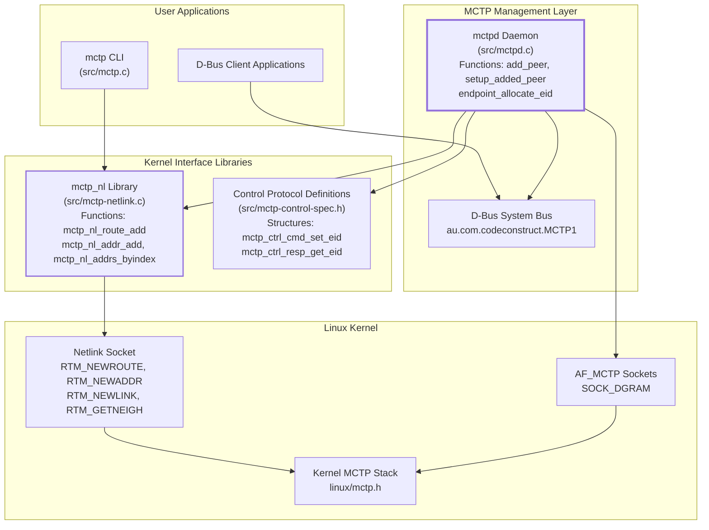
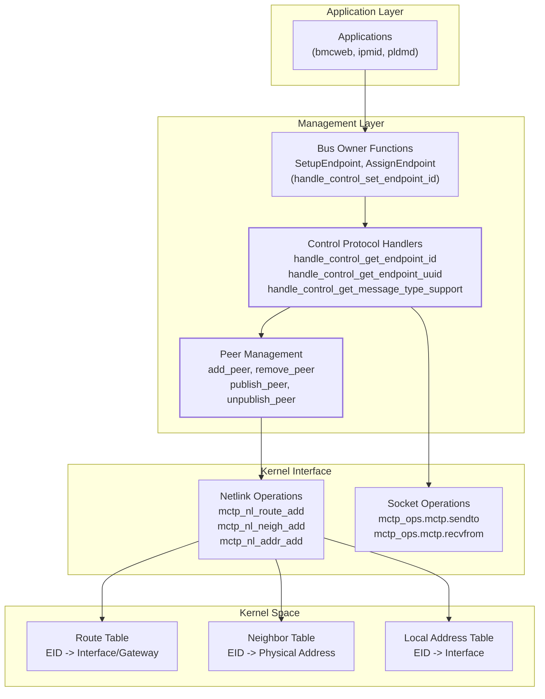
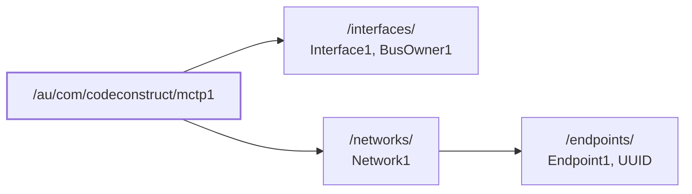
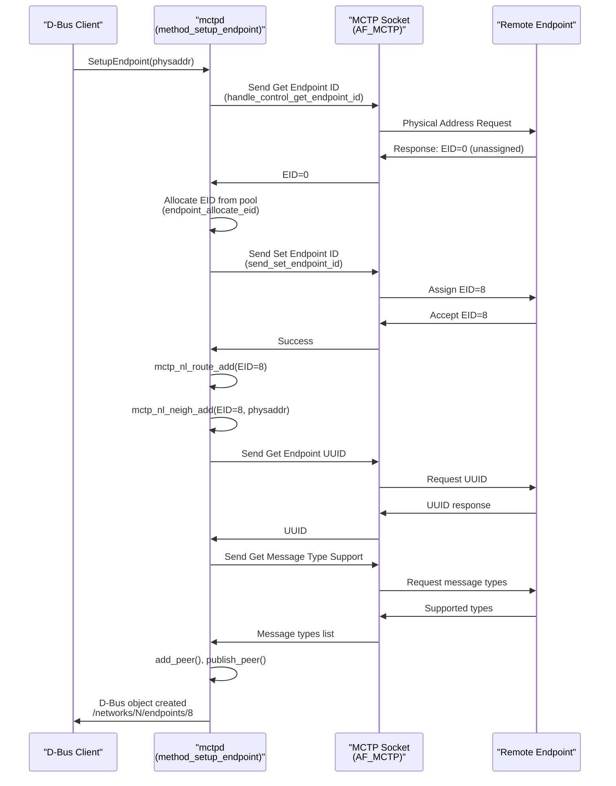
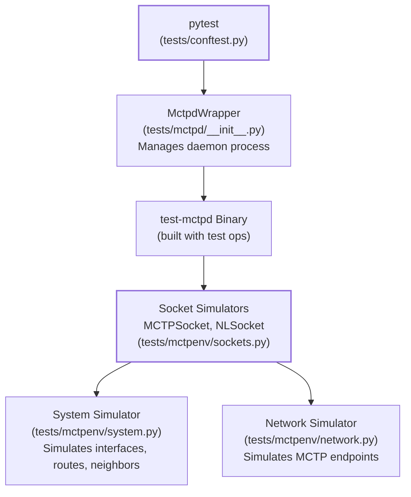

<!-- source: DeepWiki mcp.deepwiki.com · repo NVIDIA/mctp · page 1 Overview · fetched 2026-10-26 -->

# Overview

<details>
<summary>Relevant source files</summary>

The following files were used as context for generating this wiki page:

- [CHANGELOG.md](CHANGELOG.md)
- [README.md](README.md)
- [src/mctpd-util.h](src/mctpd-util.h)
- [src/mctpd.c](src/mctpd.c)
- [tests/requirements.txt](tests/requirements.txt)

</details>


## Purpose and Scope

This document provides a high-level introduction to the MCTP repository, which implements userspace tooling for the Management Component Transport Protocol (MCTP) on Linux. The repository contains two primary executables—`mctpd` (daemon) and `mctp` (CLI utility)—along with supporting tools and a comprehensive test framework.

For detailed information on specific subsystems:
- For `mctpd` daemon architecture and functionality, see [mctpd Daemon](#2.1)
- For the `mctp` command-line utility, see [mctp CLI Utility](#2.2)
- For build and installation procedures, see [Building and Installation](#5)
- For the D-Bus API specification, see [D-Bus Interface](#4)

## What is MCTP

MCTP (Management Component Transport Protocol) is a standardized protocol defined by DMTF specification DSP0236 for communication between management components in a system. MCTP provides:

- **Addressing**: Endpoint IDs (EIDs) in the range 8-254, with 0 reserved for null and 255 for broadcast
- **Transport Abstraction**: Works over multiple physical layers (I2C/SMBus, USB, Serial, PCIe VDM)
- **Message Typing**: Support for various message types including control protocol, PLDM, SPDM, and vendor-defined
- **Network Segmentation**: Multiple isolated MCTP networks, each identified by a network ID

This repository implements the MCTP control protocol and provides management tools for Linux-based systems using the kernel's AF_MCTP socket family.

## Repository Components

The repository is organized around three main component categories:

| Component | File Path | Purpose |
|-----------|-----------|---------|
| **mctpd** | [src/mctpd.c]() | Daemon implementing MCTP control protocol, acting as bus owner or endpoint |
| **mctp** | [src/mctp.c]() | CLI utility for configuring kernel MCTP stack (links, routes, addresses, neighbors) |
| **mctp-bench** | [src/mctp-bench.c]() | Benchmarking tool for measuring MCTP message throughput |
| **Supporting Tools** | [src/mctp-{echo,req,client}.c]() | Debug utilities for testing MCTP communication |
| **Test Framework** | [tests/]() | Python-based pytest framework with simulated MCTP environment |

### Component Relationships



**Sources**: [src/mctpd.c:1-100](), [src/mctp.c](), [src/mctp-netlink.c](), [README.md:1-150]()

## System Architecture Overview

### Layer Structure

The MCTP system follows a layered architecture with clear separation between userspace and kernel space:



**Sources**: [src/mctpd.c:224-271](), [src/mctp-netlink.c](), [src/mctp-control-spec.h]()

### Core Data Structures

The `mctpd` daemon maintains several key data structures defined in [src/mctpd.c:79-271]():

| Structure | Location | Purpose |
|-----------|----------|---------|
| `struct ctx` | [src/mctpd.c:224-271]() | Global daemon context containing configuration, peer list, network list |
| `struct peer` | [src/mctpd.c:152-222]() | Represents an MCTP endpoint with EID, physical address, UUID, and message types |
| `struct net` | [src/mctpd.c:87-96]() | Represents a network with EID-to-peer mappings |
| `struct link` | [src/mctpd.c:133-150]() | Represents a local MCTP interface with role (bus owner or endpoint) |
| `dest_phys` | [src/mctpd.c:79-84]() | Physical addressing information (interface index and hardware address) |

## Operational Modes

The `mctpd` daemon can operate in two distinct roles, configured via [/etc/mctpd.conf]():

### Bus Owner Mode

In bus owner mode, `mctpd`:
- Discovers endpoints via the **Get Endpoint ID** control command
- Assigns EIDs dynamically from a configurable range (`dynamic_eid_range`)
- Creates kernel routes and neighbor entries for discovered endpoints
- Exposes D-Bus methods: `SetupEndpoint`, `AssignEndpoint`, `AssignEndpointStatic`, `LearnEndpoint`
- Publishes endpoint objects at `/au/com/codeconstruct/mctp1/networks/<net>/endpoints/<eid>`

**Key Functions**: [src/mctpd.c:754-943]() (`handle_control_set_endpoint_id`), [src/mctpd.c:2350-2560]() (`method_setup_endpoint`)

### Endpoint Mode

In endpoint mode, `mctpd`:
- Responds to **Set Endpoint ID** requests from a bus owner
- Accepts assigned EIDs on local interfaces
- May function as a bridge endpoint with EID pool allocation
- Does not actively enumerate other endpoints

**Key Functions**: [src/mctpd.c:810-843]() (Set EID handling for endpoints), [src/mctpd.c:3997-4100]() (configuration parsing)

## Key Interfaces

### D-Bus Interface

The daemon exposes its functionality via D-Bus under the bus name `au.com.codeconstruct.MCTP1`:



For complete D-Bus API details, see [D-Bus Interface](#4).

**Sources**: [src/mctpd.c:44-57](), [docs/mctpd.md](), [CHANGELOG.md:156-165]()

### Netlink Interface

The `mctp-netlink.c` module provides an abstraction layer over Linux netlink for MCTP stack configuration:

| Operation | Netlink Message | Function |
|-----------|-----------------|----------|
| Add Route | `RTM_NEWROUTE` | `mctp_nl_route_add()` |
| Add Neighbor | `RTM_NEWNEIGH` | `mctp_nl_neigh_add()` |
| Add Address | `RTM_NEWADDR` | `mctp_nl_addr_add()` |
| Query Links | `RTM_GETLINK` | `mctp_nl_if_byindex()` |
| Monitor Changes | `RTNLGRP_MCTP_IFADDR` | `cb_listen_monitor()` |

**Sources**: [src/mctp-netlink.c](), [src/mctp-netlink.h]()

## Control Protocol Flow

A typical endpoint discovery and configuration sequence:



**Sources**: [src/mctpd.c:2350-2560](), [src/mctpd.c:1850-2050](), [src/mctp-control-spec.h]()

## Physical Transport Support

MCTP in this implementation supports multiple physical layer bindings:

| Transport | Kernel Module | Interface Prefix | Hardware Address |
|-----------|---------------|------------------|------------------|
| I2C/SMBus | `mctp-i2c` | `mctpi2c*` | 7-bit I2C address |
| USB | `mctp-usb` | `mctpusb*` | None (USB enumeration) |
| Serial | `mctp-serial` | `mctpserial*` | None |
| PCIe VDM | `mctp-pcie` | Variable | BDF (Bus:Device.Function) |

The physical binding type is determined via interface naming conventions in [src/mctpd-util.h:52-68]() (`get_binding_from_ifname`).

**Sources**: [src/mctpd-util.h:24-98](), [README.md:1-150]()

## Configuration

The daemon reads configuration from `/etc/mctpd.conf` (default) or a file specified with `-c` option. Key configuration parameters:

```toml
[bus-owner]
mode = "bus-owner"  # or "endpoint"
dynamic_eid_range = "8-30"
message_timeout_ms = 1000

[endpoint]
# Endpoint-specific configuration
```

Configuration parsing is handled in [src/mctpd.c:3997-4100]().

For detailed configuration reference, see [Configuration](#2.1.3).

**Sources**: [src/mctpd.c:3997-4100](), [conf/mctpd.conf](), [CHANGELOG.md:22-24]()

## Testing Infrastructure

The repository includes a comprehensive Python-based test framework that simulates MCTP environments without requiring kernel MCTP support:



Tests intercept socket operations via Unix domain sockets, redirecting them to Python-based simulators. This allows testing control protocol flows, D-Bus interactions, and error conditions without physical hardware.

For details on writing tests, see [Testing](#6).

**Sources**: [tests/conftest.py](), [tests/mctpenv/__init__.py](), [tests/requirements.txt:1-7](), [README.md:113-149]()

## Build System

The project uses Meson as its build system with the following key outputs:

| Target | Source | Purpose |
|--------|--------|---------|
| `mctpd` | [src/mctpd.c]() | Production daemon binary |
| `mctp` | [src/mctp.c]() | CLI utility |
| `test-mctpd` | [src/mctpd.c]() with test ops | Daemon for testing |
| `mctp-bench` | [src/mctp-bench.c]() | Benchmarking tool |

Build configuration is defined in [meson.build]() with optional dependencies on `libsystemd` for D-Bus and event loop functionality.

For build instructions, see [Building and Installation](#5).

**Sources**: [meson.build](), [README.md:16-36](), [CHANGELOG.md:146-154]()

## Use Cases

### As a Bus Owner (BMC)

Typical deployment on a Baseboard Management Controller:
1. System boots and kernel loads MCTP modules
2. `mctpd` starts in bus-owner mode via systemd
3. Local interfaces configured with `mctp link` and `mctp address` commands
4. Applications (bmcweb, pldmd) call `SetupEndpoint()` via D-Bus to discover devices
5. `mctpd` assigns EIDs, creates routes, publishes endpoint objects
6. Applications communicate with endpoints via AF_MCTP sockets

### As an Endpoint Device

Typical deployment on a managed device:
1. Device boots with `mctpd` in endpoint mode
2. Bus owner sends Set Endpoint ID request
3. `mctpd` accepts EID assignment on local interface
4. Device responds to control protocol requests (Get UUID, Get Message Type Support)
5. Higher-layer protocols (PLDM, SPDM) handle application-level communication

### For Development and Testing

Use the test framework or standalone simulation:
```bash
# Run full test suite
meson test -C obj

# Run daemon with simulated environment
cd obj
python3 ../tests/mctpd/__init__.py
```

**Sources**: [README.md:65-112](), [tests/mctpd/__init__.py](), [CHANGELOG.md:57-59]()

---

