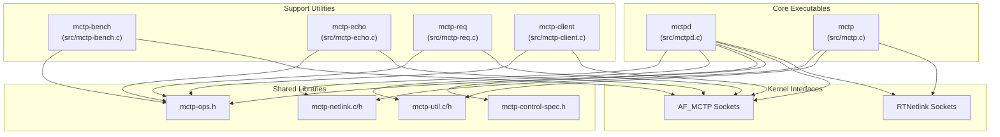
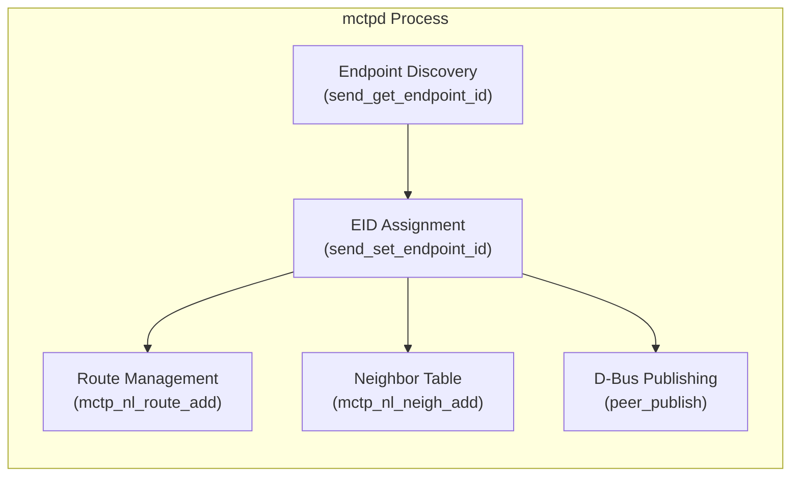
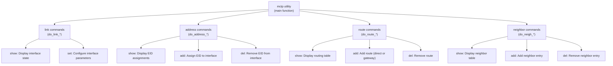
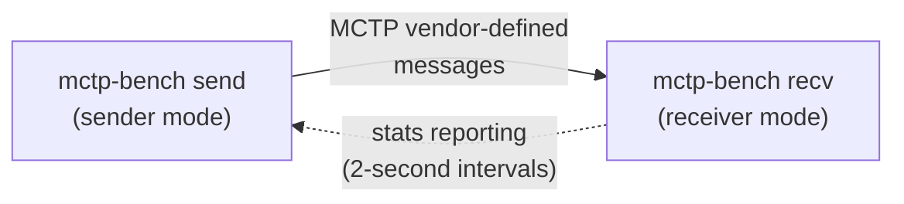
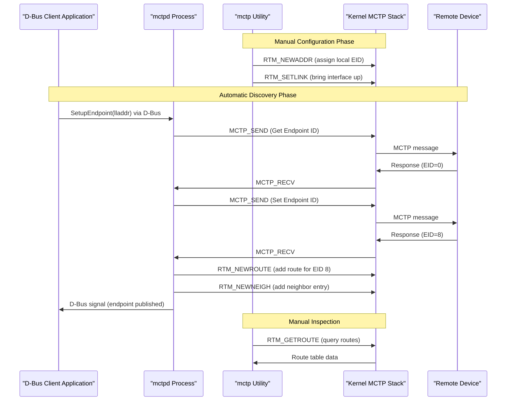

<!-- source: DeepWiki mcp.deepwiki.com · repo NVIDIA/mctp · page 2 Core Components · fetched 2026-10-26 -->

# Core Components

<details>
<summary>Relevant source files</summary>

The following files were used as context for generating this wiki page:

- [CHANGELOG.md](CHANGELOG.md)
- [README.md](README.md)
- [tests/requirements.txt](tests/requirements.txt)

</details>


This page provides an overview of the main executable components in the MCTP repository and their roles in the system. These components form the userspace interface to the Linux kernel's MCTP stack, providing both daemon-based endpoint management and command-line utilities for manual configuration and testing.

The MCTP repository contains three categories of executable components:
- **mctpd**: A system daemon that implements MCTP control protocol and manages endpoint discovery
- **mctp**: A command-line utility for direct kernel MCTP stack configuration
- **Supporting tools**: Utilities for testing, benchmarking, and debugging MCTP communication

For detailed documentation on the daemon's internal architecture and endpoint management, see [Daemon Architecture](#2.1.1) and [Endpoint Management](#2.1.2). For protocol-level details, see [MCTP Control Protocol](#3.2) and [Netlink Interface](#3.3).

---

## Component Overview

The repository builds several executables with distinct purposes in the MCTP ecosystem.



**Sources**: [README.md:1-14](), [meson.build]()

---

## Component Comparison

The following table summarizes the role and characteristics of each executable component:

| Component | Source File | Primary Role | Key Dependencies | Output Type |
|-----------|------------|--------------|------------------|-------------|
| `mctpd` | `src/mctpd.c` | MCTP control protocol daemon, bus owner, endpoint management | libsystemd (optional), D-Bus | System daemon |
| `mctp` | `src/mctp.c` | Direct kernel stack configuration utility | Netlink only | CLI utility |
| `mctp-bench` | `src/mctp-bench.c` | Performance testing and benchmarking | MCTP sockets | CLI utility |
| `mctp-echo` | `src/mctp-echo.c` | Simple echo server for testing | MCTP sockets | CLI utility |
| `mctp-req` | `src/mctp-req.c` | Request/response testing | MCTP sockets | CLI utility |
| `mctp-client` | `src/mctp-client.c` | Generic MCTP client | MCTP sockets | CLI utility |

**Sources**: [meson.build](), [README.md:1-14](), [CHANGELOG.md:49-50](), [CHANGELOG.md:69-70]()

---

## mctpd Daemon

### Overview

`mctpd` is a system daemon that implements the MCTP control protocol (DSP0236) and acts as a bus owner to manage MCTP endpoints. The daemon discovers remote devices, assigns endpoint IDs (EIDs), maintains routing tables, and exposes endpoint information via D-Bus.

### Binary Output

- **Executable**: `mctpd` (production), `test-mctpd` (test variant with mock socket operations)
- **Source**: [src/mctpd.c]()
- **Installation Path**: Typically `/usr/local/bin/mctpd` or `/usr/bin/mctpd`

### Core Responsibilities



### Operational Modes

`mctpd` supports two operational modes configured via `/etc/mctpd.conf`:

| Mode | Behavior | Configuration |
|------|----------|---------------|
| `bus-owner` | Actively discovers and assigns EIDs to remote endpoints | `mode = "bus-owner"` in config file |
| `endpoint` | Responds to EID assignment requests from remote bus owners | `mode = "endpoint"` in config file |

**Sources**: [README.md:10-13](), [CHANGELOG.md:22-28](), [CHANGELOG.md:139]()

For comprehensive documentation of the daemon's architecture, see [mctpd Daemon](#2.1). For configuration details, see [Configuration](#2.1.3).

---

## mctp CLI Utility

### Overview

The `mctp` utility provides direct command-line access to the kernel MCTP stack configuration. It operates similarly to the `ip` utility from iproute2, allowing manual management of MCTP links, addresses, routes, and neighbor entries.

### Binary Output

- **Executable**: `mctp` (production), `test-mctp` (test variant)
- **Source**: [src/mctp.c]()
- **Installation Path**: Typically `/usr/local/bin/mctp` or `/usr/bin/mctp`

### Command Structure

The utility exposes four primary command categories, each managing a different aspect of the kernel MCTP stack:



### Command Reference

| Command Category | Subcommands | Description | Example |
|-----------------|-------------|-------------|---------|
| `link` | `show`, `set` | Manage MCTP network interfaces | `mctp link set mctpi2c1 up mtu 68` |
| `address` | `show`, `add`, `del` | Manage local EID assignments | `mctp address add 8 dev mctpi2c1` |
| `route` | `show`, `add`, `del` | Manage routing table entries | `mctp route add 10-20 via mctpi2c1` |
| `neigh` | `show`, `add`, `del` | Manage neighbor table (EID to physical address mapping) | `mctp neigh add 9 dev mctpi2c1 lladdr 0x1d` |

### Netlink Communication

All `mctp` commands interact with the kernel through RTNetlink messages, using the abstraction layer in `mctp-netlink.c`:

| Operation | Netlink Message Type | Handler Function |
|-----------|---------------------|------------------|
| Link show/set | `RTM_GETLINK`, `RTM_SETLINK` | `mctp_nl_query()`, `mctp_nl_link_set()` |
| Address add/del | `RTM_NEWADDR`, `RTM_DELADDR` | `mctp_nl_addr_add()`, `mctp_nl_addr_del()` |
| Route add/del | `RTM_NEWROUTE`, `RTM_DELROUTE` | `mctp_nl_route_add()`, `mctp_nl_route_del()` |
| Neighbor add/del | `RTM_NEWNEIGH`, `RTM_DELNEIGH` | `mctp_nl_neigh_add()`, `mctp_nl_neigh_del()` |

**Sources**: [README.md:7-8](), [README.md:38-63](), [CHANGELOG.md:72-77]()

For detailed usage examples and troubleshooting, see [mctp CLI Utility](#2.2).

---

## Supporting Tools

The repository includes several utility programs for testing, debugging, and benchmarking MCTP communication. Unlike `mctpd` and `mctp`, these tools directly use MCTP sockets for application-level communication.

### mctp-bench

Performance testing tool for measuring MCTP message throughput and latency.



**Modes**:
- **Send mode**: Continuously transmits messages to a target EID
- **Receive mode**: Accepts messages and reports statistics
- **Request-receive mode**: Sends initial command to start benchmark session

**Source**: [src/mctp-bench.c]()

**Usage Example**:
```
# On receiver
mctp-bench recv

# On sender
mctp-bench send 8 100
```

**Sources**: [CHANGELOG.md:49-50](), [CHANGELOG.md:69-70](), [CHANGELOG.md:18-19](), [CHANGELOG.md:87]()

### mctp-echo

Simple echo server that receives MCTP messages and sends them back to the originator.

**Source**: [src/mctp-echo.c]()

**Purpose**: Basic connectivity testing and loopback verification.

### mctp-req

Request/response utility for sending arbitrary MCTP messages and receiving responses.

**Source**: [src/mctp-req.c]()

**Purpose**: Manual MCTP message construction and debugging.

### mctp-client

Generic MCTP client for custom protocol implementations.

**Source**: [src/mctp-client.c]()

**Purpose**: Template for building application-specific MCTP communication tools.

### Message Type

All supporting tools use vendor-defined message type (0x7E) rather than MCTP control protocol (0x00). This change was made to avoid interference with control protocol operations managed by `mctpd`.

**Sources**: [CHANGELOG.md:98-99]()

For detailed information on these utilities, see [Supporting Tools](#2.3).

---

## Component Interaction Pattern

The following diagram shows how the core components interact with each other and the kernel during typical operations:



### Interaction Characteristics

| Interaction Type | Components | Communication Method | Use Case |
|-----------------|------------|---------------------|----------|
| Configuration | `mctp` ↔ Kernel | RTNetlink sockets | Manual interface and routing setup |
| Discovery | `mctpd` ↔ Kernel ↔ Device | MCTP control protocol over AF_MCTP | Automatic endpoint enumeration |
| Monitoring | `mctp monitor` → Kernel | Netlink multicast | Real-time stack state changes |
| Management | Application ↔ `mctpd` | D-Bus method calls | High-level endpoint control |
| Testing | Utilities ↔ Device | AF_MCTP sockets | Direct message exchange |

**Sources**: [README.md:1-14](), [CHANGELOG.md:55-56]()

---

## Build Outputs

The meson build system generates the following executables:

### Production Binaries

| Binary | Source Files | Dependencies | Install Location |
|--------|-------------|--------------|------------------|
| `mctpd` | `mctpd.c`, `mctp-netlink.c`, `mctp-util.c` | libsystemd (optional) | `${prefix}/bin/` |
| `mctp` | `mctp.c`, `mctp-netlink.c`, `mctp-util.c` | None | `${prefix}/bin/` |
| `mctp-bench` | `mctp-bench.c`, `mctp-util.c` | None | `${prefix}/bin/` |
| `mctp-echo` | `mctp-echo.c` | None | `${prefix}/bin/` |
| `mctp-req` | `mctp-req.c` | None | `${prefix}/bin/` |
| `mctp-client` | `mctp-client.c` | None | `${prefix}/bin/` |

### Test Binaries

When tests are enabled (`-Dtests=true`, default), additional test-specific binaries are built:

| Binary | Purpose | Socket Operations |
|--------|---------|-------------------|
| `test-mctpd` | Test variant of mctpd | Uses `mctp_ops_test` (Unix domain sockets) |
| `test-mctp` | Test variant of mctp | Uses `mctp_ops_test` (Unix domain sockets) |

The test binaries use mock socket operations defined in [tests/mctpopstest.c](), allowing tests to run without kernel MCTP support by intercepting socket calls and routing them through Unix domain sockets to test infrastructure.

**Sources**: [meson.build](), [CHANGELOG.md:91-96]()

---

## Shared Code Components

Several source files provide functionality shared across multiple executables:

### mctp-netlink.c/h

Netlink abstraction layer providing functions for kernel MCTP stack configuration.

**Key Functions**:
- `mctp_nl_new()`: Create netlink context
- `mctp_nl_query()`: Query kernel state
- `mctp_nl_route_add()`, `mctp_nl_route_del()`: Route management
- `mctp_nl_neigh_add()`, `mctp_nl_neigh_del()`: Neighbor management
- `mctp_nl_addr_add()`, `mctp_nl_addr_del()`: Address management

**Used By**: `mctpd`, `mctp`

### mctp-util.c/h

Common utility functions for MCTP operations.

**Key Functions**:
- `parse_eid()`: Parse EID from string
- `parse_physaddr()`: Parse physical address from string
- `format_physaddr()`: Format physical address for display

**Used By**: All executables

### mctp-ops.h

Socket operations interface defining `mctp_ops` structure with function pointers for socket creation and configuration.

**Implementations**:
- `mctp_ops_std`: Standard kernel AF_MCTP sockets (production)
- `mctp_ops_test`: Mock sockets for testing (test binaries)

**Used By**: `mctpd`, `mctp-bench`, `mctp-echo`, `mctp-req`, `mctp-client`

### mctp-control-spec.h

MCTP control protocol message structures and definitions from DSP0236 specification.

**Key Structures**:
- `mctp_ctrl_msg_hdr`: Control message header
- Request/response structures for each control command (Get EID, Set EID, Get UUID, etc.)

**Used By**: `mctpd`

**Sources**: [meson.build](), [src/mctp-netlink.c](), [src/mctp-ops.h](), [src/mctp-control-spec.h]()

---

