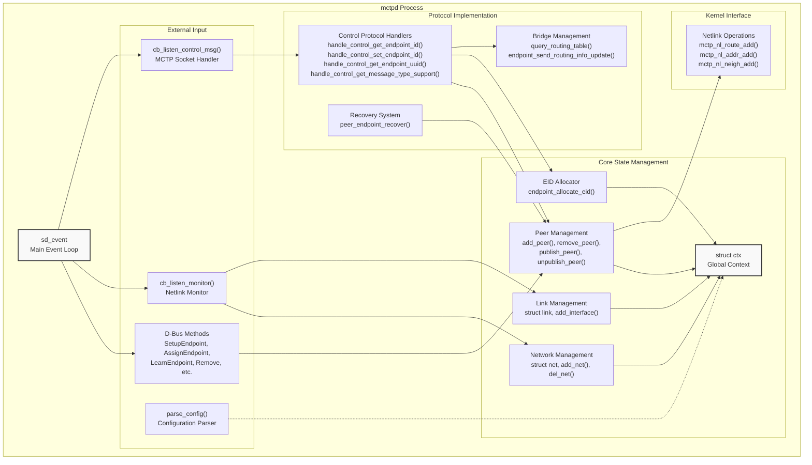
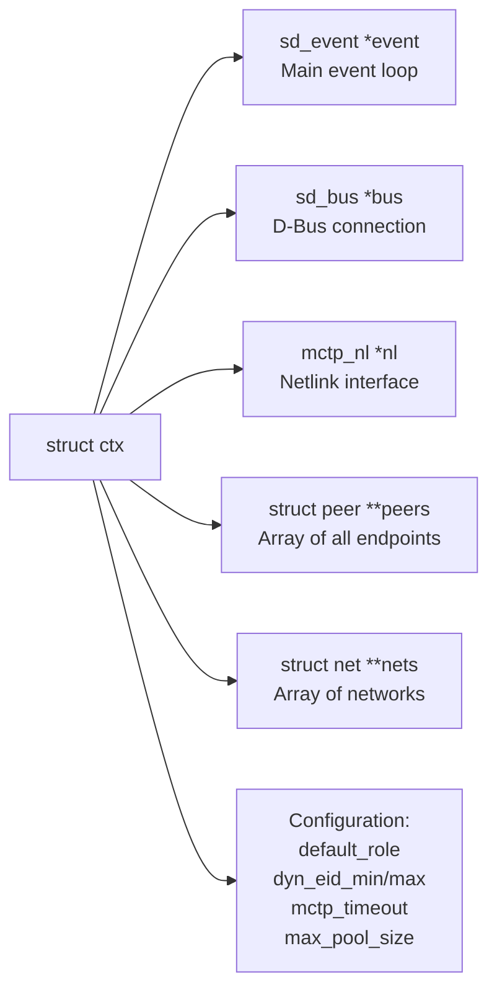
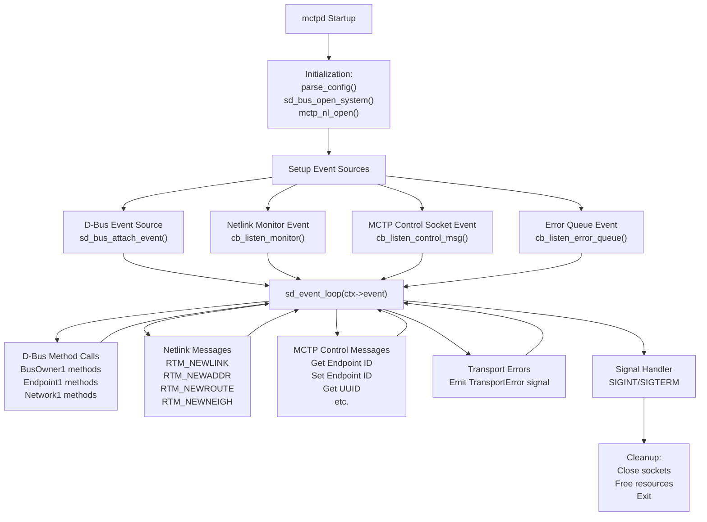
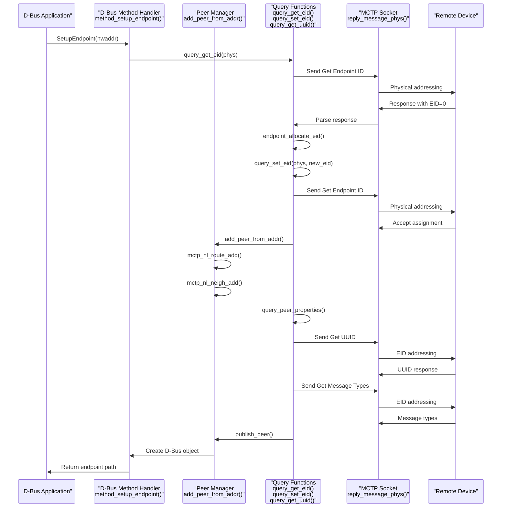

<!-- source: DeepWiki mcp.deepwiki.com · repo NVIDIA/mctp · page 2.1 mctpd Daemon · fetched 2026-10-26 -->

# mctpd Daemon

<details>
<summary>Relevant source files</summary>

The following files were used as context for generating this wiki page:

- [CHANGELOG.md](CHANGELOG.md)
- [conf/mctpd.conf](conf/mctpd.conf)
- [docs/mctpd.md](docs/mctpd.md)
- [src/mctpd-util.h](src/mctpd-util.h)
- [src/mctpd.c](src/mctpd.c)

</details>


## Purpose and Scope

This document describes the `mctpd` daemon, the central management component of the MCTP system. It covers the daemon's role, architecture, core components, and operational modes. For detailed information on specific aspects:
- Internal architecture and data structures: see [Daemon Architecture](#2.1.1)
- Endpoint discovery and management: see [Endpoint Management](#2.1.2)
- Configuration file format: see [Configuration](#2.1.3)
- D-Bus API details: see [D-Bus Interface](#4)

## Overview

The `mctpd` daemon serves as the MCTP bus owner and endpoint manager for Linux systems. It implements the MCTP control protocol (DSP0236), manages endpoint discovery and EID assignment, and provides a D-Bus interface for applications to interact with MCTP endpoints.

**Key Responsibilities:**
- Assign MCTP Endpoint IDs (EIDs) to devices
- Discover and enumerate MCTP endpoints
- Manage kernel routing and neighbor tables via Netlink
- Expose discovered endpoints through D-Bus
- Implement MCTP control protocol message handling
- Handle bridge endpoints and downstream EID allocation
- Provide endpoint recovery mechanisms

Sources: [src/mctpd.c:1-40](), [docs/mctpd.md:1-25]()

## Main Components

The daemon is organized into several interconnected subsystems that handle different aspects of MCTP management:



**Component Descriptions:**

| Component | Code Location | Purpose |
|-----------|---------------|---------|
| Event Loop | [src/mctpd.c:224-225]() | Coordinates all asynchronous operations using systemd's `sd_event` |
| Peer Manager | [src/mctpd.c:279-289]() | Manages lifecycle of MCTP endpoints (add, remove, publish, unpublish) |
| Network Manager | [src/mctpd.c:86-96](), [src/mctpd.c:299-300]() | Maintains per-network state and EID mappings |
| Link Manager | [src/mctpd.c:133-150]() | Manages MCTP interfaces and their roles |
| EID Allocator | [src/mctpd.c:302]() | Allocates dynamic EIDs from configured range |
| Control Protocol | [src/mctpd.c:754-1293]() | Implements MCTP control protocol message handlers |
| Netlink Monitor | [src/mctpd.c:1950-2066]() | Receives kernel state change notifications |
| Bridge Logic | [src/mctpd.c:302-309]() | Handles MCTP bridges and routing table queries |

Sources: [src/mctpd.c:224-310](), [src/mctpd.c:754-1293](), [src/mctpd.c:1950-2066]()

## Core Data Structures

The daemon uses three primary data structures to maintain state. These are described briefly here; for detailed information see [Daemon Architecture](#2.1.1).

### `struct ctx` - Global Context



The global context structure ([src/mctpd.c:224-271]()) holds all daemon state including references to event loop, D-Bus connection, Netlink interface, and arrays of peers and networks.

**Key Fields:**
- `sd_event *event` - Main event loop
- `sd_bus *bus` - D-Bus system bus connection
- `mctp_nl *nl` - Netlink abstraction for kernel communication
- `struct peer **peers` - Dynamic array of all known endpoints
- `struct net **nets` - Array of MCTP networks
- `dyn_eid_min`, `dyn_eid_max` - Dynamic EID allocation range
- `mctp_timeout` - Timeout for MCTP control protocol responses
- `default_role` - Bus owner or endpoint mode

Sources: [src/mctpd.c:224-271]()

### `struct peer` - Endpoint Representation

Each discovered MCTP endpoint is represented by a `peer` structure ([src/mctpd.c:152-222]()):

**Key Fields:**
- `mctp_eid_t eid` - Assigned endpoint ID
- `uint32_t net` - Network ID
- `dest_phys phys` - Physical address (interface index + hardware address)
- `state` - LOCAL or REMOTE endpoint
- `published` - Whether visible on D-Bus
- `message_types` - Supported message types from Get Message Type Support
- `uuid` - Endpoint UUID (16 bytes)
- `pool_size`, `pool_start` - For bridge endpoints, downstream EID pool

Sources: [src/mctpd.c:152-222]()

### `struct net` - Network State

Each MCTP network ([src/mctpd.c:86-96]()) maintains:

**Key Fields:**
- `uint32_t net` - Network ID
- `struct peer *peers[256]` - EID-indexed array of endpoints on this network
- `sd_bus_slot *slot` - D-Bus object slot
- `char *path` - D-Bus object path

Sources: [src/mctpd.c:86-96]()

## Operation Modes

The daemon operates in one of two modes, configured via `/etc/mctpd.conf`:

### Bus Owner Mode

**Configuration:** `mode = "bus-owner"`

In this mode, `mctpd` takes responsibility for:
- Assigning EIDs to newly discovered endpoints
- Managing the EID allocation pool
- Handling bridge endpoint pool allocation
- Responding to Get Endpoint ID requests
- **Rejecting** Set Endpoint ID requests

The daemon monitors physical addresses on configured interfaces and assigns EIDs when new devices are discovered through D-Bus methods like `SetupEndpoint()`.

Sources: [src/mctpd.c:103-131](), [src/mctpd.c:794-800](), [conf/mctpd.conf:1-2]()

### Endpoint Mode

**Configuration:** `mode = "endpoint"`

In this mode, `mctpd` acts as a passive endpoint:
- **Accepts** Set Endpoint ID requests from external bus owners
- Does not assign EIDs to other devices
- Responds to Get Endpoint ID with locally assigned EID
- May have multiple local EIDs on different interfaces

When receiving a Set Endpoint ID with operation FORCE ([src/mctpd.c:901-931]()), the daemon:
1. Clears existing interface addresses and peers
2. Adds the assigned EID to the local interface
3. Creates a peer entry for the bus owner
4. Accepts the assignment

Sources: [src/mctpd.c:754-943](), [docs/mctpd.md:298-307]()

## Main Event Loop

The daemon's operation is driven by an `sd_event` loop that handles multiple event sources:



**Event Source Registration:**

| Event Source | File Descriptor | Callback Function | Purpose |
|--------------|-----------------|-------------------|---------|
| D-Bus | Internal to `sd_bus` | D-Bus vtable methods | Handle method calls from applications |
| Netlink Monitor | `mctp_nl_get_fd()` | `cb_listen_monitor()` | Receive kernel state changes |
| MCTP Control Socket | `mctp_ops.mctp.socket()` | `cb_listen_control_msg()` | Receive MCTP control protocol messages |
| MCTP Error Queue | Same socket with MSG_ERRQUEUE | `cb_listen_error_queue()` | Receive transport error notifications |

Sources: [src/mctpd.c:2857-2985](), [src/mctpd.c:1950-2066](), [src/mctpd.c:1661-1739]()

## Control Protocol Message Flow

The daemon implements the MCTP control protocol to communicate with endpoints. Here's how a typical endpoint setup flows through the code:



**Control Protocol Handlers:**

| Command Code | Handler Function | Request Type | Response Type |
|--------------|------------------|--------------|---------------|
| 0x01 | `handle_control_set_endpoint_id()` | `mctp_ctrl_cmd_set_eid` | `mctp_ctrl_resp_set_eid` |
| 0x02 | `handle_control_get_endpoint_id()` | `mctp_ctrl_cmd_get_eid` | `mctp_ctrl_resp_get_eid` |
| 0x03 | `handle_control_get_endpoint_uuid()` | `mctp_ctrl_cmd_get_uuid` | `mctp_ctrl_resp_get_uuid` |
| 0x04 | `handle_control_get_version_support()` | `mctp_ctrl_cmd_get_mctp_ver_support` | `mctp_ctrl_resp_get_mctp_ver_support` |
| 0x05 | `handle_control_get_message_type_support()` | `mctp_ctrl_cmd_get_msg_type_support` | `mctp_ctrl_resp_get_msg_type_support` |
| 0x09 | `handle_control_resolve_endpoint_id()` | `mctp_ctrl_cmd_resolve_endpoint_id` | `mctp_ctrl_resp_resolve_endpoint_id` |
| 0x0B | `handle_control_discovery_notify()` | `mctp_ctrl_cmd_discovery_notify` | `mctp_ctrl_resp_discovery_notify` |
| 0x0D | `handle_control_routing_info_update()` | `mctp_ctrl_cmd_routing_info_update` | `mctp_ctrl_resp` |

Sources: [src/mctpd.c:1661-1739](), [src/mctpd.c:754-1293](), [src/mctp-control-spec.h:1-200]()

## D-Bus Interface Hierarchy

The daemon exposes MCTP management through D-Bus. The object hierarchy maps to MCTP concepts:

```
/au/com/codeconstruct/mctp1
├── interfaces/
│   ├── mctpi2c1                    [au.com.codeconstruct.MCTP.Interface1]
│   │                               [au.com.codeconstruct.MCTP.BusOwner1] (if bus owner)
│   └── mctpi2c2                    [au.com.codeconstruct.MCTP.Interface1]
│                                   [au.com.codeconstruct.MCTP.BusOwner1] (if bus owner)
└── networks/
    └── 1/                          [au.com.codeconstruct.MCTP.Network1]
        └── endpoints/
            ├── 8                   [xyz.openbmc_project.MCTP.Endpoint]
            │                       [au.com.codeconstruct.MCTP.Endpoint1]
            │                       [xyz.openbmc_project.Common.UUID]
            └── 10                  [xyz.openbmc_project.MCTP.Endpoint]
                                    [au.com.codeconstruct.MCTP.Endpoint1]
                                    [au.com.codeconstruct.MCTP.Bridge1] (if bridge)
                                    [xyz.openbmc_project.Common.UUID]
```

**Key Interfaces:**
- `au.com.codeconstruct.MCTP.Interface1` - Interface properties and role
- `au.com.codeconstruct.MCTP.BusOwner1` - Endpoint setup/assignment (bus owner only)
- `au.com.codeconstruct.MCTP.Network1` - Network-level operations
- `au.com.codeconstruct.MCTP.Endpoint1` - Endpoint management (SetMTU, Remove, Recover)
- `au.com.codeconstruct.MCTP.Bridge1` - Bridge pool allocation info
- `xyz.openbmc_project.MCTP.Endpoint` - OpenBMC compatibility

See [D-Bus Interface](#4) for detailed API documentation.

Sources: [src/mctpd.c:44-57](), [docs/mctpd.md:9-23]()

## Configuration Loading

Configuration is loaded at startup from `/etc/mctpd.conf` (or path specified with `--config`):

**Configuration Flow:**

1. `parse_config()` ([src/mctpd.c:2619-2782]()) parses TOML file
2. Global `mode` setting determines operation mode
3. `[mctp]` section configures protocol parameters
4. `[bus-owner]` section configures EID allocation (if applicable)
5. Configuration stored in `struct ctx`

**Key Configuration Parameters:**

| Parameter | Field in `struct ctx` | Default | Description |
|-----------|----------------------|---------|-------------|
| `mode` | `default_role` | `bus-owner` | Operation mode |
| `message_timeout_ms` | `mctp_timeout` | 250 ms | Control protocol timeout |
| `dynamic_eid_range` | `dyn_eid_min`, `dyn_eid_max` | [8, 254] | EID allocation range |
| `max_pool_size` | `max_pool_size` | 15 | Max bridge pool size |
| `uuid` | `uuid[16]` | System UUID | Endpoint UUID |

For detailed configuration reference, see [Configuration](#2.1.3).

Sources: [src/mctpd.c:2619-2782](), [conf/mctpd.conf:1-20](), [docs/mctpd.md:286-369]()

## Lifecycle

### Startup Sequence

1. **Parse command-line arguments** ([src/mctpd.c:2857-2911]())
   - Configuration file path (`--config`)
   - Verbose mode (`-v`)

2. **Load configuration** ([src/mctpd.c:2619-2782]())
   - Read TOML file
   - Set operation mode and parameters

3. **Initialize context** ([src/mctpd.c:2913-2925]())
   - Allocate `struct ctx`
   - Open D-Bus system bus
   - Open Netlink socket
   - Generate or load UUID

4. **Setup event sources** ([src/mctpd.c:2927-2973]())
   - Attach D-Bus to event loop
   - Add Netlink monitor callback
   - Create MCTP control socket
   - Setup error queue monitoring

5. **Enumerate existing state** ([src/mctpd.c:2974-2982]())
   - Query kernel for existing interfaces
   - Query for existing addresses
   - Create network and peer objects

6. **Enter event loop** ([src/mctpd.c:2983]())
   - `sd_event_loop(ctx->event)`

Sources: [src/mctpd.c:2857-2985]()

### Runtime Operation

During normal operation, the daemon responds to events:

- **D-Bus method calls** trigger endpoint setup/management operations
- **Netlink events** update internal state when kernel state changes
- **MCTP control messages** from remote endpoints are processed
- **Transport errors** are logged and may trigger recovery

### Shutdown

On receiving SIGINT or SIGTERM:

1. Exit event loop
2. Unpublish all D-Bus objects
3. Close sockets and file descriptors
4. Free allocated memory
5. Exit process

Sources: [src/mctpd.c:2985-3000]()

## Netlink Integration

The daemon maintains kernel MCTP state through Netlink operations:

**Operations Performed:**

| Operation | Function | When Used |
|-----------|----------|-----------|
| Add route | `mctp_nl_route_add()` | After assigning EID to endpoint |
| Add neighbor | `mctp_nl_neigh_add()` | After assigning EID to endpoint |
| Add address | `mctp_nl_addr_add()` | When accepting EID assignment (endpoint mode) |
| Delete route | `mctp_nl_route_del()` | When removing peer |
| Delete neighbor | `mctp_nl_neigh_del()` | When removing peer |
| Delete address | `mctp_nl_addr_del()` | When clearing interface |

**Monitoring:**

The `cb_listen_monitor()` callback ([src/mctpd.c:1950-2066]()) receives and processes:
- `RTM_NEWLINK` / `RTM_DELLINK` - Interface creation/deletion
- `RTM_NEWADDR` / `RTM_DELADDR` - Address assignment/removal  
- `RTM_NEWROUTE` / `RTM_DELROUTE` - Route changes
- `RTM_NEWNEIGH` / `RTM_DELNEIGH` - Neighbor entry changes

This ensures the daemon's internal state remains synchronized with kernel state.

Sources: [src/mctpd.c:1950-2066](), [src/mctp-netlink.c:1-500]()

## Error Handling and Recovery

The daemon includes comprehensive error handling:

### Transport Error Queue

The error queue ([src/mctpd.c:2426-2612]()) captures transport-level failures:
- Reads from socket error queue with `MSG_ERRQUEUE`
- Extracts `struct mctp_error` with error details
- Emits D-Bus `TransportError` signal
- May trigger endpoint recovery

### Endpoint Recovery

When endpoints become unresponsive ([src/mctpd.c:2166-2344]()):
1. Detect failure (timeout or transport error)
2. Mark endpoint as degraded
3. Schedule recovery attempts with exponential backoff
4. Query endpoint state periodically
5. If successful, restore endpoint to healthy state
6. If failures persist, may remove endpoint

For details on recovery mechanisms, see [Endpoint Management](#2.1.2) and [Error Handling and Recovery](#7.2).

Sources: [src/mctpd.c:2166-2344](), [src/mctpd.c:2426-2612]()

## Bridge Endpoint Support

MCTP bridges require special handling:

1. **Detection**: Bridges report `pool_size > 0` in Set Endpoint ID response
2. **Pool Allocation**: Daemon allocates contiguous EID range for downstream devices
3. **Routing Table Query**: `query_routing_table()` retrieves bridge's routing information
4. **D-Bus Exposure**: Bridge endpoints expose `au.com.codeconstruct.MCTP.Bridge1` interface
5. **Routing Info Updates**: Daemon sends routing updates to bridges when topology changes

**Bridge-Specific Fields:**
- `pool_size` - Number of EIDs allocated to bridge
- `pool_start` - First EID in allocated range
- `routing_table_entry` - Cached routing table from bridge
- `ignore_eids` - EIDs to skip when processing routing table

Sources: [src/mctpd.c:1294-1598](), [src/mctpd.c:1866-1949](), [docs/mctpd.md:270-285]()

## Summary

The `mctpd` daemon is a sophisticated service that bridges MCTP hardware and application layers. It combines:
- Event-driven architecture using `sd_event`
- D-Bus interface for high-level control
- Netlink integration for kernel state management
- MCTP control protocol implementation
- Robust error handling and recovery mechanisms

The daemon's modular design separates concerns clearly, with distinct components for peer management, network state, protocol handling, and external interfaces. This architecture enables reliable MCTP management across diverse hardware transports and configurations.

Sources: [src/mctpd.c:1-3000](), [docs/mctpd.md:1-369]()

---

