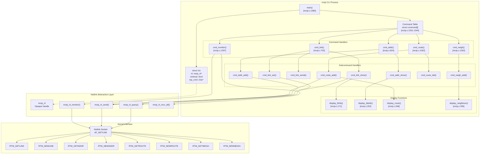
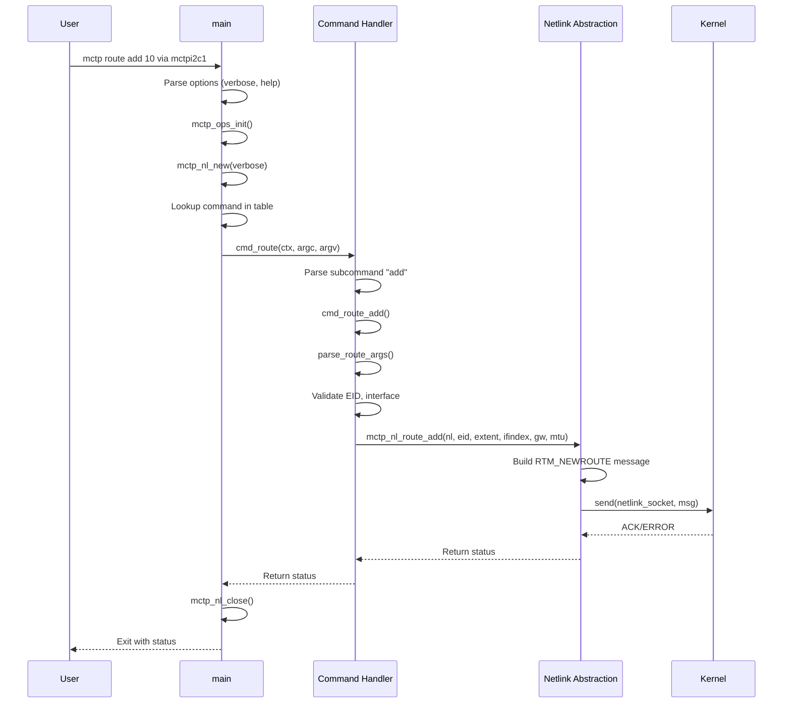
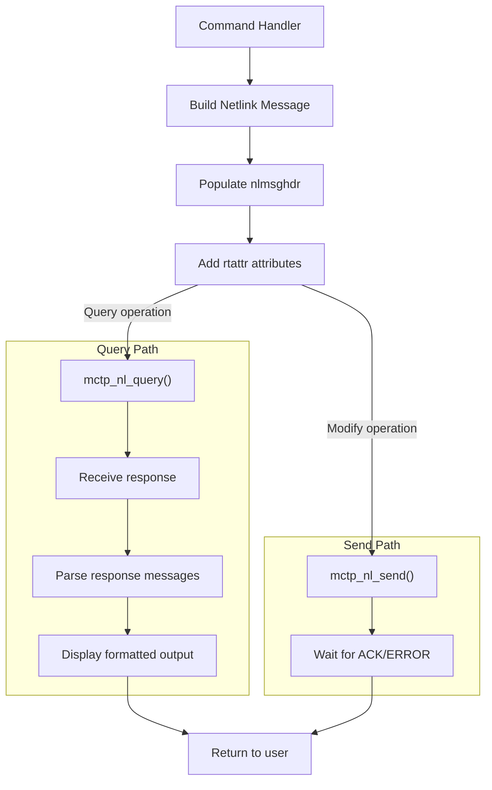

<!-- source: DeepWiki mcp.deepwiki.com · repo NVIDIA/mctp · page 2.2 mctp CLI Utility · fetched 2026-10-26 -->

# mctp CLI Utility

<details>
<summary>Relevant source files</summary>

The following files were used as context for generating this wiki page:

- [CHANGELOG.md](CHANGELOG.md)
- [README.md](README.md)
- [src/mctp.c](src/mctp.c)
- [tests/requirements.txt](tests/requirements.txt)

</details>


## Purpose and Scope

The `mctp` CLI utility is a command-line tool for directly managing the kernel MCTP stack. It provides low-level configuration and inspection capabilities for MCTP network interfaces, addresses, routes, and neighbor entries. This utility operates at the kernel interface layer, using Netlink to communicate with the Linux kernel's MCTP implementation.

For high-level endpoint management and automatic EID assignment, see [mctpd Daemon](#2.1). For information about the underlying Netlink abstraction library, see [Netlink Interface](#3.3).

**Sources:** [src/mctp.c:1-1447](), [README.md:38-64]()

---

## Overview

The `mctp` utility is similar in design and usage to iproute2's `ip` command. It provides a hierarchical command structure where users specify an object type (link, address, route, neighbour) followed by an action (show, add, del) and relevant parameters. The utility translates these commands into Netlink messages that are sent to the kernel's MCTP stack.

### Key Responsibilities

- **Interface Management**: Configure MCTP network interfaces (up/down state, MTU, network ID)
- **Address Management**: Assign and remove local endpoint IDs (EIDs) on interfaces
- **Route Management**: Configure routing table entries for remote EIDs, supporting both direct and gateway routes
- **Neighbor Management**: Manage EID-to-physical-address mappings
- **Monitoring**: Subscribe to kernel MCTP stack notifications for real-time state changes
- **Serial Line Discipline**: Setup MCTP over serial devices

Unlike `mctpd`, which implements MCTP control protocol and manages endpoint discovery, `mctp` provides direct access to kernel state without any protocol-level intelligence.

**Sources:** [src/mctp.c:1-43](), [README.md:7-8](), [CHANGELOG.md:72-76]()

---

## Architecture

### Component Structure



### Execution Flow



**Sources:** [src/mctp.c:1380-1446](), [src/mctp.c:38-43](), [src/mctp.c:1331-1344]()

---

## Command Reference

### Common Options

| Option | Short | Description |
|--------|-------|-------------|
| `--verbose` | `-v` | Enable verbose output, showing detailed Netlink message dumps |
| `--help` | `-h` | Display help information |

Options must appear before the command name.

**Sources:** [src/mctp.c:1374-1408]()

---

### link Command

Manage MCTP network interface configuration.

#### Syntax

```
mctp link
mctp link show [ifname]
mctp link set <ifname> [up|down] [mtu <mtu>] [network <net>]
mctp link serial <device>
```

#### link show

Display information about MCTP interfaces.

**Parameters:**
- `ifname` (optional): Specific interface name to query

**Output Format:**
```
dev <ifname> index <idx> address <hwaddr> net <netid> mtu <mtu> <up|down>
```

**Example:**
```bash
$ mctp link show
dev mctpi2c1 index 3 address 0x1d net 1 mtu 68 up
dev mctpi2c2 index 4 address 0x50 net 1 mtu 68 down
```

**Implementation:** [src/mctp.c:502-545]()

#### link set

Modify interface configuration.

**Parameters:**
- `<ifname>`: Interface name (required)
- `up|down`: Set interface operational state
- `mtu <mtu>`: Set maximum transmission unit
- `network <net>` or `net <net>`: Set network ID

**Example:**
```bash
$ mctp link set mctpi2c1 up mtu 64 network 1
```

**Implementation:** [src/mctp.c:608-672](), [src/mctp.c:547-606]()

**Note:** The network ID is sent as a nested Netlink attribute under `IFLA_AF_SPEC` -> `AF_MCTP` -> `IFLA_MCTP_NET` [src/mctp.c:578-603]().

#### link serial

Attach MCTP line discipline to a serial device.

**Parameters:**
- `<device>`: TTY device path (e.g., `/dev/ttyS0`)

**Example:**
```bash
$ mctp link serial /dev/ttyS0
```

This command opens the TTY device and sets the line discipline to `N_MCTP` using `TIOCSETD` ioctl, then blocks to keep the line discipline active.

**Implementation:** [src/mctp.c:674-700]()

**Sources:** [src/mctp.c:702-735](), [README.md:44-46]()

---

### address Command

Manage local endpoint ID (EID) assignments on interfaces.

#### Syntax

```
mctp address
mctp address show [IFNAME]
mctp address add <eid> dev <IFNAME>
mctp address del <eid> dev <IFNAME>
```

#### address show

Display assigned EIDs on interfaces.

**Parameters:**
- `IFNAME` (optional): Specific interface name to filter

**Output Format:**
```
eid <eid> net <netid> dev <ifname>
```

**Example:**
```bash
$ mctp address show
eid 8 net 1 dev mctpi2c1
eid 9 net 1 dev mctpi2c2
```

**Implementation:** [src/mctp.c:737-774](), [src/mctp.c:252-273]()

#### address add

Assign a local EID to an interface.

**Parameters:**
- `<eid>`: Endpoint ID (0-255, typically 8-254 for dynamic range)
- `dev <IFNAME>`: Target interface name

**Example:**
```bash
$ mctp address add 8 dev mctpi2c1
```

**Implementation:** [src/mctp.c:814-817](), [src/mctp.c:778-812]()

#### address del

Remove a local EID assignment from an interface.

**Parameters:**
- `<eid>`: Endpoint ID to remove
- `dev <IFNAME>`: Target interface name

**Example:**
```bash
$ mctp address del 8 dev mctpi2c1
```

**Implementation:** [src/mctp.c:819-822](), [src/mctp.c:778-812]()

**Sources:** [src/mctp.c:824-853](), [README.md:48-51]()

---

### route Command

Manage MCTP routing table entries.

#### Syntax

```
mctp route
mctp route show [net <network>]
mctp route add <eid>[-<eid>] via <dev> [mtu <mtu>]
mctp route add <eid>[-<eid>] gw <eid> [net <net>] [mtu <mtu>]
mctp route del <eid>[-<eid>] via <dev>
mctp route del <eid>[-<eid>] gw <eid> [net <net>]
```

#### route show

Display routing table entries.

**Output Format:**
```
eid min <min> max <max> net <net> dev <ifname> mtu <mtu>
eid min <min> max <max> net <net> gw <gweid> mtu <mtu>
```

**Example:**
```bash
$ mctp route show
eid min 10 max 10 net 1 dev mctpi2c1 mtu 68
eid min 20 max 30 net 1 gw 15 mtu 64
```

**Implementation:** [src/mctp.c:855-880](), [src/mctp.c:348-392]()

#### route add

Add a routing table entry. Supports both direct routes (via interface) and gateway routes.

**Direct Route Parameters:**
- `<eid>[-<eid>]`: Destination EID or range (e.g., `10` or `20-30`)
- `via <dev>`: Outgoing interface name
- `mtu <mtu>` (optional): Route MTU

**Gateway Route Parameters:**
- `<eid>[-<eid>]`: Destination EID or range
- `gw <eid>`: Gateway EID
- `net <net>` (optional): Network ID for gateway (defaults to gateway's network)
- `mtu <mtu>` (optional): Route MTU

**Examples:**
```bash
# Direct route for single EID
$ mctp route add 10 via mctpi2c1 mtu 68

# Direct route for EID range
$ mctp route add 20-30 via mctpi2c1

# Gateway route
$ mctp route add 50 gw 15 net 1 mtu 64
```

**Range Handling:** The range format `min-max` is parsed into a base EID and extent (max - min). The kernel uses the `rtm_dst_len` field to represent the extent [src/mctp.c:882-927]().

**Implementation:** [src/mctp.c:1016-1032](), [src/mctp.c:929-1014]()

#### route del

Remove a routing table entry.

**Parameters:** Same as `route add` (MTU is ignored for deletion)

**Example:**
```bash
$ mctp route del 10 via mctpi2c1
$ mctp route del 50 gw 15 net 1
```

**Implementation:** [src/mctp.c:1034-1050](), [src/mctp.c:929-1014]()

**Sources:** [src/mctp.c:1052-1089](), [README.md:53-58](), [CHANGELOG.md:72-74]()

---

### neighbour Command

Manage MCTP neighbor table entries (EID-to-physical-address mappings).

#### Syntax

```
mctp neigh
mctp neigh show [dev <device>]
mctp neigh add <eid> dev <device> lladdr <physaddr>
mctp neigh del <eid> dev <device>
```

#### neigh show

Display neighbor table entries.

**Parameters:**
- `dev <device>` (optional): Filter by specific interface

**Output Format:**
```
eid <eid> net <net> dev <ifname> lladdr <physaddr>
```

**Example:**
```bash
$ mctp neigh show
eid 10 net 1 dev mctpi2c1 lladdr 0x1d
eid 11 net 1 dev mctpi2c1 lladdr 0x50
```

**Hardware Address Formatting:** Physical addresses are displayed with `0x` prefix for single-byte addresses, or colon-separated hex for multi-byte addresses [src/mctp.c:317-323]().

**Implementation:** [src/mctp.c:1091-1136](), [src/mctp.c:295-326]()

#### neigh add

Add a neighbor table entry.

**Parameters:**
- `<eid>`: Endpoint ID
- `dev <device>`: Interface name
- `lladdr <physaddr>`: Physical/link-layer address (hex format)

**Physical Address Format:**
- Single byte: `1d` (no separators)
- Multi-byte: `aa:bb:cc:11:22:33` (colon-separated)

**Example:**
```bash
# I2C 7-bit address
$ mctp neigh add 10 dev mctpi2c1 lladdr 1d

# Multi-byte address
$ mctp neigh add 11 dev mctpi2c1 lladdr aa:bb:cc:11:22:33
```

**Implementation:** [src/mctp.c:1184-1229](), [src/mctp.c:1138-1182]()

#### neigh del

Remove a neighbor table entry.

**Parameters:**
- `<eid>`: Endpoint ID
- `dev <device>`: Interface name

**Example:**
```bash
$ mctp neigh del 10 dev mctpi2c1
```

**Implementation:** [src/mctp.c:1231-1260](), [src/mctp.c:1138-1182]()

**Sources:** [src/mctp.c:1262-1295](), [README.md:60-63](), [CHANGELOG.md:85]()

---

### monitor Command

Subscribe to real-time kernel MCTP stack notifications.

#### Syntax

```
mctp monitor
```

This command establishes a Netlink monitor socket and continuously displays received Netlink messages, including link state changes, address assignments, route updates, and neighbor modifications.

**Output:** Raw dumps of Netlink messages in verbose format, showing message types like `RTM_NEWLINK`, `RTM_NEWADDR`, `RTM_NEWROUTE`, `RTM_NEWNEIGH`, etc.

**Example:**
```bash
$ mctp monitor
header:
  len:   1084
  type:  16 (RTM_NEWLINK)
  flags: 0
  seq:   1234
  pid:   0
ifinfo:
  dev mctpi2c1 index 3 address 0x1d net 1 mtu 68 up
  ...
```

The monitor runs indefinitely until interrupted (Ctrl+C).

**Implementation:** [src/mctp.c:1297-1327]()

**Sources:** [src/mctp.c:1297-1327]()

---

## Internal Implementation

### Data Structures

#### struct ctx

The main context structure passed to all command handlers.

```c
struct ctx {
    mctp_nl *nl;           // Netlink abstraction handle
    bool verbose;          // Verbose output flag
    const char *top_cmd;   // Program name for error messages
};
```

**Location:** [src/mctp.c:38-43]()

#### struct command

Command table entry defining available commands.

```c
struct command {
    const char *name;       // Command name
    int (*fn)(struct ctx *, int, const char **);  // Handler function
    bool hidden;           // Hide from help output
};
```

The global `commands` array defines all available commands [src/mctp.c:1331-1344]().

**Location:** [src/mctp.c:1331-1344]()

### Netlink Message Processing



#### Query Operations

Commands like `show` use `mctp_nl_query()` to send a request and receive responses:

1. Build request message (e.g., `RTM_GETLINK`, `RTM_GETADDR`)
2. Set `NLM_F_REQUEST` and `NLM_F_DUMP` flags
3. Send via `mctp_nl_query()` [src/mctp.c:538]()
4. Parse response messages with `NLMSG_OK()` / `NLMSG_NEXT()` macros
5. Call display function for each matching message type

**Example:** [src/mctp.c:527-544]()

#### Modify Operations

Commands like `add`, `del`, `set` use `mctp_nl_send()` to send a request and wait for acknowledgment:

1. Build request message (e.g., `RTM_NEWADDR`, `RTM_NEWROUTE`)
2. Set `NLM_F_REQUEST` and `NLM_F_ACK` flags
3. Populate message-specific structure and attributes
4. Send via `mctp_nl_send()` [src/mctp.c:605]()
5. Netlink abstraction waits for `NLMSG_ERROR` with errno=0 (success) or error code

**Example:** [src/mctp.c:547-606]()

### Attribute Handling

Netlink messages use `rtattr` (routing attributes) for structured data. The utility uses helper functions from `mctp-netlink.h`:

| Function | Purpose |
|----------|---------|
| `mctp_put_rtnlmsg_attr()` | Add an attribute to a message |
| `mctp_get_rtnlmsg_attr()` | Extract an attribute from a message |
| `mctp_get_rtnlmsg_attr_u8()` | Extract a uint8_t attribute |
| `mctp_get_rtnlmsg_attr_u32()` | Extract a uint32_t attribute |
| `mctp_get_rtnlmsg_fq_addr()` | Extract a fully-qualified MCTP address |

**Nested Attributes:** Some operations require nested attributes. For example, setting network ID requires nesting: `IFLA_AF_SPEC` → `AF_MCTP | NLA_F_NESTED` → `IFLA_MCTP_NET` [src/mctp.c:578-603]().

**Sources:** [src/mctp.c:161-169](), [src/mctp.c:471-500](), [src/mctp.c:547-606]()

### Display Functions

Each object type has a dedicated display function that formats Netlink response data:

| Function | Message Type | Output Format |
|----------|--------------|---------------|
| `display_ifinfo()` | `RTM_NEWLINK` | Interface summary line |
| `display_ifaddr()` | `RTM_NEWADDR` | Address assignment line |
| `display_route()` | `RTM_NEWROUTE` | Route entry line |
| `display_neighbour()` | `RTM_NEWNEIGH` | Neighbor entry line |

These functions are called via the generic `display_rtnlmsgs()` helper [src/mctp.c:472-500](), which:
1. Optionally dumps verbose message details
2. Iterates through Netlink messages
3. Calls the specific display function for matching message types
4. Handles `NLMSG_ERROR` messages

**Sources:** [src/mctp.c:171-231](), [src/mctp.c:252-273](), [src/mctp.c:348-392](), [src/mctp.c:295-326]()

### Verbose Output

When invoked with `--verbose`, the utility dumps detailed Netlink message information:

```
/---------- 1084 bytes total from kernel
header:
  len:   1084
  type:  16
  flags: 2
  seq:   1733234567
  pid:   12345
ifinfo:
  family: 45 (AF_MCTP)
  type:   1
  index:  3
  flags:  0x00001003
  attribute dump:
    00000000  08 00 03 00 1d 00 00 00  14 00 04 00 6d 63 74 70  |............mctp|
    ...
\----------------------------
```

This shows:
- Total response size
- Each message's header fields
- Message-specific structures (e.g., `ifinfomsg`, `ifaddrmsg`)
- Raw attribute data in hexdump format

**Implementation:** [src/mctp.c:476-480](), [src/mctp.c:429-463]()

**Sources:** [src/mctp.c:420-500](), [src/mctp.c:1392-1400]()

---

## Usage Patterns

### Basic Interface Setup

```bash
# Configure interface
mctp link set mctpi2c1 up mtu 68 network 1

# Assign local EID
mctp address add 8 dev mctpi2c1

# Verify configuration
mctp link show mctpi2c1
mctp address show
```

### Static Endpoint Configuration

```bash
# Add neighbor mapping
mctp neigh add 10 dev mctpi2c1 lladdr 1d

# Add route to endpoint
mctp route add 10 via mctpi2c1 mtu 68

# Verify
mctp neigh show dev mctpi2c1
mctp route show
```

### Multi-Network Gateway Setup

```bash
# Setup local interface on network 1
mctp link set mctpi2c1 up network 1
mctp address add 8 dev mctpi2c1

# Add route to network 2 via gateway EID 15
mctp route add 50 gw 15 net 2 mtu 64

# This requires that EID 15 is already routable on network 1
```

### EID Range Routes

```bash
# Route entire EID range 20-30 via single interface
mctp route add 20-30 via mctpi2c1

# Or via gateway
mctp route add 40-50 gw 15 net 1
```

This is useful for bridged endpoints where a gateway manages a range of downstream EIDs.

**Sources:** [src/mctp.c:882-927](), [CHANGELOG.md:72-74]()

### Monitoring Real-Time Changes

```bash
# Start monitoring in one terminal
mctp monitor

# Make changes in another terminal
mctp address add 9 dev mctpi2c1
# Monitor output shows RTM_NEWADDR message

mctp link set mctpi2c1 down
# Monitor output shows RTM_NEWLINK message with IFF_UP cleared
```

### Debugging with Verbose Mode

```bash
# Show detailed Netlink message dumps
mctp --verbose link show

# Useful for understanding kernel responses
mctp -v route show
```

**Sources:** [src/mctp.c:1297-1327](), [src/mctp.c:1392-1400]()

---

## Relationship to mctpd

The `mctp` utility and `mctpd` daemon serve complementary roles:

| Aspect | mctp Utility | mctpd Daemon |
|--------|--------------|--------------|
| **Purpose** | Low-level kernel stack management | High-level endpoint management |
| **Interface** | Command-line (one-shot) | D-Bus API (persistent service) |
| **Protocol** | None (direct Netlink) | MCTP Control Protocol (DSP0236) |
| **EID Assignment** | Manual (user specifies EID) | Automatic (assigns from pool) |
| **Route Management** | Manual (user creates routes) | Automatic (creates routes during discovery) |
| **Neighbor Management** | Manual (user specifies lladdr) | Automatic (learns from protocol) |
| **Typical User** | System administrator, debugging | Applications via D-Bus |

**Common Workflow:**

1. System administrator uses `mctp` to configure interfaces and assign local EIDs
2. `mctpd` starts and uses existing interface configuration
3. `mctpd` discovers remote endpoints and automatically manages their routes/neighbors
4. Administrator may use `mctp` to inspect state or make manual adjustments
5. `mctpd` can detect and adapt to manual changes made via `mctp`

**Example Coordination:**
```bash
# Admin: Setup local interface
mctp link set mctpi2c1 up network 1
mctp address add 8 dev mctpi2c1

# System: Start mctpd
systemctl start mctpd

# mctpd: Automatically discovers endpoint at physical address 0x1d
# mctpd: Assigns EID 10, creates route and neighbor entry

# Admin: Inspect mctpd's work
mctp route show    # Shows route to EID 10
mctp neigh show    # Shows neighbor 10 -> lladdr 0x1d

# Admin: Manual override if needed
mctp route add 11 via mctpi2c1  # Manual static route
```

**Sources:** [README.md:7-13](), [CHANGELOG.md:27-28]()

---

## Implementation Notes

### Initialization Sequence

The `main()` function follows this sequence [src/mctp.c:1380-1446]():

1. Parse global options (`--verbose`, `--help`)
2. Extract command name from arguments
3. Lookup command in `commands[]` table
4. Call `mctp_ops_init()` - initializes socket operations
5. Create Netlink handle with `mctp_nl_new(verbose)`
6. Optionally dump linkmap if verbose
7. Dispatch to command handler function
8. Close Netlink handle with `mctp_nl_close()`
9. Return exit status

### Error Handling

The utility uses standard C error handling:

- `err()` / `errx()`: Print error and exit
- `warn()` / `warnx()`: Print warning and continue
- Return `-1` or `-errno` for errors from functions
- Main returns `EXIT_SUCCESS` (0) or `EXIT_FAILURE` (1)

Netlink errors are handled by the abstraction layer, which converts `NLMSG_ERROR` messages to return codes.

**Sources:** [src/mctp.c:1380-1446]()

### Address Parsing

Physical addresses support flexible formats via `parse_hex_addr()`:

- **Single byte**: `1d` → `{0x1d}`
- **Colon-separated**: `aa:bb:cc` → `{0xaa, 0xbb, 0xcc}`
- **Continuous hex**: `aabbcc` → `{0xaa, 0xbb, 0xcc}`

EID parsing via `parse_eid()` accepts:
- **Decimal**: `10` → 10
- **Hex**: `0xa` → 10

**Sources:** [src/mctp.c:1213-1218](), defined in mctp-util.h

### Interface Name Resolution

The utility maintains an internal linkmap (interface index ↔ name mapping) via the Netlink abstraction:

- `mctp_nl_ifindex_byname()`: Convert interface name to index
- `mctp_nl_if_byindex()`: Convert index to interface name
- `mctp_nl_net_byindex()`: Get network ID for interface index

This linkmap is populated at initialization and updated when interfaces are added/removed.

**Sources:** [src/mctp.c:520-525](), [src/mctp.c:268-270]()

---

## Sources Summary

This page documented the `mctp` CLI utility based on the following primary sources:

- **Main Implementation:** [src/mctp.c:1-1447]()
- **User Documentation:** [README.md:38-64]()
- **Changelog:** [CHANGELOG.md:72-76](), [CHANGELOG.md:85]()
- **Command Handlers:**
  - Link: [src/mctp.c:702-735]()
  - Address: [src/mctp.c:824-853]()
  - Route: [src/mctp.c:1052-1089]()
  - Neighbour: [src/mctp.c:1262-1295]()
  - Monitor: [src/mctp.c:1297-1327]()

---

