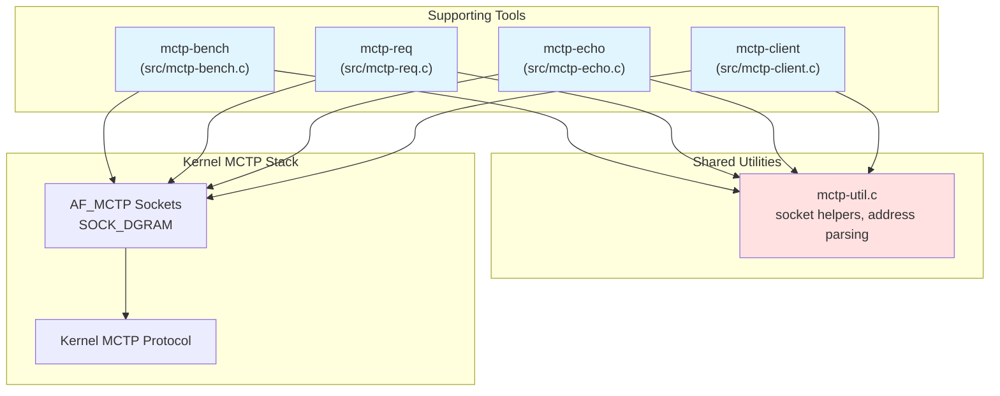
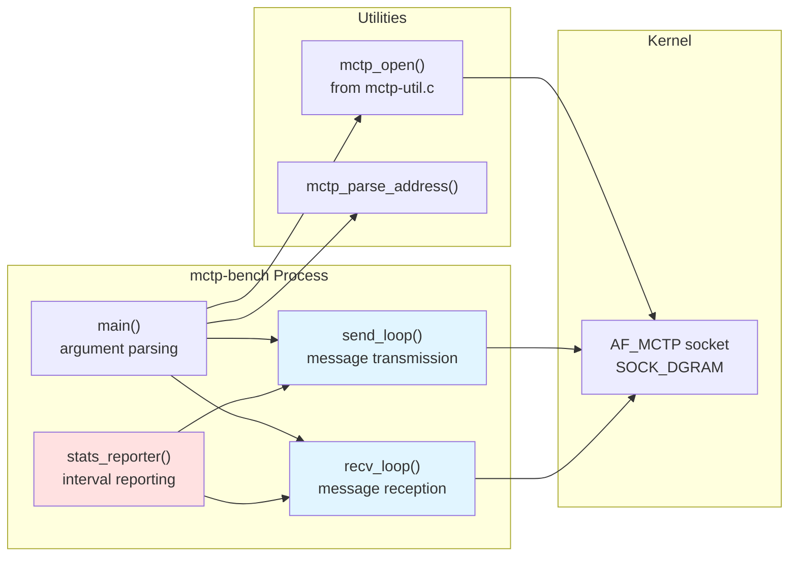
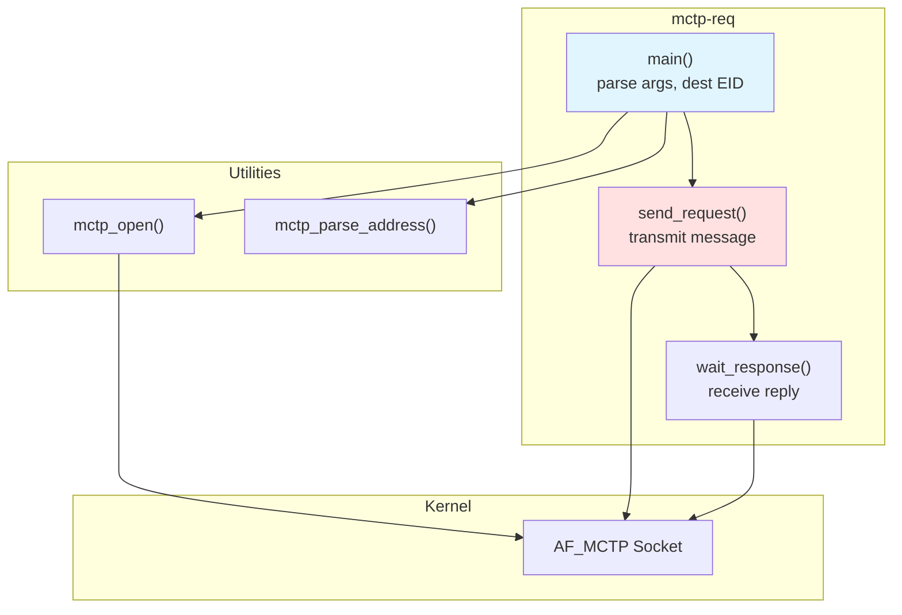
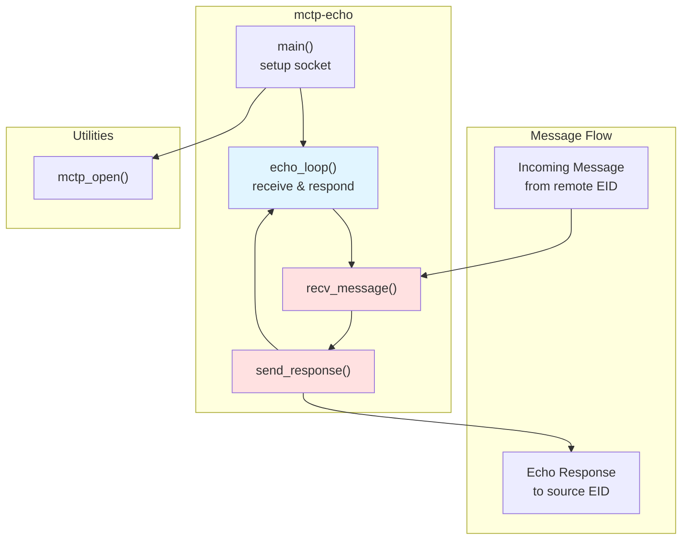
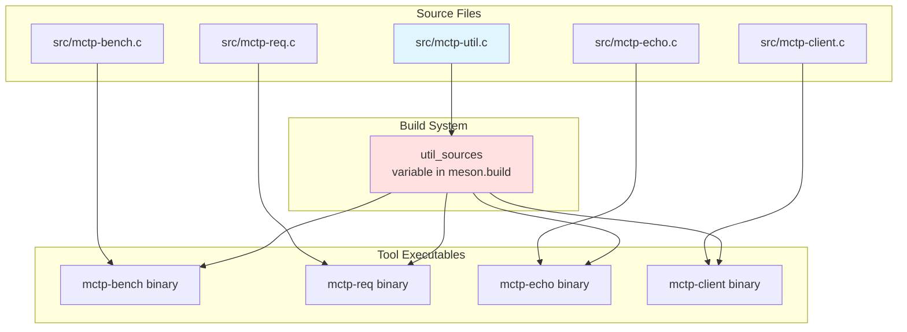

<!-- source: DeepWiki mcp.deepwiki.com · repo NVIDIA/mctp · page 2.3 Supporting Tools · fetched 2026-10-26 -->

# Supporting Tools

<details>
<summary>Relevant source files</summary>

The following files were used as context for generating this wiki page:

- [CHANGELOG.md](CHANGELOG.md)
- [meson.build](meson.build)
- [tests/pytest.ini](tests/pytest.ini)

</details>


## Purpose and Scope

This page documents auxiliary command-line utilities included in the MCTP repository that complement the main `mctpd` daemon and `mctp` CLI utility. These tools provide debugging, testing, and benchmarking capabilities for MCTP network operations. For information about the main daemon, see [mctpd Daemon](#2.1). For the primary configuration utility, see [mctp CLI Utility](#2.2).

The supporting tools covered in this document include:
- **mctp-bench**: Benchmarking tool for measuring MCTP message throughput
- **mctp-req**: Simple request/response testing utility
- **mctp-echo**: Echo responder for testing MCTP connectivity
- **mctp-client**: General-purpose MCTP client utility

---

## Overview

The supporting tools provide low-level access to the MCTP protocol stack for testing and performance measurement. Unlike `mctpd`, which manages endpoint configuration and EID assignment, these tools directly interact with MCTP sockets to send and receive application-layer messages.

### Tool Summary

| Tool | Purpose | Installed | Source File |
|------|---------|-----------|-------------|
| `mctp-bench` | Performance benchmarking and throughput testing | No | [src/mctp-bench.c]() |
| `mctp-req` | Send request messages and receive responses | No | [src/mctp-req.c]() |
| `mctp-echo` | Echo responder for connectivity testing | No | [src/mctp-echo.c]() |
| `mctp-client` | General-purpose MCTP client operations | Yes | [src/mctp-client.c]() |

### Tool Architecture



**Sources**: [meson.build:66-81](), [src/mctp-util.c]()

---

## mctp-bench

The `mctp-bench` utility provides performance benchmarking capabilities for MCTP networks, measuring message throughput and latency between endpoints.

### Purpose

`mctp-bench` operates in two modes:
1. **Send mode**: Continuously sends messages to a target endpoint and measures throughput
2. **Receive mode**: Listens for incoming messages and reports statistics

This tool is useful for:
- Measuring maximum throughput of MCTP links
- Testing message delivery reliability
- Identifying performance bottlenecks in MCTP implementations
- Validating kernel MCTP stack performance

### Message Format

`mctp-bench` uses vendor-defined message type (not MCTP control protocol type 0x00) to avoid interfering with control protocol operations. The message format was changed from MCTP type 1 to vendor-defined type in version 2.2.

### Usage Modes

#### Send Mode

In send mode, `mctp-bench` continuously sends messages to a target EID and reports throughput statistics:

```bash
mctp-bench send <dest-eid> [options]
```

The tool reports statistics at 2-second intervals, providing metrics on:
- Messages sent per interval
- Bytes transmitted
- Effective throughput (messages/sec, bytes/sec)

#### Request Receive Mode

Added in version 2.2, this mode allows a sender to command a remote endpoint to start receiving:

```bash
mctp-bench recv eid <dest-eid>
```

This sends a command message to the destination, which should be running `mctp-bench` in a listening mode, instructing it to begin the benchmark session.

### Architecture



### Implementation Details

The `mctp-bench` implementation creates an MCTP socket using the utility functions from [src/mctp-util.c]() and performs continuous send or receive operations. Statistics are collected and reported at regular intervals to provide real-time performance feedback.

**Sources**: [CHANGELOG.md:18-19](), [CHANGELOG.md:49-50](), [CHANGELOG.md:87](), [CHANGELOG.md:98-99](), [meson.build:74-76]()

---

## mctp-req

The `mctp-req` utility provides a simple request/response testing mechanism for MCTP endpoints. It sends a single request message to a destination endpoint and waits for a response.

### Purpose

`mctp-req` is designed for:
- Basic connectivity testing between MCTP endpoints
- Debugging MCTP message delivery
- Testing application-layer protocol implementations
- Verifying endpoint responsiveness

### Message Format

Like `mctp-bench`, `mctp-req` uses a vendor-defined message type rather than MCTP control protocol messages. This allows it to test application-layer communication without interfering with control protocol operations.

### Usage

```bash
mctp-req <dest-eid> [message-data]
```

The tool:
1. Creates an MCTP socket using `AF_MCTP` and `SOCK_DGRAM`
2. Sends a request message to the specified destination EID
3. Waits for a response with a timeout
4. Reports the response or timeout error

### Architecture



**Sources**: [meson.build:66-68](), [CHANGELOG.md:98-99]()

---

## mctp-echo

The `mctp-echo` utility implements an echo responder that receives MCTP messages and sends them back to the sender. This provides a simple target for testing MCTP connectivity and message delivery.

### Purpose

`mctp-echo` is useful for:
- Testing bidirectional MCTP communication
- Verifying message integrity (data sent equals data received)
- Providing a simple test endpoint without complex protocol logic
- Round-trip latency measurement when combined with `mctp-req`

### Operation

The echo responder:
1. Creates and binds an MCTP socket
2. Enters a receive loop waiting for incoming messages
3. For each received message, sends an identical response back to the source EID
4. Continues until interrupted

### Message Format

`mctp-echo` uses the same vendor-defined message type as `mctp-req` and `mctp-bench`, ensuring consistency across the testing tools.

### Architecture



**Sources**: [meson.build:70-72](), [CHANGELOG.md:98-99]()

---

## mctp-client

The `mctp-client` utility provides a general-purpose MCTP client interface. Unlike the other supporting tools, `mctp-client` is installed by default as part of the MCTP package.

### Purpose

`mctp-client` serves as:
- A template for developing MCTP client applications
- A utility for custom MCTP message transmission
- A reference implementation for MCTP socket usage

### Installation

`mctp-client` is built and installed to the system, making it available for use in production environments:

```bash
# Installed location (typically /usr/bin/mctp-client)
mctp-client [options]
```

### Implementation

The utility leverages the same shared utility functions as other tools but is designed to be more versatile for various MCTP client operations.

**Sources**: [meson.build:78-81]()

---

## Shared Utilities

All supporting tools depend on the `mctp-util.c` utility library, which provides common functionality for MCTP socket operations.

### mctp-util.c Functions

The utility library provides standardized functions used across all tools:

| Function | Purpose |
|----------|---------|
| `mctp_open()` | Create and configure an MCTP socket |
| `mctp_parse_address()` | Parse EID addresses from command-line arguments |
| Socket helper functions | Common socket operations and error handling |

### Dependency Chain



**Sources**: [meson.build:46](), [meson.build:66-81]()

---

## Build Configuration

The supporting tools are built as standalone executables using the Meson build system. The build configuration defines dependencies on shared utility sources.

### Build Definitions

From [meson.build:46-81]():

```
util_sources = ['src/mctp-util.c']

executable('mctp-req',
    sources: ['src/mctp-req.c'] + util_sources,
)

executable('mctp-echo',
    sources: ['src/mctp-echo.c'] + util_sources,
)

executable('mctp-bench',
    sources: ['src/mctp-bench.c'] + util_sources,
)

executable('mctp-client',
    sources: ['src/mctp-client.c'] + util_sources,
    install: true
)
```

### Build Output Location

After building with Meson, the tool binaries are located in the build output directory:

```
build/
  ├── mctp-bench
  ├── mctp-req
  ├── mctp-echo
  └── mctp-client  (also installed to system)
```

### Installation Status

| Tool | Installed | Reason |
|------|-----------|--------|
| `mctp-bench` | No | Debug/testing tool only |
| `mctp-req` | No | Debug/testing tool only |
| `mctp-echo` | No | Debug/testing tool only |
| `mctp-client` | Yes | General-purpose utility |

Only `mctp-client` has `install: true` specified in the build configuration, making it available system-wide after installation.

**Sources**: [meson.build:66-81]()

---

## Usage Considerations

### When to Use Each Tool

The supporting tools serve different purposes in MCTP system development and testing:

**Development Phase:**
- Use `mctp-echo` and `mctp-req` for basic connectivity testing
- Use `mctp-bench` to establish performance baselines

**Integration Testing:**
- Use `mctp-req` to verify endpoint responsiveness
- Use `mctp-bench` to measure actual vs expected throughput
- Use `mctp-echo` as a simple test endpoint

**Production:**
- Use `mctp-client` for operational MCTP client tasks
- Avoid using debug tools (`mctp-bench`, `mctp-req`, `mctp-echo`) in production

### Relationship to mctpd

These tools operate independently of the `mctpd` daemon:
- They do not interact with D-Bus
- They do not perform EID assignment or endpoint management
- They directly use MCTP sockets for application-layer communication
- They assume endpoints are already configured with valid EIDs

For endpoint configuration and management, use `mctpd` (see [mctpd Daemon](#2.1)) or the `mctp` utility (see [mctp CLI Utility](#2.2)).

**Sources**: [meson.build:66-81]()

---

