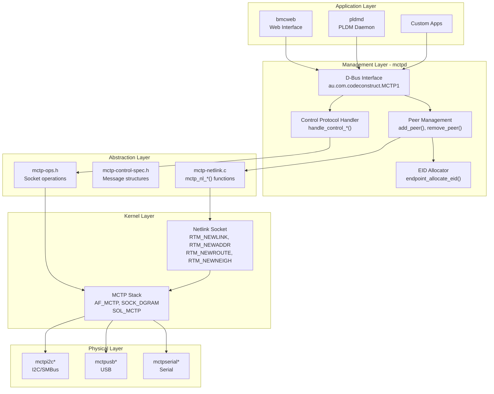
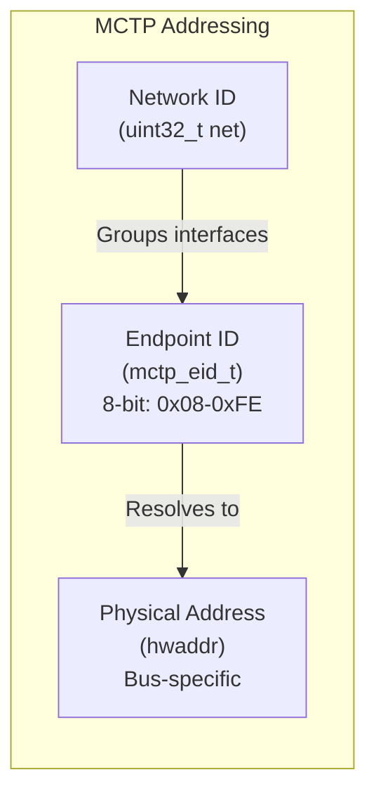
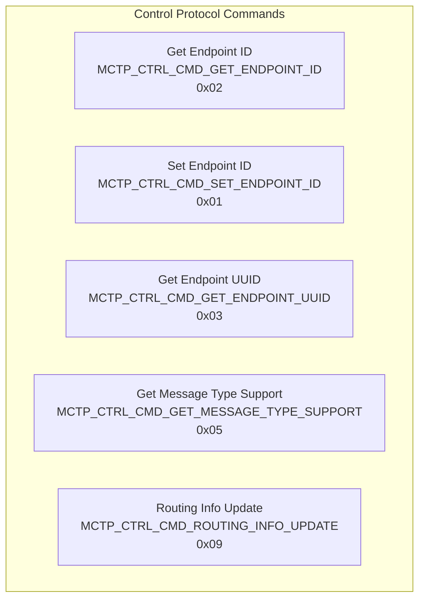
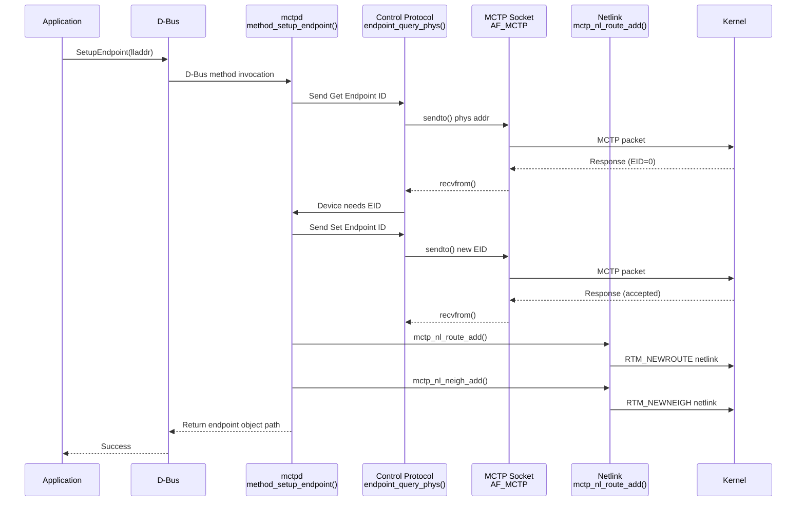
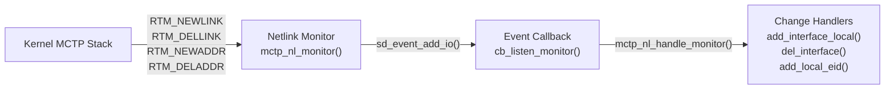
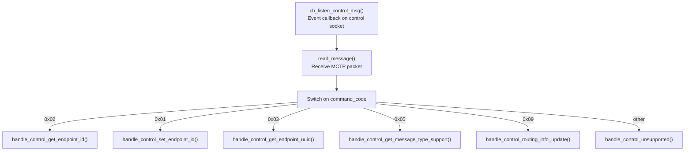

<!-- source: DeepWiki mcp.deepwiki.com · repo NVIDIA/mctp · page 3 Architecture and Protocols · fetched 2026-10-26 -->

# Architecture and Protocols

<details>
<summary>Relevant source files</summary>

The following files were used as context for generating this wiki page:

- [src/mctp.c](src/mctp.c)
- [src/mctpd-util.h](src/mctpd-util.h)
- [src/mctpd.c](src/mctpd.c)

</details>


## Purpose and Scope

This page provides an overview of the MCTP system architecture and the protocols used for communication between components. It introduces the layered design, key interfaces, and data flow patterns that enable MCTP endpoint management and message routing.

For detailed information about specific components, see:
- System architecture deep-dive: [System Architecture](#3.1)
- MCTP control protocol specifications: [MCTP Control Protocol](#3.2)
- Netlink interface details: [Netlink Interface](#3.3)
- Kernel socket API: [Kernel Interface](#3.4)
- D-Bus API reference: [D-Bus Interface](#4)

---

## Layered Architecture

The MCTP system implements a clean layered architecture separating concerns across userspace management, kernel protocol implementation, and physical transport layers.

### Architecture Layers



**Sources:** [src/mctpd.c:1-300](), [src/mctp.c:1-50](), [src/mctp-netlink.h:1-100]()

### Layer Responsibilities

| Layer | Components | Responsibilities |
|-------|-----------|-----------------|
| **Application** | `bmcweb`, `pldmd`, custom apps | Device management, PLDM message exchange, monitoring |
| **Management** | `mctpd` daemon | Endpoint discovery, EID assignment, route management, bridge coordination |
| **Abstraction** | `mctp-netlink.c`, `mctp-control-spec.h`, `mctp-ops.h` | Netlink communication, control protocol structures, socket operations |
| **Kernel** | Linux MCTP stack | Protocol implementation, packet routing, address resolution |
| **Physical** | `mctpi2c`, `mctpusb`, `mctpserial` drivers | Hardware-specific framing and transmission |

**Sources:** [src/mctpd.c:224-272](), [src/mctp-netlink.c:1-100]()

---

## MCTP Protocol Fundamentals

### Addressing Model

MCTP uses a hierarchical addressing scheme with three key concepts:



- **Network ID**: Groups interfaces that can directly communicate (typically set per interface)
- **Endpoint ID (EID)**: Logical address (8-254), unique within a network
- **Physical Address**: Bus-specific hardware address (e.g., I2C slave address)

**Sources:** [src/mctpd.c:86-96](), [src/mctp.h:1-50]()

### Control Protocol Overview

The MCTP Control Protocol (message type `0x00`) provides standard commands for endpoint management:



Each command follows a request/response pattern with:
- **Request Header**: Instance ID (IID), command code, flags
- **Response Header**: IID (echoed), command code, completion code
- **Payload**: Command-specific data

**Sources:** [src/mctp-control-spec.h:1-200](), [src/mctpd.c:1369-1410]()

### Message Type and Tag Owner Bit

MCTP messages are differentiated by:
- **Message Type**: 8-bit field identifying protocol (0x00 = Control, 0x01 = PLDM, etc.)
- **Tag Owner (TO) bit**: Indicates which endpoint owns the message tag
- **Tag**: 3-bit field for matching requests to responses

**Sources:** [src/mctp.h:1-100]()

---

## Communication Paths

### D-Bus to Kernel Flow

This diagram shows how a D-Bus method call results in kernel state changes:



**Sources:** [src/mctpd.c:2252-2400](), [src/mctpd.c:1916-2033](), [src/mctp-netlink.c:1-500]()

### Netlink Monitoring Flow

The daemon monitors kernel state changes via netlink:



**Sources:** [src/mctpd.c:1595-1690](), [src/mctp-netlink.c:1-500]()

---

## Key Interfaces

### Netlink Interface

The netlink interface abstracts RTNetlink communication for MCTP stack configuration:

| Function | Purpose | Netlink Message |
|----------|---------|----------------|
| `mctp_nl_route_add()` | Add routing entry | `RTM_NEWROUTE` |
| `mctp_nl_addr_add()` | Assign local EID | `RTM_NEWADDR` |
| `mctp_nl_neigh_add()` | Add neighbor mapping | `RTM_NEWNEIGH` |
| `mctp_nl_monitor()` | Monitor stack changes | `RTMGRP_LINK`, `RTMGRP_IPV4_IFADDR`, etc. |

**Sources:** [src/mctp-netlink.h:1-200](), [src/mctp-netlink.c:1-1000]()

### MCTP Socket Interface

Applications communicate via `AF_MCTP` sockets:

```c
// Socket creation and binding (from mctpd.c)
int sd = socket(AF_MCTP, SOCK_DGRAM, 0);
struct sockaddr_mctp addr = {
    .smctp_family = AF_MCTP,
    .smctp_network = net,
    .smctp_addr.s_addr = MCTP_ADDR_ANY,
    .smctp_type = MCTP_CTRL_HDR_MSG_TYPE,
    .smctp_tag = MCTP_TAG_OWNER
};
bind(sd, (struct sockaddr *)&addr, sizeof(addr));
```

**Socket Options:**
- `MCTP_OPT_ADDR_EXT`: Enable extended addressing with physical address
- `MCTP_OPT_ENABLE_ERRQUEUE`: Enable transport error reporting

**Sources:** [src/mctpd.c:1422-1482](), [src/mctpd.c:1916-2033](), [src/mctpd-util.h:70-76]()

### Extended Addressing

Extended addressing allows including physical address in socket operations:

```c
struct sockaddr_mctp_ext {
    struct sockaddr_mctp smctp_base;
    int smctp_ifindex;
    uint8_t smctp_halen;
    uint8_t smctp_haddr[MAX_ADDR_LEN];
};
```

Used for:
- Physical addressing (EID=0) during discovery
- Knowing source physical address of received messages
- Bridging and routing decisions

**Sources:** [src/mctp.h:1-100](), [src/mctpd.c:79-84]()

### D-Bus Interface

The daemon exposes management functions via D-Bus on bus name `au.com.codeconstruct.MCTP1`:

| Interface | Object Path | Purpose |
|-----------|-------------|---------|
| `BusOwner1` | `/au/com/codeconstruct/mctp1/interfaces/{ifname}` | Endpoint setup and assignment |
| `Endpoint1` | `/au/com/codeconstruct/mctp1/networks/{net}/endpoints/{eid}` | Per-endpoint operations |
| `Network1` | `/au/com/codeconstruct/mctp1/networks/{net}` | Network-level operations |
| `Bridge1` | (endpoint objects with bridge capability) | Bridge routing table queries |

**Sources:** [src/mctpd.c:44-57](), [docs/mctpd.md:1-500]()

---

## Control Protocol Implementation

### Handler Dispatch

Control messages are dispatched to handlers based on command code:



**Sources:** [src/mctpd.c:1323-1420](), [src/mctpd.c:754-943](), [src/mctpd.c:988-1015]()

### Query Pattern

Sending control commands to endpoints follows a consistent pattern:

```c
// 1. Construct request with unique IID
uint8_t iid = mctp_next_iid(ctx);
struct mctp_ctrl_cmd_get_eid req;
mctp_ctrl_msg_hdr_init_req(&req.ctrl_hdr, iid, MCTP_CTRL_CMD_GET_ENDPOINT_ID);

// 2. Send via socket (physical or EID addressing)
endpoint_query_phys(ctx, dest, MCTP_CTRL_HDR_MSG_TYPE, 
                    &req, sizeof(req), &resp, &resp_len, &resp_addr);

// 3. Validate response
mctp_ctrl_validate_response(resp, resp_len, sizeof(*expected_resp),
                            peer_str, iid, MCTP_CTRL_CMD_GET_ENDPOINT_ID, &resp_addr);

// 4. Process response payload
struct mctp_ctrl_resp_get_eid *r = (void *)resp;
peer->eid = r->eid;
```

**Sources:** [src/mctpd.c:1706-1712](), [src/mctpd.c:2037-2088](), [src/mctpd.c:1791-1844]()

---

## Error Handling and Transport Errors

### Transport Error Reporting

The system supports transport-level error reporting via socket error queues:

```c
// Enable error queue on socket
val = 1;
setsockopt(sd, SOL_MCTP, MCTP_OPT_ENABLE_ERRQUEUE, &val, sizeof(val));

// Monitor for EPOLLERR events
sd_event_add_io(ctx->event, NULL, sd, EPOLLIN | EPOLLERR, 
                cb_listen_control_msg, ctx);

// Read errors from queue
read_mctp_error_queue(ctx, sd, verbose);
```

Error information includes:
- Error code (e.g., `ETIMEDOUT`, `EIO`, `ECONNREFUSED`)
- Direction (`MCTP_DIR_TX` or `MCTP_DIR_RX`)
- Source and destination EIDs
- Message type and tag
- Physical binding type
- Partial payload for context

**Sources:** [src/mctpd.c:1516-1592](), [src/mctpd.c:1456-1467](), [src/mctpd-util.h:70-115]()

### Error Signal Emission

Transport errors are emitted as D-Bus signals:

```c
sd_bus_emit_signal(ctx->bus, path, CC_MCTP_DBUS_IFACE_BUSOWNER,
                   "TransportError",
                   "uyyyyyyys",
                   error_code,      // uint32
                   direction,       // uint8
                   binding,         // uint8
                   src_eid,         // uint8
                   dest_eid,        // uint8
                   tag,             // uint8
                   msg_type,        // uint8
                   command_code,    // uint8
                   ifname);         // string
```

**Sources:** [src/mctpd.c:1484-1514](), [src/mctpd.c:1847-1910]()

---

## Summary

The MCTP architecture provides:

1. **Clean Layer Separation**: Management (mctpd), abstraction (netlink/ops), kernel (AF_MCTP), and physical
2. **Multiple Interfaces**: D-Bus for management, netlink for configuration, AF_MCTP for messaging
3. **Standard Protocol**: DSP0236 control protocol for endpoint discovery and configuration
4. **Monitoring and Recovery**: Netlink change notifications and transport error reporting

This architecture enables flexible deployment scenarios from simple endpoints to complex bridged topologies while maintaining a consistent management interface.

**Sources:** [src/mctpd.c:1-2800](), [src/mctp.c:1-1447](), [src/mctp-netlink.c:1-1000](), [docs/mctpd.md:1-500]()

---

