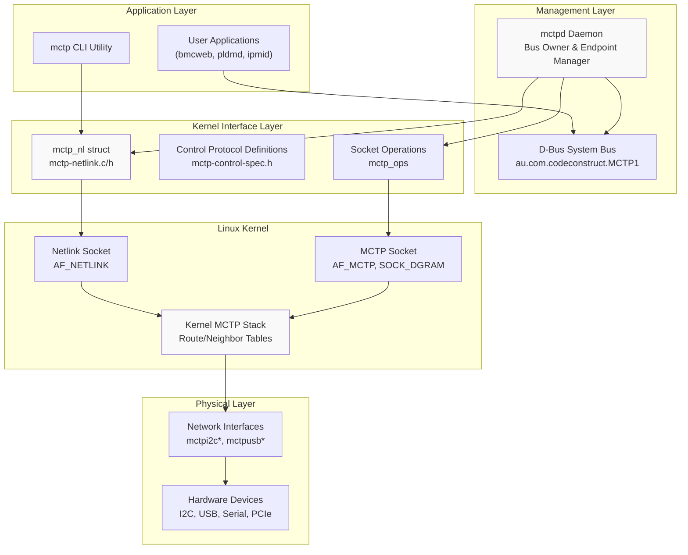
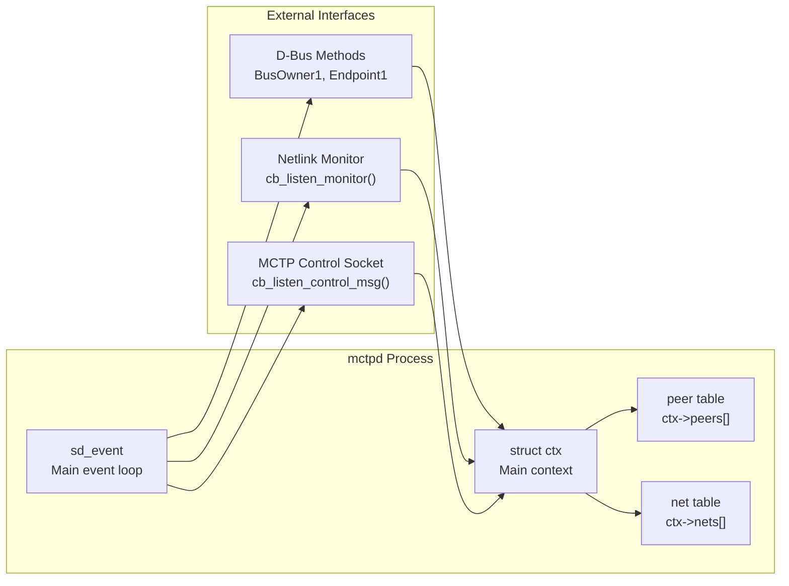
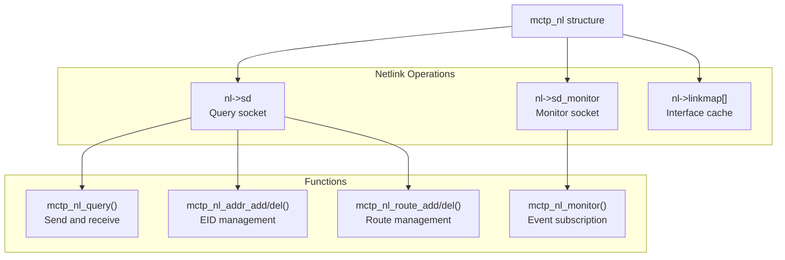
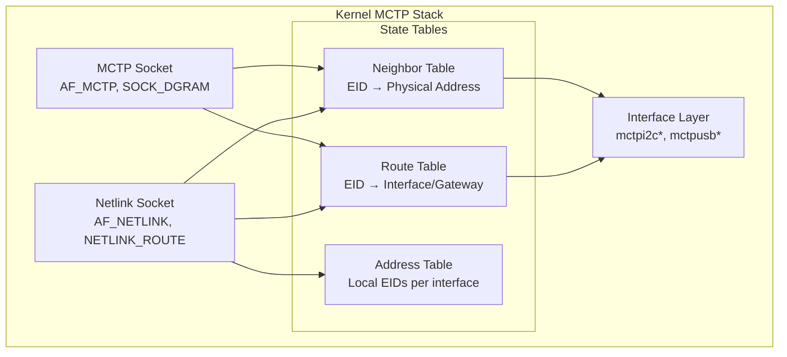
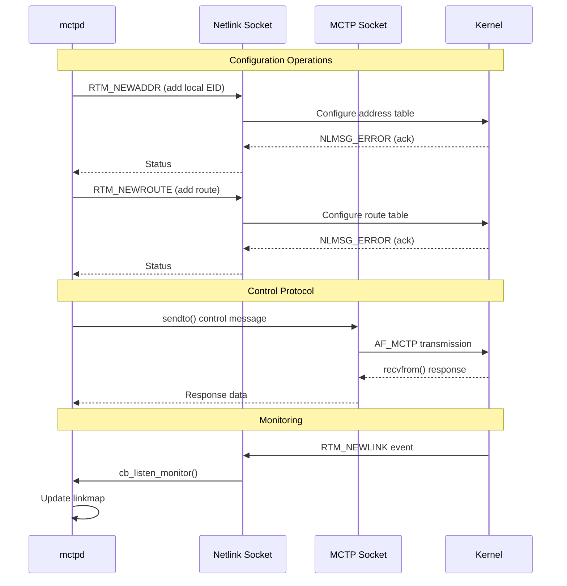
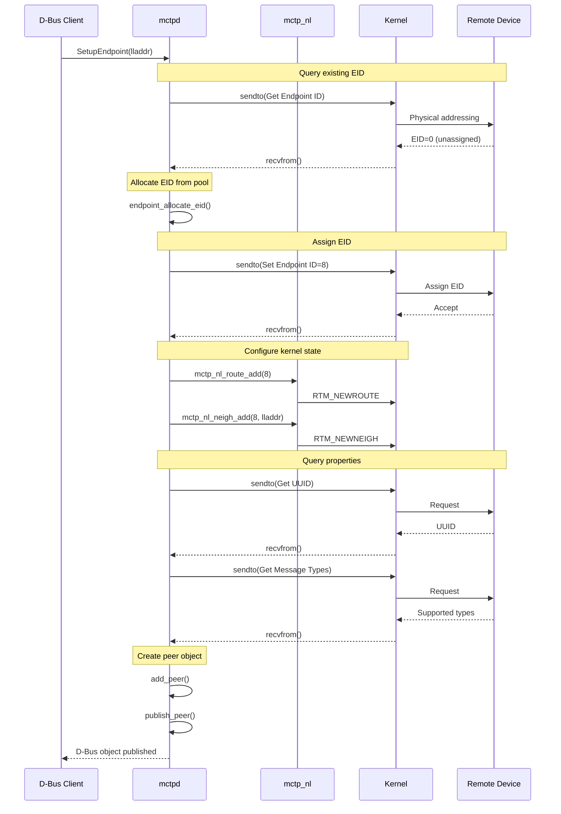
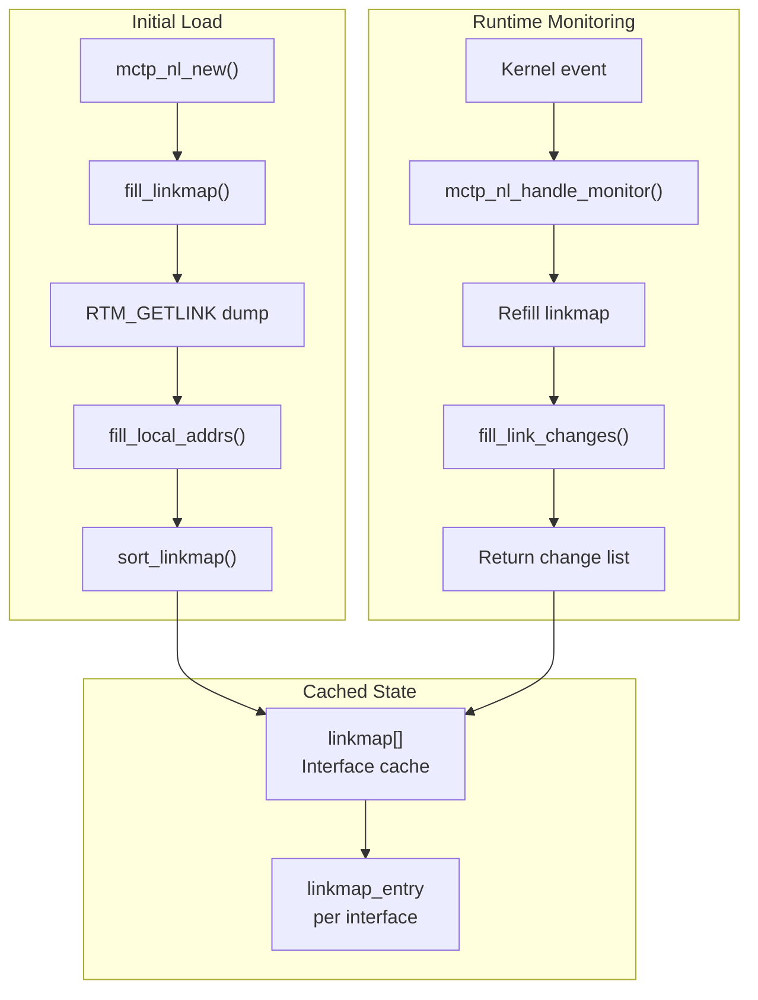
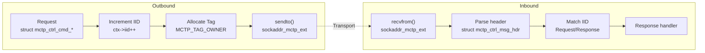
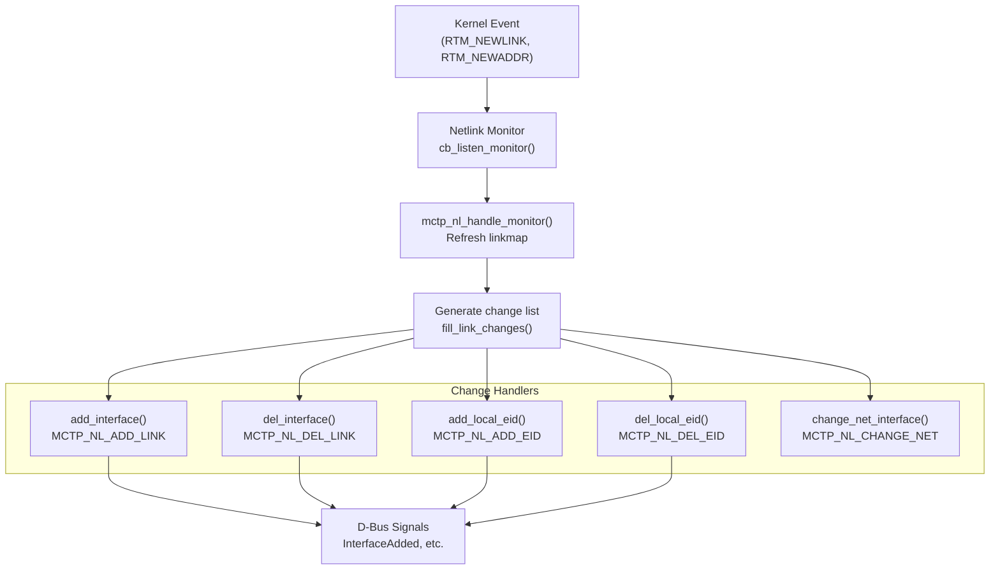

<!-- source: DeepWiki mcp.deepwiki.com · repo NVIDIA/mctp · page 3.1 System Architecture · fetched 2026-10-26 -->

# System Architecture

Relevant source files

The following files were used as context for generating this wiki page:

- [src/mctp-netlink.c](src/mctp-netlink.c)
- [src/mctp.c](src/mctp.c)
- [src/mctpd-util.h](src/mctpd-util.h)
- [src/mctpd.c](src/mctpd.c)

## Purpose and Scope

This document describes the high-level system architecture of the MCTP (Management Component Transport Protocol) implementation in this repository. It covers the layered architecture, major components, and how data flows between userspace and the Linux kernel MCTP stack.

For detailed information about specific components:
- Internal architecture of the mctpd daemon: see [Daemon Architecture](#2.1.1)
- MCTP control protocol implementation: see [MCTP Control Protocol](#3.2)
- Netlink interface details: see [Netlink Interface](#3.3)
- D-Bus API specification: see [D-Bus Interface](#4)

## System Overview

The MCTP system implements a layered architecture that separates concerns between user applications, management logic, kernel communication, and physical transports. The design enables centralized MCTP endpoint management through the `mctpd` daemon while providing direct kernel access via the `mctp` command-line utility.

**Sources:** Diagram synthesized from overview in Diagram 1 and component analysis

## Architectural Layers

### Application Layer

The application layer consists of user-facing programs that interact with the MCTP system:

| Component | Purpose | Primary Interface |
|-----------|---------|------------------|
| User Applications (e.g., `pldmd`, `ipmid`) | Consume MCTP endpoints for management protocols | D-Bus API |
| `mctp` CLI Utility | Direct kernel configuration and monitoring | Netlink via `mctp_nl` |

The `mctp` utility provides commands for managing kernel resources:
- `link`: Interface configuration and status
- `address`: Local EID assignment
- `route`: EID routing table management
- `neigh`: Physical address neighbor table
- `monitor`: Real-time Netlink event monitoring

**Sources:** [src/mctp.c:1380-1446]()

### Management Layer

The management layer centers on the `mctpd` daemon, which acts as the MCTP bus owner:

The daemon maintains runtime state in key data structures:

| Structure | Location | Purpose |
|-----------|----------|---------|
| `struct ctx` | [src/mctpd.c:224-271]() | Global daemon context |
| `struct peer` | [src/mctpd.c:152-222]() | Per-endpoint state (EID, UUID, routes) |
| `struct net` | [src/mctpd.c:87-96]() | Per-network state and EID mappings |
| `struct link` | [src/mctpd.c:133-150]() | Per-interface state and role |

**Sources:** [src/mctpd.c:224-271](), [src/mctpd.c:152-222](), [src/mctpd.c:87-96](), [src/mctpd.c:133-150]()

### Kernel Interface Layer

This layer abstracts Linux kernel communication mechanisms:

#### Netlink Abstraction

The `mctp_nl` structure ([src/mctp-netlink.c:40-55]()) encapsulates Netlink socket operations:

The `linkmap_entry` structure ([src/mctp-netlink.c:23-38]()) caches interface state:
- Interface index and name
- Network ID
- Link status (up/down)
- MTU bounds
- Local EID list
- User-defined data pointer

**Sources:** [src/mctp-netlink.c:40-55](), [src/mctp-netlink.c:23-38]()

#### Control Protocol Interface

Control protocol message handling uses structures defined in [src/mctp-control-spec.h]():
- Command/response headers
- Message type definitions
- Completion codes
- Protocol-specific data structures

**Sources:** [src/mctp-control-spec.h]()

#### Socket Operations

The `mctp_ops` structure provides abstraction for socket operations, supporting both real kernel sockets and test mocks. Key operations include:
- `socket()`: Create MCTP sockets
- `bind()`: Bind to specific EID/type
- `sendto()`/`recvfrom()`: Message transmission
- `setsockopt()`: Configure socket options (e.g., `MCTP_OPT_ADDR_EXT`, `MCTP_OPT_ENABLE_ERRQUEUE`)

**Sources:** [src/mctp-ops.h]()

### Linux Kernel Layer

The kernel layer implements the MCTP protocol stack:

The kernel maintains:
- **Route Table**: Maps EID ranges to output interfaces or gateways
- **Neighbor Table**: Maps EIDs to physical layer addresses
- **Address Table**: Local EID assignments per interface
- **Network Interfaces**: Binding-specific MCTP interfaces (I2C, USB, Serial, PCIe)

**Sources:** Analysis of Netlink message types in [src/mctp.c:440-463]()

### Physical Transport Layer

MCTP interfaces bind to physical hardware:

| Interface Pattern | Transport Binding | Kernel Module |
|------------------|-------------------|---------------|
| `mctpi2c*` | SMBus/I2C | `mctp-i2c` |
| `mctpusb*` | USB | `mctp-usb` |
| `mctpserial*` | Serial/UART | `mctp-serial` |
| PCIe interfaces | PCIe VDM | Vendor-specific |

Physical addressing varies by binding:
- **I2C/SMBus**: 7-bit I2C address
- **USB**: No physical address (point-to-point)
- **Serial**: No physical address
- **PCIe**: Routing ID (Bus:Device:Function)

**Sources:** [src/mctpd-util.h:52-68](), [src/mctp-netlink.c:789-801]()

## Component Interactions

### mctpd to Kernel Communication

The daemon uses two socket types for kernel communication:

**Netlink Operations** ([src/mctpd.c:1422-1482]()):
- `RTM_NEWADDR`/`RTM_DELADDR`: Local EID management
- `RTM_NEWROUTE`/`RTM_DELROUTE`: Route table updates
- `RTM_NEWNEIGH`/`RTM_DELNEIGH`: Neighbor table updates
- `RTM_GETLINK`: Interface queries
- Monitor socket: Asynchronous event notifications

**MCTP Socket Operations** ([src/mctpd.c:1422-1482]()):
- Bound to `MCTP_ADDR_ANY` with `MCTP_CTRL_HDR_MSG_TYPE`
- `MCTP_TAG_OWNER` flag for request/response matching
- `MCTP_OPT_ADDR_EXT` for extended addressing
- `MCTP_OPT_ENABLE_ERRQUEUE` for transport error reporting

**Sources:** [src/mctpd.c:1422-1482](), [src/mctp-netlink.c:67-103]()

### Endpoint Discovery and Configuration

The complete endpoint setup flow involves multiple system interactions:

Key functions involved:
- `setup_endpoint()` ([src/mctpd.c]()): D-Bus method handler
- `endpoint_allocate_eid()` ([src/mctpd.c]()): EID pool management
- `query_peer_properties()` ([src/mctpd.c]()): Property discovery
- `add_peer()` / `publish_peer()` ([src/mctpd.c:279-289]()): State management

**Sources:** [src/mctpd.c:279-289](), Diagram 4 analysis

### Linkmap Caching and Synchronization

The Netlink library maintains a cached view of kernel state to avoid repeated queries:

The linkmap provides O(1) lookups for:
- Interface index → name mapping
- Interface index → network ID
- Interface index → local EID list
- Interface index → user-defined data (e.g., `struct link*` pointer)

Change detection ([src/mctp-netlink.c:257-340]()) compares old and new linkmap state to generate:
- `MCTP_NL_ADD_LINK` / `MCTP_NL_DEL_LINK`: Interface added/removed
- `MCTP_NL_CHANGE_NET`: Network ID changed
- `MCTP_NL_CHANGE_UP`: Link up/down status changed
- `MCTP_NL_ADD_EID` / `MCTP_NL_DEL_EID`: Local EID added/removed

**Sources:** [src/mctp-netlink.c:105-133](), [src/mctp-netlink.c:257-340](), [src/mctp-netlink.c:363-408]()

## Data Flow Patterns

### Control Message Flow

Control protocol messages follow a request-response pattern:

Instance ID (IID) management ([src/mctpd.c:251]()):
- 5-bit field in control message header
- Incremented for each new request: `ctx->iid = (ctx->iid + 1) & 0x1f`
- Used to match responses to requests

**Sources:** [src/mctpd.c:251](), [src/mctpd.c:1323-1420]()

### Configuration Change Propagation

Network configuration changes flow from kernel to daemon to D-Bus:

The event loop ([src/mctpd.c:1595-1677]()) processes Netlink events and dispatches to appropriate handlers based on change type.

**Sources:** [src/mctpd.c:1595-1677](), [src/mctp-netlink.c:363-408]()

## Summary

The MCTP system architecture demonstrates clear separation of concerns:

1. **Application Layer**: Uses D-Bus for high-level endpoint management
2. **Management Layer**: `mctpd` daemon implements bus owner logic and endpoint lifecycle
3. **Kernel Interface Layer**: Netlink library and socket operations abstract kernel APIs
4. **Kernel Layer**: Linux MCTP stack handles routing, addressing, and physical transport
5. **Physical Layer**: Binding-specific interfaces connect to hardware

This layered design enables:
- Centralized policy (EID allocation, discovery) in `mctpd`
- Efficient packet routing in kernel space
- Multiple application protocols sharing a single MCTP infrastructure
- Testing without kernel dependencies via `mctp_ops` abstraction

**Sources:** Overall architecture synthesized from [src/mctpd.c](), [src/mctp-netlink.c](), [src/mctp.c](), and high-level diagrams

---

