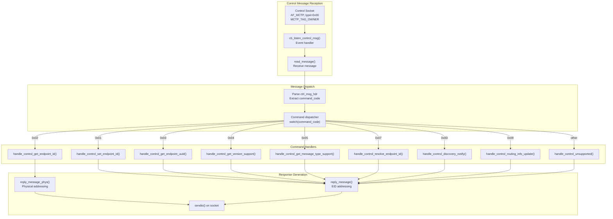
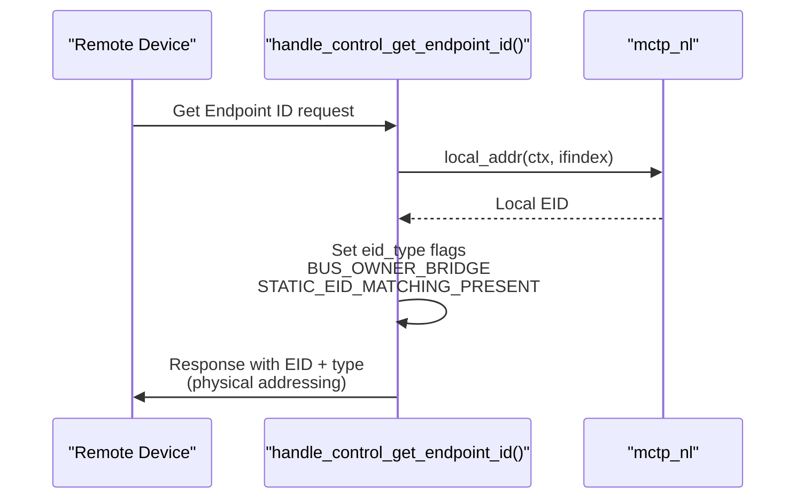
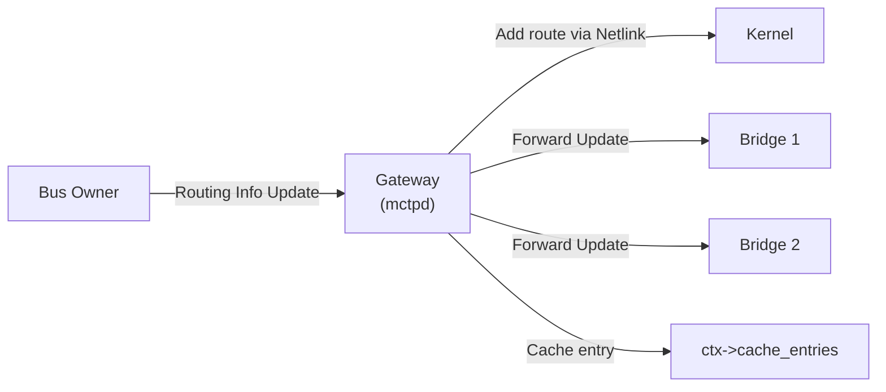
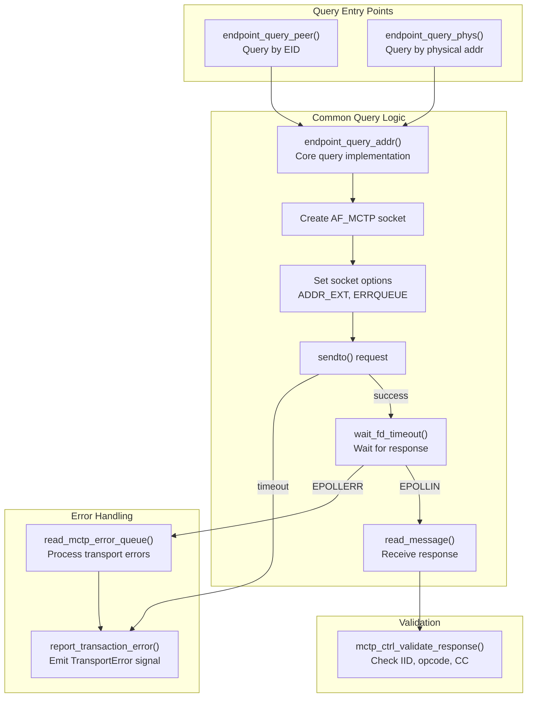
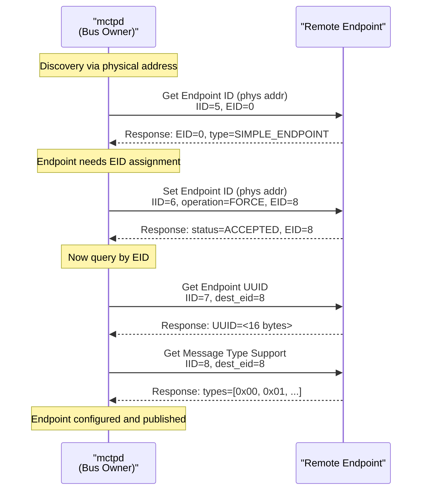

<!-- source: DeepWiki mcp.deepwiki.com · repo NVIDIA/mctp · page 3.2 MCTP Control Protocol · fetched 2026-10-26 -->

# MCTP Control Protocol

<details>
<summary>Relevant source files</summary>

The following files were used as context for generating this wiki page:

- [src/mctp-control-spec.h](src/mctp-control-spec.h)
- [src/mctpd-util.h](src/mctpd-util.h)
- [src/mctpd.c](src/mctpd.c)

</details>


## Purpose and Scope

This page documents the MCTP Control Protocol as defined in DSP0236 specification and its implementation in mctpd. The control protocol uses message type `0x00` and provides essential management functions for MCTP networks, including endpoint discovery, EID assignment, routing information exchange, and capability negotiation.

For information about how mctpd manages endpoints using these control protocol commands, see [Endpoint Management](#2.1.2). For details on the broader system architecture, see [System Architecture](#3.1).

**Sources:** [src/mctp-control-spec.h:1-392](), [src/mctpd.c:1-100]()

---

## Message Structure

### Control Message Header

All MCTP control messages share a common header structure defined by `mctp_ctrl_msg_hdr`:

| Field | Size | Description |
|-------|------|-------------|
| `rq_dgram_inst` | 1 byte | Request/Response flag (bit 7), Datagram flag (bit 6), Instance ID (bits 4-0) |
| `command_code` | 1 byte | Identifies the control command |

**Flags in `rq_dgram_inst` field:**
- `RQDI_REQ` (0x80): Request message
- `RQDI_RESP` (0x00): Response message
- `MCTP_CTRL_HDR_FLAG_DGRAM` (0x40): Datagram (no response expected)
- `RQDI_IID_MASK` (0x1F): Instance ID mask (values 0-31)

All responses include a `completion_code` field immediately following the header. The minimum response length for error cases is `MCTP_CTRL_ERROR_RESP_LEN` (3 bytes).

**Sources:** [src/mctp-control-spec.h:16-28](), [src/mctp-control-spec.h:374-391]()

### Instance ID Management

Instance IDs (IIDs) are used to match requests with responses. mctpd maintains a rolling IID counter in `ctx->iid` and generates new IIDs using `mctp_next_iid()`:

```c
static uint8_t mctp_next_iid(struct ctx *ctx)
{
    uint8_t iid = ctx->iid;
    ctx->iid = (iid + 1) & RQDI_IID_MASK;
    return iid;
}
```

**Sources:** [src/mctpd.c:1706-1712]()

### Completion Codes

Standard completion codes defined in DSP0236:

| Code | Name | Meaning |
|------|------|---------|
| `0x00` | `MCTP_CTRL_CC_SUCCESS` | Command completed successfully |
| `0x01` | `MCTP_CTRL_CC_ERROR` | Generic error |
| `0x02` | `MCTP_CTRL_CC_ERROR_INVALID_DATA` | Invalid data in request |
| `0x03` | `MCTP_CTRL_CC_ERROR_INVALID_LENGTH` | Invalid message length |
| `0x04` | `MCTP_CTRL_CC_ERROR_NOT_READY` | Endpoint not ready |
| `0x05` | `MCTP_CTRL_CC_ERROR_UNSUPPORTED_CMD` | Command not supported |

Command-specific codes exist in the range `0x80-0xFF`.

**Sources:** [src/mctp-control-spec.h:259-272]()

---

## Command Codes

The following table lists all MCTP control protocol commands defined in DSP0236:

| Code | Command Name | Purpose |
|------|--------------|---------|
| `0x00` | Reserved | - |
| `0x01` | Set Endpoint ID | Assign EID to an endpoint |
| `0x02` | Get Endpoint ID | Query endpoint's current EID |
| `0x03` | Get Endpoint UUID | Retrieve endpoint's UUID |
| `0x04` | Get Version Support | Query MCTP version support |
| `0x05` | Get Message Type Support | Query supported message types |
| `0x06` | Get Vendor Message Support | Query vendor-specific capabilities |
| `0x07` | Resolve Endpoint ID | Get physical address for an EID |
| `0x08` | Allocate Endpoint IDs | Request EID pool allocation |
| `0x09` | Routing Info Update | Update routing information |
| `0x0A` | Get Routing Table Entries | Query routing table |
| `0x0B` | Prepare Endpoint Discovery | Prepare for discovery |
| `0x0C` | Endpoint Discovery | Perform endpoint discovery |
| `0x0D` | Discovery Notify | Notify of topology changes |
| `0x0E` | Get Network ID | Query network identifier |
| `0x0F` | Query Hop | Query hop information |
| `0x10` | Resolve UUID | Resolve UUID to EID |
| `0x11` | Query Rate Limit | Query rate limiting |
| `0x12` | Request TX Rate Limit | Request transmission rate limit |
| `0x13` | Update Rate Limit | Update rate limit settings |
| `0x14` | Query Supported Interfaces | Query interface capabilities |

Codes `0xF0-0xFF` are reserved for transport-specific commands.

**Sources:** [src/mctp-control-spec.h:229-257](), [src/mctpd.c:1714-1764]()

---

## Control Message Handling Architecture



**Sources:** [src/mctpd.c:1323-1420]()

### Listener Socket Setup

The control protocol listener is established in `listen_control_msg()`:

1. Creates an `AF_MCTP` socket
2. Binds to `MCTP_ADDR_ANY` with message type `MCTP_CTRL_HDR_MSG_TYPE` (0x00)
3. Sets `MCTP_TAG_OWNER` flag to own message tags
4. Enables extended addressing via `MCTP_OPT_ADDR_EXT`
5. Enables error queue via `MCTP_OPT_ENABLE_ERRQUEUE`
6. Registers socket with event loop for `EPOLLIN | EPOLLERR` events

**Sources:** [src/mctpd.c:1422-1482]()

### Message Dispatch Flow

The `cb_listen_control_msg()` event handler:

1. Checks for error queue events (`EPOLLERR`)
2. Reads incoming message using `read_message()`
3. Validates message type matches `MCTP_CTRL_HDR_MSG_TYPE`
4. Extracts `command_code` from header
5. Dispatches to appropriate handler via switch statement
6. Handles unsupported commands with `handle_control_unsupported()`

**Sources:** [src/mctpd.c:1323-1420]()

---

## Key Command Handler Implementations

### Get Endpoint ID (0x02)

Responds with the local endpoint's EID and capabilities:



Response includes:
- Current EID on the interface
- Endpoint type (bus owner/bridge vs simple endpoint)
- EID type (static vs dynamic)

Uses physical addressing for response (`reply_message_phys()`).

**Sources:** [src/mctpd.c:988-1015]()

### Set Endpoint ID (0x01)

Handles EID assignment for endpoints. Supports multiple operation modes:

| Operation | Value | Behavior |
|-----------|-------|----------|
| `MCTP_SET_EID_SET` | 0 | Normal EID assignment with optional pool |
| `MCTP_SET_EID_FORCE` | 1 | Force EID assignment (used by bus owner) |
| `MCTP_SET_EID_RESET` | 2 | Reset EID to 0 |
| `MCTP_SET_EID_DISCOVERED` | 3 | Set discovered flag |

**Bus Owner Mode (receiving Set EID):**
- Rejects requests (responds with `MCTP_CTRL_CC_ERROR_UNSUPPORTED_CMD`)
- Already owns the bus and assigns EIDs to others

**Endpoint Mode (receiving Set EID):**
- `MCTP_SET_EID_SET`: Returns current EID if already assigned
- `MCTP_SET_EID_FORCE`: Accepts new EID, clears interface state, adds bus owner to peer list
- Creates routing entry for bus owner's EID
- Caches routing information for downstream bridges

**Sources:** [src/mctpd.c:754-943]()

### Get Endpoint UUID (0x03)

Returns the endpoint's UUID stored in `ctx->uuid`:

```c
memcpy(resp->uuid, ctx->uuid, sizeof(resp->uuid));
```

The UUID is typically generated at daemon startup using `sd_id128_get_machine_app_specific()` with `mctpd_appid`.

**Sources:** [src/mctpd.c:1017-1034]()

### Get Message Type Support (0x05)

Reports supported MCTP message types. mctpd currently only reports control protocol support:

```c
resp->msg_type_count = 1;
*((uint8_t *)(resp + 1)) = MCTP_CTRL_HDR_MSG_TYPE;  // 0x00
```

**Sources:** [src/mctpd.c:1036-1060]()

### Routing Info Update (0x09)

Receives routing information from bus owner and propagates to downstream bridges:



Processing steps:
1. Rejects if operating as bus owner
2. Parses routing entry (EID range, type, physical address)
3. Adds route to kernel via `mctp_nl_route_add()`
4. Forwards update to all known bridges (peers with `pool_size > 0`)
5. Caches entry in `ctx->cache_entries` for later queries
6. Updates `ctx->bmc_ignore_eids` list

**Sources:** [src/mctpd.c:1172-1321]()

### Discovery Notify (0x0D)

Handles topology change notifications:

```c
char path[256];
snprintf(path, sizeof(path), "%s/%s", MCTP_DBUS_PATH_LINKS, ifname);

sd_bus_emit_signal(ctx->bus, path, CC_MCTP_DBUS_IFACE_BUSOWNER,
                   "DiscoveryNotify", NULL);
```

Emits a D-Bus `DiscoveryNotify` signal on the interface path to notify applications of network changes.

**Sources:** [src/mctpd.c:1096-1146]()

---

## Sending Control Messages (Queries)

mctpd sends control messages to remote endpoints using query functions:



**Sources:** [src/mctpd.c:1912-2033]()

### Query Functions

**`endpoint_query_peer()`**: Queries an endpoint using its assigned EID
- Uses standard MCTP addressing (`sockaddr_mctp`)
- Requires peer to be in `REMOTE` state
- Automatically fills in network and EID from peer structure

**`endpoint_query_phys()`**: Queries an endpoint using physical addressing
- Uses extended addressing (`sockaddr_mctp_ext`)
- Sets destination EID to 0 (physical addressing)
- Includes hardware address and interface index
- Used for initial discovery before EID assignment

**`endpoint_query_addr()`**: Common implementation for both modes
- Creates temporary socket for transaction
- Enables extended addressing on receive
- Enables error queue for transport error reporting
- Implements timeout using `wait_fd_timeout()`
- Handles `EPOLLERR` events from error queue

**Sources:** [src/mctpd.c:1912-2088]()

### Response Validation

The `mctp_ctrl_validate_response()` function performs comprehensive validation:

1. **Minimum length check**: At least `MCTP_CTRL_ERROR_RESP_LEN` (3 bytes)
2. **IID matching**: Response IID must match request IID
3. **Opcode matching**: Response command code must match request
4. **Completion code check**: Must be `MCTP_CTRL_CC_SUCCESS` (0x00)
5. **Full length check**: Non-error responses must be full-sized

If validation fails, the function logs details using `mctp_ctrl_print_response()`.

**Sources:** [src/mctpd.c:1791-1844]()

### Error Handling and Reporting

mctpd implements comprehensive error tracking:

**Transport Errors (from kernel):**
- Kernel reports errors via `MCTP_RECVERR` control messages
- `read_mctp_error_queue()` processes error queue on `EPOLLERR` events
- Extracts error details: error code, direction, binding type, EIDs, tag, message type

**Transaction Errors (userspace):**
- `report_transaction_error()` synthesizes errors for timeout/send failures
- Direction: `MCTP_DIR_TX` (transmit) or `MCTP_DIR_RX` (receive)
- Extracts command code from request payload if control message

**D-Bus Error Reporting:**
- `log_mctp_error()` emits `TransportError` signal on `CC_MCTP_DBUS_IFACE_BUSOWNER`
- Signal signature: `uyyyyyyys` (error code, direction, binding, src EID, dest EID, tag, msg type, command code, interface name)

**Sources:** [src/mctpd.c:1484-1593](), [src/mctpd.c:1847-1910]()

---

## Control Protocol Message Examples

### Typical Query Sequence



**Sources:** [src/mctpd.c:2090-2500]()

### Command-Specific Structures

**Set Endpoint ID:**
```c
struct mctp_ctrl_cmd_set_eid {
    struct mctp_ctrl_msg_hdr ctrl_hdr;
    uint8_t operation;  // SET/FORCE/RESET/DISCOVERED
    uint8_t eid;
};

struct mctp_ctrl_resp_set_eid {
    struct mctp_ctrl_msg_hdr ctrl_hdr;
    uint8_t completion_code;
    uint8_t status;         // Assignment status | Allocation status
    mctp_eid_t eid_set;     // Assigned EID
    uint8_t eid_pool_size;  // Pool size for bridges
};
```

**Get Routing Table Entries:**
```c
struct mctp_ctrl_cmd_get_routing_table {
    struct mctp_ctrl_msg_hdr ctrl_hdr;
    uint8_t entry_handle;   // Start index
};

struct get_routing_table_entry {
    uint8_t eid_range_size;
    uint8_t starting_eid;
    uint8_t entry_type;     // Port | Assignment type | Entry type
    uint8_t phys_transport_binding_id;
    uint8_t phys_media_type_id;
    uint8_t phys_address_size;
    // Followed by variable-length physical address
};
```

**Routing Info Update:**
```c
struct mctp_ctrl_cmd_routing_info_update {
    struct mctp_ctrl_msg_hdr ctrl_hdr;
    uint8_t number_of_entries;
    uint8_t entries[1];     // Variable length
};

struct routing_info_entry {
    uint8_t entry_type;     // Type | Assignment | Port
    uint8_t eid_range;      // Number of EIDs in range
    uint8_t first_eid;      // Starting EID
    uint8_t phys_address[1]; // Variable length
};
```

**Sources:** [src/mctp-control-spec.h:37-223]()

---

## Command Code to Handler Mapping

| Command Code | Handler Function | Response Addressing |
|--------------|------------------|---------------------|
| `0x01` | `handle_control_set_endpoint_id()` | Physical or EID |
| `0x02` | `handle_control_get_endpoint_id()` | Physical |
| `0x03` | `handle_control_get_endpoint_uuid()` | EID |
| `0x04` | `handle_control_get_version_support()` | EID |
| `0x05` | `handle_control_get_message_type_support()` | EID |
| `0x07` | `handle_control_resolve_endpoint_id()` | EID |
| `0x09` | `handle_control_routing_info_update()` | EID |
| `0x0D` | `handle_control_discovery_notify()` | EID (if not datagram) |
| Other | `handle_control_unsupported()` | EID |

**Physical Addressing** (`reply_message_phys()`):
- Used when destination EID is unknown or zero
- Includes hardware address in `sockaddr_mctp_ext`
- Response may come from different EID than request destination

**EID Addressing** (`reply_message()`):
- Used when destination has assigned EID
- Uses standard `sockaddr_mctp`
- Response EID must match request destination

**Sources:** [src/mctpd.c:1369-1410](), [src/mctpd.c:641-694]()

---

This completes the documentation of the MCTP Control Protocol implementation in mctpd. The control protocol provides the foundation for all MCTP network management operations, enabling dynamic EID assignment, capability discovery, and routing configuration across complex multi-bus topologies.

---

