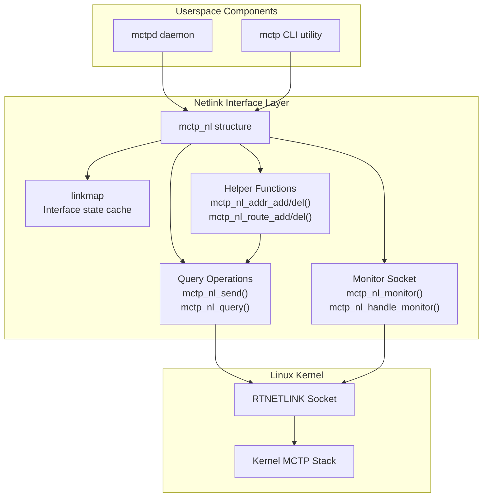
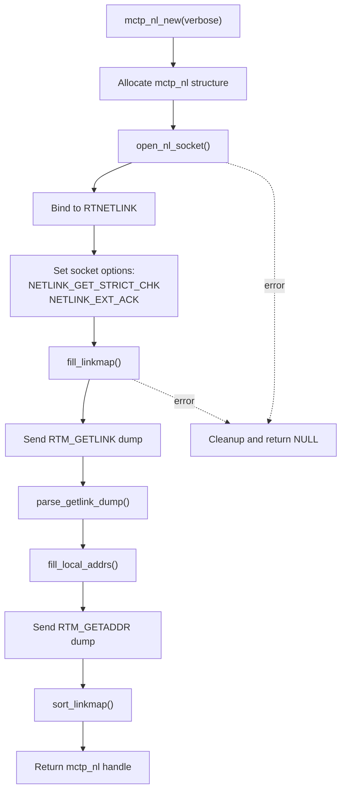
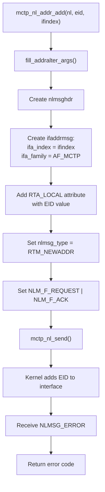
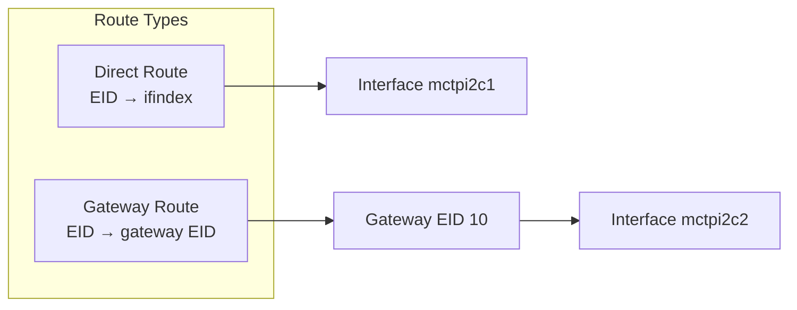
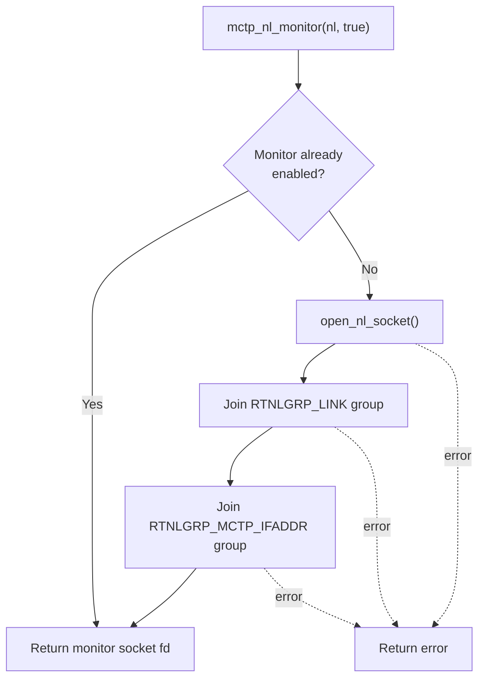
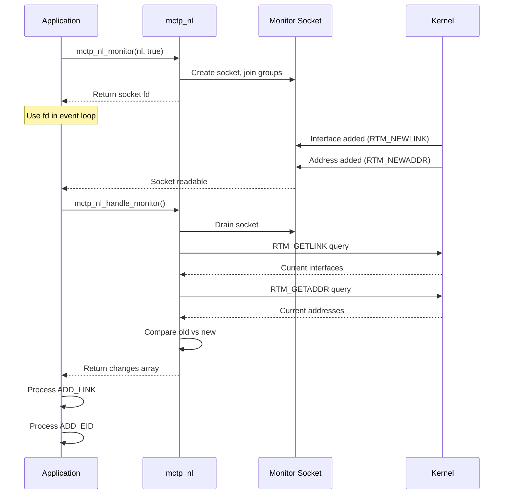
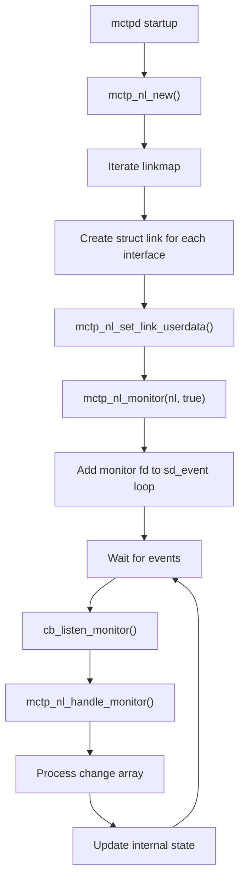

<!-- source: DeepWiki mcp.deepwiki.com · repo NVIDIA/mctp · page 3.3 Netlink Interface · fetched 2026-10-26 -->

# Netlink Interface

<details>
<summary>Relevant source files</summary>

The following files were used as context for generating this wiki page:

- [src/mctp-netlink.c](src/mctp-netlink.c)
- [src/mctp-netlink.h](src/mctp-netlink.h)

</details>


The Netlink Interface layer provides an abstraction over Linux Netlink sockets for communicating with the kernel's MCTP stack. This library handles the low-level details of Netlink message construction, parsing, and state tracking, allowing higher-level components like `mctpd` and the `mctp` utility to configure kernel MCTP interfaces, addresses, and routes without dealing directly with Netlink protocol details.

For information about the kernel MCTP socket API (AF_MCTP), see [Kernel Interface](#3.4). For how `mctpd` uses this interface, see [mctpd Daemon](#2.1).

**Sources:** [src/mctp-netlink.h:1-156](), [src/mctp-netlink.c:1-22]()

---

## Architecture Overview

The Netlink interface layer sits between userspace MCTP management components and the Linux kernel's MCTP stack. It maintains a cached view of the kernel's MCTP interface state and provides synchronous and asynchronous interfaces for configuration and monitoring.



**Sources:** [src/mctp-netlink.h:11-59](), [src/mctp-netlink.c:40-55]()

---

## Core Data Structures

### The mctp_nl Structure

The `mctp_nl` structure is the main handle for all Netlink operations. It maintains two separate Netlink sockets and a cached linkmap of MCTP interfaces.

| Field | Type | Purpose |
|-------|------|---------|
| `sd` | `int` | Socket for queries (RTM_GETLINK, RTM_NEWADDR, etc.) |
| `sd_monitor` | `int` | Socket for monitoring interface/address changes |
| `linkmap` | `struct linkmap_entry*` | Array of cached interface information |
| `linkmap_count` | `size_t` | Number of entries in linkmap |
| `linkmap_alloc` | `size_t` | Allocated size of linkmap array |
| `verbose` | `bool` | Enable verbose error reporting |
| `quiet_eexist` | `bool` | Suppress EEXIST error messages |

**Sources:** [src/mctp-netlink.c:40-55]()

### The linkmap_entry Structure

Each entry in the linkmap represents one MCTP network interface with its associated state:

| Field | Type | Purpose |
|-------|------|---------|
| `ifindex` | `int` | Kernel interface index |
| `ifname` | `char[IFNAMSIZ+1]` | Interface name (e.g., "mctpi2c1") |
| `net` | `uint32_t` | MCTP network ID |
| `up` | `bool` | Interface up/down state |
| `min_mtu` | `uint32_t` | Minimum MTU for this interface |
| `max_mtu` | `uint32_t` | Maximum MTU for this interface |
| `hwaddr_len` | `uint32_t` | Physical address length |
| `local_eids` | `mctp_eid_t*` | Array of local EIDs assigned to this interface |
| `num_local` | `size_t` | Number of local EIDs |
| `userdata` | `void*` | Opaque pointer for caller use |
| `ifaltname` | `char[ALTIFNAMSIZ]` | Alternate interface name |

**Sources:** [src/mctp-netlink.c:23-38]()

---

## Initialization and Teardown

### Creating a Netlink Context



The `mctp_nl_new()` function initializes the Netlink interface and populates the linkmap with the current state of all MCTP interfaces:

1. **Socket Creation**: Opens a Netlink socket with `AF_NETLINK` and `NETLINK_ROUTE` protocol
2. **Socket Options**: Enables strict checking and extended acknowledgments for better error reporting
3. **Interface Discovery**: Sends `RTM_GETLINK` dump request with `AF_MCTP` family filter
4. **Address Query**: Sends `RTM_GETADDR` dump request to retrieve local EIDs
5. **Sorting**: Sorts interfaces by index and EIDs for efficient lookup

**Sources:** [src/mctp-netlink.c:105-133](), [src/mctp-netlink.c:67-103](), [src/mctp-netlink.c:849-915]()

### Cleanup

```c
void mctp_nl_close(mctp_nl *nl);
```

Frees all allocated resources including the linkmap, closes sockets, and deallocates the `mctp_nl` structure.

**Sources:** [src/mctp-netlink.c:149-155]()

---

## Netlink Message Operations

### Message Types and RTM Commands

The Netlink interface uses standard RTNETLINK message types to interact with the kernel MCTP stack:

| Message Type | Direction | Purpose |
|--------------|-----------|---------|
| `RTM_GETLINK` | Query → Kernel | Retrieve interface information |
| `RTM_NEWADDR` | Configure → Kernel | Add local EID to interface |
| `RTM_DELADDR` | Configure → Kernel | Remove local EID from interface |
| `RTM_GETADDR` | Query → Kernel | Retrieve address assignments |
| `RTM_NEWROUTE` | Configure → Kernel | Add route to remote EID(s) |
| `RTM_DELROUTE` | Configure → Kernel | Remove route |
| `NLMSG_ERROR` | Response ← Kernel | Error or acknowledgment |
| `NLMSG_DONE` | Response ← Kernel | End of multi-part message |

**Sources:** [src/mctp-netlink.c:745-915](), [src/mctp-netlink.c:917-981]()

### Sending Messages


The `mctp_nl_send()` function sends a Netlink message and optionally waits for acknowledgment:

- Sends to kernel via `sendto()` on the query socket
- If `NLM_F_ACK` flag is set, waits for `NLMSG_ERROR` response
- Parses and displays any error messages with extended acknowledgment support
- Returns error code from kernel or 0 on success

**Sources:** [src/mctp-netlink.c:583-605](), [src/mctp-netlink.c:540-576]()

### Querying with Response

```c
int mctp_nl_query(mctp_nl *nl, struct nlmsghdr *msg, 
                  struct nlmsghdr **respp, size_t *resp_lenp);
```

For queries that return data (like `RTM_GETADDR`), `mctp_nl_query()`:
1. Sends the message via `mctp_nl_send()`
2. Receives all response datagrams via `mctp_nl_recv_all()`
3. Concatenates multi-part responses into a single buffer
4. Returns allocated buffer to caller (must be freed)

**Sources:** [src/mctp-netlink.c:704-720](), [src/mctp-netlink.c:621-702]()

---

## Interface Information Queries

The Netlink interface provides numerous helper functions for querying cached interface state without additional kernel round-trips:

### Lookup Functions

| Function | Returns | Use Case |
|----------|---------|----------|
| `mctp_nl_ifindex_byname()` | `int` | Get ifindex from interface name |
| `mctp_nl_if_byindex()` | `const char*` | Get interface name from ifindex |
| `mctp_nl_net_byindex()` | `uint32_t` | Get network ID for interface |
| `mctp_nl_up_byindex()` | `bool` | Check if interface is up |
| `mctp_nl_min_mtu_byindex()` | `uint32_t` | Get minimum MTU |
| `mctp_nl_max_mtu_byindex()` | `uint32_t` | Get maximum MTU |
| `mctp_nl_hwaddr_len_byindex()` | `int` | Get physical address length |
| `mctp_nl_addrs_byindex()` | `mctp_eid_t*` | Get array of local EIDs (caller frees) |

**Sources:** [src/mctp-netlink.h:74-95](), [src/mctp-netlink.c:1028-1149]()

### Enumeration Functions

| Function | Returns | Use Case |
|----------|---------|----------|
| `mctp_nl_net_list()` | `uint32_t*` | List of all network IDs |
| `mctp_nl_if_list()` | `int*` | List of all interface indices |
| `mctp_nl_if_exists()` | `bool` | Check if interface exists |

**Sources:** [src/mctp-netlink.h:90-94](), [src/mctp-netlink.c:1164-1213]()

### User Data Association

The linkmap allows callers to attach arbitrary user data to interfaces:

```c
int mctp_nl_set_link_userdata(mctp_nl *nl, int ifindex, void *userdata);
void *mctp_nl_get_link_userdata(const mctp_nl *nl, int ifindex);
void *mctp_nl_get_link_userdata_byname(const mctp_nl *nl, const char *ifname);
```

This is used by `mctpd` to associate its internal `struct link` with each kernel interface. The userdata pointer is also included in change notifications.

**Sources:** [src/mctp-netlink.h:96-108](), [src/mctp-netlink.c:1070-1098]()

---

## Address Management

### Adding a Local EID



The `mctp_nl_addr_add()` function constructs and sends an `RTM_NEWADDR` message to assign a local EID to an interface. The kernel will reject the request if:
- The EID is already assigned to another interface
- The interface does not exist
- The interface is not an MCTP interface

**Sources:** [src/mctp-netlink.c:1320-1323](), [src/mctp-netlink.c:1305-1318](), [src/mctp-netlink.c:1271-1303]()

### Removing a Local EID

```c
int mctp_nl_addr_del(struct mctp_nl *nl, mctp_eid_t eid, int ifindex);
```

Similar to `mctp_nl_addr_add()`, but sends `RTM_DELADDR` to remove an EID assignment. This is typically done before reassigning an EID or when removing an endpoint.

**Sources:** [src/mctp-netlink.c:1325-1328]()

---

## Route Management

### Route Structure

Routes in the kernel MCTP stack direct packets to specific interfaces or gateways. Each route has:
- **Destination EID**: Single EID or range (EID + extent)
- **Output**: Either an `ifindex` (direct) or `gateway` (via another endpoint)
- **MTU**: Optional MTU override for the route
- **Metrics**: Optional routing metrics (not commonly used)



**Sources:** [src/mctp-netlink.c:1330-1385]()

### Adding a Route

```c
int mctp_nl_route_add(struct mctp_nl *nl, uint8_t eid, unsigned int extent,
                      int ifindex, const struct mctp_fq_addr *gw, uint32_t mtu);
```

Creates an `RTM_NEWROUTE` message with:
- `RTA_DST`: Destination EID
- `rtm_dst_len`: Route extent (0 = single EID, N = range of 2^N EIDs)
- `RTA_OIF`: Output interface (if direct route)
- `RTA_GATEWAY`: Gateway address (if gateway route, contains `struct mctp_fq_addr`)
- `RTA_METRICS`: Optional MTU and metrics

Either `ifindex` or `gw` must be specified, but not both.

**Sources:** [src/mctp-netlink.c:1387-1423](), [src/mctp-netlink.c:1339-1385]()

### Deleting a Route

```c
int mctp_nl_route_del(struct mctp_nl *nl, uint8_t eid, unsigned int extent,
                      int ifindex, const struct mctp_fq_addr *gw);
```

Sends `RTM_DELROUTE` to remove a route. The parameters must exactly match the route being deleted.

**Sources:** [src/mctp-netlink.c:1425-1438]()

---

## Monitoring Interface Changes

The monitoring capability allows applications to be notified asynchronously when kernel MCTP state changes (interfaces added/removed, addresses assigned/removed, etc.).

### Change Notification Structure

```c
struct mctp_nl_change {
    enum {
        MCTP_NL_ADD_LINK,      // Interface added
        MCTP_NL_DEL_LINK,      // Interface removed
        MCTP_NL_CHANGE_NET,    // Network ID changed
        MCTP_NL_CHANGE_UP,     // Up/down state changed
        MCTP_NL_CHANGE_NAME,   // Interface name changed
        MCTP_NL_ADD_EID,       // Local EID added
        MCTP_NL_DEL_EID,       // Local EID removed
    } op;
    
    int ifindex;
    mctp_eid_t eid;           // For ADD_EID, DEL_EID
    int old_net;              // For CHANGE_NET, DEL_LINK, DEL_EID
    bool old_up;              // For CHANGE_UP
    char old_name[IFNAMSIZ+1]; // For CHANGE_NAME
    void *link_userdata;      // Preserved from linkmap
};
```

**Sources:** [src/mctp-netlink.h:14-44]()

### Enabling Monitoring



The `mctp_nl_monitor()` function:
1. Opens a second Netlink socket dedicated to monitoring
2. Joins multicast groups `RTNLGRP_LINK` (interface events) and `RTNLGRP_MCTP_IFADDR` (address events)
3. Returns the socket file descriptor for use with `select()`, `poll()`, or `epoll()`

**Sources:** [src/mctp-netlink.c:157-202]()

### Processing Changes

```c
int mctp_nl_handle_monitor(mctp_nl *nl, mctp_nl_change **changes, 
                           size_t *num_changes);
```

When the monitor socket becomes readable:
1. **Drain Socket**: Reads all pending Netlink messages without parsing them
2. **Refresh State**: Performs full RTM_GETLINK and RTM_GETADDR queries to get current state
3. **Compare**: Compares old linkmap with new linkmap to detect changes
4. **Generate Changes**: Produces an array of `mctp_nl_change` structures
5. **Update**: Replaces old linkmap with new linkmap

The change detection algorithm in `fill_link_changes()` walks both old and new linkmaps in sorted order, identifying additions, deletions, and modifications.

**Sources:** [src/mctp-netlink.c:363-408](), [src/mctp-netlink.c:257-340]()

### Change Processing Example



**Sources:** [src/mctp-netlink.c:363-408]()

---

## Netlink Attribute Helpers

The library provides utility functions for working with Netlink attributes (rtattr structures):

### Parsing Attributes

| Function | Purpose |
|----------|---------|
| `mctp_get_rtnlmsg_attr()` | Extract attribute by type, return pointer and length |
| `mctp_get_rtnlmsg_attr_u32()` | Extract 32-bit unsigned integer attribute |
| `mctp_get_rtnlmsg_attr_u8()` | Extract 8-bit unsigned integer attribute |
| `mctp_get_rtnlmsg_fq_addr()` | Extract `mctp_fq_addr` structure |

These functions iterate through attribute lists using the `RTA_OK()` and `RTA_NEXT()` macros, handling alignment and boundary checking.

**Sources:** [src/mctp-netlink.h:122-134](), [src/mctp-netlink.c:410-477]()

### Constructing Attributes

```c
size_t mctp_put_rtnlmsg_attr(struct rtattr **prta, size_t *rta_len,
                             unsigned short type, const void *value, size_t val_len);
```

Adds an attribute to a message buffer:
1. Sets `rta_type` and `rta_len` 
2. Copies value data to `RTA_DATA(rta)`
3. Advances pointer past attribute (properly aligned)
4. Returns space consumed

**Sources:** [src/mctp-netlink.c:479-490]()

### Error Message Display

```c
void mctp_display_nlmsg_error(const mctp_nl *nl, struct nlmsgerr *errmsg, size_t errlen);
void mctp_dump_nlmsg_error(const mctp_nl *nl, struct nlmsgerr *errmsg, size_t errlen);
```

These functions parse and display Netlink error responses, including:
- Error code and string description
- Extended acknowledgment message (`NLMSGERR_ATTR_MSG`)
- Original message that caused the error (in dump mode)

The `quiet_eexist` flag suppresses display of `EEXIST` errors, useful when idempotent operations are expected.

**Sources:** [src/mctp-netlink.c:501-537]()

---

## Integration with mctpd

The `mctpd` daemon uses the Netlink interface extensively:



Key integration points:

1. **Startup**: Creates `mctp_nl` context and associates internal `struct link` with each interface via userdata
2. **Configuration**: Uses `mctp_nl_addr_add()` and `mctp_nl_route_add()` when assigning EIDs to endpoints
3. **Monitoring**: Integrates monitor socket with `sd_event` loop to handle kernel state changes
4. **Queries**: Uses lookup functions to validate interface state before operations

**Sources:** [src/mctp-netlink.h:96-108]()

---

## Error Handling

The Netlink interface uses multiple error reporting mechanisms:

### Return Codes

- **Negative errno**: Most functions return negative errno values on failure
- **Zero**: Success
- **Positive**: Some functions return positive values (e.g., file descriptors)

### Extended Acknowledgments

When `NETLINK_EXT_ACK` socket option is enabled, kernel responses include:
- `NLMSGERR_ATTR_MSG`: Human-readable error message
- `NLMSGERR_ATTR_OFFS`: Offset into original message where error occurred

The `mctp_display_nlmsg_error()` function extracts and displays these attributes.

**Sources:** [src/mctp-netlink.c:83-96](), [src/mctp-netlink.c:501-526]()

### Common Errors

| Error | Cause | Resolution |
|-------|-------|------------|
| `EEXIST` | Address or route already exists | Use `mctp_nl_warn_eexist()` to suppress warnings for idempotent operations |
| `ENODEV` | Interface does not exist | Check `mctp_nl_if_exists()` before operations |
| `EINVAL` | Invalid parameters | Check EID ranges, network IDs, and interface indices |
| `EOPNOTSUPP` | Kernel doesn't support MCTP | Ensure kernel is built with CONFIG_MCTP |

**Sources:** [src/mctp-netlink.c:136-139]()

---

## Testing

The Netlink interface is tested through mock socket operations defined in `mctp-ops.h`. Test code can intercept Netlink socket calls and simulate kernel responses without requiring actual MCTP kernel support.

For details on the test framework, see [Test Framework](#6.1) and [Test Environment Simulation](#6.2).

**Sources:** [src/mctp-netlink.c:72-78]()

---

