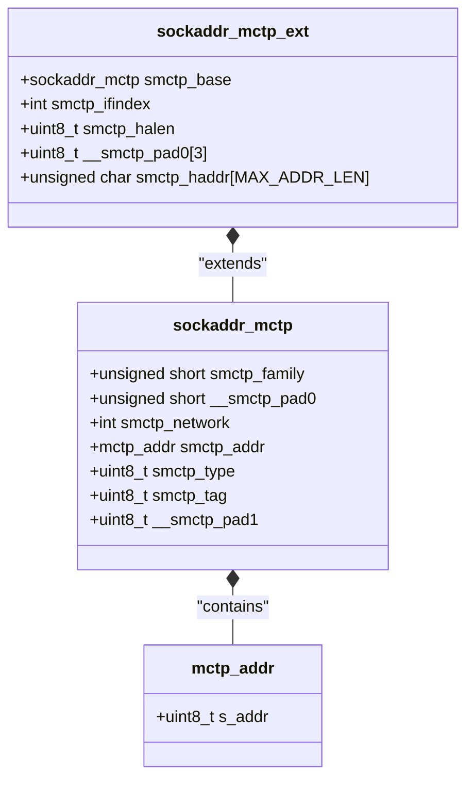
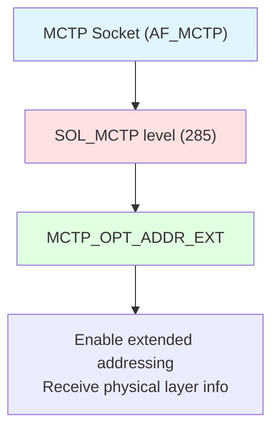
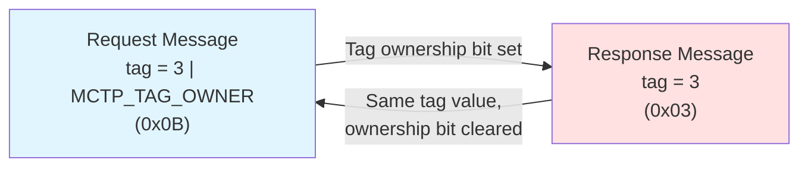
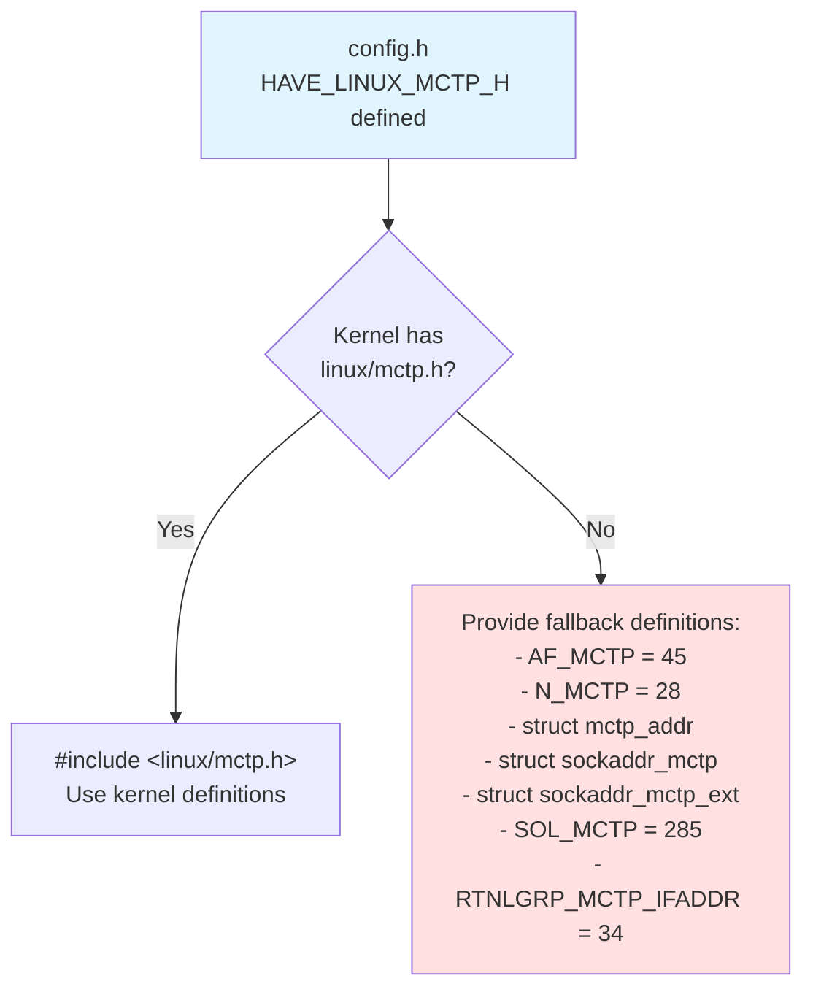

<!-- source: DeepWiki mcp.deepwiki.com · repo NVIDIA/mctp · page 3.4 Kernel Interface · fetched 2026-10-26 -->

# Kernel Interface

<details>
<summary>Relevant source files</summary>

The following files were used as context for generating this wiki page:

- [src/mctp-netlink.c](src/mctp-netlink.c)
- [src/mctp.h](src/mctp.h)

</details>


## Purpose and Scope

This document describes the kernel interface for MCTP communication, specifically focusing on the socket API (`AF_MCTP`) that userspace applications use to send and receive MCTP messages. This interface allows direct communication with MCTP endpoints through standard socket operations.

For information about kernel configuration via Netlink (managing interfaces, routes, and addresses), see [Netlink Interface](#3.3). For higher-level MCTP control protocol operations, see [MCTP Control Protocol](#3.2).

---

## Socket Family Overview

The kernel MCTP stack exposes its functionality through the `AF_MCTP` socket family. This provides a standard BSD socket interface for MCTP communication, allowing userspace to send and receive MCTP messages using familiar socket operations like `socket()`, `bind()`, `sendto()`, and `recvfrom()`.

### Key Constants

| Constant | Value | Description |
|----------|-------|-------------|
| `AF_MCTP` | 45 | MCTP address family identifier |
| `SOL_MCTP` | 285 | Socket option level for MCTP-specific options |
| `MCTP_NET_ANY` | 0 | Match any network ID |
| `MCTP_ADDR_ANY` | 0xff | Wildcard EID for binding |
| `MCTP_TAG_OWNER` | 0x08 | Tag ownership bit |

**Sources:** [src/mctp.h:25-99]()

---

## Address Structures

The kernel interface defines several address structures for MCTP communication. These structures specify the destination or source of MCTP messages.



### mctp_addr Structure

The basic MCTP address type containing a single EID:

```c
struct mctp_addr {
    mctp_eid_t s_addr;  // MCTP Endpoint ID (0-255)
};
```

**Sources:** [src/mctp.h:40-42]()

### sockaddr_mctp Structure

The standard socket address structure for MCTP:

| Field | Type | Description |
|-------|------|-------------|
| `smctp_family` | `unsigned short` | Must be `AF_MCTP` |
| `smctp_network` | `int` | Network ID, or `MCTP_NET_ANY` (0) |
| `smctp_addr` | `struct mctp_addr` | Destination/source EID |
| `smctp_type` | `uint8_t` | MCTP message type |
| `smctp_tag` | `uint8_t` | MCTP tag value (with `MCTP_TAG_OWNER` bit) |

**Sources:** [src/mctp.h:44-52]()

### sockaddr_mctp_ext Structure

Extended address structure that includes physical layer addressing information. This is used with the `MCTP_OPT_ADDR_EXT` socket option to provide link-layer address details:

| Field | Type | Description |
|-------|------|-------------|
| `smctp_base` | `struct sockaddr_mctp` | Base MCTP address |
| `smctp_ifindex` | `int` | Network interface index |
| `smctp_halen` | `uint8_t` | Hardware address length |
| `smctp_haddr` | `unsigned char[MAX_ADDR_LEN]` | Physical layer address |

**Sources:** [src/mctp.h:69-75]()

---

## Socket Creation and Configuration

### Creating an MCTP Socket

MCTP sockets are created using the standard `socket()` system call:

```c
int sd = socket(AF_MCTP, SOCK_DGRAM, 0);
```

The `SOCK_DGRAM` type is used because MCTP provides datagram-style message delivery.

### Socket Options

The kernel MCTP stack supports socket options set via `setsockopt()`:



#### MCTP_OPT_ADDR_EXT

When enabled, this option causes `recvfrom()` to return `sockaddr_mctp_ext` structures instead of `sockaddr_mctp`. This provides access to:
- Network interface index where the message was received
- Physical layer address of the sender
- Hardware address length

This is essential for control protocol operations that need to respond to specific physical addresses.

**Sources:** [src/mctp.h:65-77]()

---

## Communication Patterns

### Binding a Socket

To receive MCTP messages, a socket must be bound to a local EID and message type:

```c
struct sockaddr_mctp addr = {
    .smctp_family = AF_MCTP,
    .smctp_network = MCTP_NET_ANY,     // Any network
    .smctp_addr.s_addr = local_eid,    // Local EID
    .smctp_type = message_type,        // MCTP message type
    .smctp_tag = MCTP_TAG_OWNER,       // Own tags
};

bind(sd, (struct sockaddr *)&addr, sizeof(addr));
```

Using `MCTP_NET_ANY` allows the socket to receive messages from any network.

### Sending Messages

Messages are sent using `sendto()` with a `sockaddr_mctp` specifying the destination:

```c
struct sockaddr_mctp dest = {
    .smctp_family = AF_MCTP,
    .smctp_network = network_id,
    .smctp_addr.s_addr = dest_eid,
    .smctp_type = message_type,
    .smctp_tag = tag | MCTP_TAG_OWNER,
};

sendto(sd, message, length, 0, 
       (struct sockaddr *)&dest, sizeof(dest));
```

### Receiving Messages

Messages are received using `recvfrom()`, which populates the source address:

```c
struct sockaddr_mctp src;
socklen_t addrlen = sizeof(src);

ssize_t len = recvfrom(sd, buffer, bufsize, 0,
                       (struct sockaddr *)&src, &addrlen);
```

The received `src` structure contains:
- Source EID (`src.smctp_addr.s_addr`)
- Network ID (`src.smctp_network`)
- Message type (`src.smctp_type`)
- Tag value (`src.smctp_tag`)

**Sources:** [src/mctp.h:44-75]()

---

## Message Type and Tag Handling

### Message Types

The `smctp_type` field specifies the MCTP message type. Common values include:
- `0x00`: MCTP Control Protocol
- `0x01`: PLDM
- `0x02`: NCSI over MCTP
- `0x03`: Ethernet over MCTP
- `0x04`: NVMe Management Messages

The message type is used for socket binding and routing messages to the correct application.

### Tag Management

MCTP uses tags to match requests with responses. The `smctp_tag` field contains:
- Lower 3 bits: Tag value (0-7)
- `MCTP_TAG_OWNER` bit (0x08): Indicates tag ownership

When sending a request, the sender sets the `MCTP_TAG_OWNER` bit. When responding, the responder clears this bit but preserves the tag value.



**Sources:** [src/mctp.h:44-57]()

---

## Kernel Header Compatibility

The `mctp.h` header provides compatibility for systems where kernel headers don't yet include MCTP definitions. It uses conditional compilation to provide fallback definitions:



### Conditional Definition Pattern

The header checks for each definition before providing a fallback:

```c
#if HAVE_LINUX_MCTP_H
#include <linux/mctp.h>
#endif

#ifndef AF_MCTP
#define AF_MCTP 45
#endif

#ifndef MCTP_NET_ANY
typedef uint8_t mctp_eid_t;
struct mctp_addr { ... };
struct sockaddr_mctp { ... };
// ... etc
#endif
```

This ensures compatibility across different kernel versions while allowing the use of system-provided definitions when available.

### Fallback Definitions Provided

When kernel headers are unavailable, the following are defined:

| Definition | Purpose |
|------------|---------|
| `AF_MCTP` | Address family constant |
| `N_MCTP` | Serial line discipline number |
| `mctp_eid_t` | EID type (uint8_t) |
| `struct mctp_addr` | Basic MCTP address |
| `struct sockaddr_mctp` | Standard socket address |
| `struct sockaddr_mctp_ext` | Extended socket address |
| `SOL_MCTP` | Socket option level |
| `MCTP_OPT_ADDR_EXT` | Extended addressing option |
| `RTNLGRP_MCTP_IFADDR` | Netlink address group |

**Sources:** [src/mctp.h:1-101]()

---

## Integration with Netlink

While the socket API handles MCTP message communication, the Netlink interface (RTM_GETLINK, RTM_NEWADDR, etc.) is used for configuration. See [Netlink Interface](#3.3) for details on:
- Interface enumeration
- Address assignment
- Route configuration
- Neighbor management
- Interface monitoring

The socket and Netlink interfaces work together: Netlink configures the MCTP stack (EIDs, routes), while AF_MCTP sockets handle message transmission.

**Sources:** [src/mctp-netlink.c:1-1439]()

---

