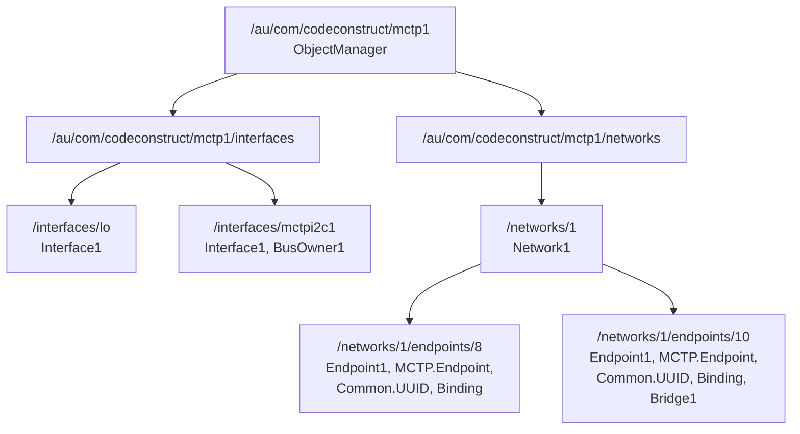
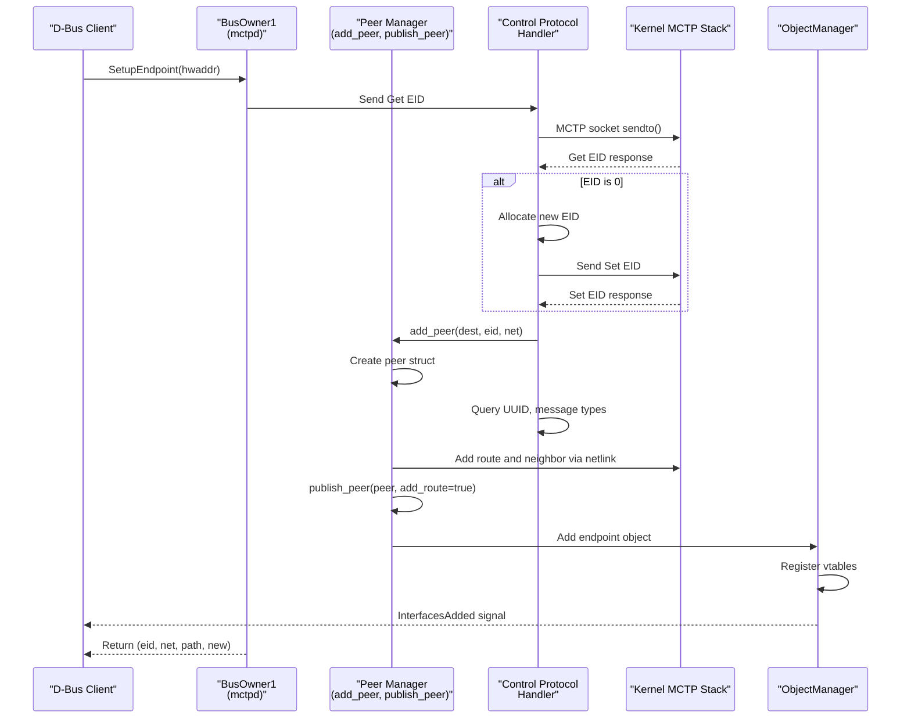

<!-- source: DeepWiki mcp.deepwiki.com · repo NVIDIA/mctp · page 4 D-Bus Interface · fetched 2026-10-26 -->

# D-Bus Interface

Relevant source files

The following files were used as context for generating this wiki page:

- [conf/mctpd.conf](conf/mctpd.conf)
- [docs/mctpd.md](docs/mctpd.md)
- [src/mctpd-util.h](src/mctpd-util.h)
- [src/mctpd.c](src/mctpd.c)

This page provides an overview of the D-Bus interface exposed by `mctpd`. The D-Bus interface serves as the primary management API for MCTP endpoint discovery, configuration, and monitoring. It allows user-space applications to interact with the MCTP subsystem without direct kernel interaction.

For detailed information about specific interfaces, see:
- [BusOwner1 Interface](#4.1) - Methods for endpoint discovery and EID assignment
- [Endpoint1 Interface](#4.2) - Endpoint-specific configuration and properties
- [Network1 Interface](#4.3) - Network-level operations
- [Bridge Management](#4.4) - MCTP bridge support and pool allocation

For information about the internal daemon architecture that implements these interfaces, see [Daemon Architecture](#2.1.1).

## Bus Name and Service Identity

`mctpd` claims the well-known D-Bus bus name `au.com.codeconstruct.MCTP1` on the system bus. All objects and interfaces are exposed under this service name.

**Sources:** [src/mctpd.c:51](), [docs/mctpd.md:5-7]()

## Object Hierarchy

The D-Bus object tree follows a hierarchical structure that mirrors the logical organization of MCTP networks, interfaces, and endpoints.

### Object Hierarchy Diagram

**Sources:** [docs/mctpd.md:9-23](), [src/mctpd.c:44-57]()

### Base Path: `/au/com/codeconstruct/mctp1`

The root object implements the `org.freedesktop.DBus.ObjectManager` interface, which allows clients to enumerate all managed objects and their interfaces. This is the primary discovery mechanism for MCTP objects.

**Sources:** [docs/mctpd.md:26-35]()

### Interface Objects: `/au/com/codeconstruct/mctp1/interfaces/<name>`

Interface objects represent local hardware transport bindings (e.g., `mctpi2c1`, `mctpusb0`). Each interface corresponds to a kernel MCTP network device. The `<name>` component matches the Linux interface name.

**Sources:** [docs/mctpd.md:37-41](), [src/mctpd.c:46]()

### Network Objects: `/au/com/codeconstruct/mctp1/networks/<net>`

Network objects represent MCTP networks, identified by a numeric network ID. Networks are typically created by the kernel when MCTP links are configured. The `<net>` component is the network ID (e.g., `1`).

**Sources:** [docs/mctpd.md:186-190](), [src/mctpd.c:45]()

### Endpoint Objects: `/au/com/codeconstruct/mctp1/networks/<net>/endpoints/<eid>`

Endpoint objects represent discovered MCTP endpoints, both local and remote. The `<eid>` component is the endpoint's MCTP EID (e.g., `8`, `10`). These objects are created dynamically as endpoints are discovered or configured.

**Sources:** [docs/mctpd.md:235-243](), [src/mctpd.c:87-96]()

## D-Bus Interface Types

`mctpd` implements multiple D-Bus interfaces, each serving a specific functional purpose. Objects may implement one or more interfaces depending on their role.

### Interface Summary Table

| Interface Name | Purpose | Objects |
|----------------|---------|---------|
| `org.freedesktop.DBus.ObjectManager` | Object enumeration | Root object |
| `au.com.codeconstruct.MCTP.Interface1` | Interface configuration and status | Interface objects |
| `au.com.codeconstruct.MCTP.BusOwner1` | Endpoint discovery and EID assignment | Interface objects (when role is BusOwner) |
| `au.com.codeconstruct.MCTP.Network1` | Network-level operations | Network objects |
| `au.com.codeconstruct.MCTP.Endpoint1` | Endpoint configuration | Endpoint objects |
| `au.com.codeconstruct.MCTP.Bridge1` | Bridge pool information | Bridge endpoint objects |
| `xyz.openbmc_project.MCTP.Endpoint` | OpenBMC standard endpoint interface | Endpoint objects |
| `xyz.openbmc_project.Common.UUID` | UUID property | Endpoint objects |
| `xyz.openbmc_project.MCTP.Binding` | Binding information | Endpoint objects |
| `xyz.openbmc_project.State.ServiceReady` | Service readiness state | Interface objects |

**Sources:** [docs/mctpd.md:48-56](), [docs/mctpd.md:71-88](), [docs/mctpd.md:193-204](), [docs/mctpd.md:245-274](), [src/mctpd.c:47-57]()

### CodeConstruct Interfaces

The `au.com.codeconstruct.MCTP.*` interfaces are specific to this implementation and provide the primary management API:

- **Interface1**: Exposes `NetworkId` and `Role` properties for each interface. The `Role` property indicates whether the interface is operating as a `BusOwner`, `Endpoint`, or `Unknown`.
- **BusOwner1**: Provides methods like `SetupEndpoint`, `AssignEndpoint`, `AssignEndpointStatic`, and `LearnEndpoint` for endpoint management. This interface is only present on interface objects where `Role` is `BusOwner`.
- **Network1**: Provides `LearnEndpoint` and `EndpointPing` methods, plus the `LocalEIDs` property.
- **Endpoint1**: Provides `SetMTU`, `Remove`, and `Recover` methods for endpoint configuration.
- **Bridge1**: Exposes `PoolStart` and `PoolEnd` properties for bridge endpoints with allocated EID pools.

**Sources:** [docs/mctpd.md:42-88](), [docs/mctpd.md:193-234](), [docs/mctpd.md:247-269](), [src/mctpd.c:47-50](), [src/mctpd.c:55-56]()

### OpenBMC Standard Interfaces

The `xyz.openbmc_project.*` interfaces provide compatibility with OpenBMC infrastructure:

- **MCTP.Endpoint**: Standard OpenBMC interface for MCTP endpoints, providing properties like `EID`, `NetworkId`, and `SupportedMessageTypes`.
- **Common.UUID**: Provides the `UUID` property for endpoint identification.
- **MCTP.Binding**: Provides binding-specific information like `BindingType` and `BindingMediumID`.
- **State.ServiceReady**: Indicates service readiness state for each interface.

**Sources:** [src/mctpd.c:52-54](), [src/mctpd.c:57](), [docs/mctpd.md:241-243]()

## Object Lifecycle and Management

### Endpoint Discovery and Publication Flow

**Sources:** [src/mctpd.c:279-289](), [src/mctpd.c:288](), [src/mctpd.c:273-278]()

### Object Creation Paths

Objects are created through several paths:

1. **Interface objects**: Created when `mctpd` starts and detects MCTP network interfaces via netlink monitoring. The function `add_interface()` at [src/mctpd.c:301]() handles interface creation.

2. **Network objects**: Created when a new network ID is encountered. The function `add_net()` at [src/mctpd.c:299]() manages network object lifecycle.

3. **Endpoint objects**: Created through:
   - Bus owner methods (`SetupEndpoint`, `AssignEndpoint`, `LearnEndpoint`)
   - Automatic discovery via netlink address notifications
   - Bridge endpoint population after routing table queries
   
   The function `add_peer()` at [src/mctpd.c:279-280]() creates the internal peer structure, and `publish_peer()` at [src/mctpd.c:288]() exposes it on D-Bus.

**Sources:** [src/mctpd.c:293-301](), [src/mctpd.c:279-289]()

### Object Removal

Objects are removed when:

1. **Interface removal**: Triggered by netlink link deletion events. The function `del_interface()` at [src/mctpd.c:294]() handles cleanup.

2. **Network removal**: When the last interface on a network is removed. The function `del_net()` at [src/mctpd.c:300]() handles network cleanup.

3. **Endpoint removal**: Triggered by:
   - `.Remove()` method call on endpoint object
   - Interface removal (all endpoints on that interface are removed)
   - Failed recovery attempts
   
   The function `remove_peer()` at [src/mctpd.c:284]() and `unpublish_peer()` at [src/mctpd.c:289]() manage endpoint removal.

**Sources:** [src/mctpd.c:284](), [src/mctpd.c:289](), [src/mctpd.c:294](), [src/mctpd.c:300]()

## Signals and Notifications

### InterfacesAdded and InterfacesRemoved

`mctpd` emits standard `ObjectManager` signals when objects are added or removed:

- `InterfacesAdded`: Emitted when a new endpoint, interface, or network is published
- `InterfacesRemoved`: Emitted when an object is removed from the tree

These signals are automatically generated by the `ObjectManager` implementation.

**Sources:** [src/mctpd.c:273-278]()

### TransportError Signal

The `TransportError` signal is emitted on interface objects implementing the `BusOwner1` interface when transport-level errors occur during MCTP message transmission or reception.

Signal signature: `uyyyyyyys`

Parameters:
- `error_code` (uint32): Transport error code from kernel
- `direction` (byte): 0=RX, 1=TX
- `binding` (byte): MCTP binding type (SMBus=0x01, PCIe=0x02, USB=0x03, etc.)
- `src_eid` (byte): Source endpoint ID
- `dest_eid` (byte): Destination endpoint ID
- `tag` (byte): MCTP message tag
- `msg_type` (byte): MCTP message type
- `command_code` (byte): Command code from control message payload (if applicable)
- `interface` (string): Interface name where error occurred

This signal is generated by the `log_mctp_error()` function at [src/mctpd.c:1484-1514]() when errors are read from the kernel's MCTP error queue.

**Sources:** [docs/mctpd.md:163-184](), [src/mctpd.c:1484-1514](), [src/mctpd.c:1516-1592]()

### DiscoveryNotify Signal

The `DiscoveryNotify` signal is emitted when a remote endpoint sends an MCTP Discovery Notify command. This indicates that an endpoint has become available or its configuration has changed.

This signal is emitted on interface objects by the `handle_control_discovery_notify()` function at [src/mctpd.c:1096-1146]().

**Sources:** [src/mctpd.c:1096-1146](), [src/mctpd.c:1133]()

## D-Bus vtables and Implementation

### vtable Structures

`mctpd` defines several vtable structures that implement the D-Bus interfaces. These are referenced but not fully defined in the provided code excerpts:

- `bus_endpoint_obmc_vtable` at [src/mctpd.c:311](): Implements `xyz.openbmc_project.MCTP.Endpoint`
- `bus_endpoint_cc_vtable` at [src/mctpd.c:312](): Implements `au.com.codeconstruct.MCTP.Endpoint1`
- `bus_endpoint_bridge` at [src/mctpd.c:313](): Implements `au.com.codeconstruct.MCTP.Bridge1`
- `bus_endpoint_uuid_vtable` at [src/mctpd.c:314](): Implements `xyz.openbmc_project.Common.UUID`
- `bus_endpoint_binding_vtable` at [src/mctpd.c:315](): Implements `xyz.openbmc_project.MCTP.Binding`

Additional vtables for interface and network objects are defined elsewhere in the code.

**Sources:** [src/mctpd.c:311-315]()

### Slot Management

D-Bus objects are registered using `sd_bus_slot` structures, which maintain the lifetime of D-Bus registrations. Each object type stores its slots:

- `struct link` (interface objects): Contains slots for `slot_iface`, `slot_busowner`, and `slot_service_readiness` at [src/mctpd.c:139-141]()
- `struct peer` (endpoint objects): Contains slots for `slot_obmc_endpoint`, `slot_cc_endpoint`, `slot_bridge`, `slot_uuid`, and `slot_binding_endpoint` at [src/mctpd.c:172-176]()
- `struct net` (network objects): Contains `slot` at [src/mctpd.c:94]()

These slots are allocated during object publication and freed during removal.

**Sources:** [src/mctpd.c:94](), [src/mctpd.c:139-141](), [src/mctpd.c:172-176]()

## Integration with System Bus

### Bus Connection

`mctpd` connects to the system D-Bus instance through a `sd_bus` object stored in `struct ctx` at [src/mctpd.c:226](). This connection is established during daemon initialization and is used for all D-Bus operations.

**Sources:** [src/mctpd.c:224-271]()

### Event Loop Integration

D-Bus operations are integrated with the `sd_event` main loop stored in `ctx->event` at [src/mctpd.c:225](). This allows D-Bus method calls, signals, and property changes to be processed asynchronously alongside netlink events and MCTP socket operations.

**Sources:** [src/mctpd.c:225]()

## Configuration Impact on D-Bus Interface

The `mode` configuration setting in `/etc/mctpd.conf` affects which D-Bus interfaces are exposed:

- **mode = "bus-owner"**: Interface objects expose the `BusOwner1` interface, allowing endpoint discovery and EID assignment methods
- **mode = "endpoint"**: Interface objects do not expose `BusOwner1`; the daemon acts as a passive endpoint

The `Role` property on interface objects reflects this configuration and can be queried by clients.

**Sources:** [conf/mctpd.conf:1-2](), [docs/mctpd.md:298-307](), [src/mctpd.c:103-131]()

---

