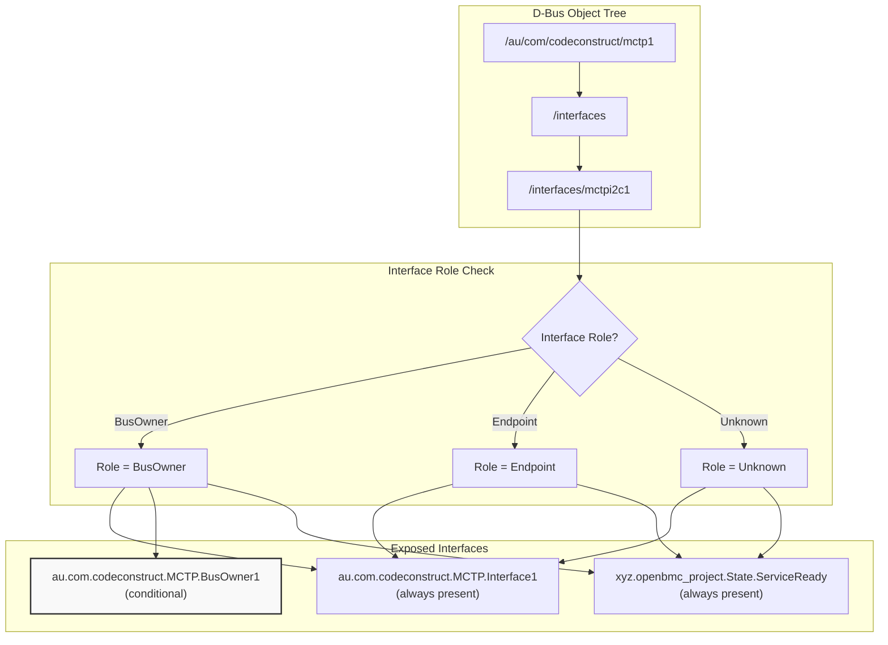
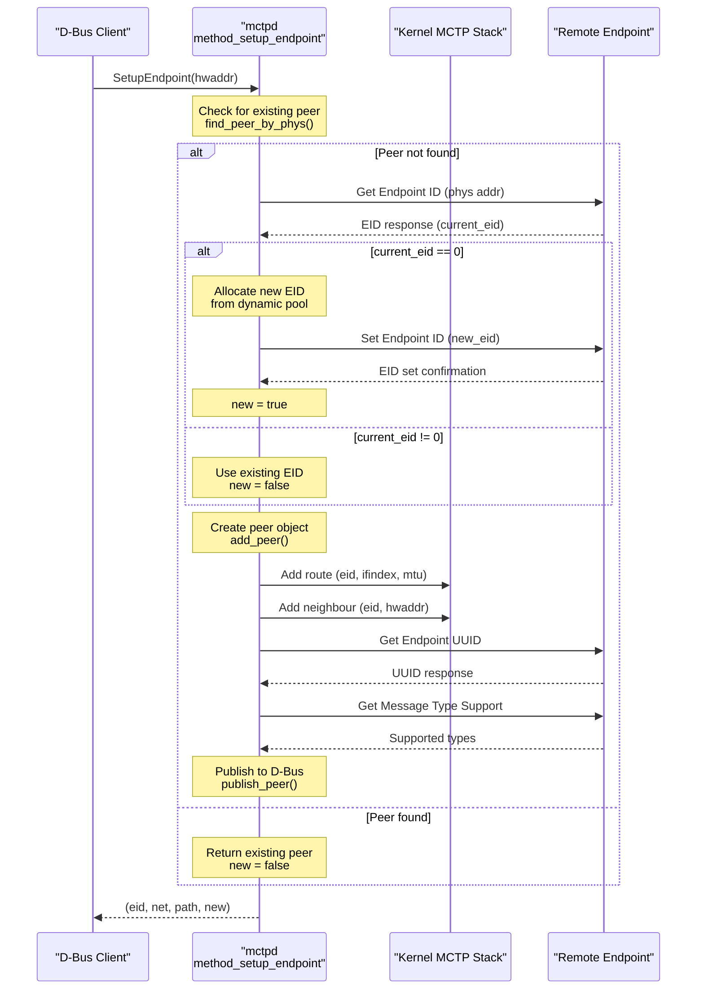
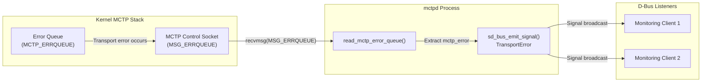
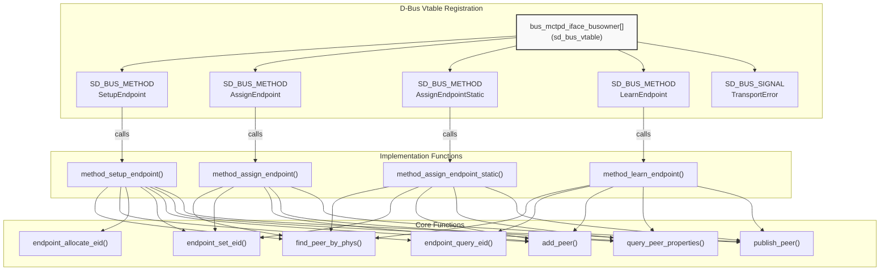

<!-- source: DeepWiki mcp.deepwiki.com · repo NVIDIA/mctp · page 4.1 BusOwner1 Interface · fetched 2026-10-26 -->

# BusOwner1 Interface

<details>
<summary>Relevant source files</summary>

The following files were used as context for generating this wiki page:

- [conf/mctpd.conf](conf/mctpd.conf)
- [docs/mctpd.md](docs/mctpd.md)
- [src/mctpd-util.h](src/mctpd-util.h)
- [src/mctpd.c](src/mctpd.c)
- [tests/test_mctpd.py](tests/test_mctpd.py)

</details>


## Purpose and Scope

The `BusOwner1` interface (`au.com.codeconstruct.MCTP.BusOwner1`) is a D-Bus interface exposed by `mctpd` that provides bus-owner-level functions for MCTP endpoint discovery, configuration, and management. This interface is only available on MCTP interface objects where the local system acts as the MCTP bus owner, responsible for assigning Endpoint IDs (EIDs) to remote devices.

This page documents the methods and signals provided by the `BusOwner1` interface. For information about endpoint-level management operations, see [Endpoint1 Interface](#4.2). For network-level operations, see [Network1 Interface](#4.3). For general D-Bus interface architecture, see [D-Bus Interface](#4).

**Sources:** [src/mctpd.c:47](), [docs/mctpd.md:71-88]()

---

## Interface Availability

The `BusOwner1` interface is conditionally exposed on MCTP interface objects located at `/au/com/codeconstruct/mctp1/interfaces/<name>`. The interface is only present when the interface's `Role` property is set to `"BusOwner"`.



**Sources:** [src/mctpd.c:133-150](), [docs/mctpd.md:54-66]()

---

## Methods

### SetupEndpoint

**Signature:** `ay` → `yisb`

**Description:** The primary method for adding MCTP endpoints to the bus. This method handles the complete endpoint discovery and configuration process: it queries the endpoint for its current EID using the MCTP Get Endpoint ID control command, assigns a new EID if the endpoint reports EID 0 (unassigned), queries endpoint properties (UUID, supported message types), and configures kernel routing and neighbor tables.

**Parameters:**
| Parameter | Type | Description |
|-----------|------|-------------|
| `hwaddr` | `ay` (byte array) | Physical address of the endpoint. Format depends on transport type (e.g., 1-byte I2C address, 6-byte MAC address) |

**Returns:**
| Field | Type | Description |
|-------|------|-------------|
| `eid` | `y` (byte) | The assigned or discovered EID of the endpoint |
| `net` | `i` (int32) | Network ID where the endpoint resides |
| `path` | `s` (string) | D-Bus object path to the endpoint object |
| `new` | `b` (boolean) | `true` if a new EID was assigned, `false` if endpoint already had an EID |

**Example Usage:**
```
busctl call au.com.codeconstruct.MCTP1 \
    /au/com/codeconstruct/mctp1/interfaces/mctpi2c6 \
    au.com.codeconstruct.MCTP.BusOwner1 \
    SetupEndpoint ay 1 0x1d
```

**Sources:** [docs/mctpd.md:91-123](), [src/mctpd.c:2185-2400](), [tests/test_mctpd.py:105-128]()

---

### AssignEndpoint

**Signature:** `ay` → `yisb`

**Description:** Similar to `SetupEndpoint`, but always assigns a new EID without querying for an existing one. This method uses the MCTP Set Endpoint ID control command with the force operation to assign an EID. If the endpoint is an MCTP bridge (reports a non-zero pool size), this method also allocates downstream EIDs for the bridge's endpoint pool.

**Parameters:**
| Parameter | Type | Description |
|-----------|------|-------------|
| `hwaddr` | `ay` (byte array) | Physical address of the endpoint |

**Returns:**
| Field | Type | Description |
|-------|------|-------------|
| `eid` | `y` (byte) | The assigned EID |
| `net` | `i` (int32) | Network ID |
| `path` | `s` (string) | D-Bus object path to the endpoint |
| `new` | `b` (boolean) | `false` if endpoint was already known to mctpd |

**Sources:** [docs/mctpd.md:126-130](), [src/mctpd.c:2402-2477]()

---

### AssignEndpointStatic

**Signature:** `ayyay` → `yisb`

**Description:** Assigns a specific static EID to an endpoint, rather than allocating dynamically from the configured EID pool. This method is useful for endpoints that require deterministic addressing. For MCTP bridges, the `pool_start` parameter specifies the first EID to allocate for downstream devices. The `ignore_eids` parameter allows skipping specific EIDs when processing routing tables from bridges.

**Parameters:**
| Parameter | Type | Description |
|-----------|------|-------------|
| `hwaddr` | `ay` (byte array) | Physical address of the endpoint |
| `static_eid` | `y` (byte) | The specific EID to assign (must be in range 8-254) |
| `pool_start` | `y` (byte) | Starting EID for bridge pool allocation (ignored for non-bridge endpoints) |
| `ignore_eids` | `ay` (byte array) | Array of EIDs to ignore when processing bridge routing tables (can be empty) |

**Returns:**
| Field | Type | Description |
|-------|------|-------------|
| `eid` | `y` (byte) | The assigned static EID |
| `net` | `i` (int32) | Network ID |
| `path` | `s` (string) | D-Bus object path to the endpoint |
| `new` | `b` (boolean) | `true` if newly assigned, `false` if already assigned |

**Error Conditions:**
- Returns error "Address in use" if `static_eid` is already assigned to another endpoint
- Returns error "Already assigned a different EID" if the endpoint already has a different EID

**Example Usage:**
```
# Assign static EID 12 with pool starting at 13, ignoring EIDs 20, 21, 22
busctl call au.com.codeconstruct.MCTP1 \
    /au/com/codeconstruct/mctp1/interfaces/mctpi2c6 \
    au.com.codeconstruct.MCTP.BusOwner1 \
    AssignEndpointStatic ay 1 0x1d y 12 y 13 ay 3 20 21 22
```

**Sources:** [docs/mctpd.md:132-154](), [src/mctpd.c:2479-2652](), [tests/test_mctpd.py:325-427]()

---

### LearnEndpoint

**Signature:** `ay` → `yisb`

**Description:** Queries an endpoint for its existing EID without assigning a new one. This method is useful for discovering endpoints that have already been configured by another bus owner or through static configuration. It only performs the Get Endpoint ID query and related property queries (UUID, message types), but will not send a Set Endpoint ID command.

**Parameters:**
| Parameter | Type | Description |
|-----------|------|-------------|
| `hwaddr` | `ay` (byte array) | Physical address of the endpoint |

**Returns:**
| Field | Type | Description |
|-------|------|-------------|
| `eid` | `y` (byte) | The endpoint's current EID (or 0 if unassigned) |
| `net` | `i` (int32) | Network ID |
| `path` | `s` (string) | D-Bus object path (only if EID != 0) |
| `new` | `b` (boolean) | `true` if newly discovered, `false` if already known |

**Error Conditions:**
- Returns error if endpoint reports EID 0 (unassigned)

**Sources:** [docs/mctpd.md:156-160](), [src/mctpd.c:2654-2714]()

---

## Method Comparison

The following table summarizes the key differences between the endpoint configuration methods:

| Method | Query Existing EID | Assign New EID | Static EID | Bridge Pool Support | Use Case |
|--------|-------------------|----------------|------------|---------------------|----------|
| `SetupEndpoint` | ✓ | If needed | ✗ | ✗ | Standard endpoint discovery and configuration |
| `AssignEndpoint` | ✗ | ✓ (force) | ✗ | ✓ | Force reconfiguration or bridge setup |
| `AssignEndpointStatic` | ✗ | ✓ (specific) | ✓ | ✓ | Deterministic addressing requirements |
| `LearnEndpoint` | ✓ | ✗ | ✗ | ✗ | Discovery-only without modification |

**Sources:** [src/mctpd.c:2185-2714](), [docs/mctpd.md:89-160]()

---

## SetupEndpoint Flow

The `SetupEndpoint` method orchestrates a complex sequence of MCTP control protocol exchanges and kernel configuration operations:



**Implementation Details:**

1. **Physical Address Lookup** [src/mctpd.c:2221-2224](): Checks if an endpoint with the given physical address already exists using `find_peer_by_phys()`.

2. **EID Query** [src/mctpd.c:2243-2265](): Sends MCTP Get Endpoint ID control command using physical addressing (EID 0, tag TO=1).

3. **EID Allocation** [src/mctpd.c:2276-2323](): If endpoint reports EID 0, allocates a new EID from the dynamic pool (`ctx->dyn_eid_min` to `ctx->dyn_eid_max`). Checks for conflicts with existing peers.

4. **Set Endpoint ID** [src/mctpd.c:2325-2359](): Sends Set Endpoint ID command with operation `MCTP_SET_EID_FORCE` and the allocated EID.

5. **Kernel Configuration** [src/mctpd.c:288-290](): Adds route and neighbor entries via Netlink interface.

6. **Property Query** [src/mctpd.c:285](): Queries endpoint UUID and supported message types using `query_peer_properties()`.

7. **D-Bus Publication** [src/mctpd.c:288](): Creates D-Bus endpoint object at `/au/com/codeconstruct/mctp1/networks/<net>/endpoints/<eid>`.

**Sources:** [src/mctpd.c:2185-2400](), [src/mctpd.c:279-290]()

---

## Signals

### TransportError

**Signature:** `uyyyyyyys`

**Description:** Emitted when a transport-level error occurs during MCTP message transmission or reception. This signal provides detailed diagnostic information about communication failures, including error codes, message direction, endpoint IDs, and a snapshot of the message payload that failed.

**Signal Parameters:**

| Parameter | Type | Description |
|-----------|------|-------------|
| `error_code` | `u` (uint32) | Transport-specific error code (e.g., errno values) |
| `direction` | `y` (byte) | Message direction: 0=RX (receive), 1=TX (transmit) |
| `binding` | `y` (byte) | MCTP binding type (0x01=SMBus, 0x02=PCIe VDM, 0x03=USB, etc.) |
| `src_eid` | `y` (byte) | Source endpoint ID |
| `dest_eid` | `y` (byte) | Destination endpoint ID |
| `tag` | `y` (byte) | MCTP message tag (including TO bit) |
| `msg_type` | `y` (byte) | MCTP message type |
| `command_code` | `y` (byte) | Command code from message payload (first byte after message type) |
| `interface` | `s` (string) | Interface name where error occurred (e.g., "mctpi2c1") |

**Error Processing:**

The signal is generated by monitoring the kernel's MCTP error queue using the `MCTP_OPT_ENABLE_ERRQUEUE` socket option. When an error occurs, the kernel copies error information into a `struct mctp_error` which mctpd reads and translates into the D-Bus signal.



**Implementation Reference:**

The error queue is read in `read_mctp_error_queue()` [src/mctpd.c:3611-3719]() and the signal is emitted via `report_transaction_error()` [src/mctpd.c:3722-3793](). The kernel error structure is defined in [src/mctpd-util.h:100-113]().

**Sources:** [docs/mctpd.md:162-184](), [src/mctpd.c:3611-3793](), [src/mctpd-util.h:100-113]()

---

## Internal Method Implementation

The D-Bus methods are implemented through the systemd D-Bus vtable mechanism. Each method has a corresponding C function that handles the request:



**Key Implementation Components:**

- **Vtable Definition** [src/mctpd.c:4274-4329](): Defines the D-Bus interface methods and signals using systemd's `sd_bus_vtable` structure.

- **Physical Address Resolution** [src/mctpd.c:365-375](): The `find_peer_by_phys()` function checks if a peer already exists with the given physical address by comparing `dest_phys` structures.

- **EID Allocation** [src/mctpd.c:1878-1957](): The `endpoint_allocate_eid()` function searches for an available EID within the configured `dynamic_eid_range`, skipping already-allocated EIDs and checking for conflicts.

- **Peer Management** [src/mctpd.c:279-290](): The `add_peer()` function creates a new peer object, adds it to the network's peer array, and optionally publishes it to D-Bus.

- **Control Protocol Exchange** [src/mctpd.c:1719-1876](): Functions like `endpoint_query_eid()` and `endpoint_set_eid()` handle MCTP control message exchanges with proper timeout handling and response validation.

**Sources:** [src/mctpd.c:4274-4329](), [src/mctpd.c:2185-2714](), [src/mctpd.c:1878-1957]()

---

## Configuration Impact

The behavior of BusOwner1 methods is influenced by the `mctpd.conf` configuration file:

**Dynamic EID Range:**
```toml
[bus-owner]
dynamic_eid_range = [8, 254]
```

This setting determines the range from which `SetupEndpoint` and `AssignEndpoint` allocate EIDs. The `AssignEndpointStatic` method can assign EIDs outside this range.

**Message Timeout:**
```toml
[mctp]
message_timeout_ms = 250
```

Controls how long mctpd waits for control protocol responses during endpoint setup operations. Longer timeouts may be needed for slow or congested buses.

**Maximum Pool Size:**
```toml
[bus-owner]
max_pool_size = 15
```

Limits the size of EID pools allocated to bridge endpoints. If a bridge requests a larger pool, it will be truncated to this value.

**Sources:** [conf/mctpd.conf:1-20](), [docs/mctpd.md:287-368](), [src/mctpd.c:244-248]()

---

## Usage Examples from Tests

The test suite provides practical examples of BusOwner1 interface usage:

**Basic Endpoint Setup:**
```python
# Get BusOwner1 interface proxy
mctp = await mctpd_mctp_iface_obj(dbus, iface)

# Setup endpoint with physical address 0x1d
(eid, net, path, new) = await mctp.call_setup_endpoint(bytes([0x1d]))

# Verify results
assert eid == 8  # First allocated EID in default range
assert new == True  # New EID was assigned
assert path == '/au/com/codeconstruct/mctp1/networks/1/endpoints/8'
```

**Static EID Assignment:**
```python
# Assign specific EID 12 with pool starting at 13
(eid, net, path, new) = await mctp.call_assign_endpoint_static(
    bytes([0x1d]),  # hwaddr
    12,             # static_eid
    13,             # pool_start
    bytes([20, 21]) # ignore_eids
)

assert eid == 12
```

**Endpoint Discovery:**
```python
# Learn existing endpoint without assigning
(eid, net, path, new) = await mctp.call_learn_endpoint(bytes([0x1d]))

# new=True if this is first discovery, False if already known
```

**Sources:** [tests/test_mctpd.py:105-128](), [tests/test_mctpd.py:325-348](), [tests/test_mctpd.py:463-481]()

---

