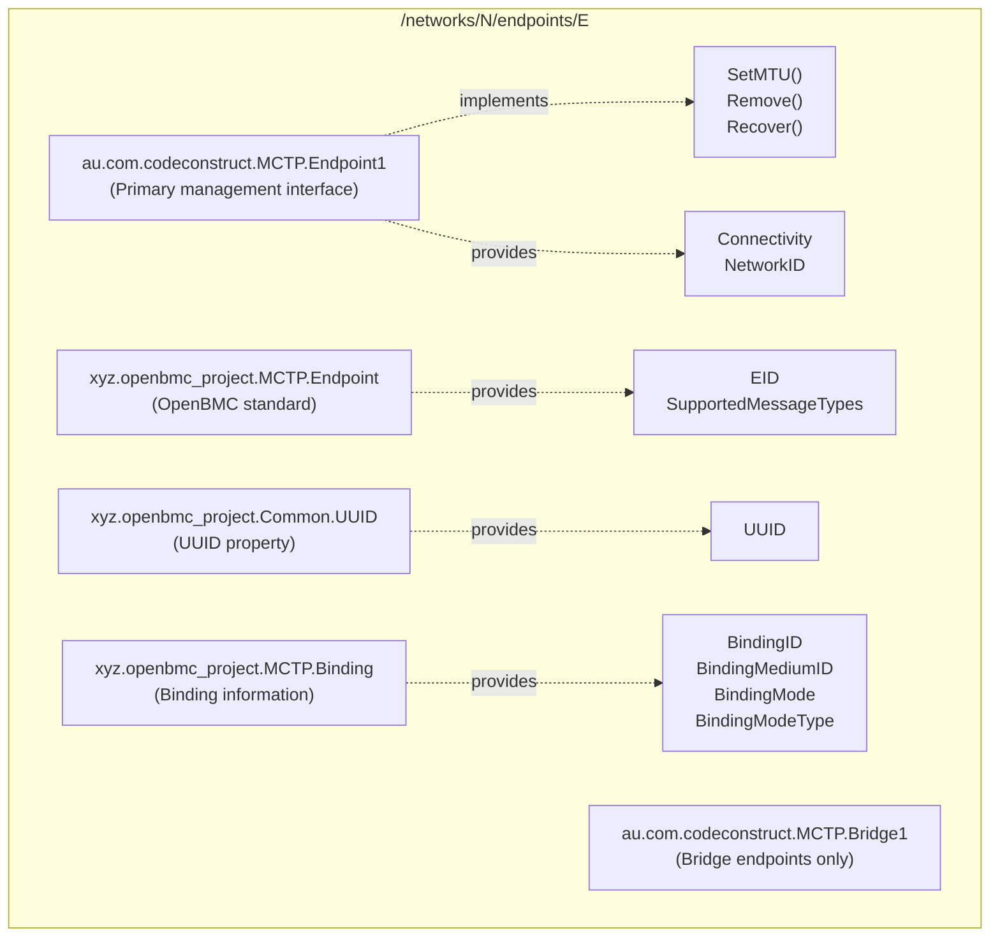
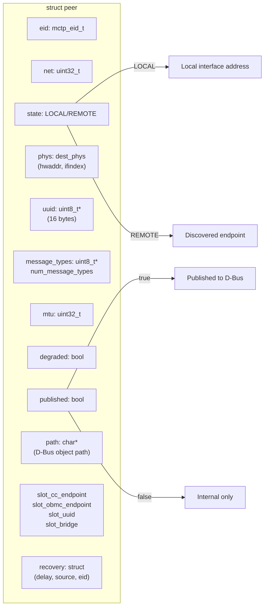
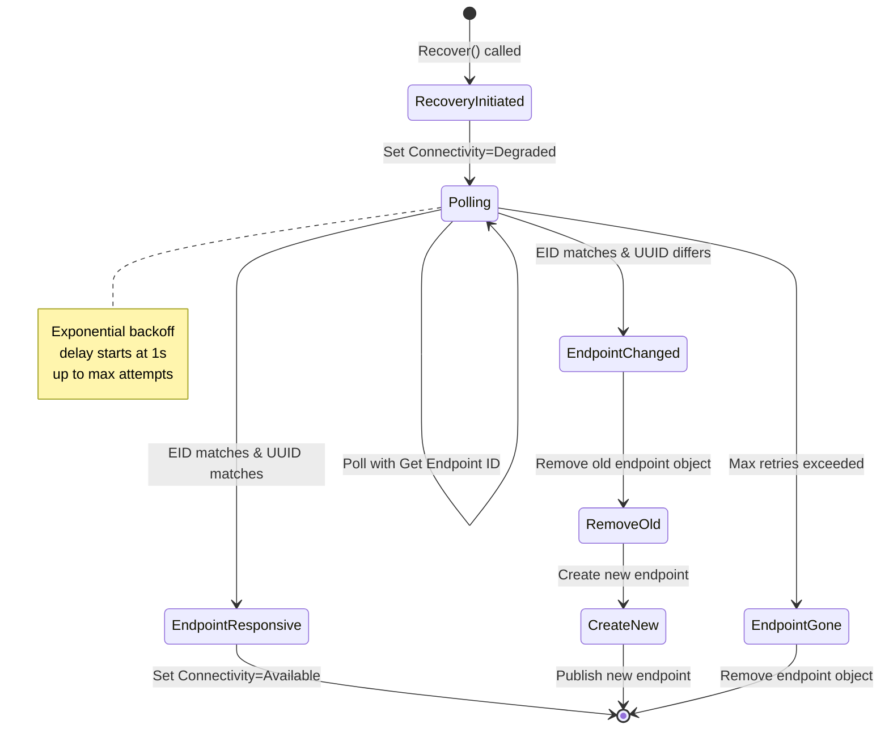
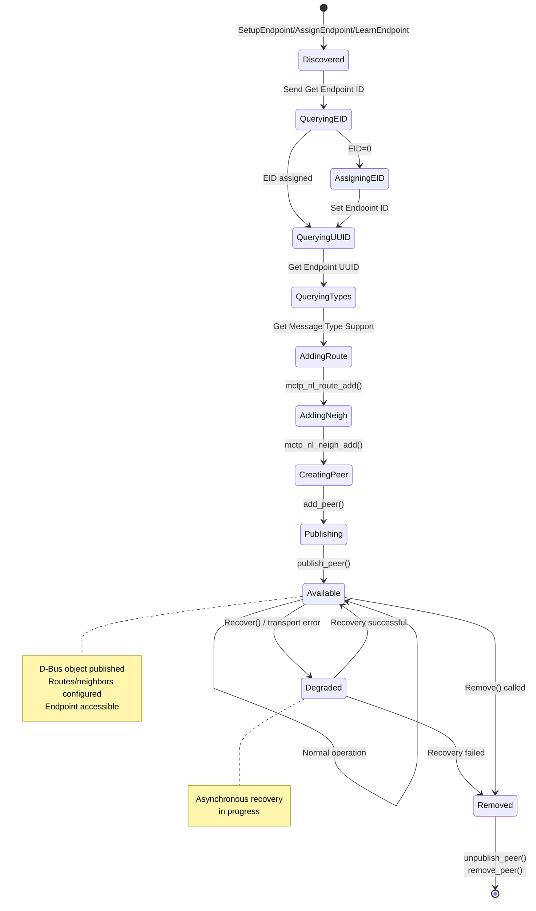
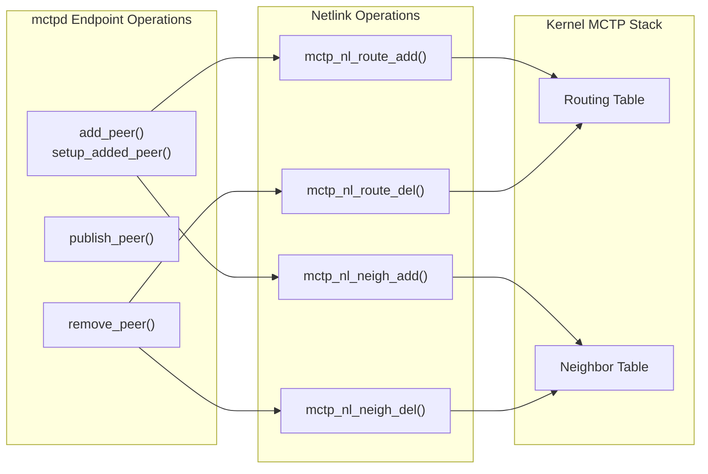

<!-- source: DeepWiki mcp.deepwiki.com · repo NVIDIA/mctp · page 4.2 Endpoint1 Interface · fetched 2026-10-26 -->

# Endpoint1 Interface

<details>
<summary>Relevant source files</summary>

The following files were used as context for generating this wiki page:

- [conf/mctpd.conf](conf/mctpd.conf)
- [docs/mctpd.md](docs/mctpd.md)
- [src/mctpd-util.h](src/mctpd-util.h)
- [src/mctpd.c](src/mctpd.c)
- [tests/test_mctpd.py](tests/test_mctpd.py)

</details>


## Purpose and Scope

This page documents the `au.com.codeconstruct.MCTP.Endpoint1` D-Bus interface, which provides management and monitoring capabilities for individual MCTP endpoints discovered or configured by mctpd. Each endpoint in the system is represented by a D-Bus object that implements this interface, exposing properties about the endpoint's state and methods for controlling it.

For information about endpoint discovery and EID assignment, see [BusOwner1 Interface](#4.1). For network-level endpoint operations, see [Network1 Interface](#4.3). For MCTP bridge endpoint functionality, see [Bridge Management](#4.4).

## Endpoint Object Path Structure

Endpoint objects are published under the network hierarchy:

```
/au/com/codeconstruct/mctp1/networks/<net>/endpoints/<eid>
```

Where:
- `<net>` is the network ID (e.g., `1`)
- `<eid>` is the MCTP Endpoint ID (e.g., `8`, `10`, `12`)

For example:
- `/au/com/codeconstruct/mctp1/networks/1/endpoints/8` - Local endpoint at EID 8
- `/au/com/codeconstruct/mctp1/networks/1/endpoints/10` - Remote endpoint at EID 10

**Sources:** [docs/mctpd.md:235-239](), [src/mctpd.c:44-46]()

## D-Bus Interfaces on Endpoint Objects



**Sources:** [src/mctpd.c:48-55](), [src/mctpd.c:171-177]()

## Endpoint Data Structure

The internal representation of endpoints in mctpd:



**Sources:** [src/mctpd.c:152-222]()

## Properties

### EID (Endpoint ID)

- **Interface:** `xyz.openbmc_project.MCTP.Endpoint`
- **Type:** `y` (byte)
- **Access:** Read-only
- **Description:** The MCTP Endpoint ID assigned to this endpoint. Valid range is 8-254 for dynamically allocated EIDs.

The EID is set during endpoint setup via `SetupEndpoint`, `AssignEndpoint`, or `AssignEndpointStatic` methods on the BusOwner1 interface, or learned via `LearnEndpoint`.

**Sources:** [src/mctpd.c:154](), [tests/test_mctpd.py:114-118]()

### NetworkID

- **Interface:** `au.com.codeconstruct.MCTP.Endpoint1`
- **Type:** `u` (uint32)
- **Access:** Read-only
- **Description:** The network ID on which this endpoint exists. Corresponds to the kernel MCTP network identifier.

**Sources:** [src/mctpd.c:153]()

### UUID

- **Interface:** `xyz.openbmc_project.Common.UUID`
- **Type:** `s` (string)
- **Access:** Read-only
- **Description:** The endpoint's unique identifier, obtained via the MCTP "Get Endpoint UUID" control protocol command (0x03). Formatted as a RFC 4122 UUID string.

For local endpoints, this is the system UUID (or configured value from `mctpd.conf`). For remote endpoints, this is queried during endpoint setup.

**Sources:** [src/mctpd.c:197](), [docs/mctpd.md:325-341]()

### SupportedMessageTypes

- **Interface:** `xyz.openbmc_project.MCTP.Endpoint`
- **Type:** `ay` (array of bytes)
- **Access:** Read-only
- **Description:** Array of MCTP message types supported by this endpoint, obtained via the "Get Message Type Support" control protocol command (0x05).

Common message types:
- `0x00` - MCTP Control Protocol
- `0x01` - PLDM
- `0x02` - NVMe Management Interface (NVMe-MI)
- `0x05` - Vendor Defined PCI

**Sources:** [src/mctpd.c:189-190](), [tests/test_mctpd.py:606-624]()

### Connectivity

- **Interface:** `au.com.codeconstruct.MCTP.Endpoint1`
- **Type:** `s` (string enum)
- **Access:** Read-only
- **Values:** `"Available"` or `"Degraded"`
- **Description:** Current connectivity state of the endpoint. Set to `"Degraded"` when the endpoint fails recovery attempts and may be unreachable.

The connectivity state changes during endpoint recovery operations initiated by the `Recover()` method.

**Sources:** [src/mctpd.c:203](), [tests/test_mctpd.py:179-194]()

### MTU (Maximum Transmission Unit)

- **Interface:** Accessible via route configuration
- **Type:** `u` (uint32)
- **Description:** The MTU configured for the route to this endpoint. Can be modified via the `SetMTU()` method. Must be within the valid range for the physical transport (e.g., [68, 254] for I2C).

**Sources:** [src/mctpd.c:186](), [docs/mctpd.md:248-264]()

## Methods

### SetMTU

```
SetMTU(u mtu) → void
```

Sets the Maximum Transmission Unit for the route to this endpoint.

**Parameters:**
- `mtu` (uint32): The MTU value in bytes. Must be within the valid range for the transport binding.

**Valid MTU Ranges:**
| Transport | Min | Max |
|-----------|-----|-----|
| I2C/SMBus | 68  | 254 |

**Errors:**
- Returns D-Bus error if MTU is outside the valid range
- Returns error if endpoint is not a remote endpoint with a route

**Example:**
```shell
busctl call au.com.codeconstruct.MCTP1 \
    /au/com/codeconstruct/mctp1/networks/1/endpoints/11 \
    au.com.codeconstruct.MCTP.Endpoint1 \
    SetMTU u 80
```

**Sources:** [docs/mctpd.md:248-264](), [src/mctpd.c:186]()

### Remove

```
Remove() → void
```

Removes the endpoint from mctpd's management. This:
1. Removes the endpoint's D-Bus object
2. Deletes kernel routing table entries for this EID
3. Deletes kernel neighbor table entries
4. Frees internal data structures

Local endpoints (with `state == LOCAL`) cannot be removed via this method.

For bridge endpoints, bridged endpoints are also removed.

**Example:**
```shell
busctl call au.com.codeconstruct.MCTP1 \
    /au/com/codeconstruct/mctp1/networks/1/endpoints/11 \
    au.com.codeconstruct.MCTP.Endpoint1 \
    Remove
```

**Sources:** [docs/mctpd.md:266-268](), [tests/test_mctpd.py:154-167]()

### Recover

```
Recover() → void
```

Initiates an asynchronous recovery procedure for the endpoint. Used when an endpoint becomes unresponsive or needs re-verification.

**Recovery Process:**



**Behavior:**
- Sets `Connectivity` property to `"Degraded"` immediately
- Polls the endpoint with "Get Endpoint ID" commands using exponential backoff
- If endpoint responds with matching EID and UUID: sets `Connectivity` to `"Available"`
- If endpoint responds with matching EID but different UUID: removes old endpoint, creates new one
- If endpoint does not respond after maximum attempts: removes endpoint from D-Bus

**Timing:**
- Initial poll delay: 1 second
- Maximum recovery time: ~10 seconds (exponential backoff with retries)
- Recovery timeout constant: `MCTPD_TRECLAIM` (5 seconds in tests)

**Sources:** [tests/test_mctpd.py:169-321](), [src/mctpd.c:214-221]()

## Endpoint Lifecycle and State Management



**Sources:** [src/mctpd.c:279-302]()

## Code Implementation Details

### Endpoint Creation and Publishing

The endpoint lifecycle is managed by these key functions:

| Function | Purpose | File Reference |
|----------|---------|----------------|
| `add_peer()` | Allocates peer structure, adds to context | [src/mctpd.c:279]() |
| `add_peer_from_addr()` | Creates peer from socket address | [src/mctpd.c:281-283]() |
| `setup_added_peer()` | Queries properties, adds routes | [src/mctpd.c:286]() |
| `publish_peer()` | Creates D-Bus object, publishes interfaces | [src/mctpd.c:288]() |
| `unpublish_peer()` | Removes D-Bus object | [src/mctpd.c:289]() |
| `remove_peer()` | Deletes routes/neighbors, frees peer | [src/mctpd.c:284]() |

### D-Bus Vtables

Endpoint objects use multiple vtables for different interfaces:

```c
static const sd_bus_vtable bus_endpoint_cc_vtable[];      // Endpoint1 interface
static const sd_bus_vtable bus_endpoint_obmc_vtable[];    // OpenBMC Endpoint interface
static const sd_bus_vtable bus_endpoint_uuid_vtable[];    // UUID interface
static const sd_bus_vtable bus_endpoint_bridge[];         // Bridge1 interface (if applicable)
static const sd_bus_vtable bus_endpoint_binding_vtable[]; // Binding interface
```

**Sources:** [src/mctpd.c:311-315]()

### Peer Data Structure Fields

The `struct peer` contains:

```c
struct peer {
    uint32_t net;                  // Network ID
    mctp_eid_t eid;                // Endpoint ID
    
    enum { REMOTE, LOCAL } state;  // Endpoint type
    
    dest_phys phys;                // Physical address (ifindex, hwaddr)
    
    bool published;                // D-Bus publication state
    char *path;                    // D-Bus object path
    
    sd_bus_slot *slot_cc_endpoint;      // Endpoint1 vtable slot
    sd_bus_slot *slot_obmc_endpoint;    // OpenBMC Endpoint vtable slot
    sd_bus_slot *slot_uuid;             // UUID vtable slot
    sd_bus_slot *slot_bridge;           // Bridge1 vtable slot
    
    uint8_t *uuid;                 // 16-byte UUID
    uint8_t *message_types;        // Supported message types array
    size_t num_message_types;      // Number of message types
    
    uint32_t mtu;                  // Route MTU
    bool degraded;                 // Connectivity state
    
    // Recovery state
    struct {
        uint64_t delay;
        sd_event_source *source;
        int npolls;
        mctp_eid_t eid;
        uint8_t endpoint_type;
        uint8_t medium_spec;
    } recovery;
};
```

**Sources:** [src/mctpd.c:152-222]()

### Endpoint Lookups

Endpoints can be located using:

| Function | Lookup Key | Reference |
|----------|------------|-----------|
| `find_peer_by_addr()` | EID + Network ID | [src/mctpd.c:377-385]() |
| `find_peer_by_phys()` | Physical address (ifindex + hwaddr) | [src/mctpd.c:365-375]() |
| `path_from_peer()` | Get D-Bus path from peer | [src/mctpd.c:550-557]() |

### Integration with Kernel MCTP Stack

Endpoint management updates kernel state through the netlink interface:



**Sources:** [src/mctpd.c:287-291](), [src/mctp-netlink.c:1-100]()

## Test Coverage

The Endpoint1 interface is extensively tested:

| Test | Validates | Reference |
|------|-----------|-----------|
| `test_setup_endpoint()` | Basic endpoint setup and property access | [tests/test_mctpd.py:105-127]() |
| `test_remove_endpoint()` | Remove() method functionality | [tests/test_mctpd.py:154-167]() |
| `test_recover_endpoint_present()` | Recovery when endpoint is responsive | [tests/test_mctpd.py:169-194]() |
| `test_recover_endpoint_removed()` | Recovery when endpoint is gone | [tests/test_mctpd.py:196-231]() |
| `test_recover_endpoint_reset()` | Recovery after endpoint reset | [tests/test_mctpd.py:233-268]() |
| `test_recover_endpoint_exchange()` | Recovery when UUID changes | [tests/test_mctpd.py:270-321]() |
| `test_query_message_types()` | SupportedMessageTypes property | [tests/test_mctpd.py:606-624]() |

**Sources:** [tests/test_mctpd.py:1-1100]()

---

