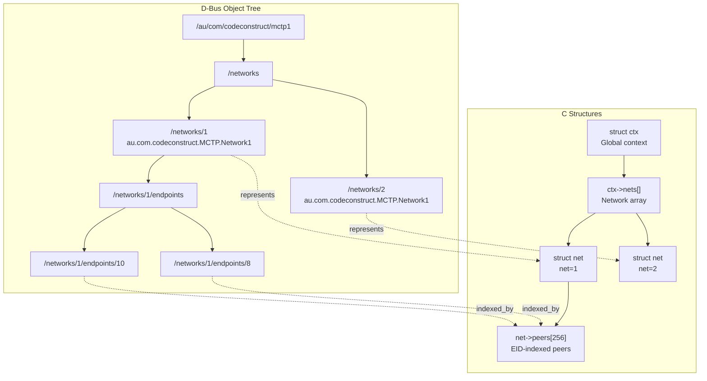
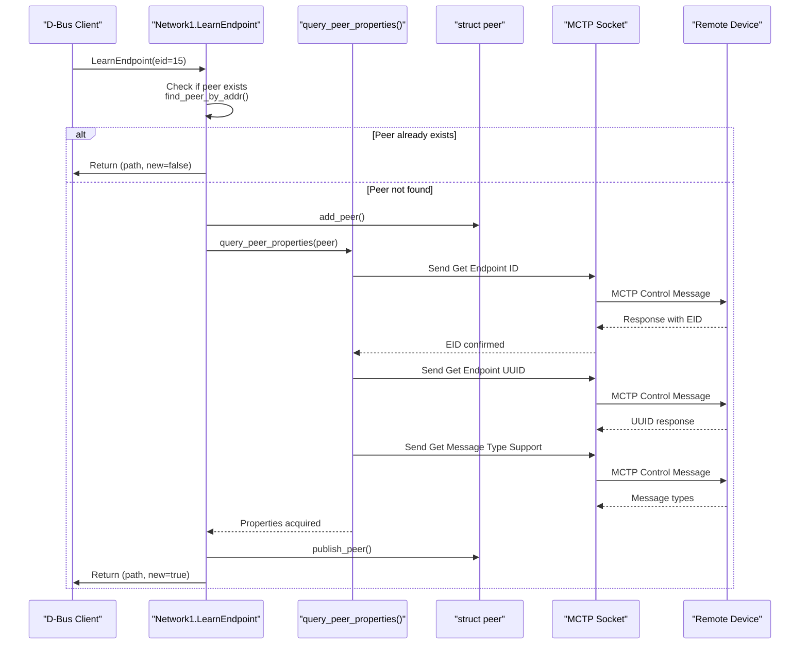
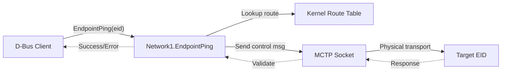
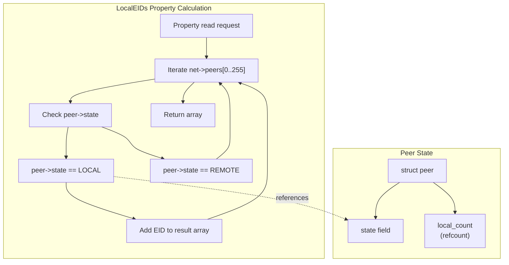
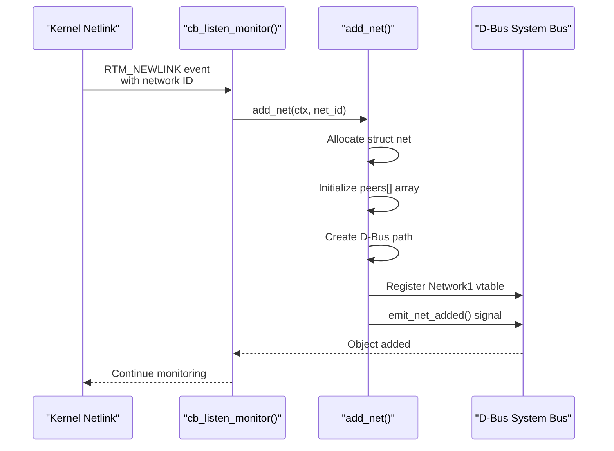
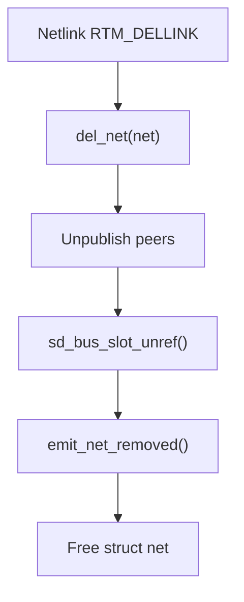
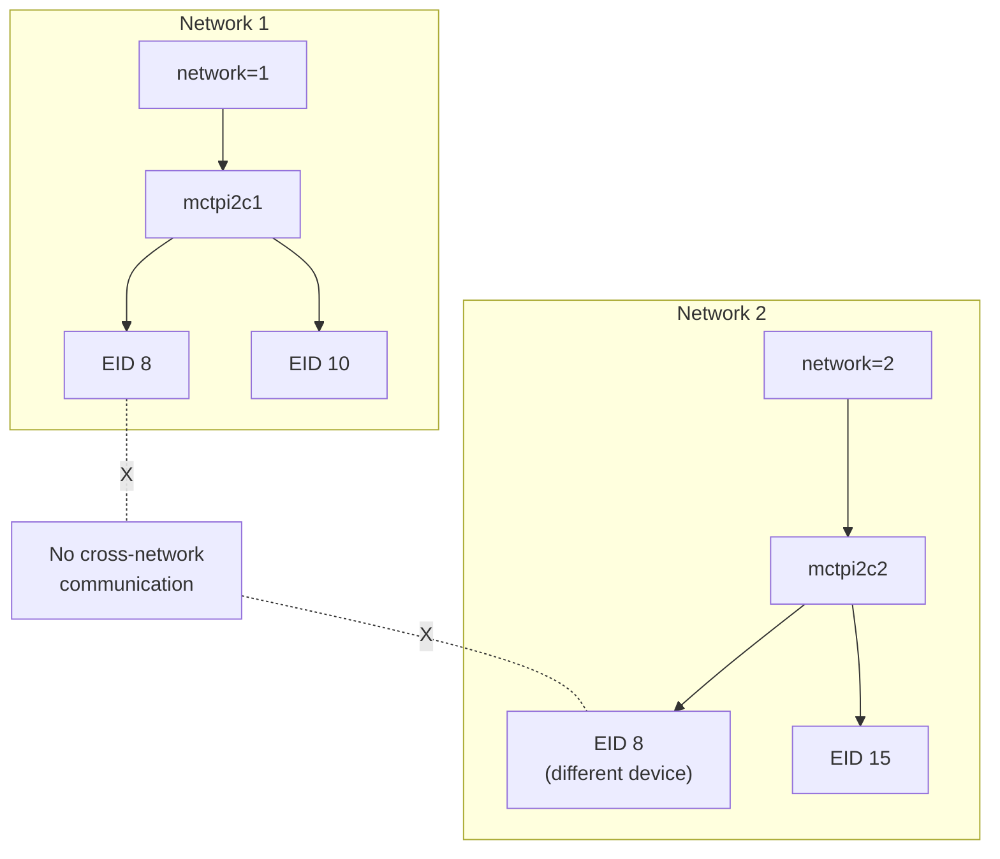
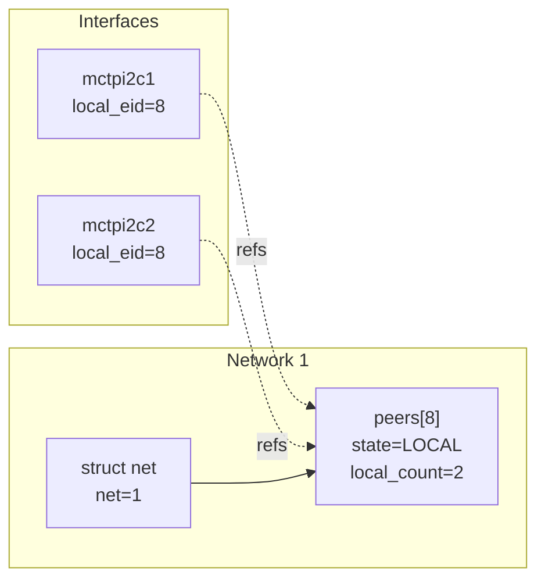

<!-- source: DeepWiki mcp.deepwiki.com · repo NVIDIA/mctp · page 4.3 Network1 Interface · fetched 2026-10-26 -->

# Network1 Interface

<details>
<summary>Relevant source files</summary>

The following files were used as context for generating this wiki page:

- [conf/mctpd.conf](conf/mctpd.conf)
- [docs/mctpd.md](docs/mctpd.md)
- [src/mctpd-util.h](src/mctpd-util.h)
- [src/mctpd.c](src/mctpd.c)

</details>


## Purpose and Scope

This page documents the `au.com.codeconstruct.MCTP.Network1` D-Bus interface, which provides network-level operations for MCTP network management. Network objects represent distinct MCTP networks on the system and provide methods for endpoint discovery and connectivity testing within those networks.

For endpoint-specific operations, see [Endpoint1 Interface](#4.2). For bus owner operations, see [BusOwner1 Interface](#4.1).

**Sources:** [docs/mctpd.md:186-234]()

---

## Network Object Hierarchy

Network objects are exposed on D-Bus under the path `/au/com/codeconstruct/mctp1/networks/<net>`, where `<net>` is the numeric network identifier. These objects are created automatically when MCTP network interfaces are configured via kernel netlink commands.

### Network Object Path Structure

```
/au/com/codeconstruct/mctp1
└── /networks
    ├── /networks/1                    (Network ID 1)
    │   └── /endpoints
    │       ├── /endpoints/8           (EID 8 on network 1)
    │       └── /endpoints/10          (EID 10 on network 1)
    └── /networks/2                    (Network ID 2)
        └── /endpoints
            └── /endpoints/12          (EID 12 on network 2)
```

### Network Object Relationships



**Sources:** [src/mctpd.c:87-96](), [docs/mctpd.md:186-192]()

---

## Data Structure

The `struct net` represents a network object in mctpd's internal state:

| Field | Type | Description |
|-------|------|-------------|
| `ctx` | `struct ctx *` | Pointer to global daemon context |
| `net` | `uint32_t` | Network identifier (1, 2, etc.) |
| `peers` | `struct peer *[256]` | Array of peer pointers indexed by EID (0-255) |
| `slot` | `sd_bus_slot *` | D-Bus vtable registration slot |
| `path` | `char *` | D-Bus object path (e.g., "/au/com/codeconstruct/mctp1/networks/1") |

The `peers` array provides O(1) lookup of endpoints by EID within the network. Unused EID slots contain `NULL`.

**Sources:** [src/mctpd.c:87-96]()

---

## Network1 Interface Specification

### Interface Summary

| Member | Type | Signature | Description |
|--------|------|-----------|-------------|
| `LearnEndpoint` | method | `y` → `sb` | Discover existing endpoint by EID |
| `EndpointPing` | method | `y` → void | Test endpoint connectivity |
| `LocalEIDs` | property | `ay` (read-only) | Array of local EIDs on this network |

**Sources:** [docs/mctpd.md:193-218]()

---

## Methods

### LearnEndpoint

Performs endpoint enumeration for a statically-configured endpoint that is already routable. This method queries an endpoint by EID without assigning a new EID.

#### Method Signature

```
LearnEndpoint(in y eid) → (out s path, out b new)
```

#### Parameters

| Parameter | Type | Direction | Description |
|-----------|------|-----------|-------------|
| `eid` | `y` (byte) | in | Endpoint ID to discover |
| `path` | `s` (string) | out | D-Bus object path of the endpoint |
| `new` | `b` (boolean) | out | `true` if newly discovered, `false` if already known |

#### Use Cases

This method is particularly useful for discovering bridged endpoints where EID assignment has been handled by the MCTP bridge, not by mctpd. It performs the same discovery queries as `SetupEndpoint` but does not attempt EID allocation.

#### Example Usage

```shell
busctl call au.com.codeconstruct.MCTP1 \
    /au/com/codeconstruct/mctp1/networks/1 \
    au.com.codeconstruct.MCTP.Network1 \
    LearnEndpoint y 15
```

Response:
```
s "/au/com/codeconstruct/mctp1/networks/1/endpoints/15"
b true
```

#### Discovery Process Flow



**Sources:** [docs/mctpd.md:206-215](), [src/mctpd.c:285]()

---

### EndpointPing

Tests connectivity to an endpoint by sending an MCTP control message and waiting for a response. This method verifies that the endpoint is reachable and responding to MCTP control protocol messages.

#### Method Signature

```
EndpointPing(in y eid) → void
```

#### Parameters

| Parameter | Type | Direction | Description |
|-----------|------|-----------|-------------|
| `eid` | `y` (byte) | in | Endpoint ID to ping |

Returns nothing on success. Raises a D-Bus error if the endpoint is unreachable or fails to respond within the configured timeout.

#### Example Usage

```shell
# Successful ping
busctl call au.com.codeconstruct.MCTP1 \
    /au/com/codeconstruct/mctp1/networks/1 \
    au.com.codeconstruct.MCTP.Network1 \
    EndpointPing y 10

# Returns with no output on success
```

#### Error Conditions

| Error | Condition |
|-------|-----------|
| Timeout | No response within `message_timeout_ms` period |
| No route | No route exists to the specified EID |
| Invalid EID | EID is out of valid range (8-254) |

#### Ping Implementation

The ping operation sends an MCTP control protocol message (typically Get Endpoint ID) to verify bidirectional communication with the target endpoint.



**Sources:** [docs/mctpd.md:219-234]()

---

## Properties

### LocalEIDs

Read-only property that returns an array of all local endpoint IDs (EIDs) assigned to interfaces on this network.

#### Property Details

| Attribute | Value |
|-----------|-------|
| Type | `ay` (array of bytes) |
| Access | Read-only |
| Change notification | `const` (does not emit PropertyChanged) |

#### Behavior

The property aggregates all EIDs that are in `LOCAL` state within the network's peer array. An interface may have multiple local EIDs, and mctpd tracks reference counts for shared local addresses.

#### Example

```shell
busctl get-property au.com.codeconstruct.MCTP1 \
    /au/com/codeconstruct/mctp1/networks/1 \
    au.com.codeconstruct.MCTP.Network1 \
    LocalEIDs
```

Response:
```
ay 2 8 11
```

This indicates network 1 has two local EIDs: 8 and 11.

#### Implementation

The property is computed by iterating through the network's peer array and selecting peers where `peer->state == LOCAL`:



**Sources:** [docs/mctpd.md:216-217](), [src/mctpd.c:152-168](), [src/mctpd.c:387-406]()

---

## Network Lifecycle Management

### Network Creation

Networks are created when MCTP interfaces are configured via kernel netlink operations. The `add_net()` function creates the network object and publishes it to D-Bus:



### Network Removal

When a network interface is deleted, the corresponding network object is removed:



**Sources:** [src/mctpd.c:299](), [src/mctpd.c:300](), [src/mctpd.c:277-278]()

---

## Relationship to Other Interfaces

### Network1 vs BusOwner1

| Aspect | Network1 | BusOwner1 |
|--------|----------|-----------|
| **Scope** | Network-level operations | Interface-level bus owner functions |
| **Location** | `/networks/<net>` | `/interfaces/<name>` |
| **Purpose** | Discover and test endpoints | Assign EIDs and enumerate devices |
| **Methods** | LearnEndpoint, EndpointPing | SetupEndpoint, AssignEndpoint |
| **EID Assignment** | Never assigns EIDs | Assigns EIDs when needed |

### Network1 and Endpoint Objects

Network objects serve as containers for endpoint objects. Each endpoint discovered or configured within a network appears as a child object:

| Object Type | Path Pattern | Purpose |
|-------------|--------------|---------|
| Network | `/networks/<net>` | Network-level operations and properties |
| Endpoint | `/networks/<net>/endpoints/<eid>` | Per-endpoint configuration and status |

**Sources:** [docs/mctpd.md:186-244]()

---

## Configuration and Network Isolation

### Network Boundaries

MCTP networks are isolated routing domains. Endpoints on different networks cannot communicate directly, even if they have the same EID value. The network ID ensures namespace separation:



### Network Configuration via mctp Utility

Networks are created and configured using the `mctp link` command before mctpd can expose Network1 interfaces:

```shell
# Create network 1
mctp link set mctpi2c1 net 1

# Create network 2
mctp link set mctpi2c2 net 2
```

**Sources:** [src/mctpd.c:87-96](), [docs/mctpd.md:186-189]()

---

## Error Handling

### Method Error Responses

Network1 methods return standard D-Bus errors for various failure conditions:

| Error Type | Condition | Example |
|------------|-----------|---------|
| `org.freedesktop.DBus.Error.InvalidArgs` | Invalid EID value | EID = 0, 255, or > 255 |
| `org.freedesktop.DBus.Error.Timeout` | No response from endpoint | Device powered off or unreachable |
| `org.freedesktop.DBus.Error.Failed` | General failure | Route not found, socket error |

### Timeout Configuration

Network1 method timeouts are controlled by the `message_timeout_ms` configuration parameter:

```toml
[mctp]
message_timeout_ms = 250  # Default: 250ms
```

Longer timeouts improve reliability for slow endpoints but degrade overall system responsiveness since operations are synchronous.

**Sources:** [conf/mctpd.conf:4-6](), [docs/mctpd.md:314-323]()

---

## Implementation Notes

### Peer Lookup Optimization

The EID-indexed peer array (`net->peers[256]`) enables O(1) endpoint lookup by EID. This is critical for:
- Fast endpoint property queries
- Efficient EndpointPing implementation  
- Quick validation of LearnEndpoint requests

### Local EID Reference Counting

Multiple interfaces can share the same local EID on a network. The `peer->local_count` field tracks how many interfaces reference each local EID, preventing premature deletion.



**Sources:** [src/mctpd.c:87-96](), [src/mctpd.c:152-168](), [src/mctpd.c:387-406]()

---

## Usage Examples

### Discovering All Endpoints on a Network

```shell
# List all endpoint objects under network 1
busctl tree au.com.codeconstruct.MCTP1 \
    /au/com/codeconstruct/mctp1/networks/1

# Output:
# /au/com/codeconstruct/mctp1/networks/1
# └─/endpoints
#   ├─/endpoints/8
#   ├─/endpoints/10
#   └─/endpoints/15
```

### Checking Network Connectivity

```shell
# Get local EIDs
busctl get-property au.com.codeconstruct.MCTP1 \
    /au/com/codeconstruct/mctp1/networks/1 \
    au.com.codeconstruct.MCTP.Network1 \
    LocalEIDs
# Output: ay 1 8

# Ping remote endpoint
busctl call au.com.codeconstruct.MCTP1 \
    /au/com/codeconstruct/mctp1/networks/1 \
    au.com.codeconstruct.MCTP.Network1 \
    EndpointPing y 10
# Output: (none on success)
```

### Learning Bridged Endpoints

```shell
# Discover endpoint EID 50 behind a bridge
busctl call au.com.codeconstruct.MCTP1 \
    /au/com/codeconstruct/mctp1/networks/1 \
    au.com.codeconstruct.MCTP.Network1 \
    LearnEndpoint y 50

# Output:
# s "/au/com/codeconstruct/mctp1/networks/1/endpoints/50"
# b true
```

**Sources:** [docs/mctpd.md:227-234]()

---

