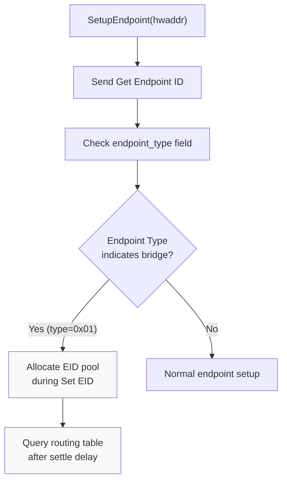
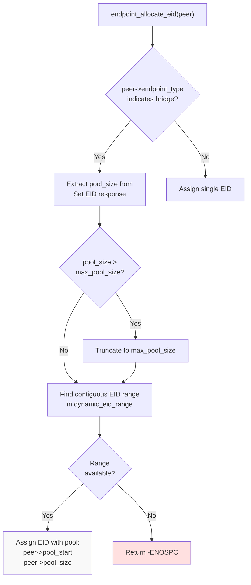
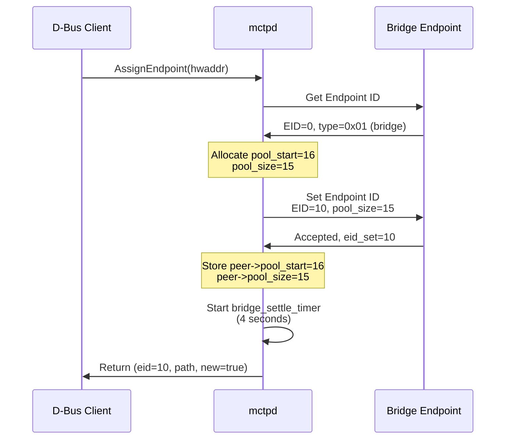
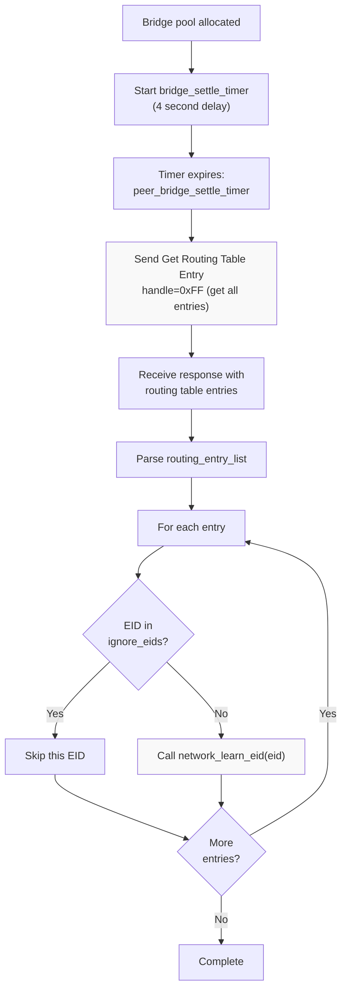
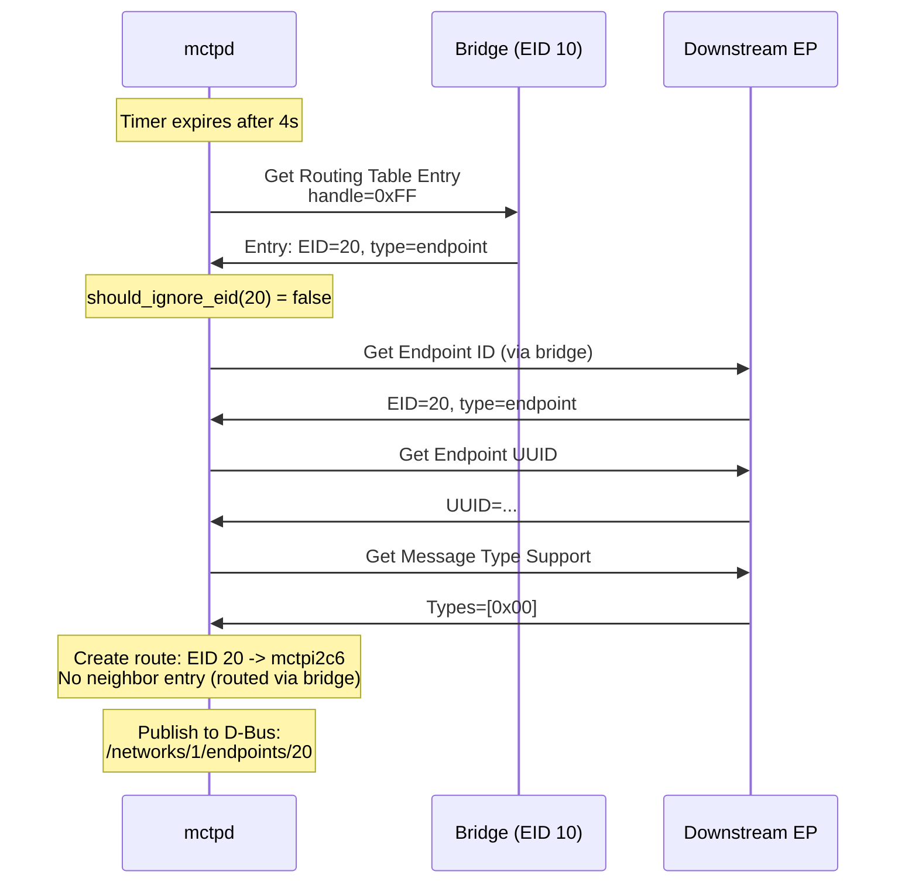
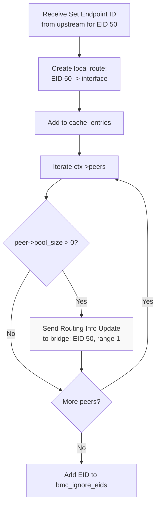

<!-- source: DeepWiki mcp.deepwiki.com · repo NVIDIA/mctp · page 4.4 Bridge Management · fetched 2026-10-26 -->

# Bridge Management

<details>
<summary>Relevant source files</summary>

The following files were used as context for generating this wiki page:

- [conf/mctpd.conf](conf/mctpd.conf)
- [docs/mctpd.md](docs/mctpd.md)
- [src/mctpd-util.h](src/mctpd-util.h)
- [src/mctpd.c](src/mctpd.c)

</details>


## Purpose and Scope

This page documents MCTP bridge endpoint support in mctpd, including pool allocation mechanisms, the `Bridge1` D-Bus interface, routing table queries, and discovery of endpoints behind bridges. For information about general endpoint management, see [Endpoint Management](#2.1.2). For the bus owner interface methods used to assign endpoints, see [BusOwner1 Interface](#4.1).

## MCTP Bridge Concepts

An MCTP bridge is an endpoint that connects multiple MCTP buses together, allowing endpoints on one bus to communicate with endpoints on another bus. Bridges require special handling because they:

- Need a contiguous **EID pool** to allocate to downstream endpoints
- Maintain **routing tables** that describe which EIDs are reachable through them
- Act as intermediaries for messages destined to downstream endpoints

When mctpd acts as a bus owner, it must:
1. Detect which endpoints are bridges (via their endpoint type in Get Endpoint ID response)
2. Allocate EID pools to bridges during Set Endpoint ID
3. Query bridge routing tables to discover downstream endpoints
4. Forward routing information updates to bridges

**Sources:** [src/mctpd.c:103-222](), [docs/mctpd.md:270-285]()

## Bridge Detection and Setup

### Detection During Endpoint Setup

Bridges are detected during the endpoint setup flow when the bus owner queries the endpoint's properties using the Get Endpoint ID control command. A bridge identifies itself through the `endpoint_type` field.



**Sources:** [src/mctpd.c:2698-2800](), [src/mctpd.c:2593-2696]()

### Bridge-Specific Peer Fields

The `struct peer` contains several bridge-specific fields:

| Field | Type | Purpose |
|-------|------|---------|
| `pool_size` | `uint8_t` | Number of EIDs allocated to bridge for downstream devices |
| `pool_start` | `uint8_t` | First EID in the allocated pool |
| `ignore_eids` | `mctp_eid_t*` | Array of EIDs to skip during routing table processing |
| `num_ignore_eids` | `size_t` | Number of entries in ignore_eids array |
| `routing_table_entry` | `struct get_routing_table_entry*` | Cached routing table data |
| `bridge_settle_timer` | `sd_event_source*` | Timer for delayed routing table query |

**Sources:** [src/mctpd.c:205-213]()

## Pool Allocation

### Dynamic Pool Allocation

When `AssignEndpoint` is called on a bridge endpoint, mctpd allocates a contiguous range of EIDs for the bridge to assign to its downstream endpoints. The allocation algorithm:

1. Determines if endpoint is a bridge by checking `endpoint_type`
2. Extracts the requested pool size from the Set Endpoint ID response
3. Truncates the request to `max_pool_size` configuration limit
4. Finds an available contiguous range within `dynamic_eid_range`
5. Assigns the pool via Set Endpoint ID with `MCTP_SET_EID_FORCE` operation



**Sources:** [src/mctpd.c:2593-2696]()

### Static Pool Allocation

The `AssignEndpointStatic` method allows specifying both the bridge's static EID and the starting EID for its pool:

```
AssignEndpointStatic(hwaddr, static_eid, pool_start, ignore_eids)
```

The `pool_start` parameter determines where the bridge's downstream EID allocation begins. For non-bridge endpoints, this parameter is ignored.

**Sources:** [docs/mctpd.md:133-150]()

### Pool Allocation Flow



**Sources:** [src/mctpd.c:2593-2696](), [src/mctpd.c:59]()

## Bridge1 D-Bus Interface

The `au.com.codeconstruct.MCTP.Bridge1` interface is published on endpoint objects that have been identified as bridges and allocated an EID pool. It exposes two read-only properties describing the allocated pool:

| Property | Type | Description |
|----------|------|-------------|
| `PoolStart` | `byte` | First EID in the contiguous range allocated for downstream endpoints |
| `PoolEnd` | `byte` | Last EID in the contiguous range allocated for downstream endpoints |

The interface is implemented in the `bus_endpoint_bridge` vtable and attached to the peer object's D-Bus slot.

### D-Bus Object Path

Bridge endpoints have the same object path structure as regular endpoints:
```
/au/com/codeconstruct/mctp1/networks/<net>/endpoints/<eid>
```

The `Bridge1` interface is added as an additional interface on the endpoint object.

### Example D-Bus Introspection

```
busctl introspect au.com.codeconstruct.MCTP1 \
    /au/com/codeconstruct/mctp1/networks/1/endpoints/10

NAME                                 TYPE      SIGNATURE RESULT/VALUE FLAGS
au.com.codeconstruct.MCTP.Bridge1    interface -         -            -
.PoolEnd                            property  y         30           const
.PoolStart                          property  y         16           const
au.com.codeconstruct.MCTP.Endpoint1  interface -         -            -
...
```

**Sources:** [src/mctpd.c:49](), [docs/mctpd.md:270-285](), [src/mctpd.c:3126-3151]()

## Routing Table Queries

### Get Routing Table Entry Command

After allocating a pool to a bridge, mctpd queries the bridge's routing table to discover which downstream endpoints are reachable through it. This uses the MCTP control protocol's Get Routing Table Entry command (0x0A).

The query is delayed by `BRIDGE_SETTLE_DELAY_SEC` (4 seconds) after EID assignment to allow the bridge time to enumerate its downstream endpoints.



**Sources:** [src/mctpd.c:2371-2479](), [src/mctpd.c:2480-2542]()

### Routing Table Entry Structure

Each entry in the routing table response contains:

| Field | Type | Description |
|-------|------|-------------|
| `eid_range` | `uint8_t` | Number of EIDs in this entry (typically 1) |
| `first_eid` | `mctp_eid_t` | Starting EID for this range |
| `entry_type` | `uint8_t` | Entry type (0x00 = simple endpoint) |
| `phys_transport_binding` | `uint8_t` | Physical medium type |
| `phys_media_type` | `uint8_t` | Media-specific type |
| `phys_address_size` | `uint8_t` | Size of physical address field |
| `phys_address` | `uint8_t[]` | Physical address (if applicable) |

**Sources:** [src/mctp-control-spec.h:258-275]()

### Ignore EIDs Mechanism

The `ignore_eids` array allows filtering out specific EIDs during routing table processing. This is useful for:

- Excluding the bridge's own EID
- Skipping EIDs managed by other systems
- Avoiding duplicate discovery of bus owner EIDs

The filtering occurs in `should_ignore_eid()` function, which is called for each routing table entry.

**Sources:** [src/mctpd.c:2338-2348](), [src/mctpd.c:208-209]()

## Bridged Endpoint Discovery

### Discovery Flow

When a routing table entry for a downstream EID is found, mctpd uses the `network_learn_eid()` function to query the endpoint directly:



**Sources:** [src/mctpd.c:2501-2542](), [src/mctpd.c:4095-4184]()

### Routing Configuration

For bridged endpoints, mctpd creates kernel routes but **does not** create neighbor entries:

- **Route**: Maps the downstream EID to the interface connected to the bridge
- **No neighbor entry**: The endpoint's physical address is not directly reachable

The route allows the kernel to forward messages to the bridge, which then handles forwarding to the downstream endpoint.

**Sources:** [src/mctpd.c:4106-4109]()

### Removing Bridged Peers

When a bridge is removed (via the `.Remove` method or interface down event), all discovered downstream endpoints must also be removed. The `remove_bridged_peers()` function:

1. Iterates through all peers in the context
2. Identifies peers whose routes are within the bridge's pool range
3. Calls `remove_peer()` on each downstream endpoint
4. Removes the bridge endpoint itself

**Sources:** [src/mctpd.c:2176-2199]()

## Routing Information Updates

### Propagating Routing Updates

When mctpd acts as an intermediate bus owner (e.g., a gateway BMC), it must propagate routing information to downstream bridges. This occurs when:

1. mctpd receives a Set Endpoint ID request and accepts it
2. mctpd receives a Routing Information Update from an upstream bus owner

In both cases, mctpd forwards the routing entry to all known bridges using the `endpoint_send_routing_info_update()` function.



**Sources:** [src/mctpd.c:840-900](), [src/mctpd.c:1238-1273]()

### Routing Info Update Message Structure

The message uses MCTP control command 0x09 (Routing Information Update):

| Field | Value |
|-------|-------|
| Command Code | 0x09 |
| Number of Entries | Typically 1 |
| Entry Handle | 0x00 |
| Entry Type | 0x00 (simple endpoint) |
| EID Range | Number of EIDs (typically 1) |
| First EID | The EID to advertise |
| Physical Address Size | Medium-specific (0 for USB) |
| Physical Address | Medium-specific address |

**Note:** Currently, all bridges are assumed to operate on USB buses, which do not utilize physical addresses. If future platforms introduce bridges on buses with physical addresses, the forwarding logic must include the bus owner's physical address.

**Sources:** [src/mctpd.c:1249-1268](), [src/mctpd.c:2831-2903]()

### Cached Routing Entries

mctpd maintains a cache of routing entries received from upstream bus owners in `ctx->cache_entries`:

```c
struct {
    struct routing_info_entry **routing_info_entries;
    uint8_t *entry_sizes;
    uint8_t count;
} cache_entries;
```

This cache is used to:
- Forward routing information to newly discovered bridges
- Respond to routing queries from other components
- Maintain a consistent view of the network topology

**Sources:** [src/mctpd.c:266-270](), [src/mctpd.c:1276-1305]()

## Configuration

### max_pool_size Setting

The `max_pool_size` configuration parameter limits the maximum EID pool size that can be allocated to a bridge, regardless of the pool size requested in the Set Endpoint ID response.

**Configuration file:** `/etc/mctpd.conf`

```toml
[bus-owner]
max_pool_size = 15
```

| Parameter | Type | Default | Description |
|-----------|------|---------|-------------|
| `max_pool_size` | integer | 15 | Maximum number of EIDs in a bridge's pool |

If a bridge requests a pool size larger than `max_pool_size`, the request is truncated to this limit. This prevents a single bridge from consuming the entire available EID space.

**Sources:** [conf/mctpd.conf:18](), [docs/mctpd.md:361-368](), [src/mctpd.c:259]()

### Bridge Settle Delay

The bridge settle delay is a hardcoded constant:

```c
#define BRIDGE_SETTLE_DELAY_SEC 4
```

This 4-second delay allows the bridge time to enumerate its downstream endpoints before mctpd queries the routing table. The delay prevents racing with the bridge's own discovery process.

**Sources:** [src/mctpd.c:59]()

---

