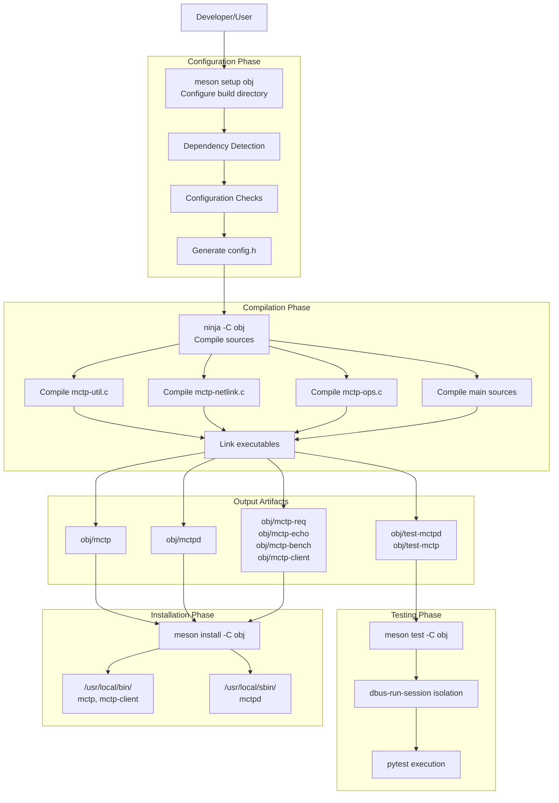
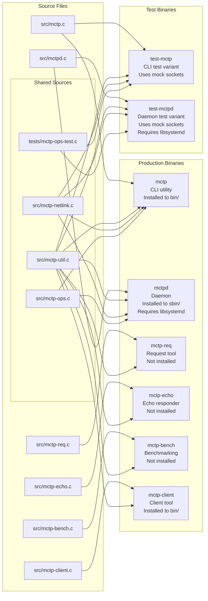
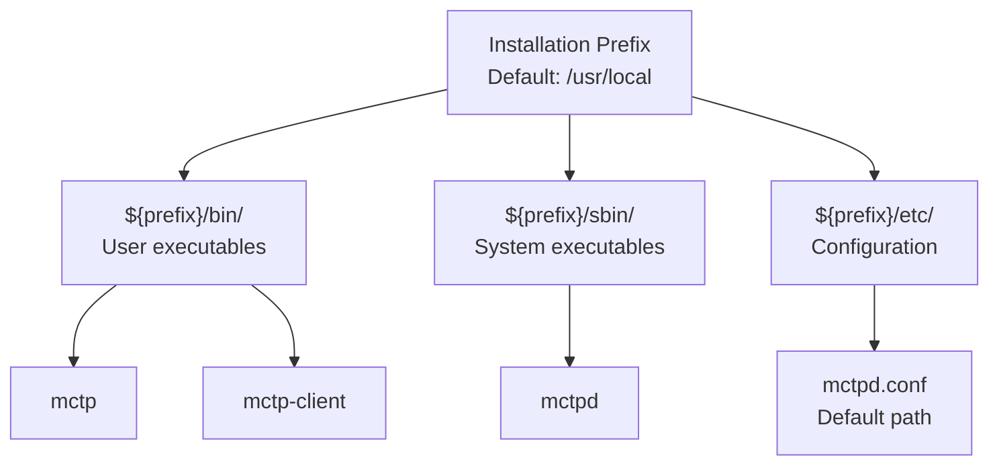
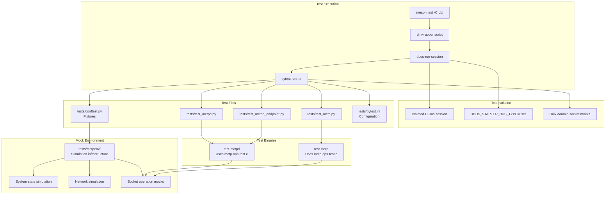
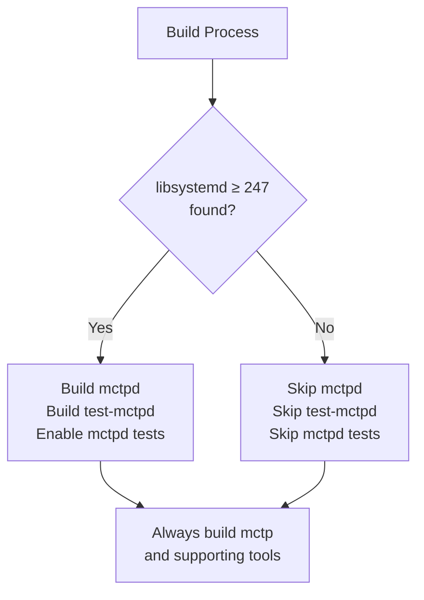

<!-- source: DeepWiki mcp.deepwiki.com · repo NVIDIA/mctp · page 5 Building and Installation · fetched 2026-10-26 -->

# Building and Installation

<details>
<summary>Relevant source files</summary>

The following files were used as context for generating this wiki page:

- [README.md](README.md)
- [meson.build](meson.build)
- [tests/pytest.ini](tests/pytest.ini)
- [tests/requirements.txt](tests/requirements.txt)

</details>


## Purpose and Scope

This page provides an overview of the build and installation process for the MCTP userspace tools. It covers the high-level workflow, quick start instructions, build artifacts, and installation procedures. For detailed information about specific aspects of the build system:

- Build system internals and Meson configuration: see [Build System](#5.1)
- Compile-time options and feature flags: see [Build Options and Configuration](#5.2)
- Required and optional dependencies: see [Dependencies](#5.3)

## Build Workflow Overview

The MCTP project uses Meson as its build system, which orchestrates compilation of multiple executables from shared and executable-specific source files. The build process involves configuration detection, dependency resolution, compilation, optional test execution, and installation.



**Sources:** [meson.build:1-174](), [README.md:15-36]()

## Quick Start

### Basic Build

To configure and compile the project with default settings:

```bash
meson setup obj
ninja -C obj
```

The `meson setup` command creates a build directory (`obj`) and performs configuration checks. The `ninja -C obj` command compiles all source files and links the executables.

### Build Without Tests

If you don't need the test suite and want to avoid test dependencies:

```bash
meson setup obj -Dtests=false
ninja -C obj
```

### Installation

To install to the default prefix (`/usr/local`):

```bash
meson install -C obj
```

To install with a custom `DESTDIR` (useful for packaging):

```bash
DESTDIR=/tmp/staging meson install -C obj
```

**Sources:** [README.md:18-28]()

## Build Artifacts

The build process produces multiple executables, each serving different purposes in the MCTP ecosystem:



### Production Executables

| Executable | Purpose | Installation Path | Dependencies |
|------------|---------|-------------------|--------------|
| `mctp` | Command-line utility for kernel MCTP stack management | `${prefix}/bin/mctp` | None |
| `mctpd` | MCTP control protocol daemon and bus owner | `${prefix}/sbin/mctpd` | libsystemd ≥ 247 |
| `mctp-client` | Client utility for MCTP communication | `${prefix}/bin/mctp-client` | None |
| `mctp-req` | Request/response test utility | Not installed | None |
| `mctp-echo` | Echo responder for testing | Not installed | None |
| `mctp-bench` | Performance benchmarking tool | Not installed | None |

### Test Executables

| Executable | Purpose | Differences from Production |
|------------|---------|----------------------------|
| `test-mctp` | Test variant of `mctp` utility | Uses `mctp-ops-test.c` for mock socket operations instead of `mctp-ops.c` |
| `test-mctpd` | Test variant of `mctpd` daemon | Uses `mctp-ops-test.c` for mock socket operations instead of `mctp-ops.c` |

The test executables are functionally identical to their production counterparts, except they use a mock socket implementation that communicates via Unix domain sockets. This allows the test suite to simulate kernel MCTP behavior without requiring actual kernel support.

**Sources:** [meson.build:46-100]()

## Installation Locations

The installation layout follows standard Unix conventions:



### Configuration File Location

The `mctpd` daemon expects its configuration file at `${prefix}/etc/mctpd.conf` by default. This path is compiled into the binary via the `MCTPD_CONF_FILE_DEFAULT` preprocessor definition. You can override this at runtime using the `-c FILE` command-line option.

### Example Installation Paths

For the default prefix (`/usr/local`):
- `mctp` → `/usr/local/bin/mctp`
- `mctp-client` → `/usr/local/bin/mctp-client`
- `mctpd` → `/usr/local/sbin/mctpd`
- Configuration → `/usr/local/etc/mctpd.conf`

For a system installation with prefix `/usr`:
- `mctp` → `/usr/bin/mctp`
- `mctp-client` → `/usr/bin/mctp-client`
- `mctpd` → `/usr/sbin/mctpd`
- Configuration → `/etc/mctpd.conf`

**Sources:** [meson.build:36-39, 56-91]()

## Testing the Build

The project includes an integration test suite that validates both the `mctp` utility and the `mctpd` daemon. Tests are enabled by default but can be disabled with `-Dtests=false`.

### Test Infrastructure Overview



### Running Tests

**Via Meson:**
```bash
meson test -C obj
```

This runs all configured tests with proper isolation.

**Via pytest directly (for development):**
```bash
cd obj
dbus-run-session env DBUS_STARTER_BUS_TYPE=user pytest
```

**With a Python virtual environment:**
```bash
python3 -m venv venv
venv/bin/pip install -r tests/requirements.txt
PATH=$PWD/venv/bin/:$PATH meson setup obj
ninja -C obj test
```

### Test Categories

The test suite includes three main test targets:

| Test Target | Source File | Tests |
|-------------|-------------|-------|
| `test-mctpd` | [tests/test_mctpd.py]() | Core mctpd daemon functionality, D-Bus interfaces, control protocol handling |
| `test-mctpd-endpoint` | [tests/test_mctpd_endpoint.py]() | Endpoint management, EID assignment, recovery mechanisms |
| `test-mctp` | [tests/test_mctp.py]() | CLI utility operations, Netlink interactions |

### Test Isolation

Tests run in an isolated environment to prevent interference with the system:

1. **D-Bus Isolation:** Each test run uses `dbus-run-session` to create an isolated D-Bus session, preventing test behaviors from affecting applications on the system bus.

2. **Socket Mocking:** Test binaries (`test-mctpd`, `test-mctp`) use mock socket operations from [tests/mctp-ops-test.c]() that communicate over Unix domain sockets instead of real Netlink and MCTP sockets.

3. **Environment Simulation:** The [tests/mctpenv/]() directory provides simulated system state (interfaces, routes, neighbors) and network endpoints.

**Sources:** [meson.build:102-173](), [README.md:113-149](), [tests/pytest.ini:1-6](), [tests/requirements.txt:1-7]()

## Conditional Compilation

### libsystemd Dependency

The `mctpd` daemon requires `libsystemd` (version ≥ 247) and is only compiled if this dependency is found:



The detection is performed at [meson.build:17]() using `dependency('libsystemd', version: '>=247', required: false)`. If libsystemd is not found, the build continues but without the daemon components.

### Test Suite

Tests are controlled by the `tests` Meson option (enabled by default). When disabled, pytest and Python dependencies are not required, and test executables are not built.

**Sources:** [meson.build:17, 83-100, 102-103](), [README.md:31-36]()

## Configuration File Generation

During the configuration phase, Meson generates a `config.h` header file that defines preprocessor macros based on system capabilities and build options:

| Macro | Detection Method | Purpose |
|-------|------------------|---------|
| `HAVE_LINUX_MCTP_H` | `cc.has_header('linux/mctp.h')` | Indicates kernel MCTP header availability |
| `HAVE_STRUCT_MCTP_FQ_ADDR` | `cc.has_type('struct mctp_fq_addr', ...)` | Indicates support for flow-qualified addresses |
| `MCTPD_RECOVER_NIL_UUID` | `get_option('unsafe-recover-nil-uuid')` | Enables nil UUID handling in recovery |
| `MCTPD_WRITABLE_CONNECTIVITY` | `get_option('unsafe-writable-connectivity')` | Enables writable Connectivity property |
| `MCTPD_CONF_FILE_DEFAULT` | Path construction | Default configuration file path |

The generated header is used by all compiled sources to adapt to the build environment.

**Sources:** [meson.build:19-44]()

## Integration with System Services

While the build system handles compilation and installation, the repository includes example systemd service files under the `conf/` directory (not installed by default). These files coordinate:

- Local MCTP stack setup (interfaces, addresses)
- Supervision of the `mctpd` process
- Integration with the system D-Bus daemon

For production deployment, these configuration files should be installed to the appropriate systemd directories (typically `/etc/systemd/system/` or `/usr/lib/systemd/system/`).

**Sources:** [README.md:27-29, 68-71]()

---

