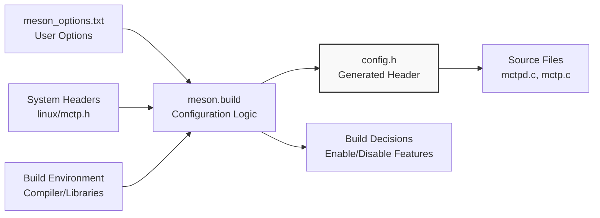
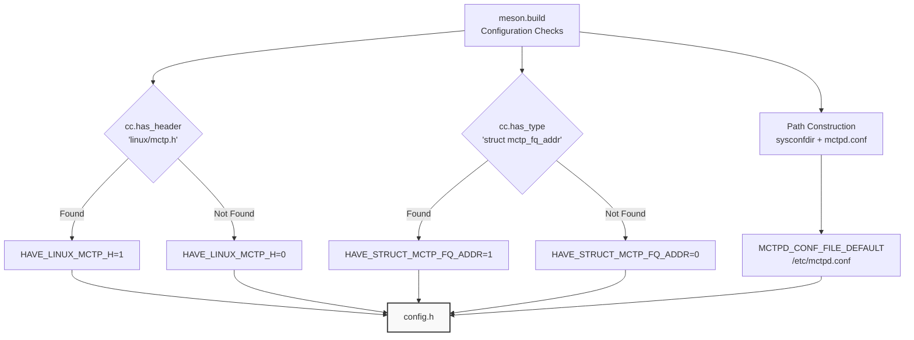
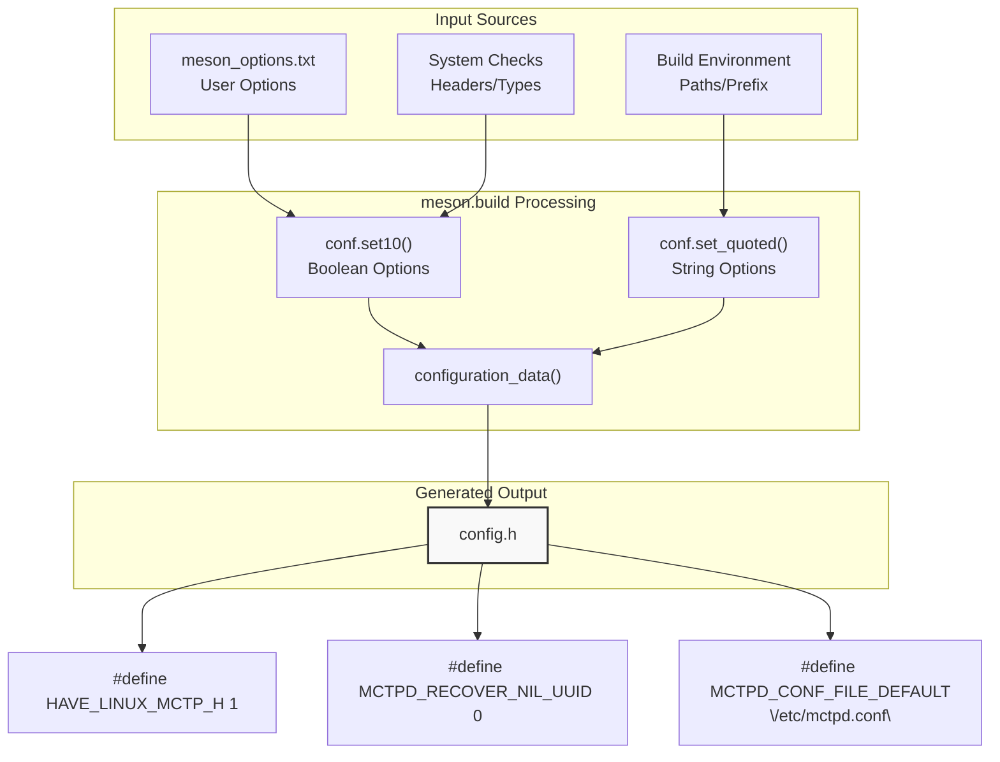
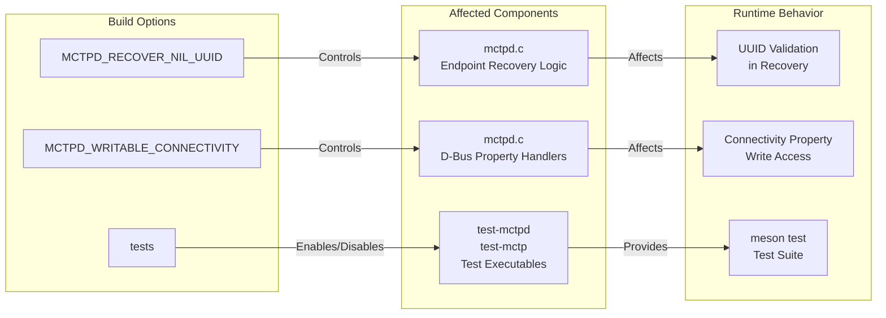

<!-- source: DeepWiki mcp.deepwiki.com · repo NVIDIA/mctp · page 5.2 Build Options and Configuration · fetched 2026-10-26 -->

# Build Options and Configuration

<details>
<summary>Relevant source files</summary>

The following files were used as context for generating this wiki page:

- [meson.build](meson.build)
- [meson_options.txt](meson_options.txt)
- [tests/pytest.ini](tests/pytest.ini)

</details>


## Purpose and Scope

This page documents the build-time configuration options available when compiling the MCTP project using Meson. It covers user-configurable options, automatic configuration checks, and how these settings affect the compiled binaries. For information about the general build system structure and compilation process, see [Build System](#5.1). For required and optional dependencies, see [Dependencies](#5.3).

---

## Overview

The MCTP project uses Meson's configuration system to expose build-time options and perform capability detection. Configuration is managed through three main mechanisms:

1. **User-configurable options** defined in `meson_options.txt`
2. **Automatic capability checks** for kernel headers and structures
3. **Generated configuration header** (`config.h`) that propagates settings to source code



**Configuration Flow Diagram**

Sources: [meson.build:1-174](), [meson_options.txt:1-7]()

---

## User-Configurable Options

The project defines three user-configurable build options in `meson_options.txt`:

| Option Name | Type | Default | Description |
|-------------|------|---------|-------------|
| `unsafe-recover-nil-uuid` | boolean | `false` | Allow endpoint recovery for devices reporting nil (all-zeros) UUIDs |
| `unsafe-writable-connectivity` | boolean | `false` | Enable write access to the `Connectivity` property on D-Bus Endpoint1 interface |
| `tests` | boolean | `true` | Build and enable the test suite |

### unsafe-recover-nil-uuid

**Configuration Symbol:** `MCTPD_RECOVER_NIL_UUID`

This option controls whether `mctpd` considers a nil UUID (all zeros) as valid for endpoint recovery purposes. By default, this is disabled because nil UUIDs are not unique and cannot reliably identify endpoints across recovery scenarios.

**When enabled:**
- Endpoints reporting UUID `00000000-0000-0000-0000-000000000000` are treated as recoverable
- May lead to incorrect endpoint identification if multiple devices report nil UUIDs
- Marked "unsafe" because it violates MCTP endpoint uniqueness requirements

**Build-time setting:**
```bash
meson configure build -Dunsafe-recover-nil-uuid=true
```

Sources: [meson_options.txt:1](), [meson.build:28-31]()

### unsafe-writable-connectivity

**Configuration Symbol:** `MCTPD_WRITABLE_CONNECTIVITY`

This option enables write access to the `Connectivity` D-Bus property on endpoint objects, allowing external applications to modify endpoint connectivity state.

**When enabled:**
- The `Connectivity` property on `au.com.codeconstruct.MCTP.Endpoint1` interface becomes writable
- Applications can mark endpoints as connected/degraded without actual device probing
- Marked "unsafe" because it allows manual state manipulation that may not reflect reality

**Build-time setting:**
```bash
meson configure build -Dunsafe-writable-connectivity=true
```

Sources: [meson_options.txt:2-5](), [meson.build:32-34]()

### tests

This option controls whether the test suite is built and registered with Meson's test runner.

**When enabled (default):**
- `test-mctpd` and `test-mctp` executables are built
- Python-based integration tests are registered via `meson test`
- Test dependencies (`pytest`, `trio`, `asyncdbus`) are required

**When disabled:**
- Test executables are not built
- Test dependencies are not required
- `meson test` has no registered tests

**Build-time setting:**
```bash
meson configure build -Dtests=false
```

Sources: [meson_options.txt:6](), [meson.build:102-173]()

---

## Automatic Configuration Checks

The build system performs several automatic capability checks to detect system features:



**Configuration Check Flow**

### HAVE_LINUX_MCTP_H

**Check:** `cc.has_header('linux/mctp.h')`

Tests whether the kernel MCTP header is available in the system's include path. This header defines core MCTP protocol constants, address structures, and socket options.

**Impact:**
- When **defined (1)**: Code can use kernel MCTP definitions directly
- When **not defined (0)**: Code must provide fallback definitions or disable kernel-dependent features

**Checked at:** [meson.build:20-23]()

### HAVE_STRUCT_MCTP_FQ_ADDR

**Check:** `cc.has_type('struct mctp_fq_addr', prefix: '#include <linux/mctp.h>')`

Tests whether the `struct mctp_fq_addr` type is available in the kernel headers. This structure is used for flow-qualified addressing in MCTP sockets.

**Impact:**
- Determines availability of advanced socket addressing features
- May affect socket operation implementations

**Checked at:** [meson.build:24-27]()

### MCTPD_CONF_FILE_DEFAULT

**Value:** `join_paths(get_option('prefix'), get_option('sysconfdir'), 'mctpd.conf')`

Constructs the default configuration file path based on installation prefix and system configuration directory.

**Default expansion:** `/usr/local/etc/mctpd.conf` (prefix=/usr/local) or `/etc/mctpd.conf` (prefix=/usr)

**Defined at:** [meson.build:36-39]()

Sources: [meson.build:19-44]()

---

## Configuration Header Generation

All configuration settings are consolidated into `config.h`, which is generated by the `configure_file()` function:



**Configuration Header Generation Process**

### Configuration Data Structure

The `configuration_data()` object accumulates all settings:

```c
// Example generated config.h content
#define HAVE_LINUX_MCTP_H 1
#define HAVE_STRUCT_MCTP_FQ_ADDR 1
#define MCTPD_RECOVER_NIL_UUID 0
#define MCTPD_WRITABLE_CONNECTIVITY 0
#define MCTPD_CONF_FILE_DEFAULT "/etc/mctpd.conf"
```

### Configuration Methods

| Method | Purpose | Example |
|--------|---------|---------|
| `conf.set10(name, value)` | Define boolean as 1 or 0 | `HAVE_LINUX_MCTP_H` |
| `conf.set_quoted(name, value)` | Define quoted string | `MCTPD_CONF_FILE_DEFAULT` |

Sources: [meson.build:19-44]()

---

## Setting Build Options

### Initial Configuration

Set options when first configuring the build:

```bash
meson setup build \
  -Dunsafe-recover-nil-uuid=false \
  -Dunsafe-writable-connectivity=false \
  -Dtests=true \
  --prefix=/usr
```

### Reconfiguring Existing Build

Modify options in an existing build directory:

```bash
meson configure build -Dunsafe-recover-nil-uuid=true
```

### Viewing Current Configuration

List all configured options:

```bash
meson configure build
```

### Installation Prefix Impact

The installation prefix affects the default configuration file path:

| Prefix | Configuration File Path |
|--------|------------------------|
| `/usr` | `/etc/mctpd.conf` |
| `/usr/local` | `/usr/local/etc/mctpd.conf` |
| `/opt/mctp` | `/opt/mctp/etc/mctpd.conf` |

Sources: [meson.build:3-11](), [meson.build:36-39]()

---

## Configuration Impact on Behavior



**Configuration Impact Map**

### MCTPD_RECOVER_NIL_UUID Impact

**Source code usage:**
- Referenced in endpoint recovery logic to decide whether nil UUIDs are acceptable
- Affects UUID validation during `peer_endpoint_recover()` operations

**Runtime impact:**
- When **enabled**: Devices with nil UUID can be recovered after disconnection
- When **disabled**: Devices with nil UUID are considered non-recoverable

### MCTPD_WRITABLE_CONNECTIVITY Impact

**Source code usage:**
- Controls D-Bus property definition for `Connectivity` on Endpoint1 interface
- Determines whether property has write capability flag

**Runtime impact:**
- When **enabled**: D-Bus clients can call `Set()` on `Connectivity` property
- When **disabled**: Property is read-only, modifications rejected with permission error

### tests Impact

**Build impact:**
- Controls whether test-specific executables are compiled
- Affects whether test dependencies must be available

**Test execution:**
```bash
# With tests=true
meson test -C build

# Runs:
# - test-mctpd (if libsystemd found)
# - test-mctpd-endpoint (if libsystemd found)
# - test-mctp
```

Sources: [meson.build:28-34](), [meson.build:102-173]()

---

## Configuration Verification

After configuring the build, verify settings by examining the generated header:

```bash
cat build/config.h
```

Expected output shows all defined symbols:

```c
#define HAVE_LINUX_MCTP_H 1
#define HAVE_STRUCT_MCTP_FQ_ADDR 1
#define MCTPD_RECOVER_NIL_UUID 0
#define MCTPD_WRITABLE_CONNECTIVITY 0
#define MCTPD_CONF_FILE_DEFAULT "/etc/mctpd.conf"
```

### Conditional Compilation

Source files include `config.h` to access these settings:

```c
#include "config.h"

#ifdef HAVE_LINUX_MCTP_H
#include <linux/mctp.h>
#else
// Fallback definitions
#endif

#if MCTPD_RECOVER_NIL_UUID
// Allow nil UUID recovery
#endif
```

Sources: [meson.build:41-44]()

---

## Summary Table

| Configuration Item | Source | Type | Impact Scope |
|-------------------|--------|------|--------------|
| `unsafe-recover-nil-uuid` | User option | Boolean | mctpd endpoint recovery |
| `unsafe-writable-connectivity` | User option | Boolean | mctpd D-Bus interface |
| `tests` | User option | Boolean | Build system |
| `HAVE_LINUX_MCTP_H` | Auto-detect | Boolean | Kernel interface code |
| `HAVE_STRUCT_MCTP_FQ_ADDR` | Auto-detect | Boolean | Socket operations |
| `MCTPD_CONF_FILE_DEFAULT` | Path construction | String | Configuration loading |

Sources: [meson.build:19-44](), [meson_options.txt:1-7]()

---

