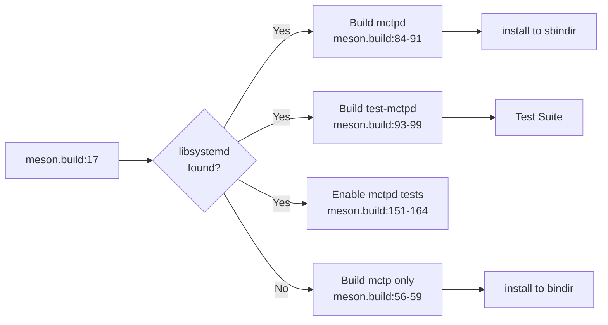
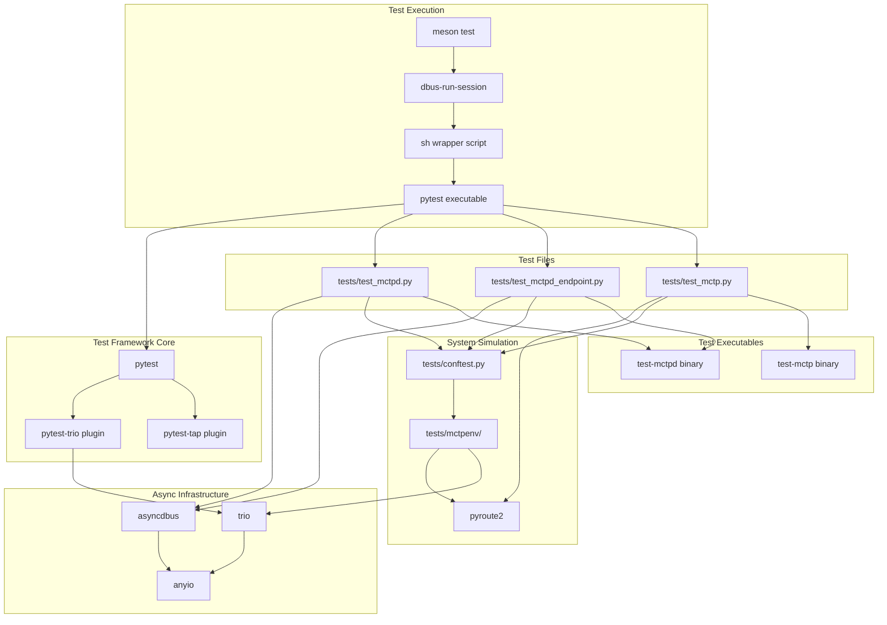

<!-- source: DeepWiki mcp.deepwiki.com · repo NVIDIA/mctp · page 5.3 Dependencies · fetched 2026-10-26 -->

# Dependencies

<details>
<summary>Relevant source files</summary>

The following files were used as context for generating this wiki page:

- [README.md](README.md)
- [meson.build](meson.build)
- [tests/pytest.ini](tests/pytest.ini)
- [tests/requirements.txt](tests/requirements.txt)

</details>


## Purpose and Scope

This document provides comprehensive information about all dependencies required to build, install, and test the MCTP repository. It covers build-time requirements, optional features, kernel prerequisites, and test infrastructure dependencies. For information about the build process itself, see [Build System](#5.1). For configuration options that affect dependency requirements, see [Build Options and Configuration](#5.2).

---

## Dependency Overview

The MCTP project has dependencies organized into four categories:

1. **Build-Time Dependencies** - Required to compile the project
2. **Optional Dependencies** - Enable additional features when present
3. **Kernel Requirements** - Linux kernel headers and support
4. **Test Dependencies** - Required only when running the test suite

```mermaid
graph TB
    subgraph "Build-Time Required"
        MESON["Meson >= 0.59.0"]
        NINJA["Ninja Build"]
        GCC["C Compiler (gcc/clang)"]
        KERNEL_HEADERS["Kernel Headers"]
    end
    
    subgraph "Optional Dependencies"
        LIBSYSTEMD["libsystemd >= 247"]
        TOML["tomlc99 (bundled)"]
    end
    
    subgraph "Kernel Requirements"
        MCTP_H["linux/mctp.h"]
        MCTP_FQ["struct mctp_fq_addr"]
        MCTP_STACK["Kernel MCTP Stack"]
    end
    
    subgraph "Test Dependencies"
        PYTEST["pytest >= 8.3.2"]
        TRIO["trio >= 0.26.2"]
        ASYNCDBUS["asyncdbus >= 0.6.1"]
        PYROUTE2["pyroute2 >= 0.7.10"]
        DBUS_SESSION["dbus-run-session"]
        PYTEST_TRIO["pytest-trio >= 0.8.0"]
        PYTEST_TAP["pytest-tap >= 3.5"]
        ANYIO["anyio >= 4.6.2"]
    end
    
    subgraph "Executables"
        MCTP_BIN["mctp"]
        MCTP_REQ["mctp-req"]
        MCTP_ECHO["mctp-echo"]
        MCTP_BENCH["mctp-bench"]
        MCTP_CLIENT["mctp-client"]
        MCTPD["mctpd"]
    end
    
    MESON --> MCTP_BIN
    MESON --> MCTP_REQ
    MESON --> MCTP_ECHO
    MESON --> MCTP_BENCH
    MESON --> MCTP_CLIENT
    
    LIBSYSTEMD --> MCTPD
    TOML --> MCTPD
    MESON --> MCTPD
    
    MCTP_H -.required by.-> MCTP_BIN
    MCTP_H -.required by.-> MCTPD
    
    PYTEST --> TEST_SUITE["Test Suite"]
    TRIO --> TEST_SUITE
    ASYNCDBUS --> TEST_SUITE
    PYROUTE2 --> TEST_SUITE
    DBUS_SESSION --> TEST_SUITE
    PYTEST_TRIO --> TEST_SUITE
    PYTEST_TAP --> TEST_SUITE
    ANYIO --> TEST_SUITE
    
    NINJA -.build tool.-> MESON
    GCC -.compiler.-> MESON
    KERNEL_HEADERS -.provides.-> MCTP_H
    
    style LIBSYSTEMD fill:#f9f9f9
    style TOML fill:#f9f9f9
    style MCTPD stroke:#333,stroke-width:2px
```



**Sources**: [meson.build:1-173](), [README.md:1-150]()

---

## Build-Time Dependencies

### Required Dependencies

The following dependencies are required to build any component of the MCTP project:

| Dependency | Minimum Version | Purpose |
|-----------|----------------|---------|
| Meson | 0.59.0 | Build system configuration |
| Ninja | (any) | Build execution backend |
| C Compiler | (gcc/clang) | Compilation of C source files |

The Meson version requirement is explicitly defined in [meson.build:5](). Meson is used to configure the build tree, detect dependencies, and generate build files for Ninja to execute.

**Installation Example:**

```bash
# Debian/Ubuntu
apt-get install meson ninja-build gcc

# Fedora/RHEL
dnf install meson ninja-build gcc

# Build from source
pip install meson ninja
```

**Sources**: [meson.build:3-11](), [README.md:18-25]()

---

### Compiler Configuration

The project uses the Meson C compiler with specific warning configurations:

- Default warning level: 2 ([meson.build:9]())
- Disabled warning: `-Wno-unused-parameter` ([meson.build:15]())

The C compiler is obtained via `meson.get_compiler('c')` ([meson.build:13]()) and is used for feature detection and header availability checks.

**Sources**: [meson.build:8-15]()

---

## Optional Dependencies

### libsystemd

The `libsystemd` library is an optional dependency that enables the `mctpd` daemon:

| Property | Value |
|----------|-------|
| Library | libsystemd |
| Minimum Version | 247 |
| Required | No (`required: false`) |
| Used By | mctpd only |

The dependency is declared in [meson.build:17]():

```c
libsystemd = dependency('libsystemd', version: '>=247', required: false)
```

**When libsystemd is present:**
- The `mctpd` daemon executable is built ([meson.build:83-91]())
- The `test-mctpd` test executable is built ([meson.build:93-99]())
- D-Bus integration is enabled for endpoint management

**When libsystemd is absent:**
- Only the `mctp` utility and supporting tools are built
- No daemon functionality is available
- Tests requiring mctpd are skipped ([meson.build:151-165]())

**Detection Flow:**



**Sources**: [meson.build:17](), [meson.build:83-100](), [meson.build:151-165]()

---

### tomlc99 (Bundled)

The `tomlc99` library provides TOML configuration file parsing for `mctpd`:

| Property | Value |
|----------|-------|
| Library | tomlc99 |
| Location | `lib/tomlc99/` (bundled) |
| Required | Yes (for mctpd) |
| Used By | mctpd only |

This dependency is bundled with the repository and declared as an internal dependency in [meson.build:51-54]():

```python
toml_dep = declare_dependency(
    sources: ['lib/tomlc99/toml.c'],
    include_directories: include_directories('lib/tomlc99'),
)
```

The dependency is used when building mctpd ([meson.build:88]()) and test-mctpd ([meson.build:98]()).

**Sources**: [meson.build:51-54](), [meson.build:88](), [meson.build:98]()

---

## Kernel Requirements

### linux/mctp.h Header

The kernel MCTP header is required for building MCTP userspace tools:

| Configuration Symbol | Description | Detection |
|---------------------|-------------|-----------|
| `HAVE_LINUX_MCTP_H` | Header availability check | [meson.build:20-23]() |
| `HAVE_STRUCT_MCTP_FQ_ADDR` | Advanced kernel support | [meson.build:24-27]() |

**Detection Logic:**

The build system checks for kernel header availability during configuration:

```python
conf.set10('HAVE_LINUX_MCTP_H',
    cc.has_header('linux/mctp.h'),
    description: 'Is linux/mctp.h available?'
)
conf.set10('HAVE_STRUCT_MCTP_FQ_ADDR',
    cc.has_type('struct mctp_fq_addr', prefix: '#include <linux/mctp.h>'),
    description: 'Is struct mctp_fq_addr available?'
)
```

**Required Kernel Features:**

The kernel must provide:
- `AF_MCTP` socket family
- `SOCK_DGRAM` socket type for MCTP
- Netlink interface for MCTP configuration (RTM_NEWADDR, RTM_NEWROUTE, etc.)
- `struct mctp_fq_addr` for advanced features (optional)

**Kernel Version Requirements:**

While not explicitly enforced by the build system, the MCTP kernel stack was introduced in Linux 5.15. For full functionality:
- Linux 5.15+ - Basic MCTP support
- Linux 5.17+ - Enhanced features including `struct mctp_fq_addr`

**Sources**: [meson.build:20-27]()

---

### Kernel Module Dependencies

At runtime, the following kernel modules must be available:

| Module | Purpose |
|--------|---------|
| `mctp` | Core MCTP protocol stack |
| `mctp-i2c` | I2C/SMBus transport binding |
| `mctp-serial` | Serial transport binding |
| Additional modules | USB, PCIe VDM (platform-specific) |

These are not checked at build time but are required for runtime operation.

**Sources**: Based on system architecture diagrams and runtime requirements

---

## Test Dependencies

### Python Test Framework

The test suite requires Python 3 and several packages listed in [tests/requirements.txt:1-7]():

| Package | Version | Purpose |
|---------|---------|---------|
| pytest | 8.3.2 | Test framework and runner |
| pytest-trio | 0.8.0 | Async test support via trio |
| pytest-tap | 3.5 | TAP protocol output for CI |
| trio | 0.26.2 | Async I/O library |
| asyncdbus | 0.6.1 | Async D-Bus communication |
| pyroute2 | 0.7.10 | Netlink protocol handling |
| anyio | 4.6.2.post1 | Async compatibility layer |

**Dependency Relationships:**



**Sources**: [tests/requirements.txt:1-7](), [meson.build:102-173]()

---

### Test Configuration

Test framework configuration is defined in [tests/pytest.ini:1-6]():

```ini
[pytest]
trio_mode = true
filterwarnings =
    ignore:.*wait_readable:DeprecationWarning:asyncdbus
    ignore:.*wait_writable:DeprecationWarning:asyncdbus
```

Key configurations:
- `trio_mode = true`: Enables async test support via pytest-trio
- `filterwarnings`: Suppresses known deprecation warnings from asyncdbus

**Sources**: [tests/pytest.ini:1-6]()

---

### Runtime Test Dependencies

In addition to Python packages, the test suite requires:

| Dependency | Purpose | Located |
|-----------|---------|---------|
| `dbus-run-session` | Isolated D-Bus session for tests | [meson.build:152]() |
| `sh` | Shell interpreter for wrapper script | [meson.build:148]() |
| `test-mctpd` binary | Test version of mctpd with mock sockets | [meson.build:93-99]() |
| `test-mctp` binary | Test version of mctp utility | [meson.build:61-64]() |

**Test Execution Flow:**

The test suite uses a complex execution chain to ensure isolation ([meson.build:104-173]()):

1. `meson test` invokes the test
2. `dbus-run-session` creates isolated D-Bus session
3. Shell script sets `DBUS_STARTER_BUS_TYPE=user` environment
4. `pytest` runs with TAP protocol output
5. Tests load mock implementations from `tests/mctpenv/`

**Sources**: [meson.build:102-173](), [README.md:113-149]()

---

## Disabling Test Dependencies

Test dependencies can be avoided by disabling tests during build configuration:

```bash
meson setup obj -Dtests=false
```

This prevents Meson from searching for pytest and related tools, which is useful for production builds or environments where test dependencies are unavailable.

When tests are disabled:
- pytest is not searched for ([meson.build:143]())
- dbus-run-session is not required ([meson.build:152]())
- test-mctpd and test-mctp binaries are not built
- No test targets are registered

**Sources**: [meson.build:102-103](), [README.md:31-36]()

---

## Python Virtual Environment Setup

For development and testing, Python dependencies can be managed via a virtual environment:

```bash
python3 -m venv venv
venv/bin/pip install -r tests/requirements.txt
PATH=$PWD/venv/bin/:$PATH meson setup obj
ninja -C obj test
```

This approach:
- Isolates test dependencies from system Python packages
- Ensures reproducible test environments
- Avoids requiring system-wide installation of test tools

**Sources**: [README.md:136-149]()

---

## Dependency Version Matrix

### Summary Table

| Component | Dependency | Min Version | Optional | Purpose |
|-----------|-----------|-------------|----------|---------|
| Build System | Meson | 0.59.0 | No | Build configuration |
| Build System | Ninja | (any) | No | Build execution |
| Build System | C Compiler | (any) | No | Compilation |
| mctpd | libsystemd | 247 | Yes | D-Bus integration |
| mctpd | tomlc99 | (bundled) | No | TOML parsing |
| mctp/mctpd | linux/mctp.h | Kernel 5.15+ | No | MCTP kernel API |
| Tests | pytest | 8.3.2 | Yes* | Test runner |
| Tests | trio | 0.26.2 | Yes* | Async I/O |
| Tests | asyncdbus | 0.6.1 | Yes* | D-Bus async API |
| Tests | pyroute2 | 0.7.10 | Yes* | Netlink simulation |
| Tests | pytest-trio | 0.8.0 | Yes* | pytest async support |
| Tests | pytest-tap | 3.5 | Yes* | TAP output |
| Tests | anyio | 4.6.2 | Yes* | Async compatibility |
| Tests | dbus-run-session | (any) | Yes* | D-Bus isolation |

\* Optional only if `-Dtests=false` is specified

**Sources**: All source files listed above

---

