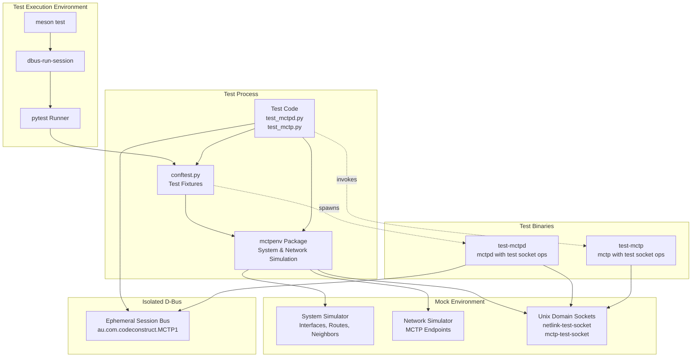
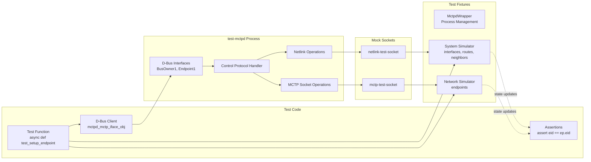

<!-- source: DeepWiki mcp.deepwiki.com · repo NVIDIA/mctp · page 6 Testing · fetched 2026-10-26 -->

# Testing

<details>
<summary>Relevant source files</summary>

The following files were used as context for generating this wiki page:

- [meson.build](meson.build)
- [tests/pytest.ini](tests/pytest.ini)
- [tests/test_mctpd.py](tests/test_mctpd.py)

</details>


This page provides an overview of the testing infrastructure for the MCTP repository. The test framework enables automated verification of both the `mctpd` daemon and `mctp` utility through integration-style tests that simulate kernel and MCTP device behavior.

For detailed information about the test framework implementation, see [Test Framework](#6.1). For details on the simulation environment, see [Test Environment Simulation](#6.2). For guidance on creating new tests, see [Writing Tests](#6.3).

## Testing Approach

The MCTP test suite employs an integration testing strategy that validates component behavior through simulated environments rather than unit tests. Tests interact with production code through its normal interfaces (D-Bus for `mctpd`, command-line for `mctp`) while mocking the underlying kernel interactions.

### Test Isolation Strategy

Tests execute in isolated D-Bus sessions to prevent interference with system services. The build system uses `dbus-run-session` to create ephemeral session buses, and test binaries connect to these isolated instances by setting `DBUS_STARTER_BUS_TYPE=user` before invoking `sd_bus_default()`.

**Key Characteristics:**

| Aspect | Implementation |
|--------|---------------|
| Test Runner | pytest with trio async support |
| Language | Python for test code, C for test binaries |
| Isolation | D-Bus session isolation via `dbus-run-session` |
| Kernel Mocking | Unix domain sockets intercept netlink and AF_MCTP operations |
| Test Execution | `meson test` or direct `pytest` invocation |

Sources: [meson.build:104-173](), [tests/test_mctpd.py:1-11]()

## Test Architecture Overview



**Test Architecture**: Tests run under pytest with trio async support. The `conftest.py` fixture setup spawns test binaries (`test-mctpd`, `test-mctp`) that connect to Unix domain sockets instead of kernel interfaces. The `mctpenv` package provides simulators for system state (interfaces, routes, neighbors) and MCTP network endpoints. Test code interacts with `test-mctpd` via D-Bus and observes/manipulates the simulated environment.

Sources: [meson.build:140-173](), [tests/test_mctpd.py:1-11]()

## Test Binaries

The build system produces test-specific executables that replace kernel socket operations with Unix domain socket communication to the test harness.

### test-mctpd

The `test-mctpd` binary is compiled from the same source as `mctpd` but links against `mctp-ops-test.c` instead of `mctp-ops.c`. This substitution replaces real netlink and AF_MCTP socket operations with mock operations that communicate over Unix domain sockets.

**Socket Replacement:**

| Original | Test Replacement | Purpose |
|----------|------------------|---------|
| `AF_NETLINK` socket | Unix socket at `netlink-test-socket` | Intercept route/address/link operations |
| `AF_MCTP` socket | Unix socket at `mctp-test-socket` | Intercept MCTP control protocol messages |

The test binary connects to an isolated D-Bus session and exposes the same interfaces as production `mctpd`, allowing tests to drive daemon behavior through D-Bus method calls.

Sources: [meson.build:93-100]()

### test-mctp

The `test-mctp` binary provides a testable version of the `mctp` CLI utility with the same socket operation substitutions as `test-mctpd`. Tests can invoke this binary's netlink operations while observing effects on the simulated system state.

Sources: [meson.build:61-64]()

## Test Execution

### Running Tests via Meson

The primary method for running tests uses the Meson build system:

```bash
meson test -C build
```

This executes all configured tests with proper D-Bus isolation and TAP protocol output.

### Running Specific Test Files

Individual test files can be executed:

```bash
meson test -C build test-mctpd
meson test -C build test-mctpd-endpoint
meson test -C build test-mctp
```

### Direct pytest Execution

Tests can also run directly with pytest, but require manual D-Bus session setup:

```bash
cd tests
dbus-run-session -- bash -c 'DBUS_STARTER_BUS_TYPE=user pytest test_mctpd.py'
```

Sources: [meson.build:143-172]()

## Test Configuration

The pytest configuration in `pytest.ini` enables trio mode for async/await support and filters expected deprecation warnings from dependencies:

```ini
[pytest]
trio_mode = true
filterwarnings =
    ignore:.*wait_readable:DeprecationWarning:asyncdbus
    ignore:.*wait_writable:DeprecationWarning:asyncdbus
```

The `trio_mode = true` setting allows test functions to be declared as `async def` and use trio primitives like `trio.sleep()` and semaphores for synchronization.

Sources: [tests/pytest.ini:1-6]()

## Test Organization

The test suite is organized into several files:

| File | Purpose | Test Count (approx) |
|------|---------|---------------------|
| `test_mctpd.py` | Core mctpd D-Bus interface tests | 50+ tests |
| `test_mctpd_endpoint.py` | Endpoint-specific behavior tests | Additional endpoint tests |
| `test_mctp.py` | CLI utility tests | mctp utility validation |
| `conftest.py` | Pytest fixtures and setup | N/A (infrastructure) |

Tests in `test_mctpd.py` cover:
- Endpoint discovery and configuration (`test_setup_endpoint`)
- EID assignment and conflict resolution (`test_setup_endpoint_conflict`)
- Endpoint removal and recovery (`test_remove_endpoint`, `test_recover_endpoint_*`)
- Static EID assignment (`test_assign_endpoint_static`)
- Control protocol validation (`test_get_endpoint_id`, `test_response_iid`)
- Bridge endpoint support (`test_bridged_learn_endpoint`)
- Interface lifecycle (`test_del_interface_last`, `test_add_interface`)
- Configuration validation (`test_config_dyn_eid_range_min`)
- Service readiness interface (`test_service_readiness_*`)

Sources: [tests/test_mctpd.py:1-1329]()

## Test Data Flow



**Test Execution Flow**: A test function calls D-Bus methods on `test-mctpd`, which processes the request through its normal control protocol handler. Socket operations are redirected through Unix domain sockets to the test harness's System and Network simulators. These simulators maintain state (routes, neighbors, endpoint EIDs) that the test can observe and assert against.

Sources: [tests/test_mctpd.py:105-128]()

## Mock Environment Components

The test infrastructure provides several simulation components:

### System Simulator

Maintains kernel-side state including:
- Network interfaces (`System.Interface`)
- Local EID addresses (`System.Address`)
- Routing table entries (`System.Route`)
- Neighbor table entries (`System.Neighbour`)

When `test-mctpd` performs netlink operations (add route, add neighbor), these operations are intercepted and applied to the simulator's state. Tests can query this state to verify daemon behavior.

### Network Simulator

Represents remote MCTP endpoints with properties:
- Physical address (`lladdr`)
- Assigned EID (`eid`)
- UUID
- Supported message types (`types`)

The `Endpoint` class implements basic MCTP control protocol responses, allowing `test-mctpd` to perform Get EID, Set EID, Get UUID, and Get Message Type Support exchanges.

### Socket Simulators

Two Unix domain socket pairs provide bidirectional communication:
- **netlink-test-socket**: Carries netlink messages for route/address/link operations
- **mctp-test-socket**: Carries MCTP messages for control protocol exchanges

Sources: [tests/test_mctpd.py:73-103]()

## Continuous Integration

The GitHub Actions workflow (`.github/workflows/pr.yml`) runs the test suite in two configurations:

| Job | Configuration | Purpose |
|-----|---------------|---------|
| `default` | With `libsystemd` | Standard configuration test |
| `no-libsystemd` | Without `libsystemd` | Verify portability |

Both jobs build the project with Meson and execute the full test suite, ensuring cross-platform compatibility and dependency optionality.

Sources: [meson.build:104-173]()

## Example Test Structure

A typical test function demonstrates the integration testing pattern:

```python
async def test_setup_endpoint(dbus, mctpd):
    # Get default system configuration from fixture
    iface = mctpd.system.interfaces[0]
    ep = mctpd.network.endpoints[0]
    
    # Get D-Bus proxy object
    mctp = await mctpd_mctp_iface_obj(dbus, iface)
    
    # Invoke D-Bus method
    (eid, net, path, new) = await mctp.call_setup_endpoint(ep.lladdr)
    
    # Verify results
    assert eid == ep.eid
    assert len(mctpd.system.neighbours) == 1
    assert len(mctpd.system.routes) == 2
```

This pattern demonstrates:
1. Accessing test fixtures (`dbus`, `mctpd`)
2. Obtaining system and network state from simulators
3. Calling D-Bus methods on the daemon
4. Asserting on both returned values and simulator state

Sources: [tests/test_mctpd.py:105-128]()

## Test Coverage Areas

The test suite validates:

**D-Bus Interface Behavior:**
- BusOwner1: `SetupEndpoint`, `AssignEndpoint`, `AssignEndpointStatic`, `LearnEndpoint`
- Endpoint1: `Remove`, `SetMTU`, `Recover`
- Network1: `LearnEndpoint`, `EndpointPing`, `LocalEIDs` property
- ObjectManager: Endpoint enumeration and lifecycle signals
- ServiceReady: State transitions and properties

**Control Protocol Implementation:**
- Get Endpoint ID command and response
- Set Endpoint ID with conflict resolution
- Get UUID and message type support queries
- Instance ID tracking and validation
- Error handling for malformed responses

**Endpoint Lifecycle:**
- Initial discovery and EID assignment
- Dynamic EID allocation within configured ranges
- Static EID assignment with conflict detection
- Endpoint removal and cleanup
- Recovery mechanisms for disconnected endpoints

**System Configuration:**
- Interface addition and removal
- Interface renaming with peer persistence
- Network ID changes
- Multiple endpoints per interface
- Bridge endpoint support

**Edge Cases:**
- EID exhaustion scenarios
- Conflicting EID assignments
- Invalid control protocol responses
- Concurrent recovery and setup operations
- Endpoint UUID changes

Sources: [tests/test_mctpd.py:67-1329]()

---

