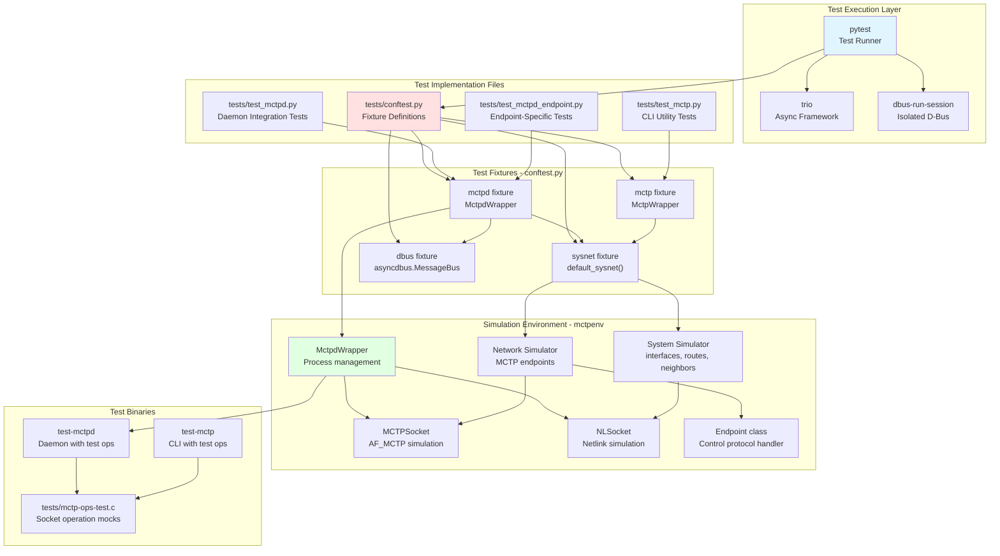
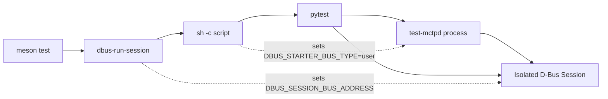
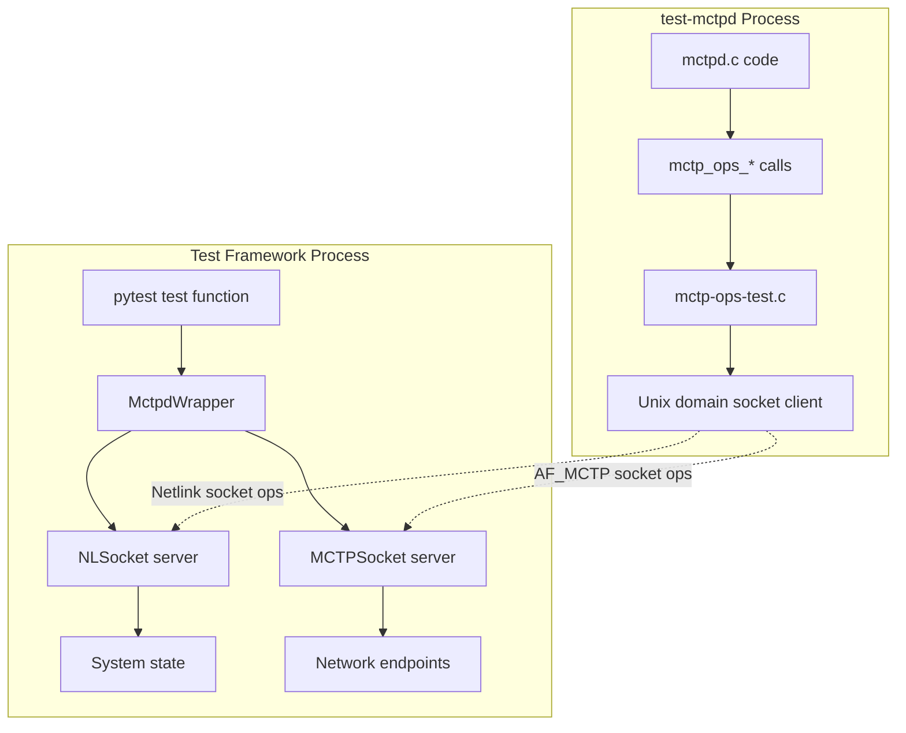
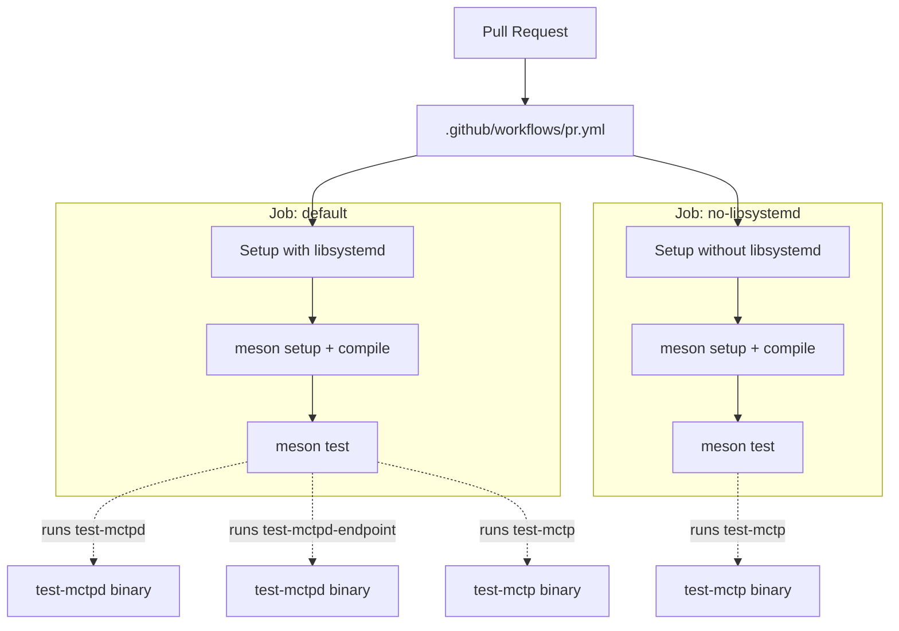

<!-- source: DeepWiki mcp.deepwiki.com · repo NVIDIA/mctp · page 6.1 Test Framework · fetched 2026-10-26 -->

# Test Framework

<details>
<summary>Relevant source files</summary>

The following files were used as context for generating this wiki page:

- [meson.build](meson.build)
- [tests/conftest.py](tests/conftest.py)
- [tests/pytest.ini](tests/pytest.ini)
- [tests/test_mctpd.py](tests/test_mctpd.py)

</details>


## Purpose and Scope

This document describes the pytest-based test framework used to validate the MCTP daemon and utilities. The framework provides a comprehensive simulation environment that mocks kernel MCTP interfaces, D-Bus interactions, and MCTP endpoint behavior, enabling integration-style testing without requiring actual MCTP hardware or kernel support.

For information about building the test binaries, see [Build System](#5.1). For details on test environment simulation internals, see [Test Environment Simulation](#6.2). For guidance on writing new tests, see [Writing Tests](#6.3).

**Sources:** [tests/test_mctpd.py:1-1300](), [meson.build:102-173]()

## Test Framework Architecture

The test framework consists of multiple layers that work together to create an isolated, reproducible testing environment:



**Sources:** [tests/conftest.py:1-38](), [meson.build:102-173](), [tests/test_mctpd.py:1-50]()

## Test Infrastructure Components

### Test Binaries

The build system creates specialized test binaries that use mock socket operations instead of real kernel interfaces:

| Binary | Source | Mock Operations | Purpose |
|--------|--------|----------------|---------|
| `test-mctpd` | [src/mctpd.c]() | [tests/mctp-ops-test.c]() | Daemon testing with simulated sockets |
| `test-mctp` | [src/mctp.c]() | [tests/mctp-ops-test.c]() | CLI utility testing with simulated sockets |

The test binaries are compiled with `tests/mctp-ops-test.c` replacing `src/mctp-ops.c`, which intercepts socket operations and redirects them to Unix domain sockets for communication with the test simulation environment.

**Build Configuration:**

```
mctpd_test = executable('test-mctpd',
    sources: ['src/mctpd.c'] + test_ops_sources + netlink_sources + util_sources,
    dependencies: [libsystemd, toml_dep],
)
```

**Sources:** [meson.build:93-99](), [meson.build:61-64]()

### Test Fixtures

The test framework defines four primary fixtures in `conftest.py`:

#### `sysnet` Fixture

Creates a simulated system and network environment with default configuration:

```python
@pytest.fixture
async def sysnet():
    return await mctpenv.default_sysnet()
```

The default environment includes:
- One MCTP interface (`mctp0`, ifindex 1, network 1)
- Local EID 8 assigned to the interface
- One endpoint at physical address `0x1d` with no EID assigned
- Support for MCTP Control Protocol (type 0) and PLDM (type 1)

**Sources:** [tests/conftest.py:14-16]()

#### `dbus` Fixture

Provides an isolated D-Bus connection using asyncdbus:

```python
@pytest.fixture
async def dbus():
    async with asyncdbus.MessageBus().connect() as bus:
        yield bus
```

This connection is used by tests to interact with the mctpd daemon's D-Bus interfaces.

**Sources:** [tests/conftest.py:18-21]()

#### `mctpd` Fixture

Manages the lifecycle of the test-mctpd process:

```python
@pytest.fixture
async def mctpd(nursery, dbus, sysnet, config):
    m = mctpenv.MctpdWrapper(dbus, sysnet, config = config)
    await m.start_mctpd(nursery)
    yield m
    res = await m.stop_mctpd()
    assert res == 0
```

The `MctpdWrapper` class handles:
- Starting the `test-mctpd` process with appropriate environment variables
- Managing the simulated MCTP socket and Netlink socket connections
- Coordinating communication between the daemon and simulation environment
- Clean shutdown and exit code verification

**Sources:** [tests/conftest.py:27-33]()

#### `mctp` Fixture

Provides a wrapper for testing the mctp CLI utility:

```python
@pytest.fixture
async def mctp(nursery, sysnet):
    return mctpenv.MctpWrapper(nursery, sysnet)
```

**Sources:** [tests/conftest.py:35-37]()

### Test Helper Functions

The test suite provides helper functions for accessing D-Bus objects:

| Helper Function | Purpose | D-Bus Interface |
|----------------|---------|-----------------|
| `mctpd_mctp_iface_obj()` | Access BusOwner1 interface for an MCTP interface | `au.com.codeconstruct.MCTP.BusOwner1` |
| `mctpd_mctp_network_obj()` | Access Network1 interface for a network | `au.com.codeconstruct.MCTP.Network1` |
| `mctpd_mctp_endpoint_common_obj()` | Access common endpoint properties | `au.com.codeconstruct.MCTP.Endpoint1` |
| `mctpd_mctp_endpoint_control_obj()` | Access endpoint control methods | `au.com.codeconstruct.MCTP.Endpoint1` |
| `mctpd_service_readiness_obj()` | Access service readiness interface | `xyz.openbmc_project.State.ServiceReady` |

**Sources:** [tests/test_mctpd.py:6-11]()

## Test Execution Environment

### D-Bus Session Isolation

Tests run in an isolated D-Bus session to prevent interference with system services. The isolation is achieved through `dbus-run-session`:



The test execution script works around systemd's `sd_bus_default()` behavior by setting `DBUS_STARTER_BUS_TYPE=user` to force connection to the session bus:

```bash
DBUS_STARTER_BUS_TYPE=user pytest --config-file pytest.ini $@
```

**Sources:** [meson.build:102-173]()

### Socket Operation Interception

Test binaries use Unix domain sockets instead of real kernel sockets. The `mctp-ops-test.c` implementation redirects socket operations:



**Sources:** [meson.build:49](), [meson.build:93-99]()

## Test Structure and Patterns

### Typical Test Flow

A standard endpoint setup test follows this pattern:

```
1. Access test fixtures (dbus, mctpd)
2. Get MCTP interface D-Bus proxy object
3. Call D-Bus method (e.g., SetupEndpoint)
4. Verify D-Bus response
5. Verify simulated kernel state (routes, neighbors)
6. Verify endpoint state updates
```

Example from `test_setup_endpoint`:

```python
async def test_setup_endpoint(dbus, mctpd):
    # Get simulated system/network components
    iface = mctpd.system.interfaces[0]
    ep = mctpd.network.endpoints[0]
    
    # Get D-Bus proxy for BusOwner1 interface
    mctp = await mctpd_mctp_iface_obj(dbus, iface)
    
    # Call SetupEndpoint D-Bus method
    (eid, net, path, new) = await mctp.call_setup_endpoint(ep.lladdr)
    
    # Verify EID was assigned and matches
    assert eid == ep.eid
    
    # Verify kernel state was updated
    assert len(mctpd.system.neighbours) == 1
    assert len(mctpd.system.routes) == 2
```

**Sources:** [tests/test_mctpd.py:105-128]()

### MCTP Control Protocol Testing

Tests can implement custom endpoint behavior by subclassing `Endpoint`:

```python
class BusyEndpoint(Endpoint):
    async def handle_mctp_control(self, sock, src_addr, msg):
        flags, opcode = msg[0:2]
        if opcode != 2:
            return await super().handle_mctp_control(sock, src_addr, msg)
        # Custom response logic
        dst_addr = MCTPSockAddr.for_ep_resp(self, src_addr, sock.addr_ext)
        msg = bytes([flags & 0x1f, 0x05, 0x00, 0x02, 0x00, 0x01])
        await sock.send(dst_addr, msg)
```

**Sources:** [tests/test_mctpd.py:464-471]()

### D-Bus Signal Monitoring

Tests can monitor D-Bus property changes and signals using asyncdbus:

```python
# Set up property change monitoring
ep_props = await ep.get_interface(DBUS_PROPERTIES_I)

recovered = trio.Semaphore(initial_value = 0)
def ep_connectivity_changed(iface, changed, invalidated):
    if iface == MCTPD_ENDPOINT_I and 'Connectivity' in changed:
        if 'Available' == changed['Connectivity'].value:
            recovered.release()

await ep_props.on_properties_changed(ep_connectivity_changed)

# Trigger action and wait for signal
await ep_ep.call_recover()
with trio.move_on_after(timeout) as expected:
    await recovered.acquire()
```

**Sources:** [tests/test_mctpd.py:178-194]()

## Build System Integration

### Meson Test Configuration

The build system defines test targets with specific configurations:

| Test Target | Test File | Dependencies | D-Bus Isolated |
|-------------|-----------|--------------|----------------|
| `test-mctpd` | `tests/test_mctpd.py` | `test-mctpd` binary | Yes |
| `test-mctpd-endpoint` | `tests/test_mctpd_endpoint.py` | `test-mctpd` binary | Yes |
| `test-mctp` | `tests/test_mctp.py` | `test-mctp` binary | No |

Tests are conditionally compiled based on the `tests` build option:

```
tests = get_option('tests')
if tests
    # Test setup...
endif
```

**Sources:** [meson.build:102-173]()

### Pytest Configuration

Test behavior is controlled by `pytest.ini`:

```ini
[pytest]
trio_mode = true
filterwarnings =
    ignore:.*wait_readable:DeprecationWarning:asyncdbus
    ignore:.*wait_writable:DeprecationWarning:asyncdbus
```

The `trio_mode = true` setting enables async test support using the trio framework.

**Sources:** [tests/pytest.ini:1-6]()

## Running Tests

### Via Meson

Execute all tests:
```bash
meson test -C build
```

Execute specific test suite:
```bash
meson test -C build test-mctpd
meson test -C build test-mctpd-endpoint
meson test -C build test-mctp
```

With verbose output (interactive mode):
```bash
meson test -C build --interactive test-mctpd
```

**Sources:** [meson.build:154-171]()

### Via Pytest Directly

For development and debugging, run pytest directly:

```bash
# With D-Bus isolation (for mctpd tests)
dbus-run-session -- sh -c 'DBUS_STARTER_BUS_TYPE=user pytest tests/test_mctpd.py'

# Without isolation (for mctp tests)
pytest tests/test_mctp.py

# Run specific test
pytest tests/test_mctpd.py::test_setup_endpoint

# With verbose output
pytest -v tests/test_mctpd.py
```

The test directory structure contains:
- `tests/test_mctpd.py` - Main daemon integration tests (>1200 lines)
- `tests/test_mctpd_endpoint.py` - Endpoint-specific tests
- `tests/test_mctp.py` - CLI utility tests
- `tests/conftest.py` - Fixture definitions
- `tests/pytest.ini` - Pytest configuration
- `tests/mctp-ops-test.c` - Mock socket operations
- `tests/mctpenv/` - Simulation environment implementation

**Sources:** [tests/conftest.py:1-38](), [meson.build:140-171]()

## CI/CD Integration

### GitHub Actions Workflow

The test framework integrates with GitHub Actions through `.github/workflows/pr.yml`:



The CI workflow runs two parallel jobs:
1. **default**: Tests with `libsystemd` dependency (includes `mctpd` tests)
2. **no-libsystemd**: Tests without `libsystemd` (only `mctp` utility tests)

This ensures portability across different system configurations.

**Sources:** [meson.build:102-173]()

## Test Constants and Configuration

### D-Bus Constants

Test files define constants for D-Bus interfaces:

```python
MCTPD_C = 'au.com.codeconstruct.MCTP1'
MCTPD_MCTP_P = '/au/com/codeconstruct/mctp1'
MCTPD_MCTP_I = 'au.com.codeconstruct.MCTP.BusOwner1'
MCTPD_ENDPOINT_I = 'au.com.codeconstruct.MCTP.Endpoint1'
MCTPD_ENDPOINT_BRIDGE_I = 'au.com.codeconstruct.MCTP.Bridge1'
DBUS_OBJECT_MANAGER_I = 'org.freedesktop.DBus.ObjectManager'
DBUS_PROPERTIES_I = 'org.freedesktop.DBus.Properties'
```

**Sources:** [tests/test_mctpd.py:15-26]()

### Service Readiness Constants

```python
OPENBMC_SERVICE_READINESS_I = 'xyz.openbmc_project.State.ServiceReady'
SERVICE_STATE_STARTING = 'xyz.openbmc_project.State.ServiceReady.States.Starting'
SERVICE_STATE_ENABLED = 'xyz.openbmc_project.State.ServiceReady.States.Enabled'
SERVICE_TYPE_MCTP = 'xyz.openbmc_project.State.ServiceReady.ServiceTypes.MCTP'
```

**Sources:** [tests/test_mctpd.py:28-32]()

### Timing Constants

```python
MCTPD_TRECLAIM = 5  # Endpoint recovery timeout in seconds
```

This constant is used in tests that verify endpoint recovery behavior, matching the daemon's internal recovery timeout.

**Sources:** [tests/test_mctpd.py:34]()

---

