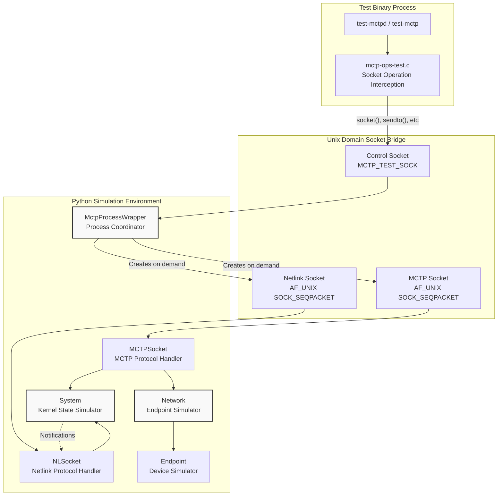
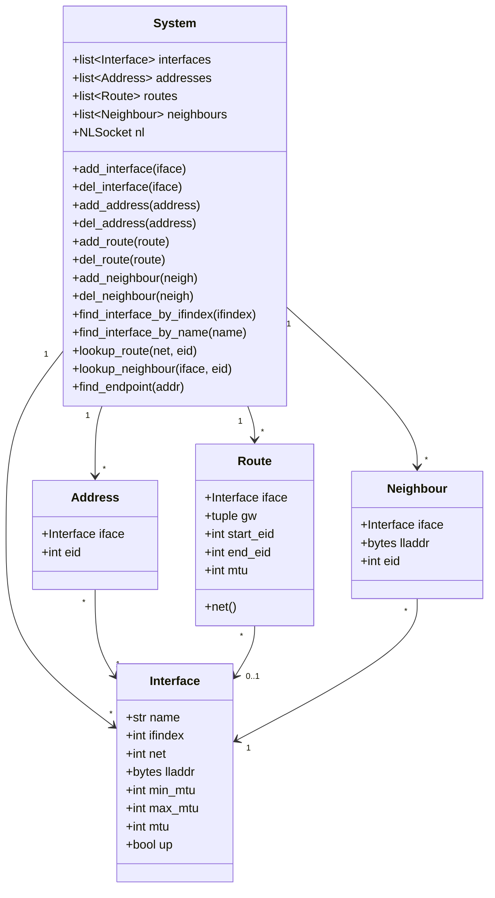
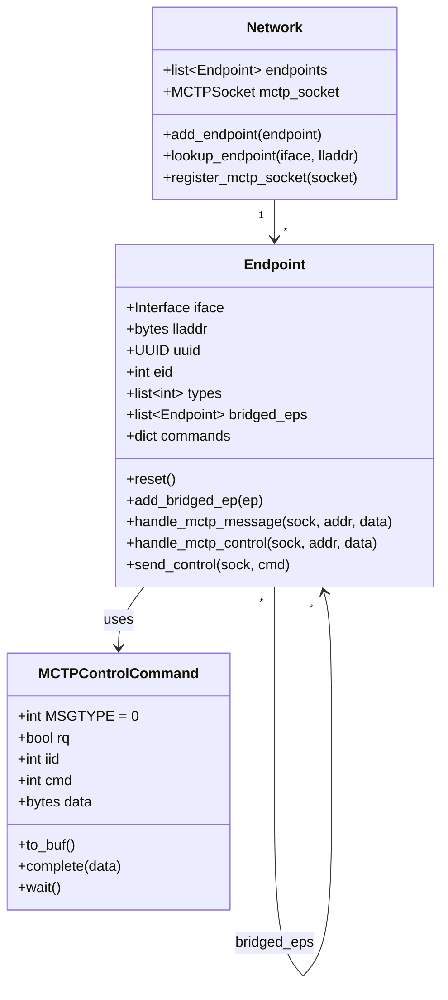
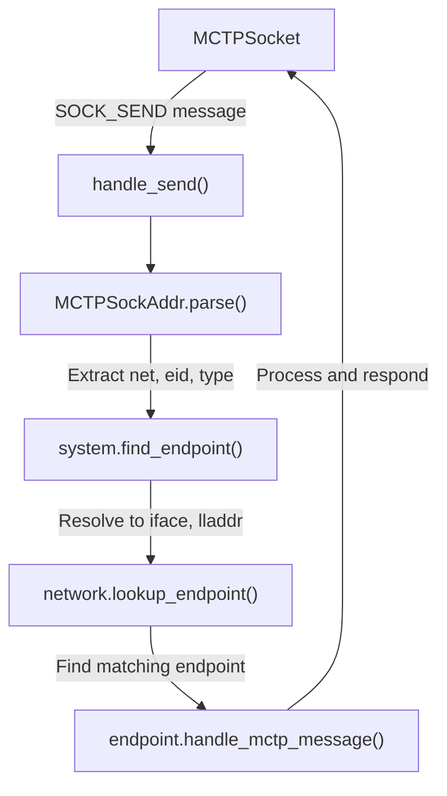
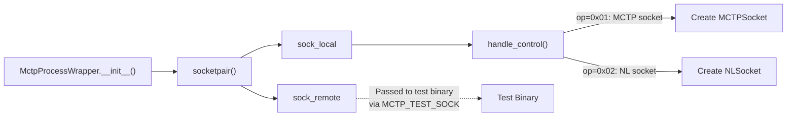
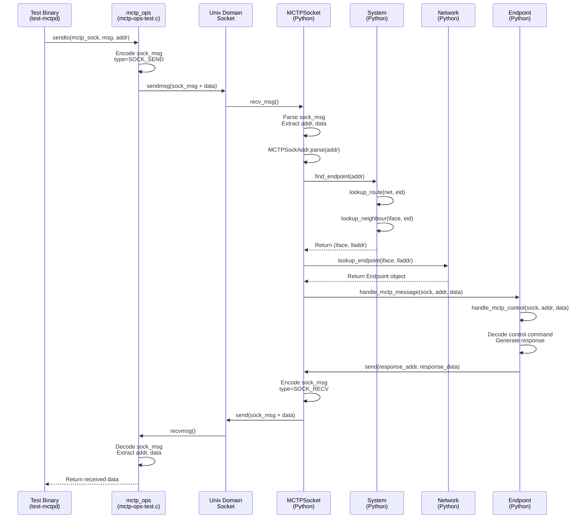

<!-- source: DeepWiki mcp.deepwiki.com · repo NVIDIA/mctp · page 6.2 Test Environment Simulation · fetched 2026-10-26 -->

# Test Environment Simulation

<details>
<summary>Relevant source files</summary>

The following files were used as context for generating this wiki page:

- [.github/workflows/pr.yml](.github/workflows/pr.yml)
- [tests/mctp-ops-test.c](tests/mctp-ops-test.c)
- [tests/mctpenv/__init__.py](tests/mctpenv/__init__.py)
- [tests/test-proto.h](tests/test-proto.h)
- [tests/test_mctp.py](tests/test_mctp.py)
- [tests/test_mctpd_endpoint.py](tests/test_mctpd_endpoint.py)

</details>


## Purpose and Scope

This document provides a detailed technical reference for the test simulation infrastructure that enables testing MCTP components without requiring kernel MCTP support or physical hardware. The simulation intercepts socket operations and provides simulated kernel state, allowing test processes to interact with synthetic MCTP endpoints and network configurations.

For information about the overall test framework and how to run tests, see [Test Framework](#6.1). For guidance on writing new tests using this simulation infrastructure, see [Writing Tests](#6.3).

**Sources:** [tests/mctpenv/__init__.py:1-1200]()

## Simulation Architecture Overview

The test simulation operates by intercepting socket system calls and redirecting them through Unix domain sockets to Python-based simulators. This allows test binaries (`test-mctpd`, `test-mctp`) to execute normally while communicating with simulated kernel state and MCTP endpoints.



**Key Components:**

| Component | File | Purpose |
|-----------|------|---------|
| `mctp_ops` | [tests/mctp-ops-test.c:224-242]() | Socket operation interception in C |
| `MctpProcessWrapper` | [tests/mctpenv/__init__.py:1082-1122]() | Process lifecycle management |
| `System` | [tests/mctpenv/__init__.py:40-269]() | Kernel state simulation |
| `Network` | [tests/mctpenv/__init__.py:403-422]() | Endpoint management |
| `MCTPSocket` | [tests/mctpenv/__init__.py:627-664]() | MCTP protocol handler |
| `NLSocket` | [tests/mctpenv/__init__.py:665-1073]() | Netlink protocol handler |

**Sources:** [tests/mctpenv/__init__.py:40-1200](), [tests/mctp-ops-test.c:1-268]()

## System State Simulator

The `System` class maintains simulated kernel state for MCTP networking, including interfaces, addresses, routes, and neighbor tables. This state mirrors the data structures maintained by the Linux kernel's MCTP stack.

### System Class Structure



### Interface Management

Interfaces represent MCTP network devices. Each interface has an index, network ID, physical address, and MTU constraints:

[tests/mctpenv/__init__.py:41-58]()

```python
class Interface:
    def __init__(self, name, ifindex, net, lladdr, min_mtu, max_mtu, up = False):
        self.name = name
        self.ifindex = ifindex
        self.net = net
        self.lladdr = lladdr
        self.min_mtu = min_mtu
        self.max_mtu = max_mtu
        self.mtu = max_mtu
        self.up = up
```

### Route Lookup

Routes map EID ranges to either direct interfaces or gateways. The `lookup_route()` method matches an EID to a route:

[tests/mctpenv/__init__.py:204-209]()

### Address and Neighbor Tables

- **Addresses**: EIDs assigned to local interfaces, stored as `System.Address` objects [tests/mctpenv/__init__.py:60-66]()
- **Neighbours**: EID-to-physical-address mappings for remote endpoints, stored as `System.Neighbour` objects [tests/mctpenv/__init__.py:68-76]()

### Notification Mechanism

When system state changes, the `System` notifies the attached `NLSocket` to send Netlink notifications. This simulates kernel Netlink events:

[tests/mctpenv/__init__.py:126-129](), [tests/mctpenv/__init__.py:800-804]()

**Sources:** [tests/mctpenv/__init__.py:40-269]()

## Network Endpoint Simulator

The `Network` class manages simulated MCTP endpoints and coordinates message delivery between endpoints and the MCTP socket handler.

### Network and Endpoint Classes



### Endpoint Initialization

Endpoints represent physical MCTP devices with UUIDs, EIDs, and supported message types:

[tests/mctpenv/__init__.py:298-307]()

```python
class Endpoint:
    def __init__(self, iface, lladdr, ep_uuid = None, eid = 0, types = None):
        self.iface = iface
        self.lladdr = lladdr
        self.uuid = ep_uuid or uuid.uuid1()
        self.eid = eid
        self.types = types or [0]
        self.bridged_eps = []
        self.commands = {}
```

### MCTP Control Protocol Handling

Endpoints respond to MCTP control protocol commands. The `handle_mctp_control()` method implements the control protocol responder:

[tests/mctpenv/__init__.py:330-385]()

**Supported Control Commands:**

| Opcode | Command | Response |
|--------|---------|----------|
| 0x01 | Set Endpoint ID | Returns completion code, EID status, assigned EID |
| 0x02 | Get Endpoint ID | Returns current EID and type |
| 0x03 | Get Endpoint UUID | Returns 16-byte UUID |
| 0x05 | Get Message Type Support | Returns list of supported message types |
| 0x08 | Allocate Endpoint IDs | Assigns EIDs to bridged endpoints |

### Bridge Endpoint Support

Endpoints can act as bridges with additional endpoints behind them. The `bridged_eps` list contains downstream endpoints, and the Allocate Endpoint IDs command assigns sequential EIDs to them:

[tests/mctpenv/__init__.py:370-380]()

### Command Tracking

The `commands` dictionary tracks outstanding control commands using `(message_type, instance_id)` as the key. This allows the endpoint to correlate responses with requests:

[tests/mctpenv/__init__.py:394-401]()

**Sources:** [tests/mctpenv/__init__.py:270-422]()

## Socket Operation Interception

Socket operations from test binaries are intercepted and redirected through Unix domain sockets to Python simulation handlers.

### C-Side Interception

The `mctp_ops` structure in [tests/mctp-ops-test.c:224-242]() provides alternative implementations of socket functions:

```c
const struct mctp_ops mctp_ops = {
    .mctp = {
        .socket = mctp_op_mctp_socket,
        .setsockopt = mctp_op_setsockopt,
        .bind = mctp_op_bind,
        .sendto = mctp_op_sendto,
        .recvfrom = mctp_op_recvfrom,
        .close = mctp_op_close,
    },
    .nl = { /* netlink operations */ },
};
```

### Socket Creation Protocol

When a test binary calls `socket()`, the operation is intercepted:

1. C code sends a control message with operation type (MCTP or Netlink) [tests/mctp-ops-test.c:41-50]()
2. Python wrapper receives request via control socket [tests/mctpenv/__init__.py:1095-1121]()
3. Python creates a Unix domain socket pair
4. Python sends one socket back via `SCM_RIGHTS` [tests/mctpenv/__init__.py:1075-1080]()
5. Python starts a handler task (`MCTPSocket` or `NLSocket`) on the other socket

### Message Protocol

Socket operations are encoded in a message protocol defined in [tests/test-proto.h:29-57]():

```c
struct sock_msg {
    enum {
        SOCK_RECV,    // Receive operation
        SOCK_SEND,    // Send operation
        SOCK_SETSOCKOPT,  // Set socket option
        SOCK_BIND,    // Bind operation
    } type;
    union { /* operation-specific data */ };
};
```

### MCTPSocket Handler

The `MCTPSocket` class processes MCTP protocol messages:



Key methods:
- `handle_send()`: Routes outgoing MCTP messages to endpoints [tests/mctpenv/__init__.py:637-648]()
- `handle_setsockopt()`: Manages socket options like `MCTP_OPT_ADDR_EXT` [tests/mctpenv/__init__.py:649-653]()
- `send()`: Sends responses back to test binary [tests/mctpenv/__init__.py:657-664]()

### NLSocket Handler

The `NLSocket` class simulates Netlink RTM operations using pyroute2 message structures:

**Netlink Message Handling:**

| RTM Type | Handler | Purpose |
|----------|---------|---------|
| `RTM_GETLINK` | `_handle_getlink()` | Dump interfaces |
| `RTM_NEWADDR` / `RTM_DELADDR` | `_handle_newaddr()` / `_handle_deladdr()` | Add/remove addresses |
| `RTM_NEWROUTE` / `RTM_DELROUTE` | `_handle_newroute()` / `_handle_delroute()` | Add/remove routes |
| `RTM_NEWNEIGH` / `RTM_DELNEIGH` | `_handle_newneigh()` / `_handle_delneigh()` | Add/remove neighbors |

The handler decodes Netlink messages, manipulates system state, and sends acknowledgments or error responses:

[tests/mctpenv/__init__.py:704-741]()

### Custom MCTP Netlink Types

The simulation defines MCTP-specific pyroute2 message classes to handle MCTP netlink attributes:

- `ifinfmsg_mctp`: Interface info with `IFLA_MCTP_NET` attribute [tests/mctpenv/__init__.py:424-436]()
- `ifaddrmsg_mctp`: Address info for MCTP EIDs [tests/mctpenv/__init__.py:441-452]()
- `ndmsg_mctp`: Neighbor info with EID and lladdr [tests/mctpenv/__init__.py:454-469]()
- `rtmsg_mctp`: Route info with gateway support [tests/mctpenv/__init__.py:471-500]()

**Sources:** [tests/mctp-ops-test.c:1-268](), [tests/test-proto.h:1-58](), [tests/mctpenv/__init__.py:502-1073]()

## Process Management and Coordination

The `MctpProcessWrapper` and `MctpdWrapper` classes manage test process lifecycle and coordinate communication between the test binary and simulation environment.

### MctpProcessWrapper

Base class for process wrappers that sets up the control socket and handles socket creation requests:



The `handle_control()` method processes socket creation requests in a loop:

[tests/mctpenv/__init__.py:1094-1121]()

**Control Operations:**

| Opcode | Operation | Action |
|--------|-----------|--------|
| 0x00 | Init | Send acknowledgment |
| 0x01 | Socket MCTP | Create MCTPSocket, send fd via SCM_RIGHTS |
| 0x02 | Socket NL | Create NLSocket, send fd via SCM_RIGHTS |

### MctpdWrapper

Extends `MctpProcessWrapper` to manage the `mctpd` daemon process with D-Bus integration:

[tests/mctpenv/__init__.py:1123-1200]()

**Key Features:**

1. **D-Bus Synchronization**: Waits for mctpd to register on D-Bus before considering it ready [tests/mctpenv/__init__.py:1153-1164]()
2. **Configuration Support**: Passes config file path to test binary [tests/mctpenv/__init__.py:1173-1174]()
3. **Graceful Shutdown**: Terminates process and waits for exit [tests/mctpenv/__init__.py:1135-1140]()

### Environment Setup

The test binary receives the control socket via the `MCTP_TEST_SOCK` environment variable:

[tests/mctp-ops-test.c:252-259]()

**Sources:** [tests/mctpenv/__init__.py:1082-1200](), [tests/mctp-ops-test.c:244-268]()

## Complete Message Flow

This diagram illustrates the complete flow of an MCTP control message through the simulation environment:



### Example: SetupEndpoint Flow

When mctpd calls `SetupEndpoint()` in the simulation:

1. **Query Endpoint**: mctpd sends "Get Endpoint ID" control command
   - `sendto()` intercepted by [tests/mctp-ops-test.c:145-175]()
   - Routed to `MCTPSocket.handle_send()` [tests/mctpenv/__init__.py:637-648]()
   - Delivered to `Endpoint.handle_mctp_control()` [tests/mctpenv/__init__.py:330-385]()
   - Endpoint responds with current EID

2. **Assign EID**: mctpd sends "Set Endpoint ID" control command
   - Same message path as above
   - Endpoint updates `self.eid` [tests/mctpenv/__init__.py:348-352]()

3. **Update Kernel State**: mctpd sends Netlink RTM_NEWADDR message
   - Intercepted and routed to `NLSocket` [tests/mctpenv/__init__.py:665-673]()
   - Handled by `_handle_newaddr()` [tests/mctpenv/__init__.py:837-856]()
   - System state updated [tests/mctpenv/__init__.py:164-167]()

4. **Netlink Notification**: System notifies of new address
   - `System.add_address()` triggers notification [tests/mctpenv/__init__.py:166-167]()
   - `NLSocket.notify_newaddr()` sends RTM_NEWADDR [tests/mctpenv/__init__.py:884-885]()
   - mctpd receives notification via `recvfrom()` [tests/mctp-ops-test.c:177-210]()

**Sources:** [tests/mctpenv/__init__.py:1-1200](), [tests/mctp-ops-test.c:1-268]()

## Simulation Fixtures in Tests

Test files use pytest fixtures to set up simulation environments. The typical pattern:

```python
@pytest.fixture
async def sysnet():
    system = System()
    iface = System.Interface("mctp0", 1, 1, bytes([0x1D]), 68, 254, True)
    await system.add_interface(iface)
    network = Network()
    network.add_endpoint(Endpoint(iface, bytes([0x10]), eid=8))
    return Sysnet(system, network)
```

**Example from test_mctpd_endpoint.py:** [tests/test_mctpd_endpoint.py:18-25]()

The `conftest.py` fixture system provides `mctpd` and `mctp` fixtures that automatically:
- Create `System` and `Network` instances
- Start wrapper processes with the control socket
- Provide D-Bus access for test assertions
- Clean up on test completion

**Sources:** [tests/test_mctpd_endpoint.py:1-104](), [tests/test_mctp.py:1-65]()

---

