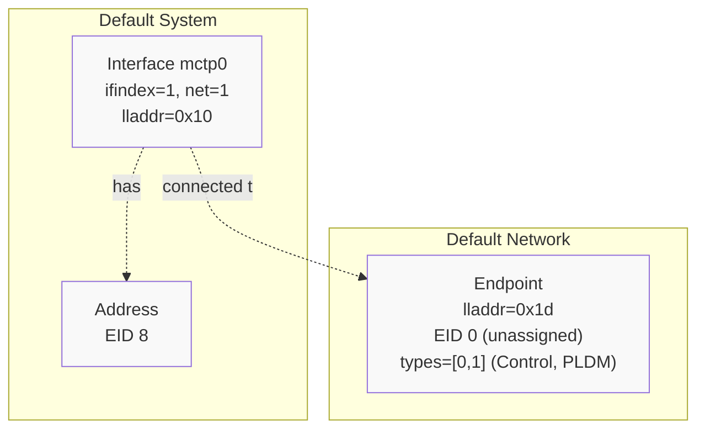
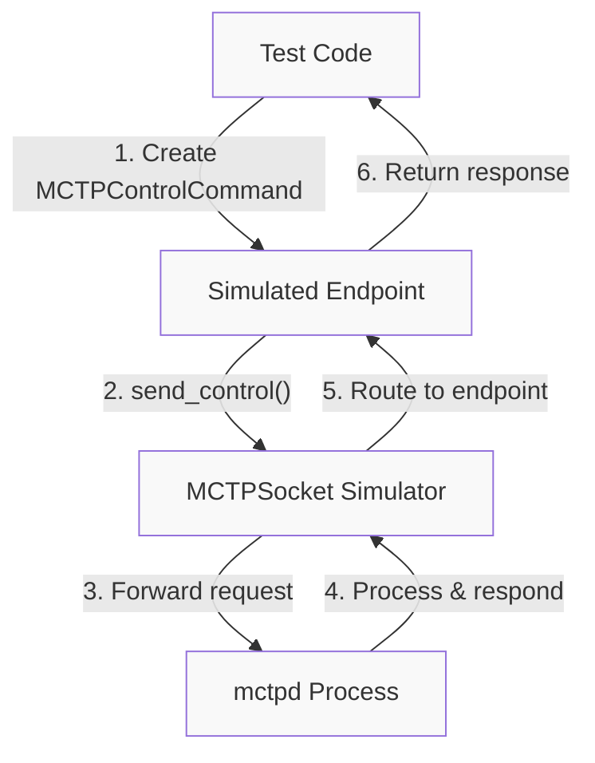
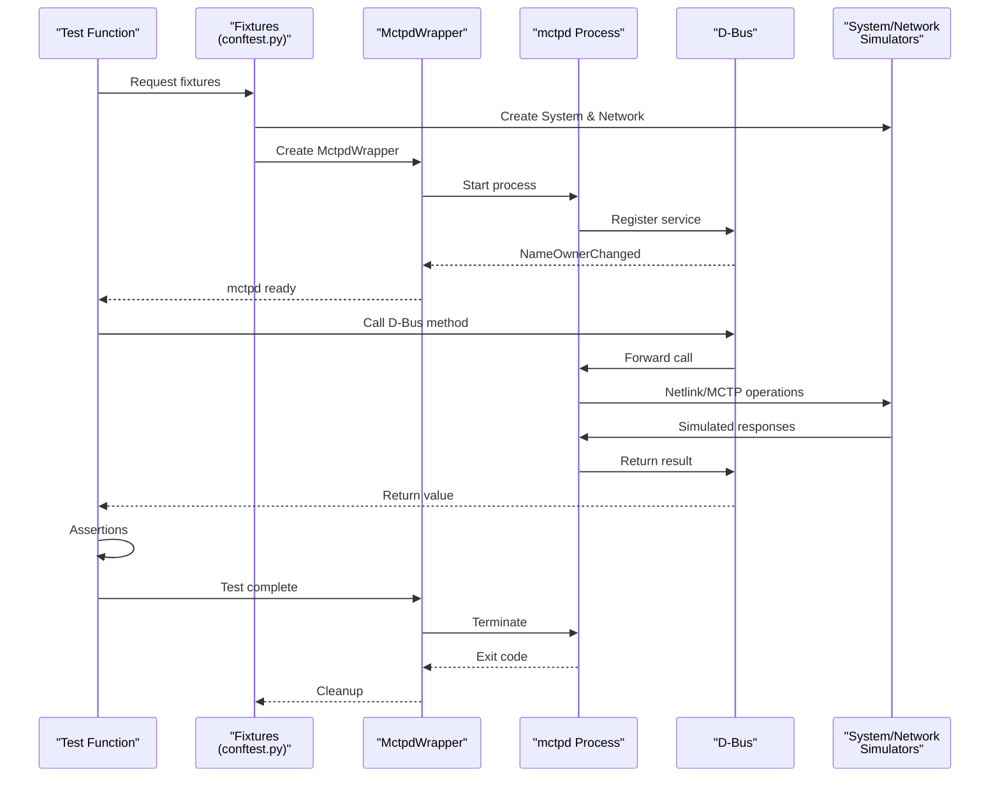

<!-- source: DeepWiki mcp.deepwiki.com · repo NVIDIA/mctp · page 6.3 Writing Tests · fetched 2026-10-26 -->

# Writing Tests

<details>
<summary>Relevant source files</summary>

The following files were used as context for generating this wiki page:

- [tests/conftest.py](tests/conftest.py)
- [tests/mctpenv/__init__.py](tests/mctpenv/__init__.py)
- [tests/test_mctp.py](tests/test_mctp.py)
- [tests/test_mctpd.py](tests/test_mctpd.py)
- [tests/test_mctpd_endpoint.py](tests/test_mctpd_endpoint.py)

</details>


This page provides a practical guide for writing new tests in the MCTP test framework. It covers how to use test fixtures, simulate MCTP devices and networks, test D-Bus interactions, and implement control protocol test scenarios.

For an overview of the test framework architecture and execution, see [Test Framework](#6.1). For details on the simulation infrastructure classes and socket interception mechanisms, see [Test Environment Simulation](#6.2).

## Test Structure and Fixtures

Tests are written using pytest with async support via trio. The test framework provides several fixtures defined in [tests/conftest.py:1-38]():

| Fixture | Type | Purpose |
|---------|------|---------|
| `sysnet` | `Sysnet` | Default system and network configuration |
| `dbus` | `MessageBus` | D-Bus connection for the test |
| `mctpd` | `MctpdWrapper` | Running mctpd daemon instance |
| `mctp` | `MctpWrapper` | mctp CLI utility wrapper |
| `config` | `str` | Optional mctpd configuration override |
| `nursery` | `Nursery` | Trio task nursery for async operations |

### Basic Test Structure

A typical test function uses async/await and accepts fixtures as parameters:

```python
async def test_setup_endpoint(dbus, mctpd):
    iface = mctpd.system.interfaces[0]
    ep = mctpd.network.endpoints[0]
    
    mctp = await mctpd_mctp_iface_obj(dbus, iface)
    (eid, net, path, new) = await mctp.call_setup_endpoint(ep.lladdr)
    
    assert eid == ep.eid
    assert new
```

The `mctpd` fixture provides access to:
- `mctpd.system`: Simulated system state (interfaces, addresses, routes, neighbors)
- `mctpd.network`: Simulated MCTP endpoints
- `mctpd.network.mctp_socket`: MCTP socket for control protocol

**Sources**: [tests/test_mctpd.py:105-128](), [tests/conftest.py:14-33]()

### Default System and Network Configuration

The default `sysnet` fixture provides a minimal test environment:



**Sources**: [tests/mctpenv/__init__.py:1235-1244](), [tests/conftest.py:14-16]()

## Creating Custom System Configurations

Override the `sysnet` fixture to customize the test environment:

```python
@pytest.fixture
async def sysnet():
    system = System()
    iface = System.Interface('mctp0', 1, 1, bytes([0x10]), 68, 254, True)
    await system.add_interface(iface)
    await system.add_address(System.Address(iface, 8))
    
    network = Network()
    network.add_endpoint(Endpoint(iface, bytes([0x1d]), types=[0, 1]))
    
    return Sysnet(system, network)
```

### Adding Multiple Interfaces

```python
# Add a second interface
iface2 = System.Interface('mctp1', 2, 1, bytes([0x11]), 68, 254, True)
await system.add_interface(iface2)
await system.add_address(System.Address(iface2, 10))
```

### Adding Static Routes

```python
# Direct route via interface
await mctpd.system.add_route(
    mctpd.system.Route(9, 0, iface=iface)
)

# Gateway route
await mctpd.system.add_route(
    mctpd.system.Route(10, 1, gw=(1, 9))
)
```

**Sources**: [tests/test_mctpd_endpoint.py:19-25](), [tests/test_mctpd.py:776-811]()

## Testing D-Bus Interactions

### Accessing D-Bus Interfaces

Use helper functions from `mctp_test_utils` to get proxy objects:

```python
# BusOwner1 interface for endpoint setup
mctp = await mctpd_mctp_iface_obj(dbus, iface)

# Endpoint1 interface for endpoint operations
ep = await mctpd_mctp_endpoint_control_obj(dbus, path)

# Network1 interface
net = await mctpd_mctp_network_obj(dbus, iface.net)
```

### Testing D-Bus Method Calls

```python
async def test_assign_endpoint_static(dbus, mctpd):
    iface = mctpd.system.interfaces[0]
    dev = mctpd.network.endpoints[0]
    mctp = await mctpd_mctp_iface_obj(dbus, iface)
    
    (eid, _, _, new) = await mctp.call_assign_endpoint_static(
        dev.lladdr,
        static_eid=12,
        start_eid=13,
        ignore_eids=b''
    )
    
    assert eid == 12
    assert new
```

### Testing D-Bus Properties

```python
ep = await mctpd_mctp_endpoint_common_obj(dbus, path)
query_types = list(await ep.get_supported_message_types())
assert query_types == [0, 1, 5]
```

### Testing D-Bus Signals

Use `on_properties_changed` and semaphores to wait for signals:

```python
ep_props = await ep.get_interface(DBUS_PROPERTIES_I)

recovered = trio.Semaphore(initial_value=0)
def ep_connectivity_changed(iface, changed, invalidated):
    if iface == MCTPD_ENDPOINT_I and 'Connectivity' in changed:
        if 'Available' == changed['Connectivity'].value:
            recovered.release()

await ep_props.on_properties_changed(ep_connectivity_changed)

# Trigger recovery
await ep_ep.call_recover()

# Wait for signal with timeout
with trio.move_on_after(10) as expected:
    await recovered.acquire()

assert not expected.cancelled_caught
```

**Sources**: [tests/test_mctpd.py:169-194](), [tests/test_mctpd.py:606-624]()

## Testing Control Protocol Flows



### Sending Control Commands to mctpd

Test mctpd's control protocol responder by sending commands from a simulated endpoint:

```python
async def test_get_endpoint_id(dbus, mctpd):
    iface = mctpd.system.interfaces[0]
    dev = mctpd.network.endpoints[0]
    dev.eid = 12
    
    await mctpd.system.add_route(
        mctpd.system.Route(dev.eid, 0, iface=iface)
    )
    await mctpd.system.add_neighbour(
        mctpd.system.Neighbour(iface, dev.lladdr, dev.eid)
    )
    
    cmd = MCTPControlCommand(True, 0, 0x02)  # Get Endpoint ID
    rsp = await dev.send_control(mctpd.network.mctp_socket, cmd)
    
    assert rsp[1] == 0x02  # Command code
    assert rsp[2] == 0x00  # Completion code
    assert rsp[3] == 8     # Local EID
```

### MCTPControlCommand Constructor

```python
MCTPControlCommand(rq, iid, cmd, data=bytes())
```

| Parameter | Type | Description |
|-----------|------|-------------|
| `rq` | `bool` | Request flag (True for request, False for response) |
| `iid` | `int` | Instance ID (0-31) |
| `cmd` | `int` | Command code (e.g., 0x01=Set EID, 0x02=Get EID) |
| `data` | `bytes` | Command-specific payload |

**Sources**: [tests/test_mctpd.py:430-449](), [tests/mctpenv/__init__.py:282-296]()

### Testing Instance ID Handling

```python
async def test_response_iid(mctpd):
    peer = mctpd.network.endpoints[0]
    for iid in [0, 1, 30, 31]:
        cmd = MCTPControlCommand(True, iid, 0x02)
        rsp = await peer.send_control(mctpd.network.mctp_socket, cmd)
        assert rsp[0] == iid
```

**Sources**: [tests/test_mctpd.py:451-458]()

## Custom Endpoint Behavior

Override `Endpoint.handle_mctp_control()` to implement custom behavior:

### Invalid Response Command

```python
class BusyEndpoint(Endpoint):
    async def handle_mctp_control(self, sock, src_addr, msg):
        flags, opcode = msg[0:2]
        if opcode != 2:
            return await super().handle_mctp_control(sock, src_addr, msg)
        
        # Return wrong command response
        dst_addr = MCTPSockAddr.for_ep_resp(self, src_addr, sock.addr_ext)
        msg = bytes([flags & 0x1f, 0x05, 0x00, 0x02, 0x00, 0x01])
        await sock.send(dst_addr, msg)

ep = BusyEndpoint(iface, bytes([0x1e]), eid=15)
mctpd.network.add_endpoint(ep)

with pytest.raises(asyncdbus.errors.DBusError) as ex:
    await mctp.call_learn_endpoint(ep.lladdr)

assert str(ex.value) == "Request failed"
```

### Invalid IID Response

```python
class InvalidIIDEndpoint(Endpoint):
    async def handle_mctp_control(self, sock, src_addr, msg):
        # Bump IID to cause mismatch
        flags = msg[0]
        iid_mask = 0x1d
        flags = (flags & ~iid_mask) | ((flags + 1) & iid_mask)
        msg = bytes([flags]) + msg[1:]
        return await super().handle_mctp_control(sock, src_addr, msg)
```

### Varying Set EID Response

```python
class VaryEndpoint(Endpoint):
    async def handle_mctp_control(self, sock, src_addr, msg):
        flags, opcode = msg[0:2]
        if opcode != 1:
            return await super().handle_mctp_control(sock, src_addr, msg)
        
        dst_addr = MCTPSockAddr.for_ep_resp(self, src_addr, sock.addr_ext)
        self.eid = msg[3] + 1  # Use different EID than requested
        msg = bytes([
            flags & 0x1f,
            0x01,
            0x00,
            0x00,
            self.eid,
            0x00,
        ])
        await sock.send(dst_addr, msg)
```

**Sources**: [tests/test_mctpd.py:463-481](), [tests/test_mctpd.py:585-603](), [tests/test_mctpd.py:517-542]()

## Simulating Network Conditions

### Endpoint Removal

```python
del mctpd.network.endpoints[0]
```

### Endpoint Reset

```python
dev.reset()  # Sets EID back to 0
dev.eid = eid
mctpd.network.add_endpoint(dev)
```

### Device Exchange (Same Physical Address, Different UUID)

```python
del mctpd.network.endpoints[0]
mctpd.network.add_endpoint(
    Endpoint(dev.iface, dev.lladdr, types=dev.types)
)
```

### Bridged Endpoints

```python
ep = mctpd.network.endpoints[0]
br_ep = Endpoint(iface, bytes(), eid=10, types=[0, 2])
ep.add_bridged_ep(br_ep)
mctpd.network.add_endpoint(br_ep)

await mctpd.system.add_route(
    mctpd.system.Route(br_ep.eid, 1, iface=iface)
)
await mctpd.system.add_neighbour(
    mctpd.system.Neighbour(iface, ep.lladdr, br_ep.eid)
)
```

**Sources**: [tests/test_mctpd.py:223-231](), [tests/test_mctpd.py:261-263](), [tests/test_mctpd.py:304-314](), [tests/test_mctpd.py:718-734]()

## Testing Configuration Options

Override the `config` fixture to test custom configuration:

```python
@pytest.fixture
def config():
    return """
    [bus-owner]
    dynamic_eid_range = [20, 254]
    message_timeout_ms = 500
    """

async def test_config_dyn_eid_range_min(nursery, dbus, sysnet):
    config = """
    [bus-owner]
    dynamic_eid_range = [20, 254]
    """
    
    mctpd = MctpdWrapper(dbus, sysnet, config=config)
    await mctpd.start_mctpd(nursery)
    
    iface = mctpd.system.interfaces[0]
    ep = mctpd.network.endpoints[0]
    
    mctp = await mctpd_mctp_iface_obj(dbus, iface)
    (eid, _, _, _) = await mctp.call_setup_endpoint(ep.lladdr)
    
    assert eid == 20  # First EID in range
    
    res = await mctpd.stop_mctpd()
    assert res == 0
```

**Sources**: [tests/test_mctpd.py:984-1005](), [tests/test_mctpd_endpoint.py:13-16]()

## Testing Endpoint Mode

For endpoint mode tests, configure mctpd as an endpoint and set up the bus owner in the network:

```python
@pytest.fixture
def config():
    return """
    mode = "endpoint"
    """

@pytest.fixture
async def sysnet():
    system = System()
    iface = System.Interface("mctp0", 1, 1, bytes([0x1D]), 68, 254, True)
    await system.add_interface(iface)
    
    network = Network()
    # Bus owner at physical address 0x10, EID 8
    network.add_endpoint(Endpoint(iface, bytes([0x10]), eid=8))
    
    return Sysnet(system, network)

async def test_accept_set_eid(dbus, mctpd):
    bo = mctpd.network.endpoints[0]  # Bus owner
    
    # mctpd starts with no EID
    assert len(mctpd.system.addresses) == 0
    
    rsp = await bo.send_control(
        mctpd.network.mctp_socket,
        MCTPControlCommand(True, 0, 0x01, bytes([0x01, 0x42]))
    )
    assert rsp.hex(' ') == '00 01 00 00 42 00'
```

**Sources**: [tests/test_mctpd_endpoint.py:12-25](), [tests/test_mctpd_endpoint.py:47-63]()

## Testing CLI Utility

Use the `mctp` fixture to test the mctp CLI utility:

```python
async def test_link_simple(mctp):
    proc = await mctp.run(["link"])
    assert proc.returncode == 0
    assert 'dev mctp0' in proc.stdout

async def test_route_add_single_direct(mctp):
    proc = await mctp.run(["route", "add", "9", "via", "mctp0"])
    assert proc.returncode == 0
    
    assert len(mctp.system.routes) == 1
    route = mctp.system.routes[0]
    assert route.iface.name == "mctp0"
    assert route.start_eid == 9
```

The `mctp` fixture provides:
- `mctp.system`: Same simulated system as mctpd tests
- `mctp.run(args)`: Execute mctp command and return process result

**Sources**: [tests/test_mctp.py:4-7](), [tests/test_mctp.py:41-51]()

## Common Test Patterns

### Testing Error Conditions

```python
with pytest.raises(asyncdbus.errors.DBusError) as ex:
    await mctp.call_assign_endpoint_static(
        dev2.lladdr, eid, 14, ignore_eids
    )

assert str(ex.value) == "Address in use"
```

### Testing Concurrent Operations

```python
async def test_concurrent_recovery_setup(dbus, mctpd):
    # Add endpoints up to allocation boundary
    for i in range(19):
        pep = Endpoint(iface, bytes([0x1e + i]))
        mctpd.network.add_endpoint(pep)
        await mctp_i.call_setup_endpoint(pep.lladdr)
    
    # Trigger recovery on one endpoint
    await ep_ep.call_recover()
    
    # Add another endpoint while recovery is in progress
    pep = Endpoint(iface, bytes([0x1e + 19]))
    mctpd.network.add_endpoint(pep)
    await mctp_i.call_setup_endpoint(pep.lladdr)
```

### Verifying System State

```python
# Check kernel state was updated
assert len(mctpd.system.neighbours) == 1
neigh = mctpd.system.neighbours[0]
assert neigh.lladdr == ep.lladdr
assert neigh.eid == ep.eid

assert len(mctpd.system.routes) == 2
```

### Using Timeouts

```python
MCTPD_TRECLAIM = 5

with trio.move_on_after(2 * MCTPD_TRECLAIM) as expected:
    await recovered.acquire()

assert not expected.cancelled_caught
```

**Sources**: [tests/test_mctpd.py:380-401](), [tests/test_mctpd.py:653-716](), [tests/test_mctpd.py:121-128](), [tests/test_mctpd.py:189-194]()

## Test Execution Flow



**Sources**: [tests/conftest.py:28-33](), [tests/mctpenv/__init__.py:1123-1200]()

## Best Practices

1. **Use descriptive test names**: `test_setup_endpoint_conflict` clearly indicates what is being tested
2. **Assert expected state changes**: Verify system state (routes, neighbors) after operations
3. **Test error conditions**: Use `pytest.raises` to verify error handling
4. **Use timeouts for async operations**: Always use `trio.move_on_after()` to prevent hanging tests
5. **Clean up resources**: The fixtures handle cleanup, but verify exit codes
6. **Test both success and failure paths**: Include tests for invalid inputs and error conditions
7. **Use custom endpoints for protocol testing**: Override `handle_mctp_control()` for specific behaviors
8. **Document complex test scenarios**: Add docstrings explaining multi-step test scenarios

**Sources**: [tests/test_mctpd.py:59-103](), [tests/test_mctpd.py:129-152](), [tests/test_mctpd.py:380-401]()

---

