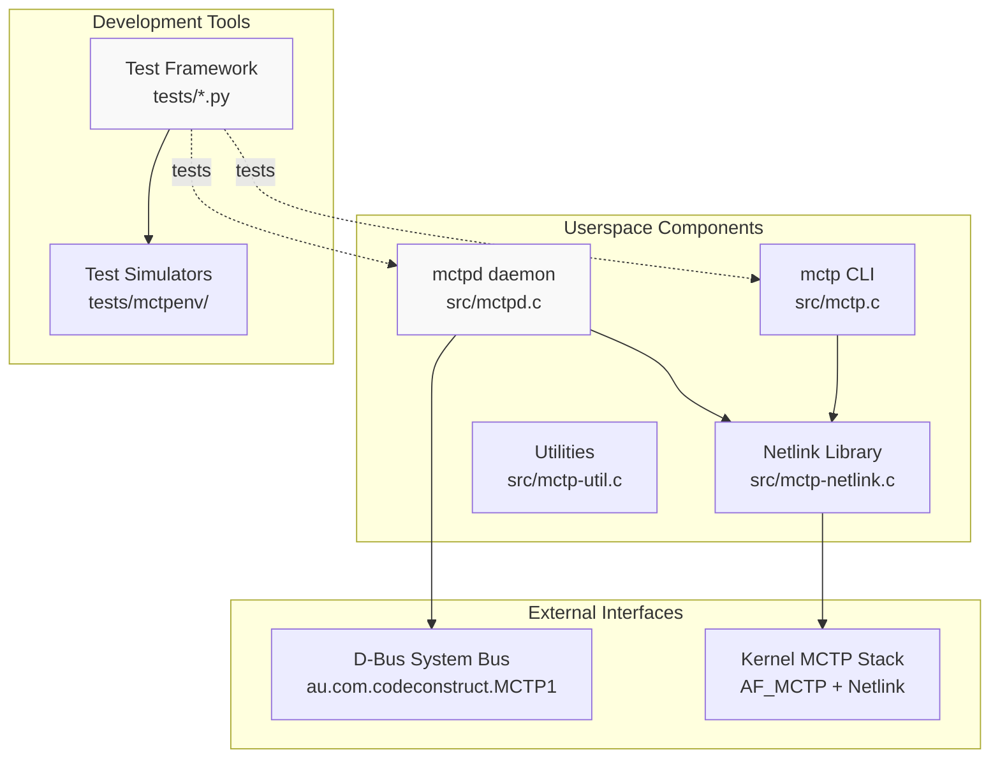
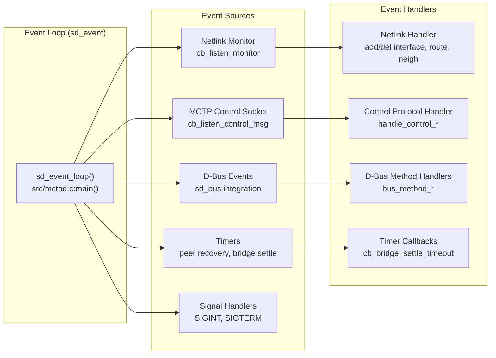
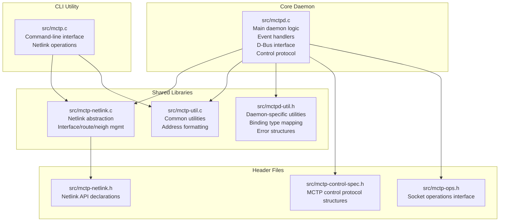
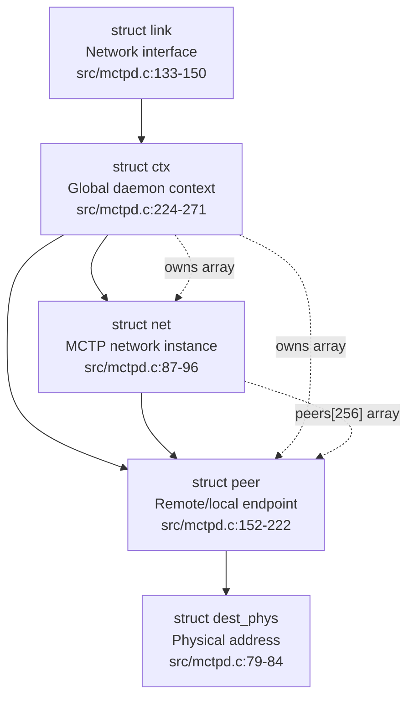
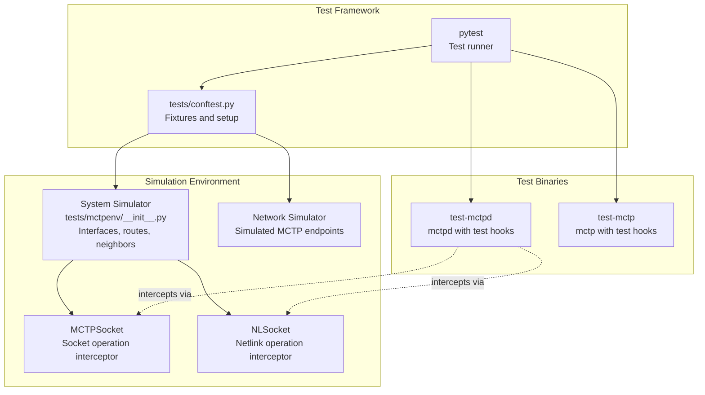

<!-- source: DeepWiki mcp.deepwiki.com · repo NVIDIA/mctp · page 7 Development Guide · fetched 2026-10-26 -->

# Development Guide

<details>
<summary>Relevant source files</summary>

The following files were used as context for generating this wiki page:

- [README.md](README.md)
- [src/mctpd-util.h](src/mctpd-util.h)
- [src/mctpd.c](src/mctpd.c)
- [tests/requirements.txt](tests/requirements.txt)

</details>


This guide provides an overview for developers who want to contribute to or extend the MCTP project. It covers the development environment setup, architecture patterns, coding conventions, and common workflows. For detailed information about specific subsystems, see:
- Code organization and structure: [Code Structure](#7.1)
- Error handling mechanisms: [Error Handling and Recovery](#7.2)
- Adding new features to mctpd: [Extending mctpd](#7.3)
- Writing tests: [Writing Tests](#6.3)

## Development Environment Setup

### Prerequisites

The project requires the following tools and dependencies:

| Dependency | Purpose | Required |
|------------|---------|----------|
| Meson (≥0.47.0) | Build system | Yes |
| Ninja | Build executor | Yes |
| GCC/Clang | C compiler | Yes |
| libsystemd | Event loop and D-Bus support | Optional* |
| Python 3 | Test framework | For tests |
| pytest, trio, asyncdbus | Test dependencies | For tests |
| linux/mctp.h | Kernel MCTP headers | Yes |

*libsystemd is optional; the build system detects its availability and builds accordingly.

**Sources:** [README.md:15-36](), [tests/requirements.txt:1-7](), [meson.build](included in provided files)

### Building for Development

The standard development build workflow:

```bash
# Configure build with tests enabled (default)
meson setup obj

# Build
ninja -C obj

# Run all tests
ninja -C obj test

# Run specific test file
cd obj && pytest ../tests/test_mctpd.py -v

# Install to test location
DESTDIR=/tmp/mctp-install meson install -C obj
```

For iterative development, rebuild with `ninja -C obj` after making changes. The build system tracks dependencies automatically.

**Sources:** [README.md:15-36]()

### Development Build Options

Configure the build with specific options for development needs:

```bash
# Build without libsystemd dependency
meson setup obj -Dtests=false

# Enable unsafe development options (for testing only)
meson setup obj -Dunsafe-recover-nil-uuid=true

# Reconfigure existing build
meson configure obj -Dtests=true
```

**Sources:** [meson.build](referenced in diagrams), [README.md:31-36]()

## Architecture Overview for Developers

Understanding the high-level architecture is essential for effective development.

### Component Architecture



**Sources:** [src/mctpd.c:1-100](), [src/mctp.c](referenced in diagrams), [src/mctp-netlink.c](referenced in diagrams)

### Event-Driven Architecture

The mctpd daemon uses an event-driven architecture based on `sd_event` from libsystemd. All asynchronous operations are managed through event sources.



**Key event callback pattern:**
```c
static int cb_event_name(sd_event_source *s, <event_params>, void *userdata)
{
    struct ctx *ctx = userdata;
    // Handle event
    return 0; // or negative error code
}
```

**Sources:** [src/mctpd.c:503-548]() (wait_fd_timeout), [src/mctpd.c:1323-1420]() (cb_listen_control_msg), [src/mctpd.c:1595-1675]() (cb_listen_monitor)

## Development Workflow

### Common Development Tasks

#### Adding a New Control Protocol Handler

1. Define handler function with signature:
   ```c
   static int handle_control_<command>(struct ctx *ctx, int sd,
                                       const struct sockaddr_mctp_ext *addr,
                                       const uint8_t *buf, const size_t buf_size)
   ```

2. Add case to switch statement in `cb_listen_control_msg()` at [src/mctpd.c:1369-1409]()

3. Implement request parsing and response generation using `mctp_ctrl_*` structures from [src/mctp-control-spec.h]()

4. Write tests in [tests/test_mctpd.py]() or [tests/test_mctpd_endpoint.py]()

**Sources:** [src/mctpd.c:754-943]() (handle_control_set_endpoint_id example), [src/mctpd.c:1323-1420]() (cb_listen_control_msg)

#### Adding a New D-Bus Method

1. Define method handler:
   ```c
   static int bus_method_<name>(sd_bus_message *msg, void *userdata, 
                                sd_bus_error *err)
   ```

2. Add to appropriate vtable (e.g., `bus_busowner_vtable`, `bus_endpoint_cc_vtable`)

3. Update D-Bus interface signature in vtable with `SD_BUS_METHOD()` macro

4. Implement business logic and call `sd_bus_reply_method_return()`

**Sources:** [src/mctpd.c:311-315]() (vtable declarations), D-Bus method examples throughout mctpd.c

#### Adding a New Configuration Option

1. Define configuration field in `struct ctx` at [src/mctpd.c:224-271]()

2. Add TOML parsing in configuration reading function

3. Document in [conf/mctpd.conf]()

4. Update configuration reference documentation

**Sources:** [src/mctpd.c:224-271]() (struct ctx)

### Debugging Techniques

#### Verbose Logging

Enable verbose logging with the `-v` flag:
```bash
./obj/mctpd -v -c test.conf
```

Verbose mode logs control protocol messages, Netlink events, and internal state changes.

**Sources:** [src/mctpd.c:256]() (ctx->verbose field), logging throughout mctpd.c

#### Inspecting D-Bus Interface

Use `busctl` to introspect and call D-Bus methods:
```bash
# List all endpoints
busctl tree au.com.codeconstruct.MCTP1

# Introspect specific interface
busctl introspect au.com.codeconstruct.MCTP1 \
    /au/com/codeconstruct/mctp1/interfaces/mctpi2c1

# Call a method
busctl call au.com.codeconstruct.MCTP1 \
    /au/com/codeconstruct/mctp1/interfaces/mctpi2c1 \
    au.com.codeconstruct.MCTP.BusOwner1 \
    SetupEndpoint ay 1 0x1d
```

**Sources:** [README.md:83-90](), [src/mctpd.c:44-57]() (D-Bus constants)

#### Monitoring Netlink Events

Use `mctp monitor` to watch kernel MCTP stack changes:
```bash
./obj/mctp monitor
```

This shows link up/down, address changes, route additions/deletions, and neighbor updates in real-time.

**Sources:** [src/mctp.c](referenced in README)

## Code Organization Principles

### File Organization

The source code follows a modular organization:



See [Code Structure](#7.1) for detailed file-by-file breakdown.

**Sources:** [src/mctpd.c:1-40]() (includes), [src/mctpd-util.h:1-116](), [meson.build](build configuration)

### Key Data Structures

Understanding the core data structures is essential for development:



**Key structure relationships:**
- `struct ctx`: Global daemon state, owns arrays of peers and networks
- `struct peer`: Represents an MCTP endpoint (remote or local)
- `struct net`: Per-network state with EID-to-peer mapping
- `struct link`: Per-interface state with D-Bus slot and role
- `struct dest_phys`: Physical address (interface + hardware address)

**Sources:** [src/mctpd.c:79-271]() (all core structures)

## Coding Patterns and Conventions

### Memory Management

The codebase uses several memory management patterns:

#### Deferred Free Pattern

The `dfree()` function schedules memory to be freed on the next event loop iteration, allowing safe return of temporary strings:

```c
// Usage pattern
const char *dest_phys_tostr(const dest_phys *dest)
{
    char *buf = malloc(size);
    // populate buf
    return dfree(buf);  // Caller doesn't need to free
}
```

**Sources:** [src/mctpd.c:471-501]() (dfree implementation), [src/mctpd.c:409-456]() (usage examples)

#### Dynamic Array Management

Peers and networks use dynamically reallocated arrays:

```c
// Growing peer array
ctx->peers = realloc(ctx->peers, (ctx->num_peers + 1) * sizeof(*ctx->peers));
ctx->peers[ctx->num_peers++] = new_peer;
```

**Sources:** [src/mctpd.c:224-271]() (ctx arrays)

### Error Handling Conventions

Functions return negative error codes on failure, 0 on success:

```c
int some_operation(struct ctx *ctx, ...)
{
    int rc;
    
    rc = helper_function(...);
    if (rc < 0) {
        warnx("Operation failed: %s", strerror(-rc));
        goto out;
    }
    
    rc = 0;  // success
out:
    cleanup();
    return rc;
}
```

Use `warnx()` for warnings, `bug_warn()` for assertion-like checks.

**Sources:** [src/mctpd.c:317-332]() (bug_warn), error handling throughout mctpd.c

### Naming Conventions

| Pattern | Usage | Example |
|---------|-------|---------|
| `cb_*` | Event callbacks | `cb_listen_control_msg` |
| `handle_control_*` | Control protocol handlers | `handle_control_get_endpoint_id` |
| `bus_method_*` | D-Bus method handlers | `bus_method_setup_endpoint` |
| `bus_*_vtable` | D-Bus vtables | `bus_endpoint_obmc_vtable` |
| `emit_*` | D-Bus signal emission | `emit_endpoint_added` |
| `add_*` / `del_*` / `remove_*` | Resource lifecycle | `add_peer`, `remove_peer` |
| `query_*` | Request-response operations | `query_peer_properties` |
| `find_*` / `lookup_*` | Search operations | `find_peer_by_addr`, `lookup_net` |

**Sources:** Function names throughout [src/mctpd.c]()

### Event Handler Pattern

All event handlers follow this pattern:

```c
static int cb_<event_type>(sd_event_source *s, <event_specific_params>, 
                           void *userdata)
{
    struct ctx *ctx = userdata;
    int rc;
    
    // Handle event
    rc = process_event(ctx, ...);
    if (rc < 0) {
        warnx("Event handling failed: %s", strerror(-rc));
    }
    
    return 0;  // Always return 0 to keep event source active
}
```

Returning non-zero from event handlers can disable the event source.

**Sources:** [src/mctpd.c:503-548]() (callback examples)

### D-Bus Method Handler Pattern

D-Bus methods follow systemd conventions:

```c
static int bus_method_<name>(sd_bus_message *msg, void *userdata,
                             sd_bus_error *err)
{
    struct ctx *ctx = userdata;
    int rc;
    
    // Parse parameters
    rc = sd_bus_message_read(msg, "signature", &param1, &param2);
    if (rc < 0)
        return rc;
    
    // Validate inputs
    if (!valid) {
        sd_bus_error_setf(err, SD_BUS_ERROR_INVALID_ARGS, "reason");
        return -EINVAL;
    }
    
    // Perform operation
    rc = do_work(ctx, ...);
    if (rc < 0) {
        sd_bus_error_setf(err, SD_BUS_ERROR_FAILED, "work failed: %s",
                          strerror(-rc));
        return rc;
    }
    
    // Return result
    return sd_bus_reply_method_return(msg, "signature", result1, result2);
}
```

**Sources:** D-Bus method implementations throughout mctpd.c

## Testing During Development

### Running Tests

Tests use pytest with custom fixtures for simulating MCTP environments:

```bash
# Run all tests
cd obj && pytest

# Run specific test file with verbose output
cd obj && pytest ../tests/test_mctpd.py -v

# Run specific test
cd obj && pytest ../tests/test_mctpd.py::test_setup_endpoint -v

# Run with D-Bus isolation
dbus-run-session env DBUS_STARTER_BUS_TYPE=user pytest
```

**Sources:** [README.md:116-150]()

### Test Infrastructure Overview



The test infrastructure intercepts socket operations and Netlink calls, routing them to simulators instead of the real kernel. This allows tests to run without kernel MCTP support.

**Sources:** [tests/conftest.py]() (referenced in diagrams), [tests/mctpenv/__init__.py]() (referenced in diagrams)

### Writing Tests

See [Writing Tests](#6.3) for detailed guidance. Brief overview:

1. Use `mctpd` fixture from conftest.py to get a running daemon instance
2. Use `dbus` fixture to interact via D-Bus
3. Use simulation fixtures to create mock endpoints
4. Assert expected behavior using D-Bus queries or state inspection

Example test structure:
```python
async def test_feature(mctpd, dbus):
    # Setup
    endpoint = mctpd.add_endpoint(eid=8, ...)
    
    # Exercise
    result = await dbus.call_method(...)
    
    # Verify
    assert result == expected
```

**Sources:** [tests/test_mctpd.py]() (example tests referenced in diagrams)

## Contributing

### Code Review Process

When submitting changes:

1. Ensure all tests pass: `ninja -C obj test`
2. Add tests for new functionality
3. Update relevant documentation
4. Follow existing code style and conventions
5. Write clear commit messages describing the change

### Documentation Requirements

- Update wiki pages for new features
- Document new D-Bus methods in interface definitions
- Update configuration file examples for new options
- Add inline comments for complex logic

### Test Requirements

- Unit tests for new functions
- Integration tests for D-Bus methods
- Control protocol tests for new MCTP commands
- Update simulation environment if needed

**Sources:** [README.md](), project structure

---

This guide provides the foundation for developing with the MCTP codebase. For more detailed information, continue to the subsections on code structure, error handling, and extending mctpd.

**Sources:** [src/mctpd.c:1-2800](), [README.md:1-150](), [src/mctpd-util.h:1-116](), [tests/requirements.txt:1-7]()

---

