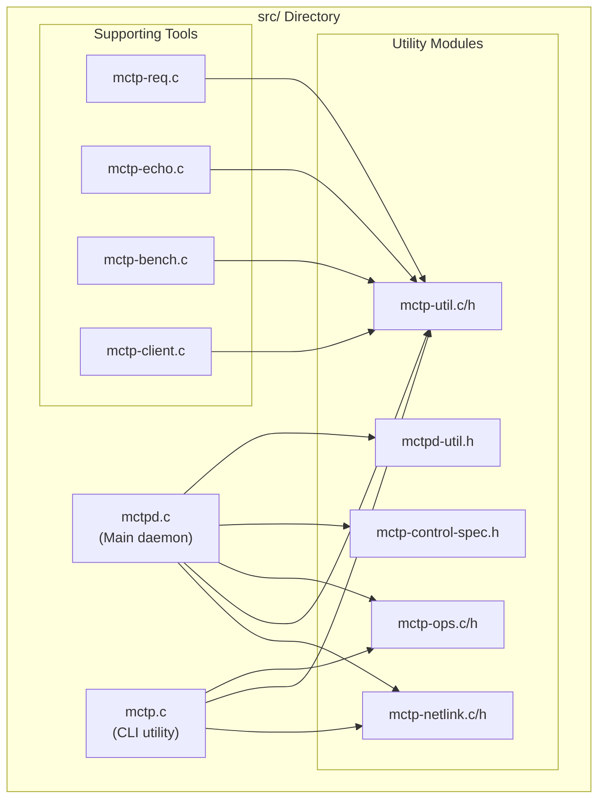
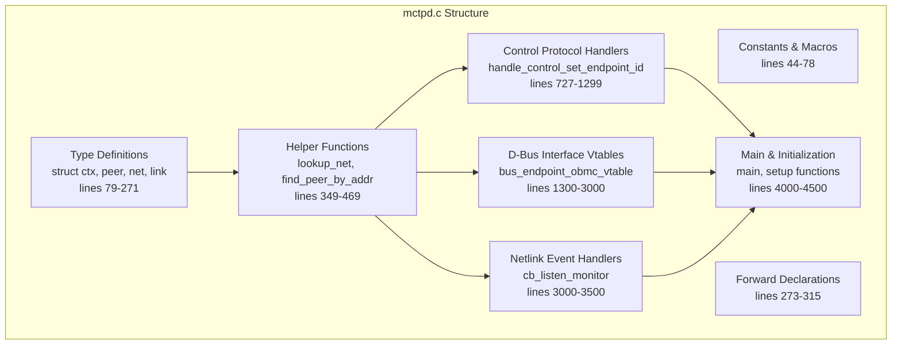
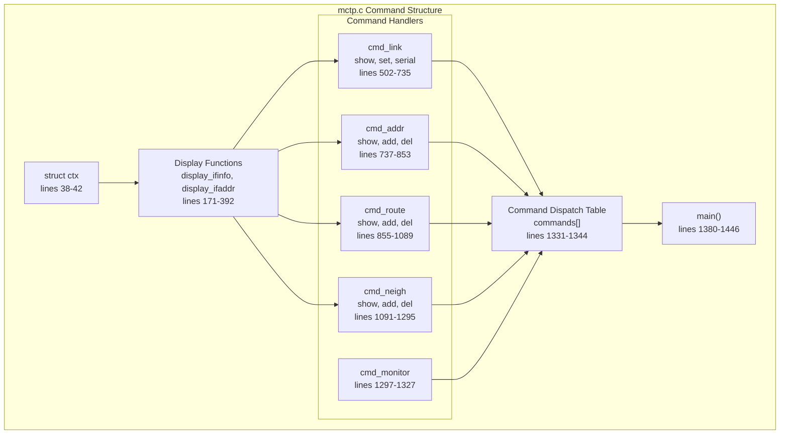
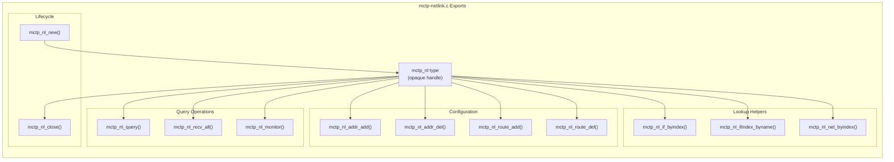
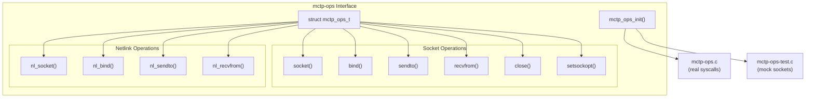
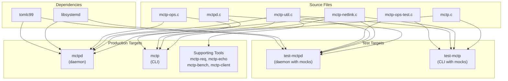

<!-- source: DeepWiki mcp.deepwiki.com · repo NVIDIA/mctp · page 7.1 Code Structure · fetched 2026-10-26 -->

# Code Structure

<details>
<summary>Relevant source files</summary>

The following files were used as context for generating this wiki page:

- [meson.build](meson.build)
- [src/mctp.c](src/mctp.c)
- [src/mctpd-util.h](src/mctpd-util.h)
- [src/mctpd.c](src/mctpd.c)
- [tests/pytest.ini](tests/pytest.ini)

</details>


This document provides an overview of the repository's code organization, including directory structure, shared utility modules, header file conventions, and how different components are compiled together. For information about the build system configuration, see [Build System](#5.1). For details on extending mctpd, see [Extending mctpd](#7.3).

## Purpose and Scope

This page documents the physical organization of source code in the repository: which files exist, how they are grouped, which components share code, and the conventions used for organizing headers and implementation files. It covers the `src/` directory structure, shared utility modules, and how different executables are composed from common source files.

## Repository Layout

The repository follows a standard C project structure with separate directories for source code, tests, and build configuration:

```
mctp/
├── src/              # Main source code
├── tests/            # Test suite
├── lib/              # Third-party libraries
├── .github/          # CI/CD workflows
└── meson.build       # Build configuration
```

**Sources:** [meson.build:1-174]()

## Source Directory Organization

The `src/` directory contains all production source code for the MCTP tools. Files are organized by executable target and shared utility modules:



**Sources:** [meson.build:46-100](), [src/mctpd.c:1-40](), [src/mctp.c:1-40]()

## Core Source Files

### Main Executables

The repository builds several executable programs, each with distinct responsibilities:

| Executable | Source File | Description | Dependencies |
|------------|-------------|-------------|--------------|
| `mctpd` | `src/mctpd.c` | MCTP bus owner daemon | netlink, util, ops, libsystemd, toml |
| `mctp` | `src/mctp.c` | Kernel stack management CLI | netlink, util, ops |
| `mctp-req` | `src/mctp-req.c` | Request/response test tool | util |
| `mctp-echo` | `src/mctp-echo.c` | Echo server test tool | util |
| `mctp-bench` | `src/mctp-bench.c` | Benchmarking tool | util |
| `mctp-client` | `src/mctp-client.c` | Example client | util |

**Sources:** [meson.build:56-91]()

### mctpd Daemon Structure

The `mctpd.c` file contains the complete daemon implementation in a single source file. Key structural elements:



The daemon uses a monolithic structure with all functionality in approximately 4500 lines of code. Major sections include:

- **Constants** [src/mctpd.c:44-78](): D-Bus interface names, service state constants, configuration defaults
- **Data Structures** [src/mctpd.c:79-271](): `struct ctx` (daemon context), `struct peer` (endpoint state), `struct net` (network state), `struct link` (interface state)
- **Control Protocol** [src/mctpd.c:727-1299](): Handlers for MCTP control protocol commands (Set Endpoint ID, Get Endpoint ID, Get UUID, etc.)
- **D-Bus Implementation** [src/mctpd.c:1300-3000](): Vtables and method handlers for BusOwner1, Endpoint1, Network1 interfaces

**Sources:** [src/mctpd.c:1-271](), [src/mctpd.c:727-1299]()

### mctp CLI Structure

The `mctp.c` file implements a command-line interface for kernel stack configuration:



The CLI follows a subcommand pattern with a dispatch table mapping command names to handler functions [src/mctp.c:1331-1344]().

**Sources:** [src/mctp.c:38-42](), [src/mctp.c:502-1446]()

## Shared Utility Modules

Utility code is factored into separate compilation units shared across multiple executables. This reduces code duplication and creates clear module boundaries.

### mctp-util Module

Provides common utility functions for MCTP address parsing, hex formatting, and data manipulation.

**Header:** `src/mctp-util.h`  
**Implementation:** `src/mctp-util.c`

Key functions:
- `parse_eid()`: Parse EID from string
- `parse_hex_addr()`: Parse hexadecimal physical addresses
- `write_hex_addr()`: Format addresses for display
- `print_hex_addr()`: Print addresses to stdout
- `mctp_hexdump()`: Debug hex dump utility

**Sources:** [meson.build:46]()

### mctp-netlink Module

Abstracts Netlink communication with the kernel MCTP stack. Provides high-level operations for interface, address, route, and neighbor management.

**Header:** `src/mctp-netlink.h`  
**Implementation:** `src/mctp-netlink.c`



The module maintains an internal linkmap cache mapping interface indices to names and network IDs, updated via Netlink monitoring.

**Sources:** [meson.build:47](), [src/mctp.c:33-36]()

### mctp-ops Module

Provides an abstraction layer for socket operations, allowing both real and mock implementations for testing.

**Header:** `src/mctp-ops.h`  
**Implementation (production):** `src/mctp-ops.c`  
**Implementation (testing):** `tests/mctp-ops-test.c`



The global `mctp_ops` structure is populated by `mctp_ops_init()`, which selects either real system calls or test mocks based on the build configuration.

**Sources:** [meson.build:48-49](), [src/mctpd.c:38]()

### mctp-control-spec Header

Defines MCTP control protocol structures, command codes, and completion codes according to DSP0236 specification.

**File:** `src/mctp-control-spec.h`

Key definitions:
- Control message command codes (e.g., `MCTP_CTRL_CMD_SET_EID`, `MCTP_CTRL_CMD_GET_EID`)
- Request/response structures (e.g., `mctp_ctrl_cmd_set_eid`, `mctp_ctrl_resp_set_eid`)
- Completion codes (e.g., `MCTP_CTRL_CC_SUCCESS`, `MCTP_CTRL_CC_ERROR`)
- Message type constants

**Sources:** [src/mctpd.c:37]()

### mctpd-util Header

Contains utility definitions specific to mctpd, including transport binding type mappings and error queue structures.

**File:** `src/mctpd-util.h`

Key elements:
- `phy_transport_binding_to_string()` [src/mctpd-util.h:24-49](): Maps binding type IDs to human-readable names
- `get_binding_from_ifname()` [src/mctpd-util.h:52-68](): Infers binding type from interface name
- `struct mctp_error` [src/mctpd-util.h:100-113](): Error queue message structure
- `enum mctp_phys_binding` [src/mctpd-util.h:86-98](): Physical binding type enumeration

**Sources:** [src/mctpd-util.h:1-116]()

## Build Target Structure

The Meson build system defines multiple targets, some sharing source files. The dependency structure shows how code is reused:



### Production vs Test Builds

The key difference between production and test builds is the `mctp-ops` implementation:

- **Production:** Links `mctp-ops.c` which provides real system calls
- **Testing:** Links `mctp-ops-test.c` which redirects socket operations to Unix domain sockets for interception by test framework

This allows the same high-level code (`mctpd.c`, `mctp.c`) to run in both environments without modification.

**Sources:** [meson.build:48-100]()

## Header Organization Conventions

The repository follows standard C conventions for header organization:

### Include Guards

Headers use `#ifndef`/`#define` include guards:

```c
#ifndef _MCTPD_UTIL_H
#define _MCTPD_UTIL_H
// ... declarations ...
#endif
```

**Sources:** [src/mctpd-util.h:18-115]()

### Include Order

Source files typically include headers in this order:

1. Configuration header (`config.h`) with `_GNU_SOURCE` definition
2. System headers (`<systemd/*>`, `<sys/*>`, `<linux/*>`)
3. Standard C library headers (`<stdio.h>`, `<stdlib.h>`, etc.)
4. Local project headers (`mctp.h`, `mctp-util.h`, etc.)

Example from mctpd.c:

```c
#define _GNU_SOURCE
#include "config.h"

#include <systemd/sd-bus-vtable.h>
#include <systemd/sd-event.h>
// ... more system headers ...

#include "mctp.h"
#include "mctp-util.h"
#include "mctp-netlink.h"
// ... more project headers ...
```

**Sources:** [src/mctpd.c:9-39](), [src/mctp.c:10-36]()

### Public vs Internal APIs

- **Public APIs:** Exported functions for use across modules (e.g., `mctp_nl_*` functions)
- **Static functions:** Internal helpers not exposed outside the compilation unit (e.g., most functions in `mctpd.c`)

The netlink and utility modules export public APIs through their headers, while `mctpd.c` and `mctp.c` contain mostly static internal functions.

**Sources:** [src/mctpd.c:273-315]()

## Third-Party Library Integration

External dependencies are integrated at the source level:

### tomlc99

TOML configuration file parser embedded in the repository:

- **Location:** `lib/tomlc99/toml.c`, `lib/tomlc99/toml.h`
- **Integration:** Declared as a Meson dependency [meson.build:51-54]()
- **Usage:** Configuration file parsing in mctpd

```meson
toml_dep = declare_dependency(
    sources: ['lib/tomlc99/toml.c'],
    include_directories: include_directories('lib/tomlc99'),
)
```

**Sources:** [meson.build:51-54](), [src/mctpd.c:32]()

## Code File Summary Table

| File | Lines | Purpose | Exported API |
|------|-------|---------|--------------|
| `src/mctpd.c` | ~4500 | MCTP daemon implementation | None (executable) |
| `src/mctp.c` | ~1450 | CLI utility implementation | None (executable) |
| `src/mctp-netlink.c` | ~800 | Netlink abstraction layer | mctp_nl_* functions |
| `src/mctp-util.c` | ~300 | Common utilities | parse_*, print_*, mctp_hexdump |
| `src/mctp-ops.c` | ~100 | Socket operation wrapper | mctp_ops structure |
| `src/mctp-control-spec.h` | ~600 | Protocol definitions | Structures, constants |
| `src/mctpd-util.h` | ~115 | Daemon-specific utilities | Helper functions |
| `tests/mctp-ops-test.c` | ~200 | Mock socket operations | mctp_ops structure |

**Sources:** [src/mctpd.c:1-4500](), [src/mctp.c:1-1450](), [meson.build:46-100]()

## Test Infrastructure Organization

Test code is organized in a separate `tests/` directory with Python-based integration tests:

```
tests/
├── conftest.py           # pytest fixtures
├── mctpenv/             # Test environment simulator
│   ├── __init__.py      # System/Network simulators
│   └── dbus.py          # D-Bus test helpers
├── test_mctpd.py        # Daemon tests
├── test_mctpd_endpoint.py  # Endpoint tests
└── test_mctp.py         # CLI tests
```

The test framework uses mock implementations (`mctp-ops-test.c`) to intercept socket operations and simulate kernel behavior without requiring actual kernel MCTP support.

**Sources:** [meson.build:102-173](), [tests/pytest.ini:1-6]()

---

This code structure enables:
- **Modularity:** Shared utilities factored into reusable modules
- **Testability:** Mock implementations allow testing without kernel dependencies
- **Maintainability:** Clear separation between daemon logic, CLI tools, and shared infrastructure
- **Extensibility:** New tools can easily leverage existing utility modules

---

