<!-- source: DeepWiki mcp.deepwiki.com · repo NVIDIA/mctp · page 7.2 Error Handling and Recovery · fetched 2026-10-26 -->

# Error Handling and Recovery

<details>
<summary>Relevant source files</summary>

The following files were used as context for generating this wiki page:

- [CHANGELOG.md](CHANGELOG.md)
- [src/mctpd-util.h](src/mctpd-util.h)
- [src/mctpd.c](src/mctpd.c)

</details>


This page documents the error handling and recovery mechanisms in the MCTP implementation. It covers transport-level errors reported by the kernel, transaction-level errors in control protocol exchanges, error reporting via D-Bus signals, and the endpoint recovery system used to handle degraded or failed endpoints.

For information about the control protocol commands and their normal operation, see [MCTP Control Protocol](#3.2). For D-Bus interface details related to error signals, see [BusOwner1 Interface](#4.1).

## Overview of Error Handling Architecture

The MCTP error handling system operates at multiple layers:

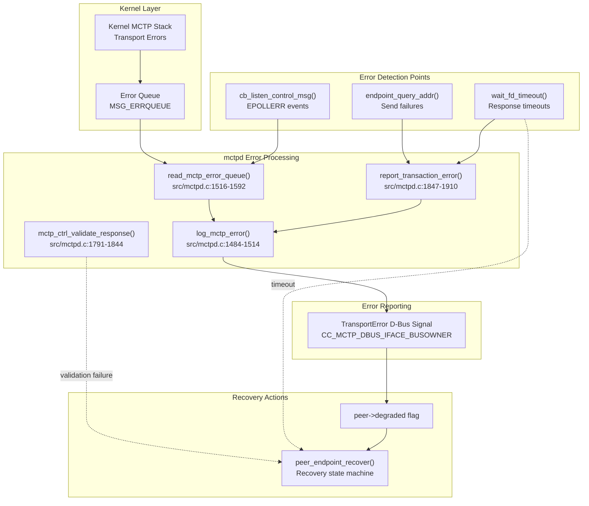

**Sources:** [src/mctpd.c:1484-2033](), [src/mctpd-util.h:70-115]()

## Transport Error Detection

### Error Queue Mechanism

The kernel MCTP stack provides an error queue mechanism for reporting transport-level errors. This is enabled per-socket using the `MCTP_OPT_ENABLE_ERRQUEUE` socket option.

| Component | Location | Purpose |
|-----------|----------|---------|
| `MCTP_OPT_ENABLE_ERRQUEUE` | Socket option | Enables error queue on MCTP sockets |
| `MCTP_RECVERR` | Control message type | Indicates MCTP error data in cmsg |
| `MSG_ERRQUEUE` | recvmsg() flag | Reads from error queue instead of normal queue |
| `struct mctp_error` | [src/mctpd-util.h:100-113]() | Kernel error data structure |

The error queue is polled when `EPOLLERR` events occur on MCTP sockets:


**Sources:** [src/mctpd.c:1334-1338](), [src/mctpd.c:1457-1467](), [src/mctpd.c:1999-2006](), [src/mctpd-util.h:70-76]()

### mctp_error Structure

The `struct mctp_error` contains detailed information about transport failures:

| Field | Type | Description |
|-------|------|-------------|
| `error_code` | `uint32_t` | System error code (errno value) |
| `direction` | `uint8_t` | `MCTP_DIR_TX` or `MCTP_DIR_RX` |
| `binding` | `uint8_t` | Physical binding type (SMBus, USB, etc.) |
| `src_eid` | `uint8_t` | Source endpoint ID |
| `dest_eid` | `uint8_t` | Destination endpoint ID |
| `tag` | `uint8_t` | MCTP message tag |
| `msg_type` | `uint8_t` | MCTP message type |
| `timestamp_ns` | `uint64_t` | Kernel timestamp |
| `payload_len` | `uint16_t` | Length of payload data |
| `payload` | `uint8_t[64]` | Message payload (first bytes) |

**Sources:** [src/mctpd-util.h:100-113]()

### Error Queue Processing Flow

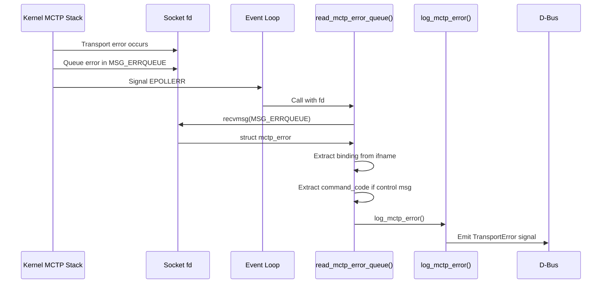

The `read_mctp_error_queue()` function processes errors from the kernel:

- Calls `recvmsg()` with `MSG_ERRQUEUE` flag [src/mctpd.c:1535]()
- Iterates through control messages looking for `SOL_MCTP` + `MCTP_RECVERR` [src/mctpd.c:1550-1556]()
- Maps interface name to binding type (SMBus, USB, I3C) [src/mctpd.c:1558-1573]()
- Extracts command code from payload for control messages [src/mctpd.c:1488-1491]()
- Calls `log_mctp_error()` to emit D-Bus signal [src/mctpd.c:1575]()

**Sources:** [src/mctpd.c:1516-1592](), [src/mctpd.c:1554-1576]()

## Transaction Error Handling

### Synthesized Errors

When userspace detects transaction failures (before the kernel reports them), mctpd synthesizes error reports using `report_transaction_error()`:

| Error Type | Detection Point | Direction |
|------------|----------------|-----------|
| Send failure | `endpoint_query_addr()` sendto() fails | `MCTP_DIR_TX` |
| Response timeout | `wait_fd_timeout()` returns `-ETIMEDOUT` | `MCTP_DIR_RX` |
| Invalid response | Response validation fails | `MCTP_DIR_RX` |

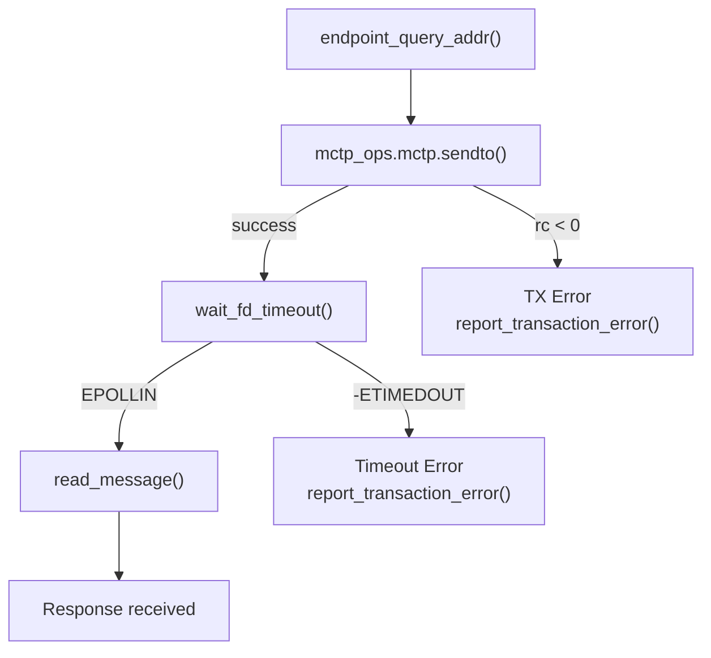

The `report_transaction_error()` function [src/mctpd.c:1847-1910]():

1. Creates a `struct mctp_error` with appropriate fields
2. Determines the failed endpoint (always sets `dest_eid` to the remote device)
3. Looks up the binding type from interface name
4. Extracts command code from the request if it's a control message
5. Calls `log_mctp_error()` to emit the TransportError signal

**Sources:** [src/mctpd.c:1847-1910](), [src/mctpd.c:1970-1978](), [src/mctpd.c:1988-1995]()

### Response Validation

The `mctp_ctrl_validate_response()` function performs comprehensive validation of control protocol responses:

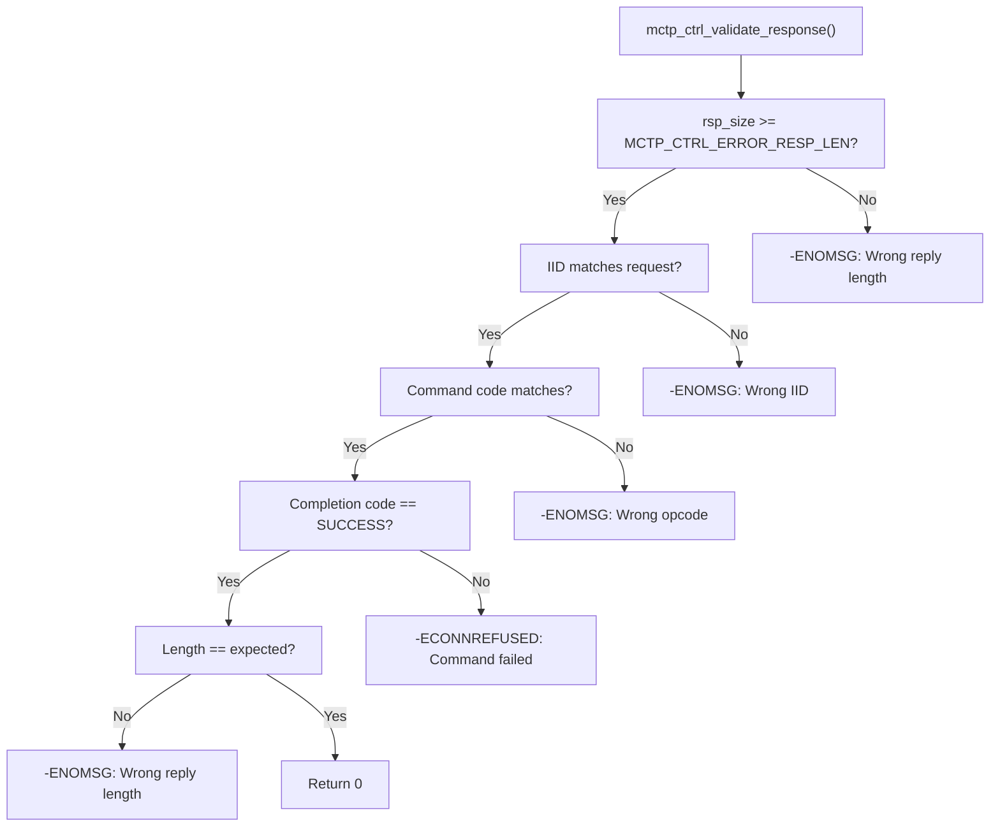

**Validation Checks:**

| Check | Location | Error Code |
|-------|----------|------------|
| Minimum size (error response) | [src/mctpd.c:1803-1808]() | `-ENOMSG` |
| Instance ID (IID) match | [src/mctpd.c:1813-1819]() | `-ENOMSG` |
| Command code match | [src/mctpd.c:1821-1826]() | `-ENOMSG` |
| Completion code success | [src/mctpd.c:1828-1833]() | `-ECONNREFUSED` |
| Full response size | [src/mctpd.c:1836-1841]() | `-ENOMSG` |

When validation fails, the function prints the response data for debugging [src/mctpd.c:1817](), [src/mctpd.c:1824](), [src/mctpd.c:1831](), [src/mctpd.c:1839]().

**Sources:** [src/mctpd.c:1791-1844](), [src/mctpd.c:1779-1786]()

## TransportError D-Bus Signal

### Signal Specification

The `TransportError` signal is emitted on the `au.com.codeconstruct.MCTP.BusOwner1` interface:

**D-Bus Signature:** `"uyyyyyyys"`

| Parameter | Type | Description |
|-----------|------|-------------|
| error_code | `u` (uint32) | Error code (errno value) |
| direction | `y` (byte) | 0=TX, 1=RX |
| binding | `y` (byte) | Physical binding (0=Unspec, 1=SMBus, 3=USB, 6=I3C) |
| src_eid | `y` (byte) | Source EID |
| dest_eid | `y` (byte) | Destination EID |
| tag | `y` (byte) | MCTP tag |
| msg_type | `y` (byte) | MCTP message type (0x00 for control) |
| command_code | `y` (byte) | Control command code (if msg_type=0x00) |
| ifname | `s` (string) | Interface name (e.g., "mctpi2c1") |

The signal is emitted from the base interfaces path or a specific interface path [src/mctpd.c:1496]().

**Sources:** [src/mctpd.c:1484-1514](), [src/mctpd.c:1498-1509]()

### Binding Type Mapping

The binding type is derived from the interface name using `get_binding_from_ifname()`:

| Interface Pattern | Binding Enum | Value |
|------------------|--------------|-------|
| Contains "i2c" | `MCTP_PHYS_BINDING_SMBUS` | 0x01 |
| Contains "usb" | `MCTP_PHYS_BINDING_USB` | 0x03 |
| Contains "spi" | `MCTP_PHYS_BINDING_UNSPEC` | 0x00 |
| Contains "irot" or "vrot" | VDM | 0x02 |
| Default | Unknown | - |

**Sources:** [src/mctpd-util.h:51-68](), [src/mctpd.c:1563-1571](), [src/mctpd.c:1889-1898]()

## Endpoint Recovery System

### Recovery State Machine

The endpoint recovery system tracks failed endpoints and attempts periodic recovery. Each `struct peer` contains a recovery structure [src/mctpd.c:214-221]():

```c
struct {
    uint64_t delay;           // Current backoff delay
    sd_event_source *source;  // Timer event source
    int npolls;               // Number of recovery attempts
    mctp_eid_t eid;          // EID being recovered
    uint8_t endpoint_type;   // Cached endpoint type
    uint8_t medium_spec;     // Cached medium spec
} recovery;
```

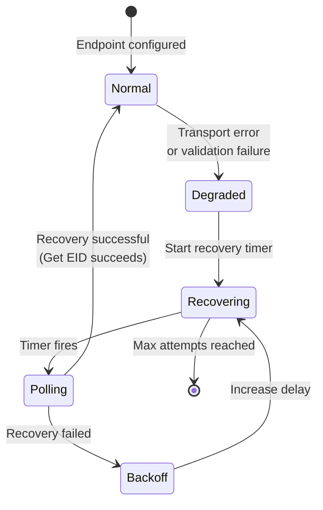

**Recovery Parameters:**

| Parameter | Source | Purpose |
|-----------|--------|---------|
| Initial delay | Configuration | Starting backoff delay (typically 1-2 seconds) |
| Max attempts | `npolls` counter | Limits retry attempts |
| Backoff multiplier | Typically 2x | Exponential backoff |
| Recovery commands | Get Endpoint ID, Get UUID | Verify endpoint responsiveness |

**Sources:** [src/mctpd.c:214-221](), [CHANGELOG.md:134]()

### Degraded State Management

The `degraded` flag in `struct peer` [src/mctpd.c:203]() indicates an endpoint is not responding:

**State Transitions:**

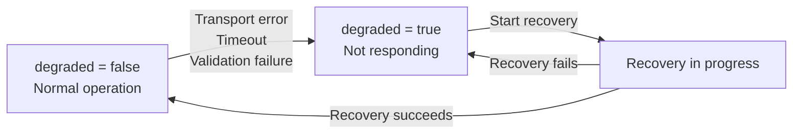

The degraded state is exposed via the `Connectivity` D-Bus property on endpoint objects, allowing applications to monitor endpoint health.

**Sources:** [src/mctpd.c:203](), [CHANGELOG.md:136](), [CHANGELOG.md:142]()

### Recovery Configuration

Recovery behavior can be configured via `mctpd.conf`:

| Setting | Type | Purpose |
|---------|------|---------|
| `unsafe-recover-nil-uuid` | Boolean | Allow recovery of endpoints with nil UUID (for development) |
| `unsafe-writable-connectivity` | Boolean | Allow D-Bus writes to Connectivity property (for testing) |

**Sources:** [CHANGELOG.md:135-136](), [CHANGELOG.md:142-143]()

## Timing Constraints and Timeouts

### Message Timeout Configuration

The `message_timeout_ms` configuration option [CHANGELOG.md:23]() sets the timeout for MCTP responses. This is stored in `ctx->mctp_timeout` (in microseconds) [src/mctpd.c:248]().

The timeout is enforced in `wait_fd_timeout()` [src/mctpd.c:522-548]():

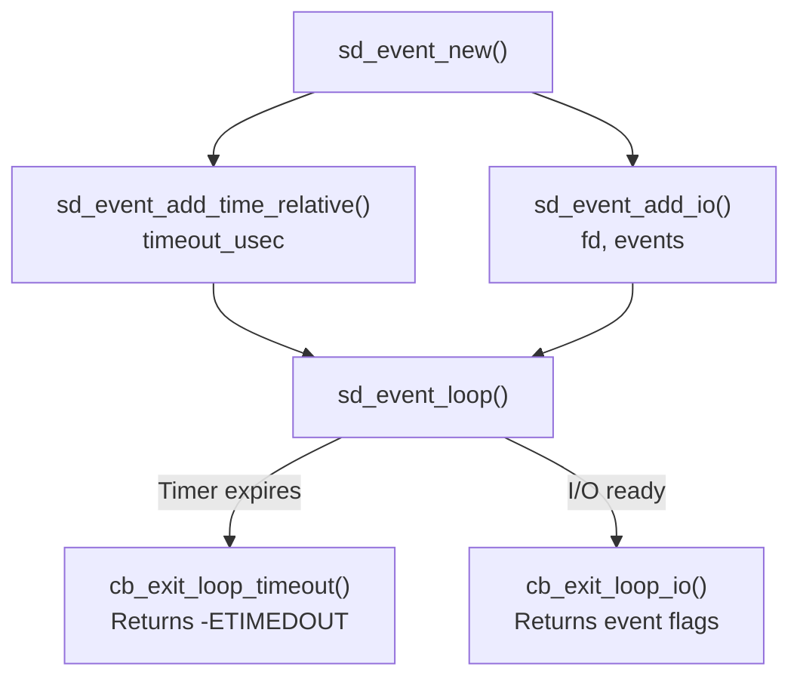

**Timeout Handling:**

1. Creates temporary event loop for single wait operation
2. Adds relative timer with configured timeout
3. Adds I/O event for socket readiness
4. Runs event loop until either fires
5. Returns `-ETIMEDOUT` if timer fires first
6. Returns event flags (EPOLLIN, EPOLLERR) if I/O ready

**Sources:** [src/mctpd.c:522-548](), [src/mctpd.c:248](), [CHANGELOG.md:23]()

### Error Queue Event Handling

The error queue is registered for both normal and error events:

```c
rc = sd_event_add_io(ctx->event, NULL, sd, EPOLLIN | EPOLLERR,
                     cb_listen_control_msg, ctx);
```

The control message callback checks for `EPOLLERR` first [src/mctpd.c:1334-1338]():

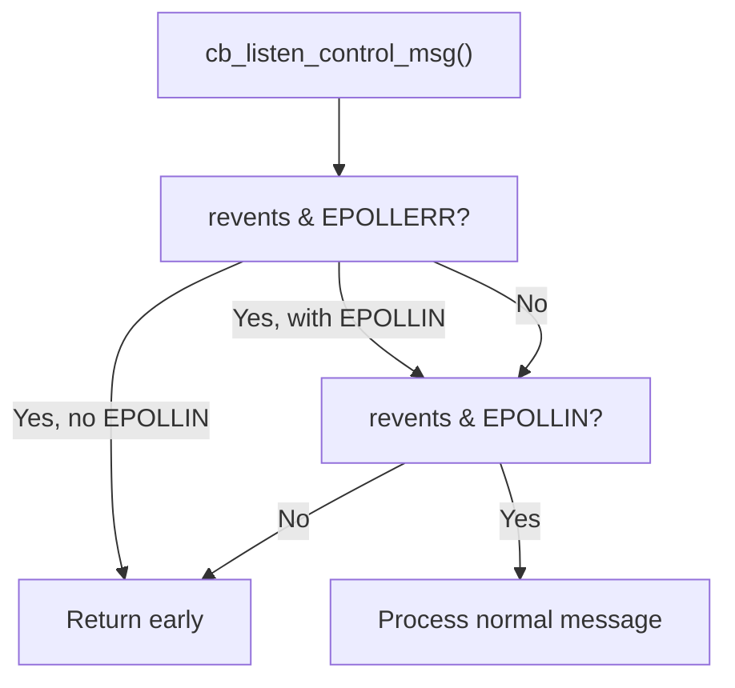

This ensures error queue events are processed before attempting to read normal messages.

**Sources:** [src/mctpd.c:1334-1342](), [src/mctpd.c:1469-1473]()

## Common Error Scenarios

### Scenario 1: Device Disconnected

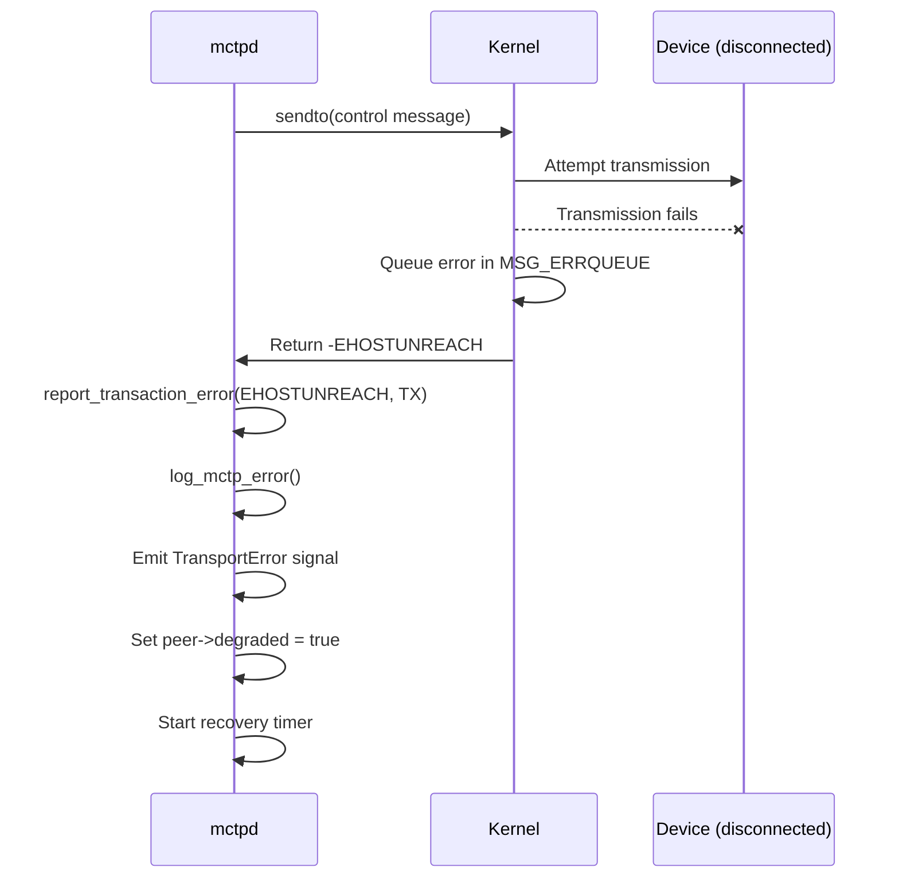

**Sources:** [src/mctpd.c:1970-1978](), [src/mctpd.c:1847-1910]()

### Scenario 2: Response Timeout

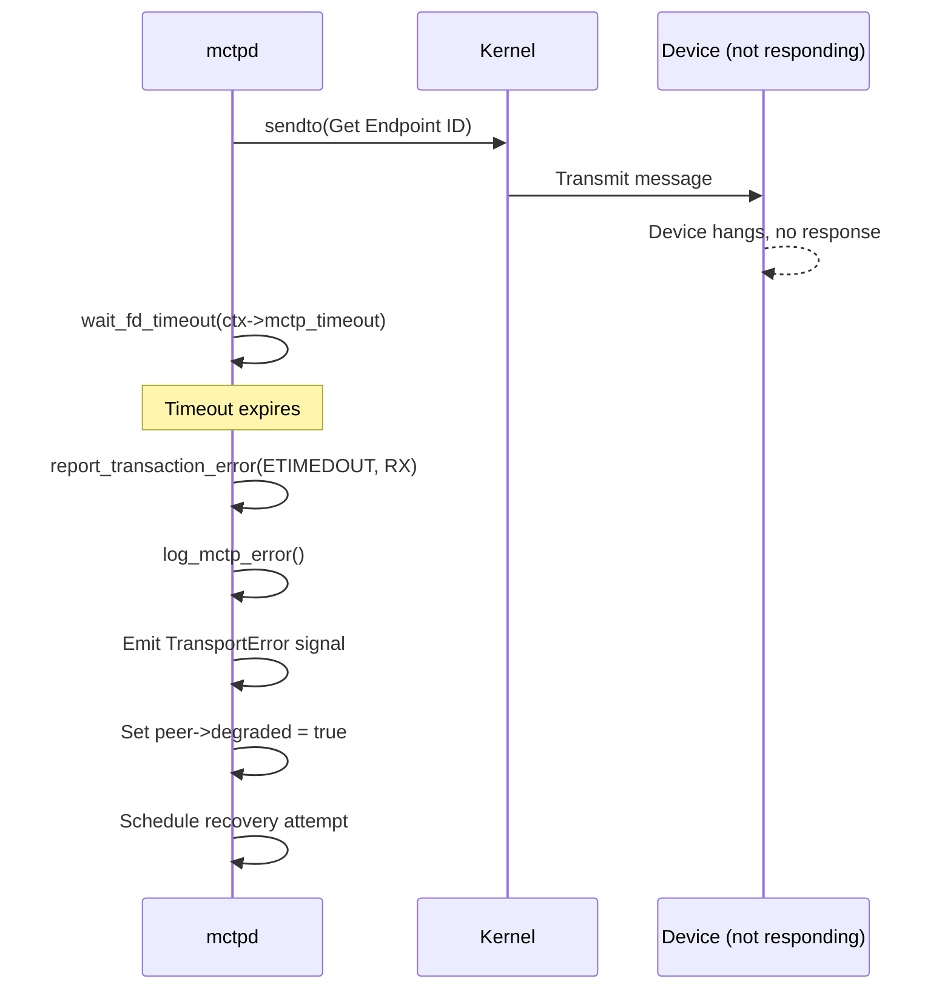

**Sources:** [src/mctpd.c:1986-1995](), [src/mctpd.c:522-548]()

### Scenario 3: Invalid Response

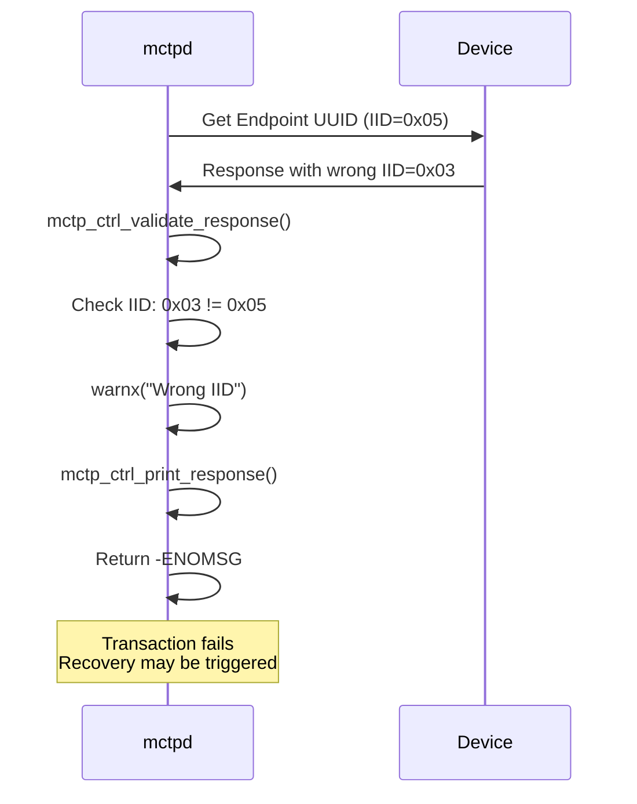

**Sources:** [src/mctpd.c:1813-1819](), [src/mctpd.c:1817]()

### Scenario 4: Kernel Error Queue Event

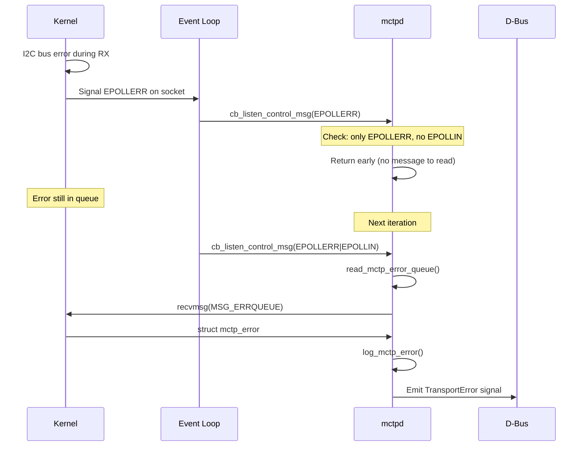

**Sources:** [src/mctpd.c:1334-1342](), [src/mctpd.c:1516-1592]()

## Interface State Clearing on Error

When a new EID is assigned with `MCTP_SET_EID_FORCE`, mctpd assumes the network topology has changed and clears all cached state for that interface:

The `clear_interface_addrs()` function [src/mctpd.c:697-725]():

1. Removes all local EIDs on the interface using `mctp_nl_addr_del()` [src/mctpd.c:708]()
2. Removes all cached remote peers on that interface [src/mctpd.c:719-724]()

This ensures stale routing information doesn't cause subsequent communication failures.

**Sources:** [src/mctpd.c:697-725](), [src/mctpd.c:906-909]()

---

