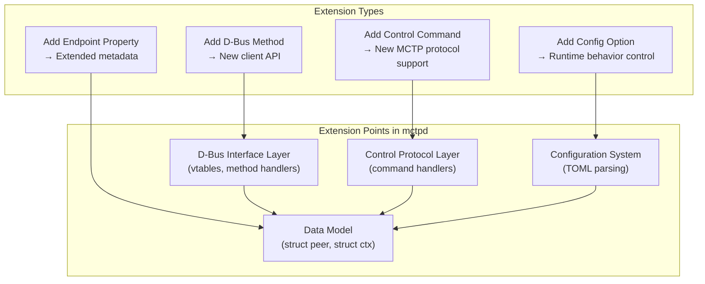
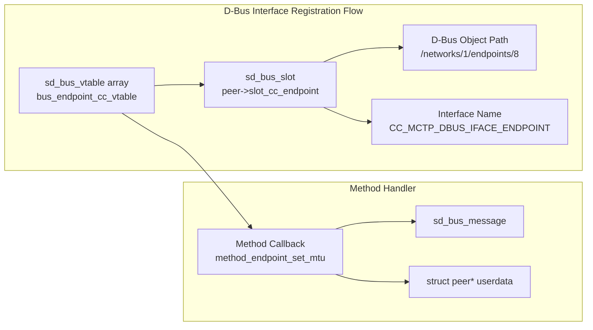
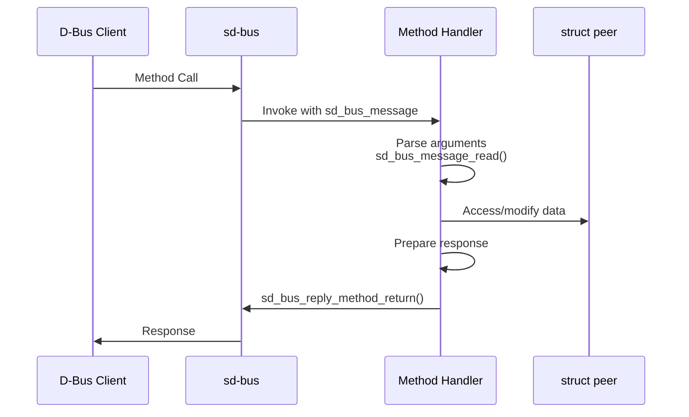
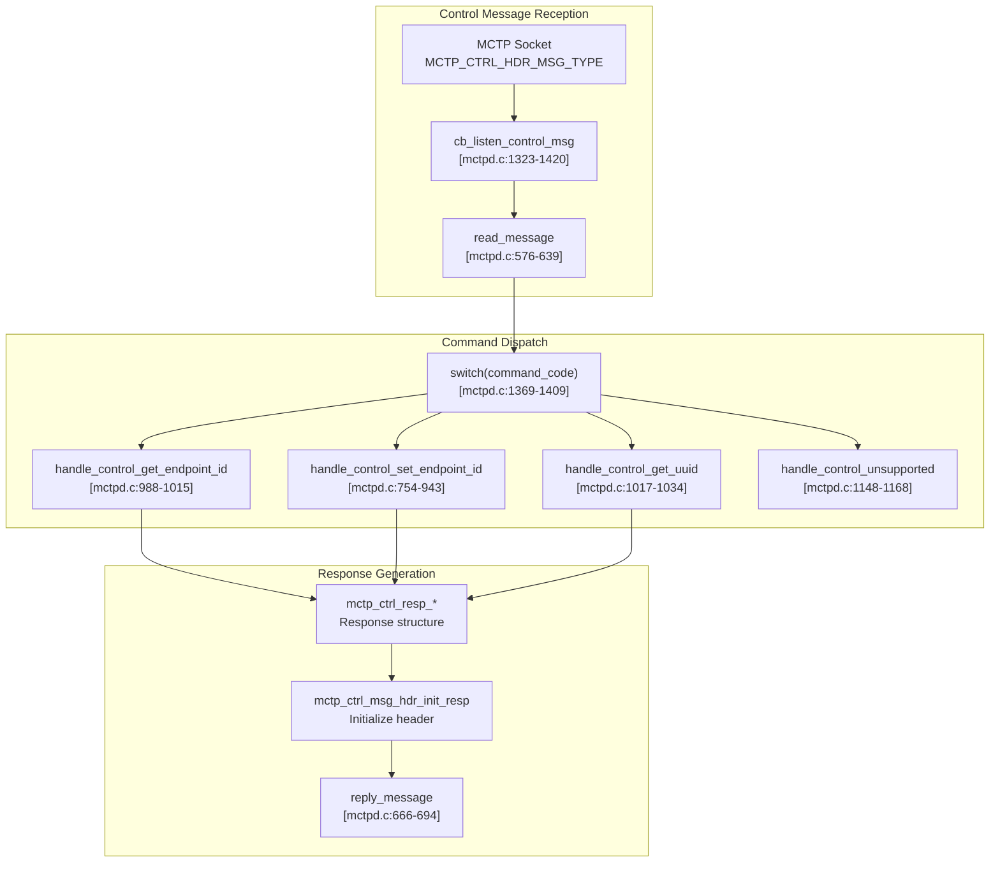
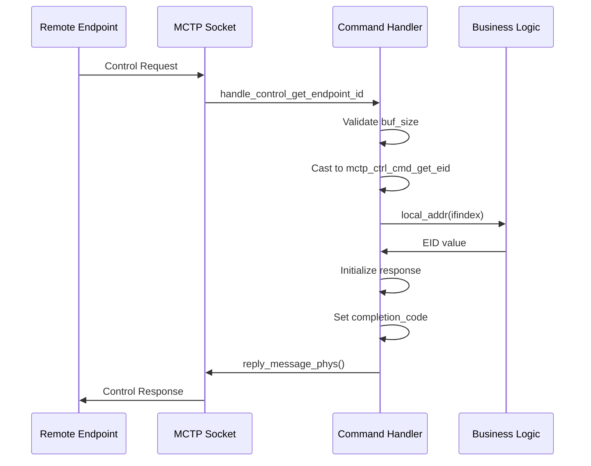
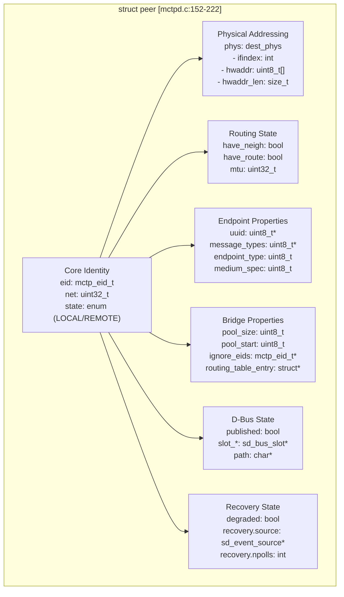
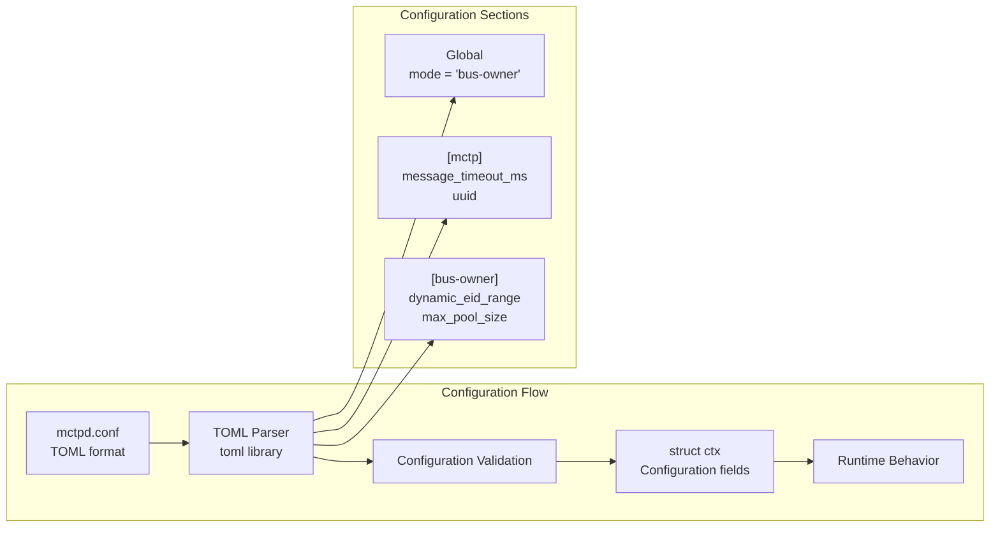
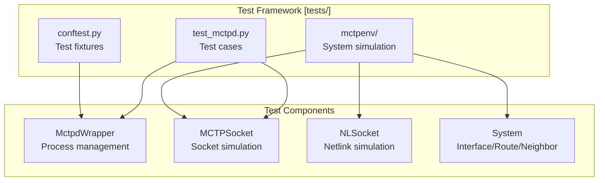

<!-- source: DeepWiki mcp.deepwiki.com · repo NVIDIA/mctp · page 7.3 Extending mctpd · fetched 2026-10-26 -->

# Extending mctpd

<details>
<summary>Relevant source files</summary>

The following files were used as context for generating this wiki page:

- [conf/mctpd.conf](conf/mctpd.conf)
- [docs/mctpd.md](docs/mctpd.md)
- [src/mctpd-util.h](src/mctpd-util.h)
- [src/mctpd.c](src/mctpd.c)

</details>


This document provides guidance for developers who need to extend mctpd's functionality. It covers the key extension points in the daemon architecture: adding new D-Bus interfaces and methods, implementing new MCTP control protocol commands, adding properties to endpoint objects, and extending the configuration system.

For general architecture information, see [Daemon Architecture](#2.1.1). For details on the existing D-Bus API, see [D-Bus Interface](#4). For control protocol specifics, see [MCTP Control Protocol](#3.2).

## Extension Points Overview

The mctpd daemon is designed with several well-defined extension points. Understanding these patterns is essential before adding new functionality.



**Sources:** [src/mctpd.c:1-500]()

## Adding New D-Bus Methods

D-Bus methods are the primary way external applications interact with mctpd. Methods are organized into interfaces and exposed through vtables.

### D-Bus Interface Structure

mctpd uses sd-bus vtables to define D-Bus interfaces. Each vtable is an array of `sd_bus_vtable` entries that describe methods, properties, and signals.



**Example: BusOwner1 Interface Vtable**

The vtable definition pattern is found in [src/mctpd.c]() where interfaces are defined as static arrays. Key vtables include:

| Vtable Variable | Interface Name | Purpose |
|----------------|----------------|---------|
| `bus_endpoint_obmc_vtable` | `xyz.openbmc_project.MCTP.Endpoint` | OpenBMC standard endpoint interface |
| `bus_endpoint_cc_vtable` | `au.com.codeconstruct.MCTP.Endpoint1` | Code Construct endpoint management |
| `bus_endpoint_bridge` | `au.com.codeconstruct.MCTP.Bridge1` | Bridge endpoint properties |
| `bus_endpoint_uuid_vtable` | `xyz.openbmc_project.Common.UUID` | UUID property interface |

**Sources:** [src/mctpd.c:311-315](), [src/mctpd.c:44-57]()

### Method Handler Pattern

D-Bus method handlers follow a standard signature and implementation pattern:



**Method Handler Signature:**
```c
int method_handler(sd_bus_message *m, void *userdata, sd_bus_error *err)
```

**Key Implementation Steps:**

1. **Parse input arguments** using `sd_bus_message_read()` with appropriate type signatures
2. **Access userdata** - typically `struct peer *` or `struct ctx *`
3. **Validate inputs** and perform the operation
4. **Construct response** using `sd_bus_reply_method_*()` functions
5. **Handle errors** by setting `sd_bus_error` and returning negative errno

**Sources:** [src/mctpd.c]() (method handlers follow this pattern throughout)

### Adding a New Method to an Existing Interface

To add a new method to an existing interface:

**Step 1: Define the method handler function**

Implement a static function following the standard signature. For example, to add a method to the Endpoint1 interface, add near the other endpoint method handlers in [src/mctpd.c]().

**Step 2: Add vtable entry**

Locate the appropriate vtable array (e.g., `bus_endpoint_cc_vtable`) and add an entry:

```
SD_BUS_METHOD("YourMethodName", "input_sig", "output_sig", 
              your_method_handler, SD_BUS_VTABLE_UNPRIVILEGED)
```

**Signature Format:**
- `"y"` = byte
- `"n"` = int16, `"q"` = uint16
- `"i"` = int32, `"u"` = uint32
- `"x"` = int64, `"t"` = uint64
- `"s"` = string
- `"ay"` = byte array
- `"as"` = string array
- `"b"` = boolean
- `"(yy)"` = struct with two bytes

**Step 3: Document in D-Bus API**

Update [docs/mctpd.md]() to document the new method's signature, parameters, and behavior.

**Sources:** [src/mctpd.c](), [docs/mctpd.md:241-269]()

### Creating a New D-Bus Interface

To add an entirely new interface:

**Step 1: Define interface constants**

Add the interface name constant in [src/mctpd.c:44-57]():
```c
#define CC_MCTP_DBUS_IFACE_YOURNAME "au.com.codeconstruct.MCTP.YourInterface1"
```

**Step 2: Create vtable array**

Define a new static vtable array with methods, properties, and signals:

```c
static const sd_bus_vtable your_interface_vtable[] = {
    SD_BUS_VTABLE_START(0),
    SD_BUS_METHOD("MethodName", "signature", "return", handler, flags),
    SD_BUS_PROPERTY("PropertyName", "type", getter, offset, flags),
    SD_BUS_SIGNAL("SignalName", "signature", flags),
    SD_BUS_VTABLE_END
};
```

**Step 3: Register the interface**

In the appropriate object creation function (e.g., `publish_peer()` for endpoints), add:

```c
rc = sd_bus_add_object_vtable(ctx->bus, &peer->slot_yourname,
                              peer->path,
                              CC_MCTP_DBUS_IFACE_YOURNAME,
                              your_interface_vtable, peer);
```

**Step 4: Clean up on removal**

Add cleanup in the corresponding removal function (e.g., `unpublish_peer()`):

```c
peer->slot_yourname = sd_bus_slot_unref(peer->slot_yourname);
```

**Sources:** [src/mctpd.c]()

## Implementing New Control Protocol Commands

MCTP control protocol commands are defined in DSP0236. Implementing a new command involves adding a handler function and registering it in the dispatch table.

### Control Protocol Handler Architecture



**Sources:** [src/mctpd.c:1323-1420](), [src/mctp-control-spec.h]()

### Handler Implementation Pattern

Each control protocol command handler follows this pattern:

**Function Signature:**
```c
static int handle_control_<command_name>(struct ctx *ctx, int sd,
                                        const struct sockaddr_mctp_ext *addr,
                                        const uint8_t *buf,
                                        const size_t buf_size)
```

**Implementation Steps:**

1. **Validate message size** - Check `buf_size` against expected structure size
2. **Cast request buffer** - Cast `buf` to appropriate `mctp_ctrl_cmd_*` structure
3. **Prepare response** - Allocate and initialize `mctp_ctrl_resp_*` structure
4. **Initialize response header** - Call `mctp_ctrl_msg_hdr_init_resp()`
5. **Process request** - Implement command-specific logic
6. **Set completion code** - Set `completion_code` field appropriately
7. **Send response** - Call `reply_message()` or `reply_message_phys()`

**Example Flow:**



**Sources:** [src/mctpd.c:988-1015]() (Get Endpoint ID example), [src/mctpd.c:754-943]() (Set Endpoint ID example)

### Adding a New Control Command Handler

**Step 1: Define command structures**

Add request and response structures to [src/mctp-control-spec.h]() following the DSP0236 specification:

```c
struct mctp_ctrl_cmd_your_command {
    struct mctp_ctrl_msg_hdr ctrl_hdr;
    uint8_t your_field;
    // ... additional fields
} __attribute__((__packed__));

struct mctp_ctrl_resp_your_command {
    struct mctp_ctrl_msg_hdr ctrl_hdr;
    uint8_t completion_code;
    uint8_t result_field;
    // ... additional fields
} __attribute__((__packed__));
```

**Step 2: Implement handler function**

Add a static handler function in [src/mctpd.c]():

```c
static int handle_control_your_command(struct ctx *ctx, int sd,
                                      const struct sockaddr_mctp_ext *addr,
                                      const uint8_t *buf,
                                      const size_t buf_size)
{
    struct mctp_ctrl_cmd_your_command *req;
    struct mctp_ctrl_resp_your_command resp = {0};
    
    if (buf_size < sizeof(*req)) {
        warnx("short Your Command message");
        return -ENOMSG;
    }
    
    req = (void *)buf;
    mctp_ctrl_msg_hdr_init_resp(&resp.ctrl_hdr, req->ctrl_hdr);
    
    // Implement command logic here
    resp.completion_code = MCTP_CTRL_CC_SUCCESS;
    
    return reply_message(ctx, sd, &resp, sizeof(resp), addr);
}
```

**Step 3: Register in dispatch switch**

Add a case to the switch statement in `cb_listen_control_msg()` [src/mctpd.c:1369-1409]():

```c
case MCTP_CTRL_CMD_YOUR_COMMAND:
    rc = handle_control_your_command(ctx, sd, &addr, buf, buf_size);
    break;
```

**Step 4: Define command code constant**

Add the command code to [src/mctp-control-spec.h]():

```c
#define MCTP_CTRL_CMD_YOUR_COMMAND 0xXX
```

**Sources:** [src/mctp-control-spec.h](), [src/mctpd.c:1323-1420]()

### Request/Response Utilities

Two helper functions are available for sending responses:

| Function | Usage | Address Type |
|----------|-------|--------------|
| `reply_message()` [src/mctpd.c:666-694]() | Reply using EID addressing | Normal EID |
| `reply_message_phys()` [src/mctpd.c:642-663]() | Reply using physical addressing | Physical address (hwaddr) |

Physical addressing is used when the endpoint doesn't yet have an assigned EID (e.g., Get Endpoint ID command).

**Sources:** [src/mctpd.c:642-694]()

## Adding New Endpoint Properties

Endpoint properties represent metadata about discovered MCTP endpoints. Properties can be exposed via D-Bus for client applications to query.

### Endpoint Data Model



**Sources:** [src/mctpd.c:152-222]()

### Adding a New Property Field

**Step 1: Add field to struct peer**

Modify `struct peer` in [src/mctpd.c:152-222]() to add your new property:

```c
struct peer {
    // ... existing fields ...
    
    // Your new property
    uint8_t your_new_property;
    char *your_string_property;  // Use malloc for dynamic data
    
    // ... rest of fields ...
};
```

**Step 2: Initialize the property**

Add initialization logic in the appropriate location:

- For properties discovered via control protocol: Add to `query_peer_properties()` [src/mctpd.c]()
- For static properties: Initialize in `add_peer()` [src/mctpd.c]()
- For bridge properties: Initialize in bridge-specific setup code

**Step 3: Expose via D-Bus**

Add a property getter function and vtable entry:

```c
static int property_get_your_property(sd_bus *bus, const char *path,
                                     const char *interface,
                                     const char *property,
                                     sd_bus_message *reply,
                                     void *userdata,
                                     sd_bus_error *error)
{
    struct peer *peer = userdata;
    return sd_bus_message_append(reply, "y", peer->your_new_property);
}
```

Add to the appropriate vtable:

```c
SD_BUS_PROPERTY("YourProperty", "y", property_get_your_property,
               0, SD_BUS_VTABLE_PROPERTY_CONST)
```

**Step 4: Clean up resources**

If the property requires dynamic memory, add cleanup to `remove_peer()` [src/mctpd.c]():

```c
free(peer->your_string_property);
peer->your_string_property = NULL;
```

**Sources:** [src/mctpd.c:152-222](), [src/mctpd.c]() (property getter examples)

### Property Type Mapping

| D-Bus Type | C Type | Signature |
|-----------|--------|-----------|
| `BYTE` | `uint8_t` | `"y"` |
| `UINT16` | `uint16_t` | `"q"` |
| `UINT32` | `uint32_t` | `"u"` |
| `UINT64` | `uint64_t` | `"t"` |
| `BOOLEAN` | `int` (0 or 1) | `"b"` |
| `STRING` | `const char *` | `"s"` |
| `ARRAY_BYTE` | `uint8_t *`, `size_t` | `"ay"` |
| `ARRAY_STRING` | `char **`, `size_t` | `"as"` |

**Sources:** sd-bus documentation, [src/mctpd.c]() (property examples)

### Property Flags

Properties can have different behaviors controlled by flags in the vtable:

| Flag | Behavior |
|------|----------|
| `SD_BUS_VTABLE_PROPERTY_CONST` | Property never changes after creation |
| `SD_BUS_VTABLE_PROPERTY_EMITS_CHANGE` | Emit PropertyChanged signal on modification |
| `SD_BUS_VTABLE_PROPERTY_EMITS_INVALIDATION` | Emit signal but don't include new value |
| `SD_BUS_VTABLE_HIDDEN` | Property exists but not advertised in introspection |

For writable properties, add a setter function and use `SD_BUS_WRITABLE_PROPERTY()` instead of `SD_BUS_PROPERTY()`.

**Sources:** sd-bus vtable documentation

## Extending Configuration Options

mctpd uses a TOML configuration file for runtime behavior configuration. The configuration file structure is defined in [conf/mctpd.conf]() and [docs/mctpd.md:286-369]().

### Configuration Architecture



**Sources:** [conf/mctpd.conf:1-20](), [docs/mctpd.md:286-369]()

### Adding a New Configuration Option

**Step 1: Add field to struct ctx**

Modify `struct ctx` in [src/mctpd.c:224-271]() to add your configuration value:

```c
struct ctx {
    // ... existing fields ...
    
    // Your new configuration option
    uint32_t your_config_value;
    bool your_feature_enabled;
    
    // ... rest of fields ...
};
```

**Step 2: Parse configuration value**

Configuration parsing happens in the initialization code. Look for where other configuration values are read from the TOML structure. Add parsing for your new option:

```c
// Read from TOML
toml_datum_t your_value = toml_int_in(config, "your_config_key");
if (your_value.ok) {
    ctx->your_config_value = your_value.u.i;
} else {
    // Set default value
    ctx->your_config_value = DEFAULT_VALUE;
}
```

**Step 3: Document in configuration file**

Add the option to [conf/mctpd.conf]() with appropriate comments:

```toml
# Your new configuration option
# Description of what it does
# Type: integer/string/boolean
# Default: <default value>
your_config_key = <value>
```

**Step 4: Document in user documentation**

Add a section to [docs/mctpd.md]() under the appropriate configuration section (global, `[mctp]`, or `[bus-owner]`):

```markdown
#### `your_config_key`: Description

* type: integer/string/boolean
* default: <value>

Detailed description of the configuration option's behavior and impact.
```

**Step 5: Use configuration value**

Access the configuration value throughout the code via `ctx->your_config_value`.

**Sources:** [src/mctpd.c:224-271](), [conf/mctpd.conf:1-20](), [docs/mctpd.md:286-369]()

### Configuration Sections

| Section | Purpose | Example Options |
|---------|---------|-----------------|
| Global | Overall daemon mode | `mode = "bus-owner"` |
| `[mctp]` | MCTP protocol behavior | `message_timeout_ms`, `uuid` |
| `[bus-owner]` | Bus owner specific settings | `dynamic_eid_range`, `max_pool_size` |

Add new sections as needed by creating appropriate TOML sections and parsing them in the configuration initialization code.

**Sources:** [conf/mctpd.conf:1-20]()

## Signal Emission

D-Bus signals notify clients of asynchronous events. mctpd emits signals for events like endpoint addition/removal and transport errors.

### Emitting a Signal

**Step 1: Define signal in vtable**

Add to the appropriate vtable:

```c
SD_BUS_SIGNAL("SignalName", "signature", 0)
```

**Step 2: Emit signal in code**

Use `sd_bus_emit_signal()` when the event occurs:

```c
int rc = sd_bus_emit_signal(ctx->bus, object_path, interface_name,
                            "SignalName", "signature",
                            arg1, arg2, ...);
if (rc < 0) {
    warnx("Failed to emit signal: %s", strerror(-rc));
}
```

**Example: TransportError Signal**

The TransportError signal implementation in [src/mctpd.c:1494-1513]() shows the pattern:

1. Define signal in vtable: `TransportError` with signature `"uyyyyyyys"`
2. Emit when error occurs: `sd_bus_emit_signal()` called from `log_mctp_error()`
3. Include relevant error information as parameters

**Sources:** [src/mctpd.c:1494-1513](), [docs/mctpd.md:163-184]()

## Testing Extensions

When adding new functionality, update the test framework to verify correct behavior.

### Test Structure



**Adding Tests for Extensions:**

1. **D-Bus method tests**: Add to [tests/test_mctpd.py]() or [tests/test_mctpd_endpoint.py]()
2. **Control protocol tests**: Add mock endpoints to system simulation and verify message exchange
3. **Configuration tests**: Add test cases with different config files and verify behavior
4. **Property tests**: Query D-Bus properties and verify correct values

For detailed testing guidance, see [Writing Tests](#6.3).

**Sources:** [tests/conftest.py](), [tests/mctpenv/](), [tests/test_mctpd.py]()

## Best Practices

### Error Handling

1. **Return negative errno values** from internal functions
2. **Set D-Bus errors** using `sd_bus_error_set()` or `sd_bus_error_set_errno()`
3. **Set completion codes** in MCTP control responses according to DSP0236
4. **Log errors** using `warnx()` for user-visible issues, `bug_warn()` for internal inconsistencies

**Sources:** [src/mctpd.c]() (error handling patterns throughout)

### Memory Management

1. **Free allocated memory** in cleanup paths (e.g., `remove_peer()`, `unpublish_peer()`)
2. **Use sd_bus_slot_unref()** to clean up D-Bus registrations
3. **Check malloc() return values** and handle allocation failures
4. **Avoid memory leaks** in error paths

**Sources:** [src/mctpd.c]()

### Compatibility

1. **Maintain backward compatibility** in D-Bus interfaces (use interface versioning)
2. **Follow MCTP specifications** strictly for control protocol commands
3. **Document breaking changes** in CHANGELOG.md
4. **Test with existing clients** before releasing changes

**Sources:** [CHANGELOG.md](), [docs/mctpd.md]()

### Code Style

1. **Follow existing patterns** in the codebase
2. **Use static functions** for internal implementation
3. **Add comments** for complex logic and protocol requirements
4. **Reference specifications** (DSP0236) in comments for protocol-related code

**Sources:** [src/mctpd.c]()

---

